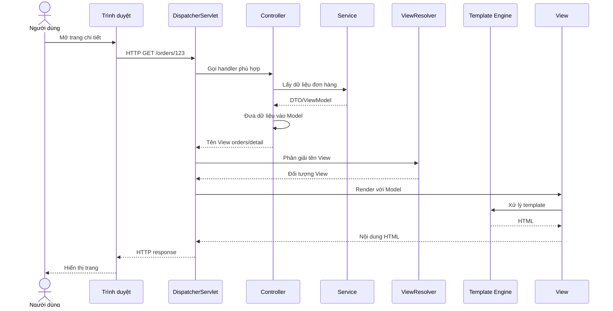

# Phân giải View và kết xuất HTML phía máy chủ

Trong ứng dụng MVC trên web, Controller thường không tự tạo toàn bộ HTML. Thay vào đó, Controller xử lý request, chuẩn bị dữ liệu cho giao diện và trả về tên View logic. Framework dùng cơ chế phân giải View để tìm template hoặc thành phần trình bày tương ứng, sau đó kết xuất HTML bằng dữ liệu trong Model và gửi phản hồi về trình duyệt.

Quá trình này được gọi là phân giải View (View resolution) và kết xuất phía máy chủ (server-side rendering – SSR). Nó tạo ra ranh giới giữa xử lý request, dữ liệu nghiệp vụ và cách trình bày. Controller quyết định cần hiển thị trang nào; ViewResolver tìm cách dựng trang; template engine kết hợp template với dữ liệu để tạo HTML.

## 1. View resolution và server-side rendering là gì?

### 1.1. Phân giải View

Phân giải View là quá trình chuyển một tên View logic hoặc thông tin điều khiển phản hồi thành đối tượng View có thể thực hiện việc trình bày.

Ví dụ, Controller có thể trả về:

```java
return "orders/detail";
```

Chuỗi `orders/detail` là tên logic. Nó không nhất thiết là đường dẫn file trực tiếp. ViewResolver sẽ tìm cấu hình phù hợp, chẳng hạn một template có tên `orders/detail.html`, hoặc một View được tạo bởi JSP, Thymeleaf hay công nghệ khác.

Lợi ích của tên logic là Controller không phải phụ thuộc vào vị trí vật lý của template. Có thể thay đổi thư mục template, tiền tố, hậu tố hoặc công nghệ trình bày thông qua cấu hình mà không cần sửa mọi Controller.

### 1.2. Kết xuất HTML phía máy chủ

Server-side rendering là cách máy chủ tạo HTML hoàn chỉnh hoặc phần lớn HTML cho request rồi gửi nội dung đó về trình duyệt.

Ví dụ:

1. Người dùng truy cập `GET /orders/123`.
2. Controller gọi Service lấy thông tin đơn hàng.
3. Controller đưa dữ liệu cần thiết vào Model.
4. Controller trả tên View `orders/detail`.
5. Framework phân giải View và gọi template engine.
6. Template engine kết hợp template với dữ liệu Model để tạo HTML.
7. Máy chủ gửi HTML cùng status code và header.
8. Trình duyệt phân tích HTML và hiển thị trang.

Trình duyệt vẫn có thể chạy JavaScript để xử lý tương tác sau khi trang được tải. SSR chỉ mô tả cách HTML ban đầu được tạo; nó không có nghĩa ứng dụng không dùng JavaScript.

### 1.3. SSR khác với trả JSON cho frontend

| Cách phản hồi | Máy chủ trả về | Thành phần dựng giao diện |
|---|---|---|
| Server-side rendering | HTML đã kết xuất | Template engine trên máy chủ |
| API JSON | Dữ liệu JSON | Frontend phía trình duyệt hoặc ứng dụng khác |
| Hybrid | HTML ban đầu và dữ liệu/API cho tương tác tiếp | Kết hợp máy chủ và frontend |

Cùng một nghiệp vụ có thể cung cấp cả trang HTML và API JSON. Hai kiểu phản hồi có thể dùng chung Service và Model nghiệp vụ, nhưng hợp đồng đầu ra khác nhau.

## 2. Vai trò của các thành phần trong quá trình kết xuất

### 2.1. DispatcherServlet và bộ định tuyến

Trong Spring MVC, `DispatcherServlet` là front controller tiếp nhận request và điều phối đến handler phù hợp. HandlerMapping tìm Controller/action theo URL, HTTP method và cấu hình mapping. HandlerAdapter gọi phương thức handler tương ứng.

Các framework khác có thể dùng tên và cấu trúc khác, nhưng thường vẫn có một thành phần điều phối trung tâm nhận request và chọn handler.

### 2.2. Controller

Controller tiếp nhận request, gọi các lớp xử lý phù hợp và quyết định kiểu phản hồi. Với trang HTML, Controller thường:

- Đọc path variable, query parameter và dữ liệu request.
- Gọi Service để lấy dữ liệu.
- Chọn các thuộc tính cần cung cấp cho View.
- Đưa dữ liệu vào Model.
- Trả tên View logic hoặc một kiểu kết quả điều hướng.

Controller không nên tự nối chuỗi HTML hoặc chứa truy vấn cơ sở dữ liệu phức tạp. Việc đó khiến xử lý request và trình bày bị trộn lẫn.

### 2.3. Model dùng để truyền dữ liệu cho View

Trong Spring MVC, `org.springframework.ui.Model` là một vùng chứa các thuộc tính mà View có thể truy cập khi render.

Ví dụ:

```java
model.addAttribute("order", orderView);
model.addAttribute("pageTitle", "Chi tiết đơn hàng");
```

Cần phân biệt `Model` của framework với Domain Model. Domain Model mô tả trạng thái và quy tắc nghiệp vụ; `Model` trong phương thức Controller chỉ là cơ chế đưa dữ liệu đến View.

Nên đưa DTO hoặc ViewModel đã giới hạn trường cần hiển thị vào Model. Không nên đưa toàn bộ Entity có thể chứa dữ liệu nội bộ, quan hệ lazy hoặc thông tin nhạy cảm vào template.

### 2.4. ViewResolver

ViewResolver nhận tên View logic và tìm một View phù hợp. Trong Spring MVC, có thể cấu hình một hoặc nhiều ViewResolver. Nếu có nhiều resolver, thứ tự ưu tiên và khả năng một resolver xử lý tên View cần được cấu hình rõ.

Ví dụ, một resolver có thể tìm template Thymeleaf, resolver khác có thể xử lý JSP. Khi một resolver không xử lý được tên View, framework có thể thử resolver tiếp theo tùy cấu hình.

### 2.5. Template engine và View

Template engine đọc template, đánh giá biểu thức, lặp qua danh sách, áp dụng điều kiện và tạo nội dung HTML.

Một số công nghệ thường gặp:

- **Thymeleaf:** tích hợp phổ biến với Spring MVC, hỗ trợ biểu thức và thuộc tính `th:*`.
- **JSP/JSTL:** công nghệ trang máy chủ lâu đời trong hệ sinh thái Java.
- **FreeMarker:** template engine tổng quát, có thể dùng để tạo HTML và các văn bản khác.
- **Mustache:** template engine dựa trên cú pháp đơn giản và logic hạn chế.

View là thành phần thực hiện việc kết xuất. Template engine cung cấp ngôn ngữ và cơ chế xử lý template; hai khái niệm thường được nhắc cùng nhau nhưng không hoàn toàn đồng nghĩa.

## 3. Luồng phân giải và kết xuất View

Sơ đồ dưới đây mô tả luồng phổ biến trong Spring MVC khi Controller trả về tên View:



Luồng có thể có thêm interceptor, filter, exception resolver, content negotiation hoặc thành phần bảo mật. Sơ đồ tập trung vào nhánh trả View HTML để làm rõ vai trò của ViewResolver và template engine.

### 3.1. Controller trả tên View logic

Trong một Controller có `@Controller`, phương thức trả về `String` thường được hiểu là tên View logic nếu không có `@ResponseBody` và không thuộc cơ chế xử lý khác.

```java
@Controller
@RequestMapping("/orders")
public class OrderPageController {

    private final OrderQueryService orderQueryService;

    public OrderPageController(OrderQueryService orderQueryService) {
        this.orderQueryService = orderQueryService;
    }

    @GetMapping("/{id}")
    public String detail(@PathVariable UUID id, Model model) {
        OrderDetailView order = orderQueryService.getDetail(id);

        model.addAttribute("order", order);
        model.addAttribute("pageTitle", "Chi tiết đơn hàng");

        return "orders/detail";
    }
}
```

Controller trả tên logic `orders/detail`. Framework sẽ dùng cấu hình ViewResolver để tìm template tương ứng.

### 3.2. ViewResolver tìm template

Với Thymeleaf, Spring thường tích hợp một `ThymeleafViewResolver` cùng `SpringTemplateEngine` và template resolver. Cấu hình có thể xác định thư mục template, hậu tố file, chế độ cache và encoding.

Ví dụ cấu hình minh họa:

```yaml
spring:
  thymeleaf:
    prefix: classpath:/templates/
    suffix: .html
    mode: HTML
    encoding: UTF-8
```

Với cấu hình này, tên logic `orders/detail` thường ánh xạ tới template:

```text
src/main/resources/templates/orders/detail.html
```

Đây là quy ước cấu hình phổ biến của Spring Boot khi dùng Thymeleaf; dự án có thể thay đổi prefix, suffix hoặc cách tổ chức template.

### 3.3. Template engine kết xuất HTML

Template Thymeleaf có thể truy cập thuộc tính trong Model:

```html
<!DOCTYPE html>
<html lang="vi" xmlns:th="http://www.thymeleaf.org">
<head>
  <meta charset="UTF-8" />
  <title th:text="${pageTitle}">Chi tiết đơn hàng</title>
</head>
<body>
  <main>
    <h1 th:text="${pageTitle}">Chi tiết đơn hàng</h1>

    <dl>
      <dt>Mã đơn</dt>
      <dd th:text="${order.orderNumber}">ORD-001</dd>

      <dt>Trạng thái</dt>
      <dd th:text="${order.statusLabel}">Đã xác nhận</dd>

      <dt>Tổng tiền</dt>
      <dd th:text="${order.totalText}">1.000.000 ₫</dd>
    </dl>
  </main>
</body>
</html>
```

Template quy định cấu trúc và cách trình bày. Các biểu thức như `${order.orderNumber}` đọc dữ liệu từ Model. Thuộc tính `th:text` thay nội dung phần tử bằng giá trị tương ứng và escape văn bản theo mặc định.

Template không nên tự truy vấn cơ sở dữ liệu, quyết định quyền truy cập hoặc thực hiện quy tắc nghiệp vụ. Những trách nhiệm đó thuộc các tầng xử lý phía máy chủ.

## 4. Cấu hình và lựa chọn ViewResolver

### 4.1. Logical view name và đường dẫn template

Tên View logic là định danh mà Controller trả về. Đường dẫn template là vị trí vật lý hoặc định danh tài nguyên mà resolver dùng để tìm nội dung.

Ví dụ:

| Thành phần | Giá trị |
|---|---|
| Tên View logic | `orders/detail` |
| Prefix | `classpath:/templates/` |
| Suffix | `.html` |
| Template | `classpath:/templates/orders/detail.html` |

Tách tên logic khỏi đường dẫn vật lý giúp Controller không bị phụ thuộc vào cấu trúc thư mục. Nếu thay đổi công nghệ View, phần cấu hình và template có thể được thay đổi mà không phải viết lại toàn bộ luồng nghiệp vụ.

### 4.2. Nhiều ViewResolver

Một ứng dụng có thể cần nhiều cách trình bày, chẳng hạn:

- Thymeleaf cho trang HTML.
- JSP cho một khu vực cũ.
- RedirectView cho điều hướng.
- View tạo file hoặc nội dung đặc biệt.

Khi có nhiều resolver, cần chú ý thứ tự. Resolver có độ ưu tiên cao có thể nhận một tên View trước resolver khác. Cấu hình không rõ ràng có thể dẫn đến resolver chọn sai View hoặc không tìm thấy template.

Không nên thêm nhiều resolver nếu ứng dụng chỉ có một công nghệ View. Cấu hình càng đơn giản càng dễ hiểu và bảo trì.

### 4.3. ViewResolver và Content Negotiation

Content negotiation xác định dạng biểu diễn phù hợp dựa trên request, thường có xét header `Accept`, loại tài nguyên và cấu hình ứng dụng.

Ví dụ, một endpoint có thể trả HTML cho trình duyệt và JSON cho client API. Tuy nhiên, trong Spring MVC, lựa chọn HTML hay JSON thường được thể hiện rõ qua kiểu handler và cơ chế message converter:

- Phương thức `@Controller` trả tên View có thể kích hoạt quá trình phân giải View.
- Phương thức có `@ResponseBody` trả dữ liệu để `HttpMessageConverter` serialize.
- `@RestController` tương đương `@Controller` kết hợp `@ResponseBody` ở cấp lớp.

Không nên mặc định mọi phản hồi đều đi qua ViewResolver. API JSON thường dùng message converter chứ không render template HTML.

Ví dụ:

```java
@Controller
@RequestMapping("/orders")
public class OrderController {

    @GetMapping("/{id}")
    public String page(@PathVariable UUID id, Model model) {
        model.addAttribute("order", orderQueryService.getDetail(id));
        return "orders/detail";
    }

    @GetMapping("/{id}/data")
    @ResponseBody
    public OrderDetailView data(@PathVariable UUID id) {
        return orderQueryService.getDetail(id);
    }
}
```

Hai handler có thể dùng chung Service nhưng có hợp đồng phản hồi khác nhau: một handler trả trang HTML, handler còn lại trả dữ liệu có thể serialize thành JSON.

## 5. Truyền dữ liệu từ Controller đến View

### 5.1. Dùng Model và ModelAndView

Spring MVC cho phép truyền dữ liệu bằng tham số `Model`:

```java
@GetMapping
public String list(Model model) {
    model.addAttribute("orders", orderQueryService.findRecent());
    return "orders/list";
}
```

Hoặc trả về `ModelAndView` khi muốn gói tên View và dữ liệu trong cùng một đối tượng:

```java
@GetMapping("/recent")
public ModelAndView recent() {
    ModelAndView result = new ModelAndView("orders/list");
    result.addObject("orders", orderQueryService.findRecent());
    return result;
}
```

Cả hai cách đều có thể phục vụ việc phân giải và render View. Chọn một phong cách nhất quán theo quy ước của dự án.

### 5.2. Dùng DTO/ViewModel thay vì đưa Entity trực tiếp

Một ViewModel có thể chứa đúng những trường mà trang cần:

```java
public record OrderDetailView(
    String orderNumber,
    String customerName,
    String statusLabel,
    String createdAtText,
    String totalText
) {}
```

ViewModel có thể chứa các chuỗi đã định dạng cho giao diện. Tuy nhiên, dữ liệu dùng để tính toán hoặc kiểm tra nghiệp vụ phải tiếp tục nằm trong các kiểu dữ liệu có ý nghĩa, không lấy ngược từ chuỗi trình bày.

Không đưa thông tin nội bộ như mật khẩu, token, ghi chú riêng của nhân viên hoặc dữ liệu cá nhân không liên quan vào Model của View.

### 5.3. Model attribute và tên thuộc tính

Tên thuộc tính cần rõ ràng và nhất quán:

```java
model.addAttribute("order", orderView);
model.addAttribute("canCancel", permissions.canCancel());
model.addAttribute("pageTitle", "Chi tiết đơn hàng");
```

Template có thể dùng các thuộc tính đó để hiển thị hoặc quyết định phần giao diện có được phép xuất hiện hay không. Giá trị `canCancel` chỉ giúp trình bày đúng giao diện; request hủy đơn vẫn phải được kiểm tra quyền và điều kiện nghiệp vụ ở máy chủ.

## 6. Layout, fragment và tái sử dụng template

Một ứng dụng thường có nhiều trang cùng sử dụng header, navigation, footer, thông báo hoặc thành phần hiển thị lặp lại. Template engine hỗ trợ layout và fragment để tránh sao chép markup.

### 6.1. Fragment trong Thymeleaf

Ví dụ tạo fragment header:

```html
<!-- templates/fragments/header.html -->
<header th:fragment="siteHeader">
  <a th:href="@{/}">Trang chủ</a>
  <nav>
    <a th:href="@{/orders}">Đơn hàng</a>
    <a th:href="@{/profile}">Tài khoản</a>
  </nav>
</header>
```

Trang sử dụng fragment:

```html
<body>
  <div th:replace="~{fragments/header :: siteHeader}"></div>

  <main>
    <h1 th:text="${pageTitle}">Trang</h1>
  </main>
</body>
```

Fragment giúp sửa một thành phần dùng chung tại một nơi. Cần giữ fragment đủ tập trung; nếu một fragment nhận quá nhiều tham số hoặc chứa nhiều logic điều kiện, nên tách thành những phần nhỏ có trách nhiệm rõ.

### 6.2. Layout dùng chung

Layout thường xác định cấu trúc tổng thể của trang, còn nội dung riêng được chèn vào vùng nội dung. Tùy template engine, có thể dùng layout dialect, decorator hoặc cơ chế include/fragment.

Nên thống nhất:

- Cấu trúc HTML chung.
- Vị trí tiêu đề và nội dung chính.
- Vùng hiển thị thông báo.
- Thành phần điều hướng.
- Cách nạp CSS và JavaScript.
- Ngữ cảnh Locale và thuộc tính `lang`.

Không nên sao chép nguyên header/footer vào từng trang vì thay đổi nhỏ sẽ phải sửa ở nhiều nơi.

## 7. Redirect, forward và Post/Redirect/Get

Không phải mọi kết quả Controller trả về đều là tên template.

### 7.1. Redirect

Redirect yêu cầu trình duyệt gửi request mới đến URL khác. Trong Spring MVC, tên View có tiền tố `redirect:` thường được xử lý như chuyển hướng:

```java
@PostMapping
public String create(@Valid @ModelAttribute OrderForm form,
                     RedirectAttributes redirectAttributes) {
    UUID id = orderCommandService.create(form);
    redirectAttributes.addFlashAttribute(
        "notice", "Đã tạo đơn hàng."
    );
    return "redirect:/orders/" + id;
}
```

Redirect thường tạo phản hồi 3xx cùng header `Location`. Trình duyệt sau đó gửi request mới đến URL đích.

### 7.2. Forward

Forward chuyển tiếp request nội bộ trong máy chủ. Trình duyệt không nhất thiết biết URL đích đã được chuyển tiếp. Forward thường dùng trong một số trường hợp xử lý nội bộ, nhưng trong ứng dụng Spring MVC hiện đại, trả tên View logic thường là cách rõ ràng hơn cho render template.

### 7.3. Post/Redirect/Get

Sau khi xử lý POST thành công, ứng dụng có thể redirect đến trang GET. Mẫu này gọi là Post/Redirect/Get (PRG).

Lợi ích:

- Tải lại trang không gửi lại POST vừa thực hiện.
- URL cuối cùng thể hiện tài nguyên hoặc trang kết quả.
- Người dùng có thể đánh dấu trang hoặc chia sẻ URL GET phù hợp.
- Flash attribute có thể chuyển thông báo ngắn qua redirect.

PRG không thay thế idempotency hoặc chống gửi lặp ở phía máy chủ. Người dùng vẫn có thể nhấn gửi nhiều lần hoặc client gửi lại request; các thao tác ghi quan trọng cần có cơ chế nghiệp vụ phù hợp.

## 8. Xử lý lỗi trong quá trình phân giải và render

Lỗi có thể xuất hiện ở nhiều giai đoạn:

- Không tìm thấy template hoặc tên View không hợp lệ.
- Biểu thức trong template tham chiếu thuộc tính không tồn tại.
- Dữ liệu đầu vào không hợp lệ.
- Service hoặc Repository phát sinh lỗi.
- Template engine gặp lỗi cú pháp hoặc không thể kết xuất.
- Client ngắt kết nối trong lúc máy chủ đang tạo phản hồi.

Ứng dụng nên phân biệt lỗi nghiệp vụ dự kiến với lỗi kỹ thuật. Ví dụ, không tìm thấy đơn hàng có thể ánh xạ thành 404; lỗi template hoặc lỗi máy chủ bất ngờ nên được ghi log và trả trang lỗi chung.

Trong Spring MVC, có thể dùng `@ControllerAdvice` cùng `@ExceptionHandler` để tập trung xử lý ngoại lệ:

```java
@ControllerAdvice
public class WebExceptionHandler {

    @ExceptionHandler(OrderNotFoundException.class)
    public ModelAndView handleNotFound(OrderNotFoundException exception) {
        ModelAndView result = new ModelAndView("errors/404");
        result.setStatus(HttpStatus.NOT_FOUND);
        return result;
    }
}
```

Đây là ví dụ rút gọn. Trang lỗi nên tránh hiển thị stack trace, câu SQL, đường dẫn nội bộ hoặc thông tin cấu hình. Có thể cung cấp mã tham chiếu để người dùng gửi cho bộ phận hỗ trợ trong khi log máy chủ lưu chi tiết kỹ thuật có kiểm soát.

## 9. Bảo mật khi render HTML

Kết xuất HTML là ranh giới quan trọng giữa dữ liệu máy chủ và trình duyệt. Dữ liệu động có thể chứa nội dung do người dùng nhập, vì vậy cần bảo vệ theo ngữ cảnh.

### 9.1. Escape đầu ra

Với Thymeleaf, dùng `th:text` để hiển thị văn bản đã escape:

```html
<p th:text="${comment.content}">Nội dung bình luận</p>
```

Không dùng `th:utext` cho nội dung người dùng chưa được kiểm soát, vì nó cho phép diễn giải nội dung như HTML và có thể dẫn đến XSS.

Escape cần phù hợp ngữ cảnh: HTML text, HTML attribute, URL, JavaScript và CSS có quy tắc khác nhau. Không nên tự thay thế vài ký tự bằng chuỗi thủ công rồi xem đó là biện pháp bảo vệ đầy đủ.

### 9.2. CSRF cho biểu mẫu thay đổi dữ liệu

Với ứng dụng dùng cookie/session để xác thực, các biểu mẫu POST/PUT/DELETE cần được bảo vệ khỏi Cross-Site Request Forgery theo cơ chế của framework.

Spring Security có thể cung cấp CSRF token cho template. Cách tích hợp phụ thuộc phiên bản và cấu hình bảo mật; cần xác nhận token được đưa vào biểu mẫu hoặc header phù hợp khi gửi request bằng JavaScript.

### 9.3. Không dựa vào View để phân quyền

Template có thể ẩn nút “Hủy đơn” nếu người dùng không có quyền. Tuy nhiên, Controller hoặc Service vẫn phải kiểm tra quyền mỗi khi request hủy được gửi. Ẩn thành phần giao diện không phải biện pháp kiểm soát truy cập.

### 9.4. Các biện pháp bổ sung

- Đặt `Content-Type: text/html; charset=UTF-8` phù hợp cho phản hồi HTML.
- Dùng Content Security Policy khi phù hợp với cấu trúc ứng dụng.
- Không chèn trực tiếp dữ liệu không tin cậy vào script inline.
- Không đưa bí mật vào HTML, comment template hoặc thuộc tính data.
- Thiết lập cache phù hợp cho trang chứa dữ liệu riêng tư.

## 10. Locale, nội dung và trạng thái trang

View thường cần hiển thị ngày giờ, số, tiền tệ và thông báo theo ngôn ngữ người dùng. Controller hoặc middleware có thể xác định Locale và múi giờ; View hoặc lớp mapper trình bày dùng chúng để định dạng.

Nội dung nghiệp vụ nên giữ dữ liệu gốc có kiểu. Ví dụ, thời điểm lưu dưới dạng `Instant`, tiền lưu dưới dạng `BigDecimal` cùng mã tiền tệ, trạng thái lưu dưới dạng enum hoặc mã ổn định. Chỉ chuyển thành chuỗi ở bước chuẩn bị trình bày.

Ngoài nội dung chính, một trang thường có các trạng thái:

- Đang tải hoặc chờ dữ liệu khi có tương tác bất đồng bộ.
- Có dữ liệu.
- Danh sách rỗng.
- Không tìm thấy tài nguyên.
- Không đủ quyền.
- Lỗi tạm thời hoặc lỗi hệ thống.

Với SSR, máy chủ thường render sẵn trạng thái ban đầu. JavaScript có thể tiếp tục cập nhật các vùng giao diện sau đó. Cần tránh tạo hai nguồn dữ liệu không đồng bộ khiến nội dung server-render và client-render khác nhau mà không có quy tắc rõ ràng.

## 11. Hiệu năng và cache của View

### 11.1. Cache template

Template engine có thể cache template đã phân tích để tránh đọc và phân tích lại file trong mỗi request. Môi trường phát triển có thể tắt cache để thấy thay đổi nhanh; môi trường sản xuất thường bật cache theo cấu hình phù hợp.

Cache template khác với cache dữ liệu. Cache template lưu cấu trúc trình bày; cache dữ liệu lưu kết quả truy vấn hoặc phản hồi. Hai loại cache có điều kiện hết hạn và rủi ro khác nhau.

### 11.2. Tránh render quá nhiều dữ liệu

Không đưa toàn bộ danh sách hàng nghìn bản ghi vào một trang HTML. Hãy phân trang, giới hạn trường, truy vấn projection và chỉ render phần người dùng cần xem.

Nếu trang có nhiều thành phần, cân nhắc fragment hoặc endpoint riêng để tải một vùng giao diện sau khi trang ban đầu được render.

### 11.3. Cache HTTP

Phản hồi HTML có thể dùng `ETag`, `Last-Modified` hoặc Cache-Control để giảm truyền tải khi nội dung phù hợp. Trang cá nhân hóa hoặc chứa dữ liệu nhạy cảm cần chính sách cache riêng. Không đánh dấu trang có dữ liệu riêng tư là public chỉ để tăng cache hit.

### 11.4. SSR và trải nghiệm người dùng

SSR có thể giúp nội dung ban đầu hiển thị sớm, hỗ trợ trình thu thập thông tin và giảm yêu cầu dựng giao diện ban đầu ở client. Tuy nhiên, SSR không tự bảo đảm hiệu năng: truy vấn chậm, template phức tạp hoặc tải dữ liệu quá nhiều vẫn làm phản hồi chậm.

Cần đo thời gian xử lý request, truy vấn dữ liệu, thời gian render template, kích thước HTML và tài nguyên trình duyệt tải thêm.

## 12. Những lỗi thường gặp

### Trả tên View nhưng không có template tương ứng

Tên logic sai, prefix/suffix không đúng hoặc template không nằm trong thư mục được cấu hình sẽ khiến framework không tìm được View. Kiểm tra tên View và cấu hình resolver.

### Nhầm tên View với URL

`orders/detail` là tên logic dùng để phân giải View; nó không nhất thiết là URL của trang. URL được xác định bởi mapping của Controller và redirect nếu có.

### Dùng @RestController nhưng mong template được render

`@RestController` trả nội dung response qua message converter. Nếu muốn render View HTML bằng tên logic, dùng `@Controller` và không đánh dấu phương thức bằng `@ResponseBody`.

### Đưa Entity trực tiếp vào template

Entity có thể làm lộ dữ liệu không cần thiết, kích hoạt truy vấn lazy hoặc tạo vòng lặp khi serialize. Hãy dùng DTO/ViewModel cho màn hình.

### Đặt logic nghiệp vụ trong template

Template nên tập trung vào trình bày và điều kiện hiển thị đơn giản. Quy tắc như người dùng có được hủy đơn hay đơn có thể hoàn tiền phải được kiểm tra ở phía máy chủ.

### Không escape dữ liệu động

Render nội dung người dùng như HTML có thể dẫn đến XSS. Dùng cơ chế escape mặc định và chỉ cho phép HTML đã được kiểm soát, sanitize theo chính sách cụ thể.

### Dùng redirect không giữ thông báo hoặc trạng thái cần thiết

Redirect tạo request mới nên dữ liệu Model của request cũ không tự động tồn tại. Dùng flash attribute cho thông báo ngắn; dữ liệu cần bền vững phải được tải lại từ nguồn có thẩm quyền.

### Tắt cache template ở môi trường sản xuất mà không có lý do

Phân tích template lặp lại có thể làm tăng chi phí xử lý. Chọn cấu hình cache theo môi trường và cách triển khai.

## 13. Kiểm thử View resolution và SSR

Kiểm thử nên bao phủ cả việc Controller chọn đúng View và nội dung được kết xuất chính xác.

| Mức kiểm thử | Điều cần xác nhận |
|---|---|
| Controller test | Request đúng route, Controller trả tên View và đưa đúng thuộc tính vào Model |
| View/template test | Template được phân giải, biểu thức và fragment render đúng |
| Integration test | ViewResolver và template engine hoạt động với cấu hình thực tế |
| Security test | Nội dung động được escape, quyền truy cập và CSRF được áp dụng |
| HTTP test | Status, Content-Type, redirect và header cache phù hợp |
| UI/E2E test | Trình duyệt hiển thị nội dung, trạng thái rỗng, lỗi và điều hướng đúng |

Ví dụ các trường hợp cần kiểm tra:

- Controller trả `orders/detail` và template tương ứng được tìm thấy.
- Model có thuộc tính `order` và `pageTitle`.
- Đơn hàng không tồn tại trả trang lỗi với status 404.
- Nội dung bình luận chứa chuỗi HTML độc hại được hiển thị như văn bản.
- POST thành công redirect sang GET và flash message xuất hiện một lần.
- Trang riêng tư không bị cache công khai.
- Template thiếu hoặc sai cú pháp tạo lỗi được ghi nhận mà không lộ chi tiết nội bộ.

Trong Spring MVC, `MockMvc` có thể kiểm tra route, status, model và tên View. Để kiểm tra HTML thực sự được render, cần cấu hình template engine trong test context hoặc thực hiện integration/UI test phù hợp; chỉ kiểm tra tên View chưa chứng minh template kết xuất thành công.

## 14. Checklist triển khai View resolution và SSR

1. Controller trả tên View logic rõ ràng và nhất quán.
2. ViewResolver được cấu hình đúng prefix, suffix, thứ tự và công nghệ template.
3. Template tồn tại ở vị trí mà resolver có thể tìm thấy.
4. Model chỉ chứa DTO/ViewModel với các trường cần thiết.
5. Template tập trung vào trình bày, không truy vấn dữ liệu hoặc quyết định nghiệp vụ.
6. HTML được escape đúng ngữ cảnh; nội dung HTML đặc biệt được sanitize.
7. Redirect, forward và PRG được dùng đúng mục đích.
8. Lỗi phân giải hoặc render được ánh xạ thành phản hồi phù hợp.
9. Locale, múi giờ và trạng thái giao diện được xử lý nhất quán.
10. Cache template và cache HTTP phù hợp môi trường, đặc biệt với dữ liệu riêng tư.
11. Có kiểm thử Controller, ViewResolver, template, bảo mật và phản hồi HTTP.

## Kết luận

Phân giải View và kết xuất HTML phía máy chủ là bước nối giữa kết quả xử lý request và giao diện mà người dùng nhìn thấy. Controller cung cấp tên View logic cùng dữ liệu trong Model; ViewResolver tìm View phù hợp; template engine kết hợp template với dữ liệu để tạo HTML; framework gửi phản hồi về trình duyệt. Khi hợp đồng dữ liệu rõ ràng, cấu hình phân giải nhất quán, template tập trung vào trình bày và đầu ra được bảo vệ đúng cách, ứng dụng MVC trên web có thể tạo giao diện dễ bảo trì, an toàn và hiệu quả.

