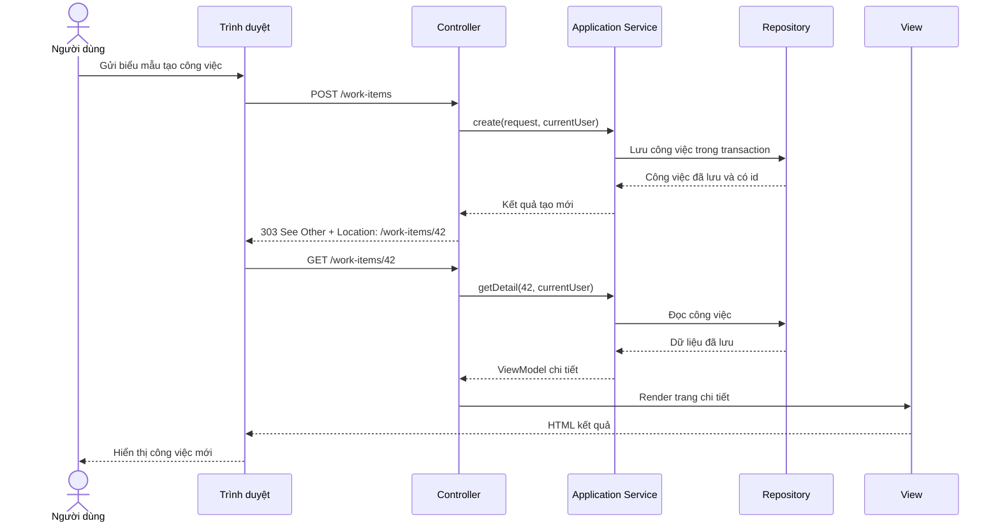
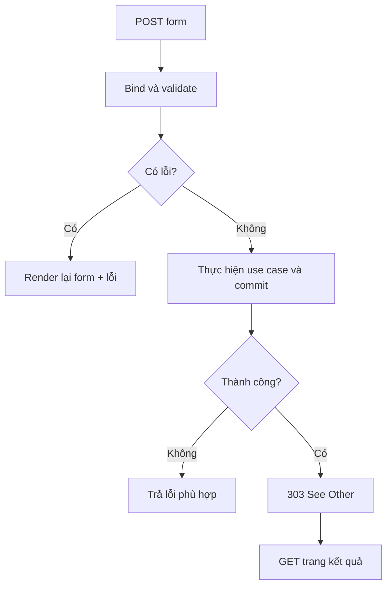
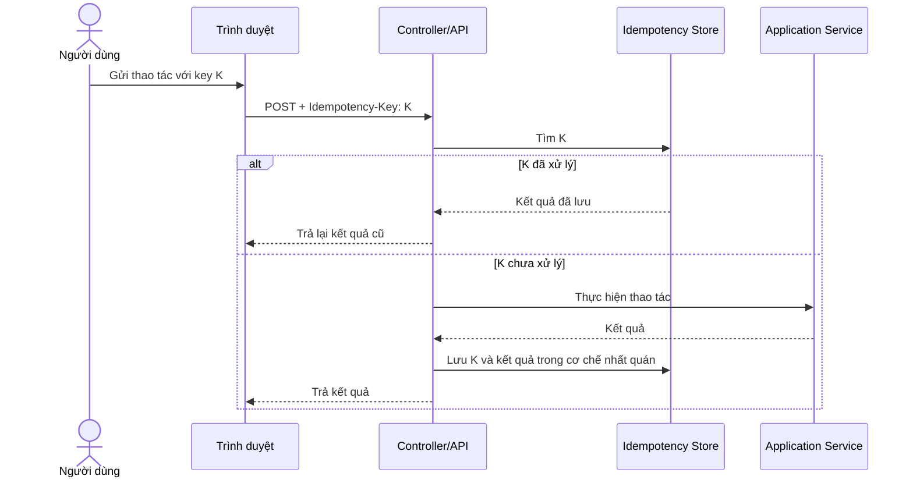

# Chuyển hướng sau thao tác ghi với Post/Redirect/Get

Trong ứng dụng web theo kiến trúc **MODEL_VIEW_CONTROLLER (MVC)**, người dùng thường gửi biểu mẫu để tạo mới, cập nhật hoặc xóa một đối tượng nghiệp vụ. Sau khi xử lý request ghi thành công, ứng dụng cần phản hồi sao cho người dùng biết kết quả và có thể tải lại trang mà không vô tình gửi lại thao tác vừa thực hiện.

**Post/Redirect/Get (PRG)** là mẫu điều hướng trong đó trình duyệt gửi một request `POST`, máy chủ xử lý và trả về một response chuyển hướng, sau đó trình duyệt gửi request `GET` đến tài nguyên kết quả. Mẫu này thường được dùng trong MVC server-rendered để tách request thay đổi dữ liệu khỏi request hiển thị kết quả.

PRG đặc biệt hữu ích sau khi tạo hoặc cập nhật dữ liệu: trình duyệt hiển thị trang chi tiết hoặc danh sách bằng `GET`; khi người dùng refresh, trình duyệt tải lại trang kết quả thay vì hỏi có gửi lại `POST` hay không. Tuy nhiên, PRG không tự bảo đảm một thao tác chỉ được thực hiện một lần. Muốn chống gửi trùng do double-click, retry hoặc mất kết nối, hệ thống vẫn cần cơ chế idempotency và ràng buộc nghiệp vụ phù hợp.

## 1. Vấn đề khi render kết quả trực tiếp sau POST

Giả sử người dùng điền biểu mẫu tạo công việc và gửi đến `POST /work-items`. Máy chủ lưu công việc rồi render trực tiếp trang chi tiết trong response của request POST.

Luồng này có thể hoạt động, nhưng trình duyệt vẫn đang hiển thị một response được tạo từ `POST`. Nếu người dùng nhấn refresh, trình duyệt có thể phải gửi lại request POST để lấy lại response. Tùy trình duyệt, người dùng sẽ thấy hộp thoại xác nhận gửi lại biểu mẫu. Nếu xác nhận, thao tác tạo có thể được thực hiện lần nữa.

Ví dụ, một request tạo hóa đơn được gửi hai lần có thể tạo hai hóa đơn. Một request thêm sản phẩm vào giỏ có thể tăng số lượng hai lần. Với một thao tác cập nhật, request gửi lại có thể lặp side effect như gửi email, tạo lịch sử hoặc phát sinh giao dịch ngoài ý muốn.

Vấn đề không nằm ở việc HTML được render trực tiếp, mà ở việc request dùng để hiển thị kết quả vẫn là request ghi. PRG thay đổi bước cuối để trình duyệt chuyển sang một URL có thể đọc bằng GET.

## 2. Luồng Post/Redirect/Get

Một luồng PRG cơ bản có ba bước:

1. **POST:** người dùng gửi dữ liệu hoặc lệnh thay đổi trạng thái.
2. **Redirect:** máy chủ xử lý thành công, commit thay đổi và trả response chuyển hướng kèm URL của trang kết quả.
3. **GET:** trình duyệt truy cập URL đích để đọc và hiển thị kết quả.



Điểm quan trọng là request GET cuối cùng đọc lại dữ liệu đã lưu từ nguồn có thẩm quyền. Trang kết quả không nên phụ thuộc vào một entity chưa commit hoặc một bản dữ liệu chỉ tồn tại trong bộ nhớ của Controller.

Ví dụ URL:

```text
GET  /work-items/new
POST /work-items
303  Location: /work-items/42
GET  /work-items/42
200  OK
```

Với cập nhật, URL đích thường là trang chi tiết hoặc danh sách sau cập nhật:

```text
POST /work-items/42
303  Location: /work-items/42
GET  /work-items/42
200  OK
```

Với xóa, URL đích có thể là danh sách:

```text
POST /work-items/42/delete
303  Location: /work-items
GET  /work-items
200  OK
```

URL đích cần được chọn theo kết quả nghiệp vụ và quyền xem của người dùng. Sau khi xóa, chuyển hướng về trang chi tiết của tài nguyên đã xóa sẽ không phù hợp trừ khi ứng dụng dùng trang xác nhận riêng hoặc soft delete có trang chi tiết lưu trữ.

## 3. Vì sao dùng 303 See Other?

Response chuyển hướng có thể dùng các mã trạng thái khác nhau. Với PRG sau POST, `303 See Other` thể hiện rõ rằng trình duyệt nên truy cập tài nguyên ở URL trong header `Location` bằng một request GET (hoặc HEAD theo ngữ nghĩa HTTP), thay vì gửi lại body của POST.

| Mã trạng thái | Hành vi chính | Có phù hợp làm bước PRG sau POST? |
|---|---|---|
| `303 See Other` | Chỉ dẫn client truy xuất tài nguyên khác bằng GET/HEAD | Phù hợp và rõ nghĩa nhất cho PRG |
| `302 Found` | Chuyển hướng tạm thời; hành vi POST sau redirect có lịch sử tương thích trình duyệt | Thường hoạt động trong ứng dụng web, nhưng ngữ nghĩa không tường minh bằng 303 |
| `307 Temporary Redirect` | Giữ nguyên phương thức và body khi chuyển hướng | Không phù hợp cho PRG vì POST tiếp tục là POST |
| `308 Permanent Redirect` | Chuyển hướng vĩnh viễn và giữ nguyên phương thức | Không phù hợp cho PRG sau thao tác ghi |
| `301 Moved Permanently` | Chuyển hướng vĩnh viễn; hành vi đổi phương thức có lịch sử khác biệt | Không nên dùng làm redirect PRG sau POST |

### 303 và 302

Nhiều framework MVC tạo redirect bằng cú pháp ngắn và mặc định trả `302 Found`. Các trình duyệt phổ biến thường chuyển POST thành GET khi xử lý 302 trong luồng biểu mẫu web, nên PRG vẫn có thể hoạt động. Tuy vậy, nếu muốn hợp đồng HTTP nói rõ rằng request tiếp theo phải là GET, hãy trả `303 See Other`.

### Không dùng 307/308 cho PRG

`307` và `308` được thiết kế để giữ nguyên phương thức và body khi chuyển hướng. Nếu POST tạo công việc được chuyển hướng bằng 307, trình duyệt có thể gửi lại chính POST đó đến URL mới. Điều này không đạt mục tiêu tách request ghi khỏi request đọc của PRG.

### Ý nghĩa của GET đích

GET nên an toàn (safe): chỉ đọc hoặc truy xuất biểu diễn, không thực hiện thay đổi trạng thái nghiệp vụ. GET cũng có ngữ nghĩa idempotent: lặp lại cùng request không tạo thêm tác động nghiệp vụ. Vì vậy, refresh trang kết quả có thể tải lại dữ liệu mà không lặp lại thao tác tạo/cập nhật.

Không đặt hành động xóa, thanh toán hoặc xác nhận đơn hàng trong một endpoint GET chỉ vì muốn điều hướng thuận tiện. Một liên kết có thể được crawler, preview bot hoặc trình duyệt tải trước truy cập; thao tác ghi cần dùng phương thức và cơ chế bảo vệ phù hợp.

## 4. Vai trò của các thành phần MVC

PRG là một mẫu điều phối HTTP, không thay đổi trách nhiệm cốt lõi của MVC.

| Thành phần | Trách nhiệm trong PRG |
|---|---|
| View | Hiển thị form, thu thập dữ liệu, hiển thị trang kết quả và thông báo |
| Controller | Nhận POST, bind và kiểm tra request, gọi use case, chọn redirect và xử lý GET đích |
| Application service | Kiểm tra quyền, điều phối quy tắc nghiệp vụ và transaction |
| Model/domain | Bảo vệ bất biến và thực hiện thay đổi nghiệp vụ hợp lệ |
| Repository | Lưu thay đổi và đọc dữ liệu cho trang kết quả |
| ViewModel mapper/query service | Chuẩn bị dữ liệu cần trình bày cho GET đích |

Controller không nên tự xác nhận thao tác thành công trước khi tầng nghiệp vụ lưu thay đổi. Redirect chỉ được trả sau khi service hoàn tất thành công theo ranh giới transaction phù hợp. Nếu transaction thất bại, Controller cần trả kết quả lỗi, không chuyển người dùng đến trang thông báo thành công.

## 5. Ví dụ form tạo mới với Spring MVC

Giả sử người dùng tạo một công việc gồm tiêu đề và mô tả. HTML form gửi POST đến endpoint tạo mới:

```html
<form action="/work-items" method="post">
  <label for="title">Tiêu đề</label>
  <input id="title" name="title" type="text" required maxlength="120">

  <label for="description">Mô tả</label>
  <textarea id="description" name="description"></textarea>

  <!-- Ứng dụng có Spring Security cần gửi CSRF token theo cấu hình. -->
  <button type="submit">Tạo công việc</button>
</form>
```

Ví dụ trên minh họa cấu trúc form; trong ứng dụng có Spring Security, token CSRF cần được thêm theo cơ chế tích hợp của template engine hoặc form tag. Không tắt CSRF chỉ để form hoạt động.

Request DTO giới hạn dữ liệu mà thao tác tạo mới nhận:

```java
import jakarta.validation.constraints.NotBlank;
import jakarta.validation.constraints.Size;

public record CreateWorkItemRequest(
        @NotBlank(message = "Vui lòng nhập tiêu đề")
        @Size(max = 120, message = "Tiêu đề không được vượt quá 120 ký tự")
        String title,

        @Size(max = 4000, message = "Mô tả không được vượt quá 4000 ký tự")
        String description
) {}
```

Controller xử lý hai nhánh: nếu validation thất bại thì render lại form; nếu thành công thì lưu và redirect. Đoạn mã sau dùng `RedirectView` để thể hiện rõ status `303`:

```java
import org.springframework.http.HttpStatus;
import org.springframework.stereotype.Controller;
import org.springframework.validation.BindingResult;
import org.springframework.web.bind.annotation.ModelAttribute;
import org.springframework.web.bind.annotation.PostMapping;
import org.springframework.web.servlet.ModelAndView;
import org.springframework.web.servlet.mvc.support.RedirectAttributes;
import org.springframework.web.servlet.view.RedirectView;

import jakarta.validation.Valid;
import java.security.Principal;

@Controller
class WorkItemController {

    private final WorkItemApplicationService service;

    WorkItemController(WorkItemApplicationService service) {
        this.service = service;
    }

    @PostMapping("/work-items")
    ModelAndView create(
            @Valid @ModelAttribute("form") CreateWorkItemRequest form,
            BindingResult errors,
            Principal principal,
            RedirectAttributes redirectAttributes) {

        if (errors.hasErrors()) {
            // Giữ lại form và BindingResult để View hiển thị lỗi theo trường.
            ModelAndView invalid = new ModelAndView("work-items/new");
            invalid.addAllObjects(errors.getModel());
            return invalid;
        }

        WorkItemId id = service.create(form, principal.getName());

        redirectAttributes.addFlashAttribute(
                "notice", "Công việc đã được tạo thành công.");

        RedirectView redirect = new RedirectView(
                "/work-items/" + id.value(), true);
        redirect.setStatusCode(HttpStatus.SEE_OTHER);
        return new ModelAndView(redirect);
    }
}
```

Đây là ví dụ Spring MVC; các kiểu `WorkItemApplicationService` và `WorkItemId` thuộc mô hình ứng dụng minh họa. Trong dự án thực tế, khi validation lỗi cần nạp lại các lựa chọn cho form, ví dụ danh sách dự án hoặc loại công việc. Nếu thao tác bị từ chối bởi quy tắc nghiệp vụ, Controller cũng cần chuyển lỗi thành phản hồi phù hợp thay vì coi đó là thành công.

`RedirectAttributes.addFlashAttribute` đặt dữ liệu tạm thời vào flash scope để dùng ở request kế tiếp. `RedirectView.setStatusCode(HttpStatus.SEE_OTHER)` làm rõ status 303. Nếu dùng cú pháp `return "redirect:/work-items/" + id;`, hãy kiểm tra status thực tế do cấu hình/framework đang tạo; không nên mặc định rằng mọi redirect view đều trả 303.

## 6. GET đích và hiển thị kết quả

GET đích đọc lại dữ liệu và dựng ViewModel cho trang kết quả:

```java
@GetMapping("/work-items/{id}")
String detail(
        @PathVariable String id,
        Principal principal,
        Model model) {

    WorkItemDetailViewModel detail =
            queryService.getDetail(id, principal.getName());

    model.addAttribute("workItem", detail);
    return "work-items/detail";
}
```

Flash attribute `notice` được Spring MVC chuyển vào model của request redirect đích nếu được thiết lập đúng. Template có thể hiển thị thông báo:

```html
<div role="status" th:if="${notice}" th:text="${notice}"></div>

<h1 th:text="${workItem.title}">Tiêu đề công việc</h1>
<p th:text="${workItem.description}">Mô tả</p>
```

Đây là ví dụ dùng Thymeleaf. Dữ liệu hiển thị phải được escape theo ngữ cảnh; tránh render HTML thô từ nội dung người dùng nhập. GET đích vẫn phải kiểm tra quyền xem tài nguyên. Việc người dùng vừa tạo ra đối tượng không có nghĩa mọi request sau đó đều được phép truy cập nếu quyền hoặc trạng thái đã thay đổi.

## 7. Flash attributes và thông báo một lần

Sau POST thành công, người dùng thường cần một thông báo như “Đã lưu thay đổi” hoặc “Công việc đã được tạo”. Nếu đặt thông báo trong query string, URL có thể bị chia sẻ, lưu trong lịch sử, ghi vào log hoặc gửi trong referrer. Nếu thông báo chứa dữ liệu nhạy cảm, điều đó có thể tạo rủi ro.

**Flash attribute** là dữ liệu tạm thời được giữ qua một lần chuyển hướng để request kế tiếp đọc. Spring MVC cung cấp `RedirectAttributes.addFlashAttribute` cho mục đích này.

Ví dụ:

```java
redirectAttributes.addFlashAttribute("notice", "Đã lưu thay đổi.");
redirectAttributes.addFlashAttribute("noticeType", "success");
```

Ở GET đích, View hiển thị thông báo rồi dữ liệu flash được tiêu thụ theo cơ chế flash map. Đây là lựa chọn phù hợp cho thông báo ngắn sau thao tác.

### Flash attribute nên chứa gì?

- Thông báo ngắn, đã được máy chủ tạo và không chứa bí mật.
- Mã loại thông báo hoặc thông tin giao diện tối thiểu.
- Một tham chiếu không nhạy cảm nếu GET đích cần hiển thị thông tin đó.

Tránh đưa toàn bộ entity, dữ liệu lớn, mật khẩu, token, thông tin thanh toán hoặc nội dung nhạy cảm vào flash scope. GET đích nên truy vấn lại dữ liệu theo định danh và quyền truy cập.

### Flash scope và nhiều tab

Flash data thường gắn với session và request chuyển hướng. Khi người dùng mở nhiều tab hoặc thực hiện nhiều thao tác gần nhau, cần cân nhắc khả năng thông báo bị tiêu thụ bởi request không mong muốn hoặc các redirect cạnh tranh. Framework có cơ chế ghép flash map với URL/target request, nhưng ứng dụng vẫn nên giữ payload nhỏ, đặt đích rõ ràng và kiểm thử luồng nhiều tab nếu trải nghiệm yêu cầu.

Nếu thông báo cần tồn tại lâu, xuất hiện ở nhiều thiết bị hoặc có giá trị kiểm toán, flash scope không phù hợp; hãy lưu một thông báo hoặc sự kiện nghiệp vụ theo cơ chế riêng.

## 8. PRG khi validation thất bại

PRG thường áp dụng sau khi thao tác ghi thành công. Nếu dữ liệu đầu vào không hợp lệ, ứng dụng chưa thực hiện thay đổi. Cách xử lý phổ biến là trả lại form ngay trong response POST cùng lỗi validation và dữ liệu người dùng đã nhập hợp lệ.



Trả lại form trực tiếp giúp giữ `BindingResult`, dữ liệu nhập và lỗi theo từng trường mà không cần lưu chúng qua redirect. Nếu redirect sau validation lỗi, ứng dụng phải lưu lỗi và dữ liệu form ở flash/session hoặc một kho tạm có kiểm soát rồi khôi phục ở GET tiếp theo. Điều đó làm luồng phức tạp hơn và cần xử lý nhiều tab, hết hạn session và dữ liệu nhạy cảm.

Một số ứng dụng vẫn chủ động redirect sau validation lỗi để giữ PRG cho mọi POST. Khi chọn cách này, hãy giới hạn thời gian lưu, chỉ giữ dữ liệu cần thiết, tránh giữ trường nhạy cảm và kiểm tra rằng thông báo lỗi được ghép với đúng form/đúng tab.

Với API, không cần redirect để phục vụ một form HTML. API có thể trả `400 Bad Request` hoặc `422 Unprocessable Content` cùng cấu trúc lỗi theo hợp đồng để client hiển thị. PRG chủ yếu là mẫu điều hướng cho tương tác trình duyệt.

## 9. PRG cho tạo mới, cập nhật và xóa

| Thao tác | Request ghi | URL GET đích thường dùng | Nội dung sau redirect |
|---|---|---|---|
| Tạo mới | `POST /items` | `/items/{id}` | Chi tiết đối tượng vừa tạo |
| Cập nhật | `POST /items/{id}` hoặc endpoint cập nhật phù hợp | `/items/{id}` | Chi tiết mới nhất sau cập nhật |
| Xóa | `POST /items/{id}/delete` hoặc `DELETE` qua client phù hợp | `/items` | Danh sách sau khi xóa |
| Thay đổi trạng thái | `POST /items/{id}/publish` | `/items/{id}` | Chi tiết với trạng thái mới |

URL đích có thể chứa query parameter không nhạy cảm để giữ bộ lọc, trang hiện tại hoặc tab, ví dụ `/items?status=open&page=2`. Query parameter chỉ điều khiển cách đọc/trình bày; GET đích vẫn cần kiểm tra đầu vào và quyền.

Không dùng flash message như bằng chứng duy nhất rằng thay đổi đã được lưu. Nếu GET đích có thể được mở trực tiếp hoặc refresh, trang phải tự đọc trạng thái thực tế từ hệ thống. Một query parameter như `?success=true` có thể bị người dùng tự thêm; không nên dùng nó để kết luận nghiệp vụ đã thành công.

## 10. PRG không thay thế idempotency và chống gửi trùng

PRG giảm khả năng trình duyệt gửi lại POST khi refresh trang kết quả. Nó không ngăn mọi trường hợp gửi lặp:

- Người dùng double-click nút gửi trước khi redirect được nhận.
- JavaScript gửi hai request do listener được gắn nhiều lần.
- Proxy, client hoặc ứng dụng di động retry sau timeout.
- Máy chủ đã commit transaction nhưng response redirect bị mất trên đường truyền.
- Người dùng mở lại form cũ ở tab khác và gửi lần nữa.

Trong các tình huống đó, máy chủ có thể nhận nhiều POST. Disable nút sau click cải thiện trải nghiệm nhưng không phải bảo vệ dữ liệu vì request có thể được gửi ngoài trình duyệt.

### Idempotency key

Với thao tác tạo có chi phí hoặc side effect quan trọng, client có thể gửi một khóa idempotency duy nhất cho một ý định thao tác. Máy chủ lưu khóa cùng kết quả xử lý trong transaction hoặc cơ chế lưu trữ có tính nhất quán. Khi nhận lại cùng khóa, máy chủ trả kết quả đã ghi nhận thay vì thực hiện tác động lần nữa.

Luồng khái niệm:



Thiết kế thực tế cần xác định phạm vi khóa (người dùng/endpoint/tài nguyên), thời gian lưu, cách xử lý hai request đồng thời cùng key, cách so sánh payload và cách trả kết quả khi request đầu vẫn đang xử lý. Không dùng một khóa cố định cho mọi lần gửi. Unique constraint hoặc quy tắc chống trùng ở miền có thể là lớp bảo vệ bổ sung.

### Update idempotent và side effect

Một thao tác đặt trạng thái thành `PUBLISHED` có thể idempotent nếu gọi lại không tạo tác động mới. Nhưng nếu mỗi lần gọi đều gửi email, tạo bản ghi audit hoặc phát thanh toán, các side effect có thể lặp. Hãy phân biệt thay đổi trạng thái với sự kiện phát sinh và dùng transaction/outbox hoặc idempotent consumer khi cần.

## 11. Bảo mật trong luồng PRG

Redirect không làm mất yêu cầu bảo mật của request ghi.

### CSRF

Với ứng dụng xác thực bằng cookie/session, POST thay đổi dữ liệu cần CSRF token hoặc cơ chế bảo vệ tương đương. Kiểm tra CSRF xảy ra ở request POST; redirect sau đó không thay thế kiểm tra này. Không dùng GET để thực hiện thao tác ghi nhằm né CSRF.

### Authorization

Controller hoặc application service phải kiểm tra người dùng được phép thực hiện thao tác trên đúng tài nguyên. Không suy ra quyền từ việc nút được hiển thị, URL redirect có tồn tại hoặc người dùng đã đăng nhập.

### Open redirect

Không lấy URL đích chuyển hướng tùy ý từ tham số do người dùng kiểm soát, ví dụ `?returnUrl=https://attacker.example`. Nếu cần quay về trang trước, hãy kiểm tra URL thuộc host/path được phép hoặc dùng một mã đích nội bộ đã biết. Open redirect có thể bị lợi dụng để tạo liên kết lừa đảo đáng tin cậy.

### Dữ liệu trên URL

Không đưa mật khẩu, token, dữ liệu cá nhân hoặc nội dung biểu mẫu vào query string của URL đích. URL có thể xuất hiện trong browser history, server log, analytics hoặc referrer. Chỉ truyền định danh và trạng thái điều hướng tối thiểu, sau đó GET đọc dữ liệu theo quyền.

### XSS và thông báo

Thông báo flash cần được escape khi render. Nếu nội dung thông báo được tạo từ dữ liệu người dùng, không render HTML thô. Ưu tiên message code hoặc câu thông báo do máy chủ kiểm soát.

## 12. Lịch sử trình duyệt và trải nghiệm người dùng

Sau PRG, lịch sử trình duyệt thường có một mục cho trang form và một mục cho URL GET kết quả. Refresh ở trang kết quả sẽ tải lại GET. Khi người dùng nhấn Back, trình duyệt có thể quay về form trước đó; tùy cache và chính sách trình duyệt, form có thể hiển thị dữ liệu đã nhập trước đây hoặc yêu cầu tải lại.

Vì vậy, PRG không tự xóa dữ liệu form khỏi lịch sử và không ngăn người dùng mở lại form cũ. Nếu form tạo có nguy cơ gửi lại một ý định đã hoàn tất, backend vẫn cần chống trùng. Có thể hiển thị trạng thái rõ ràng khi người dùng quay lại, hoặc kiểm tra token/phiên bản form nếu quy trình nghiệp vụ yêu cầu.

Đối với trang kết quả, hãy đảm bảo:

- Tiêu đề và nội dung phản ánh dữ liệu mới nhất đã lưu.
- Thông báo thành công ngắn gọn và không che khuất thông tin chính.
- Refresh không tạo side effect.
- Nếu đối tượng đã bị xóa hoặc quyền truy cập thay đổi, GET trả kết quả phù hợp như 404/403.
- Điều hướng tiếp theo vẫn rõ ràng, ví dụ quay về danh sách hoặc tiếp tục chỉnh sửa.

## 13. Các lỗi thiết kế thường gặp

### Render trực tiếp trang thành công sau POST

Refresh có thể gửi lại POST và lặp thao tác. Sau khi commit thành công, hãy chuyển hướng đến một GET đọc kết quả.

### Dùng 307 hoặc 308 với mục tiêu PRG

Hai mã này giữ nguyên phương thức và body. Dùng 303 khi muốn request tiếp theo là GET.

### Cho rằng PRG bảo đảm đúng một lần

Request vẫn có thể được gửi lặp trước redirect hoặc do retry/mất response. Dùng idempotency key, unique constraint hoặc quy tắc chống trùng phù hợp với nghiệp vụ.

### Redirect sau validation lỗi nhưng không lưu lỗi

Người dùng đến trang form mới mà mất dữ liệu và thông báo. Hãy render lại form trực tiếp hoặc thiết kế cơ chế lưu flash/error state an toàn.

### Đưa toàn bộ entity vào flash scope

Flash/session có thể phình to, chứa dữ liệu nhạy cảm hoặc trở nên lỗi thời. Chỉ lưu thông báo và dữ liệu tối thiểu; GET đích truy vấn lại tài nguyên.

### Redirect đến URL do người dùng nhập mà không kiểm tra

Điều này tạo nguy cơ open redirect. Chỉ chấp nhận đích nội bộ hoặc danh sách đích cho phép.

### GET đích thực hiện thay đổi nghiệp vụ

Refresh hoặc crawler có thể lặp side effect. GET chỉ nên đọc và trình bày.

### Thông báo thành công trước khi transaction commit

Giao diện có thể nói thành công dù transaction rollback. Chỉ tạo redirect/thông báo thành công sau khi use case hoàn tất theo ranh giới transaction.

## 14. Kiểm thử PRG trong MVC

Kiểm thử nên xác minh cả status, header `Location`, dữ liệu lưu và hành vi GET đích. Chỉ kiểm tra Controller trả về chuỗi `redirect:` là chưa đủ.

| Cấp kiểm thử | Nội dung cần xác minh |
|---|---|
| Controller test | POST hợp lệ trả redirect với status mong đợi và URL đích đúng |
| Flash attribute test | Thông báo được chuyển sang request GET tiếp theo và không tồn tại mãi |
| Validation test | POST sai dữ liệu render form cùng lỗi, không tạo bản ghi |
| Service test | Quy tắc nghiệp vụ, quyền và transaction được áp dụng trước redirect |
| Integration test | Sau POST thành công, GET đích đọc được dữ liệu đã commit |
| Security test | CSRF và authorization được kiểm tra; URL redirect không thể bị điều khiển ra host ngoài |
| Duplicate submission test | Gửi hai POST cùng ý định không tạo side effect trùng khi nghiệp vụ yêu cầu idempotency |
| Browser test | Refresh trang kết quả chỉ lặp GET, không gửi lại POST |

Ví dụ kiểm thử với Spring MockMvc và Spring Security Test:

```java
mockMvc.perform(post("/work-items")
        .with(csrf())
        .param("title", "Chuẩn bị tài liệu")
        .param("description", "Hoàn thiện bản nháp"))
    .andExpect(status().isSeeOther())
    .andExpect(header().string("Location", "/work-items/42"))
    .andExpect(flash().attribute(
            "notice", "Công việc đã được tạo thành công."));

mockMvc.perform(get("/work-items/42"))
    .andExpect(status().isOk())
    .andExpect(model().attributeExists("workItem"));
```

Ví dụ giả định service trả về định danh `42`, endpoint và cấu hình redirect đã được thiết lập để trả 303. Trong dự án thực tế, cần điều chỉnh URI theo context path, kiểm tra nội dung View và xác minh dữ liệu thực sự đã commit trong integration test.

## 15. Quy trình áp dụng Post/Redirect/Get

Khi thiết kế một thao tác ghi trong ứng dụng MVC, hãy xác định:

1. **Request ghi:** thao tác dùng POST, PUT/PATCH hay một command endpoint? Dữ liệu nào được phép gửi?
2. **Điều kiện thành công:** validation, authorization và quy tắc nghiệp vụ đã được kiểm tra ở phía máy chủ chưa?
3. **Thời điểm redirect:** transaction đã commit thành công chưa? Có side effect nào cần xử lý sau commit không?
4. **Mã trạng thái:** dùng 303 để chuyển từ POST sang GET; không dùng 307/308 nếu mục tiêu là PRG.
5. **URL đích:** trang chi tiết, danh sách hay trang kết quả nào phù hợp với nghiệp vụ và quyền truy cập?
6. **Thông báo:** có cần flash attribute một lần không? Payload có nhỏ, không nhạy cảm và gắn đúng redirect không?
7. **Validation thất bại:** render lại form hay redirect với error state? Dữ liệu nhập có được giữ an toàn không?
8. **Gửi lặp:** double-click, retry và mất response có thể tạo tác động trùng không? Có cần idempotency key hoặc unique constraint không?
9. **Bảo mật:** CSRF, authorization, open redirect, XSS và dữ liệu trên URL đã được xử lý chưa?
10. **Kiểm thử:** xác minh status, Location, flash, GET đích, refresh, Back và duplicate submission.

## Kết luận

Post/Redirect/Get tách request thay đổi trạng thái khỏi request hiển thị kết quả: trình duyệt gửi POST, máy chủ xử lý và trả `303 See Other`, rồi trình duyệt gửi GET đến URL đích. Nhờ vậy, refresh trang kết quả sẽ tải lại GET thay vì gửi lại POST vừa tạo ra response. GET đích đọc dữ liệu đã lưu và dựng ViewModel cho View.

Trong MVC, Controller điều phối redirect và request GET, application service cùng Model bảo vệ quy tắc và thay đổi nghiệp vụ, Repository lưu/đọc dữ liệu, còn View trình bày kết quả. Flash attributes hỗ trợ thông báo ngắn qua redirect. PRG cải thiện điều hướng và giảm gửi lại POST khi refresh, nhưng không thay thế idempotency, transaction, CSRF hoặc authorization. Thiết kế đầy đủ cần xử lý cả validation lỗi, request gửi lặp, dữ liệu đồng thời và lịch sử trình duyệt.
