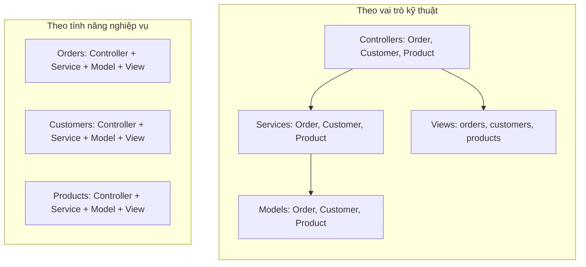
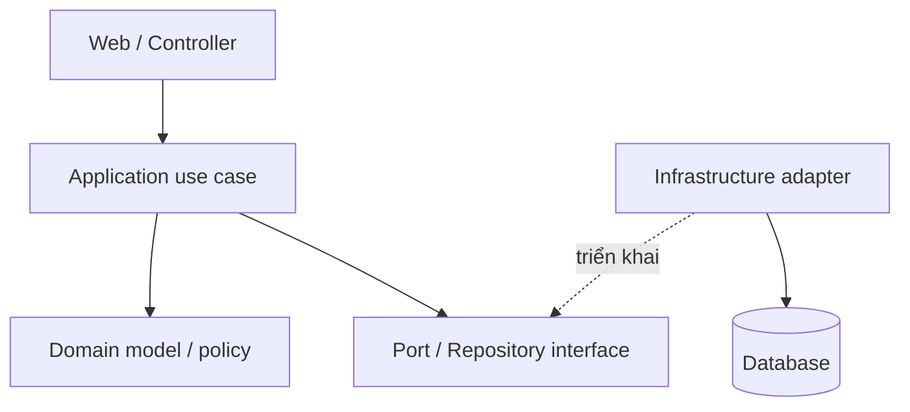

# Tổ chức theo vai trò kỹ thuật và theo tính năng nghiệp vụ

Trong ứng dụng Model–View–Controller (MVC), Controller tiếp nhận tương tác, Model quản lý trạng thái và quy tắc nghiệp vụ, còn View trình bày dữ liệu cho người dùng. Khi dự án có nhiều màn hình và chức năng, cách đặt các thành phần này vào thư mục hoặc package ảnh hưởng trực tiếp đến việc tìm mã, thay đổi chức năng, kiểm thử và phối hợp giữa các nhóm phát triển.

Hai cách tổ chức phổ biến là **theo vai trò kỹ thuật** (technical layer / role) và **theo tính năng nghiệp vụ** (feature / vertical slice). Cách thứ nhất gom các file cùng loại vào một nơi, chẳng hạn mọi Controller nằm trong `controller`. Cách thứ hai gom các file cùng phục vụ một khả năng nghiệp vụ, chẳng hạn chức năng đơn hàng chứa Controller, Model, dịch vụ và View liên quan đến đơn hàng.

Không có một cấu trúc duy nhất phù hợp với mọi dự án. Điều quan trọng là chọn cấu trúc giúp người đọc tìm được nơi thực hiện một hành vi, nhìn thấy ranh giới phụ thuộc và thay đổi một tính năng mà không phải đi qua quá nhiều khu vực không liên quan.

## 1. Tổ chức mã theo vai trò kỹ thuật

Tổ chức theo vai trò kỹ thuật chia mã nguồn dựa trên nhiệm vụ của từng loại thành phần trong kiến trúc. Với MVC, cấu trúc cơ bản thường có các thư mục hoặc package như `controller`, `model` và `view`.

Ví dụ với một ứng dụng quản lý bán hàng:

```text
src/main/java/com/example/shop/
├── controller/
│   ├── OrderController.java
│   ├── CustomerController.java
│   └── ProductController.java
├── model/
│   ├── Order.java
│   ├── Customer.java
│   └── Product.java
├── service/
│   ├── OrderService.java
│   ├── CustomerService.java
│   └── ProductService.java
├── repository/
│   ├── OrderRepository.java
│   ├── CustomerRepository.java
│   └── ProductRepository.java
└── dto/
    ├── OrderRequest.java
    ├── OrderResponse.java
    └── CustomerResponse.java

src/main/resources/
├── templates/
│   ├── orders/
│   ├── customers/
│   └── products/
└── static/
```

Trong cấu trúc này, muốn tìm một Controller, lập trình viên mở `controller`; muốn tìm entity, mở `model`; muốn tìm template, mở `templates`. Mỗi thư mục thể hiện một vai trò kỹ thuật rõ ràng.

### Ưu điểm

- **Dễ nhận biết khi mới bắt đầu:** người học có thể hiểu nhanh vị trí của Controller, Model, View và các thành phần hỗ trợ.
- **Nhất quán với kiến trúc MVC:** cấu trúc thư mục phản ánh các vai trò quen thuộc trong kiến trúc.
- **Ít thư mục ban đầu:** phù hợp với ứng dụng nhỏ, số lượng tính năng và lớp còn hạn chế.
- **Dễ áp dụng quy ước chung:** có thể đặt quy tắc cho tất cả Controller, repository hoặc DTO tại một khu vực.

### Hạn chế khi dự án phát triển

Khi số tính năng tăng, một thư mục có thể chứa rất nhiều file. Chức năng xác nhận đơn hàng có thể cần mở `OrderController`, `OrderService`, `OrderRepository`, `Order`, `OrderRequest`, `OrderResponse` và một template ở vị trí khác. Các file cùng phục vụ một hành vi bị phân tán theo loại kỹ thuật.

Điều này tạo ra một số khó khăn:

- Muốn hiểu trọn một tính năng phải chuyển qua nhiều thư mục.
- Thay đổi một yêu cầu nghiệp vụ có thể chạm vào nhiều khu vực và dễ bỏ sót thành phần.
- Tên file có thể trở nên chung chung, ví dụ `CommonService`, `BaseController` hoặc `Helper`, khiến trách nhiệm khó xác định.
- Nhiều nhóm cùng làm việc có thể liên tục sửa các package dùng chung như `service` hoặc `model`.
- Package kỹ thuật lớn có thể che khuất ranh giới giữa các nhóm nghiệp vụ.

Ví dụ, khi cần thêm chức năng hủy đơn hàng, người phát triển có thể phải tìm quy tắc trong `OrderService`, trạng thái trong `Order`, endpoint trong `OrderController`, dữ liệu trả về trong `dto` và giao diện trong `templates/orders`. Việc chia theo vai trò không sai, nhưng việc theo dấu một thay đổi xuyên suốt nhiều lớp sẽ ngày càng tốn công.

## 2. Tổ chức mã theo tính năng nghiệp vụ

Tổ chức theo tính năng đặt những thành phần cùng phục vụ một khả năng nghiệp vụ vào một khu vực. Thay vì gom tất cả Controller vào một package, ứng dụng gom Controller, dịch vụ, Model và dữ liệu giao tiếp của từng tính năng vào package riêng.

Ví dụ:

```text
src/main/java/com/example/shop/
├── orders/
│   ├── OrderController.java
│   ├── OrderService.java
│   ├── Order.java
│   ├── OrderRepository.java
│   ├── OrderRequest.java
│   └── OrderResponse.java
├── customers/
│   ├── CustomerController.java
│   ├── CustomerService.java
│   ├── Customer.java
│   └── CustomerRepository.java
├── products/
│   ├── ProductController.java
│   ├── ProductService.java
│   ├── Product.java
│   └── ProductRepository.java
└── shared/
    └── ...

src/main/resources/templates/
├── orders/
├── customers/
└── products/
```

Package `orders` chứa các thành phần liên quan đến đơn hàng; `customers` chứa thành phần của khách hàng; `products` chứa thành phần của sản phẩm. Khi làm một yêu cầu thuộc tính năng đơn hàng, phần lớn mã cần xem nằm gần nhau.

### Ưu điểm

- **Dễ theo dấu một tính năng:** Controller, dịch vụ, đối tượng miền và DTO liên quan nằm cùng khu vực.
- **Giảm phạm vi tìm kiếm:** người phát triển có thể bắt đầu từ package nghiệp vụ thay vì tìm trong nhiều package kỹ thuật lớn.
- **Hỗ trợ phân chia công việc:** nhóm phụ trách đơn hàng có thể làm việc chủ yếu trong `orders`, nhóm khách hàng trong `customers`.
- **Làm rõ ranh giới nghiệp vụ:** có thể nhận diện chức năng nào sở hữu dữ liệu và hành vi nào.
- **Thuận lợi khi tách module:** một package tính năng có ranh giới tốt có thể trở thành module độc lập khi kiến trúc cần phát triển.

### Hạn chế và rủi ro

- Nếu không thống nhất quy ước, mỗi tính năng có thể tổ chức theo một cách khác nhau.
- Một package tính năng lớn vẫn có thể trở thành nơi chứa mọi thứ nếu không phân chia trách nhiệm bên trong.
- Các tính năng có thể truy cập trực tiếp lớp nội bộ của nhau, tạo phụ thuộc chéo khó kiểm soát.
- Các thành phần thực sự dùng chung có thể bị sao chép vào nhiều package nếu không xác định đúng phần dùng chung.
- Người mới có thể khó nhận biết cấu trúc bên trong một tính năng nếu package không thể hiện rõ vai trò kỹ thuật.

Tổ chức theo tính năng không có nghĩa mọi file trong một package đều được phép phụ thuộc lẫn nhau tùy ý. Controller vẫn không nên chứa toàn bộ quy tắc nghiệp vụ; Model vẫn không nên phụ thuộc vào template hoặc HTTP. Cấu trúc package giúp nhóm mã gần nhau, còn nguyên tắc kiến trúc quyết định cách các lớp được phép gọi nhau.

## 3. So sánh hai cách tổ chức

| Tiêu chí | Theo vai trò kỹ thuật | Theo tính năng nghiệp vụ |
|---|---|---|
| Cách nhóm file | Controller với Controller, Model với Model | Thành phần cùng phục vụ một tính năng |
| Điểm bắt đầu khi tìm mã | Biết loại lớp cần tìm | Biết chức năng cần thay đổi |
| Theo dấu một yêu cầu xuyên lớp | Thường phải chuyển qua nhiều thư mục | Thường ở trong một package tính năng |
| Quy ước | Dễ thống nhất theo loại kỹ thuật | Cần thống nhất cấu trúc giữa các tính năng |
| Cô lập nghiệp vụ | Ranh giới nghiệp vụ có thể bị phân tán | Ranh giới tính năng dễ nhận diện hơn |
| Khả năng phát triển độc lập | Phụ thuộc vào cấu trúc package và quy ước | Thuận lợi nếu kiểm soát truy cập giữa các tính năng |
| Phù hợp ban đầu | Ứng dụng nhỏ, ít tính năng | Ứng dụng có nhiều chức năng riêng biệt |
| Rủi ro nổi bật | Package kỹ thuật phình to | Package tính năng phình to hoặc phụ thuộc chéo |

Có thể hình dung hai cách nhóm mã như hai hướng cắt khác nhau qua cùng một ứng dụng:



Hai sơ đồ mô tả cách sắp xếp file, không làm thay đổi bản chất của MVC. Trong cả hai trường hợp, Controller vẫn điều phối yêu cầu, Model vẫn bảo vệ dữ liệu và quy tắc, còn View vẫn trình bày kết quả.

## 4. Tổ chức theo tính năng nhưng vẫn giữ vai trò kỹ thuật bên trong

Với ứng dụng vừa và lớn, một lựa chọn cân bằng là nhóm theo tính năng ở cấp cao, sau đó phân chia theo vai trò kỹ thuật bên trong từng tính năng. Cách này thường được gọi là feature-first với các layer nội bộ.

Ví dụ package đơn hàng:

```text
com.example.shop.orders/
├── web/
│   ├── OrderController.java
│   ├── ConfirmOrderForm.java
│   └── OrderDetailsView.java
├── application/
│   ├── ConfirmOrderUseCase.java
│   └── OrderQueryService.java
├── domain/
│   ├── Order.java
│   ├── OrderStatus.java
│   └── OrderPolicy.java
└── infrastructure/
    └── persistence/
        ├── JpaOrderRepository.java
        └── SpringDataOrderRepository.java
```

Các vai trò có thể hiểu như sau:

- `web`: Controller, form, response DTO hoặc ViewModel; đây là biên giao tiếp với HTTP và View.
- `application`: điều phối ca sử dụng, xác định trình tự gọi và ranh giới giao dịch.
- `domain`: trạng thái, hành vi và quy tắc nghiệp vụ của đơn hàng.
- `infrastructure`: chi tiết triển khai kỹ thuật như ORM, database adapter hoặc kết nối bên ngoài.

Không phải dự án nào cũng cần đủ bốn thư mục. Một tính năng đơn giản có thể chỉ có `OrderController`, `OrderService`, `Order` và `OrderRepository`. Khi trách nhiệm hoặc số lượng lớp tăng, có thể tách các nhóm bên trong mà không cần tạo cấu trúc sâu ngay từ đầu.

### Ví dụ về hướng phụ thuộc

Trong một cách tổ chức có phân lớp, luồng gọi có thể là:



Controller gọi application service. Application service sử dụng domain object để thực thi quy tắc và dùng repository interface để đọc hoặc lưu dữ liệu. Adapter hạ tầng triển khai giao diện repository. Domain không cần biết Spring MVC, tên template hoặc loại cơ sở dữ liệu.

Với một ứng dụng Spring đơn giản, repository interface có thể được Spring Data triển khai trực tiếp. Với hệ thống phức tạp hơn, có thể tạo một port ở application/domain và adapter riêng ở infrastructure. Mức độ trừu tượng cần tương xứng với nhu cầu; không nên tạo thêm interface chỉ để đổi tên một lời gọi mà không tạo ra ranh giới hữu ích.

## 5. Ví dụ luồng xử lý trong package theo tính năng

Giả sử người dùng xác nhận đơn hàng. Package `orders` có thể chứa Controller, use case và đối tượng miền.

Controller chỉ tiếp nhận dữ liệu và gọi use case:

```java
@RestController
@RequestMapping("/orders")
@RequiredArgsConstructor
public class OrderController {
    private final ConfirmOrderUseCase confirmOrder;

    @PostMapping("/{id}/confirm")
    public ResponseEntity<Void> confirm(
            @PathVariable UUID id,
            @AuthenticationPrincipal AppPrincipal principal,
            @Valid @RequestBody ConfirmOrderForm form) {

        confirmOrder.execute(new ConfirmOrderCommand(
            id, principal.userId(), form.note()
        ));
        return ResponseEntity.noContent().build();
    }
}
```

Use case điều phối hành động:

```java
@Service
@RequiredArgsConstructor
public class ConfirmOrderUseCase {
    private final OrderRepository orders;
    private final OrderAccessPolicy accessPolicy;

    @Transactional
    public void execute(ConfirmOrderCommand command) {
        Order order = orders.findById(command.orderId())
            .orElseThrow(() -> new OrderNotFoundException(command.orderId()));

        accessPolicy.ensureCanConfirm(command.actorId(), order);
        order.confirm(command.note());
        orders.save(order);
    }
}
```

Đối tượng miền bảo vệ chuyển trạng thái:

```java
public class Order {
    private OrderStatus status;
    private List<OrderLine> lines;

    public void confirm(String note) {
        if (status != OrderStatus.DRAFT) {
            throw new InvalidOrderStateException();
        }
        if (lines == null || lines.isEmpty()) {
            throw new EmptyOrderException();
        }
        status = OrderStatus.CONFIRMED;
    }
}
```

Các lớp được đặt gần nhau vì cùng thuộc tính năng đơn hàng, nhưng mỗi lớp vẫn giữ một trách nhiệm. Khi cần thay đổi quy tắc xác nhận, lập trình viên có thể tìm `Order` và use case trong package `orders`. Khi cần thay đổi endpoint hoặc cách nhận dữ liệu, có thể làm việc ở `web` mà không đưa HTTP vào domain.

Ví dụ đã lược bỏ import, constructor, getter và các kiểu hỗ trợ để tập trung vào ranh giới. Tùy cách triển khai thực tế, `OrderRepository` có thể là interface ở package domain/application và adapter JPA ở infrastructure.

## 6. Xử lý phần dùng chung và phụ thuộc giữa các tính năng

Khi tổ chức theo tính năng, câu hỏi quan trọng là thành phần nào thực sự dùng chung và một tính năng có thể truy cập phần nội bộ của tính năng khác đến đâu.

### Không đưa mọi thứ vào `shared` hoặc `common`

Một package `shared` có thể chứa những thành phần thực sự dùng chung như:

- Kiểu định danh hoặc giá trị nền tảng được nhiều tính năng sử dụng.
- Quy ước lỗi chung hoặc kiểu kết quả dùng chung.
- Thành phần xác thực, cấu hình hoặc tiện ích hạ tầng có phạm vi rõ ràng.
- Các component giao diện dùng chung nếu dự án có frontend riêng.

Không nên biến `shared` thành nơi chứa mọi lớp chưa biết đặt ở đâu. Nếu `OrderCalculationService` chỉ phục vụ đơn hàng, nó nên ở `orders`; nếu một quy tắc thuộc về khách hàng, hãy để nó trong `customers`. Đưa lớp vào `shared` chỉ vì nhiều nơi đang gọi nó có thể tạo phụ thuộc rộng và làm mất quyền sở hữu nghiệp vụ.

### Gọi tính năng khác qua hợp đồng rõ ràng

Ví dụ, tính năng đơn hàng cần thông tin khách hàng. Thay vì truy cập các lớp nội bộ của `customers`, nó có thể gọi một query API hoặc application interface được công khai:

```java
public interface CustomerLookup {
    CustomerSummary findSummary(UUID customerId);
}

public record CustomerSummary(
    UUID id,
    String displayName,
    boolean active
) {}
```

`orders` phụ thuộc vào hợp đồng dữ liệu tối thiểu cần thiết. Nó không cần biết `CustomerController`, entity ORM hay repository nội bộ của `customers` được triển khai thế nào.

Nếu hai tính năng thường xuyên phải truy cập và thay đổi trực tiếp dữ liệu nội bộ của nhau, có thể ranh giới nghiệp vụ chưa được xác định rõ. Khi đó cần xem lại quyền sở hữu dữ liệu, hợp đồng giao tiếp và nơi đặt quy tắc liên quan.

### Tránh phụ thuộc vòng

Ví dụ không tốt: `orders` gọi `customers`, trong khi `customers` cũng gọi trực tiếp `orders` để cập nhật trạng thái. Hai package phụ thuộc vòng khiến khó kiểm thử và khó thay đổi độc lập.

Có thể giải quyết bằng một trong các cách sau tùy nghiệp vụ:

- Đưa một quy tắc phối hợp nhiều tính năng vào application service ở cấp phù hợp.
- Dùng interface hoặc port để đảo chiều phụ thuộc kỹ thuật.
- Phát domain event hoặc application event khi một sự kiện nghiệp vụ cần được thông báo cho tính năng khác.
- Tách một khái niệm thực sự dùng chung thành module riêng có hợp đồng ổn định.

Không nên tạo event cho mọi lời gọi đồng bộ. Nếu thao tác cần kết quả ngay để quyết định tiếp tục hay thất bại, một lời gọi application interface rõ ràng có thể đơn giản và dễ hiểu hơn.

## 7. Tổ chức View và tài nguyên giao diện

Trong ứng dụng Spring MVC dùng template server-side, mã Java và template thường nằm ở hai cây thư mục khác nhau. Vẫn có thể tổ chức template theo tính năng:

```text
src/main/resources/templates/
├── orders/
│   ├── list.html
│   ├── details.html
│   └── confirm.html
├── customers/
│   ├── list.html
│   └── details.html
└── products/
    ├── list.html
    └── details.html
```

Controller của đơn hàng trả về tên template như `orders/details`; template nằm trong khu vực `orders`. Các file CSS, JavaScript và ảnh tĩnh có thể được nhóm theo tính năng nếu chúng không phải tài nguyên dùng chung. Các component dùng chung nên có khu vực riêng với tên và trách nhiệm rõ ràng.

Với ứng dụng SPA, frontend có thể tổ chức tương tự:

```text
src/
├── features/
│   ├── orders/
│   │   ├── OrderPage.tsx
│   │   ├── orderApi.ts
│   │   ├── orderModel.ts
│   │   └── components/
│   ├── customers/
│   └── products/
└── shared/
    ├── components/
    └── http/
```

Trong cả hai kiểu giao diện, View của một tính năng nên nhận dữ liệu qua hợp đồng trình bày và gọi hành động qua Controller hoặc adapter tương ứng. Việc đặt file gần nhau không có nghĩa View được phép tự thực thi quy tắc nghiệp vụ.

## 8. Chọn cấu trúc nào cho từng quy mô?

Có thể dùng những dấu hiệu sau để lựa chọn:

| Bối cảnh | Cấu trúc gợi ý | Lý do |
|---|---|---|
| Bài tập MVC hoặc ứng dụng nhỏ, vài màn hình | Theo vai trò kỹ thuật đơn giản | Dễ học, ít lớp và ít chi phí tổ chức |
| Ứng dụng có nhiều tính năng tương đối độc lập | Theo tính năng | Tập trung mã theo công việc và ranh giới nghiệp vụ |
| Tính năng lớn, nhiều quy tắc và adapter | Theo tính năng, chia layer nội bộ | Vừa giữ gần nhau vừa kiểm soát trách nhiệm |
| Nhiều nhóm sở hữu các khu vực khác nhau | Feature/module với hợp đồng công khai | Giảm va chạm và phụ thuộc chéo |
| Hệ thống có module triển khai độc lập | Module theo ranh giới nghiệp vụ đã xác định | Có thể tiến tới modular monolith hoặc dịch vụ độc lập khi cần |

Đừng chọn cấu trúc chỉ vì dự án có nhiều file. Số lượng file là một tín hiệu, nhưng mức độ liên quan nghiệp vụ, số nhóm cùng thay đổi, độ phức tạp quy tắc và chi phí điều hướng mới là những yếu tố quan trọng.

### Dấu hiệu nên chuyển từ role-first sang feature-first

- Package `controller`, `service`, `model` hoặc `dto` đã chứa nhiều file khó tìm.
- Một yêu cầu thường xuyên phải sửa nhiều package kỹ thuật cho cùng một tính năng.
- Nhóm phát triển khó xác định khu vực nào chịu trách nhiệm cho một nghiệp vụ.
- Các thay đổi của một tính năng thường gây xung đột với nhóm đang làm tính năng khác.
- Có nhu cầu cô lập module hoặc áp dụng quy tắc truy cập package rõ ràng.

Nếu các package hiện tại vẫn nhỏ, dễ điều hướng và không tạo phụ thuộc chéo, chưa cần chuyển đổi chỉ để theo một xu hướng tổ chức mã.

## 9. Cách chuyển đổi cấu trúc an toàn

Chuyển từ tổ chức theo vai trò sang theo tính năng nên thực hiện từng bước nhỏ để giữ ứng dụng hoạt động và tránh thay đổi hành vi nghiệp vụ cùng lúc.

1. **Chọn một tính năng có ranh giới tương đối rõ.** Ví dụ bắt đầu với `orders`, vì các Controller, service, repository và template của nó có thể nhận diện được.
2. **Liệt kê các lớp và tài nguyên thuộc tính năng.** Xác định Controller, Model, dịch vụ, repository, DTO, View và kiểm thử liên quan.
3. **Tạo package tính năng.** Di chuyển các lớp liên quan vào `orders`, giữ nguyên tên lớp và hành vi khi có thể.
4. **Cập nhật import và cấu hình.** Kiểm tra component scan, route, mapping template, cấu hình ORM và test fixture nếu chúng phụ thuộc package cũ.
5. **Kiểm tra phụ thuộc ra ngoài.** Xác định lớp nào của `orders` đang được tính năng khác gọi trực tiếp; tạo hợp đồng công khai nếu cần.
6. **Chạy kiểm thử phù hợp.** Unit test, kiểm thử Controller và tích hợp cho các luồng đơn hàng giúp phát hiện lỗi do di chuyển package.
7. **Lặp lại với tính năng tiếp theo.** Chỉ tách layer nội bộ khi số lượng lớp hoặc độ phức tạp thực sự cần.

Nên dùng refactor hỗ trợ bởi IDE để di chuyển package Java vì IDE có thể cập nhật import và tham chiếu. Sau mỗi nhóm thay đổi, kiểm tra các đường dẫn template và cấu hình được viết dưới dạng chuỗi, vì công cụ refactor không phải lúc nào cũng nhận diện được những tham chiếu này.

### Giữ cấu trúc kiểm thử tương ứng

Kiểm thử có thể tổ chức theo tính năng để người phát triển tìm thấy cùng mã sản phẩm:

```text
src/test/java/com/example/shop/
├── orders/
│   ├── OrderTest.java
│   ├── ConfirmOrderUseCaseTest.java
│   └── OrderControllerTest.java
├── customers/
└── products/
```

Kiểm thử tích hợp dùng chung hoặc kiểm thử hạ tầng có thể nằm trong package riêng. Dù đặt ở đâu, tên kiểm thử nên chỉ rõ hành vi hoặc hợp đồng được xác minh.

## 10. Những sai lầm thường gặp khi tổ chức mã

| Sai lầm | Hệ quả | Hướng cải thiện |
|---|---|---|
| Mọi lớp đều nằm trong `controller`, `service`, `model` dù tính năng đã lớn | Khó theo dấu một hành vi xuyên lớp | Nhóm theo tính năng, sau đó chia vai trò bên trong |
| Tạo package tính năng nhưng để một lớp xử lý mọi thứ | Package gần nhau nhưng trách nhiệm vẫn lẫn lộn | Giữ ranh giới Controller, application service, domain và persistence |
| Đưa tất cả lớp dùng chung vào `common` | Package chung trở thành điểm phụ thuộc rộng | Chỉ chia sẻ khái niệm ổn định có nhiều nơi thực sự cần |
| Tính năng truy cập trực tiếp entity và repository nội bộ của nhau | Phụ thuộc chéo và khó thay đổi độc lập | Công khai application API hoặc port cần thiết |
| Tạo nhiều tầng và interface không có lý do | Tăng số lớp, khó lần theo luồng gọi | Chỉ tách khi có trách nhiệm hoặc ranh giới thay đổi rõ |
| Đặt tên package theo công nghệ thay vì nghiệp vụ ở cấp cao | Khó nhận biết khu vực sở hữu chức năng | Dùng tên nghiệp vụ như `orders`, `customers`, `products` |
| Chuyển package nhưng quên template hoặc cấu hình dạng chuỗi | Ứng dụng chạy lỗi dù Java compile thành công | Kiểm tra route, template path, component scan và test tích hợp |

## 11. Checklist đánh giá cấu trúc dự án MVC

- Người mới có thể tìm Controller, Model và View của một tính năng mà không phải dò quá nhiều nơi không?
- Tên package cấp cao có phản ánh đúng chức năng nghiệp vụ của ứng dụng không?
- Mỗi lớp có trách nhiệm rõ ràng dù được tổ chức theo role hay feature không?
- Controller có phụ thuộc vào hợp đồng ứng dụng thay vì chi tiết lưu trữ không?
- Quy tắc miền có tránh phụ thuộc vào HTTP và View không?
- Các tính năng có truy cập nội bộ của nhau qua hợp đồng được kiểm soát không?
- Package `shared` có chứa đúng những khái niệm thực sự dùng chung không?
- View, tài nguyên tĩnh và kiểm thử có được đặt theo cách dễ tìm cùng tính năng không?
- Cấu trúc hiện tại có phù hợp với quy mô và cách các nhóm thay đổi mã không?
- Việc thêm một tính năng mới có thể tuân theo quy ước hiện có mà không cần tạo thêm tầng không cần thiết không?

## Kết luận

Tổ chức theo vai trò kỹ thuật gom Controller, Model, View và các thành phần hỗ trợ theo loại trách nhiệm; cách này đơn giản và dễ hiểu với ứng dụng nhỏ. Tổ chức theo tính năng gom các thành phần cùng phục vụ một nghiệp vụ; cách này giúp theo dấu thay đổi và quản lý ranh giới tốt hơn khi ứng dụng phát triển. Một cấu trúc thực dụng thường nhóm theo tính năng ở cấp cao và phân chia theo vai trò bên trong khi cần. Dù chọn cách nào, nguyên tắc MVC vẫn phải được giữ: Controller điều phối tương tác, Model bảo vệ trạng thái và quy tắc, còn View tập trung trình bày.
