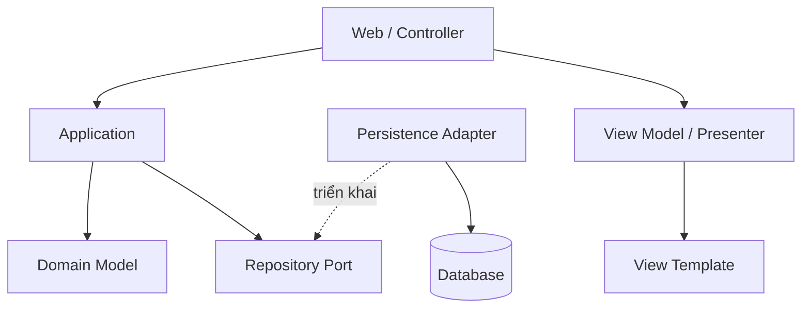
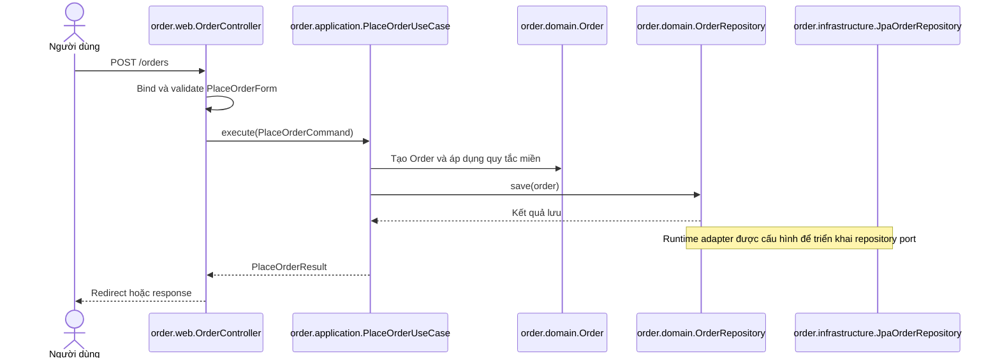

# Ranh giới gói mã cho Model, View và Controller

MVC (Model–View–Controller) phân tách ứng dụng theo ba trách nhiệm: Model quản lý trạng thái và quy tắc nghiệp vụ, View trình bày dữ liệu, còn Controller tiếp nhận tương tác và điều phối xử lý. Cách phân chia này chỉ có giá trị lâu dài khi cấu trúc mã nguồn cũng thể hiện được các ranh giới đó. Nếu mọi lớp được đặt trong một gói chung, hoặc Controller, Model và View phụ thuộc vòng tròn vào nhau, việc tìm mã, thay đổi chức năng và kiểm thử sẽ ngày càng khó.

Tổ chức package tốt giúp người đọc nhận ra một lớp thuộc trách nhiệm nào, giới hạn những phụ thuộc được phép và xác định nơi cần mở rộng khi thêm chức năng. Có hai cách tổ chức phổ biến: **theo tầng** (package by layer) và **theo chức năng** (package by feature). Cả hai đều có thể dùng MVC; lựa chọn phù hợp phụ thuộc quy mô ứng dụng, số lượng chức năng và cách nhóm phát triển làm việc.

## 1. Package boundary là gì và vì sao quan trọng?

Package boundary là ranh giới tổ chức mã nguồn, thường thể hiện qua tên package, phạm vi truy cập và các quy tắc phụ thuộc giữa những nhóm lớp. Một ranh giới tốt trả lời được ba câu hỏi:

- Lớp này chịu trách nhiệm cho phần nào của ứng dụng?
- Những package nào được phép sử dụng lớp này?
- Khi thay đổi một chức năng hoặc một chi tiết triển khai, phạm vi mã nguồn nào cần thay đổi theo?

Ví dụ, một ứng dụng quản lý đơn hàng có thể chứa `OrderController`, `Order`, `OrderRepository` và template `orders/detail.html`. Nếu tất cả được đặt trong cùng một package hoặc một thư mục không có quy ước, lập trình viên khó nhận ra lớp nào xử lý HTTP, lớp nào chứa quy tắc miền và lớp nào chỉ phục vụ hiển thị.

Khi ranh giới rõ ràng:

- Controller không cần truy cập trực tiếp bảng dữ liệu hoặc câu SQL.
- Model nghiệp vụ không phụ thuộc vào request, response hay template.
- View nhận dữ liệu đã chuẩn bị để trình bày, không tự thực thi quy tắc nghiệp vụ.
- Các chức năng có thể được phát triển và kiểm thử trong phạm vi dễ xác định.
- Những thay đổi về giao diện hoặc lưu trữ ít lan sang phần còn lại.

Package không tự động tạo ra kiến trúc tốt. Chỉ đổi tên thư mục thành `model`, `view` và `controller` mà không kiểm soát phụ thuộc thì các lớp vẫn có thể gọi chéo tùy ý. Cấu trúc thư mục, quy tắc import, phạm vi truy cập và kiểm thử kiến trúc cần hỗ trợ lẫn nhau.

## 2. Xác định trách nhiệm trước khi chia package

Trước khi chọn cách bố trí package, cần thống nhất những gì thuộc từng phần của MVC.

| Phần | Nội dung thường thuộc về | Nội dung không nên đặt ở đây |
|---|---|---|
| Model | Entity miền, value object, trạng thái và quy tắc nghiệp vụ; application service có thể được đặt trong package riêng để điều phối ca sử dụng | HTML, CSS, `HttpServletRequest`, tên template hoặc câu lệnh điều khiển giao diện |
| View | Template, component, layout, tài nguyên giao diện và mã trình bày | Truy vấn cơ sở dữ liệu, quy tắc phân quyền hoặc quyết định nghiệp vụ quan trọng |
| Controller | Route, ánh xạ request, kiểm tra đầu vào ở ranh giới, gọi ca sử dụng và chọn kiểu phản hồi | SQL, logic nghiệp vụ dài, thao tác DOM hoặc dựng giao diện chi tiết |

Trong ứng dụng Java, không phải mọi thành phần của View đều là Java package. HTML template, CSS, JavaScript và ảnh thường nằm trong thư mục tài nguyên như `src/main/resources/templates` hoặc `src/main/resources/static`. Package Java phía trình bày có thể chứa presenter, View Model, formatter hoặc component server-side nếu framework sử dụng chúng.

Model cũng cần được hiểu theo ngữ cảnh. Model nghiệp vụ là phần mô tả miền ứng dụng. `org.springframework.ui.Model` trong Spring MVC chỉ là đối tượng chứa thuộc tính mà Controller đưa sang View; nó không phải toàn bộ Model nghiệp vụ. Các lớp ánh xạ cơ sở dữ liệu có thể nằm trong adapter persistence riêng, dù ứng dụng nhỏ có thể dùng chung entity và đối tượng miền khi điều đó không làm rò rỉ chi tiết hạ tầng.

## 3. Tổ chức theo tầng (Package by Layer)

Với cách tổ chức theo tầng, các lớp có cùng trách nhiệm kỹ thuật được đặt chung package. Một cấu trúc Java điển hình:

```text
src/main/java/com/example/shop/
├── controller/
│   ├── OrderController.java
│   └── CustomerController.java
├── application/
│   ├── OrderService.java
│   └── CustomerService.java
├── model/
│   ├── order/
│   │   ├── Order.java
│   │   ├── OrderLine.java
│   │   └── OrderStatus.java
│   └── customer/
│       ├── Customer.java
│       └── CustomerId.java
├── repository/
│   ├── OrderRepository.java
│   └── CustomerRepository.java
├── persistence/
│   ├── JpaOrderRepository.java
│   └── JpaCustomerRepository.java
└── presentation/
    ├── order/
    │   ├── OrderDetailViewModel.java
    │   └── OrderViewMapper.java
    └── customer/
        └── CustomerViewModel.java

src/main/resources/
├── templates/
│   ├── orders/
│   │   ├── detail.html
│   │   └── list.html
│   └── customers/
│       └── detail.html
└── static/
    ├── css/
    └── js/
```

Ở đây, `controller` chứa các Controller web, `model` chứa mô hình miền, `application` điều phối ca sử dụng, `repository` chứa hợp đồng truy cập dữ liệu và `persistence` chứa implementation cụ thể. `presentation` chứa dữ liệu hoặc mapper phục vụ View. Template và tài nguyên tĩnh được đặt trong `resources` vì chúng không phải Java package.

### 3.1. Ưu điểm

- Dễ nhận biết các tầng kỹ thuật của hệ thống.
- Phù hợp với ứng dụng nhỏ hoặc ứng dụng có ít chức năng và quy tắc nghiệp vụ tương đối đồng nhất.
- Người mới dễ tìm một Controller, service, Model hoặc repository theo loại trách nhiệm.
- Có thể áp dụng quy tắc phụ thuộc chung giữa các tầng.

### 3.2. Hạn chế

Khi số chức năng tăng, mỗi package tầng có thể trở thành một nơi tập trung rất nhiều lớp. Để hiểu chức năng đặt hàng, lập trình viên phải chuyển qua `controller`, `application`, `model`, `repository`, `persistence` và `presentation`. Các lớp của một chức năng bị phân tán ở nhiều vị trí.

Một package `controller` cũng có thể chứa hàng chục Controller không liên quan. Nếu package tầng cho phép mọi lớp gọi mọi lớp khác trong cùng tầng, các phụ thuộc chéo giữa chức năng dễ phát triển mà khó nhận ra.

Vì vậy, tổ chức theo tầng thường phù hợp ở quy mô nhỏ đến vừa hoặc khi các nhóm chịu trách nhiệm theo tầng kỹ thuật. Khi hệ thống lớn dần, có thể chuyển sang tổ chức theo chức năng hoặc kết hợp hai cách.

## 4. Tổ chức theo chức năng (Package by Feature)

Với cách tổ chức theo chức năng, các lớp cùng phục vụ một khả năng nghiệp vụ được đặt gần nhau. Ví dụ:

```text
src/main/java/com/example/shop/
├── order/
│   ├── OrderController.java
│   ├── OrderApplicationService.java
│   ├── Order.java
│   ├── OrderLine.java
│   ├── OrderRepository.java
│   ├── JpaOrderRepository.java
│   └── OrderDetailViewModel.java
├── customer/
│   ├── CustomerController.java
│   ├── CustomerApplicationService.java
│   ├── Customer.java
│   ├── CustomerRepository.java
│   └── CustomerViewModel.java
└── shared/
    ├── error/
    └── web/

src/main/resources/
└── templates/
    ├── orders/
    └── customers/
```

Package `order` chứa những thành phần chính của chức năng đơn hàng; package `customer` chứa các thành phần của chức năng khách hàng. Một thay đổi trong luồng đặt hàng thường có thể được thực hiện bằng cách đọc các lớp trong cùng một khu vực mã nguồn.

### 4.1. Ưu điểm

- Các lớp liên quan đến cùng một chức năng nằm gần nhau.
- Dễ định vị phạm vi cần thay đổi khi thêm một use case.
- Giảm việc phải di chuyển liên tục giữa nhiều package tầng.
- Có thể giao quyền sở hữu theo nhóm chức năng hoặc miền nghiệp vụ.
- Thuận lợi để tiến tới module hóa khi các chức năng cần triển khai hoặc kiểm thử độc lập hơn.

### 4.2. Hạn chế

Nếu không có quy ước nội bộ, package theo chức năng có thể trộn Controller, entity persistence, Model nghiệp vụ, View Model và logic trình bày. Tên package cho biết chức năng nhưng chưa chắc cho biết ranh giới phụ thuộc.

Ngoài ra, các package chức năng có thể gọi trực tiếp lẫn nhau quá nhiều. Ví dụ `order` truy cập sâu vào cấu trúc nội bộ của `customer`, còn `customer` lại phụ thuộc vào Controller của `order`. Điều này tạo ra phụ thuộc vòng và khiến hai chức năng khó thay đổi độc lập.

Để tránh vấn đề đó, mỗi feature cần có quy ước về thành phần công khai, thành phần nội bộ và hợp đồng được phép dùng từ feature khác.

## 5. Kết hợp tổ chức theo chức năng và theo tầng

Với ứng dụng MVC có nhiều chức năng, cách kết hợp thường cân bằng tốt giữa khả năng tìm kiếm và ranh giới trách nhiệm. Package cấp cao được chia theo chức năng; bên trong mỗi chức năng, các nhóm lớp được chia theo trách nhiệm.

```text
src/main/java/com/example/shop/
├── order/
│   ├── web/
│   │   ├── OrderController.java
│   │   └── OrderDetailViewModel.java
│   ├── application/
│   │   ├── PlaceOrderUseCase.java
│   │   └── OrderQueryService.java
│   ├── domain/
│   │   ├── Order.java
│   │   ├── OrderLine.java
│   │   └── OrderRepository.java
│   └── infrastructure/
│       └── JpaOrderRepository.java
├── customer/
│   ├── web/
│   ├── application/
│   ├── domain/
│   └── infrastructure/
└── shared/
    ├── security/
    └── error/
```

Trong ví dụ này:

- `order.web` chứa Controller và kiểu dữ liệu phục vụ giao tiếp web.
- `order.application` điều phối các ca sử dụng và truy vấn.
- `order.domain` chứa quy tắc nghiệp vụ cùng hợp đồng repository thuộc miền.
- `order.infrastructure` triển khai lưu trữ hoặc tích hợp kỹ thuật.

Tên package có thể khác tùy quy ước dự án. Có dự án dùng `controller` thay cho `web`, `model` thay cho `domain`, hoặc đặt hợp đồng repository trong `application.port`. Điều quan trọng là vai trò và chiều phụ thuộc được hiểu thống nhất.

### 5.1. Khi nào nên dùng cấu trúc kết hợp?

Cấu trúc kết hợp hữu ích khi:

- Ứng dụng có nhiều chức năng nghiệp vụ độc lập.
- Một chức năng có nhiều Controller, use case và quy tắc miền.
- Các nhóm cần sở hữu chức năng từ giao diện đến nghiệp vụ và tích hợp.
- Có nhu cầu kiểm soát phụ thuộc giữa web, domain và hạ tầng.

Không cần tạo đủ bốn package con cho mọi feature. Một chức năng CRUD đơn giản có thể chỉ cần `web` và `application`; chỉ bổ sung `domain` hoặc `infrastructure` riêng khi trách nhiệm và mức độ phức tạp thực sự cần đến.

## 6. Quy tắc phụ thuộc giữa các package

Tên package chỉ mô tả vị trí. Quy tắc phụ thuộc xác định lớp nào được phép tham chiếu lớp nào. Một nguyên tắc hữu ích là chi tiết giao tiếp và hạ tầng phụ thuộc vào hợp đồng của ứng dụng hoặc miền; Model nghiệp vụ không phụ thuộc vào framework web hay giao diện.



Có thể diễn đạt quy tắc ở mức khái quát:

| Package nguồn | Có thể phụ thuộc vào | Nên tránh phụ thuộc vào |
|---|---|---|
| `web` / `controller` | Application service, command/query, request model, View Model và API của framework web | SQL, entity ORM nội bộ, quy tắc nghiệp vụ chi tiết |
| `application` | Domain Model, hợp đồng repository/gateway và kiểu dữ liệu ứng dụng | Servlet API, template, CSS hoặc implementation JPA cụ thể |
| `domain` / `model` | Các khái niệm miền và thư viện nền tảng cần thiết | Controller, View, HTTP, Spring MVC, cơ sở dữ liệu hoặc ORM cụ thể |
| `infrastructure` / `persistence` | Hợp đồng cần triển khai và thư viện hạ tầng | Buộc Model nghiệp vụ phụ thuộc ngược vào implementation |
| `view` / `presentation` | View Model, dữ liệu đã chuẩn bị và framework trình bày | Repository, câu SQL hoặc quy tắc nghiệp vụ có tác động dữ liệu |

Trong một dự án MVC đơn giản, Controller có thể gọi service rồi đưa dữ liệu vào View trực tiếp. Khi ứng dụng lớn hơn, việc đặt application service và repository port rõ ràng giúp ngăn Controller trở thành nơi chứa nghiệp vụ hoặc truy vấn.

### 6.1. Tránh phụ thuộc vòng

Ví dụ phụ thuộc không tốt:

```text
order.controller -> customer.controller
customer.controller -> order.controller
```

Hai Controller gọi lẫn nhau khiến luồng điều phối khó hiểu và dễ tạo vòng lặp. Nếu chức năng đơn hàng cần thông tin khách hàng, nó nên gọi một hợp đồng ứng dụng như `CustomerQueryService` hoặc một use case phù hợp, thay vì gọi Controller của khách hàng.

Tương tự, Model không nên import View Model chỉ để lấy một chuỗi hiển thị; View không nên gọi ngược Controller hoặc repository để tự tải dữ liệu. Hãy chuyển dữ liệu qua hợp đồng ở ranh giới thích hợp.

### 6.2. Giữ API package nhỏ và có chủ đích

Không nên để mọi lớp đều `public` nếu chúng chỉ phục vụ nội bộ một package. Trong Java, phạm vi package-private (không khai báo `public`) giúp giới hạn việc sử dụng từ package khác. Có thể công khai service interface hoặc kiểu dữ liệu cần thiết, giữ mapper và implementation ở phạm vi nội bộ khi không cần chia sẻ.

Ví dụ:

```java
package com.example.shop.order.application;

public interface PlaceOrderUseCase {
    PlaceOrderResult execute(PlaceOrderCommand command);
}

record PlaceOrderResult(String orderNumber) {}
```

Ví dụ này minh họa phạm vi package trong Java; nếu `PlaceOrderResult` cần được Controller ở package khác sử dụng, kiểu đó phải có phạm vi truy cập phù hợp, hoặc được đặt trong một package contract công khai có chủ đích. Không nên mở rộng quyền truy cập chỉ để làm cho một import tùy tiện hoạt động.

## 7. Ví dụ luồng request theo cấu trúc package

Giả sử người dùng gửi yêu cầu tạo đơn hàng. Với cấu trúc kết hợp theo feature và layer, luồng có thể diễn ra như sau:



Controller chỉ xử lý ranh giới HTTP và chuyển dữ liệu sang command. Application use case điều phối thao tác. Domain Model kiểm tra quy tắc và giữ trạng thái hợp lệ. Repository port mô tả nhu cầu lưu; adapter hạ tầng thực hiện bằng JPA hoặc JDBC. Kết quả quay lại Controller để chọn phản hồi.

Một ví dụ rút gọn về các package và lớp:

```java
// order/web/OrderController.java
package com.example.shop.order.web;

@Controller
@RequestMapping("/orders")
public class OrderController {
    private final PlaceOrderUseCase placeOrder;

    public OrderController(PlaceOrderUseCase placeOrder) {
        this.placeOrder = placeOrder;
    }

    @PostMapping
    public String create(@Valid @ModelAttribute PlaceOrderForm form,
                         BindingResult errors) {
        if (errors.hasErrors()) {
            return "orders/new";
        }

        PlaceOrderCommand command = new PlaceOrderCommand(
            form.customerReference(), form.lines()
        );
        PlaceOrderResult result = placeOrder.execute(command);
        return "redirect:/orders/" + result.orderNumber();
    }
}
```

```java
// order/application/PlaceOrderUseCase.java
package com.example.shop.order.application;

public interface PlaceOrderUseCase {
    PlaceOrderResult execute(PlaceOrderCommand command);
}
```

```java
// order/domain/OrderRepository.java
package com.example.shop.order.domain;

public interface OrderRepository {
    void save(Order order);
}
```

```java
// order/infrastructure/JpaOrderRepository.java
package com.example.shop.order.infrastructure;

@Repository
class JpaOrderRepository implements OrderRepository {
    // Cài đặt bằng Spring Data JPA hoặc EntityManager.
}
```

Các đoạn mã là phác thảo về vị trí và hợp đồng; một dự án chạy được cần định nghĩa đầy đủ command, result, form, entity, constructor injection, các import và cấu hình Spring để đăng ký implementation. Các kiểu trao đổi như `PlaceOrderCommand` và `PlaceOrderResult` phải có phạm vi truy cập phù hợp (thường là `public` trong file riêng hoặc nằm trong package contract công khai) nếu Controller và application use case ở package khác nhau. Ví dụ cho thấy Controller chỉ import hợp đồng use case, còn lớp infrastructure triển khai repository port. Controller không cần import `JpaOrderRepository`.

## 8. Đặt View và tài nguyên giao diện ở đâu?

Với ứng dụng server-rendered, template thường nằm ngoài `src/main/java`:

```text
src/main/resources/
├── templates/
│   ├── layout/
│   │   └── main.html
│   └── orders/
│       ├── new.html
│       ├── detail.html
│       └── list.html
└── static/
    ├── css/
    └── js/
```

Controller có thể trả về tên View logic `orders/detail`; framework sẽ tìm template tương ứng theo quy ước. View nhận các thuộc tính đã được Controller đưa vào model container hoặc View Model. Không nên đặt template HTML vào package domain hoặc để entity chứa tên file template.

Nếu giao diện là SPA được xây dựng bằng một dự án frontend riêng, component và route của frontend thường được tổ chức theo feature tương tự:

```text
frontend/src/
├── features/
│   ├── orders/
│   │   ├── components/
│   │   ├── pages/
│   │   ├── api/
│   │   └── types/
│   └── customers/
│       ├── components/
│       ├── pages/
│       ├── api/
│       └── types/
└── shared/
    ├── components/
    └── utilities/
```

Frontend component không phải Controller phía server. Nó quản lý tương tác và gọi API; Controller backend vẫn là nơi tiếp nhận HTTP request ở phía server. Cần đặt tên rõ để tránh nhầm lẫn giữa UI component, client-side controller và MVC Controller của backend.

## 9. Đặt tên package và lớp nhất quán

Tên package nên ngắn, dùng chữ thường và mô tả vai trò hoặc chức năng. Tên lớp dùng danh từ hoặc cụm danh từ thể hiện mục đích. Một số quy ước tham khảo:

| Loại thành phần | Tên ví dụ |
|---|---|
| Controller | `OrderController`, `OrderApiController` |
| Application service / use case | `PlaceOrderUseCase`, `OrderQueryService` |
| Model nghiệp vụ | `Order`, `OrderLine`, `Money` |
| Repository port | `OrderRepository` |
| Persistence adapter | `JpaOrderRepository`, `JdbcOrderRepository` |
| Request model | `PlaceOrderForm`, `CreateOrderRequest` |
| View Model | `OrderDetailViewModel` |
| Mapper | `OrderViewMapper`, `OrderPersistenceMapper` |

Tránh các package chung chung như `utils`, `common`, `misc` chứa nhiều lớp không liên quan. Nếu có thành phần dùng chung, hãy nhóm theo năng lực cụ thể như `security`, `error`, `clock` hoặc `pagination`. Package `shared` nên nhỏ và chứa những hợp đồng thực sự dùng chung; không biến nó thành nơi đưa mọi lớp khó phân loại.

## 10. Kiểm soát ranh giới bằng công cụ và quy ước

### 10.1. Giới hạn phạm vi truy cập

Trong Java, package-private giúp giữ lớp ở phạm vi package. Constructor, method và field cũng nên có mức truy cập tối thiểu cần thiết. Không nên công khai implementation persistence chỉ để Controller hoặc package khác có thể gọi trực tiếp.

### 10.2. Kiểm tra phụ thuộc kiến trúc

Có thể dùng ArchUnit hoặc quy tắc module của build tool để kiểm tra các ranh giới quan trọng. Ví dụ kiểm tra package domain không phụ thuộc vào Spring Web:

```java
@AnalyzeClasses(packages = "com.example.shop")
class ArchitectureRulesTest {

    @ArchTest
    static final ArchRule domainMustNotDependOnWeb =
        noClasses()
            .that().resideInAPackage("..domain..")
            .should().dependOnClassesThat()
            .resideInAnyPackage("org.springframework.web..", "jakarta.servlet..");
}
```

Quy tắc này chỉ là ví dụ minh họa; cần điều chỉnh package gốc và thư viện web theo dự án. Có thể bổ sung quy tắc để `web` không phụ thuộc vào `infrastructure`, hoặc để các feature chỉ truy cập API công khai của feature khác.

### 10.3. Tổ chức test theo cấu trúc sản phẩm

Test nên phản ánh phạm vi trách nhiệm mà nó xác minh. Có thể giữ package test song song với mã nguồn:

```text
src/test/java/com/example/shop/
├── order/
│   ├── web/OrderControllerTest.java
│   ├── application/PlaceOrderUseCaseTest.java
│   ├── domain/OrderTest.java
│   └── infrastructure/JpaOrderRepositoryTest.java
└── customer/
    └── ...
```

Unit test cho domain không cần dựng Spring context hoặc cơ sở dữ liệu. Test Controller có thể mock use case và kiểm tra route, validation, status hoặc redirect. Test repository adapter cần cơ sở dữ liệu kiểm thử để xác minh mapping và truy vấn. Cách đặt test gần package tương ứng giúp người đọc tìm được bằng chứng kiểm tra cho từng ranh giới.

## 11. Những sai lầm thường gặp

**Chỉ chia ba package `model`, `view`, `controller` rồi dừng lại.** Cấu trúc này có thể đủ cho ví dụ nhỏ, nhưng trong ứng dụng lớn mỗi package dễ trở thành nơi chứa hàng trăm lớp. Hãy nhóm thêm theo feature hoặc theo miền khi cần.

**Đưa mọi lớp dữ liệu vào `model`.** Entity miền, entity ORM, request DTO và View Model có mục đích khác nhau. Nếu đặt tất cả vào một package mà không phân biệt, Controller và View dễ dùng nhầm kiểu dữ liệu nội bộ.

**Đặt template vào Java package.** HTML, CSS và JavaScript thường là tài nguyên hoặc thuộc dự án frontend. Giữ chúng ở vị trí mà framework và công cụ build mong đợi; Java package có thể chứa presenter hoặc View Model.

**Cho Controller truy cập thẳng persistence.** Việc Controller import `JdbcTemplate`, `EntityManager` hoặc adapter JPA khiến tầng giao tiếp phụ thuộc công nghệ lưu trữ. Hãy gọi application service hoặc query service qua hợp đồng.

**Để feature gọi Controller của feature khác.** Controller là adapter giao thức, không phải API nội bộ giữa các chức năng. Hãy gọi use case hoặc service công khai của feature đích.

**Tạo package `shared` quá lớn.** Thành phần không có chỗ đặt không có nghĩa là nó thực sự dùng chung. Hãy đặt lớp gần nơi sở hữu trách nhiệm và chỉ đưa ra `shared` khi có nhiều bên sử dụng cùng một khái niệm ổn định.

**Tạo quá nhiều package rỗng hoặc tầng trung gian.** Mỗi package nên thể hiện một ranh giới có ý nghĩa. Không cần tạo `service`, `manager`, `helper`, `adapter` cho một chức năng chỉ có một lớp đơn giản nếu điều đó không giúp kiểm soát phụ thuộc hoặc tìm mã.

**Không kiểm tra phụ thuộc sau khi cấu trúc đã hình thành.** Quy ước ban đầu dễ bị phá vỡ khi tính năng mới được thêm. Có thể dùng review checklist, package-private và architecture test để giữ ranh giới theo thời gian.

## 12. Chọn cấu trúc package theo quy mô

| Bối cảnh | Cấu trúc nên cân nhắc | Lý do |
|---|---|---|
| Bài tập hoặc ứng dụng CRUD nhỏ | Theo tầng đơn giản | Ít lớp, dễ hiểu và dễ bắt đầu |
| Ứng dụng vừa, có nhiều chức năng riêng | Theo feature | Tập trung các lớp liên quan và giới hạn phạm vi thay đổi |
| Ứng dụng lớn, nghiệp vụ phức tạp | Feature kết hợp layer nội bộ | Vừa thể hiện miền nghiệp vụ, vừa kiểm soát phụ thuộc kỹ thuật |
| Nhiều nhóm phát triển hoặc nhiều module triển khai độc lập | Feature/module boundary rõ và API nội bộ có kiểm soát | Giảm phụ thuộc chéo và hỗ trợ quyền sở hữu |

Không có một cấu trúc package duy nhất phù hợp mọi ứng dụng. Có thể bắt đầu với cấu trúc đơn giản, sau đó tách package khi số lượng lớp, tần suất thay đổi hoặc số lượng phụ thuộc khiến việc tìm và kiểm soát mã trở nên khó khăn. Tránh tạo kiến trúc phức tạp chỉ vì dự đoán một khả năng thay đổi chưa có nhu cầu thực tế.

## 13. Checklist rà soát package boundary

Khi review cấu trúc mã nguồn MVC, hãy kiểm tra:

1. Package thể hiện rõ chức năng hoặc trách nhiệm của các lớp bên trong chưa?
2. Model nghiệp vụ có phụ thuộc vào Controller, View, HTTP hoặc framework persistence không?
3. Controller có gọi application service/use case thay vì truy cập SQL hoặc repository implementation trực tiếp không?
4. View có nhận dữ liệu trình bày phù hợp và tránh gọi trực tiếp tầng lưu trữ không?
5. Template, CSS, JavaScript và tài nguyên giao diện có nằm ở đúng vị trí của framework/build không?
6. Các feature có gọi nhau qua hợp đồng công khai thay vì truy cập sâu vào package nội bộ không?
7. Có phụ thuộc vòng giữa Controller, Model, View hoặc giữa các feature không?
8. Các lớp nội bộ có được giới hạn phạm vi truy cập phù hợp không?
9. Có architecture test hoặc quy ước review để phát hiện vi phạm phụ thuộc không?
10. Cấu trúc hiện tại có tương xứng với quy mô và độ phức tạp thực tế không?

## Kết luận

Ranh giới package giúp cấu trúc mã nguồn phản ánh trách nhiệm của MVC và giới hạn phụ thuộc giữa các phần. Tổ chức theo tầng giúp tìm lớp theo vai trò kỹ thuật; tổ chức theo feature giữ các thành phần của cùng chức năng gần nhau; kết hợp feature với các tầng nội bộ thường phù hợp khi ứng dụng có nhiều nghiệp vụ và cần kiểm soát kiến trúc chặt hơn. Dù chọn cách nào, Model nghiệp vụ cần độc lập với giao diện và hạ tầng, Controller nên điều phối qua hợp đồng ứng dụng, còn View chỉ trình bày dữ liệu đã chuẩn bị. Quy tắc phụ thuộc, phạm vi truy cập và kiểm thử kiến trúc mới là những yếu tố giữ cho ranh giới package có hiệu lực theo thời gian.
