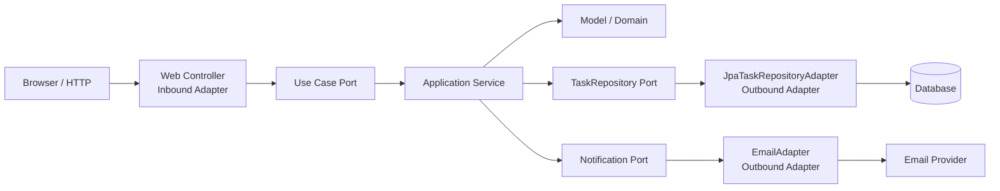
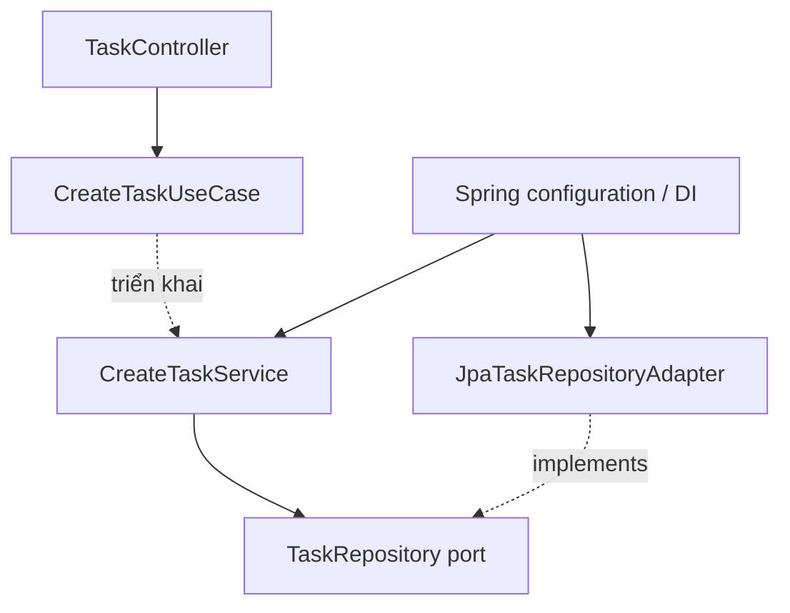

# Đặt dịch vụ ứng dụng, kho lưu trữ và bộ chuyển đổi

Trong ứng dụng MVC, Controller tiếp nhận request và điều phối tương tác, Model biểu diễn trạng thái cùng quy tắc nghiệp vụ, còn View trình bày kết quả. Khi ứng dụng lớn dần, Controller không nên trực tiếp thực hiện mọi bước nghiệp vụ, truy vấn cơ sở dữ liệu hoặc gọi dịch vụ bên ngoài. Cần tổ chức thêm các thành phần có trách nhiệm rõ ràng: **dịch vụ ứng dụng (application service)** điều phối một use case, **kho lưu trữ (repository)** cung cấp hợp đồng đọc và ghi dữ liệu miền, và **bộ chuyển đổi (adapter)** nối các hợp đồng bên trong với framework, cơ sở dữ liệu hoặc hệ thống bên ngoài.

Ví dụ, chức năng tạo công việc có thể đi qua `TaskController`, `CreateTaskService`, `TaskRepository` và `JpaTaskRepositoryAdapter`. Controller đọc request và tạo command; dịch vụ ứng dụng thực hiện use case; repository cung cấp khả năng lưu công việc; adapter dùng JPA để ghi dữ liệu. Mỗi thành phần tập trung vào một phần của luồng, nên có thể thay đổi cách lưu trữ hoặc giao tiếp mà ít ảnh hưởng đến phần nghiệp vụ.

## Ba loại thành phần giải quyết ba trách nhiệm

| Thành phần | Câu hỏi chính | Trách nhiệm điển hình | Không nên làm |
|---|---|---|---|
| Application service | Use case này cần phối hợp những bước nào? | Điều phối nghiệp vụ, quản lý transaction, gọi Model và các port | Dựng HTML, xử lý chi tiết SQL hoặc chứa mọi quy tắc miền |
| Repository | Làm thế nào để tìm và lưu đối tượng nghiệp vụ? | Cung cấp hợp đồng truy xuất/lưu dữ liệu | Quyết định luồng giao diện hoặc điều phối toàn bộ use case |
| Adapter | Làm thế nào để nối hợp đồng bên trong với công nghệ bên ngoài? | Chuyển đổi request/response, ánh xạ dữ liệu, gọi framework hoặc hệ thống ngoài | Đưa quy tắc miền cốt lõi vào chi tiết công nghệ |

Ba thành phần có thể nằm trong cùng một ứng dụng và giao tiếp qua interface. Chúng không phải ba tầng bắt buộc phải có trong mọi dự án. Với chức năng rất nhỏ, có thể dùng ít lớp hơn; khi cần thay thế công nghệ, kiểm thử độc lập hoặc điều phối nhiều bước, việc tách rõ sẽ có lợi.

## Dịch vụ ứng dụng điều phối một use case

Application service biểu diễn một hành động mà ứng dụng cung cấp, chẳng hạn tạo công việc, hoàn thành công việc, tìm danh sách công việc hoặc phê duyệt yêu cầu. Nó nhận dữ liệu đã được chuyển thành kiểu phù hợp, phối hợp các đối tượng miền và các cổng truy cập dữ liệu, rồi trả kết quả cho lớp gọi.

Các trách nhiệm thường thuộc application service:

- xác định trình tự các bước của một use case;
- tải những đối tượng cần thiết qua repository;
- gọi hành vi trên entity hoặc domain service để thực thi quy tắc;
- phối hợp nhiều repository hoặc port khi một use case cần nhiều nguồn dữ liệu;
- xác định ranh giới transaction cho thao tác đọc/ghi;
- gọi port cho các tác động bên ngoài như gửi thông báo hoặc phát sự kiện;
- trả kết quả có ý nghĩa cho Controller hoặc adapter khác.

Application service thường không tự chứa quy tắc trạng thái chi tiết của entity. Ví dụ, dịch vụ có thể tải một `Task` rồi gọi `task.complete()`. Entity `Task` chịu trách nhiệm quyết định trạng thái hiện tại có cho phép hoàn thành hay không. Dịch vụ điều phối việc tải, gọi hành vi và lưu thay đổi.

### Ví dụ Model giữ quy tắc, service điều phối

```java
public final class Task {
    private final TaskId id;
    private final String title;
    private TaskStatus status;

    private Task(TaskId id, String title, TaskStatus status) {
        this.id = id;
        this.title = title;
        this.status = status;
    }

    public static Task create(TaskId id, String title) {
        if (title == null || title.isBlank()) {
            throw new IllegalArgumentException("Tiêu đề không được để trống");
        }
        return new Task(id, title.trim(), TaskStatus.OPEN);
    }

    public void complete() {
        if (status != TaskStatus.IN_PROGRESS) {
            throw new IllegalStateException(
                    "Chỉ công việc đang thực hiện mới có thể hoàn thành");
        }
        status = TaskStatus.COMPLETED;
    }

    public TaskId id() {
        return id;
    }

    public String title() {
        return title;
    }

    public TaskStatus status() {
        return status;
    }
}
```

`Task` bảo vệ quy tắc của chính nó. Nó không biết HTTP request, tên template, transaction của Spring hay cấu trúc bảng dữ liệu.

Một application service có thể điều phối thao tác tạo:

```java
public interface CreateTaskUseCase {
    TaskId handle(CreateTaskCommand command);
}
```

```java
@Service
public class CreateTaskService implements CreateTaskUseCase {
    private final TaskRepository taskRepository;
    private final TaskIdGenerator taskIdGenerator;

    public CreateTaskService(
            TaskRepository taskRepository,
            TaskIdGenerator taskIdGenerator) {
        this.taskRepository = taskRepository;
        this.taskIdGenerator = taskIdGenerator;
    }

    @Override
    @Transactional
    public TaskId handle(CreateTaskCommand command) {
        Task task = Task.create(
                taskIdGenerator.nextId(), command.title());
        taskRepository.save(task);
        return task.id();
    }
}
```

Đây là ví dụ rút gọn: `CreateTaskCommand`, `TaskId`, `TaskIdGenerator`, `TaskRepository` và `TaskStatus` là các kiểu thuộc ứng dụng/miền cần được định nghĩa. `@Transactional` đặt ranh giới transaction quanh use case trong ứng dụng Spring; nếu dùng framework khác, có thể dùng cơ chế transaction tương ứng.

### Application service khác Domain service thế nào?

Hai loại service có mục đích khác nhau:

- **Application service** điều phối use case ở cấp ứng dụng: nhận command, tải đối tượng, gọi hành vi, lưu thay đổi và quản lý transaction.
- **Domain service** biểu diễn một quy tắc nghiệp vụ không tự nhiên thuộc về một entity hoặc value object cụ thể. Nó thường làm việc với các khái niệm miền, không điều phối HTTP hay chọn View.

Ví dụ, `CompleteTaskService` có thể tải công việc, kiểm tra ngữ cảnh người dùng, gọi `task.complete()` và lưu lại. Một `TaskAssignmentPolicy` có thể là domain service nếu quy tắc phân công cần phối hợp năng lực người nhận và trạng thái dự án, không thuộc riêng một entity nào.

Không nên tạo một service chỉ để chuyển tiếp một lời gọi mà không có lý do về hợp đồng, điều phối hoặc ranh giới. Ngược lại, nếu Controller chứa nhiều bước và được nhiều kênh gọi cần tái sử dụng, một application service riêng thường là lựa chọn phù hợp.

## Repository cung cấp hợp đồng truy cập dữ liệu

Repository che giấu cách lưu trữ và cung cấp các thao tác gần với nhu cầu của nghiệp vụ. Thay vì để application service viết SQL hoặc gọi trực tiếp API ORM, service phụ thuộc vào một interface như `TaskRepository`.

```java
import java.util.Optional;

public interface TaskRepository {
    Optional<Task> findById(TaskId id);
    void save(Task task);
}
```

Hợp đồng này mô tả những gì use case cần: tìm một công việc theo định danh và lưu công việc. Nó không tiết lộ bảng, câu SQL, `EntityManager` hay thư viện persistence.

### Interface repository đặt ở đâu?

Vị trí interface phụ thuộc vào cách tổ chức kiến trúc:

- Trong kiến trúc phân lớp đơn giản, interface có thể nằm cùng module Model hoặc module data access nếu ranh giới phụ thuộc đã rõ.
- Trong Hexagonal Architecture hoặc Clean Architecture, interface thường được xem là output port và đặt ở phía trong, gần application/domain layer đang cần nó. Adapter lưu trữ ở phía ngoài triển khai interface đó.
- Một số dự án đặt repository interface trong domain vì nó diễn tả tập hợp đối tượng miền; dự án khác đặt trong application vì truy vấn phục vụ riêng một use case. Chọn nơi đặt dựa trên chủ sở hữu hợp đồng và kiểu dữ liệu mà hợp đồng trả về.

Điểm quan trọng là phần nghiệp vụ không phụ thuộc vào lớp triển khai persistence. Nếu interface trả thẳng `JpaTaskEntity`, `Page` của một framework hoặc kiểu đặc thù của ORM, chi tiết hạ tầng đã rò rỉ qua hợp đồng. Khi đó, cân nhắc dùng kiểu miền, projection hoặc kiểu kết quả thuộc ứng dụng.

### Repository không phải nơi đặt mọi truy vấn

Repository thường cung cấp các thao tác đọc/ghi theo aggregate hoặc theo nhu cầu nghiệp vụ. Với màn hình báo cáo hoặc truy vấn chỉ đọc phức tạp, có thể dùng query service hoặc read model riêng thay vì ép mọi truy vấn vào repository của entity. Cần tránh hai thái cực: một repository tổng quát chứa mọi câu truy vấn của toàn hệ thống, hoặc một interface riêng cho từng câu SQL nhỏ mà không tạo ra hợp đồng có ý nghĩa.

## Adapter nối port nội bộ với công nghệ bên ngoài

Adapter chuyển đổi giữa hợp đồng mà ứng dụng muốn sử dụng và giao thức hoặc API mà một thành phần bên ngoài cung cấp. Ý tưởng này thường xuất hiện trong kiến trúc Ports and Adapters (Hexagonal Architecture): lõi ứng dụng định nghĩa port; adapter ở ranh giới triển khai port hoặc gọi port từ bên ngoài.

Có hai hướng adapter thường gặp:

- **Inbound adapter (adapter đầu vào):** nhận tương tác từ bên ngoài và gọi use case. Controller MVC, REST endpoint, command-line handler hoặc message consumer có thể đóng vai trò này.
- **Outbound adapter (adapter đầu ra):** được ứng dụng gọi thông qua port để tương tác với bên ngoài. Ví dụ adapter JPA lưu dữ liệu, adapter gọi dịch vụ email, adapter gửi message hoặc adapter truy cập API đối tác.



Trong sơ đồ, Controller là adapter đầu vào gọi use case. Application service phụ thuộc các port đầu ra. Adapter JPA và adapter email triển khai những port đó để kết nối với công nghệ bên ngoài. Hướng phụ thuộc mã nguồn nên đi từ adapter vào hợp đồng phía trong; lõi nghiệp vụ không cần import lớp JPA hoặc SDK email.

### Ví dụ adapter lưu trữ bằng Spring Data JPA

Một interface Spring Data chỉ thuộc về phần triển khai hạ tầng:

```java
interface SpringDataTaskRepository
        extends JpaRepository<TaskJpaEntity, Long> {
}
```

Adapter triển khai port `TaskRepository` và chuyển đổi giữa entity miền với entity persistence:

```java
@Repository
public class JpaTaskRepositoryAdapter implements TaskRepository {
    private final SpringDataTaskRepository jpaRepository;
    private final TaskPersistenceMapper mapper;

    public JpaTaskRepositoryAdapter(
            SpringDataTaskRepository jpaRepository,
            TaskPersistenceMapper mapper) {
        this.jpaRepository = jpaRepository;
        this.mapper = mapper;
    }

    @Override
    public Optional<Task> findById(TaskId id) {
        return jpaRepository.findById(id.value())
                .map(mapper::toDomain);
    }

    @Override
    public void save(Task task) {
        TaskJpaEntity entity = mapper.toEntity(task);
        jpaRepository.save(entity);
    }
}
```

`TaskJpaEntity` mô tả cách lưu trữ; `Task` biểu diễn khái niệm miền. `TaskPersistenceMapper` chuyển đổi giữa hai dạng. Với ứng dụng đơn giản, có thể dùng cùng một class cho entity và model nếu điều đó không làm rò rỉ persistence vào quy tắc nghiệp vụ. Khi cần tách, adapter là nơi phù hợp để giữ phần ánh xạ.

### Adapter cho dịch vụ bên ngoài

Giả sử khi tạo công việc, ứng dụng cần yêu cầu một dịch vụ thông báo gửi email. Application layer định nghĩa port theo ngôn ngữ của ứng dụng:

```java
public interface TaskNotificationPort {
    void taskCreated(TaskId taskId, String title, UserId recipientId);
}
```

Adapter bên ngoài chuyển lời gọi này thành request của nhà cung cấp email:

```java
@Component
public class EmailTaskNotificationAdapter implements TaskNotificationPort {
    private final EmailGateway emailGateway;

    public EmailTaskNotificationAdapter(EmailGateway emailGateway) {
        this.emailGateway = emailGateway;
    }

    @Override
    public void taskCreated(TaskId taskId, String title, UserId recipientId) {
        emailGateway.sendTaskCreatedMessage(
                recipientId.value(), taskId.value(), title);
    }
}
```

Application service chỉ biết `TaskNotificationPort`, không biết SDK, endpoint hay cấu trúc request của nhà cung cấp. Adapter chịu trách nhiệm chuyển đổi và xử lý lỗi giao tiếp theo chính sách tích hợp.

Nếu gửi email không được phép làm thất bại thao tác tạo công việc, không nên tùy tiện gọi dịch vụ email đồng bộ bên trong transaction cơ sở dữ liệu rồi giả định hai hệ thống cùng rollback. Có thể ghi sự kiện vào outbox trong cùng transaction và để worker gửi thông báo sau khi commit. Cách triển khai cụ thể tùy yêu cầu nhất quán và độ tin cậy của hệ thống.

## Adapter đầu vào trong MVC

Controller MVC cũng là adapter. Nó chuyển giao thức HTTP thành lời gọi use case và chuyển kết quả use case thành response web.

```java
public record CreateTaskRequest(
        @NotBlank @Size(max = 120) String title) {
}

public record CreateTaskResponse(long id) {
}
```

```java
@RestController
@RequestMapping("/api/tasks")
public class TaskController {
    private final CreateTaskUseCase createTask;

    public TaskController(CreateTaskUseCase createTask) {
        this.createTask = createTask;
    }

    @PostMapping
    public ResponseEntity<CreateTaskResponse> create(
            @Valid @RequestBody CreateTaskRequest request) {

        TaskId id = createTask.handle(
                new CreateTaskCommand(request.title()));

        URI location = URI.create("/api/tasks/" + id.value());
        return ResponseEntity.created(location)
                .body(new CreateTaskResponse(id.value()));
    }
}
```

Controller chuyển `CreateTaskRequest` thành `CreateTaskCommand`, gọi use case và chuyển `TaskId` thành response DTO. Lõi ứng dụng không cần biết tên JSON field, HTTP status hoặc annotation Spring. Với ứng dụng render HTML, adapter có thể trả về tên View và dữ liệu cho template thay vì JSON; vai trò chuyển đổi ở ranh giới vẫn tương tự.

## Đặt các thành phần trong cấu trúc package

Có hai cách tổ chức phổ biến: theo tầng kỹ thuật hoặc theo tính năng. Cả hai đều có thể giữ ranh giới MVC và adapter nếu dependency được kiểm soát.

### Tổ chức theo tầng

```text
com.example.app
├── controller
│   ├── TaskController.java
│   └── CreateTaskRequest.java
├── application
│   ├── CreateTaskService.java
│   ├── CreateTaskUseCase.java
│   ├── CreateTaskCommand.java
│   └── port
│       └── out
│           └── TaskRepository.java
├── domain
│   ├── Task.java
│   ├── TaskId.java
│   └── TaskStatus.java
└── infrastructure
    └── persistence
        ├── JpaTaskRepositoryAdapter.java
        ├── SpringDataTaskRepository.java
        ├── TaskJpaEntity.java
        └── TaskPersistenceMapper.java
```

Cấu trúc theo tầng dễ nhận biết trong dự án nhỏ và vừa. Tuy nhiên, khi có nhiều tính năng, các package `controller`, `service` và `repository` có thể trở thành nơi chứa hàng trăm class không liên quan.

### Tổ chức theo tính năng với ranh giới bên trong

```text
com.example.app
└── task
    ├── web
    │   ├── TaskController.java
    │   ├── CreateTaskRequest.java
    │   └── TaskViewMapper.java
    ├── application
    │   ├── CreateTaskService.java
    │   ├── CreateTaskUseCase.java
    │   ├── CreateTaskCommand.java
    │   └── port
    │       └── out
    │           └── TaskRepository.java
    ├── domain
    │   ├── Task.java
    │   ├── TaskId.java
    │   └── TaskStatus.java
    └── infrastructure
        └── persistence
            ├── JpaTaskRepositoryAdapter.java
            ├── SpringDataTaskRepository.java
            ├── TaskJpaEntity.java
            └── TaskPersistenceMapper.java
```

Tổ chức theo tính năng giúp các thành phần của `task` ở gần nhau, trong khi các package con vẫn thể hiện ranh giới. Khi module lớn, có thể tách tính năng thành module riêng và chỉ công khai các hợp đồng cần thiết.

Không có một cấu trúc thư mục duy nhất đúng cho mọi dự án. Hãy chọn cấu trúc giúp nhóm tìm được nơi đặt code, giới hạn phụ thuộc và tránh tạo package chung quá lớn.

## Hướng phụ thuộc và Dependency Injection

Nếu application service import trực tiếp `JpaTaskRepositoryAdapter`, phần nghiệp vụ bị gắn với JPA. Khi đổi sang JDBC, MongoDB hoặc nguồn dữ liệu giả trong kiểm thử, application service cũng phải thay đổi.

Với Dependency Inversion, application service phụ thuộc vào interface `TaskRepository`; adapter lưu trữ triển khai interface đó. Dependency Injection của framework cung cấp implementation khi tạo đối tượng.



Sơ đồ nhấn mạnh hai điều: interface là hợp đồng mà use case cần; framework wiring các implementation tại composition root hoặc cấu hình ứng dụng. Mũi tên phụ thuộc mã nguồn cần hướng về abstraction phía trong, dù lúc chạy đối tượng service nhận được adapter cụ thể.

Ví dụ, Spring có thể tự inject `JpaTaskRepositoryAdapter` vì nó là bean triển khai `TaskRepository`. Nếu có nhiều implementation, cần cấu hình `@Primary`, `@Qualifier` hoặc khai báo bean tường minh để tránh lựa chọn mơ hồ. Không nên để application service tự gọi `new JpaTaskRepositoryAdapter(...)`; việc khởi tạo và kết nối implementation thuộc cấu hình ứng dụng.

## Transaction và ranh giới use case

Application service thường là nơi phù hợp để đặt ranh giới transaction vì nó biểu diễn một use case có thể gồm nhiều thao tác đọc/ghi cần nhất quán cùng nhau.

Ví dụ, chuyển công việc sang dự án khác có thể cần:

1. tải công việc và dự án đích;
2. kiểm tra chính sách chuyển dự án;
3. cập nhật quan hệ của công việc;
4. lưu thay đổi;
5. ghi một sự kiện nghiệp vụ hoặc outbox để xử lý tiếp.

Nếu các bước lưu dữ liệu cần nguyên tử, application service có thể mở transaction bao quanh chúng. Repository không nên tự tạo transaction độc lập cho từng câu lệnh nếu điều đó làm use case bị chia thành nhiều transaction không mong muốn. Chiến lược transaction còn phụ thuộc framework, propagation, isolation và yêu cầu của hệ thống.

Không phải mọi thao tác bên ngoài đều tham gia được transaction cơ sở dữ liệu. Gọi API đối tác, gửi email hoặc publish message có thể không rollback cùng database. Với tác động quan trọng, cần cân nhắc outbox, retry, idempotency hoặc saga tùy quy trình.

## Kiểm thử từng phần qua hợp đồng

Việc tách service, repository và adapter giúp kiểm thử ở những mức khác nhau:

- **Kiểm thử application service:** dùng repository giả hoặc mock để kiểm tra thứ tự điều phối, command và kết quả. Có thể kiểm tra service gọi hành vi Model và lưu khi thành công.
- **Kiểm thử Model:** gọi trực tiếp entity/domain service để xác minh bất biến và chuyển trạng thái, không cần Spring hoặc database.
- **Kiểm thử repository adapter:** dùng database thử nghiệm hoặc container phù hợp để xác minh mapping, truy vấn và transaction.
- **Kiểm thử web adapter:** dùng MockMvc hoặc công cụ tương đương để xác minh route, binding, validation, response và ánh xạ DTO.
- **Kiểm thử adapter tích hợp:** dùng stub server hoặc fake provider để xác minh chuyển đổi request/response và xử lý lỗi của hệ thống bên ngoài.
- **Kiểm thử tích hợp use case:** xác minh toàn bộ luồng từ Controller qua service, repository adapter đến database khi rủi ro yêu cầu.

Một interface có ích khi nó tạo ranh giới có ý nghĩa và cho phép thay implementation trong kiểm thử hoặc môi trường chạy. Không cần mock mọi class hoặc tạo interface cho từng getter; kiểm thử nên tập trung vào hợp đồng và hành vi có thể quan sát.

## Những lỗi tổ chức thường gặp

- **Application service trở thành “God Service”:** một lớp điều phối mọi chức năng và chứa quá nhiều quy tắc. Hãy chia theo use case hoặc nhóm trách nhiệm.
- **Repository chứa nghiệp vụ:** phương thức như `approveIfEligibleAndNotify()` trộn truy vấn, quyết định và tác động bên ngoài. Hãy để service phối hợp, Model/policy quyết định quy tắc và repository tập trung vào lưu trữ.
- **Controller gọi repository trực tiếp cho mọi thao tác:** luồng nghiệp vụ bị phân tán giữa các endpoint. Hãy đưa use case cần tái sử dụng vào application service.
- **Adapter rò rỉ kiểu framework vào lõi:** application service nhận `HttpServletRequest`, `JpaRepository`, SDK email hoặc `ResponseEntity`. Hãy chuyển sang command, result và port thuộc ứng dụng.
- **Repository trả entity persistence:** lớp nghiệp vụ bị phụ thuộc vào annotation và vòng đời ORM. Cân nhắc mapper và domain model riêng khi sự phụ thuộc gây khó khăn.
- **Tạo interface không có giá trị:** một interface chỉ có một implementation và không tạo ranh giới hữu ích có thể làm mã dài hơn mà không cải thiện khả năng thay đổi. Hãy tạo abstraction khi nó thể hiện port, hợp đồng hoặc nhu cầu kiểm thử thực sự.
- **Đặt mọi thứ trong package chung:** các lớp của nhiều tính năng bị trộn lẫn. Hãy nhóm theo tính năng hoặc phân hệ khi quy mô yêu cầu.
- **Gọi dịch vụ ngoài trong transaction dài:** làm giữ khóa lâu và tạo rủi ro không nhất quán giữa hệ thống. Cân nhắc outbox hoặc xử lý bất đồng bộ khi phù hợp.
- **Adapter chứa quy tắc miền:** logic quyết định giá, quyền hoặc trạng thái nằm trong mapper hay lớp gọi API. Hãy chuyển quy tắc về Model hoặc dịch vụ nghiệp vụ.

## Checklist khi đặt một class mới

Trước khi tạo class hoặc package, hãy tự hỏi:

1. Class này đang điều phối một use case, biểu diễn quy tắc miền, truy xuất dữ liệu hay chuyển đổi giao thức?
2. Ai sở hữu hợp đồng mà class cần sử dụng? Hợp đồng nên nằm ở phía trong hay phía hạ tầng?
3. Application service có phụ thuộc abstraction thay vì implementation của framework không?
4. Repository trả kiểu dữ liệu có ý nghĩa với ứng dụng hay làm lộ chi tiết ORM?
5. Adapter có giới hạn ở chuyển đổi và giao tiếp tại ranh giới không?
6. Transaction được đặt ở nơi bao phủ đúng use case chưa?
7. Có thể kiểm thử từng hợp đồng mà không cần khởi chạy toàn bộ hệ thống không?
8. Package mới có giúp nhóm code theo tính năng và trách nhiệm rõ hơn không?

Khi tổ chức đúng, Controller tiếp nhận và chuyển đổi request; application service điều phối use case; Model bảo vệ quy tắc miền; repository cung cấp hợp đồng lưu trữ; adapter kết nối hợp đồng với công nghệ bên ngoài. Cấu trúc này giúp ứng dụng MVC dễ thay đổi, kiểm thử và mở rộng mà không làm ranh giới nghiệp vụ phụ thuộc vào chi tiết web hoặc persistence.
