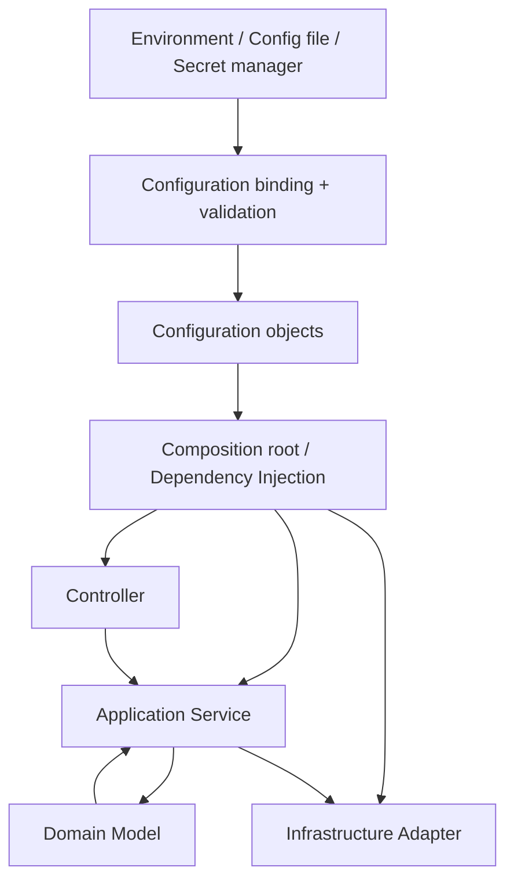

# Giữ cấu hình nền tảng ngoài mã nghiệp vụ

## 1. Vì sao cần tách cấu hình khỏi mã nghiệp vụ?

Ứng dụng MVC thường chạy ở nhiều môi trường như máy phát triển, kiểm thử, staging và production. Mỗi môi trường có thể dùng cổng mạng, địa chỉ cơ sở dữ liệu, thông tin kết nối, endpoint dịch vụ ngoài, mức log hoặc giới hạn tài nguyên khác nhau. Những giá trị này cần thay đổi theo cách triển khai mà không buộc nhóm phát triển sửa và biên dịch lại quy tắc nghiệp vụ.

Nếu Controller, Model hoặc lớp nghiệp vụ đọc trực tiếp biến môi trường, ghi cứng URL dịch vụ hoặc tự quyết định cấu hình hạ tầng, mã ứng dụng sẽ phụ thuộc vào máy chạy. Điều này làm khó kiểm thử, khó triển khai nhất quán và tăng nguy cơ lộ bí mật.

Nguyên tắc tổ chức là **đưa cấu hình nền tảng vào một ranh giới cấu hình riêng, sau đó cung cấp giá trị đã kiểm tra cho các thành phần cần dùng thông qua dependency injection**. Model vẫn tập trung vào trạng thái và quy tắc nghiệp vụ; Controller vẫn xử lý request và response; lớp cấu hình chịu trách nhiệm kết nối ứng dụng với môi trường triển khai.

## 2. Phân biệt cấu hình nền tảng với quy tắc nghiệp vụ

Không phải mọi giá trị có thể thay đổi đều là cấu hình nền tảng. Trước khi quyết định đặt một giá trị ở đâu, cần hiểu ai sở hữu nó, nó thay đổi vì lý do gì và hệ thống cần kiểm soát thay đổi như thế nào.

| Loại giá trị | Ví dụ | Nơi thường phù hợp |
|---|---|---|
| Cấu hình runtime / nền tảng | Cổng HTTP, URL database, pool size, timeout kết nối | Environment, config file, secret manager |
| Cấu hình tích hợp | Base URL của cổng thanh toán, tên queue, bucket lưu file | Externalized configuration và adapter hạ tầng |
| Cấu hình vận hành | Log level, giới hạn request, bật/tắt tính năng theo môi trường | Config server, environment hoặc feature management |
| Quy tắc nghiệp vụ | Điều kiện hủy đơn, cách tính thuế, chính sách hoàn tiền | Domain Model, domain policy hoặc application service |
| Chính sách nghiệp vụ có thể thay đổi | Mức phí theo vùng, hạn mức theo loại khách hàng, chương trình khuyến mại | Kho chính sách nghiệp vụ hoặc công cụ quản trị có phân quyền và audit |
| Nội dung trình bày | Nhãn, thông báo, bản dịch, theme | View, resource bundle hoặc hệ thống nội dung |

Ví dụ, địa chỉ máy chủ thanh toán là cấu hình tích hợp. Nhưng điều kiện “đơn hàng được phép hoàn tiền trong vòng 30 ngày” là quy tắc nghiệp vụ. Nếu doanh nghiệp cần thay đổi chính sách này mà không triển khai phiên bản mới, nó có thể được lưu trong kho chính sách có quản lý phiên bản, quyền chỉnh sửa và lịch sử thay đổi. Không nên biến mọi quy tắc thành biến môi trường chỉ vì có thể cấu hình được.

Một giá trị có thể nằm ở ranh giới khác nhau tùy sản phẩm. Hãy quyết định dựa trên quyền sở hữu, tần suất thay đổi, yêu cầu audit, phạm vi áp dụng và thời điểm hiệu lực.

## 3. Cấu hình nằm ở đâu trong kiến trúc MVC?

Trong ứng dụng MVC, lớp cấu hình thường nằm gần composition root — nơi khởi tạo và nối các thành phần của ứng dụng. Ở Spring Boot, composition root thường là cấu hình ứng dụng, các lớp `@Configuration`, cơ chế auto-configuration và dependency injection container.



Luồng này có nghĩa:

1. Môi trường triển khai cung cấp giá trị cấu hình qua nguồn được quản lý.
2. Framework đọc và bind các giá trị vào đối tượng cấu hình có kiểu.
3. Ứng dụng kiểm tra giá trị trước khi phục vụ request.
4. Dependency injection cung cấp các đối tượng cấu hình hoặc adapter đã được khởi tạo cho thành phần cần dùng.
5. Controller và Application Service sử dụng dependency thông qua hợp đồng rõ ràng; Domain Model không cần biết cấu hình được lấy từ file, biến môi trường hay secret manager.

Không nên để từng Controller gọi `System.getenv()`, đọc file YAML hoặc tự tạo HTTP client. Những việc đó thuộc ranh giới cấu hình và hạ tầng.

## 4. Externalized configuration là gì?

**Externalized configuration** là cách cung cấp cấu hình cho ứng dụng từ nguồn bên ngoài mã nguồn hoặc artifact triển khai. Cùng một artifact có thể được chạy ở nhiều môi trường với các giá trị cấu hình khác nhau.

Các nguồn phổ biến gồm:

- File cấu hình được đóng gói cùng ứng dụng cho giá trị mặc định không nhạy cảm.
- File cấu hình riêng được mount hoặc cung cấp trong môi trường triển khai.
- Biến môi trường do container, orchestrator hoặc nền tảng triển khai cung cấp.
- Secret manager hoặc vault dành cho mật khẩu, API key, certificate và credential.
- Config server hoặc hệ thống quản lý cấu hình tập trung khi nhiều ứng dụng cần dùng chung chính sách vận hành.

Ví dụ, `application.yml` có thể khai báo cấu trúc và giá trị mặc định:

```yaml
server:
  port: ${SERVER_PORT:8080}

spring:
  datasource:
    url: ${DB_URL}
    username: ${DB_USERNAME}
    password: ${DB_PASSWORD}

app:
  catalog:
    default-page-size: ${CATALOG_DEFAULT_PAGE_SIZE:20}
  payment:
    base-url: ${PAYMENT_BASE_URL}
```

Các placeholder `${...}` cho phép lấy giá trị từ nguồn cấu hình bên ngoài. Giá trị mặc định như cổng `8080` hoặc kích thước trang `20` có thể phù hợp cho môi trường phát triển. Các giá trị kết nối database và payment không có mặc định trong ví dụ; ứng dụng cần được cung cấp chúng từ môi trường hoặc hệ thống quản lý bí mật.

Không ghi mật khẩu thật, token hoặc private key vào repository. File cấu hình được commit nên chỉ chứa tên biến, giá trị mặc định an toàn hoặc dữ liệu không nhạy cảm.

## 5. Gom cấu hình theo nhóm có ý nghĩa

Không nên tạo một lớp `AppConfig` chứa hàng trăm thuộc tính không liên quan. Hãy nhóm cấu hình theo chức năng hoặc adapter:

```text
config/
├── CatalogProperties.java
├── PaymentProperties.java
├── DatabaseConfiguration.java
├── PaymentClientConfiguration.java
└── WebConfiguration.java
```

Ví dụ, cấu hình catalog có thể được bind vào một record có kiểu:

```java
@ConfigurationProperties(prefix = "app.catalog")
@Validated
public record CatalogProperties(
        @Min(1) @Max(100) int defaultPageSize,
        @Min(1) @Max(200) int maximumPageSize) {
}
```

Kích hoạt quét cấu hình trong ứng dụng Spring Boot:

```java
@SpringBootApplication
@ConfigurationPropertiesScan
public class StoreApplication {
    public static void main(String[] args) {
        SpringApplication.run(StoreApplication.class, args);
    }
}
```

Khi bind, Spring Boot chuyển đổi kiểu dữ liệu và chạy validation theo các annotation. Nếu cấu hình bắt buộc thiếu hoặc giá trị nằm ngoài giới hạn, ứng dụng nên thất bại khi khởi động thay vì chờ đến lúc người dùng gửi request mới phát hiện lỗi.

Các thuộc tính nên có tên thể hiện ý nghĩa và đơn vị. Ví dụ, `connect-timeout: 2s` rõ ràng hơn một số nguyên `2000` không nói đơn vị. Với thời lượng, có thể dùng kiểu `Duration`; với địa chỉ, dùng `URI`; với kích thước, dùng kiểu số phù hợp.

## 6. Cung cấp cấu hình cho thành phần cần dùng

Sau khi bind và kiểm tra, cấu hình được đưa vào ứng dụng bằng constructor injection. Thành phần sử dụng chỉ biết dependency có kiểu, không biết giá trị đến từ đâu.

Ví dụ dịch vụ truy vấn catalog sử dụng giới hạn phân trang:

```java
@Service
public class ProductQueryService {
    private final ProductRepository repository;
    private final CatalogProperties properties;

    public ProductQueryService(
            ProductRepository repository,
            CatalogProperties properties) {
        this.repository = repository;
        this.properties = properties;
    }

    public Page<ProductSummary> search(
            String keyword,
            int page,
            Integer requestedSize) {
        int size = requestedSize == null
                ? properties.defaultPageSize()
                : Math.min(Math.max(requestedSize, 1),
                           properties.maximumPageSize());

        return repository.search(keyword, PageRequest.of(page, size));
    }
}
```

Controller không đọc biến môi trường và không quyết định giới hạn tài nguyên:

```java
@Controller
@RequestMapping("/products")
public class ProductController {
    private final ProductQueryService queryService;

    public ProductController(ProductQueryService queryService) {
        this.queryService = queryService;
    }

    @GetMapping
    public String list(
            @RequestParam(required = false) String keyword,
            @RequestParam(defaultValue = "0") int page,
            @RequestParam(required = false) Integer size,
            Model model) {
        model.addAttribute("products",
                queryService.search(keyword, page, size));
        return "products/list";
    }
}
```

Giới hạn trang tối đa ở đây là một chính sách vận hành để bảo vệ tài nguyên truy vấn. Nếu hệ thống có quy tắc nghiệp vụ riêng về số sản phẩm người dùng được xem, quy tắc đó cần được đặt và quản lý ở miền nghiệp vụ tương ứng.

## 7. Đặt cấu hình tích hợp trong infrastructure adapter

Địa chỉ dịch vụ ngoài, timeout, connection pool và credential là chi tiết hạ tầng. Chúng nên được dùng để khởi tạo adapter, sau đó Application Service gọi adapter qua interface.

Ví dụ khai báo cấu hình thanh toán:

```java
@ConfigurationProperties(prefix = "app.payment")
@Validated
public record PaymentProperties(@NotNull URI baseUrl) {
}
```

Tạo client ở lớp cấu hình:

```java
@Configuration
public class PaymentClientConfiguration {

    @Bean
    RestClient paymentRestClient(
            RestClient.Builder builder,
            PaymentProperties properties) {
        return builder
                .baseUrl(properties.baseUrl().toString())
                .build();
    }
}
```

Adapter có thể sử dụng `RestClient` để gọi cổng thanh toán. Application Service phụ thuộc vào một hợp đồng như `PaymentGateway`, còn adapter triển khai hợp đồng đó bằng client đã được cấu hình.

```java
public interface PaymentGateway {
    RefundResult requestRefund(RefundCommand command);
}
```

Nhờ vậy, domain và application layer không cần biết base URL, thư viện HTTP hoặc cách credential được cấp. Trong ứng dụng thực tế, client cần cấu hình timeout, retry, TLS và connection pool theo yêu cầu vận hành; retry chỉ nên áp dụng cho thao tác có thể thử lại an toàn.

## 8. Profiles và khác biệt giữa môi trường

Spring Boot hỗ trợ profile để nạp các cấu hình phù hợp với môi trường hoặc cách triển khai. Ví dụ:

```text
src/main/resources/
├── application.yml
├── application-local.yml
├── application-test.yml
└── application-prod.yml
```

`application.yml` chứa cấu hình chung và mặc định an toàn. Các file theo profile chỉ nên ghi đè những giá trị thực sự khác nhau. Profile có thể được kích hoạt từ biến môi trường hoặc tham số triển khai, chẳng hạn `SPRING_PROFILES_ACTIVE=prod`.

Ví dụ, môi trường local có thể bật log SQL hoặc dùng database phát triển; production dùng database do nền tảng cấp, log ít chi tiết hơn và endpoint dịch vụ thật. Không nên viết điều kiện nghiệp vụ kiểu `if (activeProfile.equals("prod"))` trong Domain Model. Profile điều chỉnh cách khởi tạo và vận hành ứng dụng; nó không nên quyết định chính sách nghiệp vụ.

Đừng tạo một profile cho mọi biến thể nhỏ. Nếu profile chồng chéo quá nhiều, khó xác định giá trị cuối cùng được nạp. Hãy giữ cấu trúc đơn giản và ghi rõ nguồn cấu hình được phép ghi đè.

## 9. Bí mật và thông tin nhạy cảm

Mật khẩu database, API key, token, private key và certificate cần được quản lý như bí mật. Một số nguyên tắc:

- Không commit secret vào Git, kể cả trong file profile hoặc ví dụ cấu hình.
- Ưu tiên secret manager, vault hoặc cơ chế secret của nền tảng triển khai.
- Nếu dùng environment variable làm kênh cấp secret, giới hạn quyền đọc và tránh đưa giá trị vào log, exception hoặc output chẩn đoán.
- Dùng credential có quyền tối thiểu và phạm vi phù hợp với từng dịch vụ.
- Có quy trình xoay vòng, thu hồi và thay thế secret.
- Không truyền secret vào View Model, response JSON, query string hoặc flash attribute.
- Không in toàn bộ đối tượng cấu hình nếu nó có thể chứa credential.

Nếu secret bị lộ trong repository, chỉ xóa dòng khỏi commit mới là chưa đủ. Cần thu hồi hoặc xoay vòng secret đã lộ và xử lý lịch sử lưu trữ theo quy trình bảo mật của tổ chức.

## 10. Cấu hình không thay thế quy tắc nghiệp vụ

Một lỗi thiết kế thường gặp là chuyển mọi con số hoặc điều kiện sang file cấu hình để tránh hard-code. Điều đó có thể khiến quy tắc quan trọng trở nên khó kiểm soát.

Hãy phân biệt hai ví dụ:

- `payment.connect-timeout = 2s`: thời gian chờ kết nối là quyết định kỹ thuật, thay đổi theo mạng và hạ tầng.
- `refund.allowed-within-days = 30`: thời hạn hoàn tiền là chính sách nghiệp vụ, ảnh hưởng đến quyền lợi khách hàng và cần chủ sở hữu nghiệp vụ, lịch sử thay đổi, ngày hiệu lực và kiểm soát truy cập.

Nếu chính sách nghiệp vụ cần thay đổi khi ứng dụng đang chạy, có thể xây dựng `RefundPolicyProvider` đọc từ kho chính sách được quản lý. Application Service lấy chính sách qua interface; Domain Model nhận policy hoặc dữ liệu cần thiết để quyết định. Không nên để entity đọc file YAML hoặc gọi Config Server.

Các giá trị ảnh hưởng đến tính đúng đắn như mức thuế, hạn mức giao dịch, điều kiện phê duyệt hoặc thời hạn khiếu nại cần được quản lý theo quy trình nghiệp vụ. Cần xác định rõ giá trị áp dụng cho giao dịch tại thời điểm nào, có cần versioning không và thay đổi có ảnh hưởng đến giao dịch đang xử lý hay không.

## 11. Kiểm tra cấu hình khi khởi động

Ứng dụng nên phát hiện cấu hình không hợp lệ càng sớm càng tốt. Một số kiểm tra hữu ích:

- Giá trị bắt buộc có tồn tại không?
- URL có scheme và host hợp lệ không?
- Port, pool size, page size và timeout có nằm trong phạm vi cho phép không?
- Các cấu hình có mâu thuẫn không, ví dụ minimum lớn hơn maximum?
- Profile có kích hoạt đúng cho môi trường triển khai không?
- Credential có được cấp và có thể xác thực với dịch vụ cần thiết không?

Validation cấu trúc có thể thực hiện khi bind `@ConfigurationProperties`. Kiểm tra kết nối đến hệ thống ngoài nên được cân nhắc theo yêu cầu readiness và khả năng chịu lỗi: không phải mọi dependency tạm thời không sẵn sàng đều cần khiến tiến trình khởi động thất bại vĩnh viễn, nhưng ứng dụng không nên nhận traffic cho chức năng chưa thể phục vụ.

Thông báo lỗi khởi động nên nêu tên thuộc tính thiếu hoặc sai, nhưng không hiển thị giá trị secret. Ví dụ, có thể báo `app.payment.base-url is required` thay vì in toàn bộ cấu hình thanh toán.

## 12. Kiểm thử ứng dụng với cấu hình tách biệt

Tách cấu hình giúp kiểm thử không phụ thuộc vào máy của lập trình viên:

| Phạm vi | Cách kiểm thử | Điều cần xác minh |
|---|---|---|
| Binding | Dùng `ApplicationContextRunner` hoặc Spring Boot test với property mẫu | Thuộc tính được bind đúng kiểu và giá trị mặc định đúng |
| Validation | Cấp giá trị thiếu hoặc ngoài giới hạn | Context khởi động thất bại với thông báo rõ ràng |
| Application Service | Inject cấu hình hoặc policy giả lập | Use case áp dụng đúng giới hạn được cung cấp |
| Infrastructure adapter | Dùng endpoint giả hoặc mock server | Client dùng base URL và timeout đúng; không gọi hệ thống thật ngoài ý muốn |
| Controller | Dùng MockMvc và service giả lập | Controller không đọc trực tiếp biến môi trường và trả response đúng |
| Integration | Dùng cấu hình test riêng và dependency test | Ứng dụng khởi tạo được với cấu hình kiểm thử xác định |

Không nên để unit test phụ thuộc vào `application-prod.yml` hoặc secret thật. Kiểm thử nên cung cấp giá trị rõ ràng và có thể lặp lại. Với test dùng Spring context, có thể dùng `@TestPropertySource`, `@DynamicPropertySource` hoặc cấu hình test phù hợp.

## 13. Các lỗi tổ chức cấu hình thường gặp

1. **Đọc biến môi trường trong Controller hoặc Model:** tạo phụ thuộc ẩn vào máy chạy và làm khó kiểm thử.
2. **Ghi cứng URL và credential:** khiến cùng một artifact không thể triển khai an toàn ở nhiều môi trường.
3. **Một lớp cấu hình khổng lồ:** gom các thuộc tính không liên quan, khó hiểu và khó quản lý vòng đời.
4. **Dùng profile để thay đổi nghiệp vụ:** làm chính sách khác nhau một cách ngầm định giữa các môi trường.
5. **Đưa mọi quy tắc vào YAML:** khiến chính sách nghiệp vụ thiếu audit, versioning và quyền quản trị phù hợp.
6. **Không validate cấu hình:** lỗi chỉ xuất hiện khi request thật được xử lý.
7. **Log toàn bộ cấu hình:** có thể làm lộ password, token hoặc endpoint nội bộ nhạy cảm.
8. **Tạo client hạ tầng trong Controller:** khiến mỗi request có thể tạo kết nối riêng và trộn trách nhiệm giao thức với cấu hình.

## 14. Quy trình tổ chức cấu hình

Khi thêm một cấu hình mới, có thể thực hiện theo trình tự:

1. Xác định đây là cấu hình nền tảng, cấu hình tích hợp, cấu hình vận hành hay chính sách nghiệp vụ.
2. Chọn chủ sở hữu và nguồn cung cấp phù hợp: file mặc định, profile, environment, config server hoặc secret manager.
3. Đặt thuộc tính trong nhóm có tên và kiểu rõ ràng.
4. Bind vào đối tượng cấu hình riêng và kiểm tra giới hạn ngay khi khởi động.
5. Cung cấp dependency qua constructor injection hoặc khởi tạo adapter tại composition root.
6. Không để Domain Model phụ thuộc vào Spring, biến môi trường hoặc file cấu hình.
7. Kiểm thử cấu hình mặc định, cấu hình môi trường và các trường hợp thiếu/sai.
8. Bảo đảm secret không xuất hiện trong Git, log hoặc response.

## 15. Kết luận

Giữ cấu hình nền tảng ngoài mã nghiệp vụ giúp ứng dụng MVC có thể triển khai ở nhiều môi trường bằng cùng một artifact, dễ kiểm thử và giảm phụ thuộc vào hạ tầng cụ thể. Cấu hình nên được gom theo nhóm, bind vào kiểu dữ liệu rõ ràng, kiểm tra khi khởi động và cung cấp qua dependency injection. Controller và Model không nên tự đọc file hoặc biến môi trường.

Điều quan trọng là phân biệt cấu hình vận hành với chính sách nghiệp vụ. URL dịch vụ, timeout và pool size thuộc cấu hình nền tảng; quy tắc về thuế, hoàn tiền và hạn mức cần được quản lý như chính sách nghiệp vụ có chủ sở hữu và lịch sử thay đổi. Khi giữ đúng ranh giới này, MVC duy trì được sự tách biệt giữa nghiệp vụ, trình bày, điều phối và môi trường triển khai.
