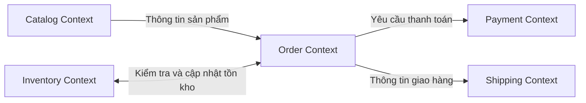

# Thiết kế hướng miền (Domain-Driven Design): mục tiêu và tư tưởng cốt lõi

Domain-Driven Design (DDD), thường được dịch là **thiết kế hướng miền**, là cách tiếp cận phát triển phần mềm đặt hiểu biết về nghiệp vụ vào trung tâm của quá trình phân tích, thiết kế và hiện thực hóa hệ thống. Thay vì bắt đầu từ bảng dữ liệu, màn hình hay framework, nhóm phát triển cùng chuyên gia nghiệp vụ tìm hiểu vấn đề cần giải quyết, xây dựng một mô hình đủ rõ để diễn đạt vấn đề đó, rồi để mô hình dẫn dắt thiết kế phần mềm.

DDD đặc biệt hữu ích khi nghiệp vụ có nhiều quy tắc, ngoại lệ, thuật ngữ chuyên ngành và những thay đổi ảnh hưởng lẫn nhau. Mục tiêu của DDD là tạo ra một mô hình phần mềm phản ánh đúng cách doanh nghiệp vận hành, giúp chuyên gia nghiệp vụ và lập trình viên hiểu nhau, đồng thời kiểm soát độ phức tạp khi hệ thống phát triển.

## 1. Domain-Driven Design là gì?

**Domain (miền nghiệp vụ)** là lĩnh vực hoặc vấn đề thực tế mà phần mềm được xây dựng để hỗ trợ. Ví dụ, với một hệ thống thương mại điện tử, miền nghiệp vụ có thể bao gồm bán hàng, thanh toán, quản lý tồn kho, giao nhận và chăm sóc khách hàng.

**Domain model (mô hình miền)** là cách biểu diễn có chọn lọc những khái niệm, mối quan hệ, quy tắc và hành vi quan trọng của miền nghiệp vụ trong phần mềm. Mô hình không cần sao chép toàn bộ thế giới thực. Nó tập trung vào những điều có ý nghĩa đối với bài toán đang giải quyết.

DDD là quá trình liên tục khám phá và cải thiện mô hình đó thông qua trao đổi giữa người hiểu nghiệp vụ và người xây dựng phần mềm. Mô hình được thể hiện trong ngôn ngữ, thiết kế và mã nguồn, để quy tắc nghiệp vụ quan trọng có thể được nhìn thấy và kiểm tra.

DDD **không phải** một framework, một thư viện Java hay một kiến trúc triển khai cố định. Có thể áp dụng DDD trong hệ thống nguyên khối hoặc hệ thống phân tán, với nhiều loại cơ sở dữ liệu và công nghệ khác nhau. Các mẫu thiết kế như Entity, Value Object hay Aggregate là công cụ hỗ trợ tư duy và hiện thực hóa mô hình; bản thân việc sử dụng các mẫu đó chưa đủ để tạo thành DDD.

## 2. Vì sao cần thiết kế hướng miền?

Trong một hệ thống nghiệp vụ phức tạp, khó khăn thường không nằm ở việc lưu hoặc truy xuất dữ liệu mà nằm ở việc hiểu đúng quy tắc và giữ cho các quy tắc đó nhất quán khi chúng thay đổi.

Nếu nhóm phát triển chỉ mô hình hóa dữ liệu, các quy tắc có thể bị phân tán trong controller, service, câu lệnh SQL và giao diện. Một thay đổi như “đơn hàng chỉ được xác nhận khi mọi mặt hàng còn đủ tồn kho” có thể phải sửa ở nhiều nơi. Theo thời gian, các phần của hệ thống có thể đưa ra những quyết định khác nhau cho cùng một tình huống.

DDD hướng tới một số mục tiêu:

- **Hiểu đúng vấn đề nghiệp vụ:** nhóm phát triển làm rõ mục tiêu, thuật ngữ, quy trình, ràng buộc và các trường hợp ngoại lệ trước khi quyết định cách cài đặt.
- **Tạo ngôn ngữ chung:** chuyên gia nghiệp vụ và đội phát triển sử dụng cùng thuật ngữ với cùng ý nghĩa trong phạm vi đang trao đổi.
- **Đưa quy tắc vào mô hình:** hành vi và bất biến quan trọng được thể hiện tại những đối tượng có trách nhiệm phù hợp, thay vì rải rác trong toàn bộ ứng dụng.
- **Chia nhỏ độ phức tạp:** xác định ranh giới của các phần nghiệp vụ để mỗi phần có thể có mô hình và nhịp thay đổi riêng.
- **Hỗ trợ thay đổi lâu dài:** khi hiểu biết nghiệp vụ thay đổi, nhóm có thể điều chỉnh mô hình và mã nguồn một cách có chủ đích.

DDD không tự động làm cho phần mềm đúng. Chất lượng mô hình phụ thuộc vào việc nhóm có thường xuyên kiểm chứng giả định với người hiểu nghiệp vụ và có sẵn sàng sửa mô hình khi học được điều mới hay không.

## 3. Những tư tưởng nền tảng

### 3.1. Đặt miền nghiệp vụ làm trọng tâm

Quyết định thiết kế nên xuất phát từ vấn đề nghiệp vụ cần giải quyết. Công nghệ vẫn quan trọng, nhưng được lựa chọn để hỗ trợ mô hình và các yêu cầu của miền nghiệp vụ.

Ví dụ, khi thiết kế quy trình đặt hàng, câu hỏi quan trọng trước tiên là: đơn hàng được tạo khi nào, điều kiện nào cho phép xác nhận, khách hàng có thể hủy trong trạng thái nào và điều gì xảy ra khi thanh toán thất bại? Những câu trả lời này định hình mô hình `Order` và các hành vi của nó. Việc chọn ORM hoặc cấu trúc bảng dữ liệu đến sau.

### 3.2. Mô hình phải phản ánh hiểu biết nghiệp vụ

Mô hình miền không phải bản vẽ được tạo một lần rồi giữ nguyên. Nó là kết quả của quá trình khám phá. Khi chuyên gia nghiệp vụ giải thích một trường hợp mới, nhóm phát triển có thể nhận ra một khái niệm đang thiếu, một quy tắc chưa chính xác hoặc một ranh giới cần thay đổi.

Một mô hình tốt giúp trả lời được các câu hỏi quan trọng của nghiệp vụ. Nó không chỉ chứa dữ liệu mà còn diễn đạt hành vi và giới hạn hợp lệ của các đối tượng.

### 3.3. Ubiquitous Language — ngôn ngữ chung

**Ubiquitous Language** là ngôn ngữ được nhóm xây dựng và sử dụng thống nhất trong một phạm vi mô hình. Thuật ngữ này xuất hiện trong cuộc trao đổi, tài liệu, tên lớp, tên phương thức và các bài kiểm thử.

Giả sử nghiệp vụ phân biệt rõ ba hành động:

- `PlaceOrder`: khách hàng gửi yêu cầu đặt hàng.
- `ConfirmOrder`: hệ thống xác nhận đơn hàng sau khi các điều kiện cần thiết được đáp ứng.
- `CancelOrder`: đơn hàng được hủy theo những điều kiện cụ thể.

Nếu mã nguồn chỉ dùng các tên chung chung như `process()`, `updateStatus()` hoặc `handle()`, ý nghĩa nghiệp vụ sẽ khó được nhận ra. Tên gọi rõ ràng giúp người đọc hiểu hành vi và giúp nhóm phát hiện khi cách hiểu trong mã nguồn khác với cách hiểu của chuyên gia.

Ngôn ngữ chung luôn gắn với phạm vi của mô hình. Một thuật ngữ có thể mang ý nghĩa khác nhau trong hai bộ phận nghiệp vụ; DDD không yêu cầu ép mọi người dùng một từ duy nhất cho toàn doanh nghiệp.

### 3.4. Cộng tác và cải tiến liên tục

Chuyên gia nghiệp vụ nắm bối cảnh, mục tiêu và các quy tắc thực tế. Đội phát triển chuyển hiểu biết đó thành mô hình có thể thực thi và chỉ ra những điểm mơ hồ, mâu thuẫn hoặc khó áp dụng. Hai bên cần trao đổi thường xuyên thay vì bàn giao yêu cầu một chiều.

Các kỹ thuật như phỏng vấn theo tình huống, phân tích ví dụ, Event Storming và thảo luận trên ngôn ngữ chung có thể giúp nhóm khám phá quy trình và quy tắc. Đây là những phương tiện hỗ trợ; giá trị cốt lõi vẫn là hiểu miền nghiệp vụ và kiểm chứng mô hình.

## 4. Strategic Design — thiết kế chiến lược

Thiết kế chiến lược giúp nhóm nhìn toàn cảnh miền nghiệp vụ, xác định phần nào tạo lợi thế cạnh tranh, phân chia ranh giới mô hình và hiểu quan hệ giữa các phần. Ba khái niệm quan trọng là **subdomain**, **bounded context** và **context map**.

### 4.1. Subdomain — miền con

Một miền nghiệp vụ lớn thường có thể được chia thành các miền con, mỗi miền con giải quyết một nhóm vấn đề cụ thể. Với thương mại điện tử, ví dụ có thể gồm bán hàng, thanh toán, quản lý kho, giao nhận và quản lý khách hàng.

DDD thường phân loại miền con theo vai trò chiến lược:

| Loại miền con | Ý nghĩa | Ví dụ trong thương mại điện tử |
| --- | --- | --- |
| **Core subdomain** (miền lõi) | Năng lực tạo khác biệt quan trọng cho doanh nghiệp; thường cần đầu tư thiết kế và phát triển riêng. | Cơ chế định giá hoặc đề xuất sản phẩm đặc thù tạo lợi thế cạnh tranh. |
| **Supporting subdomain** (miền hỗ trợ) | Hỗ trợ hoạt động cốt lõi nhưng không tự tạo lợi thế cạnh tranh chính. | Quy trình quản lý một loại yêu cầu nội bộ đặc thù. |
| **Generic subdomain** (miền tổng quát) | Năng lực phổ biến mà nhiều doanh nghiệp cũng cần; có thể cân nhắc giải pháp có sẵn. | Xác thực người dùng hoặc gửi email thông báo thông thường. |

Việc phân loại phụ thuộc chiến lược và bối cảnh của từng doanh nghiệp. Một năng lực có thể là miền lõi với doanh nghiệp này nhưng chỉ là miền tổng quát với doanh nghiệp khác.

### 4.2. Bounded Context — ngữ cảnh giới hạn

**Bounded Context** là ranh giới mà trong đó một mô hình và ngôn ngữ chung có ý nghĩa nhất quán. Bên trong ranh giới đó, nhóm có thể xác định rõ các khái niệm, quy tắc và trách nhiệm. Khi đi qua ranh giới, cùng một từ có thể được hiểu hoặc biểu diễn khác đi.

Ví dụ, khái niệm `Product` có thể xuất hiện trong nhiều ngữ cảnh:

- Trong **Catalog Context**, `Product` mô tả tên, hình ảnh, thông tin hiển thị và danh mục sản phẩm.
- Trong **Inventory Context**, thông tin cần quan tâm là mã hàng, số lượng có thể bán và vị trí lưu kho.
- Trong **Order Context**, dòng hàng trong đơn cần lưu mô tả và giá tại thời điểm đặt hàng để lịch sử đơn không thay đổi khi catalog cập nhật.

Ba mô hình này phục vụ ba mục tiêu khác nhau. Cố gắng dùng một lớp `Product` duy nhất cho mọi ngữ cảnh có thể tạo ra nhiều thuộc tính không liên quan và làm các phần phụ thuộc chặt vào nhau.

Bounded Context là ranh giới của mô hình và ngôn ngữ. Nó thường là cơ sở tốt để tổ chức module hoặc dịch vụ, nhưng **không đồng nghĩa bắt buộc với một microservice**. Quyết định triển khai còn phụ thuộc vào quy mô, đội ngũ, vận hành và nhu cầu phân phối hệ thống.

### 4.3. Context Map — bản đồ ngữ cảnh

Khi có nhiều Bounded Context, **Context Map** mô tả cách chúng liên hệ và trao đổi dữ liệu hoặc thông điệp với nhau. Bản đồ giúp nhóm thấy nơi nào có phụ thuộc, nơi nào cần chuyển đổi mô hình và đội nào chịu trách nhiệm cho hợp đồng tích hợp.

Ví dụ đơn giản:



Sơ đồ trên chỉ minh họa các luồng hợp tác có thể có. Trong hệ thống thực tế, nhóm cần xác định rõ ai sở hữu dữ liệu, hợp đồng trao đổi là gì, xử lý lỗi ra sao và thay đổi ở một ngữ cảnh ảnh hưởng đến ngữ cảnh khác như thế nào.

Một số quan hệ thường được nhắc đến trong Context Map:

- **Customer–Supplier:** một nhóm cung cấp mô hình hoặc dịch vụ, nhóm khác tiêu thụ và có thể đưa ra yêu cầu về hợp đồng.
- **Conformist:** ngữ cảnh phía sau chấp nhận mô hình do hệ thống phía trước cung cấp.
- **Anti-Corruption Layer:** lớp chuyển đổi giúp bảo vệ mô hình nội bộ khỏi khái niệm hoặc cấu trúc không phù hợp từ hệ thống bên ngoài.
- **Shared Kernel:** hai nhóm chia sẻ một phần mô hình nhỏ và cần phối hợp chặt khi thay đổi phần đó.

Không có một kiểu quan hệ phù hợp cho mọi tình huống. Nhóm chọn cách tích hợp dựa trên quyền kiểm soát, mức độ phụ thuộc và nhu cầu bảo vệ mô hình của từng ngữ cảnh.

### 4.4. Phân biệt miền con và Bounded Context

Hai khái niệm này liên quan nhưng không giống nhau:

- **Subdomain** mô tả cách chia bài toán nghiệp vụ trong thế giới của doanh nghiệp.
- **Bounded Context** mô tả ranh giới của một mô hình phần mềm và ngôn ngữ chung.

Nhóm khám phá miền con để hiểu doanh nghiệp cần năng lực nào, sau đó thiết kế Bounded Context để mô hình hóa và triển khai các năng lực đó. Mối quan hệ giữa hai loại ranh giới thường gần nhau nhưng không bắt buộc phải trùng khít.

## 5. Tactical Design — thiết kế chiến thuật

Sau khi xác định phạm vi mô hình, thiết kế chiến thuật cung cấp các mẫu để biểu diễn quy tắc và hành vi bên trong một Bounded Context. Các mẫu thường gặp gồm Entity, Value Object, Aggregate, Repository, Domain Service và Domain Event.

### 5.1. Entity — thực thể

**Entity** là đối tượng được nhận diện xuyên suốt vòng đời bằng một định danh ổn định. Các thuộc tính của nó có thể thay đổi nhưng danh tính vẫn giữ nguyên.

Ví dụ, một đơn hàng có mã `OrderId` riêng. Khi trạng thái chuyển từ `DRAFT` sang `CONFIRMED`, đó vẫn là cùng một đơn hàng. Hai đơn hàng có cùng khách hàng, sản phẩm và tổng tiền vẫn là hai Entity khác nhau nếu định danh khác nhau.

Khi thiết kế Entity, cần xác định:

- Định danh nào phân biệt đối tượng?
- Những thay đổi nào được phép trong vòng đời?
- Hành vi và quy tắc nào thuộc trách nhiệm của đối tượng?

Entity không đơn giản chỉ là một dòng trong bảng cơ sở dữ liệu. Định danh và hành vi nghiệp vụ mới là yếu tố quyết định vai trò của nó trong mô hình.

### 5.2. Value Object — đối tượng giá trị

**Value Object** được xác định bởi giá trị của các thuộc tính, không có định danh riêng. Hai Value Object có cùng giá trị được xem là tương đương trong mô hình. Chúng thường được thiết kế bất biến để tránh thay đổi ngoài ý muốn.

Ví dụ, `Money` có thể gồm số tiền và đơn vị tiền tệ. `100.00 USD` khác `100.00 VND`; chỉ so sánh số tiền mà bỏ qua đơn vị tiền tệ là không đủ. Một `Address` cũng có thể là Value Object nếu nghiệp vụ quan tâm đến nội dung địa chỉ thay vì một danh tính độc lập.

Value Object có thể chứa hành vi. Chẳng hạn, `Money` có thể kiểm tra hai khoản tiền có cùng đơn vị trước khi cộng. Điều này giúp quy tắc nằm cạnh dữ liệu mà quy tắc đó bảo vệ.

### 5.3. Aggregate và Aggregate Root

**Aggregate** là một cụm đối tượng được xem như một đơn vị nhất quán khi thay đổi. Mỗi Aggregate có một **Aggregate Root** làm điểm truy cập từ bên ngoài. Các đối tượng khác không được tùy ý sửa trạng thái nội bộ của Aggregate; thay đổi phải đi qua hành vi của Root.

Ví dụ, `Order` có thể là Aggregate Root quản lý các `OrderLine`. Khi thêm một dòng hàng, Root kiểm tra đơn hàng còn ở trạng thái cho phép chỉnh sửa và số lượng phải hợp lệ. Khi xác nhận, Root kiểm tra đơn hàng không rỗng và chuyển trạng thái theo quy tắc.

```java
public final class Order {
    private final OrderId id;
    private final List<OrderLine> lines = new ArrayList<>();
    private OrderStatus status = OrderStatus.DRAFT;

    public void addLine(OrderLine line) {
        if (status != OrderStatus.DRAFT) {
            throw new IllegalStateException("Only draft orders can be changed");
        }
        lines.add(Objects.requireNonNull(line));
    }

    public void confirm() {
        if (lines.isEmpty()) {
            throw new IllegalStateException("An empty order cannot be confirmed");
        }
        if (status != OrderStatus.DRAFT) {
            throw new IllegalStateException("Only draft orders can be confirmed");
        }
        status = OrderStatus.CONFIRMED;
    }
}
```

Đây là đoạn mã minh họa hành vi của Aggregate Root; các kiểu `OrderId`, `OrderLine`, `OrderStatus` và import được giả định đã được định nghĩa. Trong thiết kế thực tế, cần cân nhắc thêm quy tắc về số lượng, giá, tồn kho và quyền hủy theo yêu cầu của miền nghiệp vụ.

Aggregate giúp xác định **ranh giới nhất quán**. Những bất biến cần được bảo đảm trong cùng một giao dịch thường thuộc một Aggregate. Không nên gom quá nhiều đối tượng vào một Aggregate chỉ vì chúng có quan hệ dữ liệu; Aggregate quá lớn dễ tạo khóa cạnh tranh, phụ thuộc và khó mở rộng. Giữa các Aggregate, hệ thống thường phối hợp bằng định danh, dịch vụ ứng dụng hoặc sự kiện miền.

### 5.4. Repository — kho lưu trữ

**Repository** cung cấp cách truy xuất và lưu Aggregate như thể làm việc với một tập hợp đối tượng miền. Nó che giấu chi tiết lưu trữ như SQL, ORM hoặc cách tổ chức bảng khỏi mô hình miền.

Ví dụ về hợp đồng Repository:

```java
public interface OrderRepository {
    Optional<Order> findById(OrderId id);
    void save(Order order);
}
```

Phần triển khai có thể dùng JPA, JDBC hoặc một cơ chế khác. Mô hình miền chỉ phụ thuộc vào hợp đồng cần thiết. Thông thường Repository được thiết kế quanh Aggregate Root, thay vì tạo một Repository riêng cho mọi đối tượng con bên trong Aggregate.

### 5.5. Domain Service — dịch vụ miền

Một số quy tắc nghiệp vụ không thuộc tự nhiên về một Entity hay Value Object cụ thể. **Domain Service** biểu diễn quy tắc đó bằng một dịch vụ có tên gọi theo ngôn ngữ nghiệp vụ.

Ví dụ, việc tính phí vận chuyển có thể phụ thuộc vào địa chỉ giao hàng, trọng lượng kiện hàng và chính sách của nhiều bên. Nếu đặt hành vi này vào một Entity sẽ làm sai trách nhiệm của Entity đó, nhóm có thể mô hình hóa thành `ShippingCostCalculator` hoặc một dịch vụ miền tương đương.

Domain Service chứa logic nghiệp vụ và nên làm việc với các kiểu miền. Nó khác với Application Service: Application Service điều phối một ca sử dụng, gọi Repository và các dịch vụ cần thiết, còn Domain Service diễn đạt một quy tắc của miền.

### 5.6. Domain Event — sự kiện miền

**Domain Event** biểu diễn một sự việc nghiệp vụ đã xảy ra và có ý nghĩa với miền. Tên sự kiện thường dùng thì quá khứ, ví dụ `OrderConfirmed`, `PaymentReceived` hoặc `ShipmentDispatched`.

Khi một đơn hàng được xác nhận, `OrderConfirmed` có thể được phát ra để các phần khác xử lý tiếp: thanh toán được yêu cầu, tồn kho được giữ hoặc quy trình giao hàng được khởi tạo. Các bên nhận sự kiện không cần truy cập trực tiếp vào trạng thái nội bộ của Aggregate phát ra sự kiện.

Sự kiện miền giúp giảm phụ thuộc trực tiếp giữa các phần của hệ thống, nhưng cũng đặt ra yêu cầu về thứ tự xử lý, tính lặp, lỗi và tính nhất quán. Nếu sự kiện được gửi qua message broker sau khi giao dịch cơ sở dữ liệu hoàn tất, cần một cơ chế phù hợp như Transactional Outbox để tránh lưu dữ liệu thành công nhưng gửi sự kiện thất bại.

### 5.7. Factory — đối tượng tạo lập

Khi việc tạo một Entity hoặc Aggregate có nhiều điều kiện, **Factory** có thể gom logic khởi tạo vào một nơi có tên gọi rõ ràng. Factory bảo đảm đối tượng chỉ được tạo khi dữ liệu đầu vào đáp ứng các quy tắc cần thiết. Với trường hợp khởi tạo đơn giản, constructor hoặc phương thức tạo tĩnh thường đã đủ; không cần tạo Factory cho mọi lớp.

## 6. Ví dụ kết hợp: quy trình xác nhận đơn hàng

Giả sử doanh nghiệp cần xử lý yêu cầu khách hàng đặt mua sản phẩm. Một cách tiếp cận hướng miền có thể diễn ra như sau:

1. Chuyên gia nghiệp vụ và đội phát triển thống nhất rằng khách hàng **đặt hàng** khi gửi yêu cầu, còn đơn hàng chỉ được **xác nhận** sau khi các điều kiện nghiệp vụ được đáp ứng.
2. Nhóm xác định các ngữ cảnh liên quan: Catalog cung cấp thông tin sản phẩm, Inventory quản lý lượng hàng, Order quản lý vòng đời đơn hàng và Payment xử lý thanh toán.
3. Trong Order Context, nhóm mô hình hóa `Order` thành Aggregate Root, `OrderLine` là thành phần của đơn hàng và `Money` là Value Object.
4. Hành vi `confirm()` kiểm tra các bất biến thuộc Order. Việc kiểm tra hoặc giữ tồn kho được phối hợp với Inventory theo hợp đồng giữa hai ngữ cảnh.
5. Khi đơn hàng chuyển sang trạng thái đã xác nhận, Order phát sinh `OrderConfirmed`. Payment có thể tiếp nhận thông tin để bắt đầu quy trình thanh toán.

Qua ví dụ này, có thể thấy DDD kết hợp hai góc nhìn: thiết kế chiến lược giúp xác định ranh giới và quan hệ giữa các ngữ cảnh; thiết kế chiến thuật giúp biểu diễn quy tắc bên trong từng ngữ cảnh. Các quyết định cụ thể phải được kiểm chứng với quy trình thật của doanh nghiệp, vì mỗi doanh nghiệp có thể có chính sách đặt hàng, thanh toán và tồn kho khác nhau.

## 7. Quy trình áp dụng DDD trong một dự án

DDD không yêu cầu nhóm phải hoàn tất toàn bộ mô hình trước khi viết mã. Có thể bắt đầu theo từng vòng lặp nhỏ:

1. **Xác định vấn đề và mục tiêu:** làm rõ hệ thống hỗ trợ ai, giải quyết vấn đề nào và kết quả nghiệp vụ mong muốn là gì.
2. **Trao đổi với chuyên gia nghiệp vụ:** thu thập ví dụ thực tế, thuật ngữ, quy tắc, ngoại lệ và các quyết định quan trọng.
3. **Xây dựng ngôn ngữ chung:** thống nhất tên gọi, ghi lại những từ còn mơ hồ và dùng chúng nhất quán trong thảo luận, tài liệu, mã nguồn.
4. **Phân tích miền con:** nhận diện năng lực cốt lõi, phần hỗ trợ và phần tổng quát để ưu tiên đầu tư phù hợp.
5. **Xác định Bounded Context:** tìm các ranh giới nơi thuật ngữ, quy tắc và mô hình có ý nghĩa nhất quán; mô tả quan hệ bằng Context Map.
6. **Thiết kế mô hình bên trong ngữ cảnh:** chọn Entity, Value Object, Aggregate và các mẫu khác khi chúng giúp thể hiện quy tắc thực sự.
7. **Kiểm chứng bằng tình huống:** dùng ví dụ, kiểm thử và phản hồi từ chuyên gia nghiệp vụ để xác nhận mô hình xử lý đúng các trường hợp quan trọng.
8. **Cải tiến theo hiểu biết mới:** khi nghiệp vụ hoặc cách hiểu thay đổi, cập nhật ngôn ngữ, mô hình, ranh giới và mã nguồn tương ứng.

Nhóm có thể dùng Event Storming để khám phá sự kiện, lệnh, vai trò và chính sách trong quy trình nghiệp vụ. Sau buổi khám phá, cần tiếp tục xác minh các giả định và chuyển kết quả thành mô hình có trách nhiệm rõ ràng; sơ đồ tự nó chưa phải là thiết kế hoàn chỉnh.

## 8. Khi nào nên và không nên áp dụng DDD?

DDD phù hợp khi miền nghiệp vụ có độ phức tạp đáng kể: nhiều quy tắc phụ thuộc nhau, thuật ngữ dễ gây hiểu nhầm, nhiều luồng ngoại lệ, nhiều nhóm cùng phát triển hoặc yêu cầu thay đổi thường xuyên. DDD đặc biệt có giá trị khi phần mềm phải thể hiện năng lực riêng tạo nên lợi thế của doanh nghiệp.

Với ứng dụng CRUD đơn giản, nơi dữ liệu và thao tác gần như trực tiếp, việc xây dựng nhiều Bounded Context, Aggregate và Domain Service có thể tạo thêm chi phí mà không mang lại lợi ích tương xứng. Có thể áp dụng các nguyên tắc hữu ích như đặt tên rõ ràng và gom quy tắc liên quan mà không cần triển khai đầy đủ mọi mẫu DDD.

Mức độ áp dụng nên tương xứng với độ phức tạp của bài toán. DDD là cách tư duy để quản lý độ phức tạp nghiệp vụ, không phải danh sách mẫu thiết kế cần dùng cho đủ.

## 9. Những hiểu lầm thường gặp

- **DDD đồng nghĩa với microservices:** không đúng. DDD giúp tìm ranh giới mô hình; một Bounded Context có thể được triển khai thành module trong ứng dụng nguyên khối hoặc thành dịch vụ riêng khi có lý do phù hợp.
- **Entity chỉ là lớp ánh xạ bảng dữ liệu:** không đúng. Entity được nhận diện bằng định danh và thường có hành vi, vòng đời cùng các quy tắc riêng.
- **Value Object chỉ là DTO:** không đúng. Value Object là khái niệm miền được xác định bởi giá trị và có thể chứa hành vi, bất biến. DTO chủ yếu phục vụ truyền dữ liệu giữa các ranh giới kỹ thuật.
- **Aggregate là toàn bộ cây đối tượng có liên quan:** không đúng. Aggregate là ranh giới nhất quán được thiết kế có chủ đích; kích thước nhỏ và quy tắc rõ ràng thường dễ duy trì hơn.
- **Ngôn ngữ chung chỉ cần một bảng thuật ngữ:** chưa đủ. Thuật ngữ phải được dùng trong trao đổi và mã nguồn, đồng thời được điều chỉnh khi nhóm hiểu miền sâu hơn.
- **Chỉ cần áp dụng các mẫu chiến thuật là đã làm DDD:** không đúng. Nếu nhóm chưa hiểu nghiệp vụ, chưa thống nhất ngôn ngữ và chưa xác định ranh giới mô hình, các mẫu chỉ tạo thêm cấu trúc kỹ thuật.

## 10. Kết luận

Tư tưởng cốt lõi của Domain-Driven Design là để hiểu biết nghiệp vụ dẫn dắt mô hình và thiết kế phần mềm. Nhóm phát triển cộng tác với chuyên gia để xây dựng ngôn ngữ chung, chia miền lớn thành các phần có ranh giới rõ ràng và biểu diễn quy tắc bằng mô hình có hành vi.

Thiết kế chiến lược trả lời câu hỏi **nên chia miền nghiệp vụ và các mô hình như thế nào** thông qua subdomain, Bounded Context và Context Map. Thiết kế chiến thuật trả lời câu hỏi **mô hình bên trong mỗi ngữ cảnh được tổ chức ra sao** thông qua Entity, Value Object, Aggregate, Repository, Domain Service và Domain Event. Hai góc nhìn bổ trợ nhau để hệ thống phản ánh đúng nghiệp vụ và có thể tiến hóa khi doanh nghiệp thay đổi.
