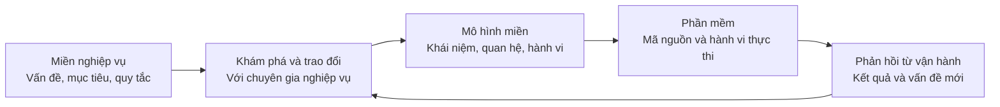

# Miền nghiệp vụ, mô hình miền và phần mềm: mối liên hệ nền tảng

Domain-Driven Design (DDD) bắt đầu từ một nhận thức đơn giản: phần mềm được xây dựng để giải quyết một vấn đề trong thế giới nghiệp vụ. Muốn thiết kế phần mềm phù hợp, đội phát triển cần hiểu vấn đề đó, diễn đạt nó bằng một mô hình đủ rõ và để mô hình ấy dẫn dắt cách tổ chức mã nguồn.

Ba khái niệm **miền nghiệp vụ**, **mô hình miền** và **phần mềm** có quan hệ chặt chẽ nhưng không đồng nghĩa. Miền nghiệp vụ là nơi vấn đề tồn tại; mô hình miền là cách con người chọn lọc và diễn đạt những hiểu biết quan trọng về vấn đề; phần mềm là hệ thống hiện thực hóa một phần mô hình để hỗ trợ hoạt động nghiệp vụ. Hiểu đúng mối quan hệ này là nền tảng để học DDD, từ thiết kế chiến lược đến thiết kế chiến thuật.

## Mục tiêu học tập

Sau bài này, bạn có thể:

- Giải thích miền nghiệp vụ là gì và phân biệt nó với phạm vi của một ứng dụng.
- Mô tả vai trò của mô hình miền trong việc chuyển kiến thức nghiệp vụ thành thiết kế phần mềm.
- Nhận biết vì sao ngôn ngữ chung và ranh giới mô hình quan trọng.
- Liên hệ mô hình miền với subdomain, bounded context, entity, value object, aggregate, repository và domain event.

## 1. Miền nghiệp vụ: nơi bài toán thực sự tồn tại

**Miền nghiệp vụ (domain)** là lĩnh vực hoạt động và tri thức mà tổ chức đang giải quyết. Miền bao gồm mục tiêu, khái niệm, quy tắc, quy trình, vai trò, sự kiện và những quyết định mà người trong lĩnh vực đó phải đưa ra.

Ví dụ, trong thương mại điện tử, nghiệp vụ không chỉ là hiển thị danh sách sản phẩm và nhận một yêu cầu HTTP. Nó bao gồm cách khách hàng chọn hàng, cách cửa hàng xác định giá, điều kiện áp dụng khuyến mãi, cách giữ tồn kho, cách xác nhận thanh toán, cách giao hàng và cách xử lý hoàn trả. Những hoạt động đó tạo thành miền nghiệp vụ mà phần mềm cần hỗ trợ.

Miền nghiệp vụ không nhất thiết trùng với một ứng dụng, một phòng ban hay một hệ thống. Miền của một tổ chức bán lẻ có thể được chia thành các subdomain liên quan đến bán hàng, quản lý hàng tồn, vận chuyển, chăm sóc khách hàng và tài chính. Một ứng dụng có thể hỗ trợ nhiều phần của miền; ngược lại, một phần nghiệp vụ có thể được nhiều ứng dụng cùng hỗ trợ.

Điều quan trọng là phân biệt **hiểu nghiệp vụ** với **biết yêu cầu giao diện**. Yêu cầu “thêm nút Hủy đơn hàng” mô tả một hành động trên giao diện. Hiểu nghiệp vụ cần trả lời sâu hơn:

- Ai có quyền hủy đơn?
- Đơn hàng được hủy ở những trạng thái nào?
- Điều gì xảy ra với khoản thanh toán và lượng hàng đã giữ?
- Nếu đơn đã bàn giao cho đơn vị vận chuyển thì quy trình xử lý ra sao?

Các câu trả lời mới cho thấy quy tắc và ràng buộc thực sự của miền. Nếu đội phát triển chỉ triển khai nút bấm mà không hiểu các quy tắc này, phần mềm có thể chạy đúng về mặt kỹ thuật nhưng vẫn cho phép một hoạt động sai về mặt nghiệp vụ.

## 2. Mô hình miền: cách diễn đạt có chọn lọc về nghiệp vụ

**Mô hình miền (domain model)** là một sự trừu tượng hóa có chủ đích về miền nghiệp vụ. Mô hình chọn ra những khái niệm, mối quan hệ, trạng thái, hành vi và quy tắc cần thiết để giải thích hoặc giải quyết một nhóm vấn đề cụ thể.

Mô hình không phải bản sao đầy đủ của thế giới thực. Nó bỏ qua những chi tiết không liên quan đến mục tiêu đang xét và làm nổi bật những điều ảnh hưởng đến quyết định nghiệp vụ. Vì vậy, hai đội có thể xây dựng hai mô hình khác nhau cho cùng một tổ chức nếu họ đang giải quyết hai vấn đề khác nhau.

Hãy xét việc tạo đơn hàng trong một cửa hàng trực tuyến. Một mô hình đơn giản có thể chứa:

- **Khách hàng (Customer):** người thực hiện giao dịch và cung cấp thông tin nhận hàng.
- **Đơn hàng (Order):** yêu cầu mua hàng có vòng đời và trạng thái riêng.
- **Dòng hàng (Order Line):** sản phẩm, số lượng và đơn giá được chấp nhận tại thời điểm đặt.
- **Tiền (Money):** giá trị tiền tệ có số tiền và đơn vị tiền tệ.
- **Quy tắc:** số lượng phải hợp lệ; đơn hàng phải có ít nhất một dòng hàng trước khi xác nhận; đơn đã giao không thể bị hủy theo quy trình hủy trước giao hàng.

Những thành phần này giúp đội phát triển suy nghĩ về nghiệp vụ bằng các khái niệm có ý nghĩa. Chúng cũng làm rõ các câu hỏi thiết kế: giá của dòng hàng có thay đổi khi giá niêm yết đổi không, trạng thái nào cho phép thêm sản phẩm, và hành động xác nhận đơn cần kiểm tra điều kiện nào?

| Thông tin nghiệp vụ | Cách mô hình hóa | Hệ quả đối với phần mềm |
| --- | --- | --- |
| Giá đã thỏa thuận tại lúc đặt hàng cần được giữ lại | Dòng hàng lưu đơn giá tại thời điểm đặt | Thay đổi giá sản phẩm về sau không làm đổi tổng tiền của đơn cũ |
| Số lượng phải lớn hơn 0 | Số lượng là một giá trị được kiểm tra theo quy tắc | Không thể thêm dòng hàng có số lượng bằng 0 hoặc âm |
| Đơn hàng có vòng đời | Đơn hàng có trạng thái và các hành vi chuyển trạng thái | Phần mềm kiểm soát được thời điểm xác nhận hoặc hủy |
| Tổng tiền phải cộng các giá trị cùng loại tiền tệ | Giá trị tiền tệ biểu diễn cả số tiền và loại tiền | Phép tính có thể từ chối cộng hai loại tiền không tương thích |

Một mô hình tốt giúp người hiểu nghiệp vụ và người viết phần mềm cùng nói về một vấn đề bằng những khái niệm nhất quán. Nó cũng giúp đội phát hiện điểm chưa rõ: nếu hai người dùng cùng một từ nhưng hiểu khác nhau, mô hình cần làm lộ ra sự khác biệt đó để cả nhóm thống nhất.

### Mô hình miền không phải sơ đồ cơ sở dữ liệu

Sơ đồ cơ sở dữ liệu mô tả cách lưu trữ dữ liệu: bảng, cột, khóa và quan hệ. Mô hình miền mô tả ý nghĩa nghiệp vụ: đối tượng nào có vai trò gì, quy tắc nào phải được giữ đúng và hành vi nào làm thay đổi trạng thái.

Hai thứ có thể liên hệ với nhau nhưng không bắt buộc giống nhau. Một mô hình miền có thể được lưu bằng nhiều bảng; một bảng có thể chỉ là chi tiết kỹ thuật để hỗ trợ truy vấn. Ngược lại, không phải cột dữ liệu nào cũng đại diện cho một khái niệm miền có ý nghĩa.

Nếu thiết kế chỉ xoay quanh việc ánh xạ bảng thành các lớp có getter và setter, các quy tắc nghiệp vụ dễ bị phân tán sang controller, service hoặc những đoạn kiểm tra rời rạc. Khi đó, cấu trúc dữ liệu có thể hiện diện rõ nhưng mô hình nghiệp vụ lại khó nhận ra.

## 3. Phần mềm: hiện thực hóa mô hình để hỗ trợ nghiệp vụ

**Phần mềm** là hệ thống có thể thực thi, lưu trữ thông tin, điều phối quy trình, áp dụng quy tắc và cung cấp khả năng tương tác cho người dùng hoặc hệ thống khác. Trong cách tiếp cận DDD, phần mềm cần phản ánh những khái niệm và quy tắc quan trọng của mô hình miền.

Ví dụ, khi người dùng xác nhận đơn hàng, phần mềm có thể cần kiểm tra đơn có dòng hàng hay chưa, xác định các điều kiện xác nhận, cập nhật trạng thái và phát sinh sự kiện để những phần khác xử lý tiếp. Tên phương thức như **confirm()** hoặc **cancel()** có thể thể hiện trực tiếp hành động nghiệp vụ. Cách tổ chức này giúp người đọc mã nguồn hiểu hệ thống đang làm gì ở cấp độ nghiệp vụ.

Một phần mềm có thể lệch khỏi mô hình miền theo nhiều cách:

- Quy tắc bị lặp lại ở nhiều màn hình hoặc API, khiến mỗi nơi xử lý một kiểu.
- Tên trong mã nguồn dùng thuật ngữ kỹ thuật chung chung, không thể hiện ý nghĩa mà chuyên gia nghiệp vụ sử dụng.
- Trạng thái được cập nhật tùy ý mà không kiểm tra điều kiện chuyển trạng thái.
- Một thay đổi trong quy trình buộc phải sửa nhiều thành phần không có ranh giới rõ ràng.

Khi đó, phần mềm vẫn có thể hoạt động, nhưng kiến thức nghiệp vụ trở nên khó tìm, khó kiểm chứng và khó thay đổi. Mục tiêu của DDD là làm cho mô hình miền trở thành một phần có ý nghĩa trong thiết kế và mã nguồn, để các thay đổi nghiệp vụ có thể được diễn đạt và thực hiện có kiểm soát.

## 4. Mối liên hệ giữa ba khái niệm là một vòng lặp

Có thể hình dung mối quan hệ nền tảng như sau:



Đây không phải quy trình tuyến tính chỉ làm một lần. Đội phát triển khám phá nghiệp vụ, đề xuất mô hình, thử nghiệm mô hình trong thiết kế và mã nguồn, sau đó học thêm từ phản hồi thực tế. Khi quy trình hoặc quy tắc thay đổi, mô hình cũng cần được xem xét và phần mềm được điều chỉnh tương ứng.

Vòng lặp này cần sự hợp tác giữa **chuyên gia nghiệp vụ** và **đội phát triển**. Chuyên gia nghiệp vụ hiểu mục tiêu, ngoại lệ và những quy tắc thường không xuất hiện trong tài liệu yêu cầu. Đội phát triển giúp biến hiểu biết đó thành mô hình rõ ràng, phát hiện mâu thuẫn và đánh giá hệ quả kỹ thuật. Không bên nào có thể thay thế hoàn toàn bên còn lại.

### Ngôn ngữ chung giúp mô hình không bị đứt đoạn

DDD khuyến khích xây dựng **ngôn ngữ chung (ubiquitous language)** cho một phạm vi mô hình. Những thuật ngữ quan trọng được dùng nhất quán trong trao đổi, tài liệu, thiết kế và mã nguồn.

Chẳng hạn, nếu nghiệp vụ phân biệt “đã tiếp nhận đơn”, “đã xác nhận đơn” và “đã bàn giao vận chuyển”, đội phát triển không nên gộp cả ba thành một trạng thái chung như **PROCESSED** nếu sự khác biệt đó ảnh hưởng đến quy tắc. Tên gọi rõ giúp mọi người thảo luận chính xác hơn và giúp mã nguồn truyền tải ý định.

Ngôn ngữ chung không có nghĩa mỗi từ chỉ có một nghĩa trong toàn doanh nghiệp. Một thuật ngữ có thể mang nghĩa khác nhau trong các hoạt động khác nhau. Điều cần thiết là xác định phạm vi mà trong đó thuật ngữ và mô hình có ý nghĩa thống nhất.

## 5. Xác định phạm vi mô hình: từ strategic design đến bounded context

Trong một tổ chức lớn, cố gắng tạo một mô hình duy nhất cho mọi hoạt động thường dẫn đến mô hình quá rộng và nhiều khái niệm mâu thuẫn. DDD giải quyết vấn đề phạm vi bằng các khái niệm của **strategic design**.

### Domain và subdomain

Domain là lĩnh vực nghiệp vụ tổng thể mà tổ chức hoạt động. **Subdomain** là một phần có phạm vi nhỏ hơn, tập trung vào một nhóm vấn đề hoặc năng lực nghiệp vụ.

Trong thương mại điện tử, có thể phân chia thành subdomain bán hàng, quản lý tồn kho, thanh toán và vận chuyển. Cách chia cụ thể phụ thuộc vào hoạt động thực tế của tổ chức; không có một danh sách cố định đúng cho mọi doanh nghiệp.

DDD thường phân loại subdomain theo vai trò:

- **Core subdomain:** phần tạo ra năng lực khác biệt hoặc lợi thế cạnh tranh mà tổ chức cần đầu tư hiểu biết và thiết kế sâu.
- **Supporting subdomain:** phần hỗ trợ hoạt động cốt lõi nhưng không tự tạo ra lợi thế cạnh tranh chính.
- **Generic subdomain:** phần có thể dùng giải pháp phổ biến hoặc mua sẵn vì không cần tự tạo khác biệt.

Việc phân loại giúp đội xác định nơi cần tập trung nguồn lực thiết kế. Không nên mặc định một loại subdomain dựa trên tên phòng ban; cần xem xét chiến lược và cách tổ chức thực sự tạo ra giá trị.

### Bounded context

**Bounded context** là ranh giới rõ ràng trong đó một mô hình và ngôn ngữ cụ thể có hiệu lực. Bên trong ranh giới đó, một thuật ngữ, quy tắc và quan hệ được hiểu theo cùng một cách.

Ví dụ, khái niệm “sản phẩm” trong phạm vi bán hàng có thể tập trung vào tên hiển thị, giá bán và mô tả. Trong phạm vi tồn kho, khái niệm tương ứng có thể tập trung vào mã hàng, đơn vị lưu kho và số lượng có thể xuất. Hai mô hình cùng phục vụ một doanh nghiệp nhưng trả lời những câu hỏi khác nhau. Ép chúng dùng chung một đối tượng Product duy nhất có thể khiến đối tượng đó chứa nhiều thuộc tính và quy tắc không liên quan.

Subdomain mô tả một phần của bài toán nghiệp vụ; bounded context xác định phạm vi áp dụng của một mô hình. Hai khái niệm có liên hệ nhưng không đồng nhất: một subdomain có thể được triển khai qua một hoặc nhiều bounded context, tùy độ phức tạp và cách tổ chức hệ thống.

**Context map** mô tả các bounded context và cách chúng liên hệ, tích hợp hoặc phụ thuộc lẫn nhau. Nó giúp đội nhận biết nơi nào cần đồng bộ dữ liệu, nơi nào cần chuyển đổi ngôn ngữ và nơi nào có nguy cơ một mô hình áp đặt lên mô hình khác.

Bounded context không tự động đồng nghĩa với microservice, một cơ sở dữ liệu riêng hay một đội riêng. Ranh giới mô hình là quyết định về ngữ nghĩa và trách nhiệm; cách triển khai vật lý cần được cân nhắc thêm theo yêu cầu vận hành và kiến trúc.

## 6. Từ mô hình miền đến tactical design

Sau khi xác định phạm vi và hiểu các khái niệm quan trọng, DDD cung cấp những mẫu thiết kế chiến thuật để biểu diễn mô hình trong phần mềm. Các mẫu này có ý nghĩa khi chúng diễn đạt đúng nghiệp vụ, không phải vì mọi dự án đều phải sử dụng đủ tất cả.

| Khái niệm | Vai trò trong mô hình | Ví dụ trong cửa hàng |
| --- | --- | --- |
| **Entity** | Đối tượng có định danh và vòng đời; các thuộc tính có thể thay đổi nhưng vẫn là cùng một đối tượng | Đơn hàng có mã đơn riêng và trải qua nhiều trạng thái |
| **Value Object** | Giá trị được xác định bởi các thuộc tính; thường bất biến và không có định danh riêng | Money gồm số tiền và loại tiền tệ |
| **Aggregate** | Nhóm đối tượng có ranh giới nhất quán; Aggregate Root kiểm soát các thay đổi cần bảo vệ quy tắc | Order quản lý các dòng hàng và trạng thái của đơn |
| **Repository** | Cung cấp cách truy xuất và lưu Aggregate theo góc nhìn của miền | OrderRepository tìm hoặc lưu một đơn hàng |
| **Domain Event** | Biểu diễn một sự kiện nghiệp vụ đã xảy ra và có ý nghĩa với phần khác của hệ thống | OrderConfirmed ghi nhận việc đơn hàng đã được xác nhận |

Ví dụ, Money phù hợp với Value Object vì hai giá trị tiền có cùng số tiền và cùng loại tiền có thể được xem là bằng nhau theo giá trị. Order phù hợp với Entity vì cần phân biệt đơn hàng này với đơn hàng khác ngay cả khi thông tin bên trong giống nhau.

Aggregate giúp xác định nơi bảo vệ các bất biến nghiệp vụ. Nếu Order là Aggregate Root, những thay đổi đối với các dòng hàng cần đi qua Order để kiểm tra trạng thái và điều kiện liên quan. Repository cung cấp điểm truy xuất Aggregate; nó không nên trở thành nơi chứa toàn bộ quy tắc nghiệp vụ. Domain Event giúp các phần khác phản ứng với một sự kiện đã xảy ra mà không phải biết toàn bộ chi tiết nội bộ của nơi phát sinh sự kiện.

Đoạn mã Java sau minh họa cách một hành vi nghiệp vụ có thể được diễn đạt trong mô hình. Đây là ví dụ rút gọn, lược bỏ phần định nghĩa kiểu dữ liệu và lưu trữ:

```java
public final class Order {
    private final OrderId id;
    private final List<OrderLine> lines = new ArrayList<>();
    private OrderStatus status = OrderStatus.DRAFT;

    public void addItem(ProductId productId, int quantity, Money unitPrice) {
        if (status != OrderStatus.DRAFT) {
            throw new IllegalStateException("Only a draft order can be changed");
        }
        if (quantity <= 0) {
            throw new IllegalArgumentException("Quantity must be positive");
        }
        lines.add(new OrderLine(productId, quantity, unitPrice));
    }

    public void confirm() {
        if (lines.isEmpty()) {
            throw new IllegalStateException("An order must contain an item");
        }
        if (status != OrderStatus.DRAFT) {
            throw new IllegalStateException("Only a draft order can be confirmed");
        }
        status = OrderStatus.CONFIRMED;
    }
}
```

Điểm đáng chú ý của ví dụ là Order giữ các quy tắc liên quan đến việc thay đổi và xác nhận đơn hàng. Người đọc có thể tìm thấy hành vi nghiệp vụ ngay trong đối tượng đại diện cho đơn hàng, thay vì phải ghép nhiều đoạn kiểm tra nằm rải rác. Trong hệ thống thực tế, quy tắc xác nhận có thể còn phụ thuộc vào tồn kho, thanh toán hoặc chính sách khác; khi đó mô hình cần thể hiện rõ trách nhiệm và ranh giới giữa các phần.

## 7. Dấu hiệu cho thấy mô hình đang giúp ích

Một mô hình miền hữu ích không được đánh giá chỉ bằng số lượng lớp hoặc độ phức tạp của sơ đồ. Hãy xem nó có giúp đội giải thích và thay đổi nghiệp vụ hay không:

1. **Tên gọi có ý nghĩa với người làm nghiệp vụ.** Thành viên trong nhóm có thể đọc tên khái niệm và hiểu chúng đang đại diện cho điều gì.
2. **Quy tắc quan trọng được thể hiện rõ.** Nhóm có thể xác định nơi kiểm tra một điều kiện và lý do điều kiện đó tồn tại.
3. **Trạng thái và hành vi nhất quán.** Các chuyển đổi quan trọng có điều kiện rõ ràng, thay vì cho phép cập nhật tùy ý.
4. **Ranh giới mô hình dễ nhận biết.** Nhóm biết thuật ngữ nào có hiệu lực trong phạm vi nào và cách các phạm vi trao đổi với nhau.
5. **Mô hình có thể thay đổi khi hiểu biết tăng lên.** Khi chuyên gia nghiệp vụ phát hiện ngoại lệ hoặc quy tắc mới, nhóm có thể cập nhật mô hình và xác định phần mềm cần thay đổi.

Nếu một mô hình quá xa cách ngôn ngữ nghiệp vụ, chứa nhiều khái niệm không phục vụ quyết định nào hoặc buộc mọi phần của hệ thống phụ thuộc vào cùng một cấu trúc, nó có thể đang làm tăng độ phức tạp thay vì giảm bớt.

## 8. Những nhầm lẫn thường gặp

- **Đồng nhất miền nghiệp vụ với ứng dụng:** một ứng dụng là phương tiện hỗ trợ; miền nghiệp vụ rộng hơn và có thể trải qua nhiều hệ thống.
- **Đồng nhất mô hình miền với mô hình dữ liệu:** dữ liệu là một phần của mô hình, nhưng mô hình còn bao gồm ý nghĩa, hành vi và quy tắc.
- **Cho rằng mọi danh từ đều phải thành Entity:** có khái niệm phù hợp với Value Object, có khái niệm chỉ là thuộc tính hoặc dữ liệu tham chiếu.
- **Cho rằng DDD đồng nghĩa với microservices:** DDD giúp xác định mô hình và ranh giới; microservices là một lựa chọn kiến trúc có thể cân nhắc sau đó.
- **Cố gắng mô hình hóa toàn bộ doanh nghiệp trong một lần:** mô hình cần có phạm vi và được cải thiện qua trao đổi, triển khai và phản hồi.

## 9. Cách bắt đầu mô hình hóa một bài toán

Khi tiếp cận một yêu cầu mới, hãy bắt đầu bằng một tình huống nghiệp vụ cụ thể thay vì lập tức tạo bảng hoặc lớp. Có thể dùng trình tự sau:

1. Xác định ai đang gặp vấn đề và kết quả nghiệp vụ họ muốn đạt được.
2. Yêu cầu chuyên gia mô tả một tình huống thực tế, bao gồm cả trường hợp bình thường và ngoại lệ.
3. Ghi lại các thuật ngữ, vai trò, sự kiện, trạng thái và quy tắc xuất hiện trong tình huống.
4. Hỏi lại những từ có nhiều cách hiểu; thống nhất ngôn ngữ trong phạm vi đang mô hình hóa.
5. Xác định những khái niệm có định danh, những giá trị chỉ được nhận diện bằng thuộc tính và những quy tắc cần luôn đúng.
6. Thử diễn đạt một hành vi nghiệp vụ bằng mô hình, sau đó kiểm tra với chuyên gia xem mô hình có phản ánh đúng thực tế không.
7. Chuyển mô hình thành thiết kế phần mềm, quan sát kết quả và điều chỉnh khi có hiểu biết mới.

Chẳng hạn, với tình huống “khách hàng hủy đơn”, đừng dừng ở thao tác cập nhật trạng thái. Hãy hỏi thời điểm nào được phép hủy, ai có quyền thực hiện, khoản tiền được xử lý ra sao, hàng đã giữ được giải phóng khi nào và hệ thống vận chuyển cần nhận thông tin gì. Những câu trả lời giúp xác định phạm vi mô hình và các quy tắc mà phần mềm phải bảo vệ.

## Kết luận

Miền nghiệp vụ cung cấp vấn đề và tri thức cần hiểu; mô hình miền chọn lọc, tổ chức và diễn đạt tri thức đó; phần mềm hiện thực hóa mô hình để hỗ trợ hoạt động thực tế. Ba thành phần liên tục tác động lẫn nhau: hiểu biết nghiệp vụ định hình mô hình, mô hình dẫn dắt thiết kế, còn việc sử dụng phần mềm tạo ra phản hồi để nhóm cải thiện hiểu biết.

DDD đưa mối liên hệ này thành trọng tâm của quá trình phát triển. Strategic design giúp xác định phạm vi và quan hệ giữa các mô hình; tactical design giúp biểu diễn các khái niệm và quy tắc trong mã nguồn. Khi mô hình được xây dựng cùng chuyên gia nghiệp vụ, dùng ngôn ngữ chung và có ranh giới rõ ràng, phần mềm có cơ hội phản ánh đúng hơn cách tổ chức tạo ra giá trị.
