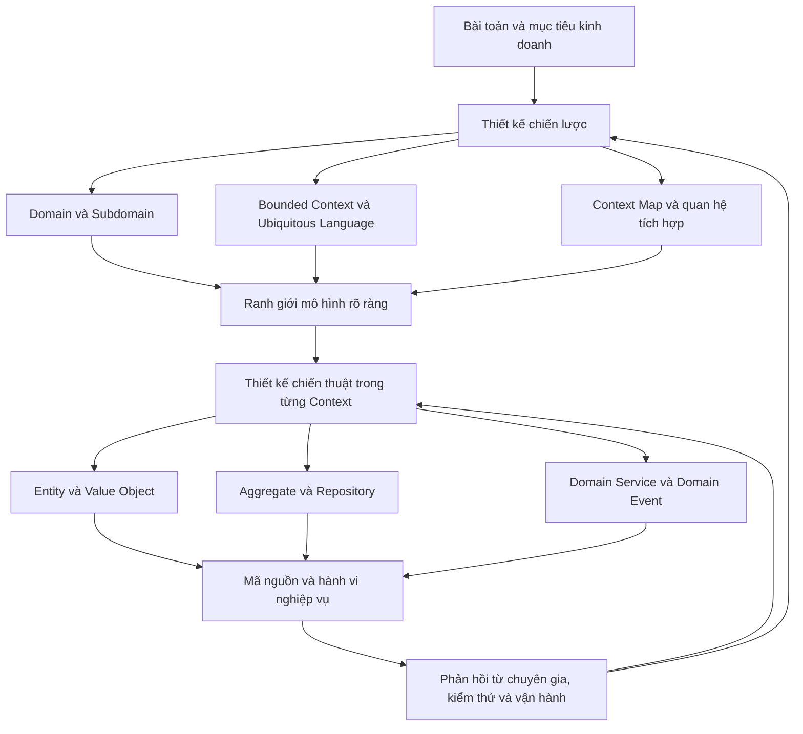
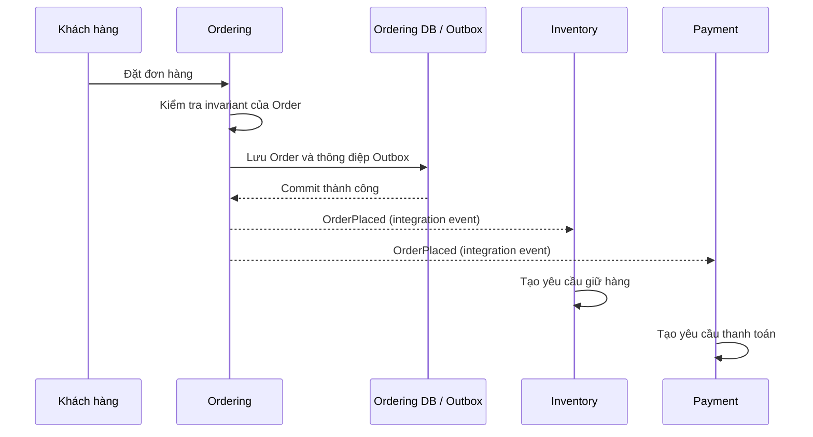

# Thiết kế chiến lược và thiết kế chiến thuật: hai mức độ bổ sung nhau

Domain-Driven Design (DDD) giúp đội phát triển biến hiểu biết về nghiệp vụ thành mô hình phần mềm có ý nghĩa. Để làm được điều đó, đội ngũ cần trả lời hai nhóm câu hỏi khác nhau:

- **Thiết kế chiến lược (strategic design):** Hệ thống đang giải quyết những phần nào của bài toán kinh doanh? Mỗi phần có mô hình và trách nhiệm ở đâu? Các phần cần phối hợp với nhau như thế nào?
- **Thiết kế chiến thuật (tactical design):** Bên trong một phạm vi nghiệp vụ đã xác định, ta biểu diễn quy tắc và vòng đời nghiệp vụ bằng những đối tượng nào? Ai được phép thay đổi trạng thái? Dữ liệu được lưu và sự kiện được phát ra ra sao?

Hai mức thiết kế bổ sung cho nhau. Thiết kế chiến lược xác định ranh giới và ngữ cảnh để mô hình không bị nhập nhằng. Thiết kế chiến thuật làm cho mô hình trong từng ngữ cảnh trở thành mã có thể thực thi. Khi triển khai một luồng nghiệp vụ, những gì học được từ mã và vận hành có thể khiến đội ngũ điều chỉnh lại ranh giới chiến lược.

## 1. Nhìn tổng thể hai mức thiết kế

Thiết kế chiến lược nhìn vào bức tranh nghiệp vụ rộng hơn. Thiết kế chiến thuật đi sâu vào mô hình bên trong một Bounded Context. Có thể hình dung mối quan hệ như sau:



| Khía cạnh | Thiết kế chiến lược | Thiết kế chiến thuật |
|---|---|---|
| Phạm vi | Toàn miền nghiệp vụ và quan hệ giữa các phần | Một Bounded Context cụ thể |
| Câu hỏi chính | Chia bài toán và trách nhiệm như thế nào? | Mô hình hóa quy tắc và trạng thái ra sao? |
| Khái niệm thường dùng | Domain, Subdomain, Bounded Context, Ubiquitous Language, Context Map | Entity, Value Object, Aggregate, Repository, Domain Service, Domain Event |
| Kết quả | Ranh giới, quyền sở hữu mô hình, cách các context hợp tác | Mô hình đối tượng, quy tắc bất biến, ranh giới nhất quán và cơ chế lưu trữ |
| Dấu hiệu tốt | Mỗi mô hình có ý nghĩa rõ trong phạm vi của nó | Quy tắc nghiệp vụ được bảo vệ bởi chính mô hình |

Không nên xem đây là hai giai đoạn đóng kín. Đội ngũ thường khám phá và điều chỉnh chúng theo vòng lặp. Tuy vậy, cần hiểu ranh giới nghiệp vụ trước khi quyết định các đối tượng và quan hệ trong mã; nếu không, mô hình chiến thuật dễ phản ánh cấu trúc cơ sở dữ liệu hoặc cấu trúc tổ chức thay vì nghiệp vụ.

## 2. Thiết kế chiến lược: xác định ranh giới của bài toán

### 2.1. Domain và Subdomain

**Domain** là lĩnh vực vấn đề mà tổ chức đang hoạt động và phần mềm cần hỗ trợ. Ví dụ, với một nền tảng thương mại điện tử, domain có thể bao gồm bán hàng, thanh toán, quản lý tồn kho, giao hàng và chăm sóc khách hàng.

Một domain lớn thường được chia thành các **Subdomain** để đội ngũ hiểu và xử lý từng phần. DDD thường phân biệt ba loại:

| Loại Subdomain | Ý nghĩa | Hướng xử lý thường gặp |
|---|---|---|
| Core Domain | Phần tạo nên lợi thế cạnh tranh hoặc năng lực khác biệt của doanh nghiệp | Đầu tư chuyên gia, mô hình và năng lực phát triển riêng |
| Supporting Subdomain | Phần cần thiết để Core Domain hoạt động nhưng không tạo khác biệt chính | Xây dựng vừa đủ theo nhu cầu nghiệp vụ |
| Generic Subdomain | Năng lực phổ biến, nhiều tổ chức có nhu cầu tương tự | Cân nhắc mua, dùng dịch vụ hoặc giải pháp tiêu chuẩn |

Ví dụ, một doanh nghiệp bán lẻ có thuật toán đề xuất sản phẩm độc đáo. Năng lực đề xuất có thể là Core Subdomain; quản lý lịch làm việc nội bộ có thể là Supporting Subdomain; xác thực danh tính phổ biến có thể là Generic Subdomain. Cách phân loại phụ thuộc chiến lược thực tế của doanh nghiệp và có thể thay đổi theo thời gian.

Việc phân loại giúp đội ngũ quyết định nên đầu tư công sức mô hình hóa ở đâu. Không nên mặc định phần phức tạp về kỹ thuật là Core Domain: một quy trình khó triển khai chưa chắc tạo ra lợi thế cạnh tranh.

### 2.2. Bounded Context: nơi một mô hình có ý nghĩa nhất quán

**Bounded Context** là ranh giới mà bên trong đó một mô hình và ngôn ngữ nghiệp vụ có ý nghĩa nhất quán. Một thuật ngữ có thể mang ý nghĩa khác nhau ở những context khác nhau.

Xét khái niệm `Customer` trong thương mại điện tử:

- Trong Sales, Customer có thể chứa thông tin phục vụ mua hàng, phân hạng và lịch sử đơn hàng.
- Trong Billing, đối tượng tương ứng có thể là BillToParty với mã số thuế, địa chỉ xuất hóa đơn và điều khoản thanh toán.
- Trong Support, hồ sơ khách hàng có thể tập trung vào yêu cầu hỗ trợ, mức độ ưu tiên và lịch sử trao đổi.

Nếu ép tất cả các bộ phận dùng chung một lớp `Customer` với mọi thuộc tính, mô hình sẽ phình to và các thay đổi ở một bộ phận có thể ảnh hưởng những bộ phận khác. Mỗi context nên sở hữu mô hình phù hợp với trách nhiệm của nó.

Bounded Context là ranh giới của mô hình và ngôn ngữ. Nó **không tự động đồng nghĩa với một microservice**. Một context có thể được triển khai bằng một hoặc nhiều thành phần phần mềm; việc tách dịch vụ còn phụ thuộc yêu cầu triển khai, tải, đội ngũ và vận hành. Ngược lại, tách một ứng dụng thành nhiều microservice mà không có ranh giới mô hình rõ ràng cũng không tự tạo ra thiết kế DDD tốt.

### 2.3. Ubiquitous Language: ngôn ngữ chung trong từng context

**Ubiquitous Language** là ngôn ngữ chung được chuyên gia nghiệp vụ và đội phát triển cùng sử dụng trong một Bounded Context. Những thuật ngữ quan trọng nên xuất hiện nhất quán trong:

- Cuộc trao đổi và tài liệu nghiệp vụ.
- Tên lớp, phương thức, thuộc tính và sự kiện trong mã nguồn.
- Kịch bản kiểm thử và ví dụ chấp nhận.
- Tên trạng thái và quy tắc trong giao diện hoặc API khi phù hợp.

Ví dụ, nếu nghiệp vụ phân biệt rõ `SubmitOrder` (gửi đơn để xử lý) và `ConfirmOrder` (xác nhận đơn đã được chấp nhận), mã nguồn cũng nên giữ sự phân biệt đó. Một phương thức tên `process()` không cho biết hành vi nghiệp vụ nào đang xảy ra.

Ngôn ngữ chung không nhất thiết giống nhau giữa mọi context. Cùng một từ có thể có nghĩa khác nhau, miễn là ranh giới và cách dịch giữa các mô hình được xác định rõ.

### 2.4. Context Map: mô tả quan hệ giữa các context

Khi một nghiệp vụ đi qua nhiều Bounded Context, các context phải trao đổi thông tin. **Context Map** mô tả các context và quan hệ phụ thuộc giữa chúng. Nó giúp đội ngũ biết mô hình nào là nguồn cung cấp thông tin, mô hình nào tiêu thụ thông tin và cần cơ chế bảo vệ nào khi tích hợp.

Một số quan hệ và mẫu tích hợp thường gặp:

| Quan hệ hoặc mẫu | Cách hoạt động | Khi phù hợp |
|---|---|---|
| Partnership | Hai đội phụ thuộc lẫn nhau và phối hợp kế hoạch thay đổi | Hai context cần đồng bộ để cùng đạt mục tiêu |
| Shared Kernel | Hai context chia sẻ một phần mô hình nhỏ, được hai bên cùng quản lý | Có thể duy trì sự phối hợp chặt chẽ và chấp nhận chi phí đồng bộ |
| Customer-Supplier | Context upstream cung cấp năng lực hoặc dữ liệu; downstream nêu nhu cầu với upstream | Một context phụ thuộc vào sản phẩm của context khác |
| Conformist | Downstream chấp nhận mô hình upstream để giảm chi phí thương lượng | Không có khả năng thực tế để thay đổi hợp đồng upstream |
| Anti-Corruption Layer (ACL) | Lớp chuyển đổi bảo vệ mô hình nội bộ khỏi khái niệm và cấu trúc bên ngoài | Tích hợp với hệ thống cũ, đối tác hoặc mô hình không phù hợp |
| Open Host Service và Published Language | Upstream cung cấp giao diện ổn định và ngôn ngữ trao đổi được công bố | Nhiều consumer cần tích hợp qua một hợp đồng rõ ràng |
| Separate Ways | Hai phần không tích hợp khi lợi ích tích hợp thấp hơn chi phí | Có thể chấp nhận dữ liệu hoặc quy trình độc lập |

Ví dụ, Ordering Context có thể phát ra thông tin đơn hàng đã được đặt. Inventory Context cần thông tin đó để giữ hàng. Nếu mô hình của hệ thống tồn kho khác với mô hình đơn hàng, Inventory có thể dùng ACL để chuyển thông điệp bên ngoài thành khái niệm nội bộ như `StockReservationRequest`. Nhờ vậy, thay đổi trong cấu trúc đơn hàng không buộc mô hình tồn kho phải thay đổi theo.

Context Map không chỉ là sơ đồ kỹ thuật. Nó còn thể hiện quyền sở hữu, mức độ phụ thuộc và cách các đội phối hợp khi hợp đồng thay đổi.

## 3. Thiết kế chiến thuật: làm cho mô hình nghiệp vụ hoạt động trong mã

Sau khi xác định Bounded Context và ngôn ngữ của nó, đội ngũ thiết kế các thành phần bên trong context. Mục tiêu là đặt dữ liệu và hành vi ở nơi phù hợp, đồng thời bảo vệ những quy tắc nghiệp vụ quan trọng.

### 3.1. Entity: đối tượng có danh tính

**Entity** là đối tượng được nhận diện bằng danh tính xuyên suốt vòng đời, ngay cả khi các thuộc tính của nó thay đổi.

Ví dụ, một đơn hàng có mã `ORD-1001`. Trạng thái của đơn có thể chuyển từ Draft sang Placed rồi Shipped, nhưng nó vẫn là cùng một đơn hàng. Vì vậy, hai đơn hàng không trở thành một chỉ vì chúng có cùng khách hàng, ngày tạo và tổng tiền.

Entity thường có:

- Một định danh ổn định.
- Trạng thái có thể thay đổi theo vòng đời.
- Hành vi kiểm soát những thay đổi hợp lệ.
- Quy tắc so sánh dựa trên định danh trong phạm vi mô hình.

Không nên biến mọi bản ghi cơ sở dữ liệu thành Entity. Nếu một khái niệm chỉ được xác định bằng các giá trị của nó và không có vòng đời riêng, Value Object có thể phù hợp hơn.

### 3.2. Value Object: đối tượng được xác định bằng giá trị

**Value Object** không có danh tính riêng. Hai Value Object được xem là bằng nhau khi các giá trị cấu thành của chúng bằng nhau theo quy tắc của mô hình.

Ví dụ:

- `Money(amount, currency)`.
- `Address(street, city, postalCode)`.
- `DateRange(start, end)`.
- `Quantity(value, unit)`.

Value Object thường nên bất biến: khi cần thay đổi, tạo ra giá trị mới. Cách làm này giảm trạng thái chia sẻ có thể bị thay đổi ngoài ý muốn và giúp kiểm tra quy tắc tại thời điểm khởi tạo.

Ví dụ Java:

```java
public record Money(BigDecimal amount, Currency currency) {
    public Money {
        Objects.requireNonNull(amount, "amount");
        Objects.requireNonNull(currency, "currency");
    }

    public Money add(Money other) {
        if (!currency.equals(other.currency)) {
            throw new IllegalArgumentException("Currency must match");
        }
        return new Money(amount.add(other.amount), currency);
    }
}
```

Đoạn mã thể hiện hai đặc điểm: `Money` không cần định danh riêng và phép cộng kiểm tra hai khoản tiền cùng loại tiền tệ. Những quy tắc như có cho phép số âm hay không, số chữ số thập phân tối đa và cách làm tròn phải được xác định theo nghiệp vụ của context, không nên áp đặt một quy tắc chung cho mọi hệ thống.

### 3.3. Aggregate: ranh giới bảo vệ tính nhất quán

**Aggregate** là một cụm đối tượng được quản lý như một đơn vị nhất quán nghiệp vụ. Mỗi Aggregate có một **Aggregate Root** làm cửa vào để bên ngoài tương tác với cụm đó.

Aggregate Root chịu trách nhiệm bảo vệ các **invariant** — những điều kiện phải luôn đúng sau mỗi thao tác được chấp nhận. Ví dụ, trong Ordering Context:

- Đơn hàng đã gửi không được thêm dòng hàng.
- Đơn hàng phải có ít nhất một dòng hàng trước khi được đặt.
- Số lượng của mỗi dòng hàng phải lớn hơn 0.
- Tổng tiền phải được tính từ các dòng hàng và chính sách giá hợp lệ.

Bên ngoài gọi hành vi trên `Order` (Aggregate Root), thay vì tự ý sửa danh sách `OrderLine` bên trong. Root kiểm tra trạng thái và điều kiện trước khi chấp nhận thay đổi.

Một Aggregate không nên chứa mọi đối tượng có liên quan về mặt nghiệp vụ. Ranh giới quá lớn khiến nhiều thao tác phải khóa và cập nhật cùng lúc, làm giảm khả năng mở rộng. Ranh giới quá nhỏ lại có thể khiến invariant bị chia cắt và khó bảo vệ. Hãy chọn ranh giới dựa trên những quy tắc cần được bảo đảm nhất quán trong một giao dịch.

Một số nguyên tắc hữu ích:

- Truy cập Aggregate thông qua Root.
- Giữ các invariant của Aggregate bên trong hành vi của Root.
- Tham chiếu Aggregate khác bằng định danh khi phù hợp, thay vì nạp cả đồ thị đối tượng vào cùng một Aggregate.
- Dùng giao dịch nhất quán cho một Aggregate; phối hợp giữa nhiều Aggregate thường cần cơ chế khác như Domain Event, quy trình điều phối hoặc eventual consistency.
- Giữ Aggregate đủ nhỏ để các thay đổi thường xuyên không tạo ra xung đột không cần thiết.

### 3.4. Repository: nạp và lưu Aggregate

**Repository** cung cấp cách làm việc với Aggregate như một tập hợp đối tượng nghiệp vụ. Mã nghiệp vụ có thể yêu cầu tìm hoặc lưu một Aggregate mà không cần biết dữ liệu được lưu trong SQL, document database hay một cơ chế khác.

Ví dụ:

```java
public interface OrderRepository {
    Optional<Order> findById(OrderId id);
    void save(Order order);
}
```

Phần triển khai cụ thể có thể nằm ở tầng hạ tầng và sử dụng JPA, JDBC hoặc công nghệ lưu trữ khác. Domain hoặc application layer phụ thuộc vào hợp đồng cần thiết; chi tiết cơ sở dữ liệu không nên rò rỉ vào quy tắc nghiệp vụ.

Repository thường được định nghĩa cho Aggregate Root, không nhất thiết tạo một repository cho từng bảng hoặc từng Entity con. Những truy vấn đọc phục vụ màn hình, báo cáo hoặc tìm kiếm phức tạp có thể dùng query service hoặc read model riêng, thay vì ép mọi nhu cầu đọc đi qua Repository của Aggregate.

### 3.5. Domain Event: ghi nhận một sự việc nghiệp vụ đã xảy ra

**Domain Event** biểu diễn một sự việc có ý nghĩa đối với nghiệp vụ và đã xảy ra. Tên sự kiện thường dùng thì quá khứ, chẳng hạn:

- `OrderPlaced`.
- `PaymentAuthorized`.
- `StockReserved`.
- `ShipmentDispatched`.

Sự kiện giúp các phần của mô hình phản ứng với một thay đổi mà không cần gắn chặt mọi hành vi vào cùng một đối tượng. Ví dụ, khi đơn hàng được đặt, Ordering Context có thể ghi nhận `OrderPlaced`; một handler trong cùng context có thể cập nhật quy trình nội bộ hoặc tạo thông tin cần phát ra cho context khác.

Cần phân biệt:

- **Domain Event** mô tả sự việc trong mô hình của một Bounded Context. Nó có thể được xử lý nội bộ.
- **Integration Event** là hợp đồng được công bố để context hoặc hệ thống khác tiêu thụ. Nó cần được thiết kế ổn định, có phiên bản và không nên phụ thuộc trực tiếp vào cấu trúc lớp nội bộ.

Một Domain Event có thể là nguồn để tạo Integration Event, nhưng hai khái niệm không nhất thiết là cùng một kiểu dữ liệu. Khi phát sự kiện ra ngoài, hệ thống cần tính đến việc lưu dữ liệu và gửi thông điệp có thể thất bại ở hai thời điểm khác nhau. Mẫu Transactional Outbox thường được dùng để ghi thay đổi nghiệp vụ và thông điệp cần phát trong cùng giao dịch cơ sở dữ liệu, sau đó một tiến trình riêng gửi thông điệp. Consumer cũng nên xử lý lặp an toàn vì thông điệp có thể được giao nhiều lần.

Domain Event không đồng nghĩa với Event Sourcing. Có thể dùng Domain Event trong một hệ thống lưu trạng thái hiện tại bằng cơ sở dữ liệu thông thường. Event Sourcing là một lựa chọn kiến trúc khác, trong đó chuỗi sự kiện được lưu làm nguồn dữ liệu chính để tái tạo trạng thái.

### 3.6. Domain Service: hành vi không thuộc tự nhiên về một Entity hay Value Object

Một số quy tắc nghiệp vụ liên quan đến nhiều đối tượng nhưng không thuộc rõ về một Entity hoặc Value Object cụ thể. Khi hành vi đó thực sự thuộc domain, có thể biểu diễn bằng **Domain Service**.

Ví dụ, chính sách xác định phí vận chuyển có thể cần trọng lượng, địa chỉ giao hàng, loại dịch vụ và chính sách của nhà vận chuyển. Nếu đặt hành vi này vào `Order` sẽ khiến Order gánh trách nhiệm không thuộc vòng đời của nó. Một `ShippingFeePolicy` hoặc domain service phù hợp có thể diễn đạt quy tắc đó rõ hơn.

Domain Service nên thể hiện một hành vi nghiệp vụ có tên và có ý nghĩa. Không nên biến nó thành nơi chứa mọi logic bị bỏ ra khỏi Entity; các hành vi gắn với vòng đời của Entity vẫn nên ở chính Entity đó.

## 4. Kết hợp hai mức thiết kế qua ví dụ đặt hàng

Giả sử hệ thống thương mại điện tử cần xử lý một đơn hàng từ lúc khách đặt đến lúc giao hàng.

### Bước 1: Phân chia bài toán ở mức chiến lược

Đội ngũ xác định một số Subdomain:

- Ordering: tiếp nhận và quản lý đơn hàng.
- Payment: ủy quyền, thu tiền và hoàn tiền.
- Inventory: quản lý lượng hàng có thể bán và giữ hàng.
- Shipping: lập và theo dõi lô giao hàng.

Sau khi đánh giá chiến lược kinh doanh, đội ngũ có thể xác định năng lực nào là Core Domain, năng lực nào là Supporting hoặc Generic. Phân loại này phụ thuộc vào lợi thế cạnh tranh thực tế của doanh nghiệp.

### Bước 2: Xác định Bounded Context và ngôn ngữ

Mỗi phần có mô hình riêng:

| Context | Khái niệm trung tâm | Trách nhiệm |
|---|---|---|
| Ordering | Order, OrderLine, CustomerOrder | Quản lý nội dung và trạng thái đơn hàng |
| Payment | Payment, Authorization, Refund | Quản lý giao dịch tiền |
| Inventory | StockItem, Reservation | Quản lý lượng hàng và việc giữ hàng |
| Shipping | Shipment, Parcel, Delivery | Quản lý việc giao hàng |

Một `Order` trong Ordering không phải là một `Payment` trong Payment. Payment có thể giữ `orderId` để biết giao dịch liên quan đến đơn nào, nhưng không cần dùng chung toàn bộ Entity `Order` của Ordering. Tương tự, Shipping có vòng đời `Shipment` của riêng nó.

### Bước 3: Thiết kế chiến thuật cho Ordering Context

Trong Ordering:

- `Order` là Entity và Aggregate Root vì có định danh, vòng đời và các quy tắc cần bảo vệ.
- `OrderLine` có thể là Value Object nếu không có định danh và vòng đời độc lập trong mô hình này.
- `Money` là Value Object để biểu diễn tiền và kiểm tra phép toán.
- `OrderRepository` nạp và lưu Aggregate `Order`.
- `OrderPlaced` là Domain Event khi đơn hàng chuyển hợp lệ sang trạng thái đã đặt.

Một phác thảo hành vi của Aggregate Root:

```java
public class Order {
    private final OrderId id;
    private final CustomerId customerId;
    private final List<OrderLine> lines = new ArrayList<>();
    private OrderStatus status = OrderStatus.DRAFT;
    private final List<DomainEvent> events = new ArrayList<>();

    public void addLine(OrderLine line) {
        ensureDraft();
        lines.add(Objects.requireNonNull(line));
    }

    public void place(Instant occurredAt) {
        ensureDraft();

        if (lines.isEmpty()) {
            throw new IllegalStateException(
                "An order must contain at least one line"
            );
        }

        status = OrderStatus.PLACED;
        events.add(new OrderPlaced(id, customerId, occurredAt));
    }

    public List<OrderLine> lines() {
        return List.copyOf(lines);
    }

    private void ensureDraft() {
        if (status != OrderStatus.DRAFT) {
            throw new IllegalStateException(
                "Only a draft order can be changed"
            );
        }
    }
}
```

Đây là phần minh họa cho cách đặt quy tắc bên trong Aggregate Root. Các kiểu `OrderId`, `CustomerId`, `OrderLine`, `OrderStatus`, `DomainEvent` và `OrderPlaced` cần được định nghĩa theo mô hình thực tế. Application Service có thể lấy thời điểm từ `Clock`, gọi `place`, lưu Aggregate qua Repository và điều phối việc xử lý các sự kiện sau khi giao dịch lưu thành công.

### Bước 4: Tích hợp giữa các context

Sau khi Ordering lưu đơn thành công, hệ thống có thể công bố Integration Event tương ứng để các context khác tiếp tục xử lý. Ví dụ:



Sơ đồ chỉ minh họa luồng khởi đầu. Trong hệ thống thực tế, giữ hàng và thanh toán có thể hoàn tất ở các thời điểm khác nhau; một bước có thể thất bại hoặc được thử lại. Khi đó, đội ngũ cần mô hình hóa trạng thái chờ, timeout, retry, xử lý trùng thông điệp và cách bù trừ nghiệp vụ. Không nên giả định rằng nhiều Bounded Context có thể cùng tham gia một giao dịch cơ sở dữ liệu nguyên tử.

Ví dụ này cho thấy hai mức thiết kế làm việc cùng nhau: thiết kế chiến lược xác định Ordering, Inventory và Payment là các context có mô hình riêng; thiết kế chiến thuật xác định cách `Order` bảo vệ quy tắc bên trong Ordering; Integration Event kết nối các context mà không buộc chúng chia sẻ cùng một mô hình nội bộ.

## 5. Quy trình áp dụng trong một dự án

Một quy trình thực tế có thể đi theo các bước sau và lặp lại khi hiểu biết thay đổi:

1. **Khám phá domain:** trao đổi với chuyên gia nghiệp vụ, tìm mục tiêu, thuật ngữ, quy trình, ngoại lệ và điểm gây khó khăn.
2. **Nhận diện Subdomain:** chia bài toán thành các năng lực nghiệp vụ; đánh giá Core, Supporting và Generic theo chiến lược của tổ chức.
3. **Đề xuất Bounded Context:** tìm nơi thuật ngữ, quy tắc và mô hình có ý nghĩa nhất quán; ghi nhận quyền sở hữu và ranh giới trách nhiệm.
4. **Lập Context Map:** xác định phụ thuộc, hướng trao đổi dữ liệu, hợp đồng tích hợp và nơi cần ACL.
5. **Xây dựng Ubiquitous Language:** thống nhất tên gọi trong trao đổi, tài liệu, mã nguồn và kịch bản kiểm thử của từng context.
6. **Mô hình hóa hành vi quan trọng:** xác định Entity, Value Object, Aggregate, invariant và các hành vi nghiệp vụ.
7. **Thiết kế lưu trữ và sự kiện:** xác định Repository cho Aggregate Root, Domain Event nội bộ và Integration Event cần công bố.
8. **Kiểm chứng bằng kịch bản:** đi qua luồng thành công, thất bại, hủy, thử lại và các trường hợp biên cùng chuyên gia nghiệp vụ.
9. **Điều chỉnh mô hình:** nếu quy tắc khó diễn đạt, Aggregate quá lớn hoặc phụ thuộc giữa context quá chặt, xem lại cả thiết kế chiến thuật lẫn chiến lược.

Không nhất thiết phải hoàn tất một sơ đồ toàn doanh nghiệp rồi mới viết mã. Có thể bắt đầu từ một luồng nghiệp vụ quan trọng, làm rõ context liên quan, mô hình hóa đủ sâu để kiểm chứng, sau đó mở rộng dần.

## 6. Những sai lầm thường gặp

**Dùng một mô hình toàn cục cho mọi bộ phận.** Các bộ phận có thể dùng cùng một từ nhưng nói về những khái niệm khác nhau. Hãy xác định context và quy tắc dịch giữa chúng thay vì ép tất cả dùng một Entity chung.

**Đồng nhất Bounded Context với microservice.** Ranh giới mô hình cần được hiểu trước; quyết định triển khai phân tán còn phải xét vận hành, tải, độ độc lập và chi phí giao tiếp.

**Bắt đầu bằng sơ đồ lớp hoặc bảng dữ liệu.** Cấu trúc lưu trữ không tự nói lên ý nghĩa nghiệp vụ. Hãy bắt đầu từ hành vi, quy tắc và ngôn ngữ của chuyên gia nghiệp vụ.

**Để Aggregate quá lớn.** Một Aggregate chứa quá nhiều khái niệm khiến giao dịch dễ xung đột và thay đổi khó độc lập. Chỉ gom các đối tượng cần được bảo vệ cùng nhau bởi invariant.

**Để logic nghiệp vụ nằm rải rác ở controller và service tổng quát.** Khi mọi quy tắc nằm ngoài mô hình, Entity trở thành túi dữ liệu và trạng thái có thể bị thay đổi theo cách không hợp lệ. Hãy đặt hành vi gần dữ liệu và vòng đời mà nó quản lý.

**Tạo Repository cho mọi lớp hoặc mọi bảng.** Repository phục vụ việc nạp và lưu Aggregate Root. Truy vấn đọc chuyên biệt có thể có cơ chế riêng.

**Phát sự kiện cho mọi thay đổi kỹ thuật.** Domain Event nên diễn đạt sự việc có ý nghĩa nghiệp vụ, chẳng hạn `OrderPlaced`, thay vì chỉ phản ánh một cột vừa được cập nhật.

**Coi Domain Event là Integration Event hoặc Event Sourcing.** Đây là các khái niệm liên quan nhưng khác mục đích. Cần xác định rõ sự kiện nào dùng nội bộ, sự kiện nào là hợp đồng bên ngoài và dữ liệu nào là nguồn trạng thái chính.

**Xem Context Map là sơ đồ tĩnh.** Quan hệ giữa các context có thể đổi khi chiến lược, đội ngũ hoặc hệ thống tích hợp thay đổi. Hãy cập nhật bản đồ cùng với thay đổi thực tế.

## 7. Checklist đánh giá thiết kế

Trước khi triển khai một phần nghiệp vụ, đội ngũ có thể dùng các câu hỏi sau để kiểm tra.

**Ở mức chiến lược:**

- Domain và các Subdomain đã được mô tả bằng ngôn ngữ nghiệp vụ chưa?
- Đội ngũ có lý do rõ ràng khi phân loại Core, Supporting và Generic không?
- Mỗi Bounded Context có phạm vi, trách nhiệm và ngôn ngữ nhất quán chưa?
- Những thuật ngữ trùng tên nhưng khác nghĩa đã được phân biệt chưa?
- Context Map cho biết phụ thuộc và cách tích hợp giữa các context chưa?
- Có nơi nào cần ACL để bảo vệ mô hình nội bộ không?

**Ở mức chiến thuật:**

- Đối tượng nào cần danh tính và vòng đời riêng để trở thành Entity?
- Khái niệm nào chỉ được xác định bằng giá trị và phù hợp làm Value Object?
- Aggregate Root nào chịu trách nhiệm bảo vệ từng invariant?
- Ranh giới Aggregate có đủ nhỏ và phù hợp với giao dịch nhất quán không?
- Repository có phục vụ Aggregate Root và che giấu chi tiết lưu trữ không?
- Domain Event có diễn đạt một sự việc nghiệp vụ đã xảy ra không?
- Integration Event có hợp đồng ổn định và được xử lý an toàn khi gửi lặp không?

**Ở ranh giới giữa hai mức:**

- Mô hình chiến thuật có dùng đúng ngôn ngữ của Bounded Context không?
- Các context có trao đổi qua hợp đồng đã xác định thay vì phụ thuộc trực tiếp vào mô hình nội bộ của nhau không?
- Khi một quy tắc thay đổi, đội ngũ có biết context và Aggregate nào chịu trách nhiệm không?
- Kịch bản nghiệp vụ có thể được chuyên gia xác nhận và chuyển thành kiểm thử không?

## 8. Kết luận

Thiết kế chiến lược giúp đội ngũ chia miền nghiệp vụ thành những phạm vi có trách nhiệm và ngôn ngữ rõ ràng. Thiết kế chiến thuật giúp mỗi phạm vi biểu diễn hành vi bằng Entity, Value Object, Aggregate, Repository, Domain Service và Domain Event.

Một mô hình tốt cần cả hai. Ranh giới chiến lược rõ ràng giúp mô hình chiến thuật tập trung và ít phụ thuộc chéo. Mô hình chiến thuật phản ánh đúng nghiệp vụ giúp kiểm chứng các ranh giới chiến lược bằng hành vi thực tế. Đội ngũ nên xem chúng như hai góc nhìn liên tục hỗ trợ nhau trong quá trình khám phá, xây dựng và điều chỉnh phần mềm.

