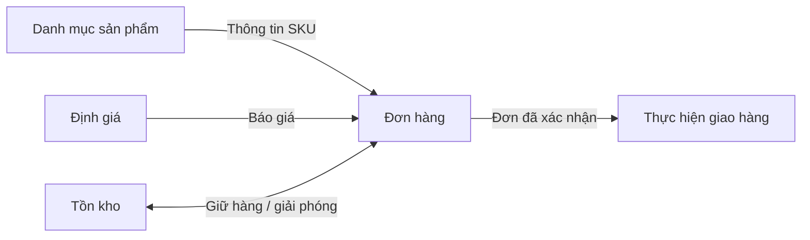

# Khi nào DDD đem lại giá trị và khi nào một mô hình đơn giản đã đủ

Domain-Driven Design (DDD) giúp đội phát triển xây dựng phần mềm dựa trên hiểu biết sâu về nghiệp vụ. Cách tiếp cận này tạo ra một mô hình và ngôn ngữ chung để chuyên gia nghiệp vụ, nhà phân tích và lập trình viên cùng mô tả vấn đề, quy tắc và hành vi của hệ thống.

DDD có thể đem lại giá trị lớn khi nghiệp vụ phức tạp, thường xuyên thay đổi hoặc có nhiều nhóm cùng làm việc trên những phần khác nhau của một miền kinh doanh. Tuy nhiên, DDD cũng đòi hỏi thời gian tìm hiểu, trao đổi và duy trì mô hình. Với một chức năng chủ yếu lưu, sửa, tìm kiếm dữ liệu và có ít quy tắc, một thiết kế đơn giản thường dễ hiểu, dễ triển khai và dễ bảo trì hơn.

Vì vậy, câu hỏi hữu ích không phải là “Có nên dùng DDD cho toàn bộ hệ thống không?”, mà là “Phần nghiệp vụ nào đủ phức tạp để cần một mô hình miền rõ ràng, và mức độ mô hình hóa nào tương xứng với giá trị nhận được?”.

## 1. DDD giải quyết vấn đề gì?

Trong một hệ thống, mã nguồn có thể chạy đúng về mặt kỹ thuật nhưng vẫn mô tả sai hoặc thiếu nghiệp vụ. Khoảng cách này thường xuất hiện khi đội phát triển chỉ nhận yêu cầu dưới dạng màn hình, bảng dữ liệu hoặc danh sách API mà chưa hiểu lý do đằng sau các quy tắc.

Hãy xét một hệ thống bán hàng cho doanh nghiệp. Cùng một từ “khách hàng” có thể chỉ người mua hàng, pháp nhân ký hợp đồng, đơn vị nhận hóa đơn hoặc tài khoản được cấp hạn mức tín dụng. Nếu mọi phần của hệ thống dùng chung một lớp `Customer` với một tập thuộc tính và quy tắc duy nhất, mô hình có thể nhanh chóng trở nên mơ hồ. Một thay đổi phục vụ bộ phận bán hàng cũng có thể vô tình ảnh hưởng đến kế toán hoặc quản lý tín dụng.

DDD xử lý vấn đề này bằng cách đưa hiểu biết nghiệp vụ vào trung tâm của quá trình thiết kế:

- **Khám phá miền nghiệp vụ:** tìm hiểu mục tiêu, quy trình, quyết định, ngoại lệ và những quy tắc thực sự chi phối hoạt động kinh doanh.
- **Xây dựng ngôn ngữ chung (Ubiquitous Language):** thống nhất cách gọi và ý nghĩa của các khái niệm để mọi người trao đổi nhất quán. Tên trong mô hình và mã nguồn nên phản ánh ngôn ngữ này.
- **Xác định ranh giới mô hình:** chia hệ thống thành các ngữ cảnh có trách nhiệm và cách hiểu riêng, thay vì ép mọi bộ phận dùng một mô hình tổng quát.
- **Mô hình hóa hành vi và quy tắc:** biểu diễn các quyết định, trạng thái và điều kiện hợp lệ ngay trong mô hình miền khi điều đó giúp bảo vệ tính đúng đắn của nghiệp vụ.

DDD có hai hướng thiết kế bổ trợ nhau. **Strategic Design** tập trung vào bức tranh lớn: miền con (subdomain), ngữ cảnh giới hạn (bounded context) và quan hệ giữa các ngữ cảnh trong context map. **Tactical Design** tập trung vào cấu trúc bên trong một ngữ cảnh: entity, value object, aggregate, repository và domain event. Không phải dự án nào cũng cần áp dụng tất cả các mẫu tactical design; việc chọn mẫu phải xuất phát từ vấn đề cụ thể của mô hình.

## 2. Những tình huống DDD thường đem lại giá trị

### 2.1. Nghiệp vụ có nhiều quy tắc tương tác

Một miền nghiệp vụ phức tạp không nhất thiết có nhiều bảng dữ liệu hay nhiều dòng mã. Độ phức tạp nằm ở số lượng quy tắc, mối quan hệ giữa chúng và hậu quả khi một quyết định sai.

Ví dụ, quy trình xử lý đơn hàng có thể phải xét đồng thời:

- Giá theo hợp đồng của từng khách hàng.
- Chiết khấu theo sản lượng, chương trình khuyến mại và thứ tự ưu tiên giữa các chính sách.
- Hạn mức tín dụng và điều kiện thanh toán.
- Khả năng giữ hàng tại từng kho.
- Điều kiện xác nhận, hủy hoặc hoàn tiền khi đơn đã đi qua một số bước xử lý.

Nếu các quy tắc này nằm rải rác trong controller, service và các câu lệnh cập nhật dữ liệu, đội phát triển khó biết nơi nào là nguồn quyết định cuối cùng. Một thay đổi nhỏ có thể tạo ra nhiều nhánh điều kiện và gây ra trạng thái không hợp lệ.

DDD có ích khi cần mô hình hóa các khái niệm và hành vi để bảo vệ những bất biến (invariant) quan trọng. Chẳng hạn, một đơn hàng không thể được xác nhận nếu chưa có báo giá hợp lệ hoặc chưa đáp ứng điều kiện giữ hàng. Một đơn đã giao không thể quay lại trạng thái nháp. Những quy tắc này cần được diễn đạt rõ và thực thi nhất quán.

### 2.2. Quy tắc nghiệp vụ thay đổi thường xuyên

Trong một miền đang phát triển, quy định, chính sách giá, cách tính phí hoặc quy trình vận hành có thể thay đổi liên tục. Nếu mã nguồn không phản ánh rõ các khái niệm nghiệp vụ, mỗi lần thay đổi đội phát triển phải lần theo nhiều đoạn mã để hiểu tác động.

Một mô hình miền tốt giúp nhóm trao đổi về thay đổi bằng chính khái niệm mà chuyên gia nghiệp vụ sử dụng. Khi có yêu cầu “đơn hàng theo hợp đồng mới được áp dụng mức chiết khấu theo bậc”, nhóm có thể xác định chính sách nào thay đổi, ngữ cảnh nào sở hữu quy tắc và những hành vi nào cần kiểm tra.

DDD đặc biệt hữu ích khi đội phát triển có thể trao đổi thường xuyên với người hiểu nghiệp vụ, thử nghiệm cách diễn đạt mô hình và điều chỉnh mô hình theo phản hồi. Nếu không có cơ hội tiếp cận tri thức nghiệp vụ, việc tự đặt tên và tự suy đoán các quy tắc sẽ làm giảm đáng kể giá trị của DDD.

### 2.3. Một khái niệm có ý nghĩa khác nhau ở các bộ phận

Khi nhiều nhóm hoặc hệ thống cùng xử lý một lĩnh vực, những từ giống nhau có thể mang ý nghĩa khác nhau. “Sản phẩm” trong danh mục có thể là mặt hàng được mô tả và tìm kiếm; trong kho vận, nó có thể gắn với đơn vị đóng gói và vị trí lưu trữ; trong định giá, nó có thể được kết hợp với hợp đồng, thị trường và thời hạn hiệu lực.

DDD khuyến khích xác định **bounded context**: phạm vi mà trong đó một mô hình và ngôn ngữ có ý nghĩa nhất quán. Mỗi ngữ cảnh có thể có cách biểu diễn riêng cho một khái niệm, miễn là ranh giới và cách trao đổi giữa chúng được xác định rõ.

Điều này đặc biệt có giá trị khi:

- Nhiều nhóm phát triển sở hữu các phần nghiệp vụ khác nhau.
- Các hệ thống bên ngoài có thuật ngữ, dữ liệu hoặc quy trình riêng.
- Một mô hình dùng chung đã tích tụ nhiều trường hợp ngoại lệ và điều kiện phụ thuộc vào người sử dụng.
- Thay đổi trong một bộ phận thường gây ảnh hưởng ngoài dự kiến đến bộ phận khác.

Bounded context là ranh giới của mô hình và ngôn ngữ. Nó có thể được triển khai bằng package, module hoặc service. Việc xác định bounded context không tự động yêu cầu tách thành microservice.

### 2.4. Miền nghiệp vụ là lợi thế cạnh tranh của sản phẩm

Không phải mọi chức năng đều có giá trị chiến lược như nhau. Một hệ thống có thể chứa các chức năng phổ biến như đăng nhập, gửi email, quản lý tệp và báo cáo, đồng thời có một quy trình đặc thù quyết định vì sao khách hàng chọn sản phẩm.

DDD giúp đội ngũ nhận diện miền con cốt lõi (core subdomain), nơi tri thức và quy tắc riêng tạo ra khác biệt cho doanh nghiệp. Đây thường là nơi đáng đầu tư thời gian để khám phá và mô hình hóa sâu hơn. Các miền con hỗ trợ hoặc phổ dụng có thể dùng thiết kế đơn giản, sản phẩm có sẵn hoặc giải pháp tiêu chuẩn nếu chúng không tạo ra lợi thế riêng.

Việc phân biệt này giúp phân bổ công sức hợp lý: đầu tư vào nơi mô hình tốt có thể cải thiện quyết định kinh doanh, giảm lỗi hoặc tăng tốc thay đổi; giữ các phần thông thường ở mức đơn giản để tránh tạo thêm chi phí không cần thiết.

## 3. Khi nào một mô hình đơn giản đã đủ?

Một mô hình đơn giản phù hợp khi nghiệp vụ ít quy tắc, ít trạng thái và ít thay đổi. Ví dụ thường gặp là danh mục mã quốc gia, danh sách phòng ban, cấu hình hiển thị, trang quản trị thông tin liên hệ hoặc chức năng lưu ghi chú nội bộ.

Những dấu hiệu cho thấy chưa cần mô hình hóa sâu:

- Nghiệp vụ chủ yếu là tạo, đọc, cập nhật và xóa dữ liệu (CRUD).
- Mỗi bản ghi có ít hành vi và vòng đời dễ hiểu.
- Quy tắc kiểm tra đơn giản, độc lập và ít có ngoại lệ.
- Dữ liệu ít được nhiều bộ phận diễn giải theo những ý nghĩa khác nhau.
- Yêu cầu tương đối ổn định và không tạo ra lợi thế cạnh tranh đáng kể.
- Một nhóm nhỏ sở hữu toàn bộ chức năng, ít có nhu cầu phối hợp qua nhiều ranh giới nghiệp vụ.

Trong trường hợp đó, một cấu trúc gồm API hoặc controller, service ứng dụng, repository dữ liệu và các kiểu dữ liệu rõ ràng có thể là đủ. Có thể dùng validation, transaction và kiểm thử phù hợp mà không cần tạo entity, aggregate hay domain event cho mọi thao tác.

“Đơn giản” không có nghĩa là viết tùy tiện. Tên biến và API vẫn cần rõ ràng; dữ liệu vẫn cần được kiểm tra; quyền truy cập và transaction vẫn cần được xử lý đúng. Chỉ nên tránh những lớp trừu tượng không giải quyết một vấn đề hiện hữu. Nếu một bảng cấu hình chỉ có vài trường và một quy tắc kiểm tra, việc tạo nhiều aggregate, factory, domain service và event có thể làm người đọc phải đi qua nhiều lớp hơn để hiểu một thao tác rất nhỏ.

Một chức năng đơn giản hôm nay cũng có thể trở nên phức tạp sau này. Khi quy tắc, trạng thái hoặc số lượng bên liên quan tăng lên, nhóm có thể nâng cấp mô hình theo nhu cầu. Không cần dự đoán toàn bộ tương lai bằng một kiến trúc lớn ngay từ đầu.

## 4. Ví dụ: cùng một sản phẩm có thể cần nhiều mức mô hình hóa

Hãy xét một nền tảng thương mại B2B. Thay vì quyết định toàn bộ nền tảng phải dùng DDD ở cùng một mức độ, ta xem xét từng phần nghiệp vụ.

| Phần nghiệp vụ | Đặc điểm | Cách tiếp cận phù hợp |
| --- | --- | --- |
| Danh mục sản phẩm | Tên, mô tả, hình ảnh, thuộc tính; thao tác cập nhật tương đối trực tiếp | Mô hình dữ liệu và CRUD đơn giản có thể đủ |
| Định giá | Giá theo hợp đồng, bậc sản lượng, thời hạn hiệu lực, chiết khấu và thứ tự ưu tiên | Nên khám phá miền và mô hình hóa chính sách, quy tắc rõ ràng |
| Đơn hàng | Có vòng đời, trạng thái, điều kiện xác nhận, hủy và hoàn tiền | Mô hình hành vi và bất biến có thể đem lại giá trị lớn |
| Tồn kho | Số lượng khả dụng, giữ hàng, hết hạn giữ hàng, điều chuyển và đối soát | Cần làm rõ các quy tắc nhất quán và ranh giới cập nhật |

Ở cấp strategic design, các phần này có thể là những bounded context khác nhau. Mỗi context sở hữu mô hình phù hợp với mục tiêu của nó và trao đổi qua hợp đồng rõ ràng:

Sơ đồ chỉ minh họa quan hệ nghiệp vụ ở mức khái quát. Hệ thống có thể triển khai các context này thành các module trong cùng một ứng dụng trước khi có lý do thực tế để tách dịch vụ. Điều quan trọng là mỗi context có trách nhiệm, thuật ngữ và hợp đồng trao đổi đủ rõ.

Ví dụ này cho thấy mức độ mô hình hóa có thể khác nhau ngay trong cùng một sản phẩm. Danh mục sản phẩm có thể vẫn là CRUD đơn giản, trong khi định giá và đơn hàng cần mô hình miền giàu hành vi. Áp dụng DDD có chọn lọc thường thực tế hơn việc buộc mọi phần có cùng số lớp và cùng bộ mẫu thiết kế.

## 5. Cách đánh giá trước khi chọn DDD

Trước khi bắt đầu, hãy trao đổi với người hiểu nghiệp vụ và trả lời một số câu hỏi:

1. **Có nhiều quy tắc tương tác không?** Một quyết định có phụ thuộc vào nhiều điều kiện, trạng thái hoặc chính sách khác nhau không?
2. **Có những bất biến quan trọng không?** Hệ thống có phải ngăn các trạng thái hoặc giao dịch không hợp lệ mà hậu quả của chúng đáng kể không?
3. **Thuật ngữ có mơ hồ theo ngữ cảnh không?** Những nhóm khác nhau có dùng cùng một từ nhưng hiểu khác nhau không?
4. **Nghiệp vụ có thường xuyên thay đổi không?** Mỗi lần thay đổi có cần trao đổi, phân tích tác động trên nhiều quy trình không?
5. **Có nhiều nhóm hoặc hệ thống cùng tham gia không?** Ranh giới trách nhiệm và hợp đồng trao đổi đã rõ chưa?
6. **Đây có phải phần tạo ra lợi thế cho doanh nghiệp không?** Một mô hình chính xác hơn có thể cải thiện chất lượng quyết định hoặc khả năng thích ứng không?

Không có một ngưỡng điểm cố định để quyết định dùng DDD. Nếu phần lớn câu trả lời là “không”, bắt đầu bằng mô hình đơn giản là lựa chọn hợp lý. Nếu nhiều câu trả lời là “có” và tập trung vào một quy trình quan trọng, hãy đầu tư khám phá và mô hình hóa sâu ở phạm vi đó. Nếu câu trả lời khác nhau giữa các phần, hãy áp dụng mức độ thiết kế khác nhau cho từng phần.

Ngoài độ phức tạp nghiệp vụ, cần xét chi phí tổ chức. DDD cần thời gian trao đổi với chuyên gia, thống nhất ngôn ngữ, cập nhật mô hình và giúp các nhóm hiểu ranh giới. Nếu nhóm chưa có quyền tiếp cận người ra quyết định nghiệp vụ hoặc chưa thể duy trì hoạt động khám phá, nên bắt đầu với phạm vi nhỏ và cải thiện dần thay vì dựng một mô hình lớn dựa trên giả định.

## 6. Bắt đầu từ nhỏ và tăng mức mô hình hóa theo nhu cầu

Khi một phần nghiệp vụ có dấu hiệu phù hợp với DDD, có thể tiến hành theo các bước sau:

1. **Chọn một quy trình có ý nghĩa:** bắt đầu từ một kết quả kinh doanh cụ thể, chẳng hạn xác nhận đơn hàng hoặc phê duyệt yêu cầu hoàn tiền. Tránh bắt đầu bằng danh sách class cần tạo.
2. **Khám phá cách nghiệp vụ vận hành:** trao đổi với người trực tiếp thực hiện, thu thập ví dụ thành công, ngoại lệ, quyết định và các trường hợp bị từ chối.
3. **Thống nhất ngôn ngữ:** ghi lại thuật ngữ, định nghĩa và ví dụ. Nếu một từ có nhiều nghĩa, ghi rõ nghĩa nào thuộc phạm vi nào.
4. **Xác định ranh giới:** tìm các miền con và bounded context khi có sự khác biệt thực sự về mục tiêu, ngôn ngữ hoặc quy tắc. Xác định cách các context trao đổi dữ liệu và sự kiện.
5. **Mô hình hóa hành vi cần bảo vệ:** biểu diễn trạng thái, hành động hợp lệ và bất biến quan trọng. Tập trung vào quy tắc có tác động thực tế.
6. **Chọn mẫu tactical khi có lý do:** dùng entity khi cần định danh và theo dõi vòng đời; value object khi giá trị được xác định bởi thuộc tính và cần bảo vệ quy tắc; aggregate khi cần một ranh giới nhất quán; repository để nạp và lưu aggregate; domain event để diễn đạt một sự kiện nghiệp vụ đã xảy ra.
7. **Kiểm tra mô hình qua thay đổi thực tế:** khi có yêu cầu mới, xem mô hình có giúp nhóm hiểu và định vị thay đổi nhanh hơn không. Nếu mô hình gây khó hiểu hoặc không phản ánh cách nghiệp vụ vận hành, hãy điều chỉnh.

Các mẫu tactical design có mục đích riêng:

- **Entity (thực thể):** có định danh ổn định và được theo dõi qua các thay đổi. Ví dụ, một đơn hàng vẫn là cùng một đơn hàng dù trạng thái hoặc địa chỉ giao thay đổi.
- **Value Object (đối tượng giá trị):** được xác định bởi giá trị thuộc tính, thường bất biến và có thể gom các quy tắc liên quan. Ví dụ, khoảng thời gian hiệu lực hoặc số tiền kèm đơn vị tiền tệ.
- **Aggregate (cụm):** nhóm các đối tượng cần được bảo vệ bởi một ranh giới nhất quán. Aggregate root là điểm truy cập để thực hiện thay đổi nhằm giữ các bất biến của cụm.
- **Repository (kho lưu trữ):** cung cấp cách nạp và lưu aggregate mà không để mô hình miền phụ thuộc trực tiếp vào chi tiết truy vấn hay cơ sở dữ liệu.
- **Domain Event (sự kiện miền):** mô tả một điều có ý nghĩa nghiệp vụ đã xảy ra, chẳng hạn `OrderConfirmed`. Event có thể giúp các phần khác phản ứng mà không cần nhúng toàn bộ quy trình của chúng vào nơi phát sinh sự kiện.

Không nên tạo các thành phần này chỉ để tuân theo một danh sách mẫu. Chẳng hạn, không phải mỗi bảng cần một aggregate riêng; không phải mỗi lần cập nhật trường dữ liệu đều là domain event; và repository không nên trở thành một lớp bọc máy móc quanh mọi câu lệnh SQL. Hãy dùng chúng khi chúng làm rõ trách nhiệm hoặc bảo vệ quy tắc cụ thể.

## 7. Nhận biết mô hình đang quá nặng hoặc quá nhẹ

Một thiết kế có thể quá nặng khi:

- Mỗi khái niệm dữ liệu đơn giản đều có nhiều lớp trung gian nhưng không chứa hành vi hay quy tắc đáng kể.
- Aggregate quá lớn, gom nhiều quy trình không cần cùng một ranh giới transaction.
- Domain event được phát ra cho mọi thay đổi kỹ thuật, khiến luồng nghiệp vụ khó theo dõi.
- Bounded context được chia chỉ theo tầng kỹ thuật hoặc theo bảng dữ liệu, không phản ánh khác biệt về ngôn ngữ và trách nhiệm.
- Lập trình viên phải hiểu nhiều mẫu thiết kế mới có thể sửa một chức năng CRUD nhỏ.

Ngược lại, mô hình có thể quá nhẹ khi:

- Cùng một quy tắc nghiệp vụ được sao chép trong nhiều service hoặc nhiều ứng dụng.
- Các chuỗi trạng thái và cờ boolean được cập nhật tự do, dẫn đến tổ hợp trạng thái không hợp lệ.
- Một service phải hiểu chi tiết nội bộ của nhiều bộ phận để hoàn thành một thao tác.
- Tên gọi trong mã nguồn không khớp với cách chuyên gia nghiệp vụ mô tả công việc.
- Mỗi thay đổi chính sách đều đòi hỏi sửa nhiều nhánh điều kiện ở những nơi khó dự đoán.

Khi gặp các dấu hiệu này, hãy quay lại quy trình và quy tắc nghiệp vụ để xác định vấn đề nằm ở mô hình, ranh giới hay cách tổ chức mã nguồn. Thêm một mẫu thiết kế mới không tự động giải quyết được sự thiếu hiểu biết về nghiệp vụ.

## 8. Nguyên tắc lựa chọn

DDD đáng đầu tư khi lợi ích của một mô hình miền rõ ràng lớn hơn chi phí khám phá và duy trì mô hình đó. Lợi ích có thể đến từ việc giảm lỗi nghiệp vụ, thay đổi chính sách an toàn hơn, phối hợp tốt hơn giữa các nhóm hoặc bảo vệ phần tạo ra lợi thế cạnh tranh.

Một mô hình đơn giản đã đủ khi dữ liệu và quy tắc dễ hiểu, ổn định, ít tương tác và không cần nhiều ranh giới nghiệp vụ. Khi ấy, ưu tiên thiết kế dễ đọc, ít khái niệm và dễ kiểm thử.

Hai cách tiếp cận này không loại trừ nhau. Một hệ thống có thể dùng mô hình đơn giản cho các miền con phổ dụng, đồng thời áp dụng strategic design và tactical design sâu hơn ở miền con cốt lõi. Hãy để độ phức tạp thực tế của nghiệp vụ quyết định mức độ mô hình hóa. Mục tiêu cuối cùng là giúp phần mềm phản ánh đúng cách doanh nghiệp vận hành và giúp đội ngũ thay đổi phần mềm một cách có kiểm soát.
