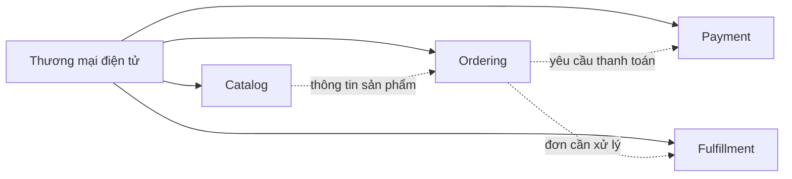
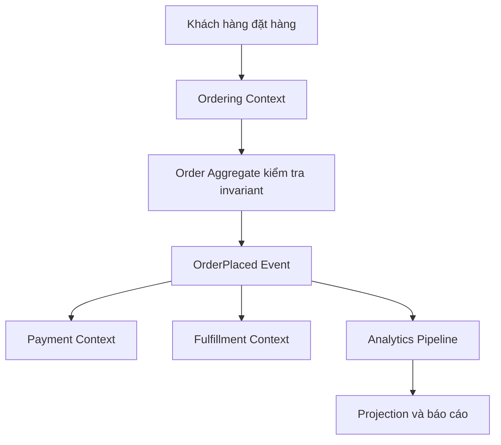

# DDD, lập trình hướng đối tượng và thiết kế hướng dữ liệu

Khi xây dựng phần mềm, đội phát triển thường phải trả lời ba câu hỏi khác nhau: hệ thống cần mô tả nghiệp vụ nào, mã nguồn nên tổ chức hành vi và trạng thái ra sao, và dữ liệu cần được lưu trữ hoặc xử lý như thế nào để đạt hiệu năng mong muốn. Domain-Driven Design (DDD), lập trình hướng đối tượng (Object-Oriented Programming — OOP) và thiết kế hướng dữ liệu (Data-Oriented Design — DOD) lần lượt giúp giải quyết những câu hỏi này.

Ba cách tiếp cận có thể phối hợp trong cùng một hệ thống. DDD giúp đội ngũ hiểu và mô hình hóa miền nghiệp vụ; OOP cung cấp một cách tổ chức mã nguồn quanh đối tượng có trạng thái và hành vi; DOD tập trung vào cách bố trí và biến đổi dữ liệu, đặc biệt khi hiệu năng và khả năng xử lý số lượng lớn phần tử trở thành yêu cầu quan trọng. Hiểu đúng phạm vi của từng cách tiếp cận giúp tránh việc dùng một kỹ thuật để giải quyết sai loại vấn đề.

## 1. Phân biệt miền nghiệp vụ, mô hình và cách tổ chức chương trình

Trước khi so sánh ba cách tiếp cận, cần phân biệt ba khái niệm:

- **Miền nghiệp vụ (domain)** là lĩnh vực mà phần mềm hỗ trợ, bao gồm khái niệm, quy trình, mục tiêu, chính sách và quy tắc của lĩnh vực đó. Ví dụ, trong thương mại điện tử có đặt hàng, thanh toán, quản lý sản phẩm, giao hàng và hoàn tiền.
- **Mô hình miền (domain model)** là tập hợp khái niệm và mối quan hệ được đội ngũ lựa chọn để diễn đạt những phần quan trọng của nghiệp vụ. Mô hình không nhất thiết mô phỏng toàn bộ thế giới thực; nó chỉ cần đủ chính xác để giải quyết vấn đề trong phạm vi đã xác định.
- **Cách tổ chức chương trình** là quyết định kỹ thuật về lớp, hàm, module, cấu trúc dữ liệu, cơ sở dữ liệu và luồng xử lý dùng để hiện thực mô hình.

Một hệ thống có thể có nhiều lớp và nhiều đối tượng nhưng vẫn hiểu sai nghiệp vụ. Ngược lại, một mô hình nghiệp vụ rõ ràng có thể được hiện thực bằng OOP, lập trình hàm, thủ tục hoặc kết hợp nhiều phong cách. Vì vậy, không nên đồng nhất DDD với OOP, cũng không nên xem DOD là một biến thể của mô hình miền.

## 2. Lập trình hướng đối tượng giải quyết vấn đề gì?

OOP tổ chức chương trình quanh các đối tượng. Một đối tượng kết hợp trạng thái với những hành vi có thể thực hiện trên trạng thái đó. Lớp thường định nghĩa cấu trúc và hành vi chung; đối tượng là một thể hiện cụ thể của lớp.

Các ý tưởng thường gặp trong OOP gồm:

- **Đóng gói (encapsulation):** kiểm soát cách trạng thái được đọc và thay đổi, bảo vệ các điều kiện hợp lệ của đối tượng.
- **Trừu tượng hóa (abstraction):** biểu diễn những đặc điểm cần thiết và ẩn đi chi tiết không liên quan đối với người sử dụng.
- **Đa hình (polymorphism):** cho phép nhiều kiểu đối tượng thực hiện cùng một giao diện theo những cách khác nhau.
- **Kế thừa (inheritance):** xây dựng kiểu mới dựa trên kiểu đã có. Trong nhiều trường hợp, kết hợp đối tượng (composition) linh hoạt hơn việc tạo một cây kế thừa sâu.

Ví dụ, một đơn hàng có thể tự bảo vệ quy tắc chuyển trạng thái:

```java
public final class Order {
    private OrderStatus status = OrderStatus.DRAFT;

    public void confirm() {
        if (status != OrderStatus.DRAFT) {
            throw new IllegalStateException("Chỉ đơn nháp mới được xác nhận");
        }
        status = OrderStatus.CONFIRMED;
    }

    public OrderStatus status() {
        return status;
    }
}

enum OrderStatus {
    DRAFT,
    CONFIRMED,
    CANCELLED
}
```

Trong ví dụ này, mã gọi `confirm()` không thể trực tiếp gán một trạng thái tùy ý vào `Order`. Đối tượng chịu trách nhiệm bảo vệ quy tắc chuyển từ `DRAFT` sang `CONFIRMED`.

OOP hữu ích khi hành vi gắn chặt với trạng thái và cần bảo vệ tính hợp lệ của trạng thái đó. Tuy nhiên, việc dùng lớp và đối tượng tự nó không bảo đảm mô hình phản ánh đúng nghiệp vụ. Một hệ thống vẫn có thể mắc các vấn đề sau:

- Tên lớp chỉ phản ánh cấu trúc kỹ thuật như `OrderController`, `OrderService`, `OrderRepository`, nhưng không diễn đạt rõ các khái niệm và quy tắc nghiệp vụ.
- Đối tượng chỉ chứa getter, setter và dữ liệu; toàn bộ quy tắc bị đẩy sang các lớp dịch vụ lớn. Đây thường được gọi là mô hình miền nghèo nàn (anemic domain model) khi nhóm đang chủ đích xây dựng mô hình miền giàu hành vi.
- Một lớp hoặc một đối tượng bị dùng chung cho nhiều bộ phận có ý nghĩa nghiệp vụ khác nhau, khiến thay đổi ở nơi này gây ảnh hưởng khó lường ở nơi khác.
- Cây kế thừa hoặc đồ thị đối tượng trở nên phức tạp, trong khi ranh giới nghiệp vụ và quyền sở hữu dữ liệu vẫn chưa rõ.

OOP trả lời tốt câu hỏi “chương trình tổ chức trạng thái và hành vi thế nào?”. Nó không tự trả lời câu hỏi “mô hình nghiệp vụ nào là đúng?” hay “phần nào của doanh nghiệp nên có một mô hình riêng?”. Đó là những câu hỏi DDD hướng đến.

## 3. Thiết kế hướng dữ liệu giải quyết vấn đề gì?

Thiết kế hướng dữ liệu (DOD) bắt đầu từ cách dữ liệu được truy cập và biến đổi trong thực tế. Thay vì mặc định rằng cấu trúc đối tượng là trung tâm, DOD xem xét luồng dữ liệu, mẫu truy cập, bố trí bộ nhớ, tính liên tục của dữ liệu và chi phí xử lý.

Mục tiêu thường gặp của DOD là:

- Tăng tính cục bộ bộ nhớ (locality), để dữ liệu cần dùng thường nằm gần nhau.
- Giảm cấp phát đối tượng, con trỏ và truy cập gián tiếp không cần thiết.
- Tận dụng cache CPU, khả năng xử lý theo lô (batch) và vector hóa khi phù hợp.
- Tổ chức phép biến đổi dữ liệu theo luồng rõ ràng, dễ đo đạc và tối ưu.

Ví dụ, một chương trình mô phỏng có thể cập nhật vị trí và vận tốc của hàng triệu thực thể ở mỗi khung hình. Cách tổ chức theo mảng đối tượng (Array of Structures — AoS) gom mọi trường của một thực thể vào cùng một đối tượng. Cách tổ chức theo mảng từng trường (Structure of Arrays — SoA) lưu các trường thành những mảng riêng. Nếu một vòng lặp chỉ cần đọc vị trí của tất cả thực thể, SoA có thể giúp truy cập dữ liệu liên tục và giảm lượng dữ liệu phải nạp vào cache.

```java
// AoS: mỗi phần tử gom nhiều trường của một thực thể.
record Particle(float x, float y, float vx, float vy) {}
Particle[] particles;

// SoA: mỗi loại dữ liệu nằm trong một mảng riêng.
final class ParticleData {
    float[] x;
    float[] y;
    float[] vx;
    float[] vy;
}
```

Đây là minh họa về cách tổ chức dữ liệu; hiệu năng thực tế còn phụ thuộc JVM, cách cấp phát, thuật toán, kích thước dữ liệu và phần cứng. Không thể kết luận SoA luôn nhanh hơn AoS trong mọi tình huống. Cần đo bằng dữ liệu và tải công việc đại diện trước khi lựa chọn.

DOD không đồng nghĩa với thiết kế cơ sở dữ liệu, CRUD hoặc việc đưa mọi dữ liệu vào một cấu trúc phẳng. Trọng tâm của nó là hiểu mẫu truy cập và tối ưu đường đi của dữ liệu. DOD đặc biệt hữu ích trong game, mô phỏng, xử lý ảnh, phân tích dữ liệu, hệ thống thời gian thực và các luồng tính toán có khối lượng lớn. Với nghiệp vụ thông thường, cấu trúc dễ hiểu và dễ thay đổi có thể có giá trị cao hơn một tối ưu bộ nhớ chưa được chứng minh.

## 4. Domain-Driven Design là gì?

Domain-Driven Design là cách tiếp cận thiết kế phần mềm đặt hiểu biết về miền nghiệp vụ vào trung tâm. DDD nhấn mạnh sự hợp tác liên tục giữa chuyên gia nghiệp vụ và đội phát triển để xây dựng một mô hình đủ rõ, dùng chung ngôn ngữ và giữ cho mã nguồn phản ánh được những quy tắc quan trọng của lĩnh vực.

DDD không chỉ là kỹ thuật tạo entity hay aggregate. Nó gồm hai nhóm hoạt động liên kết với nhau:

- **Strategic design (thiết kế chiến lược):** hiểu phạm vi nghiệp vụ, chia miền thành các subdomain, xác định bounded context và mô tả quan hệ giữa các context.
- **Tactical design (thiết kế chiến thuật):** biểu diễn mô hình bên trong một bounded context bằng entity, value object, aggregate, repository, domain service và domain event khi những khái niệm đó thực sự cần thiết.

### 4.1. Ngôn ngữ chung (Ubiquitous Language)

Ngôn ngữ chung là hệ thống thuật ngữ được chuyên gia nghiệp vụ và đội phát triển cùng hiểu, cùng sử dụng trong trao đổi, tài liệu, mô hình và mã nguồn. Nếu nhân viên vận hành gọi một hành động là “xác nhận đơn”, tài liệu và mã nguồn nên dùng thuật ngữ tương ứng thay vì tự tạo nhiều tên gần nghĩa như `approve`, `submit`, `activate` mà không phân biệt rõ ý nghĩa.

Ngôn ngữ chung không phải một bảng thuật ngữ được lập một lần rồi đóng lại. Khi đội ngũ khám phá ra quy tắc mới hoặc nhận thấy một từ đang được hiểu theo nhiều nghĩa, mô hình và cách gọi cần được điều chỉnh. Việc đặt câu hỏi về thuật ngữ thường giúp phát hiện những khác biệt nghiệp vụ bị che khuất sau một tên gọi tưởng như quen thuộc.

### 4.2. Subdomain và Bounded Context

**Subdomain** là một phần của miền nghiệp vụ. Khi phân tích miền, đội ngũ thường nhận diện:

- **Core subdomain:** năng lực tạo lợi thế cạnh tranh hoặc giá trị khác biệt chính; thường cần đầu tư hiểu biết và thiết kế sâu.
- **Supporting subdomain:** năng lực hỗ trợ hoạt động cốt lõi nhưng không phải lợi thế khác biệt chính.
- **Generic subdomain:** năng lực phổ biến, có thể mua, thuê hoặc tái sử dụng giải pháp tiêu chuẩn nếu phù hợp.

**Bounded Context** là ranh giới mà trong đó một mô hình và ngôn ngữ có ý nghĩa nhất quán. Cùng một từ có thể mang ý nghĩa khác nhau ở những context khác nhau. Chẳng hạn, “sản phẩm” trong Catalog có thể là mặt hàng được mô tả và niêm yết; trong Fulfillment, nó có thể là đơn vị vật lý cần đóng gói và giao; trong Accounting, điều quan trọng có thể là mã hàng và cách ghi nhận doanh thu.

Bounded Context không nhất thiết tương ứng một-một với microservice, database hay một nhóm người. Đây trước hết là ranh giới mô hình và trách nhiệm. Khi có lý do phù hợp, một context có thể được triển khai bằng một hoặc nhiều module, dịch vụ hay thành phần hạ tầng.



Sơ đồ chỉ mô tả một cách chia context có thể có. Ranh giới đúng phải được xác nhận bằng quy trình, quy tắc, quyền sở hữu dữ liệu và cách các nhóm phối hợp trong tổ chức thực tế.

### 4.3. Context Map

Context Map mô tả cách các bounded context liên hệ và trao đổi với nhau. Nó giúp đội ngũ nhìn thấy nơi nào phụ thuộc vào mô hình của nơi khác, nơi nào cần một hợp đồng tích hợp, và nơi nào cần bảo vệ mô hình nội bộ.

Một số quan hệ và mẫu tích hợp thường gặp:

- **Customer–Supplier:** một context cung cấp dữ liệu hoặc năng lực cho context khác; hai bên cần thống nhất cách quản lý yêu cầu và thay đổi.
- **Conformist:** context phía sau chấp nhận mô hình do bên cung cấp quyết định vì không có đủ quyền hoặc lợi ích để thay đổi nó.
- **Anti-Corruption Layer (ACL):** lớp chuyển đổi giúp mô hình nội bộ không bị kéo theo thuật ngữ, cấu trúc hoặc hạn chế của hệ thống bên ngoài.
- **Shared Kernel:** hai nhóm chia sẻ một phần mô hình nhỏ và phải phối hợp chặt chẽ khi thay đổi phần đó.
- **Partnership:** hai nhóm phụ thuộc lẫn nhau và cùng điều phối thay đổi.
- **Open Host Service và Published Language:** một context công bố giao diện hoặc ngôn ngữ trao đổi ổn định để nhiều context khác có thể tích hợp.

Không có một mẫu tích hợp phù hợp cho mọi quan hệ. Chọn mẫu dựa trên quyền kiểm soát, mức độ phụ thuộc, tốc độ thay đổi và chi phí phối hợp giữa các nhóm.

### 4.4. Các building block trong tactical design

Các building block dưới đây giúp biểu diễn quy tắc bên trong một bounded context. Không phải mô hình nào cũng cần tất cả chúng.

**Entity** là đối tượng được nhận diện bằng danh tính ổn định xuyên suốt vòng đời, ngay cả khi một số thuộc tính thay đổi. Ví dụ, hai đơn hàng có thể có cùng khách hàng và tổng tiền nhưng vẫn là hai đơn hàng khác nhau vì có `OrderId` khác nhau.

**Value Object** được xác định bởi giá trị của nó, thường không có danh tính riêng và nên bất biến sau khi tạo. Ví dụ, hai giá trị tiền có cùng số tiền và đơn vị tiền tệ có thể được xem là tương đương. Value object phù hợp để gom dữ liệu cùng quy tắc kiểm tra, tránh truyền các giá trị rời rạc thiếu ngữ nghĩa.

**Aggregate** là một cụm đối tượng miền được xem như một đơn vị nhất quán khi thay đổi. Aggregate Root là điểm truy cập bên ngoài vào aggregate và chịu trách nhiệm bảo vệ các invariant của nó. Mục tiêu là xác định ranh giới nhất quán nghiệp vụ; không nên gom mọi đối tượng có liên quan vào một aggregate lớn.

**Repository** cung cấp cách truy xuất và lưu aggregate theo ngôn ngữ miền, che giấu chi tiết lưu trữ. Repository thường được định nghĩa theo aggregate root thay vì tạo một repository cho mọi bảng hoặc mọi lớp dữ liệu.

**Domain Event** biểu diễn một sự kiện nghiệp vụ đã xảy ra, thường được đặt tên ở dạng quá khứ như `OrderPlaced` hoặc `PaymentCaptured`. Event giúp các phần khác phản ứng với sự kiện mà không cần truy cập trực tiếp vào nội bộ aggregate phát sinh nó.

**Domain Service** chứa một hành vi nghiệp vụ quan trọng nhưng không tự nhiên thuộc về một entity hoặc value object cụ thể. Domain service nên diễn đạt một quy tắc nghiệp vụ; nó không nên trở thành nơi gom mọi thao tác ứng dụng hoặc truy cập hạ tầng.

### 4.5. Ví dụ: mô hình đơn hàng

Giả sử bounded context Ordering chịu trách nhiệm tiếp nhận và xác nhận đơn hàng. Một số quy tắc có thể là:

- Đơn hàng phải có ít nhất một dòng hàng mới được xác nhận.
- Số lượng mỗi dòng hàng phải lớn hơn 0.
- Đơn đã xác nhận không được sửa danh sách dòng hàng như một đơn nháp.
- Mỗi đơn hàng có một mã định danh riêng.

Trong mô hình này, `Order` có thể là Aggregate Root; `OrderLine` và `Money` là các đối tượng nằm bên trong aggregate. Nếu `OrderLine` không có vòng đời độc lập trong nghiệp vụ, nó có thể được mô hình hóa như value object. Nếu nghiệp vụ cần theo dõi danh tính và lịch sử của từng dòng hàng độc lập, quyết định đó cần được xem xét lại.

```java
import java.math.BigDecimal;
import java.util.Currency;
import java.util.List;
import java.util.UUID;

record OrderId(UUID value) {}

record Money(BigDecimal amount, Currency currency) {
    Money {
        if (amount == null || amount.signum() < 0) {
            throw new IllegalArgumentException("Số tiền không hợp lệ");
        }
        if (currency == null) {
            throw new IllegalArgumentException("Thiếu đơn vị tiền tệ");
        }
    }
}

record OrderLine(String productId, int quantity, Money unitPrice) {
    OrderLine {
        if (productId == null || productId.isBlank()) {
            throw new IllegalArgumentException("Thiếu mã sản phẩm");
        }
        if (quantity <= 0) {
            throw new IllegalArgumentException("Số lượng phải lớn hơn 0");
        }
        if (unitPrice == null) {
            throw new IllegalArgumentException("Thiếu đơn giá");
        }
    }
}

enum OrderStatus { DRAFT, CONFIRMED, CANCELLED }

record OrderPlaced(OrderId orderId) {}

final class Order {
    private final OrderId id;
    private final List<OrderLine> lines;
    private OrderStatus status;

    Order(OrderId id, List<OrderLine> lines) {
        this.id = id;
        this.lines = List.copyOf(lines);
        this.status = OrderStatus.DRAFT;
    }

    OrderPlaced confirm() {
        if (lines.isEmpty()) {
            throw new IllegalStateException("Đơn hàng phải có ít nhất một dòng");
        }
        if (status != OrderStatus.DRAFT) {
            throw new IllegalStateException("Chỉ đơn nháp mới được xác nhận");
        }
        status = OrderStatus.CONFIRMED;
        return new OrderPlaced(id);
    }

    OrderId id() { return id; }
    OrderStatus status() { return status; }
}

interface OrderRepository {
    Order findById(OrderId id);
    void save(Order order);
}
```

Đoạn mã tập trung minh họa entity, value object, aggregate root, invariant, domain event và repository. Trong một ứng dụng thực tế, cần bổ sung xử lý trường hợp không tìm thấy đơn, tính tổng tiền có kiểm soát đơn vị tiền tệ, quản lý transaction, phát hành event bền vững và các quy tắc khác của nghiệp vụ. Không nên sao chép nguyên ví dụ này thành một mô hình hoàn chỉnh khi chưa trao đổi với chuyên gia Ordering.

Một application service có thể điều phối use case: tải `Order` qua repository, gọi `confirm()`, lưu aggregate và chuyển domain event tới cơ chế phát hành event. Application service điều phối luồng công việc; quy tắc “đơn phải có ít nhất một dòng” vẫn thuộc về mô hình miền để mọi đường gọi đều phải tuân thủ.

## 5. So sánh DDD, OOP và DOD

| Khía cạnh | DDD | OOP | DOD |
|---|---|---|---|
| Trọng tâm | Hiểu và mô hình hóa nghiệp vụ | Tổ chức trạng thái và hành vi trong chương trình | Tổ chức dữ liệu và luồng xử lý |
| Câu hỏi chính | Phần mềm cần phản ánh quy tắc và ranh giới nghiệp vụ nào? | Đối tượng nào sở hữu trạng thái và hành vi? | Dữ liệu được truy cập, bố trí và biến đổi ra sao? |
| Đơn vị thường dùng | Subdomain, bounded context, entity, value object, aggregate | Class, object, interface, method | Data layout, collection, pipeline, batch |
| Tiêu chí quan trọng | Ngữ nghĩa đúng, ranh giới rõ, quy tắc được bảo vệ | Đóng gói, khả năng mở rộng và bảo trì | Locality, thông lượng, chi phí bộ nhớ và truy cập |
| Phạm vi | Phân tích nghiệp vụ và thiết kế phần mềm | Phong cách lập trình | Phương pháp thiết kế cấu trúc và xử lý dữ liệu |
| Rủi ro khi dùng sai | Mô hình phức tạp nhưng không phản ánh thực tế | Nhiều lớp nhưng nghiệp vụ vẫn nằm rải rác | Tối ưu sớm làm mã khó hiểu mà hiệu năng không cải thiện |

DDD và OOP thường bổ trợ nhau: DDD giúp quyết định mô hình và ranh giới; OOP có thể hiện thực các entity, value object và aggregate bằng đối tượng có hành vi. DDD cũng có thể kết hợp lập trình hàm hoặc các phong cách khác nếu chúng giúp diễn đạt mô hình tốt hơn.

DOD có thể xuất hiện ở một phần khác của cùng hệ thống. Ví dụ, nghiệp vụ Ordering dùng aggregate để bảo vệ quy tắc của một đơn hàng, trong khi hệ thống phân tích hàng triệu dòng giao dịch có thể dùng pipeline và cấu trúc dữ liệu tối ưu cho truy vấn theo lô. Hai phần phục vụ mục tiêu khác nhau và có thể trao đổi qua event hoặc mô hình đọc phù hợp.

## 6. Kết hợp ba cách tiếp cận trong một hệ thống

Hãy xét một nền tảng thương mại điện tử có các chức năng catalog, đặt hàng, thanh toán, giao hàng và phân tích doanh thu.

**Ở cấp chiến lược, DDD giúp xác định ranh giới nghiệp vụ.** Catalog sở hữu thông tin mô tả và niêm yết sản phẩm; Ordering sở hữu quy tắc tạo và xác nhận đơn; Payment sở hữu quy trình thu tiền và hoàn tiền; Fulfillment sở hữu việc chuẩn bị và giao hàng. Context Map mô tả cách những bộ phận này trao đổi dữ liệu và sự kiện.

**Bên trong từng context, tactical DDD giúp xác định mô hình.** Ordering có thể dùng `Order` làm aggregate root để bảo vệ trạng thái đơn. Payment có thể có `Payment` với vòng đời và quy tắc riêng. Không nên để Ordering sửa trực tiếp trạng thái nội bộ của Payment; hai context giao tiếp thông qua hợp đồng tích hợp đã thống nhất.

**OOP có thể giúp hiện thực mô hình.** `Order.confirm()` kiểm tra invariant; `Money` bảo vệ quy tắc về số tiền và tiền tệ; interface repository tách mô hình khỏi công nghệ lưu trữ. Các lớp được đặt tên theo ngôn ngữ chung để người đọc nhận ra ý nghĩa nghiệp vụ.

**DOD có thể tối ưu phần xử lý dữ liệu khối lượng lớn.** Một pipeline phân tích doanh thu có thể nhận event, chuẩn hóa dữ liệu, gom nhóm theo thời gian và tạo projection phục vụ báo cáo. Nếu profiling cho thấy chi phí cấp phát hoặc truy cập bộ nhớ là nút thắt, đội ngũ có thể chọn cấu trúc dữ liệu liên tục, xử lý theo lô hoặc cách bố trí phù hợp hơn.

Luồng minh họa:



Event trong sơ đồ biểu diễn thông tin nghiệp vụ đã xảy ra. Hệ thống thực tế cần quyết định cách giao nhận đáng tin cậy, xử lý trùng lặp, thứ tự event, retry và tính nhất quán cuối cùng. Chỉ vẽ event trên sơ đồ chưa giải quyết được các vấn đề vận hành đó.

## 7. Quy trình bắt đầu mô hình hóa bằng DDD

Một quy trình thực hành có thể triển khai theo các bước sau:

1. **Xác định vấn đề nghiệp vụ:** ai đang gặp vấn đề, mục tiêu cần đạt là gì, quy tắc nào ảnh hưởng trực tiếp đến kết quả?
2. **Trao đổi với chuyên gia nghiệp vụ:** dùng ví dụ và tình huống thực tế để làm rõ thuật ngữ, ngoại lệ, trạng thái và quyết định.
3. **Xây dựng ngôn ngữ chung:** ghi nhận thuật ngữ có ý nghĩa chính xác; làm rõ những từ đang được các nhóm dùng với nghĩa khác nhau.
4. **Phân tích subdomain:** nhận diện phần cốt lõi, phần hỗ trợ và phần phổ biến để quyết định nơi cần đầu tư thiết kế.
5. **Xác định bounded context:** tìm ranh giới nơi thuật ngữ và mô hình nhất quán; ghi nhận quyền sở hữu nghiệp vụ và dữ liệu.
6. **Vẽ Context Map:** mô tả các quan hệ phụ thuộc, giao diện trao đổi và cách bảo vệ mô hình nội bộ.
7. **Thiết kế mô hình bên trong context:** chọn entity, value object, aggregate và domain event theo quy tắc thực tế; xác định invariant và ai có quyền thay đổi trạng thái.
8. **Hiện thực và kiểm chứng:** dùng unit test cho quy tắc miền, kiểm thử tích hợp cho hợp đồng giữa context, và đối chiếu mô hình với chuyên gia khi nghiệp vụ thay đổi.
9. **Đo hiệu năng trước khi tối ưu dữ liệu:** xác định đường xử lý nóng bằng profiling; chỉ áp dụng kỹ thuật DOD khi dữ liệu đo được cho thấy lợi ích cần thiết.

DDD là quá trình khám phá và điều chỉnh liên tục. Khi tổ chức, sản phẩm hoặc quy định thay đổi, subdomain, bounded context và ngôn ngữ chung cũng có thể cần thay đổi. Mô hình tốt là mô hình giúp đội ngũ ra quyết định và thay đổi phần mềm an toàn hơn, chứ không phải mô hình có nhiều pattern nhất.

## 8. Những sai lầm thường gặp

- **Bắt đầu bằng việc tạo thật nhiều class:** tên class được chọn trước khi hiểu thuật ngữ và quy tắc, khiến mô hình kỹ thuật lấn át mô hình nghiệp vụ.
- **Dùng một mô hình cho toàn doanh nghiệp:** cùng một khái niệm bị ép dùng chung dù các bộ phận có quy tắc và nhu cầu khác nhau.
- **Nhầm bounded context với microservice:** tách dịch vụ quá sớm làm tăng chi phí triển khai và vận hành trong khi ranh giới nghiệp vụ chưa ổn định.
- **Tạo aggregate quá lớn:** mọi đối tượng liên quan đều bị gom vào một aggregate, dẫn đến transaction nặng và cạnh tranh cập nhật. Aggregate nên được thiết kế quanh invariant cần bảo vệ.
- **Tạo repository cho mọi bảng:** cách làm này dễ biến repository thành lớp truy cập dữ liệu chung, không còn thể hiện trách nhiệm của aggregate.
- **Đưa mọi logic vào domain service:** entity và value object mất hành vi, còn service trở thành nơi chứa quy tắc không có cấu trúc.
- **Phát event cho mọi thao tác nội bộ:** event nên diễn đạt điều có ý nghĩa với nghiệp vụ hoặc bên tiêu thụ, không phải thay thế mọi lời gọi hàm.
- **Tối ưu DOD trước khi đo:** cấu trúc phức tạp hơn được đưa vào nhưng không giải quyết nút thắt thực tế.
- **Coi OOP, DDD và DOD là các lựa chọn loại trừ nhau:** chúng trả lời các câu hỏi ở những cấp độ khác nhau và có thể được phối hợp có chủ đích.

## 9. Câu hỏi tự kiểm tra

1. Vì sao một hệ thống có nhiều class và object vẫn có thể chưa có mô hình miền tốt?
2. Ubiquitous Language giúp phát hiện khác biệt nghiệp vụ như thế nào?
3. Subdomain khác bounded context ở điểm nào?
4. Vì sao cùng một từ như “sản phẩm” có thể có mô hình khác nhau trong Catalog và Fulfillment?
5. Entity khác value object ở cách xác định sự đồng nhất như thế nào?
6. Aggregate Root chịu trách nhiệm bảo vệ điều gì? Vì sao không nên tạo aggregate quá lớn?
7. Repository trong DDD khác một DAO hoặc repository CRUD tổng quát ở mục đích nào?
8. Domain event biểu diễn điều gì và hỗ trợ các bounded context phối hợp ra sao?
9. DOD tối ưu những yếu tố nào của việc truy cập và xử lý dữ liệu?
10. Trong một hệ thống thương mại điện tử, phần nào có thể cần DDD, phần nào có thể hưởng lợi từ DOD, và OOP có thể hỗ trợ ở đâu?

## Kết luận

DDD giúp đội ngũ hiểu sâu miền nghiệp vụ, thiết lập ngôn ngữ chung và chia mô hình theo bounded context. OOP giúp tổ chức trạng thái cùng hành vi, đóng gói quy tắc trong các đối tượng. DOD giúp tổ chức dữ liệu và luồng xử lý dựa trên cách chương trình thực sự truy cập dữ liệu, đặc biệt khi hiệu năng là yêu cầu quan trọng.

Khi lựa chọn kỹ thuật, hãy bắt đầu từ câu hỏi cần giải quyết: vấn đề nằm ở hiểu biết nghiệp vụ, cấu trúc hành vi hay chi phí xử lý dữ liệu? Có thể dùng cả ba cách tiếp cận trong một hệ thống, miễn là mỗi cách được áp dụng đúng phạm vi và được kiểm chứng bằng nhu cầu thực tế.
