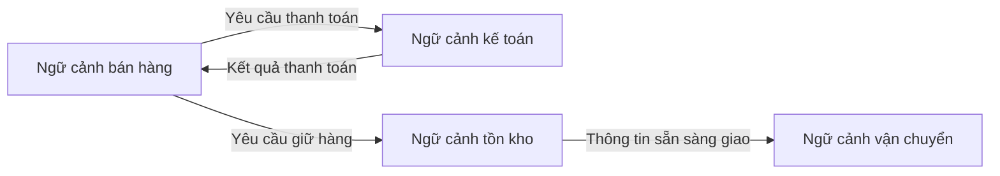

# Phân biệt DDD với microservices, kiến trúc phân lớp và việc dùng framework

Domain-Driven Design (DDD) thường được nhắc cùng microservices, kiến trúc phân lớp, Spring hay Hibernate. Vì chúng thường xuất hiện trong cùng một dự án, người mới dễ nghĩ rằng DDD là một kiểu kiến trúc, một cách chia service hoặc một bộ công cụ lập trình. Thực tế, chúng giải quyết những câu hỏi khác nhau.

DDD giúp đội phát triển hiểu nghiệp vụ và xây dựng mô hình phần mềm phản ánh đúng những khái niệm, quy tắc và mối quan hệ quan trọng của nghiệp vụ. Microservices tổ chức hệ thống thành các dịch vụ có thể phát triển và triển khai độc lập. Kiến trúc phân lớp tổ chức mã nguồn theo trách nhiệm và hướng phụ thuộc. Framework cung cấp cơ chế kỹ thuật để xây dựng ứng dụng.

Bài viết dùng ví dụ một doanh nghiệp xử lý đơn hàng để phân biệt bốn khái niệm này, đồng thời chỉ ra cách chúng có thể phối hợp trong cùng một hệ thống.

## Sau bài học này

Bạn có thể:

- Giải thích DDD là phương pháp thiết kế lấy miền nghiệp vụ làm trọng tâm, không phải một kiểu triển khai hay framework.
- Phân biệt subdomain, bounded context và context map trong strategic design.
- Nhận diện vai trò của entity, value object, aggregate, repository và domain event trong tactical design.
- Giải thích vì sao một bounded context có thể được triển khai thành module trong monolith hoặc thành một service độc lập.
- Kết hợp mô hình miền với kiến trúc phân lớp và framework mà không để chi tiết kỹ thuật quyết định mô hình nghiệp vụ.

## 1. DDD trả lời câu hỏi nào?

Hãy hình dung một hệ thống bán hàng có chức năng tạo đơn, thanh toán, kiểm tra tồn kho và giao hàng. Nếu chỉ nhìn từ góc độ kỹ thuật, ta có thể bắt đầu bằng các bảng `customer`, `order`, `product`, `payment` và các API tương ứng. Cách tiếp cận đó cho biết dữ liệu được lưu thế nào, nhưng chưa trả lời được những câu hỏi nghiệp vụ quan trọng:

- Khi nào một đơn hàng được xem là đã xác nhận?
- Đơn hàng có thể bị hủy sau khi đã thanh toán hay sau khi kho đã đóng gói không?
- Giữ hàng, xuất kho và giao hàng là những trạng thái khác nhau như thế nào?
- Bộ phận bán hàng và bộ phận kế toán có cùng ý nghĩa khi nói về một khách hàng không?

DDD bắt đầu bằng việc hợp tác với chuyên gia nghiệp vụ để tìm câu trả lời. Đội phát triển làm rõ thuật ngữ, quy tắc, quy trình, ngoại lệ và những quyết định có ảnh hưởng đến kết quả kinh doanh. Sau đó, đội chuyển hiểu biết ấy thành mô hình phần mềm và duy trì sự nhất quán giữa cách mọi người nói về nghiệp vụ với cách mã nguồn thể hiện nghiệp vụ.

**Mô hình miền (domain model)** là cách biểu diễn có chọn lọc những khái niệm và quy tắc cần thiết để giải quyết một vấn đề nghiệp vụ. Nó không đơn thuần là sơ đồ lớp, cấu trúc bảng dữ liệu hay bản sao của biểu mẫu đang dùng trong doanh nghiệp. Một mô hình tốt làm rõ điều gì được phép xảy ra, điều gì bị cấm và trạng thái của đối tượng thay đổi theo quy tắc nào.

### Ngôn ngữ chung (Ubiquitous Language)

DDD khuyến khích chuyên gia nghiệp vụ và đội phát triển sử dụng một ngôn ngữ chung trong trao đổi, tài liệu, kiểm thử và mã nguồn. Nếu nghiệp vụ phân biệt “đơn nháp”, “đơn đã xác nhận” và “đơn đã bàn giao cho vận chuyển”, mã nguồn nên thể hiện được những khái niệm đó thay vì gom tất cả vào một cột trạng thái khó hiểu hoặc những tên gọi kỹ thuật chung chung.

Ngôn ngữ chung không phải danh sách thuật ngữ được viết một lần rồi đóng lại. Nó được điều chỉnh khi đội hiểu sâu hơn về nghiệp vụ. Khi một thuật ngữ có nhiều nghĩa, đội cần làm rõ nghĩa đó trong từng ngữ cảnh thay vì ép mọi bộ phận dùng chung một định nghĩa.

DDD có hai nhóm hoạt động bổ trợ nhau:

- **Strategic design (thiết kế chiến lược):** xác định phạm vi mô hình, ranh giới và quan hệ giữa các phần của miền nghiệp vụ.
- **Tactical design (thiết kế chiến thuật):** biểu diễn quy tắc nghiệp vụ trong mô hình bằng các cấu trúc như entity, value object, aggregate, repository và domain event.

## 2. Strategic design: hiểu miền nghiệp vụ và xác định ranh giới

Strategic design giúp đội quyết định nên mô hình hóa vấn đề ở đâu, mỗi mô hình có phạm vi nào và các nhóm mô hình trao đổi với nhau ra sao. Ba khái niệm nền tảng là subdomain, bounded context và context map.

### Subdomain: chia miền nghiệp vụ theo vấn đề kinh doanh

**Domain** là toàn bộ lĩnh vực nghiệp vụ mà hệ thống cần hỗ trợ. Một doanh nghiệp thương mại có thể có miền nghiệp vụ gồm bán hàng, quản lý sản phẩm, thanh toán, tồn kho, vận chuyển và chăm sóc khách hàng.

**Subdomain** là một phần của miền nghiệp vụ, được nhận diện theo năng lực hoặc vấn đề kinh doanh mà doanh nghiệp cần giải quyết. Subdomain thuộc không gian vấn đề của doanh nghiệp: nó mô tả doanh nghiệp cần làm gì, chưa quyết định mã nguồn phải chia thành module hay service nào.

DDD thường phân loại subdomain thành ba nhóm:

| Loại subdomain | Ý nghĩa | Ví dụ trong doanh nghiệp bán hàng |
| --- | --- | --- |
| Core subdomain | Năng lực tạo lợi thế cạnh tranh hoặc khác biệt quan trọng của doanh nghiệp. Đây thường là nơi cần đầu tư mô hình và chuyên môn sâu. | Thuật toán định giá và tối ưu khuyến mại riêng của doanh nghiệp. |
| Supporting subdomain | Năng lực cần thiết để vận hành mô hình kinh doanh nhưng không tạo khác biệt chiến lược lớn. | Quy trình xử lý yêu cầu đổi trả đặc thù của doanh nghiệp. |
| Generic subdomain | Năng lực phổ biến, nhiều tổ chức có nhu cầu tương tự và thường có thể mua hoặc dùng giải pháp có sẵn. | Xác thực người dùng hoặc gửi email thông báo. |

Việc phân loại phụ thuộc vào chiến lược thực tế của doanh nghiệp. Chức năng thanh toán có thể là năng lực cốt lõi ở một công ty công nghệ tài chính, nhưng chỉ là năng lực hỗ trợ ở một nhà bán lẻ sử dụng cổng thanh toán bên ngoài.

Phân loại subdomain giúp phân bổ nguồn lực hợp lý. Đội nên hiểu sâu và kiểm soát tốt phần cốt lõi; cân nhắc tái sử dụng, mua hoặc thuê giải pháp cho phần phổ biến; và xây dựng vừa đủ cho phần hỗ trợ.

### Bounded context: ranh giới của một mô hình

**Bounded context (ngữ cảnh giới hạn)** là ranh giới trong đó một mô hình và ngôn ngữ có ý nghĩa nhất quán. Bên trong ranh giới ấy, một thuật ngữ có định nghĩa đủ rõ để mọi người cùng hiểu và mã nguồn có thể thể hiện nó một cách nhất quán.

Ví dụ, từ “khách hàng” có thể mang nghĩa khác nhau ở các bộ phận:

- Trong ngữ cảnh bán hàng, khách hàng có thể là người đặt hàng, có địa chỉ giao hàng, lịch sử mua và hạng thành viên.
- Trong ngữ cảnh kế toán, khách hàng có thể là pháp nhân hoặc cá nhân chịu trách nhiệm thanh toán, có mã số thuế, hạn mức công nợ và thông tin hóa đơn.
- Trong ngữ cảnh vận chuyển, điều cần quan tâm có thể là người nhận, số điện thoại liên hệ và địa chỉ giao hàng.

Nếu dùng một mô hình `Customer` duy nhất cho tất cả các bộ phận, lớp này dễ phình to với nhiều trường và quy tắc không liên quan. Mỗi thay đổi ở một bộ phận cũng có thể ảnh hưởng đến những bộ phận khác. Bounded context cho phép mỗi ngữ cảnh giữ mô hình phù hợp với trách nhiệm của mình, đồng thời định nghĩa rõ cách trao đổi với ngữ cảnh khác.

Bounded context là ranh giới của mô hình và ngôn ngữ. Nó có thể được triển khai thành một module trong cùng ứng dụng, một ứng dụng riêng hoặc một microservice. Bản thân khái niệm này không bắt buộc phải có một tiến trình, máy chủ hay cơ sở dữ liệu riêng.

### Subdomain khác bounded context như thế nào?

Hai khái niệm liên quan nhưng không đồng nghĩa:

| Tiêu chí | Subdomain | Bounded context |
| --- | --- | --- |
| Thuộc về | Không gian vấn đề nghiệp vụ | Không gian giải pháp và mô hình phần mềm |
| Câu hỏi chính | Doanh nghiệp cần năng lực nào? | Mô hình và ngôn ngữ nào có hiệu lực trong ranh giới này? |
| Cách nhận diện | Theo hoạt động, mục tiêu và năng lực kinh doanh | Theo tính nhất quán của mô hình, thuật ngữ và trách nhiệm |
| Quan hệ | Có thể được hỗ trợ bởi một hoặc nhiều mô hình | Có thể bao phủ một phần hoặc nhiều phần của các nhu cầu nghiệp vụ liên quan |

Không nên mặc định một subdomain luôn tương ứng chính xác với một bounded context. Một subdomain lớn có thể cần nhiều bounded context; ngược lại, một bounded context có thể hỗ trợ các phần nghiệp vụ liên quan nhau. Đội cần xác định ranh giới dựa trên cách nghiệp vụ vận hành và mức độ nhất quán của mô hình.

### Context map: mô tả quan hệ giữa các bounded context

Khi có nhiều bounded context, chúng không tồn tại độc lập hoàn toàn. Chúng có thể cần chia sẻ thông tin, đồng bộ quy trình hoặc phụ thuộc vào mô hình do ngữ cảnh khác cung cấp. **Context map (bản đồ ngữ cảnh)** mô tả các ranh giới đó và quan hệ giữa chúng.

Ví dụ đơn giản:



Các mũi tên thể hiện quan hệ trao đổi ở mức khái niệm; cách tích hợp cụ thể có thể là gọi API, gửi thông điệp, trao đổi sự kiện hoặc một cơ chế khác. Khi thiết kế context map, đội cần làm rõ bên nào sở hữu mô hình, bên nào phụ thuộc, dữ liệu nào được trao đổi và ai chịu trách nhiệm khi hợp đồng tích hợp thay đổi.

Một số kiểu quan hệ thường gặp:

- **Shared Kernel:** hai ngữ cảnh chia sẻ một phần nhỏ mô hình hoặc mã nguồn. Phần dùng chung cần được quản trị chặt vì thay đổi có thể tác động đến cả hai bên.
- **Customer-Supplier:** ngữ cảnh cung cấp (upstream) cung cấp khả năng hoặc dữ liệu cho ngữ cảnh tiêu thụ (downstream). Bên tiêu thụ có thể nêu nhu cầu; hai bên cần thống nhất cách phối hợp.
- **Conformist:** bên downstream chấp nhận mô hình và hợp đồng của upstream, thường vì không có đủ quyền hoặc lợi ích để yêu cầu thay đổi.
- **Anti-Corruption Layer (ACL):** một lớp chuyển đổi bảo vệ mô hình nội bộ khỏi cách biểu diễn hoặc quy tắc không phù hợp từ hệ thống bên ngoài. ACL dịch dữ liệu và ý nghĩa sang ngôn ngữ của bounded context hiện tại.
- **Open Host Service và Published Language:** bên cung cấp công bố một giao diện hoặc ngôn ngữ trao đổi ổn định để nhiều bên tiêu thụ có thể tích hợp.
- **Partnership:** hai đội phụ thuộc lẫn nhau và cần phối hợp trực tiếp để cùng đạt mục tiêu.
- **Separate Ways:** hai phần nghiệp vụ ít cần tích hợp; đôi khi giữ độc lập đơn giản và hiệu quả hơn xây dựng một kết nối tốn kém.

Không cần áp dụng mọi kiểu quan hệ vào mọi hệ thống. Giá trị của context map nằm ở việc làm lộ ra phụ thuộc, quyền sở hữu và chi phí phối hợp để đội có quyết định kiến trúc phù hợp.

## 3. Tactical design: biểu diễn quy tắc nghiệp vụ trong mô hình

Sau khi xác định được phạm vi và ranh giới, đội thiết kế các đối tượng và hành vi bên trong từng bounded context. Những building block sau giúp mô hình diễn đạt quy tắc nghiệp vụ một cách rõ ràng.

### Entity: đối tượng có định danh và vòng đời

**Entity (thực thể)** là đối tượng được phân biệt chủ yếu bằng định danh ổn định, không chỉ bằng các thuộc tính hiện tại. Hai entity có thể có cùng tên hoặc cùng giá trị thuộc tính nhưng vẫn là hai đối tượng khác nhau nếu định danh khác nhau.

Ví dụ, hai đơn hàng có cùng khách hàng, cùng sản phẩm và cùng tổng tiền vẫn là hai đơn hàng riêng vì có mã đơn khác nhau. Một đơn hàng giữ định danh trong suốt vòng đời dù trạng thái, địa chỉ giao hoặc danh sách dòng hàng có thể thay đổi theo quy tắc.

Entity thường có:

- Định danh riêng và ổn định.
- Trạng thái thay đổi theo thời gian.
- Hành vi kiểm soát những thay đổi hợp lệ của trạng thái.

Không phải mọi danh từ trong nghiệp vụ đều cần trở thành entity. Chỉ dùng entity khi định danh và vòng đời của đối tượng thực sự có ý nghĩa.

### Value object: mô tả giá trị, không có định danh riêng

**Value object (đối tượng giá trị)** được xác định bởi giá trị của các thuộc tính. Hai value object có cùng giá trị được xem là tương đương; chúng không cần định danh riêng để phân biệt.

Ví dụ:

- `Money` gồm số tiền và loại tiền tệ.
- `Address` gồm đường, phường, thành phố và mã bưu chính.
- `DateRange` gồm ngày bắt đầu và ngày kết thúc.
- `Quantity` biểu diễn số lượng cùng đơn vị đo.

Value object thường nên bất biến (immutable): khi cần thay đổi, tạo giá trị mới thay vì sửa một phần trạng thái bên trong. Cách này giúp giảm tác dụng phụ và làm các quy tắc kiểm tra giá trị dễ kiểm soát. Chẳng hạn, `Money` nên ngăn việc cộng trực tiếp hai khoản tiền khác loại tiền tệ nếu chưa có quy tắc quy đổi rõ ràng.

### Aggregate: ranh giới nhất quán của một nhóm đối tượng

**Aggregate (cụm tổng hợp)** là một nhóm entity và value object được xem như một đơn vị nhất quán khi áp dụng các quy tắc nghiệp vụ. Mỗi aggregate có một **aggregate root (gốc aggregate)** làm điểm truy cập từ bên ngoài. Đối tượng khác không nên tự ý thay đổi các thành phần nội bộ mà bỏ qua root.

Ví dụ, `Order` có thể là aggregate root, quản lý các `OrderLine` bên trong. Đơn hàng chịu trách nhiệm bảo đảm những quy tắc như:

- Không thể xác nhận một đơn hàng không có dòng hàng.
- Số lượng trong mỗi dòng hàng phải lớn hơn 0.
- Chỉ đơn hàng ở trạng thái cho phép mới có thể được xác nhận hoặc hủy.
- Tổng tiền phải được tính theo quy tắc giá và giảm giá đã thống nhất.

Một thao tác thay đổi trạng thái nên đi qua hành vi của aggregate root, chẳng hạn `order.confirm()`, để các bất biến (invariant) được kiểm tra tại nơi sở hữu chúng.

Một số nguyên tắc thiết kế hữu ích:

- Giữ aggregate đủ nhỏ để bảo vệ những quy tắc thực sự cần nhất quán cùng nhau.
- Bên ngoài aggregate chỉ tham chiếu aggregate khác bằng định danh khi có thể, thay vì giữ cả một đồ thị đối tượng lớn.
- Không tạo aggregate chỉ để gom các bảng dữ liệu có quan hệ khóa ngoại.
- Bắt đầu với ranh giới giao dịch của một aggregate; phối hợp nhiều aggregate bằng quy trình hoặc sự kiện khi nghiệp vụ cho phép nhất quán cuối cùng.

Aggregate không phải cách đặt tên khác cho một entity lớn. Nó xác định nơi các bất biến phải luôn đúng sau một thao tác nghiệp vụ.

### Repository: truy cập và lưu aggregate

**Repository (kho lưu trữ)** cung cấp cách lấy và lưu aggregate mà không buộc mô hình miền phụ thuộc vào chi tiết truy vấn hoặc công nghệ lưu trữ. Trong mô hình hướng đối tượng, repository thường được sử dụng như một tập hợp các aggregate root: tìm một đơn hàng theo mã, thêm đơn mới hoặc lưu thay đổi của đơn hàng.

Ví dụ về hợp đồng ở mức miền:

```java
public interface OrderRepository {
    Optional<Order> findById(OrderId id);
    void save(Order order);
}
```

Phần triển khai có thể dùng JPA, JDBC, một cơ sở dữ liệu tài liệu hoặc một hệ thống lưu trữ khác. Domain/application layer làm việc với hợp đồng; infrastructure layer cung cấp cách thực hiện hợp đồng đó.

Không nhất thiết tạo một repository cho từng bảng hoặc từng entity con. Repository thường tập trung vào aggregate root vì root là ranh giới truy cập và nhất quán của aggregate.

### Domain event: ghi nhận điều đã xảy ra trong miền

**Domain event (sự kiện miền)** biểu diễn một sự việc nghiệp vụ đã xảy ra và có ý nghĩa đối với miền. Tên sự kiện thường ở thì quá khứ, ví dụ `OrderConfirmed`, `PaymentReceived` hoặc `StockReserved`.

Domain event hữu ích khi một thay đổi trong một phần mô hình cần được phần khác phản ứng. Ví dụ, sau khi đơn hàng được xác nhận, quy trình tồn kho có thể bắt đầu giữ hàng. Sự kiện giúp mô tả sự thật đã xảy ra mà không buộc aggregate phát lệnh gọi trực tiếp đến mọi thành phần quan tâm.

Cần phân biệt:

- **Command (lệnh):** yêu cầu thực hiện một hành động, ví dụ `ConfirmOrder`.
- **Domain event:** thông báo một sự việc đã xảy ra trong mô hình, ví dụ `OrderConfirmed`.
- **Integration event:** hợp đồng sự kiện được công bố qua ranh giới bounded context hoặc hệ thống để bên khác có thể tiêu thụ. Nó thường được ánh xạ từ sự kiện nội bộ và cần được quản trị như một hợp đồng tích hợp.

Trong hệ thống có giao dịch cơ sở dữ liệu và message broker, đội cần bảo đảm sự kiện được phát ra nhất quán với dữ liệu đã lưu. Một cách thường dùng là transactional outbox: ghi thay đổi miền và thông điệp cần phát vào cùng giao dịch, sau đó tiến trình riêng gửi thông điệp. Đây là kỹ thuật triển khai hỗ trợ độ tin cậy, không phải điều kiện để một mô hình được xem là DDD.

### Domain service và application service

Hai loại service này thường xuất hiện cùng các building block trên:

- **Domain service** chứa một quy tắc nghiệp vụ có ý nghĩa trong miền nhưng không tự nhiên thuộc về một entity hay value object cụ thể. Nó nên diễn đạt bằng ngôn ngữ miền và không trở thành nơi chứa mọi nghiệp vụ.
- **Application service** điều phối một use case: nhận yêu cầu, tải aggregate qua repository, gọi hành vi miền, quản lý ranh giới giao dịch và phối hợp với các cổng tích hợp. Nó tổ chức luồng công việc, còn quy tắc cốt lõi vẫn thuộc mô hình miền.

Nếu application service chứa hàng loạt điều kiện nghiệp vụ và entity chỉ có getter/setter, mô hình dễ trở thành **anemic domain model** (mô hình miền nghèo hành vi). Khi đó, quy tắc nằm rải rác trong các service và khó bảo đảm nhất quán. Tuy vậy, với nghiệp vụ đơn giản, mô hình dữ liệu và service thủ tục có thể là lựa chọn hợp lý; không nên ép mọi ứng dụng dùng đầy đủ tactical pattern.

## 4. DDD và microservices: phương pháp thiết kế so với cách tổ chức dịch vụ

DDD và microservices thường đi cùng nhau vì bounded context có thể là cơ sở tốt để xác định ranh giới service. Nhưng hai khái niệm này không cùng loại.

| Tiêu chí | DDD | Microservices |
| --- | --- | --- |
| Bản chất | Cách tiếp cận phân tích và thiết kế phần mềm lấy miền nghiệp vụ làm trọng tâm | Phong cách kiến trúc chia hệ thống thành các dịch vụ nhỏ, có trách nhiệm rõ và có thể triển khai độc lập |
| Câu hỏi chính | Mô hình nghiệp vụ nào đúng, thuật ngữ nào có nghĩa gì, ranh giới nào hợp lý? | Dịch vụ nào sở hữu chức năng và dữ liệu nào, được triển khai và vận hành độc lập ra sao? |
| Trọng tâm | Mô hình miền, ngôn ngữ chung, bounded context và quy tắc nghiệp vụ | Ranh giới dịch vụ, giao tiếp mạng, triển khai, khả năng mở rộng và vận hành |
| Phạm vi áp dụng | Có thể dùng trong monolith, modular monolith hoặc hệ thống phân tán | Là một lựa chọn tổ chức kiến trúc và triển khai hệ thống |

### Bounded context có thể gợi ý ranh giới microservice

Giả sử hệ thống có các bounded context Bán hàng, Tồn kho, Thanh toán và Vận chuyển. Khi các ngữ cảnh có mô hình, đội sở hữu, vòng đời triển khai và nhu cầu mở rộng riêng, chúng có thể trở thành những microservice độc lập.

Tuy nhiên, không nên tự động tạo một microservice cho mỗi bounded context. Một số ngữ cảnh có thể còn nhỏ, thay đổi cùng nhau hoặc chưa cần triển khai độc lập. Chúng có thể ở chung trong một ứng dụng nhưng vẫn giữ ranh giới module, mô hình và quyền sở hữu rõ ràng. Ngược lại, một bounded context lớn có thể cần được chia nhỏ hơn sau khi hiểu rõ các năng lực và ranh giới bên trong.

DDD cũng không yêu cầu mỗi entity, aggregate hay bảng dữ liệu trở thành một service. Chia service theo bảng hoặc danh từ thường tạo ra nhiều lời gọi mạng nhỏ, phụ thuộc dữ liệu chặt chẽ và khó thực hiện một quy trình nghiệp vụ trọn vẹn. Ranh giới service nên phản ánh trách nhiệm nghiệp vụ và quyền sở hữu dữ liệu, đồng thời cân nhắc khả năng triển khai, vận hành và phối hợp giữa các đội.

### Có thể áp dụng DDD trong monolith

Một **modular monolith** có thể tổ chức mã nguồn thành các module tương ứng với bounded context. Mỗi module sở hữu mô hình và quy tắc của mình; giao tiếp qua giao diện được xác định rõ. Các module có thể chạy trong cùng một tiến trình và dùng chung hạ tầng triển khai, nhưng vẫn duy trì ranh giới logic.

Đây thường là điểm khởi đầu thực tế khi đội muốn xây dựng mô hình nghiệp vụ rõ ràng mà chưa cần gánh chi phí của hệ thống phân tán. Nếu sau này một module có nhu cầu triển khai độc lập, ranh giới đã rõ sẽ giúp việc tách service dễ đánh giá hơn.

### Microservices không tự động tạo ra DDD

Một hệ thống có nhiều service vẫn có thể có mô hình nghiệp vụ yếu. Nếu các service cùng sửa một cơ sở dữ liệu, dùng chung một mô hình `Customer` khổng lồ và phải phối hợp qua nhiều lời gọi đồng bộ để hoàn tất một thao tác, hệ thống có thể trở thành distributed monolith (monolith phân tán): phức tạp vận hành nhưng vẫn phụ thuộc chặt.

Microservices giải quyết nhu cầu độc lập triển khai, mở rộng và sở hữu dịch vụ. DDD hỗ trợ tìm ranh giới nghiệp vụ và mô hình phù hợp. Dùng microservices mà không hiểu miền nghiệp vụ có thể chỉ phân tán sự mơ hồ sang nhiều tiến trình.

## 5. DDD và kiến trúc phân lớp: mô hình nghiệp vụ so với cách tổ chức mã nguồn

**Kiến trúc phân lớp (layered architecture)** chia ứng dụng thành các lớp theo trách nhiệm. Một cách tổ chức phổ biến gồm:

| Lớp | Trách nhiệm | Ví dụ trong xử lý đơn hàng |
| --- | --- | --- |
| Presentation / Interface | Nhận yêu cầu và trả kết quả qua giao diện, API hoặc giao thức khác | REST controller nhận yêu cầu xác nhận đơn hàng |
| Application | Điều phối use case, quản lý giao dịch và gọi các thành phần cần thiết | `ConfirmOrderService` tải đơn, gọi `order.confirm()` và lưu lại |
| Domain | Chứa mô hình, hành vi và quy tắc nghiệp vụ | `Order`, `OrderLine`, `Money`, quy tắc xác nhận đơn |
| Infrastructure | Hiện thực lưu trữ, nhắn tin, truy cập dịch vụ ngoài và các chi tiết kỹ thuật | JPA repository adapter, message broker adapter |

Kiến trúc phân lớp trả lời câu hỏi **mã nguồn được chia theo trách nhiệm nào và phụ thuộc theo hướng nào**. DDD trả lời câu hỏi **mô hình nghiệp vụ cần thể hiện điều gì và được chia ranh giới ra sao**. Vì vậy, hai cách tiếp cận bổ trợ nhau.

Trong cách tổ chức thường gặp, presentation gọi application; application sử dụng domain và các hợp đồng cần thiết; infrastructure triển khai những hợp đồng đó. Chi tiết hạ tầng nên phụ thuộc vào chính sách nghiệp vụ thông qua abstraction, để thay cơ sở dữ liệu hoặc message broker không buộc đội viết lại quy tắc miền.

Ví dụ, `OrderRepository` có thể được khai báo như một interface mà application hoặc domain cần. Một adapter trong infrastructure hiện thực interface đó bằng JPA. `Order` không cần biết dữ liệu được lưu bằng PostgreSQL, MongoDB hay một cơ chế khác để thực thi quy tắc xác nhận đơn.

DDD không bắt buộc dùng đúng bốn lớp trên. Mô hình miền cũng có thể được tổ chức với kiến trúc hexagonal (ports and adapters), onion hoặc clean architecture. Những kiến trúc này nhấn mạnh việc bảo vệ phần lõi và hướng phụ thuộc vào trong; chúng có thể kết hợp với DDD để giữ mô hình miền ít bị chi phối bởi hạ tầng.

## 6. DDD và framework: tư duy thiết kế so với công cụ kỹ thuật

**Framework** là bộ khung phần mềm cung cấp quy ước, thư viện và cơ chế để xây dựng ứng dụng. Ví dụ, Spring hỗ trợ dependency injection, quản lý bean, web và giao dịch; Hibernate hỗ trợ ánh xạ đối tượng với cơ sở dữ liệu quan hệ; các framework messaging hỗ trợ gửi và nhận thông điệp.

Framework giúp triển khai nhanh và nhất quán, nhưng không tự xác định:

- Đâu là core subdomain của doanh nghiệp.
- Thuật ngữ “đơn đã xác nhận” có ý nghĩa gì.
- `Order` và `Payment` thuộc cùng hay khác bounded context.
- Aggregate nào chịu trách nhiệm bảo vệ một bất biến.
- Khi nào một domain event cần được công bố cho ngữ cảnh khác.

Đó là các quyết định thiết kế cần hiểu biết nghiệp vụ. Framework có thể cung cấp cơ chế để hiện thực quyết định, nhưng không thay thế quá trình khám phá và mô hình hóa miền.

Ví dụ, Hibernate có thể khiến đội thuận tiện tạo entity từ bảng dữ liệu. Nhưng entity trong ORM và entity trong DDD không nhất thiết là cùng một khái niệm. Một lớp có annotation `@Entity` chỉ cho biết lớp được ánh xạ theo cơ chế ORM; điều đó không chứng minh nó có định danh nghiệp vụ phù hợp, hành vi miền hay thuộc về một aggregate được thiết kế tốt.

Có thể dùng annotation và framework trong domain model nếu lợi ích thực tế lớn hơn chi phí phụ thuộc. Với miền phức tạp, đội thường cố giữ quy tắc nghiệp vụ ít phụ thuộc vào framework, đặt chi tiết ánh xạ và truy cập dữ liệu ở adapter hoặc infrastructure. Với ứng dụng CRUD đơn giản, cách tiếp cận trực tiếp hơn có thể tiết kiệm công sức. Mức độ tách biệt nên tương xứng với độ phức tạp và tốc độ thay đổi của miền.

## 7. Ghép các khái niệm vào một luồng xử lý đơn hàng

Xét use case khách hàng xác nhận đơn hàng:

1. API nhận lệnh `ConfirmOrder` và chuyển yêu cầu vào application service của bounded context Bán hàng.
2. Application service dùng `OrderRepository` để tải aggregate `Order` theo mã đơn.
3. Application service gọi hành vi `order.confirm()`. Aggregate kiểm tra các invariant, chẳng hạn đơn phải có ít nhất một dòng hàng và đang ở trạng thái cho phép xác nhận.
4. Nếu hợp lệ, aggregate cập nhật trạng thái và ghi nhận domain event `OrderConfirmed`.
5. Application service lưu aggregate trong giao dịch. Cơ chế phát sự kiện bảo đảm thông điệp chỉ được công bố phù hợp với kết quả lưu dữ liệu; transactional outbox là một lựa chọn triển khai.
6. Ngữ cảnh Tồn kho tiếp nhận integration event tương ứng và thực hiện quy tắc giữ hàng của chính nó. Kết quả giữ hàng có thể được phản hồi bằng một sự kiện khác để ngữ cảnh Bán hàng tiếp tục quy trình.

Đoạn mã rút gọn dưới đây minh họa nơi đặt hành vi nghiệp vụ. Các kiểu `OrderId`, `OrderLine` và cơ chế ghi nhận sự kiện được lược giản để tập trung vào ý tưởng:

```java
public final class Order {
    private final OrderId id;
    private final List<OrderLine> lines;
    private OrderStatus status;

    public void confirm() {
        if (status != OrderStatus.DRAFT) {
            throw new IllegalStateException("Only a draft order can be confirmed");
        }
        if (lines.isEmpty()) {
            throw new IllegalStateException("An order must contain at least one line");
        }

        status = OrderStatus.CONFIRMED;
        recordEvent(new OrderConfirmed(id));
    }
}
```

Điều đáng chú ý không phải cú pháp Java mà là trách nhiệm: application service điều phối use case; aggregate `Order` bảo vệ quy tắc của đơn; repository lưu aggregate; domain event ghi nhận sự việc đã xảy ra; bounded context Tồn kho dùng hợp đồng tích hợp để phản ứng theo mô hình riêng.

Cùng một luồng có thể chạy trong một modular monolith hoặc qua nhiều microservice. Nếu chạy trong monolith, các module có thể gọi nhau qua interface nội bộ hoặc cơ chế sự kiện trong tiến trình. Nếu tách thành microservices, giao tiếp có thể đi qua API hoặc message broker và cần xử lý độ trễ, lỗi mạng, retry, idempotency và nhất quán cuối cùng. Mô hình DDD giúp làm rõ ý nghĩa nghiệp vụ trong cả hai cách triển khai.

## 8. Bảng phân biệt nhanh

| Khái niệm | Trả lời câu hỏi | Vai trò trong hệ thống |
| --- | --- | --- |
| DDD | Làm sao hiểu và mô hình hóa nghiệp vụ phức tạp? | Định hướng cách khám phá miền, tạo ngôn ngữ chung, xác định bounded context và xây dựng domain model. |
| Subdomain | Doanh nghiệp có những năng lực hoặc vấn đề nghiệp vụ nào? | Phân tích và ưu tiên các phần của miền nghiệp vụ. |
| Bounded context | Mô hình và ngôn ngữ nào có hiệu lực trong ranh giới này? | Giữ mô hình nhất quán và xác định quyền sở hữu. |
| Context map | Các bounded context phụ thuộc và trao đổi với nhau thế nào? | Làm rõ quan hệ, hợp đồng và chiến lược tích hợp. |
| Microservices | Dịch vụ được chia, triển khai và vận hành độc lập ra sao? | Tổ chức hệ thống phân tán theo các dịch vụ có trách nhiệm rõ. |
| Kiến trúc phân lớp | Mã nguồn được tổ chức theo trách nhiệm và hướng phụ thuộc nào? | Tách giao diện, điều phối use case, miền nghiệp vụ và hạ tầng. |
| Framework | Có cơ chế kỹ thuật nào giúp triển khai ứng dụng? | Cung cấp thư viện, quy ước và runtime để hiện thực hệ thống. |

## 9. Khi nào nên áp dụng?

DDD đặc biệt hữu ích khi nghiệp vụ có nhiều quy tắc, ngoại lệ, trạng thái và thuật ngữ dễ gây hiểu nhầm; khi nhiều nhóm cần phối hợp; hoặc khi phần mềm phải thay đổi theo cách doanh nghiệp vận hành. DDD giúp đội tập trung công sức mô hình hóa vào phần có độ phức tạp và giá trị nghiệp vụ cao.

Nếu ứng dụng chủ yếu là CRUD đơn giản, quy tắc ít và ổn định, một mô hình dữ liệu gọn cùng các service thủ tục có thể phù hợp hơn. Áp dụng mọi tactical pattern cho mọi màn hình sẽ tạo thêm lớp và khái niệm mà không đem lại giá trị tương xứng.

Microservices phù hợp khi có nhu cầu thực tế về triển khai độc lập, mở rộng khác nhau, quyền sở hữu theo đội hoặc cô lập lỗi, đồng thời tổ chức có năng lực vận hành hệ thống phân tán. Nếu mục tiêu trước mắt là làm rõ nghiệp vụ và giảm phụ thuộc trong mã nguồn, modular monolith có thể đáp ứng tốt.

Kiến trúc phân lớp là một cách tổ chức trách nhiệm phổ biến và có thể dùng cùng DDD. Framework nên được chọn theo yêu cầu kỹ thuật, hệ sinh thái và năng lực của đội; lựa chọn framework không thay thế quyết định về mô hình miền.

Một trình tự thực hành có thể là:

1. Trao đổi với chuyên gia nghiệp vụ để hiểu quy trình, quy tắc, ngoại lệ và ngôn ngữ thực tế.
2. Xác định các subdomain, đánh giá phần cốt lõi, hỗ trợ và phổ biến.
3. Nhận diện bounded context dựa trên ranh giới của mô hình và ngôn ngữ.
4. Vẽ context map để làm rõ quan hệ, phụ thuộc và hợp đồng giữa các ngữ cảnh.
5. Trong từng bounded context, thiết kế entity, value object, aggregate, repository và domain event ở nơi chúng thực sự cần thiết.
6. Chọn cách tổ chức mã nguồn và triển khai phù hợp: layered architecture, modular monolith, microservices hoặc kết hợp.
7. Dùng framework để hiện thực các quyết định kỹ thuật, sau đó kiểm tra mô hình qua tình huống nghiệp vụ và phản hồi từ chuyên gia.

## 10. Những nhầm lẫn thường gặp

- **“DDD nghĩa là phải dùng microservices.”** Không đúng. DDD có thể được áp dụng trong một monolith; bounded context chỉ gợi ý ranh giới service khi các điều kiện tổ chức và vận hành phù hợp.
- **“Mỗi subdomain là một microservice.”** Không có ánh xạ một-một bắt buộc. Subdomain mô tả vấn đề nghiệp vụ; bounded context mô tả ranh giới mô hình; service là lựa chọn triển khai.
- **“Có entity và repository là đã làm DDD.”** Chưa đủ. Các pattern chiến thuật chỉ hữu ích khi mô hình phản ánh đúng quy tắc và ngôn ngữ nghiệp vụ, trong một ranh giới được hiểu rõ.
- **“DDD yêu cầu một kiến trúc phân lớp cố định.”** Không. DDD có thể kết hợp với layered, hexagonal, onion hoặc clean architecture.
- **“Dùng Spring/Hibernate là dùng DDD.”** Không. Framework cung cấp cơ chế kỹ thuật; mô hình miền cần được khám phá và thiết kế từ nghiệp vụ.
- **“Mọi đối tượng đều phải là entity hoặc aggregate.”** Không. Có khái niệm chỉ cần value object, kiểu dữ liệu đơn giản hoặc cấu trúc biểu diễn khác. Chỉ dùng pattern khi nó làm rõ quy tắc.
- **“Aggregate là nhóm các bảng có quan hệ với nhau.”** Không. Aggregate là ranh giới nhất quán nghiệp vụ, được thiết kế quanh các invariant cần bảo vệ.

## Kết luận

DDD giúp đội phát triển hiểu và mô hình hóa miền nghiệp vụ bằng ngôn ngữ chung, ranh giới rõ và các quy tắc được đặt đúng chỗ. Microservices quyết định cách chia và vận hành dịch vụ; kiến trúc phân lớp quyết định cách tổ chức trách nhiệm trong mã nguồn; framework cung cấp công cụ kỹ thuật để triển khai. Khi phân biệt được các câu hỏi này, đội có thể kết hợp chúng một cách có chủ đích: dùng DDD để tìm mô hình và ranh giới phù hợp, rồi chọn kiến trúc và công cụ dựa trên nhu cầu thực tế của hệ thống.
