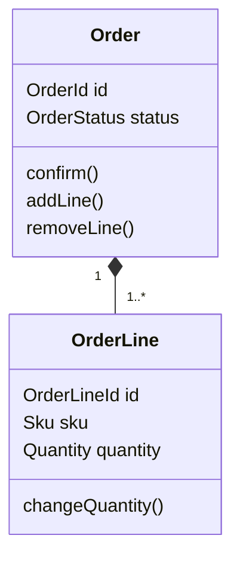

# Thực thể (Entity): danh tính liên tục qua các lần thay đổi

Trong Domain-Driven Design (DDD), **Entity (thực thể)** là đối tượng miền được nhận diện bằng danh tính riêng và duy trì danh tính đó trong suốt vòng đời, dù các thuộc tính của nó có thể thay đổi. Một khách hàng vẫn là cùng một khách hàng khi đổi tên hoặc địa chỉ; một đơn hàng vẫn là cùng một đơn hàng khi thêm dòng hàng, đổi địa chỉ giao hoặc chuyển từ nháp sang đã xác nhận.

Điểm quan trọng của Entity không nằm ở việc nó có bao nhiêu thuộc tính hay được lưu trong bảng nào. Điều làm nó trở thành Entity là nghiệp vụ cần theo dõi chính đối tượng đó qua thời gian. Vì vậy, mô hình cần có định danh ổn định, hành vi phù hợp với vòng đời và các quy tắc bảo vệ trạng thái của đối tượng.

## 1. Vì sao cần Entity?

Trong nghiệp vụ, nhiều đối tượng tiếp tục tồn tại dù thông tin mô tả chúng thay đổi. Nếu hệ thống xem đối tượng chỉ là tập hợp thuộc tính, nó có thể nhầm một đối tượng đã thay đổi với một đối tượng hoàn toàn mới.

Ví dụ, một khách hàng có các thông tin:

```text
Customer
- customerId: C-1042
- name: Nguyen An
- email: an@example.com
- phone: 090...
- address: Ho Chi Minh City
```

Sau đó khách hàng đổi email và địa chỉ. Hệ thống vẫn cần biết đây là khách hàng `C-1042`, giữ nguyên lịch sử đơn hàng, hạn mức tín dụng, trao đổi hỗ trợ và các quan hệ nghiệp vụ trước đó. Nếu dùng email làm danh tính, việc đổi email có thể khiến hệ thống xem người này là một khách hàng mới hoặc làm đứt các liên kết cũ.

Entity giải quyết nhu cầu theo dõi liên tục đó bằng một định danh ổn định. Các thuộc tính mô tả có thể thay đổi; danh tính vẫn được giữ nguyên.

## 2. Danh tính khác với các thuộc tính

Danh tính (identity) trả lời câu hỏi: “Đây là đối tượng nào?”. Thuộc tính trả lời câu hỏi: “Đối tượng này hiện có những đặc điểm gì?”. Hai Entity có thể có thuộc tính giống nhau nhưng vẫn là hai đối tượng khác nhau.

Ví dụ, hai khách hàng cùng tên, cùng địa chỉ và cùng số điện thoại không nhất thiết là một người. Ngược lại, một khách hàng đổi tên sau khi cập nhật giấy tờ vẫn là cùng một Entity nếu nghiệp vụ xác định danh tính của họ không thay đổi.

| Tiêu chí | Danh tính (Identity) | Thuộc tính (Attribute) |
| --- | --- | --- |
| Trả lời | Đối tượng nào? | Đối tượng có đặc điểm gì? |
| Thay đổi theo thời gian | Thường ổn định trong vòng đời | Có thể thay đổi theo nghiệp vụ |
| Dùng để | Nhận diện và tham chiếu cùng một đối tượng | Mô tả, tính toán và áp dụng quy tắc |
| Ví dụ | `CustomerId`, `OrderId` | Tên, email, địa chỉ, trạng thái |

Một số thuộc tính có thể rất quan trọng, thậm chí được dùng để tìm kiếm hoặc đối chiếu, nhưng không vì thế mà trở thành danh tính. Email, số điện thoại, tên công ty hoặc địa chỉ có thể thay đổi, được dùng lại hoặc không duy nhất trong mọi tình huống. Chỉ dùng một thuộc tính làm định danh nghiệp vụ khi chuyên gia xác nhận nó ổn định, duy nhất và có quy tắc quản lý rõ ràng.

## 3. Định danh của Entity cần ổn định trong phạm vi nghiệp vụ

Định danh (identifier) là giá trị dùng để nhận ra một Entity cụ thể. Nó thường được biểu diễn bằng một kiểu riêng như `CustomerId`, `OrderId` hoặc `InvoiceId` thay vì dùng một chuỗi chung chung ở mọi nơi.

Một định danh tốt nên:

- Phân biệt được đối tượng cần nhận diện trong phạm vi đã xác định.
- Không thay đổi chỉ vì tên, địa chỉ, trạng thái hoặc dữ liệu mô tả thay đổi.
- Có quy tắc tạo, lưu trữ và truyền qua các thành phần rõ ràng.
- Có kiểu dữ liệu thể hiện đúng ý nghĩa để tránh truyền nhầm ID giữa các loại Entity.

Ví dụ, `OrderId` và `CustomerId` đều có thể được biểu diễn bằng UUID, nhưng chúng không nên bị xem là có thể thay thế cho nhau. Kiểu riêng giúp trình biên dịch phát hiện một số lỗi truyền nhầm định danh.

```java
public record OrderId(UUID value) {
    public OrderId {
        Objects.requireNonNull(value, "OrderId is required");
    }
}

public record CustomerId(UUID value) {
    public CustomerId {
        Objects.requireNonNull(value, "CustomerId is required");
    }
}
```

Định danh có thể là mã nghiệp vụ tự nhiên nếu nó thực sự ổn định và duy nhất, hoặc là mã opaque được tạo riêng. Không nên mặc định khóa chính của cơ sở dữ liệu chính là danh tính nghiệp vụ. Khóa cơ sở dữ liệu là chi tiết lưu trữ; định danh Entity thuộc mô hình miền và cần được lựa chọn theo quy tắc nghiệp vụ.

Danh tính cũng có phạm vi. `CustomerId` trong bounded context CRM không tự động là cùng một khái niệm với `CustomerId` trong context Billing. Hai context có thể cần mapping hoặc một định danh liên kết được thống nhất. Không nên suy ra hai Entity giống nhau chỉ vì chúng dùng cùng tên trường hoặc cùng định dạng UUID.

## 4. Entity khác Value Object như thế nào?

Entity được nhận diện bằng danh tính. Value Object được nhận diện bằng giá trị của các thuộc tính cấu thành nó. Hai Value Object có cùng giá trị trong cùng ngữ cảnh thường được xem là tương đương; hai Entity có thuộc tính giống nhau vẫn có thể là hai đối tượng khác nhau.

| Tiêu chí | Entity | Value Object |
| --- | --- | --- |
| Cách nhận diện | Định danh ổn định | Giá trị thuộc tính |
| So sánh | Cùng identity | Cùng giá trị cấu thành |
| Thay đổi | Có thể thay đổi qua hành vi trong vòng đời | Thường bất biến; thay đổi bằng cách tạo giá trị mới |
| Vòng đời | Có thể được theo dõi độc lập | Thường tồn tại như một phần của Entity hoặc Aggregate |
| Ví dụ | `Customer`, `Order`, `Invoice` | `Money`, `Address`, `DateRange` |

Ví dụ, hai địa chỉ có cùng số nhà, đường, thành phố và mã bưu chính có thể được xem là cùng một giá trị `Address`. Nhưng hai khách hàng sống tại cùng địa chỉ vẫn là hai Entity khác nhau. Khi địa chỉ của khách hàng thay đổi, ta thường thay Value Object `Address` cũ bằng một giá trị mới bên trong Entity `Customer`.

Không nên chọn Entity hay Value Object chỉ dựa vào việc đối tượng có ID trong cơ sở dữ liệu. Hãy hỏi nghiệp vụ có cần theo dõi danh tính và vòng đời của nó hay chỉ cần quan tâm đến giá trị hiện tại.

## 5. Entity có dữ liệu và hành vi

Một Entity không nên chỉ là một túi dữ liệu có getter và setter cho mọi trường. Nó nên cung cấp các hành vi thể hiện điều nghiệp vụ cho phép thực hiện, đồng thời bảo vệ những quy tắc liên quan đến trạng thái của nó.

Ví dụ, đơn hàng có thể cho phép thay địa chỉ giao khi còn là bản nháp, nhưng từ chối thay đổi sau khi đã xác nhận:

```java
public final class Order {
    private final OrderId id;
    private ShippingAddress shippingAddress;
    private OrderStatus status;

    public Order(OrderId id, ShippingAddress shippingAddress) {
        this.id = Objects.requireNonNull(id);
        this.shippingAddress = Objects.requireNonNull(shippingAddress);
        this.status = OrderStatus.DRAFT;
    }

    public void changeShippingAddress(ShippingAddress newAddress) {
        if (status != OrderStatus.DRAFT) {
            throw new IllegalStateException(
                "Shipping address can only change while the order is a draft"
            );
        }
        this.shippingAddress = Objects.requireNonNull(newAddress);
    }

    public void confirm() {
        if (status != OrderStatus.DRAFT) {
            throw new IllegalStateException("Only a draft order can be confirmed");
        }
        status = OrderStatus.CONFIRMED;
    }

    public OrderId id() {
        return id;
    }

    public OrderStatus status() {
        return status;
    }

    @Override
    public boolean equals(Object other) {
        if (this == other) return true;
        if (other == null || getClass() != other.getClass()) return false;
        Order order = (Order) other;
        return id.equals(order.id);
    }

    @Override
    public int hashCode() {
        return id.hashCode();
    }
}
```

Đây là ví dụ rút gọn; các kiểu `ShippingAddress`, `OrderStatus` và `OrderId` cần được định nghĩa riêng. `id` là bất biến sau khi tạo; địa chỉ và trạng thái thay đổi thông qua các phương thức nghiệp vụ. Việc so sánh hai `Order` dựa trên `OrderId`, không dựa trên địa chỉ hoặc trạng thái hiện tại.

Trong hệ thống thực tế, quy tắc xác nhận đơn thường còn kiểm tra dòng hàng, báo giá, thanh toán và giữ hàng. Những điều kiện đó cần được đặt trong mô hình và quy trình sở hữu chúng. Ví dụ chỉ minh họa cách Entity kiểm soát hành vi và bảo vệ trạng thái của chính nó.

## 6. So sánh Entity theo danh tính

Hai object trong bộ nhớ có thể là hai instance khác nhau nhưng đại diện cho cùng một Entity được lưu trữ. Nếu cả hai có cùng định danh trong cùng loại Entity và cùng bounded context, chúng thường được xem là cùng một đối tượng miền.

```java
Order first = orderRepository.findById(orderId).orElseThrow();
Order second = orderRepository.findById(orderId).orElseThrow();

// first và second có thể là hai instance khác nhau,
// nhưng đại diện cho cùng một Order theo OrderId.
boolean sameOrder = first.equals(second);
```

Ngược lại, hai đơn hàng có cùng khách hàng, địa chỉ và danh sách hàng vẫn là hai Entity khác nhau nếu `OrderId` khác nhau.

Khi cài đặt `equals()` và `hashCode()` trong Java, cần chú ý:

- Chỉ dùng định danh ổn định để so sánh Entity; không đưa thuộc tính có thể thay đổi vào `equals()` hoặc `hashCode()`.
- Hai phương thức phải nhất quán: nếu hai Entity bằng nhau thì hash code phải bằng nhau.
- Nếu Entity là `final`, dùng `getClass()` để bảo đảm chỉ so sánh cùng loại. Với hệ thống có kế thừa hoặc proxy ORM, cần chọn chiến lược phù hợp và nhất quán với framework.
- Không để định danh thay đổi sau khi Entity đã được dùng làm khóa trong `HashSet` hoặc `HashMap`.

Một cách an toàn là tạo domain ID ngay khi Entity được khởi tạo, thay vì chờ cơ sở dữ liệu cấp ID sau lần lưu đầu tiên. Nếu buộc phải dùng ID do persistence cấp, cần thiết kế equality cho đối tượng chưa được lưu một cách cẩn thận; hai Entity chưa có ID không được xem là bằng nhau chỉ vì cả hai cùng có `null`.

## 7. Entity và Aggregate có quan hệ thế nào?

Entity có thể tồn tại độc lập hoặc là một thành phần bên trong Aggregate. **Aggregate** là ranh giới nhất quán của một nhóm đối tượng miền; Aggregate Root là Entity được phép truy cập từ bên ngoài để điều phối thay đổi và bảo vệ bất biến của cả cụm.

Ví dụ, `Order` có thể là Aggregate Root và `OrderLine` là Entity bên trong:



`OrderLine` có thể có định danh riêng vì nghiệp vụ cần theo dõi từng dòng, ví dụ khi thay số lượng hoặc xử lý một dòng bị từ chối. Tuy nhiên, bên ngoài Aggregate nên thao tác thông qua `Order`, không tải và sửa `OrderLine` độc lập nếu điều đó có thể phá vỡ quy tắc của đơn hàng.

Không phải Entity nào cũng là Aggregate Root. Nếu một đối tượng chỉ có ý nghĩa trong vòng đời của đối tượng cha và các bất biến cần được bảo vệ cùng nhau, nó thường phù hợp làm thành phần bên trong Aggregate. Ngược lại, nếu nó cần vòng đời, quyền truy cập và ranh giới nhất quán riêng, có thể cần Aggregate riêng.

## 8. Tham chiếu Entity trong và ngoài Aggregate

Trong một Aggregate, có thể giữ tham chiếu trực tiếp đến các Entity con vì chúng cùng thuộc một ranh giới nhất quán. Giữa các Aggregate, thông thường nên tham chiếu bằng định danh thay vì giữ toàn bộ object graph.

Ví dụ, `Order` có thể lưu `CustomerId` thay vì giữ một object `Customer` có thể thay đổi độc lập. Khi cần thông tin khách hàng, application service hoặc một policy có thể lấy dữ liệu qua hợp đồng phù hợp.

Giữa các bounded context, nguyên tắc này càng quan trọng. Context Order không nên giữ và thay đổi trực tiếp Entity `Customer` do CRM sở hữu. Nó có thể lưu `CustomerId` theo hợp đồng đã thống nhất hoặc duy trì một bản dữ liệu cần thiết cho mục đích riêng. Mỗi context vẫn kiểm soát mô hình và vòng đời nội bộ của mình.

## 9. Entity không đồng nghĩa với bản ghi cơ sở dữ liệu

Một hàng trong bảng có thể được dùng để lưu Entity, nhưng không phải mọi hàng dữ liệu đều là Entity trong mô hình miền. Một số dữ liệu chỉ là cấu hình, bản ghi tra cứu hoặc dữ liệu phục vụ báo cáo. Ngược lại, một Entity có thể được lưu qua nhiều bảng hoặc được tái tạo từ nhiều nguồn dữ liệu.

| Góc nhìn | Câu hỏi chính |
| --- | --- |
| Entity trong mô hình miền | Đối tượng nào cần danh tính và hành vi xuyên suốt vòng đời? |
| Bản ghi cơ sở dữ liệu | Dữ liệu được tổ chức và lưu trữ ra sao? |
| DTO / API model | Dữ liệu nào cần truyền qua ranh giới giao tiếp? |
| Read model | Dữ liệu nào cần được tối ưu để truy vấn và hiển thị? |

Một ORM có thể gọi lớp ánh xạ bảng là `Entity`, nhưng đó là cách dùng thuật ngữ trong persistence. Trong DDD, câu hỏi quan trọng hơn là lớp đó có phản ánh một khái niệm miền với danh tính, hành vi và quy tắc hay không. Không nên biến mọi bảng thành một Entity giàu hành vi chỉ để phù hợp với một quy ước kỹ thuật.

## 10. Khi nào nên dùng Entity?

Một khái niệm thường phù hợp làm Entity khi có một hoặc nhiều dấu hiệu:

- Nghiệp vụ cần nhận diện cùng một đối tượng qua nhiều lần thay đổi.
- Đối tượng có vòng đời riêng, gồm tạo mới, cập nhật, chuyển trạng thái hoặc kết thúc.
- Những đối tượng có cùng thuộc tính vẫn cần được phân biệt.
- Các đối tượng khác cần tham chiếu đến nó bằng một định danh ổn định.
- Có quy tắc hoặc hành vi cần được thực hiện trên chính đối tượng đó.

Ví dụ thường gặp là `Customer`, `Order`, `Invoice`, `Shipment`, `Subscription` hoặc `Employee`, tùy miền nghiệp vụ.

Một khái niệm có thể không cần Entity nếu chỉ được nhận diện bằng giá trị và không có vòng đời riêng. Ví dụ, địa chỉ giao hàng trong một đơn có thể là `ShippingAddress` dạng Value Object. Một dòng địa chỉ không nhất thiết cần định danh độc lập nếu nghiệp vụ chỉ quan tâm đến nội dung của nó.

## 11. Những lỗi thường gặp khi thiết kế Entity

**Dùng thuộc tính thay đổi được làm danh tính.** Email, tên hoặc số điện thoại có thể thay đổi hay được dùng lại. Hãy xác định định danh theo quy tắc miền.

**Đồng nhất Entity với bảng dữ liệu.** Cách làm này tạo ra nhiều lớp không có hành vi miền và khiến mô hình phụ thuộc vào cấu trúc lưu trữ.

**Đưa mọi dữ liệu vào một Entity lớn.** Một lớp `Customer` có thể bị nhồi thông tin bán hàng, hóa đơn, tín dụng, hỗ trợ và vận chuyển dù các lĩnh vực có quy tắc riêng. Hãy xem xét bounded context và Aggregate để xác định ranh giới.

**Cho phép sửa mọi thuộc tính bằng setter công khai.** Các thành phần bên ngoài có thể bỏ qua quy tắc và tạo trạng thái không hợp lệ. Hãy cung cấp hành vi theo ngôn ngữ nghiệp vụ.

**So sánh Entity theo toàn bộ thuộc tính.** Khi một thuộc tính thay đổi, hai instance của cùng đối tượng có thể bị xem là khác nhau. Equality của Entity cần dựa trên identity.

**Dùng ID chưa ổn định trong `hashCode()`.** Khi ID thay đổi sau khi object được thêm vào `HashSet`, việc tìm kiếm hoặc xóa phần tử có thể không còn hoạt động đúng. Hãy xác định chiến lược ID ngay từ lúc tạo Entity.

**Chia sẻ Entity giữa các bounded context.** Hai context có thể có cách nhìn khác nhau về cùng một đối tượng trong thế giới thực. Hãy trao đổi qua định danh và hợp đồng, hoặc dùng mapping khi cần.

## 12. Quy trình xác định và mô hình hóa Entity

Có thể dùng các bước sau khi khám phá một khái niệm nghiệp vụ:

1. **Xác định đối tượng:** hỏi nghiệp vụ có cần theo dõi đối tượng này qua thời gian không.
2. **Tìm danh tính:** xác định điều gì làm nó khác với những đối tượng khác và định danh có ổn định không.
3. **Phân biệt thuộc tính:** ghi rõ dữ liệu nào mô tả đối tượng và dữ liệu nào thực sự xác định identity.
4. **Xác định vòng đời:** tìm các trạng thái, hành động, sự kiện tạo mới, cập nhật và kết thúc.
5. **Đặt hành vi trong mô hình:** chọn các phương thức phản ánh hành động nghiệp vụ và bảo vệ bất biến.
6. **Xác định Aggregate:** xem Entity có phải root hay thuộc một Aggregate khác; làm rõ ranh giới nhất quán.
7. **Xác định tham chiếu:** quyết định nơi dùng object reference và nơi chỉ lưu định danh.
8. **Chọn cách lưu trữ:** ánh xạ Entity sang cơ sở dữ liệu mà không để chi tiết persistence quyết định ý nghĩa miền.
9. **Kiểm thử identity:** kiểm tra cùng ID, khác ID, thay đổi thuộc tính và vòng đời của đối tượng.

## 13. Kiểm thử danh tính và vòng đời

Kiểm thử Entity cần xác nhận cả danh tính lẫn hành vi:

| Tình huống | Kết quả mong đợi |
| --- | --- |
| Hai instance cùng `OrderId` | Được xem là cùng một Entity theo quy tắc equality đã chọn |
| Hai đơn có `OrderId` khác nhau nhưng thuộc tính giống nhau | Là hai Entity khác nhau |
| Đổi địa chỉ giao của đơn nháp | Identity không đổi; địa chỉ được cập nhật |
| Đổi địa chỉ giao của đơn đã xác nhận | Bị từ chối nếu quy tắc miền không cho phép |
| Thay đổi trạng thái đơn | `OrderId` không thay đổi |
| Tạo hai Entity chưa có ID | Không được mặc định xem là bằng nhau vì cùng thiếu ID |

Ngoài unit test, cần kiểm tra quá trình nạp Entity từ repository: một ID phải luôn ánh xạ đến đúng đối tượng trong phạm vi context, và thao tác cập nhật không được vô tình tạo bản ghi mới khi mục tiêu là thay đổi Entity hiện tại.

## 14. Nguyên tắc cần ghi nhớ

Entity là đối tượng có danh tính liên tục qua các lần thay đổi. Định danh cho biết đó là đối tượng nào; thuộc tính mô tả tình trạng hiện tại; hành vi kiểm soát cách đối tượng được thay đổi theo quy tắc nghiệp vụ.

Hãy phân biệt Entity với Value Object và bản ghi cơ sở dữ liệu, chọn định danh ổn định trong đúng bounded context, bảo vệ vòng đời bằng hành vi thay vì setter tùy ý và xác định rõ Entity thuộc Aggregate nào. Khi mô hình giữ được danh tính xuyên suốt thay đổi, hệ thống có thể duy trì lịch sử, quan hệ và quy tắc nghiệp vụ một cách đáng tin cậy.
