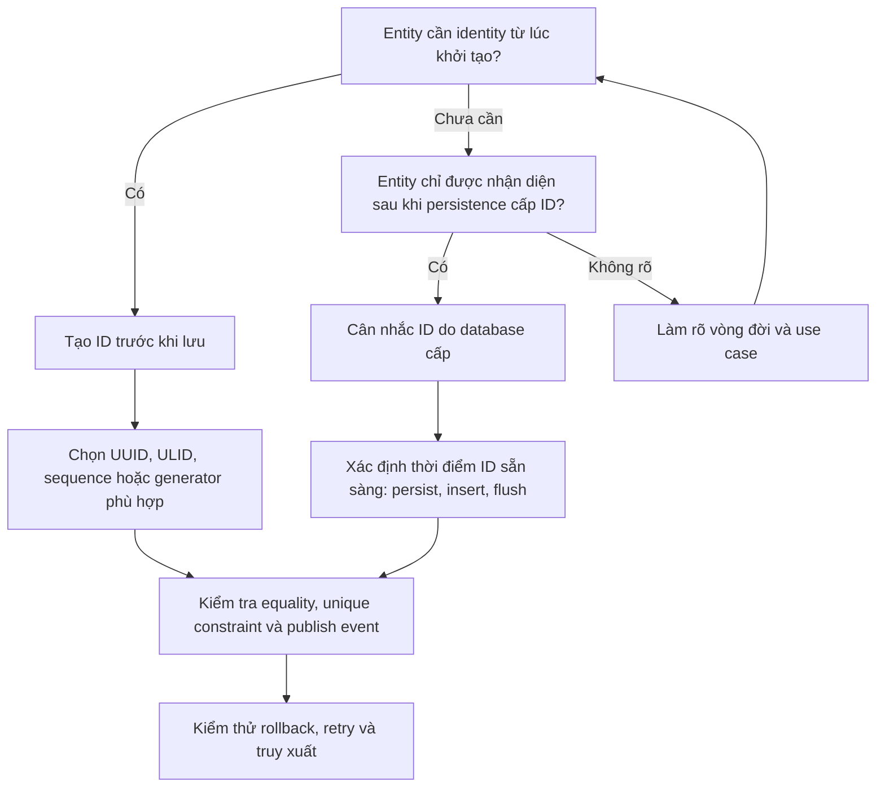

# Tạo và cấp định danh trước hoặc sau khi lưu

Entity trong Domain-Driven Design (DDD) được nhận diện bởi **định danh ổn định**, không chỉ bởi tập thuộc tính hiện tại. Hai đối tượng có cùng tên, địa chỉ hoặc trạng thái vẫn có thể là hai entity khác nhau; một entity vẫn là chính nó khi các thuộc tính thay đổi. Vì vậy, khi thiết kế entity, đội phát triển cần quyết định định danh được tạo ở thời điểm nào và ai chịu trách nhiệm cấp nó.

Có hai cách phổ biến. Ứng dụng hoặc miền tạo định danh ngay khi entity được tạo, trước khi lưu. Hoặc hệ thống lưu trữ cấp định danh trong quá trình ghi entity, sau đó repository trả lại định danh cho ứng dụng. Mỗi cách có ưu điểm, giới hạn và ảnh hưởng đến vòng đời đối tượng, kiểm thử, tích hợp cũng như cách phát sự kiện.

Không có một lựa chọn phù hợp cho mọi hệ thống. Điều quan trọng là phân biệt **định danh của entity**, **thời điểm entity được lưu bền vững** và **thời điểm giao dịch được commit**. Ba thời điểm này có liên quan nhưng không đồng nhất.

Trong module `DOMAIN_DRIVEN_DESIGN`, entity là một khái niệm tactical design bên cạnh value object, aggregate, repository và domain event. Bài này tập trung vào cách chọn thời điểm tạo định danh cho entity, cách triển khai với Java và ORM, cùng những hệ quả cần kiểm tra trong mô hình miền.

## 1. Định danh có ý nghĩa gì đối với Entity?

### 1.1. Định danh phân biệt các thực thể có cùng thuộc tính

Entity là đối tượng có vòng đời và được nhận diện qua một định danh. Ví dụ, hai khách hàng có thể cùng tên và cùng địa chỉ nhưng vẫn là hai khách hàng khác nhau. Một khách hàng có thể đổi địa chỉ hoặc số điện thoại mà định danh vẫn giữ nguyên.

```text
Customer
  id: CustomerId
  name: "Nguyễn An"
  address: "12 Nguyễn Huệ"

Customer
  id: CustomerId
  name: "Nguyễn An"
  address: "12 Nguyễn Huệ"
```

Hai bản ghi có cùng thuộc tính nhưng nếu `CustomerId` khác nhau thì chúng biểu diễn hai entity khác nhau. Ngược lại, nếu cùng `CustomerId`, chúng là hai biểu diễn hoặc hai trạng thái của cùng một entity tại những thời điểm khác nhau.

### 1.2. Định danh khác với thuộc tính nghiệp vụ

Một thuộc tính có vẻ duy nhất chưa chắc là định danh tốt. Email, số điện thoại, mã nhân viên hoặc mã khách hàng bên ngoài có thể thay đổi, được tái sử dụng hoặc có phạm vi duy nhất không rõ ràng.

Hãy phân biệt:

- **Định danh entity:** xác định entity nào đang được nói đến trong phạm vi mô hình.
- **Business key (khóa nghiệp vụ):** mã có ý nghĩa với nghiệp vụ hoặc người dùng, chẳng hạn số đơn hàng hiển thị, mã SKU hoặc mã hợp đồng.
- **Persistence key (khóa lưu trữ):** khóa được dùng trong cơ sở dữ liệu để tìm bản ghi. Nó có thể trùng với định danh miền, nhưng không bắt buộc.
- **External reference (mã tham chiếu bên ngoài):** định danh do hệ thống khác cấp, có ý nghĩa trong hệ thống đó.

Ví dụ, một đơn hàng có thể có `OrderId` nội bộ ổn định và `OrderNumber` dễ đọc để nhân viên trao đổi với khách. Nếu số đơn hàng có quy tắc cấp theo cửa hàng, năm hoặc kênh bán, nó vẫn có thể là business key riêng. Đừng thay định danh entity bằng một trường chỉ tình cờ duy nhất ở thời điểm hiện tại.

### 1.3. Định danh cần có phạm vi rõ ràng

Một giá trị ID chỉ duy nhất trong một phạm vi nhất định. Câu hỏi cần làm rõ là duy nhất trong:

- Một aggregate hay toàn bộ bounded context?
- Một tenant, cửa hàng hoặc tổ chức?
- Một cơ sở dữ liệu hay nhiều hệ thống phân tán?
- Một nhà cung cấp bên ngoài hay toàn bộ hệ sinh thái?

Ví dụ, `CustomerId = 123` có thể hợp lệ trong hai tenant khác nhau nếu phạm vi định danh là tenant. Khi trao đổi qua nhiều tenant, hệ thống cần ghép thêm tenant ID hoặc dùng một định danh có phạm vi rộng hơn.

Định danh cũng có ý nghĩa trong bounded context cụ thể. Hai context có thể biểu diễn cùng một khách hàng thực tế bằng hai định danh riêng, vì mỗi context quản lý mô hình và vòng đời khác nhau. Khi cần liên kết, dùng hợp đồng hoặc bảng ánh xạ rõ ràng thay vì giả định mọi nơi đều dùng chung một `CustomerId`.

## 2. Hai thời điểm tạo định danh phổ biến

### 2.1. Tạo định danh trước khi lưu

Trong cách này, ứng dụng, factory hoặc domain service tạo ID khi entity được khởi tạo. Entity có định danh ngay từ khi xuất hiện trong bộ nhớ, trước khi repository ghi nó vào cơ sở dữ liệu.

```text
Nhận yêu cầu tạo entity
        |
        v
Tạo định danh
        |
        v
Khởi tạo entity với ID
        |
        v
Repository lưu entity
        |
        v
Giao dịch commit
```

Ví dụ, ứng dụng tạo `OrderId` bằng UUID rồi khởi tạo `Order`. Nếu lưu thất bại, entity vẫn đã có ID trong bộ nhớ, nhưng chưa có nghĩa là một đơn hàng đã tồn tại bền vững trong hệ thống.

### 2.2. Định danh được cấp trong quá trình lưu

Trong cách này, entity được tạo trước nhưng chưa có ID do cơ sở dữ liệu cấp. Khi repository lưu entity, database hoặc persistence provider tạo khóa và gán lại cho đối tượng hoặc trả về giá trị đã cấp.

```text
Nhận yêu cầu tạo entity
        |
        v
Khởi tạo entity chưa có ID lưu trữ
        |
        v
Repository yêu cầu lưu
        |
        v
Database cấp ID và ghi bản ghi
        |
        v
Repository trả entity/ID đã cấp
        |
        v
Giao dịch commit
```

Ví dụ thường gặp là khóa số tự tăng với `IDENTITY`. Cơ sở dữ liệu cấp ID khi thực hiện câu lệnh insert và trả khóa được tạo về cho persistence provider. Với một số cơ chế khác như database sequence, giá trị có thể được lấy trước khi insert. Vì vậy, “database-generated” không phải lúc nào cũng có nghĩa ID chỉ xuất hiện sau khi ghi bản ghi.

### 2.3. Tạo ID, lưu và commit là ba việc khác nhau

Đây là điểm dễ nhầm lẫn:

1. **Tạo ID:** có một giá trị để nhận diện entity.
2. **Lưu/persist:** persistence layer thực hiện hoặc lên lịch ghi entity vào kho lưu trữ.
3. **Commit:** giao dịch hoàn tất và thay đổi trở nên bền vững theo cam kết của hệ quản trị dữ liệu.

ID được tạo trước khi lưu không chứng minh việc lưu đã thành công. ID được database cấp trong lúc insert cũng không đảm bảo toàn bộ giao dịch sẽ commit; giao dịch vẫn có thể rollback. Ngay cả khi ID đã được cấp, bản ghi có thể không tồn tại sau rollback.

Với sequence hoặc auto-increment, số bị bỏ trống sau rollback là điều bình thường. Không nên giả định dãy ID phải liên tục hoặc dùng khoảng trống để suy ra số giao dịch đã hoàn tất.

## 3. Tạo định danh trước khi lưu

### 3.1. Cách triển khai

Một lựa chọn phổ biến là dùng định danh kiểu mạnh (strongly typed ID) bọc quanh UUID hoặc một kiểu giá trị khác. Điều này giúp tránh truyền nhầm ID của hai loại entity.

```java
import java.util.UUID;

public record OrderId(UUID value) {
    public OrderId {
        if (value == null) {
            throw new IllegalArgumentException("OrderId is required");
        }
    }

    public static OrderId newId() {
        return new OrderId(UUID.randomUUID());
    }
}
```

Factory hoặc constructor có kiểm soát tạo entity với ID ngay từ đầu:

```java
public final class Order {
    private final OrderId id;
    private OrderStatus status;

    private Order(OrderId id) {
        this.id = id;
        this.status = OrderStatus.DRAFT;
    }

    public static Order create() {
        return new Order(OrderId.newId());
    }

    public OrderId id() {
        return id;
    }
}
```

Repository lưu entity đã có định danh:

```java
Order order = Order.create();
OrderId orderId = order.id();

orderRepository.save(order);
```

`orderId` có thể được dùng để ghi log, liên kết các đối tượng trong cùng use case hoặc đưa vào thông điệp nội bộ trước khi lưu. Tuy nhiên, chỉ sau khi thao tác lưu và giao dịch thành công mới có thể khẳng định đơn hàng đã được lưu bền vững.

### 3.2. Ưu điểm

**Entity luôn có định danh ngay khi được tạo.** Điều này phù hợp với quan điểm entity có identity trong suốt vòng đời, kể cả khi nó mới tồn tại trong bộ nhớ.

**Dễ tạo quan hệ giữa các đối tượng trước khi lưu.** Một aggregate hoặc các đối tượng con có thể giữ tham chiếu đến ID của đối tượng liên quan mà không cần chờ database trả khóa.

**Hỗ trợ quy trình phân tán và làm việc ngoại tuyến.** Nhiều node có thể tạo ID độc lập trước khi kết nối với kho dữ liệu trung tâm, miễn là thuật toán và phạm vi ID được chọn phù hợp.

**Thuận tiện cho domain event và correlation.** ID có sẵn khi tạo sự kiện miền, ghi log hoặc truyền thông tin qua các bước của use case. Việc phát sự kiện vẫn cần gắn với transaction/outbox đúng cách; có ID trước không có nghĩa nên phát thông điệp trước khi dữ liệu được commit.

**Kiểm thử đơn giản.** Unit test có thể tạo entity mà không cần database chỉ để nhận một ID hợp lệ. Có thể dùng ID cố định trong fixture để kết quả kiểm thử dễ đọc.

### 3.3. Hạn chế và chi phí

- ID ngẫu nhiên thường dài hơn khóa số tuần tự, có thể làm chỉ mục lớn hơn và ảnh hưởng đến locality của một số cấu trúc index.
- ID được tạo nhưng entity không bao giờ được lưu có thể tạo khoảng trống hoặc dấu vết trong log; điều này không phải lỗi nhưng cần hiểu đúng.
- Nếu ID do một dịch vụ trung tâm cấp, dịch vụ đó có thể trở thành điểm phụ thuộc hoặc điểm nghẽn.
- Một số loại ID có thành phần thời gian hoặc thứ tự có thể tiết lộ gần đúng thời điểm tạo. ID không nên được coi là bí mật hoặc cơ chế phân quyền.
- UUID có xác suất va chạm rất thấp nhưng hệ thống vẫn nên có ràng buộc duy nhất ở persistence layer để bảo vệ tính toàn vẹn.

### 3.4. Các thuật toán tạo ID thường gặp

| Loại ID | Đặc điểm | Khi nào cân nhắc |
|---|---|---|
| UUID v4 | Giá trị ngẫu nhiên, có thể tạo độc lập | Cần tạo ID phía ứng dụng, nhiều node hoặc không muốn phụ thuộc database |
| UUID v7 | Có thành phần thời gian và thứ tự gần đúng | Muốn ID phân tán có xu hướng sắp xếp theo thời gian; cần cân nhắc thông tin thời gian bị lộ |
| ULID | Biểu diễn gọn, có thành phần thời gian và phần ngẫu nhiên | Cần ID có thể sắp xếp gần theo thời gian và dễ dùng trong log/URL |
| Database sequence | Số được cấp bởi sequence của database | Cần số gọn, có thứ tự cấp phát trong phạm vi sequence và chấp nhận phụ thuộc database |
| Business key | Mã có ý nghĩa nghiệp vụ | Khi mã đó thực sự ổn định, duy nhất và có quy tắc vòng đời rõ |

Không có thuật toán nào tự giải quyết quyền truy cập, tính toàn vẹn nghiệp vụ hoặc khả năng chống giả mạo. Dù ID khó đoán, API vẫn phải kiểm tra quyền của người gọi đối với entity tương ứng.

## 4. Định danh được cấp khi lưu

### 4.1. Cách triển khai với khóa do database sinh

Một mô hình persistence đơn giản có thể dùng khóa số tự tăng:

```java
import jakarta.persistence.Entity;
import jakarta.persistence.GeneratedValue;
import jakarta.persistence.GenerationType;
import jakarta.persistence.Id;

@Entity
public class OrderRecord {
    @Id
    @GeneratedValue(strategy = GenerationType.IDENTITY)
    private Long id;

    private String status;

    protected OrderRecord() {
    }

    public OrderRecord(String status) {
        this.status = status;
    }

    public Long id() {
        return id;
    }
}
```

Sau khi persistence provider thực hiện insert và nhận khóa do database cấp, ứng dụng có thể đọc ID từ entity đã được quản lý:

```java
OrderRecord record = new OrderRecord("DRAFT");
entityManager.persist(record);

// Với IDENTITY, provider thường phải insert để nhận khóa.
Long generatedId = record.id();
```

Thời điểm chính xác ID xuất hiện phụ thuộc chiến lược sinh khóa, provider và việc flush. Với `IDENTITY`, insert thường phải được thực hiện để database trả khóa. Với `SEQUENCE`, provider có thể lấy số trước insert. Không nên giả định mọi `@GeneratedValue` đều cấp ID ở cùng một thời điểm.

### 4.2. Ưu điểm

**Database là nơi cấp khóa tập trung.** Điều này hữu ích khi hệ thống dùng một database có thẩm quyền và muốn dựa vào cơ chế cấp khóa đã được quản lý.

**Khóa số thường gọn.** Giá trị `BIGINT` có kích thước nhỏ, dễ đọc và có thể phù hợp với chỉ mục quan hệ truyền thống.

**Không cần tự triển khai thuật toán sinh ID ở ứng dụng.** Đội phát triển giảm một phần trách nhiệm về thuật toán và cấu hình tạo khóa.

**Có thể phù hợp với ứng dụng CRUD hoặc hệ thống tập trung.** Nếu entity chỉ được tạo trong một transaction lưu trữ và không cần ID trước đó, khóa do database sinh có thể là lựa chọn đơn giản.

### 4.3. Hạn chế và hệ quả với mô hình miền

- Entity mới có thể chưa có ID lưu trữ cho đến khi persistence thực hiện thao tác insert hoặc cấp sequence.
- Nếu domain entity bắt buộc có ID ngay trong constructor, việc chờ database cấp khóa tạo ra xung đột thiết kế.
- Muốn dùng ID trước khi lưu để tạo event hoặc liên kết đối tượng có thể phải đổi quy trình hoặc tách persistence model khỏi domain model.
- Việc tạo ID phụ thuộc vào database hoặc persistence provider, làm unit test và tạo entity ngoại tuyến khó hơn nếu mô hình miền bị gắn chặt với ORM.
- Khóa tuần tự có thể làm lộ số lượng hoặc nhịp tạo bản ghi nếu đưa trực tiếp ra API công khai.
- Sequence/identity có thể có khoảng trống sau rollback hoặc khi provider cấp trước nhiều giá trị.

### 4.4. Sequence không giống Identity

Hai chiến lược thường bị gộp chung:

| Chiến lược | Cách cấp | Thời điểm ID có thể xuất hiện |
|---|---|---|
| `IDENTITY` | Database sinh khóa trong thao tác insert | Thường khi insert được thực hiện |
| `SEQUENCE` | Ứng dụng/provider lấy giá trị từ sequence | Có thể trước insert |
| `TABLE` | Provider dùng bảng để quản lý bộ cấp số | Tùy provider và thời điểm lấy khóa |
| `AUTO` | Provider chọn chiến lược phù hợp | Phụ thuộc provider và cấu hình |

Vì vậy, khi yêu cầu là “định danh sau khi lưu”, hãy xác định rõ đang nói đến sau khi gọi repository, sau khi insert, sau khi flush hay sau khi commit. Các thời điểm này có thể khác nhau.

## 5. So sánh hai cách tiếp cận

| Tiêu chí | Tạo ID trước khi lưu | Database cấp ID trong quá trình lưu |
|---|---|---|
| Entity mới | Có ID ngay khi khởi tạo | Có thể chưa có ID cho đến khi persistence cấp |
| Phụ thuộc database | Thấp hơn | Cao hơn |
| Tạo entity trong unit test | Dễ, không cần database | Có thể cần persistence test hoặc cơ chế giả lập |
| Tạo liên kết trước khi lưu | Thuận tiện | Khó hơn nếu ID chưa được cấp |
| Tích hợp phân tán/offline | Thuận lợi hơn | Thường cần kết nối đến nơi cấp ID |
| Kích thước ID | UUID/ULID thường lớn hơn | Khóa số thường gọn |
| Khả năng sắp xếp theo thời gian | Tùy thuật toán | Sequence thường tăng theo lần cấp, không phải thứ tự commit |
| Rủi ro lộ thông tin | UUID ngẫu nhiên ít lộ thứ tự; ID có thời gian có thể lộ thời điểm | Khóa tuần tự có thể lộ nhịp tạo bản ghi |
| Vận hành | Cần quản lý thuật toán và ràng buộc duy nhất | Dựa vào cơ chế cấp khóa của database |
| Phù hợp điển hình | DDD, nhiều node, event và aggregate cần ID từ lúc tạo | Ứng dụng tập trung, CRUD, ID chỉ cần sau thao tác lưu |

Đây là so sánh xu hướng, không phải quy tắc tuyệt đối. UUID có thể dùng cùng database tập trung; khóa sequence cũng có thể dùng trong hệ thống nhiều dịch vụ nếu có một nơi cấp khóa phù hợp. Hãy chọn theo yêu cầu của miền và kiến trúc triển khai.

## 6. Lựa chọn trong bối cảnh DDD

### 6.1. Vì sao DDD thường thuận lợi với ID được tạo trước?

Trong mô hình miền giàu hành vi, entity và aggregate thường cần được nhận diện ngay khi được tạo. Aggregate có thể tạo domain event, tham chiếu các đối tượng liên quan, ghi nhận hành động hoặc tham gia một use case trước khi repository lưu.

Ví dụ, khi khách đặt đơn, domain factory có thể tạo `OrderId`, khởi tạo `Order` và ghi nhận sự kiện `OrderPlaced`. Application service sau đó lưu aggregate và sự kiện trong cùng transaction hoặc qua transactional outbox. ID đã có sẵn giúp sự kiện tham chiếu đúng đơn hàng mà không phải đợi database cấp khóa.

```java
public static Order place(OrderRequest request, Clock clock) {
    Order order = new Order(
        OrderId.newId(),
        request.lines(),
        OrderStatus.DRAFT,
        clock.instant()
    );
    order.recordEvent(new OrderPlaced(order.id(), clock.instant()));
    return order;
}
```

Đoạn code chỉ minh họa. Tên sự kiện và thời điểm ghi nhận phải phản ánh đúng ngôn ngữ nghiệp vụ: nếu đối tượng mới chỉ là bản nháp chưa được chấp thuận, `OrderDraftCreated` có thể chính xác hơn `OrderPlaced`.

### 6.2. Repository không nhất thiết phải tạo ID

Repository trong DDD cung cấp cách truy cập và lưu aggregate. Nếu ID đã được tạo bởi domain factory, repository chỉ cần lưu và bảo đảm việc truy xuất theo ID. Trách nhiệm cấp ID có thể nằm trong factory, một abstraction `IdGenerator` hoặc một dịch vụ miền phù hợp.

Nếu database cấp ID, repository có thể nhận entity mới và trả về kết quả có ID. Nhưng khi đó cần thiết kế rõ trạng thái trước/sau lưu và tránh để domain model phụ thuộc trực tiếp vào chi tiết ORM.

Một interface repository có thể thể hiện việc lưu trả lại aggregate:

```java
public interface OrderRepository {
    Order save(Order order);
    Optional<Order> findById(OrderId id);
}
```

Khi ID được tạo trước, `save` thường trả lại cùng định danh. Khi persistence cấp ID, hợp đồng repository cần nói rõ lúc nào ID đã sẵn sàng và kết quả có còn phụ thuộc vào transaction commit hay không. Không nên khiến caller hiểu `save` thành công đồng nghĩa giao dịch đã commit nếu transaction được quản lý bên ngoài.

### 6.3. Có thể tách Domain Model và Persistence Model

Trong một số hệ thống, domain entity cần ID từ lúc tạo nhưng schema cũ chỉ cấp khóa số khi insert. Có thể dùng một lớp persistence riêng để ánh xạ:

```text
Domain Order
  OrderId: UUID
  Status
  Lines

Persistence OrderRecord
  DatabaseId: Long
  OrderId: UUID (unique)
  Status
  Serialized/relational fields
```

Khi đó, `OrderId` là định danh miền được tạo trước; `DatabaseId` là khóa nội bộ phục vụ lưu trữ. Cách này có chi phí mapping và thêm một cột, nhưng giúp mô hình miền không phải chờ khóa database. Chỉ nên dùng khi lợi ích tách biệt thực sự đáng giá.

### 6.4. Tránh để ORM quyết định ngữ nghĩa miền

Các annotation như `@GeneratedValue` là chi tiết persistence. Nếu domain entity chứa trực tiếp annotation, constructor rỗng và trạng thái ID null chỉ để phù hợp ORM, mô hình có thể bị chi phối bởi công nghệ lưu trữ.

Điều đó không có nghĩa phải luôn tách hai mô hình. Một ứng dụng nhỏ có thể dùng chung class domain và persistence nếu cách đó đơn giản, dễ hiểu và không làm sai quy tắc. Hãy đánh giá xem ORM có buộc entity chấp nhận trạng thái mà nghiệp vụ không mong muốn hay không.

## 7. Định danh ảnh hưởng đến equality và vòng đời Entity

### 7.1. So sánh entity theo identity

Với entity đã có định danh, hai instance biểu diễn cùng một entity nếu chúng có cùng loại entity và cùng ID trong cùng phạm vi mô hình. Các thuộc tính khác có thể khác nhau vì chúng phản ánh hai thời điểm.

```text
Order A: id=ORD-42, status=Draft
Order B: id=ORD-42, status=Confirmed

=> Cùng một Entity Order ở hai trạng thái khác nhau.
```

Ngược lại, hai order có cùng dòng hàng và trạng thái nhưng ID khác nhau là hai entity khác nhau.

### 7.2. Entity chưa có ID tạo ra bài toán equality

Nếu ID chỉ được cấp khi lưu, hai entity mới có thể đều có `id = null`. Không được coi mọi entity null ID là bằng nhau chỉ vì giá trị ID giống nhau.

Các lựa chọn cần được cân nhắc:

- Tạo ID phía ứng dụng để entity có identity ngay từ đầu.
- Dùng object reference equality cho entity transient trong giai đoạn trước khi persist, rồi áp dụng identity equality khi có ID; cách này cần đặc biệt cẩn thận với `hashCode`.
- Dùng một định danh tạm thời riêng cho instance trước khi có khóa lưu trữ.
- Thiết kế lớp persistence riêng để khóa database không chi phối equality của domain entity.

Không nên đưa entity chưa có ID vào `HashSet` hoặc dùng làm key trong `HashMap` nếu `hashCode` có thể thay đổi sau khi ID được cấp. Thay đổi hash code sau khi đối tượng đã nằm trong hash collection có thể khiến collection không tìm thấy phần tử đúng cách.

### 7.3. Không dùng toàn bộ thuộc tính để so sánh entity

So sánh theo tất cả thuộc tính khiến entity đổi identity mỗi khi trạng thái hoặc dữ liệu thay đổi. Đây là cách phù hợp hơn với một số value object bất biến, không phù hợp với entity có vòng đời.

Với entity, equality cần phản ánh identity đã được định nghĩa trong phạm vi miền. Nếu business key là định danh thực sự và bất biến, có thể dùng nó; nhưng phải chứng minh các điều kiện duy nhất, không thay đổi và không tái sử dụng.

## 8. Chọn loại định danh theo nhu cầu

### 8.1. Dùng UUID khi cần tạo độc lập

UUID v4 phù hợp khi nhiều ứng dụng hoặc node cần tự tạo ID mà không gọi dịch vụ trung tâm. Nó dễ tích hợp trong Java bằng `UUID.randomUUID()`.

UUID v7 đưa thành phần thời gian vào cấu trúc, giúp ID có xu hướng sắp xếp gần theo thời gian tạo và có thể cải thiện locality của một số chỉ mục so với UUID ngẫu nhiên. Đổi lại, nó để lộ thông tin thời gian gần đúng và cần thư viện hoặc runtime hỗ trợ phù hợp.

### 8.2. Dùng sequence khi database là nơi cấp khóa có thẩm quyền

Sequence phù hợp với ứng dụng tập trung hoặc hệ thống đã có quy ước khóa số. Nó có thể cấp giá trị trước insert, hỗ trợ batch allocation và tránh một số hạn chế của `IDENTITY` trong ORM.

Sequence không bảo đảm số liên tục, cũng không bảo đảm thứ tự ID phản ánh thứ tự commit. Các node có thể lấy số trước và commit theo thứ tự khác nhau.

### 8.3. Dùng business key khi nghiệp vụ thực sự yêu cầu

Một số mã có thể là định danh miền, ví dụ mã SKU nếu tổ chức cam kết mã không đổi và không tái sử dụng trong phạm vi xác định. Nhưng nhiều mã khác chỉ là thuộc tính hoặc mã hiển thị.

Trước khi dùng business key làm entity ID, hãy hỏi:

- Mã có thể đổi khi tổ chức thay đổi quy tắc không?
- Mã có thể được tái sử dụng sau khi entity kết thúc không?
- Có duy nhất trên toàn hệ thống hay chỉ trong một cửa hàng/tenant?
- Có phụ thuộc vào hệ thống bên ngoài không?
- Có chứa thông tin cá nhân hoặc thông tin nhạy cảm không nên đưa vào URL/log không?

Nếu câu trả lời cho thấy mã không ổn định, hãy giữ nó như business attribute và dùng một ID riêng.

### 8.4. Không dùng ID làm cơ chế bảo mật

ID tuần tự có thể dễ đoán; UUID ngẫu nhiên khó đoán hơn nhưng vẫn có thể bị lộ qua log, URL, email hoặc thông điệp. Quyền truy cập phải được kiểm tra dựa trên danh tính người dùng, vai trò và quyền sở hữu tài nguyên. “Không đoán được ID” không thay thế authorization.

## 9. Các tình huống cần xử lý cẩn thận

### 9.1. Tạo entity nhưng không lưu thành công

Với ID được tạo trước, entity có ID nhưng repository có thể lỗi hoặc transaction rollback. Ứng dụng không được coi ID đó là bằng chứng entity đã được lưu. Có thể ghi log với trạng thái thao tác thất bại, nhưng không công bố sự kiện “đã tạo” cho consumer như thể giao dịch đã hoàn tất.

### 9.2. Phát domain event trước khi commit

Nếu sự kiện được gửi ra broker trước khi transaction lưu aggregate commit, consumer có thể nhận một sự kiện cho entity không tồn tại bền vững. Cơ chế transactional outbox hoặc một chiến lược đồng bộ tương đương giúp ghi dữ liệu và thông điệp trong cùng transaction, sau đó phát thông điệp khi an toàn.

ID có sẵn trước khi lưu giúp tạo payload, nhưng không giải quyết thứ tự commit và publish. Hãy tách rõ việc ghi nhận domain event trong bộ nhớ, lưu outbox và chuyển thông điệp ra ngoài.

### 9.3. Hai node tạo cùng một ID

Với UUID, xác suất trùng rất thấp nhưng không bằng tuyệt đối. Database vẫn nên có unique constraint trên ID. Nếu phát hiện vi phạm duy nhất, ứng dụng cần xử lý như một lỗi tạo ID hoặc lỗi dữ liệu, không ghi đè entity hiện có.

Với ID do dịch vụ trung tâm cấp, cần tính đến độ sẵn sàng, timeout và khả năng retry. Không nên gọi ID service trong mỗi lần tạo entity nếu một thuật toán cục bộ đáp ứng được yêu cầu.

### 9.4. Nhập dữ liệu từ hệ thống khác

Khi import, ID bên ngoài có thể trùng với ID nội bộ hoặc chỉ duy nhất trong hệ thống nguồn. Hãy lưu `SourceSystem` và `ExternalId` như một cặp tham chiếu có phạm vi, rồi ánh xạ sang ID nội bộ. Không mặc định external ID là entity ID của context hiện tại.

### 9.5. Tạo nhiều entity trong cùng một aggregate

Aggregate root có định danh riêng. Entity con có thể có identity riêng nếu vòng đời và cách tham chiếu đòi hỏi; nếu chỉ là thành phần phụ thuộc không có vòng đời độc lập, nó có thể được nhận diện qua aggregate root và vị trí/giá trị của nó.

Ví dụ, `OrderLine` có thể có `OrderLineId` nếu dòng hàng được tham chiếu riêng qua các lần sửa, giao hoặc trả hàng. Nếu dòng hàng chỉ tồn tại như thành phần của Order và không được tham chiếu độc lập, có thể không cần một ID toàn cục riêng. Đừng tạo ID cho mọi object theo thói quen.

## 10. Quy trình quyết định thời điểm tạo ID

Có thể sử dụng quy trình sau khi thiết kế entity mới:



Các câu hỏi quyết định:

1. Entity có cần được tham chiếu trước khi lưu không?
2. Có cần tạo liên kết giữa nhiều entity trước khi ghi database không?
3. Có cần tạo event hoặc command chứa ID ngay khi tạo entity không?
4. Hệ thống có nhiều node, offline hoặc nhiều database độc lập không?
5. Database có phải nơi cấp ID duy nhất và có thể truy cập trong thời điểm tạo không?
6. Entity transient được so sánh và lưu trong collection như thế nào?
7. ID có được công khai qua URL, log hoặc API không?
8. Phạm vi duy nhất là gì và có ràng buộc duy nhất ở persistence layer không?

## 11. Ví dụ thiết kế hai phương án

### 11.1. Phương án A: UUID được tạo ở domain factory

```java
public record CustomerId(UUID value) {
    public static CustomerId newId() {
        return new CustomerId(UUID.randomUUID());
    }
}

public final class Customer {
    private final CustomerId id;
    private String displayName;

    private Customer(CustomerId id, String displayName) {
        this.id = id;
        this.displayName = displayName;
    }

    public static Customer register(String displayName) {
        if (displayName == null || displayName.isBlank()) {
            throw new IllegalArgumentException("Display name is required");
        }
        return new Customer(CustomerId.newId(), displayName);
    }

    public CustomerId id() {
        return id;
    }
}
```

Ưu điểm là `Customer` luôn có ID. Unit test có thể kiểm tra entity ngay mà không cần database. Repository chỉ cần lưu và truy xuất bằng `CustomerId`.

### 11.2. Phương án B: database cấp khóa số

```java
@Entity
public class CustomerRecord {
    @Id
    @GeneratedValue(strategy = GenerationType.IDENTITY)
    private Long id;

    private String displayName;

    protected CustomerRecord() {
    }

    public CustomerRecord(String displayName) {
        this.displayName = displayName;
    }

    public Long id() {
        return id;
    }
}
```

Ứng dụng cần persist entity trước khi đọc khóa trong trường hợp dùng `IDENTITY`. Nếu nghiệp vụ cần một định danh ổn định ngay từ lúc đăng ký, có thể cân nhắc dùng ID ứng dụng tạo hoặc giữ một ID miền riêng bên cạnh khóa database.

### 11.3. So sánh hai phương án theo cùng use case

| Câu hỏi | Phương án A: UUID trước khi lưu | Phương án B: IDENTITY khi insert |
|---|---|---|
| Có ID trước repository.save? | Có | Thường chưa |
| Có thể đưa ID vào domain event được ghi nhận trong bộ nhớ? | Có | Cần chờ ID được cấp hoặc dùng định danh khác |
| Có thể tạo entity khi offline? | Có | Không thể cấp khóa từ database đang không truy cập được |
| Cần database để unit test hành vi entity? | Không | Domain model tách biệt vẫn có thể không cần; persistence mapping cần kiểm thử tích hợp |
| Có thể dùng số khóa ngắn? | Không theo cách UUID này | Có |
| Cần chú ý gì? | Kích thước index, uniqueness, thuật toán ID | Thời điểm insert, entity transient, equality và rollback |

## 12. Checklist thiết kế định danh cho Entity

Trước khi chốt cách tạo ID, hãy kiểm tra:

- [ ] Đã phân biệt định danh entity với business key và persistence key.
- [ ] Đã xác định phạm vi duy nhất của ID.
- [ ] Đã quyết định ID được tạo trước hay trong quá trình lưu và có lý do rõ ràng.
- [ ] Đã hiểu khác biệt giữa cấp ID, persist, flush và commit.
- [ ] Entity có identity hợp lệ trong các giai đoạn vòng đời cần thiết.
- [ ] Equality và hash code không thay đổi theo cách làm hỏng collection.
- [ ] Repository có hợp đồng rõ về việc lưu và trả ID.
- [ ] Database có unique constraint phù hợp.
- [ ] Domain event không được publish trước khi dữ liệu có thể được bảo đảm bền vững.
- [ ] Đã xem xét rollback, retry, import dữ liệu và nhiều node.
- [ ] ID công khai không bị dùng thay cho authorization.
- [ ] Các entity con chỉ có ID riêng khi vòng đời hoặc nhu cầu tham chiếu yêu cầu.

## 13. Câu hỏi tự kiểm tra

1. Hai entity có cùng mọi thuộc tính nhưng ID khác nhau có phải cùng một entity không? Vì sao?
2. Tạo UUID trước khi lưu có chứng minh entity đã tồn tại trong database không?
3. Vì sao `GenerationType.IDENTITY` thường cần insert để nhận ID, trong khi sequence có thể cấp giá trị trước insert?
4. Một entity chưa có ID được thêm vào `HashSet`, sau đó ID được gán và `hashCode` thay đổi. Có thể xảy ra vấn đề gì?
5. Vì sao UUID khó đoán không thay thế việc kiểm tra quyền truy cập?
6. Khi một bounded context import khách hàng từ hệ thống ngoài, vì sao nên lưu external ID theo cặp nguồn thay vì mặc định dùng làm CustomerId nội bộ?
7. Vì sao ID có sẵn trước khi lưu vẫn không đủ để publish domain event an toàn?

**Gợi ý trả lời:**

- Câu 1: Không. Định danh khác nhau biểu thị hai entity khác nhau; thuộc tính có thể giống nhau nhưng identity không giống nhau.
- Câu 2: Không. ID chỉ là giá trị nhận diện. Repository có thể lỗi và transaction có thể rollback; cần xác nhận việc lưu và commit.
- Câu 3: `IDENTITY` lấy khóa từ kết quả insert của database; sequence có thể cấp trước một giá trị độc lập với thao tác insert bản ghi.
- Câu 4: Phần tử có thể nằm ở bucket cũ trong hash collection và không được tìm thấy đúng cách. Tránh thay đổi hash code sau khi đưa object vào collection.
- Câu 5: ID có thể bị lộ và việc khó đoán không chứng minh người gọi có quyền với tài nguyên. Authorization phải được kiểm tra riêng.
- Câu 6: External ID chỉ duy nhất trong hệ thống nguồn và có thể thay đổi hoặc trùng ở nguồn khác. Cặp `(SourceSystem, ExternalId)` giữ rõ phạm vi tham chiếu.
- Câu 7: Event phát trước commit có thể đến consumer dù transaction lưu entity rollback. Cần cơ chế đồng bộ như transactional outbox hoặc cách bảo đảm tương đương.

## Kết luận

Tạo định danh trước khi lưu giúp entity có identity ngay từ lúc khởi tạo, thuận tiện cho mô hình miền, kiểm thử và hệ thống phân tán. Để database cấp định danh trong quá trình lưu phù hợp với ứng dụng tập trung và nơi lưu trữ là thẩm quyền cấp khóa, nhưng cần hiểu thời điểm ID xuất hiện và xử lý entity transient cẩn thận. Hãy quyết định dựa trên vòng đời entity, nhu cầu tham chiếu, cách phối hợp giữa bounded context, yêu cầu persistence và cơ chế phát sự kiện. Dù chọn cách nào, định danh vẫn cần có phạm vi rõ, ổn định và tách biệt với trạng thái lưu bền vững của entity.
