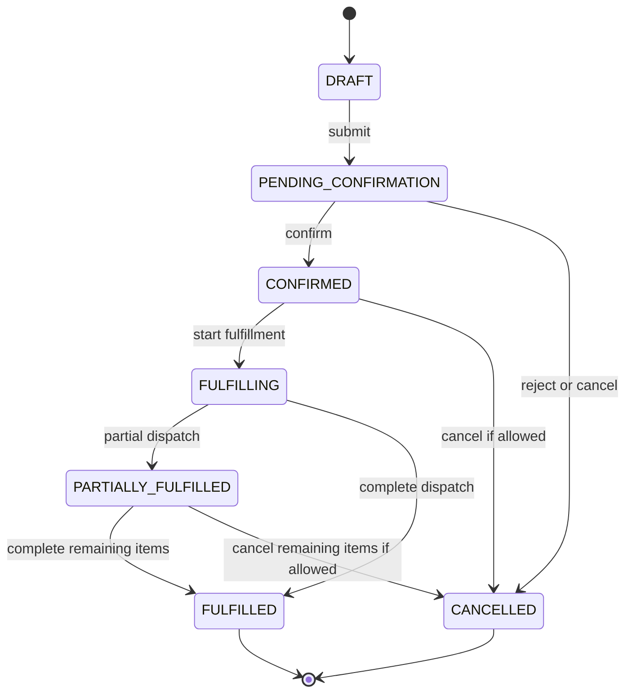

# Vòng đời, trạng thái và hành vi hợp lệ của thực thể

Trong Domain-Driven Design (DDD), **Entity (thực thể)** là đối tượng nghiệp vụ có danh tính riêng và được theo dõi liên tục qua thời gian. Thuộc tính của entity có thể thay đổi, nhưng identity của nó vẫn giữ nguyên. Một đơn hàng có thể chuyển từ bản nháp sang đã xác nhận, rồi được giao hoặc hủy; đó vẫn là cùng một đơn hàng.

Entity vì thế không chỉ là một cấu trúc dữ liệu có mã định danh và các getter/setter. Nó có vòng đời, trạng thái và những hành vi được phép trong từng hoàn cảnh. Mô hình miền cần thể hiện rõ đối tượng được tạo ra khi nào, có thể chuyển trạng thái ra sao, điều kiện nào phải đúng trước khi hành động xảy ra và khi nào vòng đời kết thúc.

Quản lý tốt vòng đời entity giúp bảo vệ quy tắc nghiệp vụ ở đúng nơi, ngăn trạng thái không hợp lệ và làm cho domain model diễn đạt được ngôn ngữ mà chuyên gia nghiệp vụ sử dụng. Đây là một phần quan trọng của tactical design, kết nối Entity với Value Object, Aggregate, Repository và Domain Event.

## 1. Entity là gì và vì sao cần identity?

Entity được nhận diện bằng identity chứ không phải chỉ bằng tập giá trị hiện tại. Hai entity có thể có cùng tên, địa chỉ hoặc trạng thái nhưng vẫn là hai đối tượng khác nhau. Ngược lại, một entity có thể thay đổi nhiều thuộc tính mà vẫn là chính nó.

Ví dụ, hai khách hàng có thể cùng tên “Nguyễn An” và cùng địa chỉ, nhưng là hai hồ sơ khách hàng khác nhau. Nếu một khách hàng đổi địa chỉ hoặc số điện thoại, hệ thống vẫn cần nhận ra đó là hồ sơ khách hàng trước đây.

### Identity và thuộc tính

| Khía cạnh | Entity | Value Object |
|---|---|---|
| Cách nhận diện | Identity ổn định trong phạm vi mô hình | Giá trị được xác định bởi các thuộc tính |
| So sánh bằng nhau | Thường dựa trên identity | Dựa trên toàn bộ giá trị liên quan |
| Thay đổi | Có thể thay đổi thuộc tính trong vòng đời | Thường bất biến; thay đổi được biểu diễn bằng giá trị mới |
| Vòng đời | Có thể được tạo, chuyển trạng thái và kết thúc | Thường không có vòng đời độc lập |
| Ví dụ | `Customer`, `Order`, `Shipment` | `Money`, `Address`, `DateRange` |

Không nên biến mọi đối tượng thành entity chỉ vì có thể gán cho nó một ID. Một địa chỉ giao hàng thường có thể là Value Object nếu ý nghĩa của nó nằm ở các thành phần địa chỉ. Một đơn hàng là entity vì doanh nghiệp cần theo dõi chính đơn hàng đó qua nhiều sự kiện và thay đổi.

### Identity có phạm vi

Identity cần được hiểu trong phạm vi bounded context. Cùng một khách hàng có thể có mã trong Customer Management, mã tài khoản trong Billing và mã người nhận trong Shipping. Những mã này có thể được ánh xạ với nhau, nhưng không nên mặc định rằng mọi context phải dùng chung một kiểu ID hoặc cùng một mô hình khách hàng.

Trong một context, identity thường được biểu diễn bằng kiểu riêng như `OrderId` hoặc `CustomerId` thay vì dùng `String` hoặc `Long` ở mọi nơi. Kiểu riêng giúp tránh truyền nhầm ID và làm rõ ngôn ngữ miền.

```java
public record OrderId(UUID value) {
    public OrderId {
        Objects.requireNonNull(value, "value");
    }
}
```

ID có thể được tạo ở phía ứng dụng, trong factory của domain hoặc bởi cơ sở dữ liệu tùy yêu cầu. Điều quan trọng là identity phải ổn định và không phụ thuộc vào các thuộc tính có thể thay đổi như tên, email hay trạng thái.

## 2. Vòng đời của entity

Vòng đời mô tả những giai đoạn mà một entity trải qua từ lúc được tạo đến khi không còn hoạt động trong nghiệp vụ. Mỗi loại entity có vòng đời riêng. Không nên áp đặt cùng một chuỗi trạng thái cho mọi entity chỉ để thống nhất kỹ thuật.

Một vòng đời thường có các mốc:

1. **Khởi tạo:** entity được tạo khi nghiệp vụ phát sinh một đối tượng mới.
2. **Hoạt động:** entity tồn tại và có thể thực hiện các hành vi phù hợp với trạng thái hiện tại.
3. **Chuyển trạng thái:** một hành động hoặc sự kiện làm thay đổi trạng thái và có thể cập nhật dữ liệu liên quan.
4. **Kết thúc nghiệp vụ:** entity đạt trạng thái không còn hoạt động, chẳng hạn đơn hàng đã đóng hoặc hợp đồng đã chấm dứt.
5. **Lưu trữ lịch sử:** thông tin có thể tiếp tục được giữ để kiểm toán, tra cứu hoặc đáp ứng nghĩa vụ pháp lý.

Kết thúc vòng đời nghiệp vụ không nhất thiết có nghĩa xóa bản ghi khỏi cơ sở dữ liệu. Một đơn hàng đã giao xong vẫn có thể cần được tra cứu, hoàn tiền hoặc kiểm toán. Vòng đời nghiệp vụ và vòng đời lưu trữ là hai khái niệm liên quan nhưng khác nhau.

### Ví dụ vòng đời đơn hàng

Một đơn hàng trực tuyến có thể trải qua các trạng thái sau:

| Trạng thái | Ý nghĩa | Hành vi có thể hợp lệ |
|---|---|---|
| `DRAFT` | Đơn đang được tạo và chỉnh sửa | Thêm, bỏ hoặc thay đổi dòng hàng; gửi xác nhận |
| `PENDING_CONFIRMATION` | Đã gửi yêu cầu xác nhận và đang chờ điều kiện cần thiết | Tiếp tục xử lý xác nhận; hủy theo chính sách |
| `CONFIRMED` | Đơn đã được doanh nghiệp chấp nhận | Bắt đầu thực hiện; yêu cầu hủy nếu chính sách cho phép |
| `FULFILLING` | Đơn đang được chuẩn bị hoặc thực hiện | Cập nhật tiến độ; xử lý ngoại lệ |
| `PARTIALLY_FULFILLED` | Một phần hàng đã được thực hiện | Tiếp tục phần còn lại; đóng phần không thể thực hiện theo chính sách |
| `FULFILLED` | Nghĩa vụ thực hiện đơn đã hoàn tất | Tra cứu; xử lý hậu mãi hoặc hoàn tiền theo quy tắc riêng |
| `CANCELLED` | Đơn đã bị hủy | Tra cứu; xử lý hoàn tiền hoặc giải phóng tài nguyên nếu còn cần |

Đây là mô hình minh họa. Một doanh nghiệp có thể có trạng thái khác, hoặc tách trạng thái thanh toán, giao hàng và đơn hàng thành các vòng đời riêng. Điều cần làm rõ là trạng thái nào thuộc về entity nào và ai có quyền thay đổi nó.



Sơ đồ chỉ biểu diễn một số chuyển trạng thái chính. Những hành động như hoàn tiền, trả hàng hoặc khiếu nại có thể thuộc các entity hoặc bounded context khác, thay vì mở rộng vô hạn trạng thái của `Order`.

## 3. Trạng thái phải phản ánh sự thật nghiệp vụ

Trạng thái là cách tóm tắt tình hình hiện tại của entity. Một trạng thái hữu ích cần có ý nghĩa rõ với nghiệp vụ và giúp xác định những hành vi nào được phép.

Không nên tạo trạng thái chỉ vì một bước kỹ thuật đã chạy. Ví dụ, `PAYMENT_API_CALLED` có thể là trạng thái vận hành của một tiến trình tích hợp, nhưng không nhất thiết là trạng thái nghiệp vụ của đơn hàng. Nếu khách hàng quan tâm đến việc thanh toán đã được chấp thuận hay chưa, mô hình nên biểu diễn ý nghĩa đó, chẳng hạn `PAYMENT_AUTHORIZED`, trong context sở hữu thanh toán.

### Trạng thái đơn và trạng thái của các khía cạnh liên quan

Một đơn hàng có thể đồng thời có:

- Trạng thái đơn hàng: đã xác nhận, đang thực hiện, đã hoàn tất.
- Trạng thái thanh toán: chưa thanh toán, đã ủy quyền, đã thu tiền, đã hoàn tiền.
- Trạng thái giao hàng: chưa bàn giao, đang vận chuyển, đã giao, giao thất bại.

Nếu gộp tất cả vào một enum duy nhất, số tổ hợp trạng thái sẽ tăng nhanh và khó kiểm soát. Ví dụ, `CONFIRMED_AND_PAID_AND_SHIPPED`, `CONFIRMED_AND_PAID_AND_NOT_SHIPPED` hoặc `CONFIRMED_AND_UNPAID_AND_NOT_SHIPPED` không phải cách mô hình dễ mở rộng.

Hãy xác định mỗi trạng thái thuộc về entity hoặc context nào. `Order` có thể tham chiếu kết quả thanh toán hoặc nhận domain event từ Payment context để cập nhật phần thông tin cần thiết. Nó không nên tự quản lý toàn bộ vòng đời thanh toán nếu đó là trách nhiệm của một bounded context khác.

### Trạng thái hiện tại và lịch sử chuyển trạng thái

Một field `status` cho biết tình trạng hiện tại nhưng không giải thích entity đã đi đến đó bằng cách nào. Với nghiệp vụ cần kiểm toán hoặc điều tra, có thể lưu lịch sử chuyển trạng thái gồm:

- Trạng thái trước và sau.
- Hành động hoặc sự kiện gây chuyển đổi.
- Thời điểm xảy ra.
- Tác nhân hoặc nguồn yêu cầu.
- Lý do hoặc dữ liệu nghiệp vụ liên quan.
- Mã tương quan để truy vết qua các hệ thống.

Không phải entity nào cũng cần lưu toàn bộ lịch sử ở cùng một bảng. Có thể dùng audit log, domain event store hoặc bảng lịch sử riêng tùy yêu cầu. Dù lưu ở đâu, lịch sử phải có ý nghĩa và nguồn gốc rõ ràng.

## 4. Hành vi hợp lệ và bất biến của entity

Entity nên cung cấp hành vi thể hiện điều nghiệp vụ cho phép. Thay vì cho phép mã bên ngoài thay đổi tùy ý mọi field, hãy định nghĩa các phương thức có ý nghĩa như `confirm()`, `cancel()` hoặc `changeDeliveryAddress()`.

### Hành vi phải có điều kiện

Một hành vi hợp lệ phụ thuộc vào trạng thái hiện tại và các điều kiện nghiệp vụ khác. Ví dụ:

| Hành vi | Điều kiện ví dụ | Kết quả |
|---|---|---|
| `addLine()` | Đơn đang ở trạng thái `DRAFT`; số lượng dương | Thêm dòng hàng |
| `submit()` | Đơn có ít nhất một dòng hợp lệ | Chuyển sang chờ xác nhận |
| `confirm()` | Đơn đang chờ xác nhận; các điều kiện xác nhận đã đạt | Chuyển sang `CONFIRMED` |
| `cancel()` | Đơn chưa đạt trạng thái không thể hủy; chính sách cho phép | Chuyển sang `CANCELLED` và phát sinh xử lý liên quan |
| `markFulfilled()` | Số lượng thực hiện đáp ứng nghĩa vụ còn lại | Chuyển sang `FULFILLED` |

Điều kiện trong bảng chỉ là ví dụ. Chuyên gia nghiệp vụ cần xác nhận chính sách thực tế, chẳng hạn thời điểm cuối cùng khách hàng được hủy hoặc cách xử lý đơn giao một phần.

### Bảo vệ bất biến

Bất biến (invariant) là điều kiện phải luôn đúng trong phạm vi mô hình hoặc aggregate. Ví dụ:

- Đơn hàng phải có ít nhất một dòng hợp lệ trước khi xác nhận.
- Số lượng của một dòng hàng phải lớn hơn không.
- Đơn đã hủy không thể tiếp tục chuyển sang đang thực hiện.
- Tổng số lượng đã giao không vượt quá số lượng được phép giao.
- Một hợp đồng đã chấm dứt không thể được gia hạn bằng hành vi chỉ dành cho hợp đồng đang hoạt động.

Bất biến cần được kiểm tra ở nơi có thể bảo vệ nó cho mọi đường gọi. Nếu quy tắc chỉ nằm trong giao diện web, một message consumer hoặc batch job có thể bỏ qua. Nếu quy tắc thuộc phạm vi một aggregate, aggregate root là nơi thích hợp để bảo vệ.

### Thiết kế phương thức theo ý nghĩa nghiệp vụ

Phương thức nên mô tả ý định nghiệp vụ, không chỉ phơi bày thao tác thay đổi field. So sánh:

```java
// Cách dễ làm lộ trạng thái nội bộ
order.setStatus(OrderStatus.CONFIRMED);
```

với:

```java
// Cách thể hiện ý định nghiệp vụ
order.confirm(confirmationPolicy);
```

Phương thức `confirm()` có thể kiểm tra trạng thái hiện tại, điều kiện nghiệp vụ, cập nhật thời điểm xác nhận và ghi nhận domain event. Mã gọi không cần tự biết thứ tự thay đổi các field bên trong.

## 5. Mô hình hóa chuyển trạng thái

Chuyển trạng thái là một hành động làm thay đổi trạng thái entity từ giá trị hiện tại sang giá trị mới. Cần xác định rõ trạng thái nguồn, hành động, điều kiện và trạng thái đích.

### Bảng chuyển trạng thái

Một state transition table giúp phát hiện trường hợp bị bỏ sót:

| Trạng thái hiện tại | Hành động | Điều kiện | Trạng thái tiếp theo |
|---|---|---|---|
| `DRAFT` | `submit` | Có dòng hàng hợp lệ | `PENDING_CONFIRMATION` |
| `DRAFT` | `cancel` | Đơn chưa được gửi đi | `CANCELLED` |
| `PENDING_CONFIRMATION` | `confirm` | Đủ điều kiện nghiệp vụ | `CONFIRMED` |
| `PENDING_CONFIRMATION` | `reject` | Có lý do từ chối hợp lệ | `CANCELLED` hoặc trạng thái từ chối riêng |
| `CONFIRMED` | `startFulfillment` | Có thể thực hiện đơn | `FULFILLING` |
| `CONFIRMED` | `cancel` | Chính sách cho phép và chưa bắt đầu thực hiện | `CANCELLED` |
| `FULFILLING` | `complete` | Đã thực hiện đủ số lượng | `FULFILLED` |
| `FULFILLING` | `partialComplete` | Một phần đã được thực hiện | `PARTIALLY_FULFILLED` |

Không có dòng chuyển trạng thái nghĩa là hành động không được phép trong trạng thái đó, trừ khi nghiệp vụ quy định một hành vi khác. Tránh tự động cho phép mọi trạng thái chuyển sang mọi trạng thái vì sẽ tạo ra nhiều đường đi không có ý nghĩa.

### Từ chối chuyển trạng thái không hợp lệ

Khi một hành động không hợp lệ, domain model nên từ chối rõ ràng. Tùy cách thiết kế, có thể trả về domain error, kết quả thất bại có kiểu hoặc ném exception nghiệp vụ. Lựa chọn cần nhất quán và giúp application layer chuyển kết quả thành phản hồi phù hợp.

Không nên âm thầm bỏ qua hành động nếu người gọi cần biết yêu cầu không được thực hiện. Ví dụ, gọi `cancel()` với đơn đã giao xong cần một kết quả rõ ràng để ứng dụng không hiển thị rằng đơn đã được hủy.

### Một hành vi có thể tạo nhiều thay đổi

Hành vi nghiệp vụ có thể thay đổi nhiều thuộc tính nhưng vẫn là một chuyển đổi có ý nghĩa duy nhất. Ví dụ, `confirm()` có thể đặt trạng thái, ghi `confirmedAt`, lưu người xác nhận và tạo `OrderConfirmed`. Những thay đổi này cần được thực hiện nhất quán để entity không rơi vào trạng thái nửa hoàn tất.

## 6. Ví dụ Java: entity tự bảo vệ vòng đời

Ví dụ sau minh họa một `Order` có identity, trạng thái và các hành vi được kiểm soát. Đây là mã rút gọn để giải thích thiết kế; dự án thực tế cần bổ sung kiểu miền, chính sách và xử lý lỗi phù hợp.

```java
public final class Order {
    private final OrderId id;
    private final List<OrderLine> lines = new ArrayList<>();
    private OrderStatus status;
    private Instant confirmedAt;

    private Order(OrderId id) {
        this.id = Objects.requireNonNull(id);
        this.status = OrderStatus.DRAFT;
    }

    public static Order draft(OrderId id) {
        return new Order(id);
    }

    public void addLine(OrderLine line) {
        requireStatus(OrderStatus.DRAFT);
        lines.add(Objects.requireNonNull(line));
    }

    public void submit() {
        requireStatus(OrderStatus.DRAFT);
        if (lines.isEmpty()) {
            throw new InvalidOrderException("Order must contain at least one line");
        }
        status = OrderStatus.PENDING_CONFIRMATION;
    }

    public OrderConfirmed confirm(Instant now) {
        requireStatus(OrderStatus.PENDING_CONFIRMATION);
        this.status = OrderStatus.CONFIRMED;
        this.confirmedAt = Objects.requireNonNull(now);
        return new OrderConfirmed(id, confirmedAt);
    }

    public void cancel(CancellationReason reason) {
        if (status != OrderStatus.DRAFT
                && status != OrderStatus.PENDING_CONFIRMATION
                && status != OrderStatus.CONFIRMED) {
            throw new InvalidOrderTransitionException(status, OrderStatus.CANCELLED);
        }
        Objects.requireNonNull(reason);
        status = OrderStatus.CANCELLED;
    }

    private void requireStatus(OrderStatus expected) {
        if (status != expected) {
            throw new InvalidOrderStateException(status, expected);
        }
    }

    public OrderId id() { return id; }
    public OrderStatus status() { return status; }
    public List<OrderLine> lines() { return List.copyOf(lines); }
}
```

Ở đây, constructor được giới hạn để entity chỉ được tạo qua factory `draft()`. Các phương thức `submit()`, `confirm()` và `cancel()` tự kiểm tra điều kiện chuyển trạng thái. Danh sách dòng hàng được trả về dưới dạng bản sao không thể sửa trực tiếp, tránh để mã bên ngoài thay đổi bất biến.

`confirm()` trả về domain event trong ví dụ để minh họa sự kiện được tạo tại thời điểm hành động nghiệp vụ xảy ra. Một thiết kế khác có thể lưu event trong danh sách domain events của aggregate rồi application layer thu thập sau khi xử lý.

### Tách trạng thái thành kiểu rõ ràng

```java
public enum OrderStatus {
    DRAFT,
    PENDING_CONFIRMATION,
    CONFIRMED,
    FULFILLING,
    PARTIALLY_FULFILLED,
    FULFILLED,
    CANCELLED
}
```

Enum phù hợp khi tập trạng thái tương đối ổn định và hữu hạn. Với quy trình có nhiều bước cấu hình hoặc trạng thái do nghiệp vụ mở rộng, có thể cần mô hình state object hoặc policy riêng. Không nên dùng state pattern chỉ vì entity có vài giá trị enum; hãy chọn cấu trúc đơn giản nhất vẫn bảo vệ được quy tắc.

## 7. Factory, khôi phục entity và thay đổi dữ liệu

### Tạo entity mới

Entity mới nên được tạo trong một trạng thái khởi đầu hợp lệ. Factory hoặc constructor có thể kiểm tra dữ liệu bắt buộc, tạo identity và khởi tạo các thuộc tính mặc định.

Ví dụ, `Order.draft()` tạo đơn nháp. Không nên cho phép tạo một đơn hàng mới trực tiếp ở trạng thái `FULFILLED` nếu nghiệp vụ không có tình huống tương ứng.

### Khôi phục entity từ persistence

Khôi phục (reconstitution) là quá trình dựng lại entity từ dữ liệu đã lưu. Đây không giống tạo mới: entity được khôi phục cần giữ nguyên identity, trạng thái và các thuộc tính lịch sử hợp lệ.

Repository hoặc mapper có thể sử dụng constructor/factory chuyên biệt để khôi phục. Cơ chế này cần tránh chạy lại những tác dụng phụ chỉ dành cho việc tạo mới, chẳng hạn phát `OrderCreated` lần nữa hoặc gửi thông báo cho khách hàng mỗi khi tải entity từ database.

### Không cho phép setter tùy ý

Một entity có setter công khai cho mọi thuộc tính dễ trở thành mô hình dữ liệu thiếu hành vi (anemic model). Mã ứng dụng có thể thực hiện những tổ hợp thay đổi không hợp lệ:

```java
order.setStatus(OrderStatus.FULFILLED);
order.setConfirmedAt(null);
order.setTotal(Money.zero());
```

Các lệnh này có thể làm trạng thái không nhất quán. Thay vào đó, cung cấp hành vi nghiệp vụ có điều kiện và chỉ cho phép thay đổi những thuộc tính mà entity sở hữu.

## 8. Entity, Aggregate và ranh giới nhất quán

Một entity có thể nằm bên trong một aggregate và không được truy cập trực tiếp từ bên ngoài. Aggregate root là entity gốc chịu trách nhiệm bảo vệ các bất biến trong ranh giới aggregate.

Ví dụ, `Order` là aggregate root và `OrderLine` là entity con hoặc đối tượng nội bộ. Nếu mọi thay đổi dòng hàng phải tuân thủ quy tắc của đơn, bên ngoài nên gọi `order.addLine()` hoặc `order.removeLine()` thay vì tải và sửa `OrderLine` độc lập.

```text
Order (Aggregate Root)
  - OrderId
  - Status
  - ConfirmedAt
  - OrderLine 1
  - OrderLine 2
  - OrderLine 3
```

Aggregate root quyết định hành vi nào được phép và khi nào có thể thay đổi trạng thái. Điều này giúp bảo đảm các bất biến cần nhất quán đồng thời được kiểm tra tại một ranh giới rõ ràng.

Không nên đưa mọi entity có liên quan vào cùng một aggregate. Ví dụ, `Order` và `Payment` có thể có vòng đời riêng và được quản lý bởi hai bounded context. Khi thanh toán thành công, Payment context phát sự kiện; Order context xử lý sự kiện để cập nhật trạng thái phù hợp. Sự nhất quán giữa hai context có thể là eventual consistency thay vì một transaction chung.

## 9. Domain Event và lịch sử vòng đời

Khi một hành vi làm thay đổi trạng thái theo ý nghĩa nghiệp vụ, entity hoặc aggregate có thể phát sinh Domain Event. Event mô tả điều đã xảy ra, thường dùng thì quá khứ, ví dụ `OrderSubmitted`, `OrderConfirmed` hoặc `OrderCancelled`.

Domain Event hữu ích để:

- Thông báo cho các thành phần khác rằng một sự việc nghiệp vụ đã xảy ra.
- Kích hoạt quy trình tiếp theo mà không để entity trực tiếp gọi dịch vụ bên ngoài.
- Ghi lại các mốc quan trọng trong vòng đời.
- Đồng bộ thông tin giữa các bounded context theo cơ chế bất đồng bộ.
- Hỗ trợ audit và truy vết khi được lưu với metadata phù hợp.

Không phải mọi thay đổi field đều cần Domain Event. Event nên biểu diễn một sự việc có ý nghĩa với nghiệp vụ, không phải một thông báo kỹ thuật kiểu `OrderStatusColumnUpdated`.

### Event và trạng thái hiện tại không thay thế nhau

Trạng thái hiện tại cho biết entity đang ở đâu; event cho biết một điều gì đã xảy ra. `Order.status = CONFIRMED` không cho biết ai xác nhận, xác nhận lúc nào hoặc điều kiện nào đã được đáp ứng. `OrderConfirmed` có thể mang thời điểm, mã đơn và thông tin nghiệp vụ cần thiết.

Nếu hệ thống cần lịch sử đầy đủ để tái dựng trạng thái, có thể cân nhắc Event Sourcing. Tuy nhiên, dùng Domain Event không đồng nghĩa với việc phải dùng Event Sourcing. Phần lớn hệ thống có thể lưu trạng thái hiện tại trong database và lưu event/outbox phục vụ tích hợp hoặc audit.

## 10. Kiểm soát đồng thời và thay đổi trạng thái

Hai yêu cầu có thể cùng lúc tác động đến một entity. Nếu không có cơ chế kiểm soát, cả hai có thể đọc cùng trạng thái cũ rồi ghi đè lẫn nhau.

Ví dụ, một yêu cầu hủy đơn và một yêu cầu bắt đầu thực hiện đơn đến gần như đồng thời. Cả hai đều đọc trạng thái `CONFIRMED`. Nếu không kiểm soát cạnh tranh, hệ thống có thể vừa đánh dấu đơn đã hủy vừa tạo yêu cầu thực hiện.

### Optimistic locking

Optimistic locking dùng version hoặc timestamp để phát hiện dữ liệu đã bị thay đổi kể từ lúc đọc. Khi lưu, repository chỉ cập nhật nếu version vẫn là phiên bản mà transaction đã đọc. Nếu version khác, thao tác phải được thử lại hoặc trả về xung đột để application xử lý.

```java
@Entity
public class OrderRecord {
    @Id
    private UUID id;

    @Version
    private long version;

    private String status;
}
```

Annotation `@Version` là chi tiết persistence thuộc Infrastructure. Domain model không cần phụ thuộc vào annotation đó; repository adapter ánh xạ version và chuyển xung đột lưu trữ thành lỗi phù hợp ở application layer.

### Pessimistic locking

Pessimistic locking khóa bản ghi hoặc tài nguyên trong một khoảng thời gian để ngăn transaction khác sửa đồng thời. Cách này có thể phù hợp với một số nghiệp vụ có xung đột cao, nhưng làm tăng nguy cơ chờ khóa và deadlock. Chỉ nên dùng khi đã hiểu đặc điểm tải và yêu cầu nhất quán.

### Kiểm tra lại quy tắc ở thời điểm commit

Kiểm tra trạng thái trong bộ nhớ chưa đủ nếu dữ liệu có thể thay đổi đồng thời. Cần kết hợp bảo vệ bất biến trong domain model với cơ chế transaction/locking ở persistence. Hai phần giải quyết hai vấn đề khác nhau: domain model định nghĩa chuyển đổi hợp lệ, còn hạ tầng bảo đảm dữ liệu không bị ghi đè bởi các thao tác cạnh tranh.

## 11. Xóa, ngừng hoạt động và lưu trữ lịch sử

Không phải entity nào cũng kết thúc bằng thao tác xóa vật lý. Trong nhiều nghiệp vụ, cần phân biệt:

- **Xóa vật lý (hard delete):** bản ghi bị loại bỏ khỏi kho dữ liệu.
- **Xóa mềm (soft delete):** entity được đánh dấu không còn hoạt động nhưng dữ liệu vẫn được giữ.
- **Ngừng hiệu lực (deactivate/retire):** entity không còn được dùng cho giao dịch mới nhưng lịch sử vẫn có ý nghĩa.
- **Đóng nghiệp vụ (close/terminate):** vòng đời nghiệp vụ kết thúc theo quy tắc, nhưng entity vẫn có thể được truy vấn.

Ví dụ, tài khoản khách hàng bị vô hiệu hóa có thể không được phép đăng nhập hoặc tạo đơn mới, nhưng đơn hàng cũ vẫn phải tham chiếu được khách hàng đó. Nếu xóa vật lý khách hàng, hệ thống có thể mất thông tin cần cho hóa đơn, bảo hành hoặc kiểm toán.

Quyết định lưu hoặc xóa dữ liệu cần tuân thủ chính sách nghiệp vụ, pháp lý và bảo mật. Không nên dùng một field `deleted = true` thay cho mọi ý nghĩa như hủy hợp đồng, khóa tài khoản hay ngừng cung cấp sản phẩm.

## 12. Kiểm thử vòng đời và hành vi entity

Kiểm thử entity nên tập trung vào các hành vi và chuyển trạng thái có ý nghĩa. Không cần kiểm tra getter/setter đơn giản nếu chúng không chứa logic.

Với mỗi hành vi, hãy kiểm thử:

1. Trạng thái ban đầu hợp lệ.
2. Hành vi được phép trong trạng thái đó.
3. Trạng thái và dữ liệu sau khi hành vi thành công.
4. Domain Event được tạo nếu có.
5. Hành vi không được phép bị từ chối.
6. Các bất biến vẫn đúng sau nhiều hành động liên tiếp.

Ví dụ bảng test cho `Order`:

| Tình huống | Kỳ vọng |
|---|---|
| Tạo đơn mới | Trạng thái là `DRAFT`, identity được gán |
| Gửi đơn không có dòng hàng | Bị từ chối, trạng thái vẫn là `DRAFT` |
| Gửi đơn có dòng hàng hợp lệ | Chuyển sang `PENDING_CONFIRMATION` |
| Xác nhận đơn đang chờ | Chuyển sang `CONFIRMED`, ghi thời điểm và tạo event |
| Xác nhận đơn đã xác nhận | Bị từ chối hoặc trả kết quả idempotent theo chính sách đã chọn |
| Thêm dòng hàng sau xác nhận | Bị từ chối |
| Hủy đơn đã giao xong | Bị từ chối nếu chính sách không cho phép |
| Khôi phục entity từ database | Giữ nguyên identity, trạng thái và lịch sử; không phát lại event tạo mới |

Một ví dụ unit test:

```java
class OrderTest {
    @Test
    void cannotSubmitAnOrderWithoutLines() {
        Order order = Order.draft(new OrderId(UUID.randomUUID()));

        assertThrows(
                InvalidOrderException.class,
                order::submit
        );
        assertEquals(OrderStatus.DRAFT, order.status());
    }

    @Test
    void confirmationChangesStateAndRecordsTime() {
        Order order = Order.draft(new OrderId(UUID.randomUUID()));
        order.addLine(sampleLine());
        order.submit();

        Instant now = Instant.parse("2026-01-10T10:00:00Z");
        OrderConfirmed event = order.confirm(now);

        assertEquals(OrderStatus.CONFIRMED, order.status());
        assertEquals(now, event.occurredAt());
    }
}
```

Tên exception và phương thức trong ví dụ cần đồng nhất với implementation thực tế. Bộ test nên bao phủ cả đường đi hợp lệ lẫn các chuyển đổi bị cấm, đặc biệt với trạng thái cuối hoặc hành động có tác động tài chính.

## 13. Những sai lầm thường gặp

- **Dùng thuộc tính thay đổi làm identity:** tên, email hoặc số điện thoại có thể thay đổi và không bảo đảm duy nhất. Hãy dùng identity ổn định.
- **Coi entity chỉ là data holder:** entity chỉ có getter/setter khiến quy tắc nằm rải rác trong service hoặc controller. Hãy biểu diễn hành vi nghiệp vụ tại entity hoặc aggregate phù hợp.
- **Cho phép setter trạng thái công khai:** bất kỳ đoạn mã nào cũng có thể đưa entity sang trạng thái không hợp lệ. Hãy cung cấp phương thức chuyển trạng thái có điều kiện.
- **Cho phép mọi trạng thái chuyển sang mọi trạng thái:** tạo ra đường đi vô nghĩa và khó kiểm thử. Hãy lập bảng chuyển trạng thái theo nghiệp vụ.
- **Gộp mọi trạng thái liên quan vào một enum:** làm bùng nổ số tổ hợp và trộn quyền sở hữu giữa các context. Hãy tách vòng đời thuộc các entity hoặc context khác nhau.
- **Nhầm trạng thái kỹ thuật với trạng thái nghiệp vụ:** trạng thái API hoặc job chạy không nhất thiết là khái niệm miền. Hãy dùng thuật ngữ phản ánh điều chuyên gia nghiệp vụ quan tâm.
- **Phát event khi chỉ tải entity:** reconstitution có thể vô tình kích hoạt tác dụng phụ. Chỉ phát event khi sự việc nghiệp vụ thực sự xảy ra.
- **Không kiểm soát cập nhật đồng thời:** hai yêu cầu cạnh tranh có thể ghi đè nhau và phá vỡ bất biến. Hãy kết hợp transaction với optimistic hoặc pessimistic locking phù hợp.
- **Xóa vật lý entity quá sớm:** có thể phá liên kết lịch sử hoặc nghĩa vụ kiểm toán. Hãy phân biệt xóa, vô hiệu hóa và kết thúc vòng đời nghiệp vụ.
- **Đưa mọi hành vi vào domain service:** entity mất khả năng tự bảo vệ trạng thái. Hãy đặt hành vi ở nơi sở hữu dữ liệu và quy tắc tự nhiên.

## 14. Checklist thiết kế vòng đời entity

Khi mô hình hóa một entity, hãy xác nhận:

- Entity có identity ổn định và phạm vi rõ trong bounded context không?
- Lý do đối tượng cần identity đã rõ, hay nó thực chất là Value Object?
- Các trạng thái phản ánh ý nghĩa nghiệp vụ và có định nghĩa rõ không?
- Trạng thái khởi đầu và điều kiện kết thúc vòng đời đã được xác định chưa?
- Các hành vi hợp lệ trong từng trạng thái đã được mô tả chưa?
- Bất biến nào phải được bảo vệ tại entity hoặc aggregate root đã rõ chưa?
- Hành vi có từ chối chuyển trạng thái không hợp lệ một cách tường minh không?
- Các trạng thái thuộc context khác có bị gộp vào entity này không?
- Domain Event có phản ánh sự việc nghiệp vụ đã xảy ra không?
- Factory và repository có phân biệt tạo mới với khôi phục entity không?
- Cơ chế lưu trữ có xử lý cập nhật đồng thời không?
- Chính sách xóa, vô hiệu hóa và lưu lịch sử có phù hợp không?
- Unit test đã bao phủ hành vi hợp lệ, không hợp lệ và các bất biến quan trọng chưa?

Entity có ý nghĩa khi nó giữ được identity qua thời gian và kiểm soát được những thay đổi thuộc về nó. Khi vòng đời, trạng thái, hành vi và bất biến được mô hình hóa rõ, domain model trở thành nơi đáng tin cậy để diễn đạt quy tắc nghiệp vụ. Điều đó giúp các ca sử dụng và các thành phần kỹ thuật phối hợp với entity mà không phải tự ý thay đổi trạng thái nội bộ hoặc lặp lại cùng một logic ở nhiều nơi.
