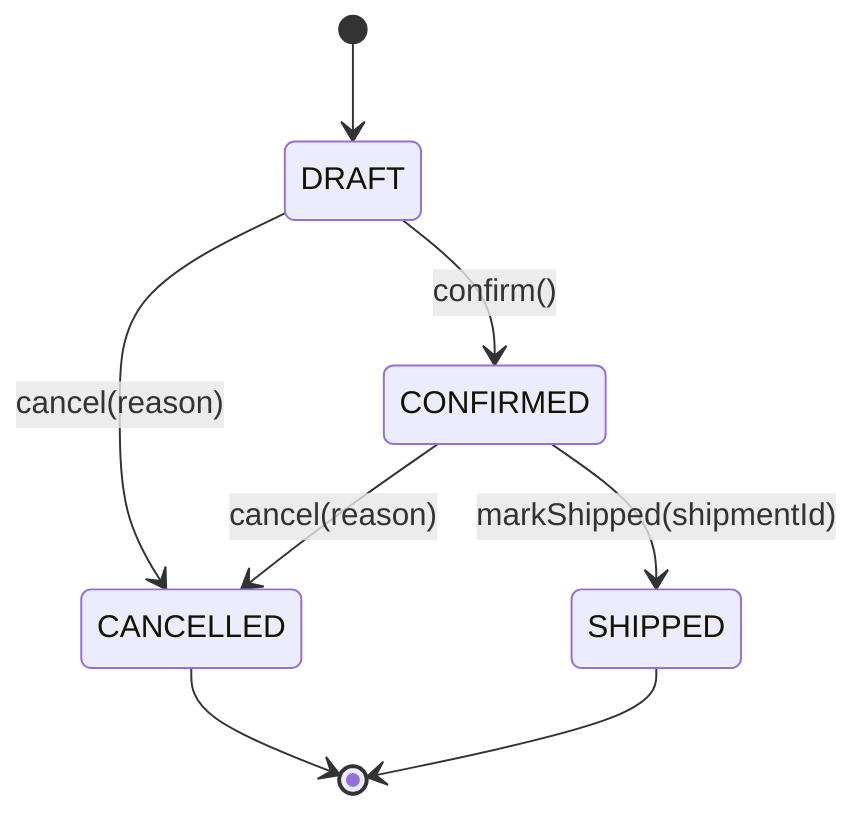
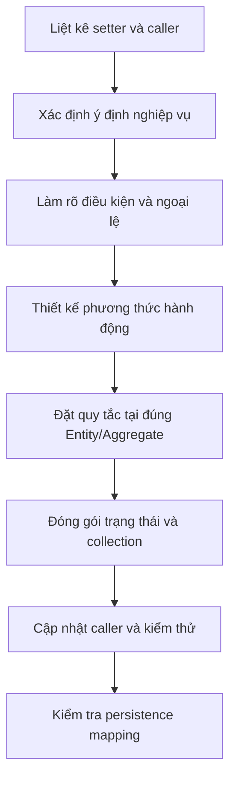

# Thiết kế phương thức theo hành động nghiệp vụ thay vì setter tùy ý

Trong Domain-Driven Design (DDD), Entity không chỉ là một cấu trúc chứa dữ liệu. Entity có định danh, vòng đời và thường chịu trách nhiệm bảo vệ những quy tắc quyết định trạng thái nào của nó là hợp lệ. Vì vậy, giao diện công khai của Entity nên diễn đạt những hành động mà nghiệp vụ cho phép, chẳng hạn `confirm()`, `cancel()` hoặc `markShipped()`, thay vì mở mọi thuộc tính cho bên ngoài thay đổi bằng các setter chung chung.

Một phương thức như `setStatus(OrderStatus.SHIPPED)` chỉ cho biết dữ liệu sẽ được gán thành giá trị nào. Nó không diễn đạt ai hoặc điều gì cho phép chuyển trạng thái, các điều kiện cần thỏa mãn, hay những dữ liệu liên quan phải được cập nhật cùng lúc. Phương thức `markShipped(ShipmentId shipmentId)` có thể thể hiện rõ ý định, kiểm tra trạng thái hiện tại và bảo vệ quy tắc chuyển đơn hàng sang trạng thái đã bàn giao.

Thiết kế phương thức theo hành động nghiệp vụ giúp mã nguồn gần với ngôn ngữ chung, giữ bất biến trong mô hình và ngăn các luồng khác nhau thay đổi Entity theo những cách không nhất quán. Điều này đặc biệt quan trọng với Aggregate Root, nơi mọi thay đổi trạng thái cần đi qua các hành vi bảo vệ ranh giới nhất quán.

## 1. Vấn đề của setter tùy ý trong Entity

Setter là phương thức công khai cho phép bên gọi gán một giá trị vào thuộc tính. Ví dụ:

```java
order.setStatus(OrderStatus.SHIPPED);
order.setTotalAmount(new BigDecimal("0.00"));
order.setCancelled(true);
```

Những lời gọi này cho biết thuộc tính nào được thay đổi nhưng không thể hiện quy tắc nghiệp vụ. Một đoạn code khác có thể gọi `setStatus(SHIPPED)` ngay cả khi đơn hàng chưa được xác nhận hoặc chưa có thông tin giao hàng. Một đoạn khác có thể đặt `cancelled = true` mà quên giải phóng giữ hàng hoặc ghi nhận lý do hủy.

Setter tùy ý thường gây ra các vấn đề sau:

- **Bất biến bị phá vỡ:** đối tượng có thể rơi vào trạng thái mà nghiệp vụ không cho phép.
- **Quy tắc bị phân tán:** mỗi caller tự kiểm tra điều kiện trước khi gọi setter; một caller mới có thể quên kiểm tra.
- **Ý định không rõ:** `setStatus()` không cho biết đây là xác nhận, hủy, từ chối hay hoàn tất một quy trình.
- **Thay đổi không nguyên tử ở cấp mô hình:** nhiều thuộc tính liên quan được cập nhật riêng rẽ và có thể chỉ cập nhật một phần.
- **Khó kiểm thử theo nghiệp vụ:** kiểm thử thường tập trung vào giá trị trường thay vì hành vi và điều kiện hợp lệ.

Vấn đề không nằm ở bản thân cú pháp setter. Vấn đề xuất hiện khi setter trở thành giao diện chính để thay đổi một Entity có quy tắc nghiệp vụ.

## 2. Thiết kế phương thức theo hành động nghiệp vụ là gì?

Một phương thức theo hành động nghiệp vụ diễn đạt điều mà một vai trò hoặc quy trình muốn thực hiện với Entity. Phương thức chịu trách nhiệm kiểm tra điều kiện, thực hiện chuyển đổi hợp lệ và giữ các bất biến thuộc đối tượng hoặc Aggregate.

Ví dụ:

| Setter chung chung | Hành động nghiệp vụ | Ý nghĩa rõ hơn |
| --- | --- | --- |
| `setStatus(CONFIRMED)` | `confirm()` | Xác nhận đơn sau khi các điều kiện xác nhận được đáp ứng. |
| `setStatus(CANCELLED)` | `cancel(reason)` | Hủy đơn theo điều kiện và ghi nhận lý do. |
| `setAddress(address)` | `changeDeliveryAddress(address)` | Thay địa chỉ giao hàng trong giai đoạn được phép. |
| `setAssignedTo(userId)` | `assignTo(employeeId)` | Giao trách nhiệm xử lý cho một nhân viên. |
| `setApproved(true)` | `approve(approverId)` | Phê duyệt một yêu cầu bởi người có thẩm quyền. |
| `setBalance(balance)` | `deposit(amount)` hoặc `withdraw(amount)` | Thay đổi số dư theo quy tắc giao dịch. |
| `setQuantity(quantity)` | `increaseQuantity()` hoặc `adjustQuantity(...)` | Điều chỉnh số lượng theo chính sách tồn kho. |

Tên phương thức nên sử dụng động từ và thuật ngữ đã thống nhất trong Bounded Context. Một phương thức tốt giúp người đọc hiểu ý định mà không cần biết các thuộc tính nội bộ sẽ thay đổi như thế nào.

### 2.1. Một hành động bao gồm điều kiện và kết quả

Hành động nghiệp vụ thường có ba phần:

1. **Tiền điều kiện:** đối tượng đang ở trạng thái nào, dữ liệu nào cần có, ai có quyền thực hiện?
2. **Hành vi:** đối tượng thực hiện thay đổi nào theo quy tắc?
3. **Kết quả:** trạng thái mới là gì, dữ liệu nào được ghi nhận và sự kiện nào có thể phát sinh?

Ví dụ, `confirm()` có thể yêu cầu đơn đang ở trạng thái nháp và có ít nhất một dòng hàng. Khi hợp lệ, phương thức chuyển trạng thái sang đã xác nhận. Nếu điều kiện không thỏa mãn, phương thức từ chối hành động và giữ nguyên trạng thái.

### 2.2. Phương thức phải phản ánh đúng phạm vi trách nhiệm

Không phải mọi hành động đều thuộc một Entity. Nếu hành động bảo vệ bất biến của một Aggregate, nên đi qua Aggregate Root. Nếu quy tắc không thuộc tự nhiên về một Entity hoặc Value Object, có thể dùng Domain Service. Nếu thao tác chủ yếu điều phối nhiều thành phần hoặc hệ thống ngoài, Application Service chịu trách nhiệm điều phối.

Ví dụ, `order.cancel()` có thể bảo vệ quy tắc hủy thuộc đơn hàng. Nhưng việc gửi yêu cầu hoàn tiền đến cổng thanh toán và thông báo cho đơn vị vận chuyển là các bước tích hợp cần được Application điều phối hoặc xử lý qua sự kiện và các dịch vụ tương ứng.

## 3. Encapsulation — đóng gói trạng thái và hành vi

Đóng gói là nguyên tắc che giấu chi tiết nội bộ và chỉ cho phép tương tác thông qua giao diện được kiểm soát. Với Entity, điều này có nghĩa:

- Thuộc tính thay đổi được thường để `private`.
- Không cung cấp setter công khai cho mọi trường.
- Chỉ cung cấp các phương thức thể hiện hành động hợp lệ.
- Không trả về cấu trúc mutable để bên ngoài sửa trực tiếp.
- Kiểm tra dữ liệu đầu vào và điều kiện chuyển trạng thái ngay tại nơi có trách nhiệm bảo vệ.

Ví dụ, nếu `Order` trả về danh sách `lines` mutable, caller có thể thêm hoặc xóa dòng hàng mà không đi qua `addLine()` hoặc `removeLine()`. Khi đó, các quy tắc như chỉ được sửa đơn nháp có thể bị bỏ qua.

```java
public List<OrderLine> lines() {
    return List.copyOf(lines);
}
```

`List.copyOf` tạo một danh sách không thể sửa qua tham chiếu trả về. Nếu phần tử cũng là Value Object bất biến, caller không thể thay đổi trạng thái nội bộ thông qua danh sách đó.

Đóng gói không có nghĩa mọi thuộc tính đều phải bị giấu tuyệt đối. Getter hoặc phương thức truy vấn chỉ đọc có thể được cung cấp khi cần. Mục tiêu là kiểm soát đường thay đổi trạng thái, không phải làm cho đối tượng khó sử dụng.

## 4. Ví dụ: thiết kế Entity Order bằng hành động nghiệp vụ

Giả sử một hệ thống bán hàng có quy tắc minh họa:

- Đơn nháp có thể thêm dòng hàng và thay địa chỉ giao hàng.
- Chỉ đơn có ít nhất một dòng hàng mới được xác nhận.
- Đơn nháp hoặc đơn đã xác nhận có thể bị hủy trước khi giao.
- Chỉ đơn đã xác nhận mới được đánh dấu đã bàn giao cho đơn vị vận chuyển.
- Đơn đã bàn giao không thể hủy theo quy trình hủy trước giao.

Đây là quy tắc giả định để minh họa thiết kế. Mỗi doanh nghiệp cần xác nhận chính sách thực tế, chẳng hạn điều kiện thanh toán, giữ tồn kho, hủy từng phần và quyền của từng vai trò.

### 4.1. Thiết kế yếu: mở setter cho trạng thái

```java
public class Order {
    private OrderStatus status;
    private boolean cancelled;
    private BigDecimal totalAmount;

    public void setStatus(OrderStatus status) {
        this.status = status;
    }

    public void setCancelled(boolean cancelled) {
        this.cancelled = cancelled;
    }

    public void setTotalAmount(BigDecimal totalAmount) {
        this.totalAmount = totalAmount;
    }
}
```

Lớp trên không thể hiện được:

- Những trạng thái nào có thể chuyển sang nhau.
- Khi nào được hủy và khi nào được xác nhận.
- Vì sao tổng tiền thay đổi và cách tính tổng tiền.
- Quan hệ giữa `status` và `cancelled`.
- Hành động nào cần ghi nhận lý do hoặc thông tin liên quan.

Ví dụ, `status = SHIPPED` và `cancelled = true` có thể cùng tồn tại vì hai trường được thay đổi độc lập. Nếu nghiệp vụ không cho phép tổ hợp này, mô hình phải ngăn chặn nó.

### 4.2. Thiết kế theo hành động

Một cách thiết kế tốt hơn là giữ trạng thái riêng tư và cung cấp các hành vi có tên rõ ràng:

```java
import java.util.ArrayList;
import java.util.List;
import java.util.Objects;

public final class Order {
    private final OrderId id;
    private final List<OrderLine> lines = new ArrayList<>();
    private Address deliveryAddress;
    private OrderStatus status = OrderStatus.DRAFT;
    private ShipmentId shipmentId;
    private CancellationReason cancellationReason;

    private Order(OrderId id, Address deliveryAddress) {
        this.id = Objects.requireNonNull(id);
        this.deliveryAddress = Objects.requireNonNull(deliveryAddress);
    }

    public static Order draft(OrderId id, Address deliveryAddress) {
        return new Order(id, deliveryAddress);
    }

    public void addLine(OrderLine line) {
        requireStatus(OrderStatus.DRAFT);
        lines.add(Objects.requireNonNull(line));
    }

    public void changeDeliveryAddress(Address newAddress) {
        requireStatus(OrderStatus.DRAFT);
        deliveryAddress = Objects.requireNonNull(newAddress);
    }

    public void confirm() {
        requireStatus(OrderStatus.DRAFT);
        if (lines.isEmpty()) {
            throw new IllegalStateException("An empty order cannot be confirmed");
        }
        status = OrderStatus.CONFIRMED;
    }

    public void cancel(CancellationReason reason) {
        if (status != OrderStatus.DRAFT && status != OrderStatus.CONFIRMED) {
            throw new IllegalStateException("Only unshipped orders can be cancelled");
        }
        cancellationReason = Objects.requireNonNull(reason);
        status = OrderStatus.CANCELLED;
    }

    public void markShipped(ShipmentId shipmentId) {
        requireStatus(OrderStatus.CONFIRMED);
        this.shipmentId = Objects.requireNonNull(shipmentId);
        status = OrderStatus.SHIPPED;
    }

    public OrderId id() {
        return id;
    }

    public OrderStatus status() {
        return status;
    }

    public List<OrderLine> lines() {
        return List.copyOf(lines);
    }

    public Address deliveryAddress() {
        return deliveryAddress;
    }

    private void requireStatus(OrderStatus expected) {
        if (status != expected) {
            throw new IllegalStateException(
                    "Expected status " + expected + " but was " + status
            );
        }
    }

    public record OrderId(String value) {
        public OrderId {
            if (value == null || value.isBlank()) {
                throw new IllegalArgumentException("Order ID is required");
            }
        }
    }

    public record Address(String street, String city, String country) {
        public Address {
            Objects.requireNonNull(street);
            Objects.requireNonNull(city);
            Objects.requireNonNull(country);
        }
    }

    public record ProductId(String value) {
        public ProductId {
            if (value == null || value.isBlank()) {
                throw new IllegalArgumentException("Product ID is required");
            }
        }
    }

    public record OrderLine(ProductId productId, int quantity) {
        public OrderLine {
            Objects.requireNonNull(productId);
            if (quantity <= 0) {
                throw new IllegalArgumentException("Quantity must be positive");
            }
        }
    }

    public record ShipmentId(String value) {
        public ShipmentId {
            if (value == null || value.isBlank()) {
                throw new IllegalArgumentException("Shipment ID is required");
            }
        }
    }

    public record CancellationReason(String value) {
        public CancellationReason {
            if (value == null || value.isBlank()) {
                throw new IllegalArgumentException("Cancellation reason is required");
            }
        }
    }

    public enum OrderStatus {
        DRAFT, CONFIRMED, CANCELLED, SHIPPED
    }
}
```

Các Value Object được đặt lồng trong `Order` để ví dụ nằm trong một khối mã; trong dự án thật, chúng thường được tách thành các kiểu riêng theo cấu trúc package. Ví dụ cũng lược bỏ một số quy tắc như kiểm tra thanh toán, tồn kho, quyền hủy và phát Domain Event. Điểm chính là caller không thể đặt trạng thái tùy ý; nó phải yêu cầu một hành động có tên nghiệp vụ và để `Order` kiểm tra điều kiện.

### 4.3. So sánh giao diện công khai

| Trường hợp | Giao diện setter | Giao diện hành động |
| --- | --- | --- |
| Xác nhận đơn | `setStatus(CONFIRMED)` | `confirm()` |
| Hủy đơn | `setStatus(CANCELLED)` và `setCancelled(true)` | `cancel(reason)` |
| Bàn giao vận chuyển | `setStatus(SHIPPED)` và `setShipmentId(id)` | `markShipped(shipmentId)` |
| Thay địa chỉ | `setDeliveryAddress(address)` | `changeDeliveryAddress(address)` |

Giao diện hành động gom những thay đổi liên quan và bảo vệ điều kiện tại một nơi. Caller diễn đạt điều muốn làm; Entity quyết định liệu hành động có hợp lệ hay không.

## 5. Phương thức hành động và vòng đời Entity

Entity thường có vòng đời với những trạng thái và chuyển đổi được nghiệp vụ quy định. Thiết kế phương thức nên làm rõ các chuyển đổi đó.

### 5.1. Mô tả chuyển trạng thái hợp lệ

Ví dụ vòng đời đơn hàng đơn giản:



Sơ đồ chỉ mô tả tập con quy tắc đã nêu. Hệ thống thực tế có thể cần các trạng thái `PAYMENT_PENDING`, `PARTIALLY_SHIPPED`, `DELIVERED`, `RETURNED` hoặc các trạng thái khác. Không nên thêm trạng thái chỉ vì muốn biểu diễn mọi chi tiết kỹ thuật; trạng thái cần có ý nghĩa và ảnh hưởng đến quyết định nghiệp vụ.

### 5.2. Không cho phép chuyển trạng thái tùy ý

Một phương thức hành động cần kiểm tra trạng thái hiện tại và các điều kiện khác. Nếu không hợp lệ, nó nên từ chối rõ ràng thay vì âm thầm bỏ qua hoặc ép trạng thái.

Ví dụ:

- `confirm()` chỉ hoạt động khi đơn đang là `DRAFT` và có ít nhất một dòng.
- `cancel(reason)` chỉ hoạt động trong các trạng thái mà chính sách cho phép hủy.
- `markShipped(shipmentId)` yêu cầu đơn đã được xác nhận và có thông tin bàn giao.

Các kiểm tra này nên tập trung trong Entity hoặc Aggregate chịu trách nhiệm, tránh lặp lại ở nhiều controller hay Application Service.

### 5.3. Trạng thái và thuộc tính liên quan phải nhất quán

Nếu hành động thay đổi nhiều trường có liên hệ, phương thức nên thực hiện chúng như một thay đổi logic thống nhất. Ví dụ, `markShipped()` có thể vừa ghi `shipmentId` vừa chuyển trạng thái sang `SHIPPED`. Caller không phải nhớ gọi hai setter theo đúng thứ tự.

Tuy nhiên, nếu một hành động cần thay đổi dữ liệu ở nhiều Aggregate hoặc hệ thống khác, không nên cố gom tất cả vào một Entity. Aggregate bảo vệ bất biến bên trong ranh giới của nó; Application hoặc quy trình miền điều phối phần việc còn lại.

## 6. Thiết kế tên và chữ ký phương thức

Tên phương thức là một phần của ngôn ngữ chung. Nó nên diễn đạt ý định nghiệp vụ, có phạm vi rõ và tránh phơi bày chi tiết triển khai.

### 6.1. Dùng động từ nghiệp vụ cụ thể

Một số động từ thường gặp:

| Động từ | Ví dụ | Ngữ nghĩa |
| --- | --- | --- |
| `place` | `placeOrder()` | Ghi nhận yêu cầu đặt hàng. |
| `confirm` | `confirm()` | Xác nhận sau khi điều kiện được đáp ứng. |
| `cancel` | `cancel(reason)` | Hủy theo chính sách. |
| `approve` | `approve(approverId)` | Phê duyệt bởi người có thẩm quyền. |
| `reject` | `reject(reason)` | Từ chối và ghi nhận lý do. |
| `assign` | `assignTo(employeeId)` | Giao trách nhiệm cho một người. |
| `reserve` | `reserve(quantity)` | Giữ trước một lượng tài nguyên. |
| `release` | `releaseReservation()` | Giải phóng phần đã giữ. |
| `reprice` | `reprice(pricingPolicy)` | Tính lại giá theo một chính sách xác định. |

Các từ chung như `process()`, `update()`, `handle()` hoặc `setValue()` có thể phù hợp ở tầng kỹ thuật, nhưng thường không đủ ý nghĩa cho hành vi miền.

### 6.2. Dùng kiểu miền thay vì primitive khi có ý nghĩa

Nếu phương thức nhận `String`, `int` hoặc `BigDecimal` cho một khái niệm có quy tắc riêng, hãy cân nhắc Value Object.

Ví dụ:

```java
order.cancel(new Order.CancellationReason("Customer request"));
order.markShipped(new Order.ShipmentId("SHP-1042"));
```

Kiểu `CancellationReason` có thể kiểm tra không rỗng hoặc giới hạn độ dài; `ShipmentId` giúp tránh nhầm mã vận đơn với mã đơn hàng. Value Object bất biến cũng ngăn caller thay đổi giá trị sau khi truyền vào Entity.

Không cần tạo Value Object cho mọi chuỗi hoặc số. Chỉ tạo khi khái niệm có ý nghĩa miền, quy tắc xác thực, phép so sánh hoặc khả năng tái sử dụng đáng kể.

### 6.3. Chọn chữ ký phản ánh hành động hoàn chỉnh

Một phương thức có chữ ký tốt cung cấp đủ thông tin để thực hiện hành động, nhưng không yêu cầu caller tự phối hợp những thay đổi nội bộ.

Ví dụ, `markShipped(ShipmentId)` rõ hơn việc yêu cầu caller gọi `setShipmentId(id)` rồi `setStatus(SHIPPED)`. Nếu cần ghi nhận thời điểm hoặc người thực hiện, có thể truyền `Instant` hoặc Value Object phù hợp, miễn là các tham số thuộc ngữ nghĩa nghiệp vụ.

### 6.4. Tránh tham số điều khiển mơ hồ

Các chữ ký như `updateStatus(status, force, validate, notify)` thường gộp nhiều ý định và mở cửa cho các đường đi không rõ ràng. Nên tách thành hành động có tên riêng hoặc dùng một chính sách/đối tượng tham số thể hiện ý nghĩa. Nếu có một trường hợp quản trị đặc biệt được phép bỏ qua quy tắc, hãy mô hình hóa quyền và lý do của nó một cách tường minh.

## 7. Vai trò của Aggregate Root

Trong DDD, Aggregate là ranh giới nhất quán gồm một hoặc nhiều đối tượng. **Aggregate Root** là cổng truy cập từ bên ngoài và chịu trách nhiệm bảo vệ bất biến của toàn Aggregate.

Ví dụ, `Order` là Aggregate Root quản lý các `OrderLine`. Bên ngoài nên yêu cầu `order.addLine(line)` hoặc `order.removeLine(productId)` thay vì lấy danh sách dòng hàng rồi sửa trực tiếp.

```java
public void removeLine(ProductId productId) {
    requireStatus(OrderStatus.DRAFT);

    OrderLine line = lines.stream()
            .filter(candidate -> candidate.productId().equals(productId))
            .findFirst()
            .orElseThrow(() -> new IllegalArgumentException(
                    "Product is not part of this order"
            ));
    if (lines.size() == 1) {
        throw new IllegalStateException("An order must contain at least one line");
    }
    lines.remove(line);
}
```

Đây là ví dụ về cách Aggregate Root kiểm soát thay đổi của đối tượng con. Quy tắc “đơn không được rỗng” cần được áp dụng nhất quán với các hành vi khác như tạo đơn và hủy; nếu nghiệp vụ cho phép đơn nháp rỗng, cần điều chỉnh điều kiện theo đúng vòng đời.

Không nên tạo setter công khai trên đối tượng con để caller có thể thay đổi dữ liệu mà không thông qua Root. Cũng không nên để Root trở thành một lớp khổng lồ chứa mọi quy tắc không liên quan. Ranh giới Aggregate cần được thiết kế theo các bất biến phải được bảo đảm cùng nhau.

## 8. Phân biệt hành vi Entity, Domain Service và Application Service

Không phải mọi hành động nghiệp vụ đều nên trở thành phương thức của một Entity. Chọn đúng nơi đặt hành vi giúp mô hình không bị dàn trải hoặc tập trung quá mức.

| Nơi đặt hành vi | Khi nào phù hợp | Ví dụ |
| --- | --- | --- |
| **Entity / Aggregate** | Hành vi thay đổi trạng thái hoặc bảo vệ bất biến thuộc đối tượng đó. | `order.confirm()`, `account.withdraw(amount)`. |
| **Value Object** | Hành vi tính toán hoặc kiểm tra thuộc chính giá trị. | `money.add(other)`, `dateRange.overlaps(other)`. |
| **Domain Service** | Quy tắc miền quan trọng không thuộc tự nhiên về một Entity hay Value Object cụ thể. | `PricingPolicy.calculateQuote(customer, items)`. |
| **Application Service** | Điều phối ca sử dụng, tải Aggregate, gọi cổng và quản lý giao dịch. | `CancelOrderService.cancel(orderId, reason)`. |

Ví dụ, `order.cancel(reason)` có thể kiểm tra trạng thái và chuyển đơn sang `CANCELLED`. Nhưng việc gửi yêu cầu hoàn tiền, giải phóng tồn kho ở một Aggregate khác và gửi thông báo có thể thuộc quy trình Application hoặc xử lý sự kiện. Không nên nhồi tất cả vào một phương thức Entity chỉ vì chúng xảy ra sau khi hủy.

## 9. Domain Event và hành động nghiệp vụ

Một hành động thành công có thể làm phát sinh Domain Event để các phần khác biết một sự việc nghiệp vụ đã xảy ra. Tên sự kiện thường dùng thì quá khứ, còn phương thức hành động thường dùng động từ thể hiện yêu cầu.

| Hành động | Sự kiện có thể phát sinh |
| --- | --- |
| `order.confirm()` | `OrderConfirmed` |
| `order.cancel(reason)` | `OrderCancelled` |
| `order.markShipped(shipmentId)` | `OrderShipped` |
| `account.withdraw(amount)` | `MoneyWithdrawn` |

Entity có thể ghi nhận sự kiện miền trong bộ sưu tập nội bộ để Application hoặc cơ chế lưu trữ lấy ra sau khi thay đổi được lưu. Không nên để phương thức Entity tự gửi email hoặc gọi message broker. Việc công bố sự kiện ra bên ngoài cần được phối hợp với giao dịch và cơ chế hạ tầng phù hợp.

Ví dụ, khi `Order` được hủy, nó có thể ghi nhận `OrderCancelled`. Application lưu Aggregate và phát sự kiện qua Transactional Outbox; các consumer liên quan có thể xử lý hoàn tiền hoặc giải phóng tồn kho theo hợp đồng riêng.

## 10. Setter có luôn luôn sai không?

Không. Setter có thể phù hợp với DTO, form model, cấu trúc dữ liệu đơn giản hoặc đối tượng không có quy tắc vòng đời đáng kể. Một số framework ánh xạ dữ liệu cũng có thể yêu cầu setter hoặc constructor đặc biệt. Cần phân biệt mục đích của từng loại đối tượng.

| Loại đối tượng | Setter có thể phù hợp? | Lý do |
| --- | --- | --- |
| Request/Response DTO | Có | Chủ yếu truyền dữ liệu; quy tắc nghiệp vụ được xử lý ở nơi khác. |
| Form hoặc binding model | Có | Framework cần gán dữ liệu đầu vào trước khi chuyển sang ca sử dụng. |
| Value Object bất biến | Thường không | Giá trị nên được xác lập khi tạo và không thay đổi sau đó. |
| Entity có vòng đời và bất biến | Hạn chế setter công khai | Thay đổi nên đi qua hành động nghiệp vụ để bảo vệ quy tắc. |
| Aggregate Root | Tránh mở setter cho trạng thái nội bộ | Root cần kiểm soát các thay đổi ảnh hưởng đến toàn Aggregate. |
| Entity chỉ là dữ liệu tham chiếu đơn giản | Có thể cân nhắc | Nếu không có quy tắc hoặc vòng đời đáng kể, thiết kế đơn giản có thể hợp lý. |

Nếu dùng JPA hoặc ORM, có thể dùng field access, constructor `protected` hoặc cơ chế ánh xạ riêng để persistence framework khôi phục đối tượng mà không mở setter nghiệp vụ công khai. Một số dự án chọn annotation trực tiếp trên Entity; đó là quyết định về mức phụ thuộc framework, không làm thay đổi nguyên tắc rằng API nghiệp vụ nên kiểm soát các chuyển đổi quan trọng.

## 11. Kiểm thử phương thức theo hành động

Kiểm thử nên tập trung vào hành vi được phép, hành vi bị từ chối và trạng thái sau hành động. Tên kiểm thử nên dùng ngôn ngữ nghiệp vụ.

Ví dụ với JUnit 5:

```java
import static org.junit.jupiter.api.Assertions.assertEquals;
import static org.junit.jupiter.api.Assertions.assertThrows;

import org.junit.jupiter.api.Test;

class OrderTest {
    @Test
    void draftOrderCanBeConfirmedWhenItContainsALine() {
        Order order = Order.draft(
                new Order.OrderId("ORD-1"),
                new Order.Address("1 Main Street", "HCMC", "VN")
        );
        order.addLine(new Order.OrderLine(new Order.ProductId("SKU-1"), 2));

        order.confirm();

        assertEquals(Order.OrderStatus.CONFIRMED, order.status());
    }

    @Test
    void emptyOrderCannotBeConfirmed() {
        Order order = Order.draft(
                new Order.OrderId("ORD-2"),
                new Order.Address("1 Main Street", "HCMC", "VN")
        );

        assertThrows(IllegalStateException.class, order::confirm);
        assertEquals(Order.OrderStatus.DRAFT, order.status());
    }

    @Test
    void shippedOrderCannotBeCancelled() {
        Order order = Order.draft(
                new Order.OrderId("ORD-3"),
                new Order.Address("1 Main Street", "HCMC", "VN")
        );
        order.addLine(new Order.OrderLine(new Order.ProductId("SKU-1"), 1));
        order.confirm();
        order.markShipped(new Order.ShipmentId("SHP-1"));

        assertThrows(
                IllegalStateException.class,
                () -> order.cancel(new Order.CancellationReason("Customer request"))
        );
        assertEquals(Order.OrderStatus.SHIPPED, order.status());
    }
}
```

Các kiểm thử dùng các kiểu lồng trong ví dụ `Order`. Chúng xác nhận cả kết quả hợp lệ lẫn việc trạng thái không thay đổi khi hành động bị từ chối. Trong dự án thật, nên bổ sung các tình huống theo chính sách như quyền hủy, thanh toán, giao từng phần và các sự kiện miền cần phát sinh.

### 11.1. Kiểm thử bất biến thay vì chỉ kiểm tra setter

Với thiết kế setter, kiểm thử có thể chỉ xác nhận rằng trường được gán giá trị. Với thiết kế hành động, kiểm thử nên trả lời:

- Hành động được phép trong trạng thái nào?
- Điều kiện nào bắt buộc phải thỏa mãn?
- Khi hành động thành công, trạng thái và dữ liệu liên quan thay đổi ra sao?
- Khi hành động bị từ chối, đối tượng có giữ nguyên trạng thái không?
- Có sự kiện miền nào được ghi nhận không?

## 12. Những sai lầm thường gặp

### 12.1. Chỉ đổi tên setter mà không thêm quy tắc

Đổi `setStatus()` thành `confirm()` nhưng vẫn gán trạng thái trực tiếp mà không kiểm tra điều kiện không cải thiện mô hình. Hành động cần thực sự bảo vệ quy tắc.

### 12.2. Đưa mọi hành vi vào một Entity

Entity không nên gọi cổng thanh toán, gửi email, truy vấn cơ sở dữ liệu hoặc điều phối nhiều hệ thống. Hãy giữ hành vi bảo vệ bất biến trong mô hình miền và để Application/Infrastructure xử lý phối hợp bên ngoài.

### 12.3. Tạo phương thức quá chung chung

Các phương thức như `update(data)`, `change(values)` hoặc `process(command)` có thể che giấu nhiều hành động khác nhau. Nếu một phương thức có nhiều nhánh theo cờ hoặc trạng thái, cân nhắc tách thành các hành động nghiệp vụ rõ ràng.

### 12.4. Cho phép thay đổi đối tượng con ngoài Aggregate Root

Trả về collection mutable hoặc cho caller tham chiếu đến Entity con có setter công khai có thể làm bất biến của Aggregate bị bỏ qua. Mọi thay đổi cần đi qua Root khi quy tắc thuộc ranh giới Aggregate.

### 12.5. Dùng ngoại lệ cho mọi kết quả nghiệp vụ

Ngoại lệ phù hợp khi hành động vi phạm điều kiện hoặc trạng thái không hợp lệ theo thiết kế. Với một kết quả nghiệp vụ được dự kiến như “không đủ tồn kho” hoặc “yêu cầu bị từ chối”, nhóm có thể dùng kiểu kết quả rõ ràng thay vì xem mọi trường hợp là lỗi kỹ thuật. Lựa chọn phụ thuộc ngôn ngữ, quy ước và cách Application cần xử lý kết quả.

### 12.6. Thiết kế hành động quá nhỏ và vụn

Không nên tạo một phương thức cho từng phép gán nếu chúng không thể hiện ý nghĩa nghiệp vụ. `setStreet()`, `setCity()` và `setCountry()` có thể khiến địa chỉ bị cập nhật từng phần. Nếu nghiệp vụ xem địa chỉ là một giá trị hoàn chỉnh, dùng `changeDeliveryAddress(Address)` với Value Object hợp lệ sẽ phù hợp hơn.

### 12.7. Coi mọi thuộc tính đều là bất biến

Entity có thể thay đổi theo vòng đời. DDD không yêu cầu Entity bất biến như Value Object. Điều quan trọng là thay đổi phải có ý nghĩa, được kiểm soát và giữ các bất biến liên quan.

## 13. Quy trình chuyển từ setter sang hành động nghiệp vụ

Khi cải tiến một Entity hiện có, có thể thực hiện theo các bước:

1. **Liệt kê các setter công khai:** tìm nơi nào đang thay đổi trạng thái và dữ liệu quan trọng.
2. **Tìm caller:** xác định mỗi setter được gọi ở những luồng nào và vì mục đích gì.
3. **Nhóm theo ý định:** phân biệt xác nhận, hủy, phê duyệt, thay đổi địa chỉ, điều chỉnh số lượng và các hành động khác.
4. **Làm rõ quy tắc:** hỏi chuyên gia nghiệp vụ về điều kiện, ngoại lệ, quyền thực hiện và kết quả mong đợi.
5. **Thiết kế phương thức có tên rõ:** dùng thuật ngữ trong Ubiquitous Language và tham số có kiểu miền khi cần.
6. **Đưa bất biến vào đúng nơi:** đặt quy tắc ở Entity, Aggregate Root, Value Object hoặc Domain Service tùy trách nhiệm.
7. **Giảm khả năng sửa trực tiếp:** thu hẹp setter, đóng gói collection và tránh trả tham chiếu mutable.
8. **Cập nhật caller và kiểm thử:** thay các chuỗi setter bằng lời gọi hành động, xác nhận cả luồng hợp lệ và không hợp lệ.
9. **Kiểm tra persistence mapping:** bảo đảm ORM hoặc mapper vẫn có thể lưu/khôi phục đối tượng mà không làm lộ API thay đổi nghiệp vụ.

Không nên đổi toàn bộ setter thành các phương thức mới theo kiểu máy móc. Hãy ưu tiên những thuộc tính ảnh hưởng đến bất biến, vòng đời và quyết định nghiệp vụ; các DTO hoặc đối tượng dữ liệu đơn giản có thể giữ cách cập nhật trực tiếp phù hợp.



## 14. Checklist thiết kế phương thức cho Entity

- [ ] Tên phương thức diễn đạt một hành động hoặc ý định nghiệp vụ cụ thể.
- [ ] Thuật ngữ được dùng nhất quán với Ubiquitous Language của Bounded Context.
- [ ] Phương thức kiểm tra trạng thái và tiền điều kiện cần thiết.
- [ ] Các thay đổi liên quan được thực hiện cùng nhau để giữ bất biến.
- [ ] Caller không thể đặt trạng thái tùy ý bằng setter công khai.
- [ ] Collection hoặc đối tượng con không cho phép sửa nội bộ ngoài Aggregate Root.
- [ ] Tham số dùng Value Object khi khái niệm có ý nghĩa và quy tắc riêng.
- [ ] Hành vi được đặt đúng nơi: Entity, Value Object, Domain Service hoặc Application Service.
- [ ] Tích hợp bên ngoài và side effect không bị nhồi vào Entity.
- [ ] Kiểm thử bao gồm hành động hợp lệ, hành động bị từ chối và trạng thái sau hành động.
- [ ] Persistence có thể lưu và khôi phục đối tượng mà không cần mở API nghiệp vụ tùy ý.
- [ ] Setter vẫn được dùng có chủ đích cho DTO hoặc đối tượng dữ liệu phù hợp.

## 15. Kết luận

Entity trong DDD nên cung cấp giao diện phản ánh những hành động mà nghiệp vụ cho phép. Các phương thức như `confirm()`, `cancel(reason)` hoặc `markShipped(shipmentId)` diễn đạt ý định rõ ràng, kiểm tra điều kiện và giữ trạng thái nhất quán. Setter công khai cho mọi thuộc tính thường khiến quy tắc bị phân tán và cho phép caller tạo ra trạng thái không hợp lệ.

Thiết kế theo hành động không có nghĩa loại bỏ mọi setter hoặc đưa toàn bộ logic vào Entity. Hãy đặt mỗi quy tắc ở đúng nơi, để Aggregate Root bảo vệ bất biến trong ranh giới của nó, Application điều phối ca sử dụng và Infrastructure xử lý chi tiết kỹ thuật. Khi giao diện của Entity dùng ngôn ngữ nghiệp vụ và kiểm soát được các chuyển đổi, mô hình trở nên dễ hiểu, dễ kiểm thử và an toàn hơn trước thay đổi.
