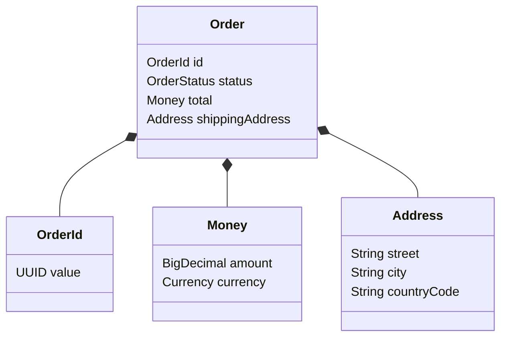
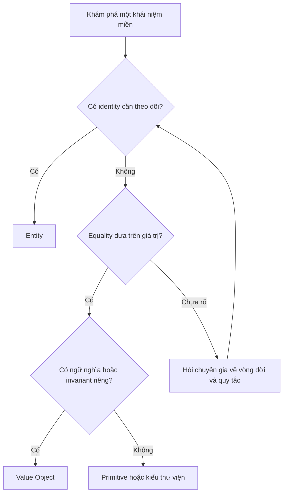

# Phân biệt Value Object với Entity và kiểu dữ liệu nguyên thủy

Trong Domain-Driven Design (DDD), mô hình miền cần diễn đạt được cả những đối tượng có danh tính riêng lẫn những khái niệm chỉ được xác định bằng giá trị. Một đơn hàng vẫn là cùng một đơn hàng dù địa chỉ giao hoặc trạng thái thay đổi; một khoản tiền 250.000 đồng lại được xem là tương đương với khoản tiền khác có cùng số tiền và đơn vị tiền tệ. Hai cách nhìn này dẫn đến hai building block quan trọng: **Entity** và **Value Object**.

Khi viết chương trình, đội phát triển cũng thường dùng các kiểu nguyên thủy như `String`, `int`, `long` và `BigDecimal` để biểu diễn dữ liệu nghiệp vụ. Những kiểu này tiện dụng nhưng không tự nói rõ ý nghĩa, giới hạn hay quy tắc của dữ liệu. DDD khuyến khích tạo Value Object khi một khái niệm có ngữ nghĩa và invariant riêng, nhờ đó mô hình trở nên rõ ràng và khó sử dụng sai hơn.

Bài học này giúp phân biệt ba cách biểu diễn, hiểu cách Value Object được so sánh và thay đổi, đồng thời biết khi nào nên tạo Value Object trong một bounded context.

## 1. Ba cách biểu diễn một khái niệm

Hãy xét một hệ thống thương mại điện tử. Hệ thống có đơn hàng, khách hàng, địa chỉ giao hàng, số tiền và số lượng sản phẩm.

- Một **Entity** như `Order` có danh tính ổn định. Hai đơn hàng có cùng khách hàng và cùng tổng tiền vẫn là hai đơn hàng khác nhau nếu chúng có `OrderId` khác nhau.
- Một **Value Object** như `Money` được xác định bởi giá trị. Hai khoản tiền cùng số tiền và cùng loại tiền được xem là bằng nhau theo quy tắc của mô hình.
- Một **kiểu dữ liệu nguyên thủy** như `String` hoặc `BigDecimal` chỉ cung cấp cách lưu và thao tác dữ liệu ở mức kỹ thuật. Nó chưa diễn đạt đầy đủ khái niệm nghiệp vụ như mã đơn, địa chỉ email, tiền tệ hoặc số lượng đặt hàng.

| Tiêu chí | Entity | Value Object | Kiểu nguyên thủy |
|---|---|---|---|
| Cách xác định | Danh tính ổn định | Tập hợp giá trị | Kiểu dữ liệu kỹ thuật |
| So sánh | Theo identity | Theo giá trị và quy tắc tương đương | Theo quy tắc của kiểu nền |
| Thay đổi | Có thể thay đổi trạng thái mà vẫn là cùng entity | Thường bất biến; thay đổi bằng cách tạo giá trị mới | Tùy kiểu, không chứa quy tắc miền riêng |
| Vòng đời | Có vòng đời riêng trong miền | Thường phụ thuộc entity hoặc aggregate sở hữu | Không tự biểu diễn vòng đời nghiệp vụ |
| Hành vi | Bảo vệ quy tắc gắn với danh tính | Diễn đạt phép toán và invariant của giá trị | Cung cấp thao tác chung của kiểu |
| Ví dụ | `Order`, `Customer`, `Payment` | `Money`, `Address`, `Quantity`, `DateRange` | `String`, `int`, `long`, `BigDecimal` |

Điểm khác biệt quan trọng nhất là cách xác định sự đồng nhất. Entity trả lời câu hỏi “đây có phải cùng một đối tượng xuyên suốt thời gian không?”, còn Value Object trả lời “các giá trị này có tương đương theo ý nghĩa nghiệp vụ không?”.

## 2. Entity: đối tượng được nhận diện bằng danh tính

Entity là đối tượng có identity riêng, được phân biệt với những đối tượng khác ngay cả khi các thuộc tính của chúng giống nhau. Danh tính thường tồn tại ổn định qua các thay đổi trạng thái và thuộc tính.

Ví dụ, hai đơn hàng có cùng khách hàng, cùng các dòng sản phẩm và cùng tổng tiền vẫn là hai đơn hàng khác nhau. Chúng có thể được tạo ở hai thời điểm khác nhau và có lịch sử xử lý riêng.

```java
import java.util.UUID;

record OrderId(UUID value) {}

enum OrderStatus {
    PLACED,
    CONFIRMED,
    CANCELLED
}

final class Order {
    private final OrderId id;
    private OrderStatus status;

    Order(OrderId id) {
        this.id = id;
        this.status = OrderStatus.PLACED;
    }

    void confirm() {
        if (status != OrderStatus.PLACED) {
            throw new IllegalStateException("Đơn không ở trạng thái có thể xác nhận");
        }
        status = OrderStatus.CONFIRMED;
    }

    OrderId id() {
        return id;
    }

    OrderStatus status() {
        return status;
    }

    @Override
    public boolean equals(Object other) {
        return other instanceof Order order && id.equals(order.id);
    }

    @Override
    public int hashCode() {
        return id.hashCode();
    }
}
```

Trong ví dụ, `Order` giữ identity qua `OrderId`. Khi trạng thái đổi từ `PLACED` sang `CONFIRMED`, đơn hàng vẫn là cùng một Entity. Hai instance `Order` có cùng ID được xem là cùng một Entity theo quy tắc equality được chọn trong ví dụ.

### 2.1. Identity không phải là toàn bộ thuộc tính

Không nên so sánh Entity bằng tất cả thuộc tính có thể thay đổi. Nếu equality của `Order` phụ thuộc vào `status`, việc xác nhận đơn sẽ làm thay đổi kết quả so sánh và có thể gây lỗi khi Entity đang nằm trong `HashSet` hoặc được dùng làm khóa của `HashMap`.

Danh tính thường được biểu diễn bằng một ID có ý nghĩa trong miền. ID có thể là UUID, số tăng dần, mã nghiệp vụ hoặc một kiểu định danh khác. Công nghệ tạo ID là quyết định kỹ thuật; ý nghĩa và phạm vi duy nhất của ID cần theo mô hình nghiệp vụ.

### 2.2. Entity có thể thay đổi nhưng phải bảo vệ invariant

Entity thường có trạng thái thay đổi theo hành vi nghiệp vụ. Các thay đổi nên đi qua phương thức có tên theo ngôn ngữ chung và kiểm tra điều kiện hợp lệ. Ví dụ, `Order.confirm()` kiểm tra trạng thái hiện tại trước khi chuyển trạng thái.

Một đối tượng chỉ có getter và setter công khai không tự trở thành mô hình Entity tốt. Nếu quy tắc nằm rải rác ở nhiều service, đối tượng có identity nhưng chưa bảo vệ được hành vi miền của nó.

## 3. Value Object: đối tượng được xác định bằng giá trị

Value Object là đối tượng miền không có identity riêng. Hai Value Object được xem là bằng nhau nếu các thành phần giá trị của chúng tương đương theo quy tắc nghiệp vụ.

Ví dụ, `Money(250000, VND)` tương đương với một Value Object khác có cùng số tiền và loại tiền. Không cần hỏi khoản tiền thứ nhất được tạo lúc nào hoặc nằm ở vị trí bộ nhớ nào. Điều quan trọng là giá trị và ý nghĩa của nó.

Value Object thường có các đặc điểm:

- Không có danh tính riêng cần theo dõi qua thời gian.
- Equality dựa trên các giá trị cấu thành và quy tắc tương đương.
- Thường bất biến sau khi được tạo.
- Tự bảo vệ invariant của chính nó.
- Có thể chứa dữ liệu và hành vi có ý nghĩa, không chỉ là một túi thuộc tính.
- Thường được sở hữu bởi Entity hoặc Aggregate và không có repository riêng.

Ví dụ, `Money` không chỉ gồm một số `amount`; nó còn có `currency`, phép cộng và quy tắc không cộng hai loại tiền khác nhau nếu chưa có chuyển đổi tỷ giá.

```java
import java.math.BigDecimal;
import java.util.Currency;
import java.util.Objects;

record Money(BigDecimal amount, Currency currency) {
    Money {
        Objects.requireNonNull(amount, "amount không được null");
        Objects.requireNonNull(currency, "currency không được null");

        // Chuẩn hóa để 100.0 và 100.00 có cùng biểu diễn giá trị.
        amount = amount.stripTrailingZeros();
    }

    Money add(Money other) {
        requireSameCurrency(other);
        return new Money(amount.add(other.amount), currency);
    }

    private void requireSameCurrency(Money other) {
        if (!currency.equals(other.currency)) {
            throw new IllegalArgumentException("Không thể cộng hai loại tiền khác nhau");
        }
    }
}
```

Java `record` tự sinh `equals()` và `hashCode()` dựa trên các component. Việc chuẩn hóa `BigDecimal` trong constructor giúp ví dụ này coi `100.0` và `100.00` là cùng giá trị trước khi equality được áp dụng. Trong hệ thống thực tế, quy tắc làm tròn, số chữ số thập phân, tiền tệ được hỗ trợ và cách xử lý số âm phải theo nghiệp vụ tài chính; `stripTrailingZeros()` không thay thế chính sách làm tròn.

### 3.1. Value Object có thể chứa hành vi

Value Object không chỉ là cấu trúc dữ liệu bất biến. Nó có thể cung cấp các phép toán có ý nghĩa và bảo vệ quy tắc của khái niệm.

Ví dụ `OrderQuantity` có thể bảo đảm số lượng đặt hàng luôn lớn hơn 0:

```java
record OrderQuantity(int value) {
    OrderQuantity {
        if (value <= 0) {
            throw new IllegalArgumentException("Số lượng phải lớn hơn 0");
        }
    }

    OrderQuantity add(OrderQuantity other) {
        return new OrderQuantity(Math.addExact(value, other.value));
    }
}
```

Trong một context quản lý tồn kho, số lượng bằng 0 có thể là giá trị hợp lệ. Vì vậy, quy tắc `value > 0` trong ví dụ chỉ phù hợp với `OrderQuantity`; không nên dùng một kiểu `Quantity` chung cho mọi khái niệm nếu các context có quy tắc khác nhau.

### 3.2. Value Object thường bất biến

Khi một Value Object đã được tạo, giá trị của nó không thay đổi. Nếu địa chỉ giao hàng thay đổi, mô hình tạo một `Address` mới rồi thay thế giá trị cũ trên đơn hàng. Cách làm này giúp:

- Không phải lo một nơi khác âm thầm sửa giá trị đang được chia sẻ.
- Dễ so sánh giá trị trước và sau khi thay đổi.
- Dễ kiểm tra invariant ngay tại thời điểm tạo.
- Giảm lỗi do nhiều phần của chương trình cùng giữ tham chiếu tới một đối tượng mutable.

Với Value Object chứa collection, cần sao chép phòng vệ và không để lộ collection có thể thay đổi. `record` chỉ tạo field `final` nông; nếu component là một `List` mutable, bản thân nội dung list vẫn có thể bị sửa nếu không xử lý cẩn thận.

## 4. Kiểu nguyên thủy: dữ liệu có kiểu nhưng thiếu ngữ nghĩa miền

Các kiểu nguyên thủy và kiểu thư viện như `String`, `int`, `long`, `BigDecimal`, `LocalDate` rất cần thiết. Vấn đề xuất hiện khi chúng được dùng trực tiếp để biểu diễn nhiều khái niệm nghiệp vụ khác nhau mà không có tên gọi, invariant hoặc hành vi riêng.

Ví dụ:

```java
void transfer(
    String fromAccountId,
    String toAccountId,
    BigDecimal amount,
    String currency
) {
    // Kiểm tra và thực hiện chuyển tiền.
}
```

Chữ ký trên không nói rõ `fromAccountId` và `toAccountId` có thể bị đảo vị trí hay không; `amount` có được âm hoặc bằng 0 không; `currency` có phải mã tiền tệ hợp lệ không; và số tiền có được phép cộng với một khoản thuộc loại tiền khác không. Người gọi phải nhớ những quy tắc này và có thể truyền nhầm dữ liệu.

Có thể diễn đạt rõ hơn bằng Value Object:

```java
import java.util.UUID;

record AccountId(UUID value) {}

void transfer(AccountId from, AccountId to, Money amount) {
    // Quy tắc chuyển tiền được kiểm tra trong mô hình miền.
}
```

Chữ ký mới thể hiện ý nghĩa của từng tham số. `AccountId` và `Money` cũng có thể kiểm tra dữ liệu khi được tạo, nhờ đó các hàm nhận chúng có ít trạng thái không hợp lệ hơn cần xử lý.

### 4.1. Primitive Obsession

Primitive Obsession là tình trạng mô hình sử dụng quá nhiều kiểu nguyên thủy để biểu diễn các khái niệm miền có ngữ nghĩa riêng. Một số dấu hiệu:

- Nhiều tham số `String` liên tiếp nhưng mỗi tham số mang ý nghĩa khác nhau.
- Mã kiểm tra định dạng, khoảng giá trị hoặc đơn vị đo bị lặp ở nhiều nơi.
- Một số `BigDecimal` có thể là tiền, tỷ lệ, trọng lượng hoặc đơn giá nhưng không phân biệt được bằng kiểu.
- Code phải truyền nhiều cặp giá trị đi cùng nhau như số tiền và tiền tệ.
- Các điều kiện hợp lệ được ghi nhớ bằng quy ước hoặc comment thay vì được bảo vệ trong mô hình.

Value Object giúp gom dữ liệu liên quan, đặt tên cho khái niệm và đưa invariant về một nơi. Tuy nhiên, không phải mọi biến `int` hay `String` đều cần được bọc thành class. Một biến đếm nội bộ không có ý nghĩa miền riêng có thể tiếp tục dùng kiểu nguyên thủy.

## 5. Phân biệt bằng equality và thay đổi

Equality là một cách kiểm tra rất hữu ích để xác định một khái niệm nên là Entity hay Value Object.

### 5.1. Hai Entity có cùng thuộc tính vẫn có thể khác nhau

Giả sử có hai khách hàng cùng tên, cùng ngày sinh và cùng địa chỉ. Họ vẫn có thể là hai người khác nhau. Hệ thống phân biệt họ bằng `CustomerId`, không phải bằng cách so sánh toàn bộ thuộc tính.

Khi một khách hàng đổi địa chỉ hoặc số điện thoại, identity của họ vẫn giữ nguyên. Vì vậy, equality của Entity thường dựa trên identity được mô hình lựa chọn.

### 5.2. Hai Value Object có cùng giá trị được xem là tương đương

Hai địa chỉ có cùng đường, phường, thành phố và quốc gia có thể được xem là tương đương theo quy tắc của mô hình. Nếu một phần giá trị thay đổi, ta có một Value Object khác.

Ví dụ:

```java
record Address(
    String street,
    String ward,
    String city,
    String countryCode
) {
    Address {
        street = requireText(street, "street");
        ward = requireText(ward, "ward");
        city = requireText(city, "city");
        countryCode = requireText(countryCode, "countryCode");
    }

    private static String requireText(String value, String field) {
        if (value == null || value.isBlank()) {
            throw new IllegalArgumentException(field + " không được để trống");
        }
        return value.trim();
    }
}
```

```java
Address a = new Address("12 Nguyễn Huệ", "Bến Nghé", "TP.HCM", "VN");
Address b = new Address("12 Nguyễn Huệ ", "Bến Nghé", "TP.HCM", "VN");

boolean sameValue = a.equals(b); // true sau khi chuẩn hóa khoảng trắng
```

Đây là ví dụ tối giản. Địa chỉ thực tế có thể cần mã bưu chính, quận/huyện, quy tắc chuẩn hóa tên địa danh hoặc cách biểu diễn theo quốc gia. Nếu doanh nghiệp cần theo dõi từng địa chỉ như một đối tượng có lịch sử, trạng thái xác minh và danh tính riêng, cần xem xét mô hình Entity thay vì mặc định Address luôn là Value Object.

### 5.3. Equality của Value Object phải phản ánh ngữ nghĩa

Không phải lúc nào cũng so sánh từng field theo cách máy móc. Ví dụ, `Money` phải xét cả số tiền lẫn tiền tệ; `DateRange` cần xét ngày bắt đầu, ngày kết thúc và quy tắc biên; `Measurement` có thể cần quy đổi về đơn vị chuẩn trước khi so sánh.

Khi thiết kế equality, hãy hỏi:

- Những thành phần nào thực sự quyết định giá trị của khái niệm?
- Có cần chuẩn hóa trước khi so sánh không?
- Hai cách biểu diễn khác nhau có thể mang cùng ý nghĩa không?
- Quy tắc so sánh có phụ thuộc bounded context hoặc chính sách nghiệp vụ không?
- `hashCode()` có nhất quán với `equals()` không?

Nếu `equals()` coi hai giá trị là bằng nhau thì `hashCode()` của chúng cũng phải bằng nhau. Đây là yêu cầu của Java Collections và cần được giữ khi tự triển khai equality.

## 6. Khi nào một khái niệm nên là Value Object?

Hãy cân nhắc tạo Value Object khi một khái niệm có ý nghĩa nghiệp vụ rõ ràng và một hoặc nhiều đặc điểm sau:

- Có nhiều giá trị phải đi cùng nhau để tạo thành một khái niệm hoàn chỉnh.
- Có invariant cần được kiểm tra ở mọi nơi sử dụng.
- Có phép toán hoặc hành vi riêng.
- Việc truyền kiểu nguyên thủy dễ gây nhầm lẫn.
- Equality theo giá trị có ý nghĩa với nghiệp vụ.
- Cần chuẩn hóa hoặc chuyển đổi dữ liệu theo một quy tắc thống nhất.

Ví dụ thường gặp:

| Khái niệm | Dữ liệu nền | Quy tắc hoặc hành vi có thể đóng gói |
|---|---|---|
| `Money` | `BigDecimal`, `Currency` | Cộng cùng tiền tệ, nhân số lượng, làm tròn theo chính sách |
| `EmailAddress` | `String` | Chuẩn hóa và kiểm tra định dạng theo chính sách |
| `Quantity` | `int` hoặc `BigDecimal` | Giới hạn, đơn vị và phép cộng/trừ |
| `DateRange` | `LocalDate`, `LocalDate` | Ngày bắt đầu/kết thúc, giao nhau, bao gồm ngày biên |
| `Address` | Nhiều `String` hoặc mã địa lý | Kiểm tra trường bắt buộc, chuẩn hóa theo quốc gia |
| `Percentage` | `BigDecimal` | Miền giá trị và phép tính tỷ lệ |
| `Distance` | `BigDecimal`, đơn vị | Quy đổi đơn vị và so sánh khoảng cách |
| `OrderId` | `UUID` hoặc chuỗi | Định danh đơn hàng có kiểu riêng |

### 6.1. Không tạo Value Object chỉ để bọc một primitive

Một lớp chỉ chứa một trường `String` nhưng không thêm ngữ nghĩa, kiểm tra, hành vi hoặc an toàn kiểu có thể chỉ làm tăng số lượng code. Tuy nhiên, một wrapper đơn giản vẫn có ích nếu nó tạo ra kiểu riêng giúp không thể truyền nhầm `CustomerId` vào vị trí `OrderId`.

Hãy đánh giá lợi ích cụ thể: kiểu mới có bảo vệ invariant, làm chữ ký phương thức rõ hơn, tránh nhầm lẫn hoặc diễn đạt thuật ngữ nghiệp vụ không? Nếu không, kiểu nguyên thủy có thể đã đủ.

### 6.2. Không biến mọi dữ liệu ghép thành Value Object một cách máy móc

Một DTO nhận dữ liệu từ API có thể gồm nhiều field nhưng không nhất thiết là Value Object. Để trở thành Value Object, nó cần có ý nghĩa trong mô hình miền và equality theo giá trị. Một cấu trúc chỉ phục vụ truyền dữ liệu, serialization hoặc hiển thị có thể là DTO.

Ngược lại, một Value Object có thể được ánh xạ thành nhiều cột cơ sở dữ liệu hoặc thành nhiều field trong API. Hình dạng lưu trữ không quyết định bản chất miền của nó.

## 7. Value Object trong Entity và Aggregate

Value Object thường được dùng bên trong Entity hoặc Aggregate để diễn đạt những phần giá trị của đối tượng lớn hơn.

Ví dụ, `Order` có identity riêng nhưng chứa `Money` cho tổng tiền, `Address` cho địa chỉ giao hàng và `OrderLine` hoặc `Quantity` cho chi tiết đặt hàng. Khi địa chỉ thay đổi, Order thay thế Value Object cũ bằng Value Object mới và vẫn giữ nguyên `OrderId`.



Sơ đồ minh họa rằng `Order` là Entity, còn `OrderId`, `Money` và `Address` được mô hình hóa theo giá trị. `OrderId` là Value Object về mặt kiểu dữ liệu và equality, dù nó được dùng để nhận diện Entity. Điều này không làm cho `Order` trở thành Value Object.

### 7.1. Value Object thường không có Repository riêng

Repository trong DDD thường cung cấp cách truy xuất và lưu Aggregate Root. Value Object không có identity và vòng đời độc lập nên thường được lưu cùng Entity hoặc Aggregate sở hữu nó.

Ví dụ, khi tải `Order`, repository cũng tái tạo `Money` và `Address` của đơn. Không cần một `MoneyRepository` chỉ để tìm một khoản tiền nếu khoản tiền không phải một đối tượng miền có identity và vòng đời độc lập.

### 7.2. Có thể chia sẻ Value Object nếu bất biến

Một Value Object bất biến có thể được nhiều Entity tham chiếu mà không lo một bên sửa dữ liệu làm ảnh hưởng bên khác. Nếu Value Object chứa trạng thái mutable, việc chia sẻ tham chiếu có thể tạo ra tác dụng phụ khó kiểm soát.

Không nên dùng tính bất biến như lý do để bỏ qua quyền sở hữu và ngữ nghĩa. Một địa chỉ được chia sẻ giữa hai đơn hàng có thể là cùng giá trị tại thời điểm tạo, nhưng nếu khách cập nhật hồ sơ địa chỉ sau đó, đơn hàng cũ có cần giữ nguyên địa chỉ đã chốt hay không là quy tắc nghiệp vụ cần xác định.

## 8. Value Object và Entity trong các bounded context khác nhau

Một khái niệm không bắt buộc phải có cùng cách mô hình hóa trong mọi bounded context. Ví dụ, `Address` trong Ordering có thể là snapshot bất biến của địa chỉ giao hàng tại thời điểm đặt đơn. Trong Customer Management, địa chỉ được lưu, xác minh, gắn nhãn “nhà riêng” hoặc “văn phòng” và có lịch sử thay đổi; tại đó nó có thể được mô hình hóa như Entity.

Tương tự, `Product` trong Catalog có thể là Entity với identity và vòng đời niêm yết; một dòng hàng trong Order có thể lưu `Sku`, tên sản phẩm và đơn giá tại thời điểm mua như những giá trị đã chụp. Hai mô hình phục vụ hai mục tiêu khác nhau.

Khi quyết định, hãy xét:

- Context đang giải quyết vấn đề nghiệp vụ nào?
- Khái niệm có cần theo dõi danh tính và lịch sử riêng không?
- Nó có thể thay đổi độc lập với Entity sở hữu nó không?
- Các quy tắc và vòng đời của nó là gì?
- Context khác cần tham chiếu hay cần sở hữu mô hình này?

Không nên ép toàn hệ thống dùng chung một class `Address` hoặc `Product` chỉ vì tên gọi giống nhau.

## 9. Ví dụ Java: thay primitive bằng Value Object có chọn lọc

Giả sử một use case đặt hàng nhận mã sản phẩm, số lượng và đơn giá. Nếu dùng primitive, quy tắc có thể bị phân tán:

```java
import java.math.BigDecimal;

void addLine(String sku, int quantity, BigDecimal unitPrice, String currency) {
    if (sku == null || sku.isBlank()) {
        throw new IllegalArgumentException("Thiếu SKU");
    }
    if (quantity <= 0) {
        throw new IllegalArgumentException("Số lượng không hợp lệ");
    }
    if (unitPrice.signum() < 0) {
        throw new IllegalArgumentException("Đơn giá không hợp lệ");
    }
    // Tiếp tục xử lý...
}
```

Mỗi nơi nhận dữ liệu có thể phải lặp lại những kiểm tra tương tự. Có thể đưa các quy tắc vào Value Object:

```java
import java.math.BigDecimal;
import java.util.Currency;
import java.util.Objects;

record Sku(String value) {
    Sku {
        Objects.requireNonNull(value, "sku");
        value = value.trim();
        if (value.isEmpty()) {
            throw new IllegalArgumentException("SKU không được để trống");
        }
    }
}

record OrderQuantity(int value) {
    OrderQuantity {
        if (value <= 0) {
            throw new IllegalArgumentException("Số lượng đặt phải lớn hơn 0");
        }
    }
}

record UnitPrice(Money value) {
    UnitPrice {
        Objects.requireNonNull(value, "unit price");
        if (value.amount().signum() < 0) {
            throw new IllegalArgumentException("Đơn giá không được âm");
        }
    }
}

record Money(BigDecimal amount, Currency currency) {
    Money {
        Objects.requireNonNull(amount, "amount");
        Objects.requireNonNull(currency, "currency");
        amount = amount.stripTrailingZeros();
    }
}

record OrderLine(Sku sku, OrderQuantity quantity, UnitPrice unitPrice) {
    OrderLine {
        Objects.requireNonNull(sku);
        Objects.requireNonNull(quantity);
        Objects.requireNonNull(unitPrice);
    }
}
```

Sau khi tạo, `OrderLine` chỉ nhận các giá trị đã qua kiểm tra cơ bản. Tên kiểu giúp người đọc phân biệt SKU, số lượng đặt và đơn giá. Ví dụ tách `UnitPrice` khỏi `Money` vì đơn giá có quy tắc không âm, trong khi một khoản tiền tổng quát có thể cần hỗ trợ số âm cho bút toán điều chỉnh hoặc hoàn tiền.

Đây là ví dụ minh họa, chưa phải mô hình hoàn chỉnh. Ứng dụng thực tế cần xác định độ chính xác, làm tròn, đơn vị tiền tệ, quy tắc thuế và cách tính tổng theo chính sách của bounded context Ordering.

## 10. Cách triển khai Value Object trong Java

Java `record` là lựa chọn thuận tiện cho nhiều Value Object vì cung cấp component `final`, constructor, `equals()`, `hashCode()` và `toString()` dựa trên giá trị. Tuy nhiên, record không tự bảo đảm mọi invariant và cũng không bảo đảm bất biến sâu nếu component chứa đối tượng mutable.

Một số nguyên tắc thực hành:

- Dùng constructor chuẩn hoặc factory method để kiểm tra và chuẩn hóa dữ liệu.
- Đặt tên kiểu theo ngôn ngữ nghiệp vụ, ví dụ `OrderQuantity` thay vì `IntValue`.
- Chỉ cung cấp phép toán có ý nghĩa trong miền.
- Không cung cấp setter làm thay đổi giá trị sau khi tạo.
- Với collection, dùng bản sao bất biến như `List.copyOf()` khi cần.
- Chọn equality theo các thành phần quyết định giá trị nghiệp vụ.
- Tránh để Value Object phụ thuộc vào repository, HTTP client hoặc cơ sở dữ liệu.
- Không dùng `double` hoặc `float` để biểu diễn tiền nếu cần tính toán chính xác thập phân; thường dùng `BigDecimal` với chính sách làm tròn rõ ràng.

Ví dụ Value Object có collection:

```java
import java.util.List;
import java.util.Objects;

record Tags(List<String> values) {
    Tags {
        Objects.requireNonNull(values);
        if (values.stream().anyMatch(tag -> tag == null || tag.isBlank())) {
            throw new IllegalArgumentException("Tag không được rỗng");
        }
        values = List.copyOf(values);
    }
}
```

`List.copyOf()` tạo bản sao không thể sửa qua tham chiếu trả về. Nếu thứ tự hoặc phần tử trùng lặp không có ý nghĩa nghiệp vụ, có thể cần chuẩn hóa thêm; nếu chúng có ý nghĩa, không nên tự ý loại bỏ.

## 11. Value Object không đồng nghĩa với DTO hoặc kiểu lưu trữ

Một số khái niệm thường bị nhầm với Value Object:

| Khái niệm | Mục đích | Có nhất thiết là Value Object? |
|---|---|---|
| DTO | Truyền dữ liệu giữa các lớp hoặc qua biên API | Không |
| Database row/entity | Ánh xạ cấu trúc lưu trữ | Không |
| Java record | Cú pháp khai báo lớp dữ liệu | Không, tùy ngữ nghĩa miền |
| Enum | Tập hợp giá trị hằng hữu hạn | Không phải mọi enum đều là Value Object; có thể biểu diễn một phần của Value Object |
| Value Object | Biểu diễn khái niệm miền theo giá trị và invariant | Có |

Một DTO có thể mutable để phục vụ binding hoặc serialization; một Value Object thường bất biến và chứa quy tắc miền. Một JPA `@Embeddable` có thể là cách lưu Value Object, nhưng annotation không biến dữ liệu thành Value Object. Ngược lại, Value Object có thể được lưu thành một bảng riêng vì lý do kỹ thuật mà vẫn không có identity trong mô hình miền.

## 12. Những sai lầm thường gặp

- **So sánh Entity bằng toàn bộ thuộc tính:** khi một thuộc tính thay đổi, đối tượng có thể bị xem là một Entity khác dù identity vẫn giữ nguyên.
- **Gắn ID cho mọi Value Object:** nếu không có nhu cầu nhận diện và theo dõi vòng đời độc lập, ID có thể tạo ra khái niệm Entity không cần thiết.
- **Dùng primitive cho mọi khái niệm:** quy tắc bị lặp, tham số dễ truyền nhầm và chữ ký phương thức thiếu ngữ nghĩa.
- **Bọc mọi primitive thành class:** quá nhiều wrapper không có invariant hoặc hành vi làm mô hình nặng nề mà không tăng giá trị.
- **Value Object mutable:** một nơi sửa giá trị có thể ảnh hưởng đến mọi nơi đang chia sẻ tham chiếu.
- **Value Object chỉ là túi dữ liệu:** bỏ lỡ cơ hội đặt phép toán và invariant gần với dữ liệu mà chúng bảo vệ.
- **Nhầm Value Object với DTO:** cấu trúc truyền dữ liệu bị đưa thẳng vào domain model dù không mang ý nghĩa nghiệp vụ.
- **Dùng `double` cho tiền:** sai số dấu phẩy động có thể gây kết quả không mong muốn trong phép tính tài chính.
- **Không xác định equality:** hai cách biểu diễn cùng giá trị có thể bị coi là khác nhau hoặc hai khái niệm khác nhau bị coi là bằng nhau.
- **Dùng chung Value Object giữa các context mà không kiểm tra ngữ nghĩa:** cùng tên `Address` hoặc `Money` chưa chắc có cùng quy tắc trong mọi bounded context.
- **Tạo repository cho Value Object:** biến một giá trị phụ thuộc thành đối tượng có vòng đời và identity không cần thiết.

## 13. Quy trình quyết định Entity, Value Object hay primitive

Khi mô hình hóa một khái niệm, có thể lần lượt đặt các câu hỏi:

1. Khái niệm này có cần được nhận diện và theo dõi xuyên suốt các thay đổi không? Nếu có, hãy xem xét Entity.
2. Hai thể hiện có cùng giá trị có được xem là tương đương theo nghiệp vụ không? Nếu có, hãy xem xét Value Object.
3. Khái niệm có invariant, chuẩn hóa hoặc phép toán riêng không? Nếu có, Value Object có thể giúp đóng gói chúng.
4. Nếu dùng primitive, người gọi có thể truyền nhầm hoặc tạo dữ liệu không hợp lệ không?
5. Khái niệm có vòng đời độc lập hoặc cần repository riêng không? Nếu có, hãy kiểm tra khả năng nó là Entity.
6. Nếu không có ý nghĩa miền riêng và không có quy tắc cần bảo vệ, primitive hoặc kiểu thư viện có thể đã đủ.



Sơ đồ chỉ là gợi ý suy nghĩ, không phải bộ phân loại tự động. Một định danh như `OrderId` có equality theo giá trị nhưng được dùng để nhận diện Entity; nó vẫn có thể là Value Object. Điều quan trọng là phân biệt kiểu định danh với đối tượng được định danh.

## 14. Checklist thiết kế Value Object

Trước khi đưa Value Object vào mô hình, hãy kiểm tra:

- [ ] Tên gọi phản ánh một khái niệm nghiệp vụ cụ thể.
- [ ] Đã xác định rõ các thành phần tạo nên giá trị.
- [ ] Equality phản ánh đúng ý nghĩa tương đương trong bounded context.
- [ ] Invariant được kiểm tra khi tạo hoặc qua factory method.
- [ ] Giá trị bất biến sau khi tạo, hoặc có lý do rõ ràng nếu không thể bất biến.
- [ ] Các phép toán được cung cấp có ý nghĩa nghiệp vụ.
- [ ] Đã xác định cách chuẩn hóa, làm tròn và xử lý giá trị biên nếu có.
- [ ] Không gắn identity hoặc repository nếu khái niệm không có vòng đời độc lập.
- [ ] Nếu chứa collection hoặc object khác, đã bảo đảm bất biến sâu phù hợp.
- [ ] Không nhầm Value Object miền với DTO hoặc cấu trúc persistence.
- [ ] Quy tắc đã được kiểm tra bằng ví dụ và test phù hợp.

## 15. Câu hỏi tự kiểm tra

1. Entity và Value Object khác nhau căn bản ở cách xác định sự đồng nhất như thế nào?
2. Vì sao hai đơn hàng có cùng thuộc tính vẫn có thể là hai Entity khác nhau?
3. Vì sao hai Value Object `Money` có cùng số tiền nhưng khác tiền tệ không được xem là tương đương?
4. Primitive Obsession gây ra những vấn đề gì trong mô hình miền?
5. Khi nào nên tạo Value Object thay vì tiếp tục dùng `String`, `int` hoặc `BigDecimal`?
6. Vì sao Value Object thường được thiết kế bất biến?
7. Một Java `record` có tự động trở thành Value Object không? Vì sao?
8. Vì sao `OrderId` có thể là Value Object trong khi `Order` là Entity?
9. Một `Address` có thể là Value Object trong Ordering nhưng là Entity trong Customer Management không? Hãy giải thích.
10. Khi nào Value Object cần repository riêng? Điều đó có gợi ý rằng mô hình đã chọn sai building block không?

## Kết luận

Entity được nhận diện bằng identity và có thể thay đổi trạng thái mà vẫn là cùng một đối tượng. Value Object được xác định bằng giá trị, thường bất biến và tự bảo vệ các quy tắc của khái niệm. Kiểu nguyên thủy cung cấp nền tảng lưu trữ và thao tác dữ liệu, nhưng không tự diễn đạt ngữ nghĩa hoặc invariant của miền.

Hãy dùng Entity cho những đối tượng cần theo dõi danh tính và vòng đời; dùng Value Object cho những khái niệm được xác định bằng giá trị và có ý nghĩa nghiệp vụ; giữ primitive cho dữ liệu đơn giản chưa cần mô hình hóa thêm. Lựa chọn đúng giúp chữ ký phương thức rõ ràng, giảm trạng thái không hợp lệ và làm cho domain model diễn đạt nghiệp vụ chính xác hơn.
