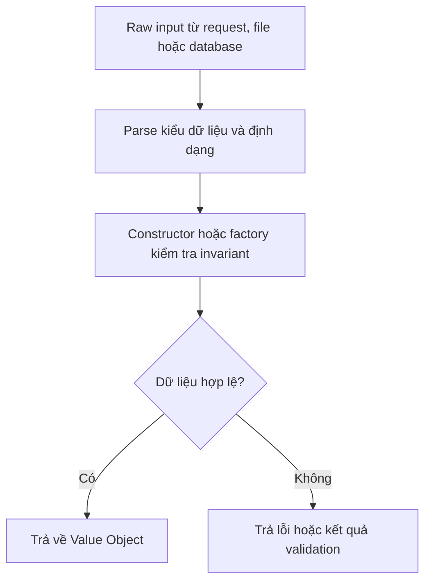

# Bất biến, tính hợp lệ và cách tạo một đối tượng giá trị

Trong Domain-Driven Design (DDD), **Value Object (đối tượng giá trị)** biểu diễn một khái niệm được xác định bởi giá trị của các thuộc tính, không phải bởi một định danh riêng. Ví dụ, số tiền, khoảng ngày, địa chỉ hoặc số lượng thường phù hợp để mô hình hóa thành value object.

Một value object hữu ích cần bảo đảm rằng mọi instance được tạo ra đều có trạng thái hợp lệ theo định nghĩa của miền. Nếu `Money` có thể chứa loại tiền tệ null, `DateRange` có ngày kết thúc trước ngày bắt đầu hoặc `Quantity` có giá trị âm dù nghiệp vụ cấm điều đó, các lớp sử dụng sẽ phải tự kiểm tra lặp đi lặp lại. Dần dần, quy tắc bị phân tán và một đối tượng không hợp lệ có thể đi sâu vào hệ thống.

Vì vậy, value object thường được thiết kế bất biến và tự bảo vệ các bất biến nội tại ngay khi được tạo. Constructor hoặc factory kiểm tra dữ liệu, chuẩn hóa cách biểu diễn khi cần và chỉ trả về instance hợp lệ. Các hành vi sau đó tạo ra value object mới thay vì sửa trạng thái cũ.

## Sau bài học này

Bạn có thể:

- Giải thích bất biến (invariant) và phân biệt nó với kiểm tra đầu vào hoặc chính sách của use case.
- Thiết kế value object có trạng thái hợp lệ ngay từ lúc khởi tạo.
- Sử dụng constructor, static factory và named factory phù hợp.
- Áp dụng tính bất biến, equality theo giá trị và chuẩn hóa dữ liệu.
- Chọn cách xử lý lỗi khi tạo value object.
- Tổ chức value object lồng nhau, kiểm tra quy tắc nhiều thuộc tính và tránh primitive obsession.
- Lưu trữ, khôi phục và kiểm thử value object mà không làm mất các bất biến.

## 1. Vì sao value object cần bảo vệ tính hợp lệ?

Giả sử hệ thống bán hàng dùng `BigDecimal` để biểu diễn số tiền và `LocalDate` cho ngày bắt đầu, ngày kết thúc. Mỗi nơi sử dụng phải tự kiểm tra:

```java
if (amount == null || currency == null) {
    throw new IllegalArgumentException();
}

if (endDate == null || startDate == null || !startDate.isBefore(endDate)) {
    throw new IllegalArgumentException();
}
```

Nếu cùng một quy tắc xuất hiện trong controller, service, job nền và listener, các nơi có thể kiểm tra khác nhau. Một đường đi mới có thể quên kiểm tra; một nơi khác có thể chuẩn hóa dữ liệu theo cách không thống nhất.

Value object gom dữ liệu liên quan cùng quy tắc nội tại vào một kiểu có ý nghĩa:

```java
Money price;
DateRange promotionPeriod;
Quantity orderedQuantity;
```

Thay vì truyền những giá trị nguyên thủy rời rạc, mô hình thể hiện rõ khái niệm và các điều kiện mà khái niệm đó phải thỏa mãn. Khi đã có một instance `DateRange`, caller có thể dựa vào hợp đồng rằng ngày bắt đầu và kết thúc đã được kiểm tra.

### Primitive obsession

*Primitive obsession* là xu hướng dùng quá nhiều kiểu dữ liệu nguyên thủy như `String`, `int`, `long` hoặc `BigDecimal` cho các khái niệm có quy tắc riêng. Ví dụ, `String` có thể được dùng cho mã bưu chính, mã đơn, email và mã tiền tệ dù chúng có ý nghĩa và điều kiện khác nhau.

Không phải mọi primitive đều cần được bọc thành class. Hãy tạo value object khi khái niệm có ý nghĩa miền, quy tắc, phép toán hoặc cách so sánh riêng đủ quan trọng để được thể hiện rõ. Một biến đếm nội bộ đơn giản có thể vẫn là `int`.

## 2. Bất biến của value object là gì?

**Invariant (bất biến)** là điều kiện phải luôn đúng đối với mọi instance hợp lệ trong suốt vòng đời của đối tượng. Với value object bất biến, điều kiện được kiểm tra khi tạo instance và không bị phá vỡ bởi các thao tác sửa đổi sau đó.

Ví dụ:

| Value object | Bất biến có thể áp dụng |
| --- | --- |
| `DateRange` | Ngày bắt đầu phải trước ngày kết thúc nếu khoảng thời gian dùng quy ước `[start, end)`. |
| `Money` | Số tiền và loại tiền tệ không được null; độ chính xác phải phù hợp với quy tắc tiền tệ của miền. |
| `Quantity` | Giá trị không âm; đơn vị đo phải được xác định. |
| `Percentage` | Giá trị nằm trong khoảng cho phép, chẳng hạn từ 0 đến 100 phần trăm. |
| `EmailAddress` | Địa chỉ phải đáp ứng chính sách định dạng và chuẩn hóa mà hệ thống đã chọn. |

Bất biến phải xuất phát từ ý nghĩa nghiệp vụ, không phải từ một giả định kỹ thuật tùy tiện. Ví dụ, không nên mặc định mọi `Money` đều phải không âm nếu miền kế toán có bút toán điều chỉnh âm. Điều kiện “đơn hàng không được có giá trị âm” có thể thuộc `Order` hoặc một value object chuyên biệt như `NonNegativeAmount`, tùy ngôn ngữ của miền.

### Bất biến nội tại và quy tắc bên ngoài

Không phải mọi điều kiện liên quan đến value object đều nên đặt trong chính value object.

- **Bất biến nội tại:** chỉ cần các giá trị cấu thành đối tượng để quyết định. Ví dụ `DateRange` yêu cầu ngày bắt đầu trước ngày kết thúc.
- **Quy tắc của aggregate:** phụ thuộc trạng thái và quan hệ với đối tượng khác. Ví dụ đơn đã xác nhận không được thay đổi địa chỉ giao.
- **Chính sách use case:** phụ thuộc actor, thời điểm, quyền hoặc cấu hình quy trình. Ví dụ khách hàng hạng Gold được hưởng ưu đãi trong chiến dịch hiện tại.
- **Kiểm tra ở biên hệ thống:** phụ thuộc giao thức hoặc dữ liệu bên ngoài. Ví dụ JSON có trường ngày đúng định dạng hay không.

Value object nên bảo vệ những điều kiện làm cho chính giá trị đó có ý nghĩa. Không nên đưa mọi chính sách của hệ thống vào constructor, đặc biệt nếu quy tắc phụ thuộc vào database, người dùng hiện tại hoặc dịch vụ bên ngoài.

## 3. Tạo value object hợp lệ ngay từ đầu

Nguyên tắc quan trọng là không để một instance nửa hợp lệ tồn tại rồi hy vọng caller sẽ gọi `validate()` trước khi sử dụng. Việc tạo đối tượng nên là một ranh giới kiểm tra rõ ràng.

Một luồng thường gặp:



Ví dụ, request gửi chuỗi ngày `2026-12-01`. Presentation adapter có thể parse chuỗi thành `LocalDate`. Sau đó, factory của `DateRange` kiểm tra quan hệ giữa hai ngày. Việc parse chuỗi thuộc biên giao tiếp; việc hai ngày có tạo thành khoảng hợp lệ hay không thuộc value object.

### Constructor có kiểm tra

Với value object nhỏ, constructor là cách trực tiếp và dễ hiểu. Trong Java record, compact constructor cho phép kiểm tra và chuẩn hóa tham số trước khi các field được gán:

```java
public record DateRange(
    LocalDate startInclusive,
    LocalDate endExclusive
) {
    public DateRange {
        Objects.requireNonNull(startInclusive, "startInclusive");
        Objects.requireNonNull(endExclusive, "endExclusive");

        if (!startInclusive.isBefore(endExclusive)) {
            throw new IllegalArgumentException(
                "The start date must be before the end date"
            );
        }
    }

    public boolean contains(LocalDate date) {
        Objects.requireNonNull(date, "date");
        return !date.isBefore(startInclusive)
            && date.isBefore(endExclusive);
    }
}
```

Ở đây khoảng thời gian dùng quy ước `[startInclusive, endExclusive)`: bao gồm ngày bắt đầu và không bao gồm ngày kết thúc. Quy ước này giúp ghép các khoảng liền nhau mà không bị chồng lấn ngày cuối. Nếu nghiệp vụ dùng khoảng đóng hai đầu hoặc quy ước khác, cần thể hiện rõ trong tên và hành vi.

Khi tạo `new DateRange(...)`, instance không thể tồn tại với ngày null hoặc khoảng rỗng/đảo ngược. Phương thức `contains` cũng thể hiện trực tiếp ý nghĩa của khoảng thời gian.

### Static factory và named factory

Khi constructor không đủ diễn đạt cách tạo hoặc cần nhiều quy tắc khởi tạo, dùng static factory:

```java
public record Percentage(BigDecimal value) {
    public Percentage {
        Objects.requireNonNull(value, "value");
        value = value.stripTrailingZeros();

        if (value.signum() < 0 || value.compareTo(BigDecimal.valueOf(100)) > 0) {
            throw new IllegalArgumentException(
                "Percentage must be between 0 and 100"
            );
        }
    }

    public static Percentage zero() {
        return new Percentage(BigDecimal.ZERO);
    }

    public static Percentage ofPercent(String rawValue) {
        Objects.requireNonNull(rawValue, "rawValue");
        try {
            return new Percentage(new BigDecimal(rawValue));
        } catch (NumberFormatException ex) {
            throw new IllegalArgumentException("Invalid percentage", ex);
        }
    }
}
```

`ofPercent` cho biết giá trị đầu vào có đơn vị phần trăm, tránh nhầm `0.2` là 0,2% hay 20%. `zero()` biểu diễn một giá trị đặc biệt thường dùng. Factory cũng là nơi thích hợp để gom cách tạo phức tạp hoặc trả về kiểu kết quả cụ thể.

`BigDecimal.stripTrailingZeros()` giúp chuẩn hóa `10.0` và `10.00` về cùng một cách biểu diễn trước khi record sinh `equals` và `hashCode`. Với giá trị bằng không, có thể chuẩn hóa riêng về `BigDecimal.ZERO` nếu muốn cách biểu diễn ổn định tuyệt đối.

### Private constructor khi cần kiểm soát cách tạo

Nếu muốn buộc caller sử dụng factory có tên rõ ràng, có thể dùng class thông thường với constructor private:

```java
public final class CustomerCode {
    private final String value;

    private CustomerCode(String value) {
        this.value = value;
    }

    public static CustomerCode of(String rawValue) {
        Objects.requireNonNull(rawValue, "rawValue");
        String normalized = rawValue.trim().toUpperCase(Locale.ROOT);

        if (!normalized.matches("CUS-[0-9]{6}")) {
            throw new IllegalArgumentException("Invalid customer code");
        }

        return new CustomerCode(normalized);
    }

    public String value() {
        return value;
    }

    @Override
    public boolean equals(Object other) {
        return other instanceof CustomerCode code
            && value.equals(code.value);
    }

    @Override
    public int hashCode() {
        return value.hashCode();
    }
}
```

Quy tắc chữ hoa và mẫu mã trong ví dụ chỉ phù hợp nếu nghiệp vụ xác nhận mã không phân biệt hoa thường và có cấu trúc đó. Không được tự chuẩn hóa dữ liệu theo một giả định kỹ thuật nếu điều đó làm thay đổi ý nghĩa hoặc mã đã cấp.

## 4. Chọn giữa constructor, factory và phương thức parse

Không có một cách tạo duy nhất phù hợp với mọi value object. Chọn theo ý nghĩa và cách xử lý lỗi mong muốn.

| Cách tạo | Phù hợp khi | Ví dụ |
| --- | --- | --- |
| Constructor công khai có validation | Kiểu nhỏ, chỉ có một cách tạo tự nhiên, quy tắc ngắn gọn | `new DateRange(start, end)` |
| Static factory | Cần tên diễn đạt rõ, nhiều biến thể hoặc chuẩn hóa | `Money.of(amount, currency)` |
| Named factory | Các cách tạo có ngữ nghĩa khác nhau | `DateRange.ofInclusiveDates(...)`, `Percentage.ofPercent(...)` |
| Parse factory | Đầu vào là chuỗi hoặc định dạng bên ngoài | `CustomerCode.parse(raw)` |
| Factory trả kết quả | Dữ liệu người dùng có thể sai thường xuyên và caller muốn xử lý lỗi theo kiểu dữ liệu | `EmailAddress.tryCreate(raw)` trả `Result` hoặc `Either` |

Không nên tạo một lớp factory riêng cho mọi value object nếu nó chỉ chuyển tiếp `new`. Factory có ích khi nó thể hiện chính sách tạo, chuyển đổi hoặc xử lý lỗi có ý nghĩa.

### Parse và validation là hai việc khác nhau

Parse chuyển dữ liệu thô thành kiểu dữ liệu có cấu trúc. Validation kiểm tra giá trị đó có hợp lệ theo miền hay không.

Ví dụ:

- Chuỗi `2026-02-30` không parse được thành `LocalDate`.
- Hai ngày parse thành công nhưng `start` sau `end` tạo thành `DateRange` không hợp lệ.
- Chuỗi `"-5"` parse được thành số lượng nhưng có thể không hợp lệ trong một `OrderLine`.

Giữ hai bước rõ ràng giúp thông báo lỗi chính xác và tránh đưa chi tiết HTTP/JSON vào domain model.

## 5. Tính bất biến (immutability)

Value object thường nên bất biến: sau khi được tạo, các giá trị cấu thành không thay đổi. Nếu cần một giá trị mới, tạo instance mới.

Ví dụ:

```java
public record Money(BigDecimal amount, Currency currency) {
    public Money {
        Objects.requireNonNull(amount, "amount");
        Objects.requireNonNull(currency, "currency");
    }

    public Money add(Money other) {
        Objects.requireNonNull(other, "other");
        if (!currency.equals(other.currency)) {
            throw new IllegalArgumentException(
                "Cannot add different currencies"
            );
        }
        return new Money(amount.add(other.amount), currency);
    }
}
```

`add` trả về một `Money` mới; cả hai giá trị đầu vào giữ nguyên. Trong ví dụ sản xuất, constructor còn cần áp dụng chính sách độ chính xác và làm tròn phù hợp với loại tiền tệ và miền nghiệp vụ.

### Vì sao bất biến hữu ích?

- Không cần lo một nơi khác âm thầm sửa giá trị sau khi đã kiểm tra.
- Có thể chia sẻ instance giữa nhiều đối tượng mà ít rủi ro tác dụng phụ.
- Equality và hash code ổn định trong suốt vòng đời.
- Dễ dùng trong collection, cache và xử lý đồng thời.
- Mỗi phương thức biến đổi có thể thể hiện rõ giá trị mới được tạo ra.

### Record không tự bảo đảm bất biến sâu

Java record có field `final`, nhưng nếu field chứa một collection mutable thì nội dung collection vẫn có thể bị thay đổi. Cần sao chép phòng vệ:

```java
public record ProductTags(List<String> values) {
    public ProductTags {
        Objects.requireNonNull(values, "values");
        values = List.copyOf(values);
    }
}
```

`List.copyOf` tạo một danh sách không thể sửa thông qua tham chiếu trả về. Nếu phần tử bên trong cũng mutable, vẫn cần bảo vệ chúng hoặc chọn kiểu phần tử bất biến. Tương tự, không nên trả ra mảng nội bộ hoặc object mutable mà caller có thể sửa.

## 6. Equality theo giá trị

Hai value object được xem là bằng nhau khi các thuộc tính có ý nghĩa của chúng bằng nhau theo quy tắc của miền. Chúng không cần một ID riêng để phân biệt.

Ví dụ, hai `DateRange` có cùng ngày bắt đầu và ngày kết thúc biểu diễn cùng một khoảng thời gian. Hai `Money` có cùng số tiền và loại tiền tệ biểu diễn cùng một giá trị tiền.

Với Java record, `equals` và `hashCode` được sinh dựa trên các component. Với class thông thường, cần triển khai hai phương thức nhất quán theo đúng các thuộc tính định nghĩa giá trị.

### Cẩn trọng với BigDecimal

`BigDecimal.equals` phân biệt scale: `new BigDecimal("10.0")` không bằng `new BigDecimal("10.00")` theo `equals`, dù `compareTo` cho kết quả bằng nhau. Vì vậy, value object chứa `BigDecimal` cần có quy tắc chuẩn hóa hoặc equality phù hợp.

Một số lựa chọn:

- Chuẩn hóa scale trong constructor theo đơn vị nghiệp vụ.
- Dùng `stripTrailingZeros()` nếu scale không mang ý nghĩa.
- Triển khai equality dựa trên `compareTo` nếu miền xem các scale khác nhau là cùng giá trị, đồng thời triển khai `hashCode` tương thích.

Với `Money`, scale có thể phụ thuộc loại tiền tệ. Nếu nghiệp vụ yêu cầu hai giá trị `10.0 USD` và `10.00 USD` bằng nhau, nên chuẩn hóa về số chữ số thập phân đã chọn trước khi equality được dùng.

### Không dùng identity cho value object

Không nên thêm UUID chỉ để phân biệt hai `Money` hoặc hai `DateRange` giống nhau. Nếu một khái niệm cần được theo dõi riêng qua thời gian, có vòng đời và cần phân biệt hai instance có cùng thuộc tính, có thể đó là entity thay vì value object.

## 7. Chuẩn hóa dữ liệu và canonical representation

Chuẩn hóa (normalization) biến những cách biểu diễn được xem là tương đương thành một dạng thống nhất. Nó giúp equality, tìm kiếm, lưu trữ và so sánh ổn định hơn.

Ví dụ có thể chuẩn hóa:

- Xóa khoảng trắng đầu/cuối của mã nếu khoảng trắng đó không có ý nghĩa.
- Chuyển mã không phân biệt hoa thường về một dạng chuẩn.
- Quy định scale của số tiền theo tiền tệ.
- Chuẩn hóa đơn vị đo về đơn vị cơ sở nếu miền định nghĩa phép quy đổi.
- Chuẩn hóa thời điểm về một quy ước múi giờ nếu nghiệp vụ coi chúng là cùng một instant.

Không nên chuẩn hóa một cách mù quáng. Tên người, địa chỉ, mã đối tác hoặc email có thể có quy tắc riêng. Chuyển chữ thường, xóa dấu, bỏ số 0 đầu hoặc đổi múi giờ có thể làm mất thông tin. Nếu cần giữ cả giá trị gốc để hiển thị hoặc kiểm toán, hãy mô hình hóa riêng giá trị nhập và giá trị chuẩn hóa.

### Giá trị và đơn vị phải đi cùng nhau

`100` không cho biết đó là 100 đồng, 100 đô la, 100 kilogram hay 100 sản phẩm. Một value object nên giữ đơn vị hoặc loại tiền tệ khi chúng ảnh hưởng đến ý nghĩa.

Ví dụ, không thể cộng `5 kg` với `3 pieces` chỉ vì cả hai đều chứa một số. Cũng không thể cộng `10 USD` với `10 EUR` nếu chưa có quy tắc quy đổi. Việc giữ đơn vị trong kiểu dữ liệu giúp ngăn lỗi ngay tại API của mô hình.

## 8. Ví dụ đầy đủ: Money và Quantity

### Money

`Money` cần giữ cả số tiền và tiền tệ. Constructor dưới đây kiểm tra null và chuẩn hóa số chữ số thập phân theo tiền tệ ISO mà Java hỗ trợ:

```java
public record Money(BigDecimal amount, Currency currency) {
    public Money {
        Objects.requireNonNull(amount, "amount");
        Objects.requireNonNull(currency, "currency");

        int fractionDigits = currency.getDefaultFractionDigits();
        if (fractionDigits < 0) {
            throw new IllegalArgumentException(
                "Currency has no standard fraction digit definition"
            );
        }

        try {
            amount = amount.setScale(fractionDigits, RoundingMode.UNNECESSARY);
        } catch (ArithmeticException ex) {
            throw new IllegalArgumentException(
                "Amount has more fractional digits than the currency allows",
                ex
            );
        }
    }

    public Money add(Money other) {
        Objects.requireNonNull(other, "other");
        if (!currency.equals(other.currency)) {
            throw new IllegalArgumentException(
                "Currencies must match when adding money"
            );
        }
        return new Money(amount.add(other.amount), currency);
    }
}
```

`RoundingMode.UNNECESSARY` yêu cầu không cần làm tròn để đưa số tiền về scale chuẩn; nếu phải loại bỏ chữ số khác không, việc tạo thất bại. Đây là lựa chọn nghiêm ngặt để minh họa. Một miền có thể cần factory nhận rõ `RoundingMode` hoặc một chính sách làm tròn do nghiệp vụ quy định. Không nên âm thầm làm tròn trong constructor nếu người gọi không biết.

`Currency.getDefaultFractionDigits()` là quy tắc mặc định của mã tiền tệ trong thư viện Java, không thay thế hoàn toàn chính sách tiền tệ của mọi sản phẩm tài chính. Một số loại tài sản, đơn vị kế toán hoặc quy trình có precision riêng; khi đó cần mô hình hóa quy tắc cụ thể.

### Quantity

`Quantity` giữ số lượng cùng đơn vị đo. Ví dụ đơn giản dưới đây cho phép giá trị không âm và chỉ cộng hai quantity cùng đơn vị:

```java
public record Quantity(BigDecimal amount, Unit unit) {
    public Quantity {
        Objects.requireNonNull(amount, "amount");
        Objects.requireNonNull(unit, "unit");

        if (amount.signum() < 0) {
            throw new IllegalArgumentException("Quantity cannot be negative");
        }
        amount = amount.stripTrailingZeros();
    }

    public Quantity add(Quantity other) {
        Objects.requireNonNull(other, "other");
        if (unit != other.unit) {
            throw new IllegalArgumentException("Units must match");
        }
        return new Quantity(amount.add(other.amount), unit);
    }
}

public enum Unit {
    PIECE,
    KILOGRAM
}
```

`Quantity` cho phép 0 vì giá trị này có thể hữu ích trong tồn kho hoặc phép tính. `OrderLine` có thể yêu cầu số lượng lớn hơn 0 vì một dòng hàng đã đặt không thể có số lượng bằng 0. Đây là ví dụ về cách đặt invariant ở đúng mức: quy tắc chung của Quantity ở value object, quy tắc cụ thể của dòng đơn hàng ở entity/aggregate.

## 9. Kết hợp nhiều value object để biểu diễn một khái niệm

Value object có thể chứa các value object khác để tránh dùng primitive rời rạc. Ví dụ, địa chỉ có thể gồm các thành phần đã được mô hình hóa riêng:

```java
public record PostalCode(String value) {
    public PostalCode {
        Objects.requireNonNull(value, "value");
        value = value.trim();
        if (value.isEmpty()) {
            throw new IllegalArgumentException("Postal code is required");
        }
    }
}

public record Address(
    String street,
    String city,
    String countryCode,
    PostalCode postalCode
) {
    public Address {
        Objects.requireNonNull(street, "street");
        Objects.requireNonNull(city, "city");
        Objects.requireNonNull(countryCode, "countryCode");
        Objects.requireNonNull(postalCode, "postalCode");

        street = street.trim();
        city = city.trim();
        countryCode = countryCode.trim().toUpperCase(Locale.ROOT);

        if (street.isEmpty() || city.isEmpty() || countryCode.isEmpty()) {
            throw new IllegalArgumentException("Address fields are required");
        }
    }
}
```

Đây chỉ là ví dụ tối giản. Địa chỉ thực tế có cấu trúc khác nhau theo quốc gia; mã bưu chính có thể không tồn tại hoặc có định dạng riêng. Một mô hình tốt cần phản ánh chính sách của các quốc gia mà hệ thống phục vụ thay vì áp dụng một biểu thức chung.

Nếu một phần dữ liệu có quy tắc và phép so sánh riêng, nó có thể xứng đáng trở thành value object riêng. Nếu chỉ là chuỗi đơn giản không có ý nghĩa độc lập, giữ nó như thuộc tính có thể rõ ràng hơn.

## 10. Tạo value object từ dữ liệu không đáng tin cậy

Dữ liệu có thể đến từ HTTP request, file import, message broker, database cũ hoặc API của đối tác. Các nguồn này không tự động bảo đảm dữ liệu hợp lệ.

Một quy trình an toàn thường gồm:

1. **Parse ở biên:** chuyển chuỗi, số và timestamp sang kiểu dữ liệu phù hợp; xử lý định dạng sai.
2. **Chuẩn hóa có chủ đích:** áp dụng quy tắc về khoảng trắng, chữ hoa/thường, đơn vị hoặc precision đã được xác nhận.
3. **Tạo value object:** constructor/factory kiểm tra invariant nội tại.
4. **Thực hiện hành vi miền:** aggregate hoặc domain service áp dụng các quy tắc phụ thuộc vào trạng thái và quan hệ khác.
5. **Chuyển lỗi phù hợp:** adapter trình bày lỗi cho người dùng hoặc ghi nhận dữ liệu tích hợp không hợp lệ.

### Chọn cách biểu diễn lỗi

Có hai cách thường gặp:

- **Exception:** phù hợp khi constructor/factory không thể tạo instance hợp lệ và caller cần dừng luồng hiện tại. Dùng exception có thông điệp rõ, tránh trả về null.
- **Result/Either/Validation:** phù hợp khi dữ liệu đầu vào có thể sai thường xuyên và ứng dụng muốn gom nhiều lỗi để hiển thị hoặc xử lý. Kiểu kết quả cần biểu diễn rõ thành công hoặc danh sách lỗi.

Ví dụ một factory trả về `Optional` có thể báo tạo thất bại, nhưng thường không đủ thông tin để giải thích nguyên nhân. Nếu cần thông báo cụ thể, dùng kiểu `Result<EmailAddress, ValidationError>` hoặc một cấu trúc tương đương.

Không nên có một value object “không hợp lệ” với cờ `isValid=false` rồi để mọi caller nhớ kiểm tra. Cách đó làm mất lợi ích chính của kiểu dữ liệu: sự tồn tại của instance phải là bằng chứng nó đã qua kiểm tra.

### Kiểm tra ở nhiều lớp nhưng không lặp quy tắc

Presentation có thể kiểm tra trường bắt buộc để phản hồi sớm. Value object vẫn phải kiểm tra invariant của nó vì nó có thể được tạo từ nhiều đường khác nhau. Hai bước có mục đích khác nhau: kiểm tra giao thức giúp phản hồi thân thiện; kiểm tra miền bảo vệ mô hình bất kể nguồn dữ liệu.

## 11. Value object trong Entity và Aggregate

Value object thường là thành phần của entity hoặc aggregate. Entity sở hữu vòng đời; value object mô tả những giá trị mà entity sử dụng.

Ví dụ, `Order` có thể chứa `Money total`, `Address deliveryAddress` và danh sách `OrderLine`. Khi khách đổi địa chỉ giao trước khi đơn được xác nhận, aggregate có thể thay toàn bộ `Address` bằng một value object mới sau khi kiểm tra trạng thái đơn.

```java
public final class Order {
    private Address deliveryAddress;
    private OrderStatus status;

    public void changeDeliveryAddress(Address newAddress) {
        Objects.requireNonNull(newAddress, "newAddress");
        if (status != OrderStatus.DRAFT) {
            throw new IllegalStateException(
                "Delivery address can only change while the order is a draft"
            );
        }
        this.deliveryAddress = newAddress;
    }
}
```

`Address` tự bảo vệ tính hợp lệ nội tại của địa chỉ. `Order` quyết định khi nào địa chỉ được phép thay đổi. Đây là hai lớp quy tắc khác nhau và nên được giữ ở đúng nơi sở hữu.

### Thay value object thay vì sửa từng thuộc tính

Với value object bất biến, thay đổi một phần giá trị thường tạo một instance mới:

```java
Address updatedAddress = new Address(
    "12 Nguyen Hue",
    "Ho Chi Minh City",
    "VN",
    new PostalCode("700000")
);

order.changeDeliveryAddress(updatedAddress);
```

Aggregate quyết định có chấp nhận giá trị mới hay không. Nếu thay đổi được chấp nhận, nó thay tham chiếu đến value object cũ bằng value object mới. Những nơi khác đang giữ giá trị cũ không bị thay đổi ngoài ý muốn.

## 12. Lưu trữ và khôi phục value object

Value object không nhất thiết cần một bảng riêng hoặc một khóa chính. Cách lưu trữ phụ thuộc vào cấu trúc miền và công nghệ persistence:

- Lưu các thuộc tính như cột trong bảng của entity/aggregate.
- Dùng embedded value hoặc owned type nếu ORM hỗ trợ.
- Lưu dưới dạng JSON/document nếu phù hợp với truy vấn và vòng đời dữ liệu.
- Dùng bảng riêng khi cần cấu trúc lưu trữ đó, nhưng không vì thế mà value object tự động trở thành entity miền.

Điều quan trọng là khi đọc dữ liệu trở lại, hệ thống phải khôi phục qua constructor/factory hoặc cơ chế tương đương để bất biến được kiểm tra. Đừng để ORM hoặc deserializer tạo một instance có thể bỏ qua validation rồi đưa thẳng vào domain.

### Persistence mapping không quyết định bản chất miền

Một value object có thể được lưu thành nhiều cột; một entity có thể được lưu trong một bảng; một bảng có thể chứa dữ liệu của nhiều khái niệm. Cấu trúc database không tự quyết định đối tượng nào là entity hay value object. Bản chất được xác định bởi định danh, ý nghĩa, vòng đời và quy tắc nghiệp vụ.

Nếu dùng JPA `@Embeddable`, cần xem cách ORM khởi tạo, truy cập field và xử lý null. Có thể dùng mapper để tạo domain value object đã hợp lệ từ persistence representation. Với dữ liệu lịch sử không còn thỏa quy tắc hiện tại, cần migration hoặc một chính sách tương thích có chủ đích, không âm thầm bỏ qua invariant.

## 13. Kiểm thử value object

Value object thường rất phù hợp với unit test vì không cần database, Spring context hoặc message broker.

Các nhóm kiểm thử nên có:

- **Giá trị hợp lệ:** constructor/factory tạo được instance cho các trường hợp chuẩn.
- **Biên hợp lệ:** giá trị nhỏ nhất/lớn nhất, ngày bắt đầu/kết thúc sát nhau, số tiền đúng precision.
- **Giá trị không hợp lệ:** null, chuỗi rỗng, khoảng ngày đảo ngược, số lượng âm hoặc tiền tệ không phù hợp.
- **Equality:** hai instance có cùng giá trị được xem là bằng nhau; khác đơn vị hoặc thuộc tính có ý nghĩa thì không bằng.
- **Hash code:** các instance bằng nhau phải có hash code bằng nhau.
- **Immutability:** thao tác trả về giá trị mới và không làm thay đổi instance cũ; collection đầu vào không thể sửa nội dung nội bộ.
- **Normalization:** các cách biểu diễn được miền xem là tương đương được chuẩn hóa nhất quán.
- **Phép toán:** cộng tiền khác tiền tệ bị từ chối; cộng quantity khác đơn vị bị từ chối.

Ví dụ kiểm thử `DateRange`:

```java
class DateRangeTest {
    @Test
    void rejectsAnEmptyRange() {
        LocalDate day = LocalDate.of(2026, 12, 1);

        assertThrows(
            IllegalArgumentException.class,
            () -> new DateRange(day, day)
        );
    }

    @Test
    void includesStartAndExcludesEnd() {
        DateRange range = new DateRange(
            LocalDate.of(2026, 12, 1),
            LocalDate.of(2026, 12, 5)
        );

        assertTrue(range.contains(LocalDate.of(2026, 12, 1)));
        assertFalse(range.contains(LocalDate.of(2026, 12, 5)));
    }
}
```

Kiểm thử xác nhận hợp đồng của kiểu dữ liệu. Nếu quy tắc ngày thay đổi, các test này giúp đội phát hiện ảnh hưởng ở mọi nơi sử dụng `DateRange`.

## 14. Những sai lầm thường gặp

- **Để instance không hợp lệ tồn tại:** tạo object trước rồi yêu cầu caller nhớ gọi `validate()`.
- **Dùng setter cho value object:** trạng thái có thể thay đổi sau khi đã qua kiểm tra và equality/hash code có thể mất ổn định.
- **Dùng primitive dù có ý nghĩa miền rõ:** `BigDecimal` không thể tự ngăn cộng hai loại tiền tệ khác nhau.
- **Bọc mọi primitive thành class:** tạo thêm kiểu không có ý nghĩa hoặc quy tắc, làm mô hình nặng hơn.
- **Đặt mọi quy tắc vào value object:** quy tắc phụ thuộc trạng thái aggregate, actor hoặc chính sách chiến dịch bị đặt sai chỗ.
- **Chuẩn hóa dữ liệu quá mức:** xóa thông tin hoặc thay đổi ý nghĩa vì giả định rằng các giá trị trông giống nhau là tương đương.
- **Quên đơn vị:** lưu `amount` mà không có currency hoặc unit khiến phép toán không an toàn.
- **Bỏ qua equality của BigDecimal:** `10.0` và `10.00` có thể không bằng nhau theo `equals` nếu chưa chuẩn hóa.
- **Tin rằng record luôn immutable sâu:** field `final` không ngăn collection mutable bị sửa.
- **Để ORM bỏ qua invariant:** dữ liệu persistence được tạo thành domain object mà không chạy validation.
- **Dùng ID cho value object:** thêm định danh dù ý nghĩa của đối tượng chỉ phụ thuộc vào giá trị.
- **Làm tròn âm thầm:** constructor thay đổi số tiền mà không thể hiện chính sách làm tròn của nghiệp vụ.

## 15. Quy trình thiết kế một value object

Khi nhận thấy một nhóm primitive đang đại diện cho khái niệm miền, hãy đi theo các bước:

1. **Đặt tên khái niệm:** thuật ngữ nào chuyên gia nghiệp vụ sử dụng và nó có ý nghĩa gì?
2. **Xác định thuộc tính:** những giá trị nào cấu thành khái niệm và đơn vị nào ảnh hưởng đến ý nghĩa?
3. **Viết bất biến:** điều kiện nào phải đúng với mọi instance hợp lệ?
4. **Phân biệt quy tắc:** điều kiện nào thuộc value object, aggregate, application hay biên giao tiếp?
5. **Chọn cách tạo:** constructor, static factory, named factory hoặc factory trả kết quả.
6. **Quyết định chuẩn hóa:** giá trị nào tương đương và cần có biểu diễn chuẩn? Có cần giữ giá trị gốc không?
7. **Thiết kế equality:** thuộc tính nào quyết định hai instance bằng nhau?
8. **Giữ bất biến:** dùng field final, không cung cấp setter và sao chép phòng vệ collection mutable.
9. **Xác định phép toán:** chỉ cung cấp phép toán có ý nghĩa và kiểm tra đơn vị/loại giá trị phù hợp.
10. **Thiết kế persistence:** bảo đảm khôi phục qua đường tạo hợp lệ và không làm rò rỉ chi tiết ORM vào miền.
11. **Viết test:** kiểm tra trường hợp chuẩn, biên, lỗi, equality, hash code và immutability.

## Checklist rà soát

- [ ] Value object có tên theo ngôn ngữ miền.
- [ ] Nó được xác định bằng giá trị thay vì định danh riêng.
- [ ] Các thuộc tính bắt buộc và đơn vị đã rõ.
- [ ] Bất biến nội tại được kiểm tra khi tạo.
- [ ] Không tồn tại trạng thái nửa hợp lệ hoặc cờ `isValid` phải kiểm tra thủ công.
- [ ] Constructor/factory không phụ thuộc database, HTTP hoặc framework.
- [ ] Giá trị được chuẩn hóa theo quy tắc có căn cứ.
- [ ] Equality và hash code nhất quán với ý nghĩa miền.
- [ ] Không có setter hoặc tham chiếu mutable làm thay đổi instance.
- [ ] Các phép toán kiểm tra đơn vị, tiền tệ và precision.
- [ ] Aggregate sở hữu các quy tắc phụ thuộc trạng thái và quan hệ bên ngoài value object.
- [ ] Persistence/deserialization khôi phục qua validation.
- [ ] Unit test bao phủ trường hợp hợp lệ, không hợp lệ và biên.

## Kết luận

Value object giúp mô hình hóa các khái niệm được xác định bởi giá trị và gom dữ liệu cùng bất biến vào một kiểu có ý nghĩa. Khi constructor hoặc factory chỉ tạo ra instance hợp lệ, đối tượng bất biến và equality phản ánh đúng ngữ nghĩa, các lớp sử dụng có thể dựa vào một hợp đồng rõ ràng. Hãy đặt bất biến nội tại trong value object, giữ quy tắc phụ thuộc trạng thái ở aggregate hoặc application, và bảo đảm mọi đường khôi phục dữ liệu đều tôn trọng cùng điều kiện. Cách làm này giúp mô hình miền an toàn hơn, dễ kiểm thử và diễn đạt nghiệp vụ chính xác hơn.
