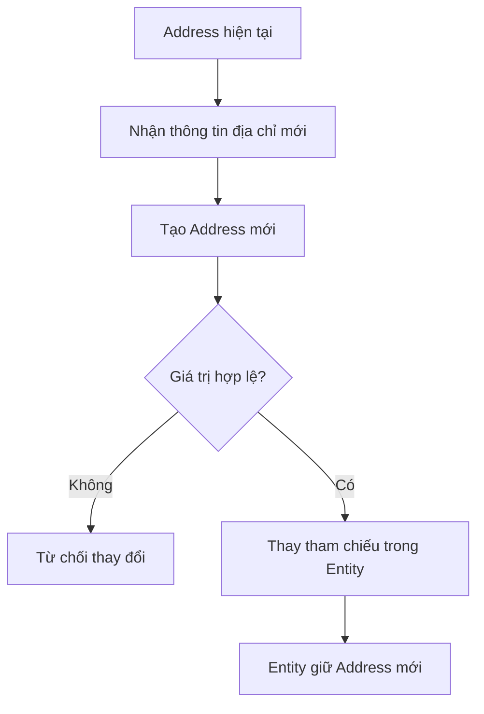

# Thay thế toàn bộ giá trị thay vì thay đổi từng thuộc tính bên trong

Trong Domain-Driven Design (DDD), **Value Object** biểu diễn một khái niệm nghiệp vụ được xác định bởi các giá trị thuộc tính của nó, không phải bởi một danh tính riêng. Một địa chỉ, khoảng thời gian, số tiền hoặc tọa độ thường được nhận diện bằng nội dung của nó. Khi một trong các giá trị thành phần thay đổi, ta tạo một Value Object mới đại diện cho giá trị hoàn chỉnh rồi thay thế giá trị cũ tại nơi sở hữu nó.

Cách làm này thường đi cùng tính bất biến (*immutability*): sau khi được tạo, một Value Object không bị sửa các thuộc tính bên trong. Thay đổi được biểu diễn bằng một đối tượng mới đã được kiểm tra đầy đủ. Nhờ vậy, mô hình miền tránh được trạng thái trung gian không hợp lệ, các quy tắc liên quan được kiểm tra cùng lúc và việc so sánh giá trị trở nên dễ hiểu.

Ví dụ, khi khách hàng đổi địa chỉ giao hàng, hệ thống tạo một `Address` mới từ đầy đủ thông tin cần thiết rồi gán nó cho đơn hàng. Đơn hàng vẫn là cùng một entity với cùng danh tính; chỉ giá trị địa chỉ mà nó đang tham chiếu được thay thế. Bài học này giải thích nguyên tắc đó, cách áp dụng trong Java và những điểm cần chú ý khi cập nhật, lưu trữ và kiểm thử Value Object.

## 1. Value Object được xác định bởi giá trị

Một Value Object mô tả một thuộc tính hoặc khái niệm miền thông qua dữ liệu và ý nghĩa của dữ liệu đó. Hai Value Object cùng loại có cùng giá trị thành phần thường được xem là bằng nhau, dù chúng được tạo ở hai thời điểm hoặc hai vị trí bộ nhớ khác nhau.

Ví dụ:

- `Money(150000, VND)` biểu diễn một số tiền.
- `DateRange(2026-11-01, 2026-11-30)` biểu diễn một khoảng thời gian.
- `Address(...)` biểu diễn một địa chỉ giao hàng.
- `GeoPoint(10.78, 106.69)` biểu diễn một vị trí địa lý.
- `EmailAddress("a@example.com")` biểu diễn một địa chỉ email hợp lệ theo quy tắc của miền.

Value Object không có identity nghiệp vụ riêng. Nếu một địa chỉ thay đổi số nhà, ta không cần theo dõi “địa chỉ cũ đã biến đổi thành địa chỉ mới” như một entity có vòng đời riêng. Ta chỉ cần giá trị địa chỉ mới, trừ khi nghiệp vụ có nhu cầu lưu lịch sử địa chỉ như một khái niệm độc lập.

Điều này khác với Entity. Một `Order` vẫn là cùng một đơn hàng dù địa chỉ giao hàng, trạng thái hoặc ghi chú thay đổi. Entity có identity ổn định; Value Object mô tả giá trị mà entity đang sử dụng.

## 2. Vì sao thay thế toàn bộ Value Object?

Giả sử một địa chỉ gồm số nhà, đường, phường, thành phố và mã bưu chính. Nếu đối tượng cho phép sửa từng thuộc tính độc lập, hệ thống có thể quan sát thấy trạng thái mới chỉ được cập nhật một phần:

1. Số nhà đã đổi nhưng đường vẫn cũ.
2. Phường đã đổi nhưng thành phố chưa đổi.
3. Mã bưu chính không còn phù hợp với khu vực mới.
4. Một quy tắc liên thuộc tính bị vi phạm trong khoảng thời gian giữa các lần cập nhật.

Nếu `Address` bất biến, việc thay đổi diễn ra theo một trình tự rõ ràng:

1. Thu thập đầy đủ các thành phần của địa chỉ mới.
2. Tạo một `Address` mới.
3. Kiểm tra các quy tắc trên toàn bộ giá trị.
4. Chỉ khi đối tượng mới hợp lệ, thay tham chiếu cũ bằng tham chiếu mới.



Việc tạo giá trị mới giúp hệ thống không phải sửa một đối tượng đang được nhiều nơi tham chiếu. Mọi nơi vẫn giữ tham chiếu đến giá trị cũ cho đến khi chúng được cập nhật theo quy trình của mình. Giá trị cũ không bị thay đổi âm thầm.

## 3. Tính bất biến và phép thay thế là hai ý liên quan

**Immutability** là đặc tính của Value Object: trạng thái bên trong không đổi sau khi tạo. **Replacement** là cách mô hình biểu diễn một thay đổi: tạo giá trị mới và thay giá trị cũ tại nơi sở hữu.

Hai ý này bổ trợ cho nhau:

- Value Object không có setter để sửa thuộc tính sau khi tạo.
- Các phương thức biến đổi, nếu có, trả về Value Object mới.
- Entity hoặc Aggregate sở hữu thuộc tính sẽ thay thế tham chiếu sau khi kiểm tra quy tắc.
- Đối tượng cũ vẫn giữ nguyên giá trị và có thể được dùng để so sánh hoặc lưu lịch sử nếu cần.

Không phải mọi đối tượng trong hệ thống đều phải bất biến. Entity thường có trạng thái thay đổi theo vòng đời. Tuy nhiên, Value Object thường nên bất biến vì danh tính của nó chính là tập giá trị đang biểu diễn.

## 4. Ví dụ không tốt: sửa từng thuộc tính của Value Object

Một lớp địa chỉ có setter cho từng field có thể được viết như sau:

```java
public class Address {
    private String street;
    private String ward;
    private String city;
    private String postalCode;

    public void setStreet(String street) {
        this.street = street;
    }

    public void setWard(String ward) {
        this.ward = ward;
    }

    public void setCity(String city) {
        this.city = city;
    }

    public void setPostalCode(String postalCode) {
        this.postalCode = postalCode;
    }
}
```

Đoạn code này cho phép tạo một `Address` rỗng hoặc sửa nó thành trạng thái không nhất quán. Một nơi gọi có thể chỉ cập nhật `street` mà quên cập nhật `ward` hoặc `postalCode`. Các quy tắc bị phân tán giữa nhiều setter và khó bảo đảm tất cả được áp dụng.

Vấn đề không chỉ là code có nhiều setter. Vấn đề là một khái niệm nghiệp vụ được cập nhật theo từng phần mà không có một điểm kiểm tra toàn bộ giá trị.

## 5. Tạo Value Object bất biến trong Java

Java `record` phù hợp với nhiều Value Object vì nó cung cấp constructor, accessor và `equals`/`hashCode` dựa trên thành phần. Record không tự động bảo đảm mọi dữ liệu đều hợp lệ hoặc mọi thành phần đều bất biến, vì vậy vẫn cần kiểm tra và phòng vệ dữ liệu mutable.

### 5.1. Ví dụ Address dùng record

```java
package com.example.sales.domain;

import java.util.Locale;
import java.util.Objects;

public record Address(
        String street,
        String ward,
        String city,
        String postalCode,
        String countryCode
) {
    public Address {
        street = requireText(street, "street");
        ward = requireText(ward, "ward");
        city = requireText(city, "city");
        postalCode = requireText(postalCode, "postalCode");
        countryCode = requireText(countryCode, "countryCode").toUpperCase(Locale.ROOT);
    }

    private static String requireText(String value, String field) {
        Objects.requireNonNull(value, field + " must not be null");
        String normalized = value.trim();
        if (normalized.isEmpty()) {
            throw new IllegalArgumentException(field + " must not be blank");
        }
        return normalized;
    }

    public Address withPostalCode(String newPostalCode) {
        return new Address(
                street,
                ward,
                city,
                newPostalCode,
                countryCode
        );
    }
}
```

Sau khi tạo, `Address` không có setter. Phương thức `withPostalCode` không sửa đối tượng hiện tại; nó tạo một đối tượng mới với mã bưu chính mới và các thành phần còn lại được giữ nguyên. Constructor chạy lại toàn bộ kiểm tra.

`withPostalCode` là một cách viết tiện lợi khi nghiệp vụ thực sự cho phép thay riêng giá trị đó. Nếu thay đổi một thành phần kéo theo các thành phần khác, nên nhận thông tin đầy đủ và tạo lại toàn bộ `Address` thay vì giữ một phương thức cập nhật đơn lẻ.

### 5.2. Tạo giá trị mới bằng constructor

Không nhất thiết mọi Value Object đều cần các phương thức `with...`. Một cách rõ ràng là tạo đối tượng mới trực tiếp:

```java
Address newAddress = new Address(
        "25 Nguyen Hue",
        "Ben Nghe",
        "Ho Chi Minh City",
        "700000",
        "VN"
);
```

Ưu điểm là người gọi phải cung cấp đầy đủ thành phần cần thiết. Nhược điểm là nếu Value Object có nhiều field, việc truyền lại các giá trị cũ có thể dài. Có thể dùng factory hoặc phương thức tạo bản sao để cải thiện khả năng đọc, nhưng đối tượng kết quả vẫn phải là một giá trị hoàn chỉnh, hợp lệ.

## 6. Thay thế Value Object bên trong Entity

Entity có thể thay đổi trạng thái của chính nó. Điều quan trọng là Entity không sửa thuộc tính bên trong Value Object; nó thay thế toàn bộ tham chiếu sau khi kiểm tra quy tắc nghiệp vụ.

```java
package com.example.sales.domain;

import java.util.Objects;

public class Order {
    private final OrderId id;
    private Address shippingAddress;
    private OrderStatus status;

    public Order(OrderId id, Address shippingAddress) {
        this.id = Objects.requireNonNull(id);
        this.shippingAddress = Objects.requireNonNull(shippingAddress);
        this.status = OrderStatus.DRAFT;
    }

    public void changeShippingAddress(Address newAddress) {
        Objects.requireNonNull(newAddress, "newAddress must not be null");

        if (status == OrderStatus.SHIPPED || status == OrderStatus.DELIVERED) {
            throw new IllegalStateException(
                    "Cannot change shipping address after shipment"
            );
        }

        this.shippingAddress = newAddress;
    }

    public Address shippingAddress() {
        return shippingAddress;
    }
}
```

Trong ví dụ:

- `Order` là Entity vì có `OrderId` và vòng đời riêng.
- `Address` là Value Object vì được xác định bằng các thành phần địa chỉ.
- `Order.changeShippingAddress` là hành vi nghiệp vụ quyết định khi nào được thay địa chỉ.
- Khi hợp lệ, entity thay tham chiếu `shippingAddress` bằng một `Address` mới.
- Địa chỉ cũ không bị sửa và các tham chiếu khác đến nó vẫn nhìn thấy giá trị cũ.

Nếu cần phát domain event, entity hoặc aggregate có thể ghi nhận `ShippingAddressChanged` sau khi thay đổi thành công. Event nên mô tả thay đổi đã được chấp nhận, không phát ra trước khi quy tắc nghiệp vụ được kiểm tra.

## 7. Thay thế toàn bộ giá trị giúp bảo vệ invariant

Invariant là điều kiện phải luôn đúng đối với mô hình trong phạm vi được bảo vệ. Một Value Object có thể có invariant liên quan đến nhiều thuộc tính.

Ví dụ, `DateRange` có hai thời điểm bắt đầu và kết thúc. Quy tắc có thể yêu cầu ngày bắt đầu không sau ngày kết thúc. Nếu sửa từng field, một trạng thái trung gian có thể vi phạm quy tắc.

```java
import java.time.LocalDate;
import java.util.Objects;

public record DateRange(LocalDate start, LocalDate end) {
    public DateRange {
        Objects.requireNonNull(start, "start");
        Objects.requireNonNull(end, "end");
        if (start.isAfter(end)) {
            throw new IllegalArgumentException(
                    "start must be on or before end"
            );
        }
    }

    public DateRange moveTo(LocalDate newStart, LocalDate newEnd) {
        return new DateRange(newStart, newEnd);
    }
}
```

Phương thức `moveTo` tạo một khoảng thời gian mới và constructor xác minh cả hai đầu mút. Không có thời điểm nào mà đối tượng cũ chỉ được cập nhật một nửa.

### 7.1. Thay đổi có quan hệ giữa nhiều thuộc tính

Giả sử một Value Object `Measurement` gồm giá trị và đơn vị. Nếu đổi từ mét sang centimet, chỉ đổi số mà không đổi đơn vị sẽ làm sai ý nghĩa. Hãy tạo một `Measurement` mới với cả giá trị và đơn vị phù hợp.

Tương tự:

- Thay đổi số tài khoản có thể yêu cầu thay ngân hàng hoặc chi nhánh.
- Thay đổi mã quốc gia có thể làm thay đổi quy tắc kiểm tra mã bưu chính.
- Thay đổi loại tiền có thể cần quy tắc quy đổi và làm tròn.
- Thay đổi múi giờ có thể ảnh hưởng cách diễn giải thời điểm địa phương.

Khi các thuộc tính có quan hệ nghiệp vụ, tạo lại toàn bộ giá trị giúp kiểm tra chúng trong cùng một ngữ cảnh.

## 8. Value Object có thể cung cấp phép toán trả về giá trị mới

Immutability không có nghĩa Value Object chỉ có getter. Nó có thể cung cấp các hành vi nghiệp vụ, miễn là không thay đổi trạng thái bên trong.

### 8.1. Ví dụ Money

```java
import java.math.BigDecimal;
import java.util.Currency;
import java.util.Objects;

public record Money(BigDecimal amount, Currency currency) {
    public Money {
        Objects.requireNonNull(amount, "amount");
        Objects.requireNonNull(currency, "currency");
        amount = amount.stripTrailingZeros();
    }

    public Money add(Money other) {
        requireSameCurrency(other);
        return new Money(amount.add(other.amount), currency);
    }

    public Money subtract(Money other) {
        requireSameCurrency(other);
        return new Money(amount.subtract(other.amount), currency);
    }

    private void requireSameCurrency(Money other) {
        Objects.requireNonNull(other, "other");
        if (!currency.equals(other.currency)) {
            throw new IllegalArgumentException("Currency mismatch");
        }
    }
}
```

`add` và `subtract` trả về `Money` mới. Chúng không cộng hoặc trừ trực tiếp vào `amount` của đối tượng hiện tại. Constructor chuẩn hóa biểu diễn số để hạn chế khác biệt scale không cần thiết trong ví dụ này.

Trong hệ thống tài chính thực tế, cần xác định thêm độ chính xác, quy tắc làm tròn, số chữ số thập phân theo tiền tệ và cách xử lý tỷ giá. Không nên chọn quy tắc làm tròn tùy tiện trong Value Object nếu chính sách thuộc nghiệp vụ hoặc sản phẩm.

### 8.2. Ví dụ sử dụng phép toán

```java
Money price = new Money(new BigDecimal("125.00"), Currency.getInstance("USD"));
Money tax = new Money(new BigDecimal("10.00"), Currency.getInstance("USD"));

Money total = price.add(tax);
```

`price` và `tax` vẫn giữ nguyên. `total` là một Value Object mới biểu diễn kết quả. Cách này giúp các phép tính có thể được kết hợp, kiểm thử và ghi nhận mà không làm thay đổi dữ liệu đầu vào.

## 9. Value Object chứa collection cũng cần bất biến

Một Value Object có thể chứa danh sách hoặc tập hợp. Dùng `final` cho tham chiếu chưa đủ nếu collection bên trong vẫn mutable. Cần sao chép phòng vệ khi nhận dữ liệu và không để lộ collection có thể sửa.

```java
import java.util.Set;

public record ProductTags(Set<String> values) {
    public ProductTags {
        values = Set.copyOf(values);
    }

    public ProductTags withAdded(String tag) {
        Set<String> updated = new java.util.HashSet<>(values);
        updated.add(tag);
        return new ProductTags(updated);
    }
}
```

`Set.copyOf` tạo một tập hợp không thể sửa qua tham chiếu được trả về. `withAdded` tạo tập hợp mới, thêm giá trị rồi tạo `ProductTags` mới. Đối tượng ban đầu vẫn giữ nguyên.

Nếu thứ tự phần tử có ý nghĩa nghiệp vụ, hãy dùng một collection có thứ tự và bảo vệ tính bất biến tương ứng. Nếu phần tử có thể thay đổi trạng thái, việc sao chép collection nông không làm các phần tử đó trở thành bất biến; cần dùng các Value Object bất biến hoặc sao chép sâu theo yêu cầu.

## 10. Thay thế giá trị trong Aggregate

Aggregate là ranh giới nhất quán của mô hình miền. Aggregate Root bảo vệ các invariant và điều phối thay đổi trạng thái. Value Object nằm bên trong aggregate thường được thay thế thông qua hành vi của root, để mọi điều kiện nghiệp vụ được kiểm tra tại một điểm.

Ví dụ, `Order` là Aggregate Root và `Address` là một giá trị thuộc đơn hàng. Application layer không nên lấy địa chỉ rồi tự sửa các field. Nó gửi một yêu cầu thay đổi đến aggregate:

```java
public void updateShippingAddress(ChangeShippingAddress command) {
    Address replacement = new Address(
            command.street(),
            command.ward(),
            command.city(),
            command.postalCode(),
            command.countryCode()
    );

    order.changeShippingAddress(replacement);
}
```

Trong ví dụ này, application layer chuyển dữ liệu đầu vào thành Value Object hợp lệ, còn aggregate quyết định việc thay đổi có được phép theo trạng thái đơn hàng hay không. Tùy thiết kế, việc tạo Value Object cũng có thể được thực hiện bên trong factory hoặc hành vi của aggregate.

Không nên để consumer sửa một thuộc tính của Value Object nằm trong aggregate thông qua setter công khai. Làm như vậy sẽ bỏ qua quyền bảo vệ invariant của Aggregate Root.

## 11. Cập nhật một phần từ API nhưng vẫn thay Value Object hoàn chỉnh

Giao diện người dùng hoặc API có thể gửi yêu cầu cập nhật một phần, chẳng hạn chỉ thay mã bưu chính. Đây là định dạng trao đổi ở application/presentation layer; nó không bắt buộc domain model phải có setter để sửa Value Object.

Có thể xử lý theo cách:

1. Nạp entity hoặc aggregate hiện tại.
2. Đọc giá trị Value Object hiện tại.
3. Kết hợp dữ liệu mới với các thành phần được giữ lại theo đúng ngữ nghĩa API.
4. Tạo Value Object mới và kiểm tra toàn bộ invariant.
5. Gọi hành vi của aggregate để thay thế giá trị.
6. Lưu aggregate trong ranh giới giao dịch phù hợp.

Ví dụ DTO cho yêu cầu cập nhật một phần:

```java
public record ChangePostalCodeRequest(String postalCode) {}

public void handle(ChangePostalCodeRequest request, Order order) {
    Address current = order.shippingAddress();
    Address replacement = current.withPostalCode(request.postalCode());
    order.changeShippingAddress(replacement);
}
```

Đối với một thay đổi chỉ ảnh hưởng mã bưu chính, `withPostalCode` tạo một địa chỉ đầy đủ mới. Nếu mã quốc gia hoặc khu vực thay đổi khiến các field khác cần cập nhật, API nên nhận đủ thông tin hoặc application layer phải thực hiện quy tắc hợp nhất đã được nghiệp vụ xác định.

### 11.1. Phân biệt field bị bỏ qua, null và giá trị rỗng

API cập nhật một phần cần quy định rõ:

- Field không xuất hiện: giữ giá trị hiện tại hay dùng mặc định?
- Field xuất hiện với `null`: xóa giá trị, biểu thị chưa biết hay không hợp lệ?
- Field là chuỗi rỗng: có được xem là xóa hoặc là dữ liệu không hợp lệ?
- Field xuất hiện với giá trị mới: có cần kiểm tra liên thuộc tính không?

Không nên dùng một DTO mơ hồ rồi để domain tự suy đoán. Hãy chuyển đổi patch request thành một lệnh nghiệp vụ rõ ràng trước khi tạo Value Object mới.

## 12. Thay thế Value Object và lưu trữ dữ liệu

Trong mô hình miền, Value Object được thay thế như một giá trị hoàn chỉnh. Cách lưu trữ vật lý có thể khác tùy ORM và database.

Ví dụ, `Address` có thể được lưu thành nhiều cột trong cùng bản ghi `orders`:

```text
orders
------------------------------------------------
order_id
shipping_street
shipping_ward
shipping_city
shipping_postal_code
shipping_country_code
```

Việc có nhiều cột không có nghĩa domain phải cho phép cập nhật từng field độc lập. Persistence mapper có thể đọc các cột thành một `Address` và ghi toàn bộ các thành phần khi giá trị được thay thế.

### 12.1. Embedded Value Object

Với ORM hỗ trợ embedded mapping, các thuộc tính của Value Object có thể được ánh xạ vào bảng của entity hoặc aggregate root. Cần cấu hình để tránh tạo một identity hoặc lifecycle độc lập không cần thiết.

### 12.2. Lưu Value Object thành JSON hoặc cấu trúc riêng

Một số Value Object có cấu trúc thay đổi hoặc được lưu như JSON/document. Cần cân nhắc khả năng truy vấn, index, migration và kiểm tra dữ liệu. Dù lưu bằng cách nào, domain vẫn nên khôi phục thành một giá trị đầy đủ và hợp lệ.

### 12.3. Lịch sử giá trị

Nếu nghiệp vụ cần biết địa chỉ cũ, mức giá cũ hoặc điều khoản cũ, đừng giữ tham chiếu mutable rồi sửa nó. Có thể lưu snapshot, lịch sử thay đổi hoặc một entity lịch sử riêng tùy yêu cầu. Value Object bất biến giúp giữ lại giá trị trước đó một cách tự nhiên, nhưng hệ thống vẫn cần cơ chế lưu lịch sử nếu muốn truy xuất sau khi tiến trình kết thúc.

## 13. So sánh Value Object với Entity

| Tiêu chí | Value Object | Entity |
|---|---|---|
| Cách nhận diện | Tập giá trị thuộc tính | Identity ổn định |
| Equality | So sánh theo giá trị | Thường so sánh theo identity |
| Thay đổi | Tạo giá trị mới và thay thế | Cùng entity thay đổi trạng thái theo hành vi |
| Vòng đời riêng | Thường không có | Có vòng đời nghiệp vụ |
| Ví dụ | Money, Address, DateRange | Order, CustomerAccount, Shipment |
| Quy tắc | Bảo vệ tính hợp lệ của toàn bộ giá trị | Bảo vệ hành vi và invariant của entity/aggregate |

Một địa chỉ thường là Value Object trong đơn hàng. Nhưng nếu nghiệp vụ quản lý “địa điểm giao nhận” với mã định danh, lịch sử, trạng thái xác minh và các đơn hàng cùng tham chiếu, khái niệm đó có thể cần được mô hình hóa thành Entity. Quyết định phụ thuộc vào ý nghĩa và vòng đời nghiệp vụ, không phụ thuộc vào tên gọi.

## 14. Lợi ích của cách thay thế toàn bộ giá trị

### 14.1. Tránh trạng thái không hợp lệ

Constructor hoặc factory kiểm tra toàn bộ thành phần trước khi tạo đối tượng. Người gọi không thể tạo một Value Object hợp lệ rồi sửa dần nó thành trạng thái sai qua các setter.

### 14.2. Thay đổi có tính nguyên tử ở mức mô hình

Entity thay một tham chiếu sau khi Value Object mới được tạo thành công. Các thành phần của giá trị không bị quan sát trong trạng thái cập nhật dở dang. Đây là tính nguyên tử về mặt mô hình; nó không tự thay thế transaction database hoặc bảo đảm thread safety cho toàn bộ aggregate.

### 14.3. Dễ chia sẻ và tái sử dụng

Nhiều đối tượng có thể tham chiếu cùng một Value Object bất biến mà không lo một nơi sửa nó khiến nơi khác thay đổi ngoài ý muốn. Không cần sao chép chỉ để phòng tránh mutation nếu giá trị thực sự bất biến.

### 14.4. Dễ kiểm thử

Có thể kiểm tra constructor, factory và các phép toán bằng đầu vào/đầu ra. Không cần kiểm tra chuỗi thao tác setter hoặc trạng thái trung gian.

### 14.5. Dễ so sánh và lưu dấu thay đổi

Vì Value Object không đổi, việc so sánh giá trị cũ và mới cho biết nội dung có thực sự thay đổi hay không. Điều này hữu ích khi phát domain event, ghi audit hoặc tránh cập nhật không cần thiết.

## 15. Những lỗi thường gặp

| Lỗi | Hệ quả | Cách cải thiện |
|---|---|---|
| Dùng setter cho mọi field của Value Object | Có thể tạo trạng thái trung gian hoặc không hợp lệ | Tạo đối tượng mới qua constructor/factory |
| Chỉ đánh dấu field `final` nhưng chứa collection mutable | Bên ngoài vẫn có thể thay đổi nội dung | Defensive copy và collection bất biến |
| Để application sửa trực tiếp thuộc tính bên trong | Bỏ qua hành vi và invariant của aggregate | Gọi hành vi của Aggregate Root để thay thế giá trị |
| Chỉ thay một field dù các field liên quan | Các thuộc tính không còn nhất quán | Tạo giá trị mới từ đầy đủ thông tin liên quan |
| Nhầm update API một phần với domain mutation từng phần | DTO và domain model bị trộn trách nhiệm | Merge patch ở application rồi tạo Value Object hoàn chỉnh |
| Cho rằng mọi đối tượng đều phải bất biến | Entity mất khả năng thể hiện vòng đời | Phân biệt Entity và Value Object |
| Tạo Value Object quá nhỏ cho mọi field | Mô hình nhiều lớp nhưng không tăng ý nghĩa | Chỉ tạo VO khi có khái niệm, quy tắc hoặc lợi ích rõ |
| Cho rằng immutable tự bảo đảm thread safety | Bỏ qua đồng bộ, transaction và publication | Kiểm soát đồng thời ở aggregate, repository và hạ tầng |
| Dùng Value Object cho dữ liệu cần identity/lịch sử riêng | Mất khả năng quản lý vòng đời | Xem xét mô hình Entity khi nghiệp vụ cần identity |

## 16. Kiểm thử Value Object và hành vi thay thế

Nên kiểm tra cả tính bất biến của Value Object và quy tắc thay thế ở Entity/Aggregate.

### 16.1. Kiểm thử tính bất biến

```java
@Test
void withPostalCodeReturnsNewAddressAndKeepsOriginalUnchanged() {
    Address original = new Address(
            "25 Nguyen Hue", "Ben Nghe", "HCMC", "700000", "VN"
    );

    Address changed = original.withPostalCode("710000");

    assertEquals("700000", original.postalCode());
    assertEquals("710000", changed.postalCode());
    assertNotSame(original, changed);
}
```

### 16.2. Kiểm thử invariant

```java
@Test
void dateRangeRejectsStartAfterEnd() {
    assertThrows(IllegalArgumentException.class, () ->
            new DateRange(
                    LocalDate.of(2026, 12, 1),
                    LocalDate.of(2026, 11, 1)
            )
    );
}
```

### 16.3. Kiểm thử quy tắc của Aggregate Root

```java
@Test
void cannotChangeShippingAddressAfterShipment() {
    Order order = anOrderInStatus(OrderStatus.SHIPPED);
    Address replacement = anAddress("710000");

    assertThrows(
            IllegalStateException.class,
            () -> order.changeShippingAddress(replacement)
    );
}
```

Các hàm trợ giúp trong ví dụ test là fixture do dự án định nghĩa. Ngoài trường hợp thành công, nên kiểm tra null, dữ liệu rỗng, giá trị biên, collection đầu vào bị sửa sau khi tạo và equality/hash code.

## 17. Khi nào không nên dùng cách thay thế Value Object?

Nếu một khái niệm cần danh tính và vòng đời riêng, nó có thể không phải Value Object. Ví dụ, một tài khoản ngân hàng có số tài khoản, trạng thái xác minh, lịch sử thay đổi và quyền sở hữu. Nếu chỉ biểu diễn số tài khoản và ngân hàng như một giá trị trong hồ sơ, `BankAccountDetails` có thể là Value Object. Nếu nghiệp vụ quản lý tài khoản như một thực thể riêng, nó có thể là Entity.

Ngoài ra, một số dữ liệu kỹ thuật có thể được cập nhật theo luồng mutable vì yêu cầu hiệu năng hoặc thư viện. Không cần áp dụng Value Object cho mọi cấu trúc dữ liệu. Hãy chọn bất biến ở nơi nó làm rõ ngữ nghĩa và bảo vệ quy tắc, thay vì áp đặt nó như một mục tiêu hình thức.

Nếu Value Object chứa dữ liệu lớn hoặc phép tạo mới quá tốn kém, hãy đo đạc trước khi tối ưu. Có thể dùng cấu trúc persistent data hoặc chia nhỏ khái niệm theo miền. Tránh quay lại mutation không kiểm soát chỉ vì lo ngại hiệu năng chưa được đo.

## 18. Checklist thiết kế Value Object theo hướng thay thế

Trước khi hoàn tất một Value Object, hãy kiểm tra:

- [ ] Khái niệm được xác định bằng giá trị thay vì identity.
- [ ] Constructor hoặc factory tạo ra một giá trị hoàn chỉnh và hợp lệ.
- [ ] Không có setter làm thay đổi thuộc tính sau khi tạo.
- [ ] Các phép biến đổi trả về đối tượng mới.
- [ ] Các thuộc tính có quan hệ được kiểm tra cùng nhau.
- [ ] Collection hoặc object con mutable được sao chép phòng vệ khi cần.
- [ ] Equality và hash code phản ánh ý nghĩa giá trị.
- [ ] Entity/Aggregate thay thế Value Object qua hành vi có kiểm tra quy tắc.
- [ ] API patch được chuyển đổi thành giá trị domain hoàn chỉnh ở application boundary.
- [ ] Persistence mapping khôi phục và lưu giá trị theo đúng ngữ nghĩa.
- [ ] Các trường hợp hợp lệ, không hợp lệ và giá trị biên đã được kiểm thử.
- [ ] Đã xem xét liệu khái niệm có thực sự cần identity hoặc lịch sử riêng không.

## 19. Kết nối với các khái niệm DDD khác

Value Object thường được chứa trong Entity hoặc Aggregate. Tính bất biến giúp Aggregate Root thay thế một giá trị sau khi kiểm tra invariant, đồng thời giảm nguy cơ một phần của mô hình bị thay đổi ngoài quyền kiểm soát. Repository lưu và khôi phục Aggregate với các Value Object đầy đủ; Domain Event có thể mô tả việc một giá trị nghiệp vụ đã thay đổi khi thay đổi đó có ý nghĩa với các bên khác.

Trong Ubiquitous Language, tên Value Object nên diễn đạt khái niệm mà chuyên gia nghiệp vụ nhận ra, chẳng hạn `Money`, `DeliveryAddress`, `BillingPeriod` hoặc `CreditLimit`. Khi các khái niệm này được mô hình hóa đúng, mã nguồn thể hiện quy tắc miền rõ hơn và người đọc không phải suy ra ý nghĩa từ một nhóm field rời rạc.

Thay thế toàn bộ Value Object là một cách giữ giá trị luôn hoàn chỉnh và hợp lệ. Entity vẫn có thể thay đổi theo vòng đời, nhưng mỗi Value Object mà nó sử dụng là một giá trị nhất quán tại thời điểm được gán. Đây là nền tảng giúp mô hình miền dễ hiểu, dễ kiểm thử và an toàn hơn khi tiến hóa.
