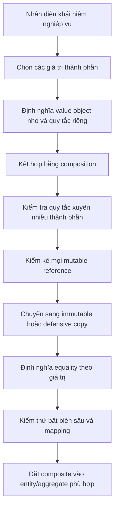

# Kết hợp nhiều đối tượng giá trị và kiểm soát tham chiếu có thể thay đổi

Một khái niệm nghiệp vụ thường được tạo thành từ nhiều giá trị nhỏ hơn. Địa chỉ giao hàng có thể gồm người nhận, số điện thoại, các dòng địa chỉ và khoảng thời gian nhận hàng. Số tiền gồm giá trị số và đơn vị tiền tệ. Khoảng thời gian gồm thời điểm bắt đầu và kết thúc. Nếu mô hình biểu diễn tất cả bằng những chuỗi và con số rời rạc, quy tắc giữa các phần dễ bị phân tán và dữ liệu có thể rơi vào trạng thái không hợp lệ.

Trong Domain-Driven Design (DDD), **Value Object (đối tượng giá trị)** có thể được kết hợp để tạo thành một value object lớn hơn. Cách kết hợp này giúp mô hình diễn đạt một khái niệm nghiệp vụ hoàn chỉnh bằng những thành phần có ý nghĩa. Tuy nhiên, việc ghép các object lại với nhau chưa đủ để bảo đảm tính bất biến. Nếu một thành phần bên trong vẫn có thể bị thay đổi thông qua tham chiếu bên ngoài, value object tổng hợp có thể âm thầm đổi giá trị sau khi được tạo.

Bài này trình bày cách kết hợp nhiều value object, kiểm soát tham chiếu có thể thay đổi (mutable reference), tránh lỗi chia sẻ tham chiếu (aliasing), và bảo vệ tính bất biến từ ngoài vào trong. Các ví dụ dùng Java để minh họa constructor, record, collection, mảng, ngày giờ, equality, aggregate và kiểm thử.

## 1. Kết hợp nhiều Value Object để diễn tả một khái niệm

### 1.1. Từ các giá trị rời rạc đến một khái niệm có ý nghĩa

Giả sử một đơn hàng có thông tin giao hàng. Cách biểu diễn ban đầu có thể gồm nhiều thuộc tính:

```java
class Order {
    String recipientName;
    String phoneNumber;
    String addressLine1;
    String addressLine2;
    String ward;
    String city;
    String countryCode;
    Instant deliveryFrom;
    Instant deliveryUntil;
}
```

Cách này khiến `Order` phải biết ý nghĩa và quy tắc của từng trường. Việc kiểm tra số điện thoại, địa chỉ, quốc gia và khoảng thời gian có thể bị lặp lại ở nhiều nơi. Một số trường cũng có thể bị cập nhật riêng lẻ, tạo ra trạng thái không nhất quán.

Ta có thể nhóm các giá trị thành những value object nhỏ:

- `Recipient`: người nhận và thông tin liên hệ.
- `PostalAddress`: địa chỉ bưu chính.
- `DeliveryWindow`: khoảng thời gian giao hàng.

Sau đó kết hợp chúng thành `DeliveryDestination`:

```text
DeliveryDestination
  ├── Recipient
  │     ├── FullName
  │     └── PhoneNumber
  ├── PostalAddress
  │     ├── AddressLine
  │     ├── Ward
  │     ├── City
  │     └── CountryCode
  └── DeliveryWindow
        ├── StartsAt
        └── EndsAt
```

`DeliveryDestination` biểu diễn một khái niệm hoàn chỉnh mà nghiệp vụ có thể sử dụng như một đơn vị. `Order` có thể thay đổi toàn bộ điểm giao hàng bằng một hành vi như `changeDeliveryDestination(destination)` thay vì cho phép bên ngoài sửa từng trường.

### 1.2. Composition không phải là kế thừa

Kết hợp value object (composition) diễn tả quan hệ “bao gồm” hoặc “được cấu thành từ”. `DeliveryDestination` bao gồm `Recipient`, `PostalAddress` và `DeliveryWindow`. Mỗi thành phần vẫn giữ tên, quy tắc và ý nghĩa riêng.

Không cần tạo một hệ thống kế thừa chỉ để tái sử dụng các thuộc tính. Ví dụ, `ShippingAddress` và `BillingAddress` có thể cùng chứa một `PostalAddress`, nhưng hai khái niệm vẫn có quy tắc sử dụng khác nhau. Chúng có thể là hai value object riêng cùng sử dụng thành phần địa chỉ.

Composition phù hợp khi:

- Một khái niệm có các phần con có ý nghĩa rõ ràng.
- Các phần con có thể được xác thực và kiểm thử độc lập.
- Khái niệm tổng hợp cần áp dụng thêm quy tắc liên quan đến nhiều phần.
- Các phần không cần định danh và vòng đời độc lập như entity.

### 1.3. Value object tổng hợp vẫn là một value object

Khi một value object chứa các value object khác, nó không tự động trở thành entity hay aggregate. Nó vẫn được nhận diện bằng toàn bộ giá trị cấu thành, không có identity riêng.

Ví dụ, hai `DeliveryDestination` có cùng người nhận, địa chỉ và khoảng thời gian được xem là bằng nhau theo quy tắc equality của mô hình. Nếu một dòng địa chỉ thay đổi, ta tạo một giá trị `DeliveryDestination` mới. Không cần sửa đối tượng cũ tại chỗ.

Một composite value object thường:

- Không có ID riêng chỉ để phân biệt các instance.
- Không có repository riêng để lưu và truy xuất độc lập.
- Không quản lý vòng đời dài hạn như entity.
- Có thể được chia sẻ giữa nhiều đối tượng nếu toàn bộ object graph bất biến.
- Được thay thế bằng một giá trị mới khi dữ liệu thay đổi.

Nếu một thành phần cần được theo dõi độc lập, có trạng thái thay đổi riêng, quyền truy cập riêng hoặc vòng đời không phụ thuộc object bao ngoài, hãy đánh giá xem nó có thực chất là entity hay không.

## 2. Vì sao tham chiếu có thể thay đổi gây nguy hiểm?

### 2.1. Mutable reference và aliasing

Một object có thể được nhiều biến cùng tham chiếu. Nếu một biến sửa object, các nơi còn lại cũng nhìn thấy thay đổi đó. Hiện tượng này thường được gọi là **aliasing** (nhiều bí danh cùng trỏ đến một object).

```java
List<String> source = new ArrayList<>();
source.add("12 Nguyễn Huệ");

List<String> addressLines = source;
source.add("Tầng 3");

System.out.println(addressLines);
// [12 Nguyễn Huệ, Tầng 3]
```

Nếu một value object giữ trực tiếp `source`, bên gọi vẫn có thể thay đổi nội dung bên trong value object mà không gọi bất kỳ hành vi nào của nó. Điều này phá vỡ tính bất biến và khiến quy tắc nghiệp vụ khó kiểm soát.

### 2.2. Một tham chiếu có thể làm value object thay đổi từ bên ngoài

Ví dụ sau trông có vẻ hợp lý nhưng không an toàn:

```java
public final class Address {
    private final List<String> lines;

    public Address(List<String> lines) {
        this.lines = lines;
    }

    public List<String> lines() {
        return lines;
    }
}
```

Có hai lỗ hổng:

1. Constructor giữ nguyên tham chiếu do caller truyền vào. Caller có thể sửa list gốc sau khi tạo `Address`.
2. Accessor trả trực tiếp list nội bộ. Caller có thể gọi `add`, `remove` hoặc `clear` để thay đổi `Address`.

Từ khóa `final` chỉ ngăn biến `lines` trỏ sang một list khác. Nó không làm cho object `List` mà biến đang trỏ đến trở nên bất biến.

### 2.3. Bất biến nông và bất biến sâu

**Bất biến nông (shallow immutability)** nghĩa là các tham chiếu ở lớp ngoài không thể được gán lại, nhưng object được tham chiếu vẫn có thể thay đổi.

**Bất biến sâu (deep immutability)** nghĩa là toàn bộ object graph có thể quan sát qua value object không thể bị thay đổi sau khi tạo. Các object con, collection và phần tử trong collection cũng phải bất biến hoặc được bảo vệ.

Ví dụ:

```text
ImmutableAddress
  └── final List<MutableContact>
        ├── MutableContact
        └── MutableContact
```

List có thể không cho phép thêm hoặc xóa phần tử, nhưng từng `MutableContact` vẫn có thể bị sửa. Khi đó, object tổng hợp chưa bất biến sâu.

Để bảo vệ value object, cần kiểm soát cả hai hướng: dữ liệu đi vào constructor và dữ liệu đi ra qua accessor. Đồng thời, phải xem xét khả năng thay đổi của từng phần tử bên trong.

## 3. Nguyên tắc bảo vệ tham chiếu

### 3.1. Không giữ trực tiếp tham chiếu mutable từ bên ngoài

Khi nhận một collection có thể thay đổi, hãy tạo một bản sao an toàn hoặc chuyển nó thành collection bất biến:

```java
public final class Address {
    private final List<String> lines;

    public Address(List<String> lines) {
        this.lines = List.copyOf(lines);
    }

    public List<String> lines() {
        return lines;
    }
}
```

`List.copyOf` tạo một list không thể sửa qua API collection và bảo đảm thay đổi về sau ở collection nguồn không làm thay đổi list kết quả. Nó cũng từ chối phần tử `null`, điều này có thể phù hợp với mô hình yêu cầu mỗi dòng địa chỉ đều hợp lệ.

Với `Set` và `Map`, có thể dùng `Set.copyOf` và `Map.copyOf`. Nếu cần giữ thứ tự hoặc dùng một kiểu collection cụ thể, hãy tạo bản sao trước rồi bọc bằng một API chỉ đọc phù hợp.

### 3.2. Phân biệt bản sao với view chỉ đọc

`Collections.unmodifiableList(source)` chỉ tạo một view không cho caller sửa qua view đó. Nếu caller còn giữ `source` và thay đổi nó, view vẫn phản ánh thay đổi.

```java
List<String> source = new ArrayList<>(List.of("A"));
List<String> view = Collections.unmodifiableList(source);

source.add("B");
System.out.println(view); // [A, B]
```

Nếu muốn snapshot độc lập, hãy sao chép trước:

```java
List<String> snapshot = Collections.unmodifiableList(
    new ArrayList<>(source)
);
```

Với phần tử bất biến, `List.copyOf(source)` thường là cách ngắn gọn hơn. Điều quan trọng là hiểu khác biệt giữa “caller không sửa được qua tham chiếu này” và “giá trị không bị thay đổi bởi bất kỳ tham chiếu mutable nào khác”.

### 3.3. Kiểm soát dữ liệu trả ra

Nếu accessor trả collection mutable nội bộ, caller có thể phá vỡ bất biến. Có hai hướng:

- Trả collection bất biến đã được tạo an toàn ở constructor.
- Trả defensive copy nếu API cần cung cấp một bản có thể chỉnh sửa mà không ảnh hưởng object gốc.

Đối với value object, trả collection bất biến thường phù hợp hơn vì caller không có lý do sửa trực tiếp giá trị bên trong. Khi cần thay đổi, caller tạo một value object mới.

### 3.4. Phần tử trong collection cũng phải an toàn

`List.copyOf` chỉ bảo vệ cấu trúc list. Nó không tự biến phần tử mutable thành bất biến.

```java
List<StringBuilder> builders = new ArrayList<>();
StringBuilder line = new StringBuilder("12 Nguyễn Huệ");
builders.add(line);

List<StringBuilder> copy = List.copyOf(builders);
line.append(", Quận 1");

System.out.println(copy.get(0));
// 12 Nguyễn Huệ, Quận 1
```

List không thể thêm hoặc xóa, nhưng phần tử vẫn thay đổi. Có thể giải quyết bằng cách:

- Ưu tiên phần tử immutable như `String`, `BigDecimal`, `LocalDate`, enum hoặc value object bất biến.
- Chuyển đổi phần tử mutable sang kiểu immutable khi nhận dữ liệu.
- Tạo deep copy nếu bắt buộc phải giữ một cấu trúc phần tử mutable.
- Không trả tham chiếu đến object mutable nội bộ.

## 4. Xây dựng composite Value Object bằng Java

### 4.1. Định nghĩa các value object thành phần

Ví dụ dưới đây mô hình hóa điểm giao hàng bằng các thành phần nhỏ. Các record được dùng vì chúng hỗ trợ equality theo giá trị và cú pháp gọn; tính bất biến vẫn cần được bảo đảm ở các thành phần bên trong.

```java
public record Recipient(String fullName, String phoneNumber) {
    public Recipient {
        if (fullName == null || fullName.isBlank()) {
            throw new IllegalArgumentException("Recipient name is required");
        }
        if (phoneNumber == null || phoneNumber.isBlank()) {
            throw new IllegalArgumentException("Phone number is required");
        }
    }
}
```

`String` là immutable nên không có nguy cơ caller sửa nội dung chuỗi sau khi truyền vào. Nếu dùng một class `PhoneNumber` riêng, class đó cũng cần xác thực và bất biến.

### 4.2. Một value object chứa collection

```java
public record PostalAddress(
    List<String> lines,
    String ward,
    String city,
    String countryCode
) {
    public PostalAddress {
        if (lines == null || lines.isEmpty()) {
            throw new IllegalArgumentException("Address lines are required");
        }

        lines = lines.stream()
            .map(line -> {
                if (line == null || line.isBlank()) {
                    throw new IllegalArgumentException("Address line is invalid");
                }
                return line.trim();
            })
            .toList();

        if (ward == null || ward.isBlank()) {
            throw new IllegalArgumentException("Ward is required");
        }
        if (city == null || city.isBlank()) {
            throw new IllegalArgumentException("City is required");
        }
        if (countryCode == null || countryCode.isBlank()) {
            throw new IllegalArgumentException("Country code is required");
        }
    }
}
```

`Stream.toList()` trả về list không thể sửa qua API collection. Các phần tử là `String`, vốn bất biến, nên list này an toàn để chia sẻ. Nếu cần hỗ trợ Java version cũ hơn, có thể dùng `List.copyOf` sau khi chuẩn hóa dữ liệu.

### 4.3. Một value object biểu diễn khoảng thời gian

```java
public record DeliveryWindow(Instant startsAt, Instant endsAt) {
    public DeliveryWindow {
        Objects.requireNonNull(startsAt, "startsAt is required");
        Objects.requireNonNull(endsAt, "endsAt is required");

        if (!startsAt.isBefore(endsAt)) {
            throw new IllegalArgumentException(
                "Delivery window must have a positive duration"
            );
        }
    }

    public boolean contains(Instant time) {
        return !time.isBefore(startsAt) && time.isBefore(endsAt);
    }
}
```

Các kiểu `Instant`, `LocalDate`, `LocalTime` và `ZonedDateTime` trong `java.time` được thiết kế bất biến. Chúng thường an toàn hơn các kiểu ngày giờ mutable cũ như `java.util.Date` và `Calendar` khi được chứa trong value object.

### 4.4. Kết hợp các thành phần và kiểm tra quy tắc tổng hợp

```java
public record DeliveryDestination(
    Recipient recipient,
    PostalAddress address,
    DeliveryWindow window,
    String instructions
) {
    public DeliveryDestination {
        Objects.requireNonNull(recipient, "recipient is required");
        Objects.requireNonNull(address, "address is required");
        Objects.requireNonNull(window, "window is required");

        if (instructions != null && instructions.length() > 500) {
            throw new IllegalArgumentException("Instructions are too long");
        }
        if (instructions != null) {
            instructions = instructions.trim();
        }
    }
}
```

Composite value object kiểm tra sự hiện diện của các thành phần và quy tắc liên quan đến toàn bộ điểm giao hàng. Các quy tắc riêng như định dạng số điện thoại thuộc `Recipient` hoặc quy tắc khoảng thời gian thuộc `DeliveryWindow`.

Vì tất cả thành phần ở ví dụ này đều bất biến, `DeliveryDestination` có thể giữ trực tiếp tham chiếu đến chúng. Việc chia sẻ một instance `PostalAddress` giữa nhiều `DeliveryDestination` là an toàn vì không ai có thể sửa nó tại chỗ.

### 4.5. Thay đổi giá trị bằng cách tạo instance mới

Khi khách đổi địa chỉ, không sửa `PostalAddress` đang được dùng. Hãy tạo một giá trị mới và thay thế toàn bộ `DeliveryDestination`:

```java
PostalAddress newAddress = new PostalAddress(
    List.of("25 Lê Lợi", "Tòa nhà B, căn 1204"),
    "Bến Nghé",
    "Thành phố Hồ Chí Minh",
    "VN"
);

DeliveryDestination newDestination = new DeliveryDestination(
    oldDestination.recipient(),
    newAddress,
    oldDestination.window(),
    oldDestination.instructions()
);

order.changeDeliveryDestination(newDestination);
```

`Order` là entity hoặc aggregate root sở hữu hành vi thay đổi thông tin giao hàng. Nó có thể kiểm tra trạng thái đơn trước khi chấp nhận thay đổi, ghi nhận lý do hoặc tạo domain event. Value object không tự lưu lịch sử thay đổi và không cần ID riêng.

## 5. Record không tự bảo đảm bất biến sâu

### 5.1. Record chỉ làm field final ở lớp ngoài

Java record tạo các component field final và accessor tương ứng. Tuy nhiên, nếu component là `List`, `Map`, mảng hoặc object mutable, record vẫn có thể bị thay đổi gián tiếp.

```java
public record UnsafeTags(List<String> values) {
}

List<String> source = new ArrayList<>(List.of("fragile"));
UnsafeTags tags = new UnsafeTags(source);

source.add("urgent");
System.out.println(tags.values()); // [fragile, urgent]
```

Để bảo vệ record, hãy sao chép và chuẩn hóa component trong compact constructor:

```java
public record Tags(List<String> values) {
    public Tags {
        values = List.copyOf(values);
    }
}
```

Vì `String` bất biến và list không thể sửa, `Tags` có thể được chia sẻ an toàn.

### 5.2. Record chứa object mutable

```java
public record Contact(String name, StringBuilder note) {
}
```

Field `note` là final nhưng `StringBuilder` vẫn mutable. Caller có thể sửa `note` sau khi tạo record. Nên chuyển sang `String`, hoặc dùng một value object bất biến thay thế.

### 5.3. Record chứa mảng cần xử lý đặc biệt

Mảng Java mutable và record không tự sao chép mảng. Nếu bắt buộc lưu `byte[]`, cần clone khi nhận và khi trả ra:

```java
public final class DocumentFingerprint {
    private final byte[] bytes;

    public DocumentFingerprint(byte[] bytes) {
        this.bytes = Objects.requireNonNull(bytes).clone();
    }

    public byte[] bytes() {
        return bytes.clone();
    }

    @Override
    public boolean equals(Object other) {
        return other instanceof DocumentFingerprint that
            && Arrays.equals(bytes, that.bytes);
    }

    @Override
    public int hashCode() {
        return Arrays.hashCode(bytes);
    }
}
```

Việc clone bảo vệ dữ liệu khỏi thay đổi qua tham chiếu bên ngoài. Cần tự định nghĩa `equals` và `hashCode` theo nội dung mảng, vì equality mặc định của mảng Java là identity của mảng, không phải so sánh từng byte.

Nếu dùng record cho mảng, vẫn phải clone trong constructor, override accessor và định nghĩa equality/hashCode theo nội dung. Khi có thể, hãy dùng kiểu immutable hoặc biểu diễn giá trị khác để tránh phức tạp này.

## 6. Xử lý các kiểu dữ liệu mutable thường gặp

| Kiểu dữ liệu | Rủi ro | Cách bảo vệ khuyến nghị |
|---|---|---|
| `List`, `Set`, `Map` | Caller thêm, xóa hoặc thay phần tử | Sao chép thành `List.copyOf`, `Set.copyOf`, `Map.copyOf`; phần tử cũng cần bất biến |
| Mảng (`byte[]`, `char[]`) | Caller sửa trực tiếp từng phần tử | Clone khi nhận và khi trả; định nghĩa equality theo nội dung |
| `Date`, `Calendar` | API cho phép thay đổi thời gian | Chuyển sang `Instant`, `LocalDate`, `LocalDateTime` hoặc kiểu `java.time` phù hợp |
| `StringBuilder`, `StringBuffer` | Nội dung có thể được nối hoặc xóa | Chuyển thành `String` tại biên |
| Object do ứng dụng tự viết | Có setter hoặc trạng thái mutable | Dùng value object bất biến, snapshot hoặc deep copy |
| Collection chứa object mutable | Cấu trúc list bất biến nhưng phần tử vẫn đổi | Chuyển phần tử thành immutable hoặc deep copy có kiểm soát |

### 6.1. Chuyển Date sang kiểu java.time

Không nên giữ `Date` trực tiếp trong value object:

```java
public final class LegacyPeriod {
    private final Date start;

    public LegacyPeriod(Date start) {
        this.start = start;
    }

    public Date start() {
        return start;
    }
}
```

Caller có thể thay đổi cả ngày đầu vào lẫn giá trị trả về. Có thể chuyển đổi ngay tại biên:

```java
public record EffectiveAt(Instant value) {
    public EffectiveAt {
        Objects.requireNonNull(value);
    }

    public static EffectiveAt fromLegacyDate(Date date) {
        return new EffectiveAt(date.toInstant());
    }
}
```

Nếu phải tương tác với API cũ, tạo `Date` mới mỗi lần xuất dữ liệu:

```java
Date toLegacyDate(EffectiveAt effectiveAt) {
    return Date.from(effectiveAt.value());
}
```

Không để kiểu mutable của thư viện cũ đi sâu vào mô hình miền.

### 6.2. Sao chép Map và Set

Với metadata hoặc tập mã phân loại, dùng bản sao bất biến:

```java
public record ProductAttributes(Map<String, String> values) {
    public ProductAttributes {
        values = Map.copyOf(values);
    }
}

public record SupportedRegions(Set<String> codes) {
    public SupportedRegions {
        codes = Set.copyOf(codes);
    }
}
```

Ví dụ này an toàn vì key, value và mã vùng là `String`. Nếu map chứa list, mảng hoặc object mutable, cần bảo vệ cả các giá trị lồng bên trong.

## 7. Bảo vệ bất biến xuyên suốt object graph

### 7.1. Deep immutability là thuộc tính của toàn bộ cấu trúc

Hãy xem object graph như một cây hoặc đồ thị tham chiếu. Một value object chỉ bất biến sâu nếu không có đường truy cập nào cho phép caller sửa dữ liệu mà nó quan sát.

```text
DeliveryDestination
  ├── Recipient (immutable)
  │     ├── String (immutable)
  │     └── String (immutable)
  ├── PostalAddress (immutable)
  │     ├── List (unmodifiable snapshot)
  │     │     └── String (immutable)
  │     ├── String (immutable)
  │     └── String (immutable)
  └── DeliveryWindow (immutable)
        ├── Instant (immutable)
        └── Instant (immutable)
```

Nếu một nhánh chứa object mutable, cần xử lý nhánh đó trước khi xem toàn bộ cấu trúc là bất biến.

### 7.2. Sao chép sâu hay thiết kế phần tử bất biến?

Có hai chiến lược chính:

- **Ưu tiên phần tử bất biến:** chuyển dữ liệu đầu vào sang `String`, `BigDecimal`, `Instant`, enum hoặc value object bất biến. Sau đó dùng collection bất biến. Đây thường là cách dễ hiểu và ít tốn kém nhất.
- **Deep copy:** sao chép từng object con nếu không thể thay đổi kiểu dữ liệu nguồn. Cần định nghĩa rõ cách sao chép, xử lý vòng tham chiếu, object dùng chung và các subtype.

Deep copy tổng quát có thể rất phức tạp. Không nên dùng serialize/deserialize làm cách sao chép mặc định vì có thể làm mất kiểu, gây lỗi hiệu năng hoặc tạo lỗ hổng khi xử lý dữ liệu không tin cậy. Tốt hơn là chuyển đổi tường minh sang mô hình immutable cần thiết.

### 7.3. Tránh lưu entity mutable bên trong Value Object

Value object thường nên chứa các value object khác hoặc dữ liệu bất biến. Nếu nó giữ trực tiếp một entity mutable, giá trị quan sát được có thể đổi theo vòng đời của entity đó dù bản thân value object không thay đổi.

Ví dụ, một `ApprovalSummary` không nên giữ toàn bộ `Employee` nếu chỉ cần biết người phê duyệt tại thời điểm quyết định. Có thể lưu `EmployeeId` và tên hiển thị đã chốt, tùy yêu cầu lịch sử. Nếu cần truy vấn trạng thái nhân viên hiện tại, đó là một nhu cầu khác và nên được xử lý qua ranh giới phù hợp.

Khi value object cần tham chiếu đến entity, thường nên dùng identity hoặc một snapshot bất biến có ý nghĩa rõ ràng thay vì giữ một tham chiếu trực tiếp đến object có thể thay đổi.

### 7.4. Chia sẻ instance bất biến là an toàn

Không phải lúc nào cũng cần tạo bản sao mới cho mọi value object. Nếu object graph thật sự bất biến, nhiều entity hoặc aggregate có thể cùng tham chiếu đến một instance mà không ảnh hưởng lẫn nhau.

Ví dụ, `Currency.VND`, `CountryCode.VN` hoặc một `PostalAddress` bất biến có thể được chia sẻ. Chia sẻ này tiết kiệm cấp phát và không làm thay đổi ngữ nghĩa value object. Điều kiện là không có mutable reference ẩn bên trong.

## 8. Equality và hash code của composite Value Object

### 8.1. Equality theo toàn bộ giá trị cấu thành

Hai value object được xem là bằng nhau khi các thành phần có ý nghĩa của chúng bằng nhau theo quy tắc miền. Với record, Java sinh `equals` và `hashCode` dựa trên các component.

```java
PostalAddress first = new PostalAddress(
    List.of("12 Nguyễn Huệ"), "Bến Nghé", "TP.HCM", "VN"
);

PostalAddress second = new PostalAddress(
    List.of("12 Nguyễn Huệ"), "Bến Nghé", "TP.HCM", "VN"
);

assert first.equals(second);
```

Không cần hai instance phải là cùng một object trong bộ nhớ. Điều quan trọng là giá trị có ý nghĩa tương đương.

### 8.2. Chuẩn hóa trước khi so sánh

Một số dữ liệu cần chuẩn hóa trước khi tạo value object. Ví dụ, mã quốc gia có thể được chuẩn hóa về chữ hoa; chuỗi có thể được trim; số điện thoại có thể được chuẩn hóa theo quy tắc của miền.

Không nên chuẩn hóa tùy tiện những giá trị mà định dạng có ý nghĩa. Ví dụ, tên người nhận có thể cần giữ cách viết gốc để hiển thị, trong khi mã tiền tệ cần một định dạng chuẩn để so sánh.

### 8.3. Chú ý BigDecimal

`BigDecimal.equals` xem cả giá trị số và scale. Vì vậy `new BigDecimal("10.0")` không bằng `new BigDecimal("10.00")` theo `equals`, dù `compareTo` trả về `0`.

Nếu miền coi hai số tiền này là cùng một giá trị, hãy chuẩn hóa scale theo quy tắc tiền tệ khi tạo `Money`, hoặc định nghĩa equality phù hợp. Không nên để quy tắc so sánh tiền tệ phụ thuộc vào cách dữ liệu được nhập.

Ví dụ khái quát:

```java
public record Money(BigDecimal amount, Currency currency) {
    public Money {
        Objects.requireNonNull(amount);
        Objects.requireNonNull(currency);

        amount = amount.setScale(
            currency.getDefaultFractionDigits(),
            RoundingMode.UNNECESSARY
        );
    }
}
```

Đây là một chính sách minh họa. Một số nghiệp vụ cần quy tắc làm tròn khác, tiền tệ có số chữ số thập phân đặc biệt hoặc quy tắc lưu trữ riêng. Hãy để chuyên gia nghiệp vụ xác nhận scale và rounding mode.

### 8.4. Không dùng identity equality cho value object

Không nên so sánh value object bằng `==` để xác định giá trị bằng nhau. `==` so sánh hai tham chiếu có trỏ đến cùng object hay không. Hãy dùng `equals`, hoặc các phương thức so sánh theo miền nếu có quy tắc đặc biệt.

## 9. Thay đổi Value Object bên trong Entity hoặc Aggregate

### 9.1. Thay toàn bộ giá trị thay vì sửa từng phần

Entity có thể thay đổi trạng thái, nhưng value object được thay bằng một instance mới. Ví dụ:

```java
public final class Order {
    private final OrderId id;
    private DeliveryDestination destination;
    private OrderStatus status;

    public void changeDeliveryDestination(DeliveryDestination newDestination) {
        Objects.requireNonNull(newDestination);
        if (!status.allowsDestinationChange()) {
            throw new IllegalStateException(
                "Destination cannot be changed in the current status"
            );
        }

        DeliveryDestination previous = this.destination;
        this.destination = newDestination;
        // Có thể ghi nhận DeliveryDestinationChanged nếu nghiệp vụ cần.
    }
}
```

`Order` kiểm soát khi nào được đổi địa chỉ. `DeliveryDestination` bảo vệ tính hợp lệ của giá trị. Hai trách nhiệm này bổ sung cho nhau.

### 9.2. Aggregate root bảo vệ quy tắc xuyên nhiều thành phần

Nếu thay đổi một value object ảnh hưởng đến bất biến của aggregate, hành vi phải đi qua aggregate root. Ví dụ, thay đổi địa chỉ sau khi đơn đã bàn giao cho vận chuyển có thể cần yêu cầu sửa địa chỉ với nhà vận chuyển hoặc bị từ chối.

Không cho caller lấy `Order.destination().address()` rồi sửa một thuộc tính bên trong. Khi value object bất biến và accessor chỉ trả object immutable, caller chỉ có thể đề xuất một giá trị mới để aggregate xem xét.

### 9.3. Domain event nên chứa snapshot bất biến

Nếu cần phát sự kiện `DeliveryDestinationChanged`, payload nên chứa các giá trị cần thiết tại thời điểm thay đổi, hoặc tham chiếu đến một hợp đồng snapshot bất biến. Không giữ một tham chiếu đến object mutable rồi để payload thay đổi sau khi sự kiện đã được ghi nhận.

Sự kiện phải phản ánh điều đã xảy ra. Nếu aggregate chỉ ghi nhận yêu cầu thay đổi địa chỉ và còn chờ nhà vận chuyển xác nhận, sự kiện phù hợp có thể là `DeliveryDestinationChangeRequested`, không phải `DeliveryDestinationChanged`.

## 10. Persistence và serialization của composite Value Object

### 10.1. Ánh xạ dữ liệu không được phá vỡ tính bất biến

Khi đọc dữ liệu từ database hoặc JSON, hãy tái tạo value object thông qua constructor hoặc factory có kiểm tra quy tắc. Đừng tạo một object ở trạng thái chưa hợp lệ rồi để caller sửa dần từng field.

Ví dụ, dữ liệu JSON có thể được chuyển thành `PostalAddress` bằng mapper. Constructor kiểm tra các dòng địa chỉ và chuẩn hóa giá trị. Nếu dữ liệu không hợp lệ, mapper trả lỗi dữ liệu đầu vào thay vì đưa một value object lỗi vào domain.

### 10.2. ORM có thể cần adapter

Một số ORM yêu cầu constructor mặc định, setter hoặc collection mutable. Nếu điều đó xung đột với thiết kế bất biến, có thể:

- Dùng persistence model riêng và ánh xạ sang domain value object.
- Dùng constructor mapping hoặc embeddable phù hợp với ORM.
- Dùng converter để chuyển kiểu giá trị miền sang kiểu lưu trữ.
- Giữ collection mutable chỉ trong persistence adapter, sau đó tạo snapshot immutable khi đi vào domain.

Không để yêu cầu của ORM buộc domain value object công khai setter cho mọi trường. Cũng không cần tách mô hình chỉ vì nguyên tắc; hãy chọn mức tách biệt vừa đủ để bảo vệ quy tắc và giữ mã dễ hiểu.

### 10.3. Hợp đồng giữa bounded context

Hai bounded context có thể cùng có khái niệm “địa chỉ” nhưng quy tắc khác nhau. Context giao hàng có thể cần hướng dẫn tìm nhà và khoảng thời gian nhận; context hóa đơn có thể cần địa chỉ pháp lý và mã số thuế.

Không nên dùng một thư viện `Address` toàn cục rồi ép mọi context chia sẻ cùng mô hình. Mỗi context có thể định nghĩa value object riêng và chuyển đổi qua Published Language hoặc hợp đồng tích hợp. Cùng một từ không bảo đảm cùng một ý nghĩa nghiệp vụ.

## 11. Kiểm thử tính bất biến và khả năng kết hợp

Kiểm thử value object không chỉ kiểm tra constructor có tạo được object. Cần kiểm tra dữ liệu không bị thay đổi qua các tham chiếu ngoài.

### 11.1. Kiểm tra constructor không giữ tham chiếu mutable

```java
@Test
void addressDoesNotChangeWhenSourceListChanges() {
    List<String> source = new ArrayList<>(List.of("12 Nguyễn Huệ"));
    PostalAddress address = new PostalAddress(
        source, "Bến Nghé", "TP.HCM", "VN"
    );

    source.add("Tầng 3");

    assertEquals(List.of("12 Nguyễn Huệ"), address.lines());
}
```

### 11.2. Kiểm tra accessor không cho sửa collection

```java
@Test
void addressLinesAreUnmodifiable() {
    PostalAddress address = new PostalAddress(
        List.of("12 Nguyễn Huệ"), "Bến Nghé", "TP.HCM", "VN"
    );

    assertThrows(UnsupportedOperationException.class,
        () -> address.lines().add("Tầng 3"));
}
```

### 11.3. Kiểm tra phần tử lồng bên trong

Nếu collection chứa phần tử mutable, hãy viết kiểm thử sửa phần tử sau khi tạo composite object. Kết quả mong đợi là value object không thay đổi, hoặc thiết kế phải được điều chỉnh để chuyển phần tử thành immutable.

### 11.4. Kiểm tra equality và hash code

```java
@Test
void equalAddressesHaveEqualHashCodes() {
    PostalAddress first = new PostalAddress(
        List.of("12 Nguyễn Huệ"), "Bến Nghé", "TP.HCM", "VN"
    );
    PostalAddress second = new PostalAddress(
        List.of("12 Nguyễn Huệ"), "Bến Nghé", "TP.HCM", "VN"
    );

    assertEquals(first, second);
    assertEquals(first.hashCode(), second.hashCode());
}
```

### 11.5. Kiểm tra quy tắc tổng hợp

Kiểm tra trường hợp từng thành phần hợp lệ riêng nhưng tổ hợp không hợp lệ. Ví dụ, `DeliveryWindow` có thời điểm bắt đầu sau thời điểm kết thúc phải bị từ chối ngay khi tạo. Nếu `DeliveryDestination` có quy tắc phụ thuộc quốc gia và phương thức giao hàng, kiểm tra quy tắc đó tại nơi sở hữu cả hai giá trị.

## 12. Những sai lầm thường gặp

**Cho rằng `final` đồng nghĩa immutable.** `final` chỉ khóa tham chiếu, không khóa trạng thái object. Hãy kiểm tra kiểu dữ liệu bên trong.

**Cho rằng record tự động bất biến sâu.** Record có field final nhưng component có thể là list, map, mảng hoặc object mutable. Cần defensive copy và kiểm tra các phần tử lồng.

**Chỉ bọc collection bằng unmodifiable view.** View không ngăn nguồn gốc bị sửa. Hãy tạo snapshot độc lập trước khi công bố.

**Chỉ sao chép collection mà bỏ qua phần tử.** Cấu trúc list có thể bất biến nhưng object bên trong vẫn mutable. Ưu tiên phần tử immutable hoặc deep copy có chủ đích.

**Trả tham chiếu mutable qua accessor.** Caller có thể sửa trạng thái nội bộ. Trả immutable value hoặc defensive copy.

**Dùng Date và Calendar trong mô hình miền.** Các kiểu này mutable. Chuyển sang `java.time` ở biên tích hợp.

**Kết hợp quá nhiều value object nhỏ.** Không phải chuỗi nào cũng cần một class riêng. Chỉ tách khi khái niệm có ngữ nghĩa, quy tắc hoặc cách dùng riêng.

**Gộp nhiều ngữ cảnh vào một value object toàn cục.** `Address` cho giao hàng và `Address` cho hóa đơn có thể khác nhau. Giữ mô hình phù hợp với bounded context.

**Sửa value object tại chỗ.** Thay đổi bằng instance mới và để entity/aggregate quyết định có chấp nhận thay đổi không.

**Nhầm composite value object với aggregate.** Value object không có identity và repository riêng. Aggregate là ranh giới nhất quán có root entity và quy tắc cập nhật.

## 13. Quy trình thiết kế composite Value Object

Có thể áp dụng quy trình sau:



Ở mỗi bước, hãy hỏi:

1. Khái niệm tổng hợp có ý nghĩa nghiệp vụ riêng không?
2. Thành phần nào có thể được tái sử dụng mà vẫn giữ cùng ngữ nghĩa?
3. Quy tắc nào thuộc từng thành phần và quy tắc nào chỉ có ý nghĩa khi kết hợp?
4. Có tham chiếu nào trỏ đến object mutable không?
5. Constructor có giữ tham chiếu đầu vào trực tiếp không?
6. Accessor có để lộ trạng thái mutable không?
7. Collection có chứa phần tử mutable không?
8. Equality và hash code có phản ánh đúng ý nghĩa giá trị không?
9. Khi dữ liệu thay đổi, value object được thay thế qua hành vi nào của aggregate?
10. Persistence và serialization có tái tạo object qua đường tạo hợp lệ không?

## 14. Checklist và câu hỏi tự kiểm tra

Trước khi xem một composite value object là an toàn, hãy kiểm tra:

- [ ] Khái niệm tổng hợp có tên và ý nghĩa nghiệp vụ rõ ràng.
- [ ] Các thành phần có trách nhiệm và quy tắc riêng hợp lý.
- [ ] Quy tắc liên thành phần được kiểm tra ở composite value object hoặc nơi sở hữu phù hợp.
- [ ] Không nhầm value object với entity hoặc aggregate.
- [ ] Không giữ tham chiếu mutable từ caller mà không bảo vệ.
- [ ] Không trả collection hoặc object mutable nội bộ ra ngoài.
- [ ] Collection được sao chép, không chỉ bọc bằng view chỉ đọc.
- [ ] Phần tử bên trong collection cũng bất biến hoặc được sao chép sâu.
- [ ] Mảng được clone khi nhận và khi trả; equality so sánh theo nội dung.
- [ ] Ngày giờ dùng kiểu immutable phù hợp.
- [ ] Record không bị hiểu nhầm là bất biến sâu.
- [ ] Equality và hash code phản ánh giá trị miền, bao gồm quy tắc chuẩn hóa.
- [ ] Thay đổi value object diễn ra bằng cách tạo instance mới qua hành vi entity/aggregate.
- [ ] Mapping và serialization không bỏ qua validation.
- [ ] Có kiểm thử aliasing, defensive copy, equality và quy tắc tổng hợp.

Câu hỏi tự kiểm tra:

1. Vì sao `final List<String>` chưa đủ để một value object bất biến?
2. `Collections.unmodifiableList(source)` khác `List.copyOf(source)` ở điểm nào?
3. Vì sao `List.copyOf` không đủ khi phần tử trong list là `StringBuilder`?
4. Một record chứa `Date` hoặc `byte[]` có thể bị thay đổi qua những đường nào?
5. Khi nào nên kết hợp nhiều value object thành một composite value object?
6. Vì sao không nên giữ trực tiếp một entity mutable bên trong value object nếu chỉ cần thông tin tại thời điểm tạo?
7. Khi một địa chỉ giao hàng thay đổi, tại sao nên tạo `DeliveryDestination` mới thay vì sửa các trường bên trong?
8. Nếu hai bounded context đều có khái niệm địa chỉ, vì sao không nhất thiết phải chia sẻ cùng một class `Address`?

**Gợi ý trả lời:**

- Câu 1: `final` chỉ ngăn gán lại tham chiếu; list vẫn có thể bị sửa qua chính tham chiếu đó hoặc tham chiếu khác.
- Câu 2: `unmodifiableList` tạo view không cho sửa qua view nhưng vẫn phản ánh thay đổi từ nguồn. `List.copyOf` tạo snapshot không bị ảnh hưởng bởi thay đổi sau đó của collection nguồn.
- Câu 3: List không cho thay cấu trúc, nhưng `StringBuilder` vẫn mutable; cần dùng phần tử immutable hoặc deep copy.
- Câu 4: `Date` có thể bị sửa qua setter thời gian; mảng có thể bị sửa từng phần tử. Cần chuyển kiểu hoặc clone cả đầu vào và đầu ra.
- Câu 5: Khi khái niệm tổng hợp có ý nghĩa nghiệp vụ, quy tắc hoặc cách sử dụng riêng và các phần con có thể được biểu diễn rõ bằng composition.
- Câu 6: Entity có thể đổi trạng thái theo thời gian; value object sẽ quan sát được thay đổi ngoài ý muốn. Dùng ID hoặc snapshot bất biến tùy nhu cầu.
- Câu 7: Value object được xác định bằng giá trị và nên bất biến. Tạo instance mới giúp kiểm tra quy tắc ở aggregate và giữ lịch sử thay đổi rõ ràng.
- Câu 8: Hai context có thể dùng từ giống nhau nhưng có chính sách và dữ liệu khác nhau. Mỗi context nên giữ mô hình phù hợp với ngôn ngữ của mình và chuyển đổi qua hợp đồng khi cần.

## Kết luận

Kết hợp nhiều value object giúp mô hình diễn tả các khái niệm nghiệp vụ hoàn chỉnh và gom quy tắc về đúng nơi. Nhưng tính bất biến chỉ được bảo đảm khi toàn bộ object graph được bảo vệ khỏi thay đổi qua tham chiếu bên ngoài. Hãy ưu tiên thành phần immutable, tạo snapshot cho collection, clone mảng khi cần, tránh giữ object mutable và thay đổi giá trị bằng instance mới qua hành vi entity hoặc aggregate. Khi composition, equality, validation và defensive copying được thiết kế nhất quán, value object có thể được chia sẻ an toàn và giúp mô hình miền dễ hiểu, dễ kiểm thử hơn.
