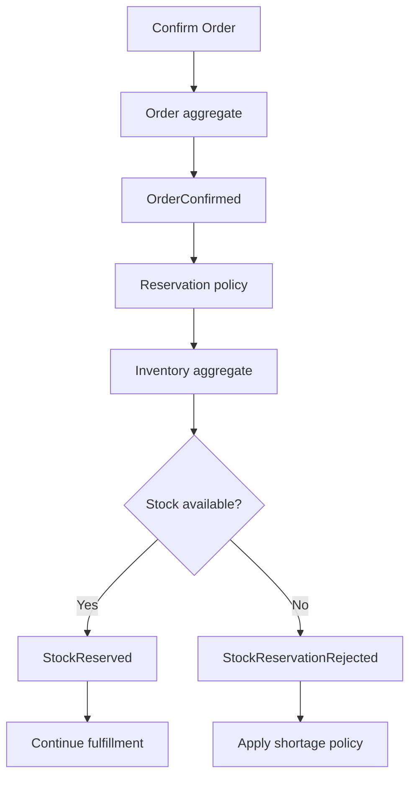

# Aggregate: nhóm đối tượng tạo thành ranh giới nhất quán

Trong Domain-Driven Design (DDD), một nghiệp vụ thường liên quan đến nhiều entity và value object. Tuy nhiên, không phải mọi đối tượng có liên quan đều cần được tải, thay đổi và lưu như một khối duy nhất. Nhóm cần xác định những đối tượng nào phải cùng tuân thủ một tập hợp quy tắc tại thời điểm thay đổi, và đâu là ranh giới chịu trách nhiệm bảo vệ các quy tắc đó.

**Aggregate** là một nhóm entity và value object được xem như một đơn vị nhất quán trong mô hình miền. Mỗi aggregate có một **aggregate root** làm điểm truy cập bên ngoài. Aggregate root bảo vệ các bất biến (invariant) và kiểm soát những thay đổi đối với các đối tượng bên trong ranh giới của nó.

Aggregate giúp nhóm trả lời các câu hỏi quan trọng: dữ liệu nào phải nhất quán ngay lập tức, ai có quyền thay đổi nó, đối tượng bên ngoài được tham chiếu như thế nào và những thay đổi nào có thể được phối hợp bất đồng bộ. Thiết kế aggregate phù hợp giúp domain model bảo vệ quy tắc nghiệp vụ mà không tạo ra những nhóm đối tượng quá lớn, khó tải và khó thay đổi.

## 1. Aggregate là gì?

Aggregate là một cụm đối tượng miền được gom quanh một ranh giới nhất quán. Các đối tượng trong cụm có thể gồm:

- Một entity đóng vai trò aggregate root.
- Các entity nội bộ có danh tính riêng nhưng chỉ được quản lý qua root.
- Các value object mô tả giá trị, quy tắc hoặc thuộc tính của đối tượng.
- Các cấu trúc dữ liệu nội bộ cần thiết để thực thi hành vi và bảo vệ bất biến.

Ví dụ, một `Order` có thể chứa các dòng hàng (`OrderLine`), địa chỉ giao hàng và thông tin tiền tệ. Khi thêm hoặc bỏ dòng hàng, tổng tiền đơn phải được cập nhật đúng. Khi xác nhận đơn, hệ thống cần bảo đảm đơn có ít nhất một dòng hàng hợp lệ và các điều kiện xác nhận được đáp ứng.

Những đối tượng này có thể thuộc cùng một aggregate vì các quy tắc liên quan cần được bảo vệ trong cùng một ranh giới nhất quán. Tuy nhiên, khách hàng, kho, giao dịch thanh toán và đơn vị vận chuyển không tự động thuộc aggregate `Order` chỉ vì chúng có liên quan đến đơn hàng.

Aggregate không phải là:

- Một tập hợp mọi object có quan hệ với nhau trong sơ đồ lớp.
- Một bản sao nguyên trạng của quan hệ bảng trong database.
- Một cách gom tất cả dữ liệu cần cho một màn hình vào cùng một object.
- Một transaction bao trùm mọi dịch vụ và hệ thống bên ngoài.
- Một lý do để tạo một lớp lớn chứa toàn bộ logic của ứng dụng.

Aggregate là quyết định mô hình hóa dựa trên quy tắc nghiệp vụ và nhu cầu nhất quán.

## 2. Aggregate root: cổng truy cập duy nhất

**Aggregate root** là entity gốc đại diện cho aggregate. Mọi tương tác từ bên ngoài với aggregate đều đi qua root. Root chịu trách nhiệm duy trì các bất biến của aggregate và quyết định hành vi nào được phép thực hiện.

Ví dụ, bên ngoài có thể yêu cầu `Order` thêm dòng hàng, thay đổi số lượng hoặc xác nhận đơn. Bên ngoài không nên lấy một `OrderLine` nội bộ rồi sửa trực tiếp số lượng, bởi thao tác đó có thể làm tổng tiền hoặc trạng thái đơn không còn nhất quán.

```text
Order aggregate

        +---------------------------+
        |       Order (root)        |
        |---------------------------|
        | orderId                   |
        | status                    |
        | total                     |
        |---------------------------|
        | addLine(...)              |
        | changeQuantity(...)       |
        | confirm()                 |
        +-------------+-------------+
                      |
          +-----------+-----------+
          |                       |
          v                       v
  +---------------+       +------------------+
  |   OrderLine   |       | ShippingAddress |
  |---------------|       |------------------|
  | productId     |       | street           |
  | quantity      |       | city             |
  | unitPrice     |       | postalCode       |
  +---------------+       +------------------+
```

Trong ví dụ, `OrderLine` được quản lý bên trong `Order`; `ShippingAddress` có thể là value object. Aggregate root là điểm mà application layer hoặc domain service gọi để thực hiện thay đổi.

### 2.1. Vì sao cần một root?

Nếu nhiều thành phần bên ngoài được phép sửa trực tiếp các object nội bộ, mỗi nơi có thể bỏ qua một phần quy tắc. Ví dụ, một API thay số lượng dòng hàng nhưng quên cập nhật tổng tiền; một tác vụ nền xác nhận đơn dù chưa có dòng hàng; một consumer cập nhật trạng thái mà không kiểm tra đơn đã bị hủy.

Khi root là cổng truy cập, mọi thay đổi phải đi qua các hành vi do root cung cấp. Root có thể kiểm tra trạng thái hiện tại, xác minh điều kiện, cập nhật các object nội bộ và ghi nhận sự kiện miền phù hợp.

### 2.2. Root không có nghĩa phải chứa mọi thuộc tính

Aggregate root không nhất thiết phải giữ mọi dữ liệu liên quan đến quy trình. Nó chỉ quản lý những đối tượng cần nằm trong ranh giới nhất quán của aggregate. Thông tin phục vụ đọc hoặc báo cáo có thể được lấy qua read model. Dữ liệu thuộc aggregate khác được tham chiếu bằng ID hoặc truy vấn qua cổng phù hợp.

## 3. Invariant và ranh giới nhất quán

**Invariant (bất biến)** là quy tắc phải luôn đúng tại những thời điểm mô hình cho phép quan sát trạng thái hợp lệ. Aggregate được thiết kế để bảo vệ một nhóm bất biến cần được duy trì nhất quán trong cùng một thay đổi nghiệp vụ.

Ví dụ với đơn hàng:

- Đơn hàng đã xác nhận phải có ít nhất một dòng hàng.
- Số lượng mỗi dòng hàng phải lớn hơn 0.
- Các dòng hàng trong một đơn phải dùng tiền tệ phù hợp với chính sách của đơn.
- Đơn đã hủy không thể tiếp tục được chỉnh sửa như đơn nháp.
- Tổng tiền phải phản ánh các dòng hàng và quy tắc giá đã áp dụng.

Những quy tắc này có thể được bảo vệ bên trong aggregate `Order`. Khi một hành vi làm thay đổi trạng thái, root kiểm tra điều kiện và chỉ thực hiện thay đổi nếu kết quả vẫn hợp lệ.

### 3.1. Không phải mọi quy tắc đều là invariant của một aggregate

Một quy trình đặt hàng có thể liên quan đến các điều kiện như:

- Khách hàng có được phép mua chịu không?
- Kho còn đủ hàng không?
- Cổng thanh toán đã chấp nhận giao dịch chưa?
- Địa chỉ giao hàng có nằm trong vùng phục vụ không?

Những điều kiện này có thể thuộc các bounded context hoặc aggregate khác nhau. `Order` không nên tự truy cập database của kho, gọi cổng thanh toán và đọc hồ sơ tín dụng chỉ để kiểm tra mọi thứ bên trong một phương thức `confirm()`.

Thay vào đó, application service hoặc quy trình điều phối thu thập kết quả cần thiết, sau đó gửi command phù hợp đến aggregate. Mỗi aggregate bảo vệ các bất biến mà nó sở hữu. Các quy trình liên aggregate được phối hợp qua sự kiện, policy, saga hoặc cơ chế điều phối phù hợp.

### 3.2. Nhất quán ngay lập tức và nhất quán cuối cùng

Trong một aggregate, các bất biến cần được bảo vệ đồng bộ khi thực hiện một thay đổi. Giữa các aggregate, nhóm thường chấp nhận cập nhật bất đồng bộ và nhất quán cuối cùng nếu nghiệp vụ cho phép.

Ví dụ, khi đơn hàng được xác nhận, một domain event có thể được phát ra để kho giữ hàng. Việc kho xử lý yêu cầu có thể diễn ra sau đó. Trong khoảng thời gian chờ, hệ thống cần biểu diễn trạng thái phù hợp như `AwaitingStockReservation` hoặc một trạng thái điều phối khác nếu nghiệp vụ cần.

Không nên giả định rằng mọi dữ liệu liên quan đều phải được cập nhật trong một transaction database duy nhất. Ranh giới aggregate giúp xác định phạm vi nhất quán tức thời, còn quy trình lớn hơn cần chính sách phối hợp riêng.

## 4. Quy tắc truy cập các đối tượng bên trong aggregate

Một nguyên tắc thiết kế phổ biến là đối tượng bên ngoài chỉ giữ tham chiếu đến aggregate root, không giữ tham chiếu trực tiếp đến entity nội bộ.

Ví dụ, application service tải `Order` qua repository và gọi `order.changeQuantity(...)`. Nó không tải `OrderLine` riêng rồi gọi `line.setQuantity(...)`.

```text
Application Service
        |
        v
OrderRepository
        |
        v
Order (Aggregate Root)
        |
        +---- OrderLine (internal entity)
        |
        +---- Money (value object)
        |
        +---- ShippingAddress (value object)
```

Các entity nội bộ có thể có ID riêng để phân biệt chúng trong aggregate, nhưng ID đó không có nghĩa chúng được truy cập độc lập từ bên ngoài. Nếu một đối tượng cần được tải và thay đổi độc lập, có vòng đời và bất biến riêng, nhóm nên xem xét liệu nó có cần trở thành aggregate root của một aggregate khác hay không.

### 4.1. Tham chiếu aggregate khác bằng ID

Khi một aggregate cần liên hệ với aggregate khác, nên tham chiếu bằng định danh thay vì giữ toàn bộ object graph.

Ví dụ, `Order` có thể giữ `CustomerId` thay vì chứa cả entity `Customer`. `PickingTask` có thể giữ `OrderId` để biết nhiệm vụ lấy hàng được tạo từ đơn nào.

```java
public record CustomerId(UUID value) {}
public record OrderId(UUID value) {}

public final class Order {
    private final OrderId id;
    private final CustomerId customerId;
}
```

Tham chiếu bằng ID giúp giới hạn ranh giới, giảm phụ thuộc và tránh tải một đồ thị object lớn. Khi cần thông tin từ aggregate khác, application service có thể truy vấn qua repository hoặc read model phù hợp rồi truyền dữ liệu cần thiết vào use case.

### 4.2. Không dùng tham chiếu object để tạo transaction xuyên aggregate

Nếu `Order` giữ toàn bộ `Customer`, `Inventory`, `Payment` và `Shipment`, một thay đổi nhỏ có thể kéo theo việc tải và khóa nhiều dữ liệu. Mô hình sẽ trở nên phụ thuộc chặt và khó kiểm soát đồng thời.

Tham chiếu ID không có nghĩa không thể truy vấn dữ liệu liên quan. Nó chỉ nhấn mạnh rằng mỗi aggregate tự sở hữu vòng đời và bất biến của mình; việc phối hợp phải được thực hiện rõ qua các ranh giới.

## 5. Thiết kế aggregate vừa đủ nhỏ

Một aggregate quá lớn thường làm tăng xung đột cập nhật, thời gian tải, phạm vi khóa và độ khó kiểm thử. Một aggregate quá nhỏ có thể khiến những bất biến cần được bảo vệ cùng nhau bị phân tán và phải phối hợp bằng nhiều bước.

Mục tiêu không phải là tạo aggregate lớn nhất hoặc nhỏ nhất, mà là tìm ranh giới phù hợp với các bất biến và hành vi nghiệp vụ.

### 5.1. Gom theo invariant, không gom theo quan hệ sở hữu

Hai đối tượng có quan hệ một-nhiều trong database không nhất thiết phải thuộc cùng aggregate. Ví dụ, một khách hàng có hàng nghìn đơn hàng. Nếu mọi đơn hàng nằm bên trong aggregate `Customer`, mỗi lần đặt hoặc cập nhật đơn đều có thể phải tải và khóa aggregate khách hàng rất lớn.

Trong nhiều mô hình, `Customer` và `Order` nên là hai aggregate riêng. `Order` tham chiếu `CustomerId`; mỗi đơn hàng được thay đổi độc lập. Quy tắc giới hạn tín dụng hoặc điều kiện khách hàng được mua có thể được xác minh qua một quy trình phù hợp, với cơ chế đồng bộ hoặc bất đồng bộ theo yêu cầu nghiệp vụ.

### 5.2. Gom theo thay đổi cần nguyên tử

Nếu hai đối tượng luôn phải thay đổi cùng nhau để giữ một bất biến và nghiệp vụ yêu cầu kết quả tức thời, chúng có thể cần nằm trong cùng aggregate. Ví dụ, số lượng và tổng tiền của một dòng hàng có thể cần được cập nhật cùng nhau khi thay đổi số lượng.

Ngược lại, nếu hai đối tượng có thể cập nhật độc lập và chấp nhận một khoảng thời gian chưa đồng bộ, hãy cân nhắc tách chúng thành các aggregate khác nhau.

### 5.3. Đặt câu hỏi về tính đồng thời

Hãy xem nhiều người dùng có thể cập nhật cùng một aggregate cùng lúc không. Nếu aggregate lớn, nhiều thao tác không liên quan có thể xung đột trên cùng một phiên bản. Chia aggregate theo bất biến giúp giảm tranh chấp và làm rõ nơi cần kiểm soát concurrency.

## 6. Ví dụ Java: Order aggregate bảo vệ quy tắc đơn hàng

Giả sử nghiệp vụ yêu cầu:

- Đơn hàng có ID và trạng thái riêng.
- Mỗi dòng hàng có sản phẩm, số lượng và đơn giá.
- Số lượng phải lớn hơn 0 và đơn giá không âm.
- Chỉ đơn nháp mới được thêm hoặc thay đổi dòng hàng.
- Chỉ đơn có ít nhất một dòng hàng mới được xác nhận.
- Tổng tiền được tính từ các dòng hàng.

Một cách triển khai minh họa:

```java
public record OrderId(UUID value) {
    public OrderId {
        Objects.requireNonNull(value);
    }
}

public record ProductId(String value) {
    public ProductId {
        if (value == null || value.isBlank()) {
            throw new IllegalArgumentException("ProductId is required");
        }
    }
}

public record Money(BigDecimal amount, Currency currency) {
    public Money {
        Objects.requireNonNull(amount);
        Objects.requireNonNull(currency);
        if (amount.signum() < 0) {
            throw new IllegalArgumentException("Amount cannot be negative");
        }
    }

    public Money add(Money other) {
        if (!currency.equals(other.currency)) {
            throw new IllegalArgumentException("Currency mismatch");
        }
        return new Money(amount.add(other.amount), currency);
    }

    public Money multiply(int quantity) {
        if (quantity < 0) {
            throw new IllegalArgumentException("Quantity cannot be negative");
        }
        return new Money(amount.multiply(BigDecimal.valueOf(quantity)), currency);
    }
}

public enum OrderStatus {
    DRAFT,
    CONFIRMED,
    CANCELLED
}

public final class OrderLine {
    private final ProductId productId;
    private int quantity;
    private final Money unitPrice;

    OrderLine(ProductId productId, int quantity, Money unitPrice) {
        this.productId = Objects.requireNonNull(productId);
        this.unitPrice = Objects.requireNonNull(unitPrice);
        changeQuantity(quantity);
    }

    void changeQuantity(int newQuantity) {
        if (newQuantity <= 0) {
            throw new IllegalArgumentException("Quantity must be positive");
        }
        this.quantity = newQuantity;
    }

    Money subtotal() {
        return unitPrice.multiply(quantity);
    }
}

public final class Order {
    private final OrderId id;
    private final CustomerId customerId;
    private final List<OrderLine> lines = new ArrayList<>();
    private OrderStatus status = OrderStatus.DRAFT;

    public Order(OrderId id, CustomerId customerId) {
        this.id = Objects.requireNonNull(id);
        this.customerId = Objects.requireNonNull(customerId);
    }

    public void addLine(ProductId productId, int quantity, Money unitPrice) {
        ensureDraft();
        lines.add(new OrderLine(productId, quantity, unitPrice));
    }

    public void changeLineQuantity(int lineIndex, int quantity) {
        ensureDraft();
        if (lineIndex < 0 || lineIndex >= lines.size()) {
            throw new IllegalArgumentException("Order line not found");
        }
        lines.get(lineIndex).changeQuantity(quantity);
    }

    public Money total() {
        if (lines.isEmpty()) {
            throw new IllegalStateException("An empty order has no total");
        }
        Money total = new Money(BigDecimal.ZERO, lines.getFirst().subtotal().currency());
        for (OrderLine line : lines) {
            total = total.add(line.subtotal());
        }
        return total;
    }

    public void confirm() {
        ensureDraft();
        if (lines.isEmpty()) {
            throw new IllegalStateException("Cannot confirm an empty order");
        }
        total(); // Kiểm tra tính nhất quán tiền tệ và tổng tiền.
        status = OrderStatus.CONFIRMED;
        // Có thể ghi nhận domain event OrderConfirmed tại đây.
    }

    private void ensureDraft() {
        if (status != OrderStatus.DRAFT) {
            throw new IllegalStateException("Only draft orders can be changed");
        }
    }
}
```

Đây là ví dụ tập trung vào ranh giới aggregate, không phải mã hoàn chỉnh cho một hệ thống thương mại. Trong Java 21 trở lên, `List.getFirst()` có sẵn; với phiên bản cũ hơn, có thể dùng `get(0)`. Một triển khai thực tế cần bổ sung ID cho dòng hàng nếu cần tham chiếu riêng, xử lý thay đổi giá, làm tròn tiền, loại tiền của đơn, snapshot giá, hủy đơn, event collection và các chính sách nghiệp vụ khác.

Điểm quan trọng là `OrderLine` không được cung cấp API công khai để bên ngoài tự sửa. `Order` kiểm soát việc thêm dòng và thay đổi số lượng, qua đó bảo vệ các quy tắc của aggregate.

## 7. Repository làm việc với aggregate root

Trong DDD, repository thường được định nghĩa cho aggregate root. Nó cung cấp cách tải và lưu một aggregate theo danh tính, che giấu chi tiết persistence.

```java
public interface OrderRepository {
    Optional<Order> findById(OrderId id);
    void save(Order order);
}
```

Application service tải `Order` qua repository, gọi hành vi trên root rồi lưu aggregate. Repository không nên cung cấp một API cho phép bên ngoài tải và cập nhật trực tiếp từng entity nội bộ nếu điều đó phá vỡ ranh giới.

```java
public final class ChangeOrderLineQuantityService {
    private final OrderRepository orders;

    public ChangeOrderLineQuantityService(OrderRepository orders) {
        this.orders = orders;
    }

    public void change(OrderId orderId, int lineIndex, int quantity) {
        Order order = orders.findById(orderId).orElseThrow();
        order.changeLineQuantity(lineIndex, quantity);
        orders.save(order);
    }
}
```

Repository không phải một API CRUD tổng quát cho mọi bảng. Nó hỗ trợ truy xuất aggregate theo nhu cầu của mô hình miền. Các màn hình báo cáo hoặc danh sách có thể dùng query service/read model riêng thay vì tải hàng loạt aggregate chỉ để đọc.

## 8. Giao dịch và đồng thời trong aggregate

Aggregate là ranh giới nhất quán, vì vậy một thay đổi cần bảo vệ bất biến thường được lưu trong một transaction phù hợp với aggregate đó. Khi nhiều người cùng cập nhật một aggregate, hệ thống cần phát hiện xung đột để không ghi đè một thay đổi hợp lệ bằng dữ liệu cũ.

### 8.1. Optimistic concurrency

Một cách phổ biến là dùng version. Khi tải aggregate, repository đọc version hiện tại. Khi lưu, hệ thống chỉ cập nhật nếu version trong database vẫn bằng version đã đọc. Nếu một giao dịch khác đã lưu trước, update thất bại và ứng dụng cần tải lại, đánh giá lại command hoặc trả lỗi xung đột.

```text
Transaction A reads Order version 5
Transaction B reads Order version 5

Transaction A saves version 6  -> success
Transaction B saves version 6  -> conflict
```

Optimistic concurrency phù hợp khi xung đột không quá thường xuyên. Với các điểm nóng có nhiều cập nhật đồng thời, nhóm cần đánh giá chiến lược khóa, phân vùng hoặc thay đổi ranh giới aggregate.

### 8.2. Pessimistic locking

Pessimistic locking khóa dữ liệu trong lúc transaction thực hiện để ngăn các thao tác cạnh tranh. Nó có thể phù hợp với một số quy trình, nhưng khóa lâu hoặc aggregate quá lớn dễ làm giảm throughput và gây deadlock. Việc dùng khóa cần dựa trên tải thực tế và yêu cầu nhất quán.

### 8.3. Không giữ transaction mở khi chờ hệ thống ngoài

Một aggregate không nên giữ transaction database mở trong lúc chờ cổng thanh toán hoặc dịch vụ vận chuyển phản hồi lâu. Các lời gọi mạng có thể timeout, chậm hoặc thất bại. Hãy lưu trạng thái trung gian, phát event hoặc dùng quy trình điều phối để tiếp tục khi có kết quả.

## 9. Phối hợp giữa nhiều aggregate

Một quy trình lớn thường thay đổi nhiều aggregate. Ví dụ, xác nhận đơn có thể liên quan đến `Order`, `InventoryItem`, `Payment` và `Shipment`. Mỗi aggregate sở hữu bất biến riêng; không nên gom tất cả vào một aggregate chỉ để có một transaction lớn.

Một cách phối hợp thường gặp:

1. Aggregate `Order` được xác nhận và ghi nhận `OrderConfirmed`.
2. Application layer công bố sự kiện hoặc khởi động policy.
3. Context kho xử lý yêu cầu giữ hàng và cập nhật aggregate tồn kho.
4. Kho phát `StockReserved` hoặc `StockReservationRejected`.
5. Quy trình điều phối nhận kết quả và tiếp tục hoặc thực hiện hành động bù phù hợp.



Đây là một quy trình bất đồng bộ minh họa. Nếu giữ hàng thất bại, nghiệp vụ có thể hủy đơn, chờ bổ sung hàng, đề xuất thay thế hoặc hoàn tiền. Quyết định đó cần được xác định bằng chính sách và có thể cần saga/process manager.

### 9.1. Domain event giúp phối hợp

Domain event mô tả điều đã xảy ra trong một aggregate hoặc bounded context. Event có thể được xử lý bởi policy để gửi command đến aggregate khác. Event cần được đặt tên theo ngôn ngữ nghiệp vụ và chỉ công bố sau khi thay đổi tương ứng được xác nhận theo cơ chế của ứng dụng.

Trong hệ thống phân tán, Transactional Outbox có thể giúp lưu thay đổi aggregate và bản ghi sự kiện trong cùng transaction database. Một tiến trình riêng chuyển sự kiện ra message broker. Cơ chế này giảm nguy cơ lưu dữ liệu thành công nhưng mất message, tuy vậy consumer vẫn cần xử lý trùng lặp và idempotency.

### 9.2. Eventual consistency cần được nghiệp vụ chấp nhận

Khi các aggregate cập nhật độc lập, có thể tồn tại một khoảng thời gian mà trạng thái giữa chúng chưa đồng bộ. Ví dụ, đơn đã xác nhận nhưng kho chưa phản hồi kết quả giữ hàng. Hệ thống cần mô hình hóa trạng thái trung gian và xác định thời hạn, retry, thông báo hoặc hành động bù.

Không nên chọn eventual consistency chỉ vì nó thuận tiện về kỹ thuật. Chuyên gia nghiệp vụ cần xác nhận khoảng trễ có thể chấp nhận, người dùng cần nhìn thấy trạng thái nào và điều gì xảy ra khi quy trình không thể hoàn tất.

## 10. Các nguyên tắc thiết kế aggregate

Một số nguyên tắc thực hành thường được dùng khi xác định ranh giới aggregate:

### 10.1. Bảo vệ bất biến thực sự cần nhất quán

Đừng gom đối tượng chỉ vì chúng có quan hệ. Hãy hỏi những quy tắc nào phải đúng ngay sau một command và dữ liệu nào cần được thay đổi cùng nhau để giữ quy tắc đó.

### 10.2. Giữ aggregate nhỏ và tập trung

Aggregate nhỏ thường dễ tải, lưu, kiểm thử và cập nhật đồng thời. Một aggregate nên có trách nhiệm rõ ràng. Nếu root có hàng chục hành vi không liên quan hoặc phải tải một đồ thị lớn, ranh giới có thể đang quá rộng.

### 10.3. Tham chiếu aggregate khác bằng ID

Giữ tham chiếu đến root của aggregate khác bằng ID. Khi cần dữ liệu, truy vấn qua repository hoặc read model. Cách này giúp giới hạn object graph và quyền sở hữu.

### 10.4. Một transaction cho một aggregate khi có thể

Một command thường thay đổi một aggregate trong một transaction. Nếu quy trình cần cập nhật nhiều aggregate, cân nhắc event, policy hoặc saga và xác định rõ nhất quán cuối cùng.

### 10.5. Thay đổi qua hành vi, không qua setter tùy tiện

Aggregate root nên cung cấp phương thức diễn đạt hành vi nghiệp vụ như `confirm()`, `cancel()` hoặc `changeQuantity()`. Các phương thức này kiểm tra trạng thái và bảo vệ bất biến. Một loạt setter công khai dễ cho phép trạng thái không hợp lệ.

### 10.6. Dùng repository cho root

Repository tải và lưu aggregate root. Tránh repository riêng cho entity nội bộ nếu việc truy cập độc lập làm mất kiểm soát của root.

### 10.7. Xem xét concurrency và tần suất thay đổi

Nếu nhiều thao tác độc lập thường xuyên cập nhật cùng một aggregate, có thể ranh giới quá lớn. Nếu bất biến liên quan bị tách và thường xuyên vi phạm, có thể ranh giới quá nhỏ hoặc quy trình cần một chính sách phối hợp khác.

## 11. Khi nào một đối tượng nên trở thành aggregate root riêng?

Một đối tượng có thể cần trở thành aggregate root riêng nếu nó có danh tính, vòng đời và quy tắc nhất quán độc lập, hoặc cần được truy cập và cập nhật thường xuyên mà không cần tải aggregate hiện tại.

Ví dụ, `Order` và `Payment` thường có vòng đời khác nhau:

- Đơn hàng có thể được tạo, xác nhận, hủy và hoàn tất.
- Thanh toán có thể được khởi tạo, ủy quyền, thu tiền, thất bại, void hoặc hoàn tiền.
- Một đơn hàng có thể có nhiều lần thử thanh toán.
- Một giao dịch thanh toán có thể cần đối soát độc lập với trạng thái đơn hàng.

Trong trường hợp đó, `Payment` có thể là aggregate riêng và giữ `OrderId` làm tham chiếu. `Order` không cần chứa toàn bộ các giao dịch thanh toán. Quy trình điều phối đảm bảo kết quả thanh toán dẫn đến hành động phù hợp đối với đơn hàng.

Ngược lại, một `OrderLine` thường không cần là aggregate root riêng nếu nó chỉ có ý nghĩa trong đơn hàng, không có vòng đời độc lập và các thay đổi phải tuân theo bất biến của `Order`.

Hãy đánh giá dựa trên quy tắc, vòng đời và nhu cầu truy cập, không dựa trên số lượng thuộc tính hoặc tên lớp.

## 12. Những sai lầm thường gặp

| Sai lầm | Hệ quả | Cách cải thiện |
| --- | --- | --- |
| Gom tất cả object có quan hệ vào một aggregate | Aggregate quá lớn, nhiều xung đột và khó thay đổi | Gom theo invariant cần bảo vệ cùng nhau |
| Cho phép sửa entity nội bộ trực tiếp | Bỏ qua kiểm tra của aggregate root | Chỉ cung cấp hành vi thay đổi qua root |
| Tham chiếu toàn bộ aggregate khác | Object graph lớn và phụ thuộc chặt | Tham chiếu bằng ID và truy vấn khi cần |
| Dùng một transaction cho toàn bộ quy trình nhiều context | Khó mở rộng và dễ giữ khóa lâu | Tách aggregate, phối hợp qua event hoặc saga |
| Đưa mọi quy tắc vào aggregate root | Root trở nên quá lớn và phụ thuộc nhiều context | Giữ invariant nội bộ trong aggregate; điều phối ở application layer |
| Tạo aggregate chỉ theo cấu trúc database | Mô hình phản ánh bảng thay vì quy tắc nghiệp vụ | Bắt đầu từ hành vi và consistency boundary |
| Công khai setter cho mọi thuộc tính | Có thể tạo trạng thái không hợp lệ | Dùng phương thức thể hiện hành vi và kiểm tra điều kiện |
| Không xử lý concurrency | Ghi đè thay đổi hoặc vi phạm invariant khi cập nhật đồng thời | Dùng version, optimistic/pessimistic locking phù hợp |
| Giả định event được giao đúng một lần | Consumer xử lý trùng gây tác dụng phụ | Thiết kế idempotency và outbox khi cần |
| Ép eventual consistency mà không hỏi nghiệp vụ | Trạng thái trung gian không được người dùng chấp nhận | Thống nhất độ trễ, trạng thái và hành động bù |

## 13. Quy trình xác định aggregate trong một domain model

Nhóm có thể sử dụng quy trình sau khi chuyển từ hiểu biết nghiệp vụ sang thiết kế aggregate.

### Bước 1: Liệt kê các command và hành vi nghiệp vụ

Tìm các hành động làm thay đổi trạng thái như tạo đơn, thêm dòng hàng, xác nhận, hủy, giữ hàng hoặc ghi nhận thanh toán. Tập trung vào điều người dùng muốn thực hiện và kết quả cần có.

### Bước 2: Xác định các invariant

Với từng hành vi, hỏi điều kiện nào phải đúng trước và sau khi thực hiện. Những dữ liệu nào cần được kiểm tra và cập nhật cùng nhau để bảo vệ các điều kiện đó?

### Bước 3: Nhóm đối tượng theo consistency boundary

Đặt những entity và value object cần cùng nhất quán vào một nhóm ứng viên. Nếu một quy tắc đòi hỏi thay đổi hai đối tượng trong cùng một transaction, hãy kiểm tra xem chúng có nên cùng aggregate hay không.

### Bước 4: Chọn aggregate root

Chọn entity có danh tính và trách nhiệm điều phối thay đổi bên trong nhóm. Root cần cung cấp hành vi để bảo vệ invariant và là điểm truy cập từ bên ngoài.

### Bước 5: Xác định tham chiếu đến aggregate khác

Thay object reference xuyên aggregate bằng ID khi phù hợp. Xác định dữ liệu nào cần truy vấn thêm và nơi nào chịu trách nhiệm cung cấp.

### Bước 6: Kiểm tra kích thước và concurrency

Đánh giá số lượng đối tượng, tần suất cập nhật, khả năng tranh chấp và nhu cầu tải dữ liệu. Nếu aggregate quá lớn hoặc nhiều thao tác không liên quan thường xuyên xung đột, xem xét tách ranh giới.

### Bước 7: Xác định quy trình liên aggregate

Nếu một use case cần thay đổi nhiều aggregate, mô tả thứ tự command/event, trạng thái trung gian, retry và hành động bù. Xác nhận với nghiệp vụ khoảng thời gian chưa đồng bộ có chấp nhận được không.

### Bước 8: Kiểm chứng bằng ví dụ và kiểm thử

Thử các trường hợp hợp lệ, không hợp lệ, cập nhật đồng thời và thất bại giữa chừng. Nếu root không thể bảo vệ invariant hoặc phải biết quá nhiều chi tiết bên ngoài, xem lại ranh giới và trách nhiệm.

## 14. Nguyên tắc thực hành

Khi thiết kế aggregate trong DDD, nhóm nên nhớ:

- **Aggregate là ranh giới nhất quán.** Xác định nó từ invariant và hành vi nghiệp vụ.
- **Aggregate root là cổng truy cập.** Mọi thay đổi bên ngoài đi qua root để bảo vệ quy tắc.
- **Không gom theo quan hệ dữ liệu đơn thuần.** Quan hệ một-nhiều trong database không quyết định ranh giới aggregate.
- **Giữ aggregate vừa đủ nhỏ.** Chỉ đưa vào những đối tượng cần được bảo vệ cùng nhau.
- **Tham chiếu aggregate khác bằng ID.** Mỗi aggregate tự quản lý vòng đời và invariant của mình.
- **Repository làm việc với root.** Không mở đường truy cập trực tiếp đến entity nội bộ nếu điều đó phá vỡ ranh giới.
- **Dùng hành vi thay vì setter tự do.** Mỗi thay đổi cần thể hiện ý nghĩa nghiệp vụ và kiểm tra điều kiện.
- **Phối hợp liên aggregate một cách tường minh.** Dùng domain event, policy hoặc saga khi cần.
- **Thiết kế cho concurrency.** Xác định cách phát hiện xung đột và xử lý cập nhật đồng thời.
- **Kiểm chứng với nghiệp vụ.** Độ trễ, trạng thái trung gian và hành động bù phải phù hợp với kỳ vọng thực tế.

Aggregate giúp nhóm xác định nơi nào cần bảo vệ các quy tắc ngay lập tức và ai có quyền thay đổi trạng thái. Khi ranh giới được chọn dựa trên invariant, aggregate root kiểm soát truy cập, các aggregate khác được tham chiếu bằng ID và quy trình lớn được phối hợp rõ ràng, domain model sẽ dễ hiểu, nhất quán và có khả năng mở rộng hơn.

## 15. Câu hỏi tự kiểm tra

1. Aggregate là gì và vì sao không nên xem nó đơn thuần là một nhóm object có quan hệ?
2. Aggregate root có trách nhiệm gì đối với các entity và value object bên trong aggregate?
3. Invariant là gì? Hãy nêu ba invariant có thể được bảo vệ trong `Order` aggregate.
4. Vì sao không nên để application service sửa trực tiếp một `OrderLine` nội bộ?
5. Vì sao một `Order` thường tham chiếu `CustomerId` thay vì giữ toàn bộ entity `Customer`?
6. Những tiêu chí nào giúp quyết định hai đối tượng có nên thuộc cùng một aggregate?
7. Phân biệt nhất quán tức thời trong aggregate với eventual consistency giữa các aggregate.
8. Repository trong DDD thường tải và lưu đối tượng nào của aggregate?
9. Optimistic concurrency phát hiện xung đột cập nhật như thế nào?
10. Vì sao không nên giữ transaction database mở trong lúc chờ cổng thanh toán hoặc dịch vụ bên ngoài?
11. Domain event và saga có thể phối hợp các aggregate trong một quy trình lớn như thế nào?
12. Hãy chọn một quy trình nghiệp vụ, xác định invariant, đề xuất aggregate root, các đối tượng nội bộ và cách phối hợp với aggregate khác.
