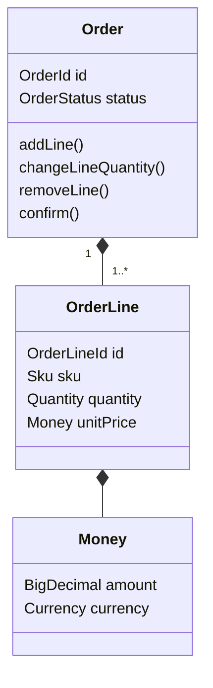
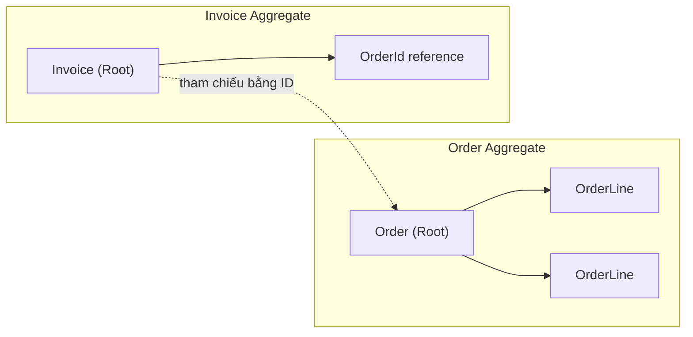

# Aggregate Root và quyền kiểm soát thay đổi bên trong

Trong Domain-Driven Design (DDD), **Aggregate** là một cụm đối tượng miền được xem như một đơn vị nhất quán. **Aggregate Root** là đối tượng gốc đại diện cho cụm đó và là cổng truy cập từ bên ngoài. Mọi thay đổi có thể ảnh hưởng đến các bất biến của Aggregate cần được thực hiện thông qua Root để các quy tắc được kiểm tra tại một nơi có thẩm quyền.

Ví dụ, một đơn hàng có thể chứa nhiều dòng hàng. Bên ngoài nên gửi yêu cầu đến `Order` để thêm dòng, đổi số lượng hoặc xác nhận đơn. Không nên lấy một `OrderLine` ra rồi tự sửa số lượng mà bỏ qua quy tắc về số lượng tối thiểu, tổng tiền hoặc trạng thái của đơn. `Order` kiểm soát những hành động đó vì nó chịu trách nhiệm bảo vệ tính hợp lệ của toàn bộ đơn hàng.

## 1. Aggregate giải quyết vấn đề gì?

Một mô hình miền thường có nhiều đối tượng liên quan. Nếu mọi thành phần đều có thể được tải và sửa độc lập, các quy tắc liên quan giữa chúng dễ bị phân tán.

Hãy xét một đơn hàng có các thông tin:

- Mã đơn và khách hàng đặt đơn.
- Danh sách dòng hàng, mỗi dòng có SKU, số lượng và đơn giá.
- Trạng thái đơn hàng.
- Các điều kiện xác nhận và giới hạn chỉnh sửa.

Một số quy tắc cần được bảo vệ trên toàn bộ đơn:

- Đơn phải có ít nhất một dòng hàng trước khi được gửi.
- Số lượng mỗi dòng phải lớn hơn 0.
- Không được sửa dòng hàng sau khi đơn đã xác nhận.
- Tổng tiền phải được tính từ các dòng hàng theo chính sách đã thống nhất.
- Một đơn đã hủy không thể tiếp tục được xác nhận.

Nếu controller, application service hoặc nhiều repository tự sửa các đối tượng bên trong, mỗi nơi có thể quên một quy tắc. Aggregate tạo ra ranh giới nhất quán: các đối tượng trong cụm tuân theo những bất biến được bảo vệ bởi một Root.

## 2. Aggregate Root là gì?

Aggregate Root là đối tượng có trách nhiệm:

- Đại diện cho Aggregate trong các tương tác từ bên ngoài.
- Cung cấp các phương thức nghiệp vụ để yêu cầu thay đổi.
- Kiểm tra trạng thái và điều kiện trước khi thay đổi các đối tượng bên trong.
- Bảo đảm các bất biến của Aggregate vẫn đúng sau mỗi thao tác được chấp nhận.
- Là điểm tham chiếu và thường là điểm nạp/lưu của Repository.

Root thường là một Entity vì nó có định danh ổn định và vòng đời riêng. Tuy nhiên, không phải Entity nào cũng là Aggregate Root. Một Entity con có thể có ID riêng nhưng vẫn chỉ được truy cập và thay đổi thông qua Root.

Ví dụ, `Order` là Root; `OrderLine` có thể là Entity bên trong Aggregate. Mỗi dòng hàng có `OrderLineId` để phân biệt các dòng trong cùng đơn, nhưng bên ngoài không được tự ý tải `OrderLine` và sửa nó nếu thao tác đó có thể phá vỡ quy tắc của `Order`.



Sơ đồ thể hiện `Order` là cổng truy cập của cụm. `OrderLine` và `Money` không cần được công bố thành các đối tượng có thể sửa độc lập từ bên ngoài Aggregate.

## 3. Quyền kiểm soát thay đổi bên trong

Quyền kiểm soát của Root được thể hiện qua API công khai. Bên ngoài yêu cầu một hành động có ý nghĩa nghiệp vụ; Root tự quyết định hành động đó có hợp lệ không và cập nhật các thành phần bên trong khi điều kiện được đáp ứng.

Ví dụ, thay vì cung cấp:

```java
order.getLines().get(0).setQuantity(0);
order.setStatus(OrderStatus.CONFIRMED);
```

hãy cung cấp các hành vi:

```java
order.changeLineQuantity(lineId, Quantity.of(3));
order.confirm(confirmationRequirements);
```

Cách thứ hai diễn đạt ý định nghiệp vụ và cho phép Root kiểm tra:

- Đơn hiện có được chỉnh sửa hay không.
- Dòng hàng có thuộc đơn này không.
- Số lượng mới có hợp lệ không.
- Điều kiện xác nhận có được đáp ứng không.
- Những thuộc tính nào cần được cập nhật cùng nhau.

Root không nhất thiết phải tự thực hiện mọi phép tính. Nó có thể ủy quyền cho Entity con hoặc Value Object thực hiện phần việc nội bộ, miễn là bên ngoài không vượt qua Root để thay đổi trạng thái và Root vẫn bảo vệ được bất biến của cụm.

## 4. Xác định bất biến mà Aggregate phải bảo vệ

Bất biến (invariant) là điều kiện nghiệp vụ phải luôn đúng tại những thời điểm hệ thống xem Aggregate ở trạng thái nhất quán. Đây là căn cứ quan trọng để quyết định những đối tượng nào cần nằm trong cùng một Aggregate.

Với đơn hàng, có thể có các bất biến:

1. Đơn ở trạng thái `DRAFT` có thể chỉnh sửa; đơn `CONFIRMED` không thể thay đổi dòng hàng.
2. Mỗi dòng hàng có số lượng dương.
3. Đơn chỉ được xác nhận khi có ít nhất một dòng hàng và các điều kiện nghiệp vụ đã được đáp ứng.
4. Tổng tiền của đơn được tính từ các dòng hàng theo cùng một chính sách.
5. Một dòng hàng được thay đổi phải thuộc chính đơn hàng đó.

Không phải mọi quy tắc liên quan đến đơn hàng đều là bất biến nội bộ của Aggregate. Ví dụ, kiểm tra số dư tài khoản của khách hàng hoặc giữ hàng trong kho có thể thuộc các bounded context khác. `Order` không nên truy cập trực tiếp cơ sở dữ liệu của các context đó để tự kiểm tra. Quy trình ứng dụng có thể lấy kết quả qua hợp đồng, sau đó gửi dữ kiện cần thiết vào hành vi của Root.

Một câu hỏi hữu ích khi thiết kế là: “Sau một thao tác, những điều kiện nào phải đúng ngay lập tức và cần được bảo vệ cùng nhau?”. Các đối tượng cần thay đổi trong cùng ranh giới nhất quán có thể thuộc một Aggregate. Những dữ liệu chỉ cần nhất quán sau một quy trình phối hợp có thể thuộc Aggregate khác.

## 5. Ví dụ Java: Order kiểm soát OrderLine

Trong ví dụ dưới đây, `Order` giữ collection dòng hàng ở trạng thái private. Nó không trả về collection mutable và không cung cấp setter cho trạng thái. Mọi thay đổi dòng hàng đi qua phương thức của Root.

```java
public final class Order {
    private final OrderId id;
    private final List<OrderLine> lines = new ArrayList<>();
    private OrderStatus status = OrderStatus.DRAFT;

    public Order(OrderId id) {
        this.id = Objects.requireNonNull(id);
    }

    public void addLine(OrderLine line) {
        requireDraft();
        Objects.requireNonNull(line);

        if (lines.stream().anyMatch(existing -> existing.id().equals(line.id()))) {
            throw new DuplicateOrderLine(line.id());
        }
        lines.add(line);
    }

    public void changeLineQuantity(OrderLineId lineId, Quantity quantity) {
        requireDraft();
        findLine(lineId).changeQuantity(quantity);
    }

    public void removeLine(OrderLineId lineId) {
        requireDraft();
        OrderLine line = findLine(lineId);
        if (lines.size() == 1) {
            throw new OrderMustContainAtLeastOneLine();
        }
        lines.remove(line);
    }

    public void confirm() {
        requireDraft();
        if (lines.isEmpty()) {
            throw new OrderMustContainAtLeastOneLine();
        }
        status = OrderStatus.CONFIRMED;
        registerEvent(new OrderConfirmed(id));
    }

    public List<OrderLine> lines() {
        return List.copyOf(lines);
    }

    public OrderId id() {
        return id;
    }

    public OrderStatus status() {
        return status;
    }

    private OrderLine findLine(OrderLineId lineId) {
        return lines.stream()
            .filter(line -> line.id().equals(lineId))
            .findFirst()
            .orElseThrow(() -> new OrderLineNotFound(lineId));
    }

    private void requireDraft() {
        if (status != OrderStatus.DRAFT) {
            throw new OrderCannotBeChanged(status);
        }
    }

    private void registerEvent(DomainEvent event) {
        // Giữ event để application layer lưu cùng thay đổi của Aggregate.
    }
}
```

Entity con chỉ cung cấp hành vi mà Root sử dụng:

```java
public final class OrderLine {
    private final OrderLineId id;
    private final Sku sku;
    private final Money unitPrice;
    private Quantity quantity;

    public OrderLine(
        OrderLineId id,
        Sku sku,
        Quantity quantity,
        Money unitPrice
    ) {
        this.id = Objects.requireNonNull(id);
        this.sku = Objects.requireNonNull(sku);
        this.quantity = Objects.requireNonNull(quantity);
        this.unitPrice = Objects.requireNonNull(unitPrice);
    }

    void changeQuantity(Quantity newQuantity) {
        this.quantity = Objects.requireNonNull(newQuantity);
    }

    public OrderLineId id() {
        return id;
    }
}
```

Các kiểu `OrderId`, `OrderLineId`, `Quantity`, `Sku`, `Money`, `OrderStatus`, các exception và `DomainEvent` được lược giản để tập trung vào vai trò của Root. Trong mã thật, `Quantity` cần tự bảo vệ điều kiện số lượng dương; `Money` cần có quy tắc tiền tệ và phép tính rõ ràng. Có thể đặt `Order` và `OrderLine` trong package nội bộ của Aggregate, giới hạn quyền truy cập của các phương thức thay đổi và quy định các lớp cùng package không sửa Entity con trực tiếp. Java không có cơ chế friend class để chỉ cấp quyền gọi một phương thức cho riêng Root, nên ranh giới package và cách tổ chức module cần hỗ trợ quy ước này.

Phương thức `lines()` trả về bản sao không thể sửa của collection. Đây là bản sao nông; điều đó vẫn an toàn khi các phần tử không cho phép bên ngoài sửa trạng thái của chúng. Không nên công khai các tham chiếu mutable hoặc setter làm lộ đường đi vòng qua Root.

## 6. Root không cần làm mọi việc một mình

Quyền kiểm soát không có nghĩa Root phải chứa toàn bộ logic. Root chịu trách nhiệm điều phối thay đổi và bảo vệ bất biến ở cấp Aggregate; các thành phần bên trong có thể sở hữu quy tắc cục bộ của chúng.

Ví dụ:

- `OrderLine` kiểm tra và thay đổi số lượng của chính dòng hàng.
- `Money` thực hiện phép cộng/trừ và kiểm tra loại tiền tệ.
- `Quantity` bảo vệ đơn vị đo và miền giá trị.
- `Order` quyết định có được thêm, sửa hoặc xóa dòng trong trạng thái hiện tại hay không, và bảo vệ các quy tắc liên quan đến toàn đơn.

Nếu có quy tắc cần dữ liệu từ nhiều đối tượng bên trong, Root có thể phối hợp các hành vi đó. Nếu logic là một chính sách nghiệp vụ không thuộc tự nhiên về một Entity cụ thể, có thể dùng domain service, nhưng việc thay đổi Aggregate vẫn cần đi qua Root.

## 7. Bên ngoài chỉ tham chiếu Aggregate Root

Một quy tắc thiết kế quan trọng là các Aggregate khác nên tham chiếu đến nhau bằng định danh của Root, thay vì giữ tham chiếu trực tiếp đến Entity con bên trong.

Ví dụ, `Invoice` có thể giữ `OrderId` để biết hóa đơn được lập từ đơn nào. Nó không nên giữ một tham chiếu trực tiếp đến `OrderLine` để tùy ý thay đổi dòng hàng của đơn. Nếu cần thông tin dòng hàng, ứng dụng có thể truy vấn qua một read model hoặc lấy dữ liệu cần thiết thông qua giao diện được công bố.



Tham chiếu bằng ID giúp các Aggregate giữ ranh giới nhất quán độc lập. Khi cần phối hợp, application service có thể nạp từng Root và điều phối qua các hành vi công khai trong một quy trình phù hợp.

## 8. Repository làm việc với Aggregate Root

Repository thường được định nghĩa theo Aggregate Root. Nó cung cấp cách nạp và lưu toàn bộ Aggregate như một đơn vị, trong khi che giấu chi tiết persistence.

Ví dụ:

```java
public interface OrderRepository {
    Optional<Order> findById(OrderId id);
    void save(Order order);
}
```

Thông thường không cần tạo `OrderLineRepository` để các thành phần ứng dụng tải và lưu dòng hàng độc lập. Dòng hàng được nạp và lưu thông qua `Order`. Điều này giúp bảo đảm mọi thay đổi đều được kiểm soát bởi Root.

Repository không có nghĩa mọi truy vấn đều phải đi qua Aggregate. Các truy vấn đọc, báo cáo hoặc tìm kiếm có thể dùng read model, query service hoặc projection phù hợp. Quy tắc “Repository theo Root” chủ yếu áp dụng cho việc nạp và lưu để thay đổi mô hình miền.

## 9. Một thao tác trên Aggregate diễn ra thế nào?

Một luồng ứng dụng thường có các bước:

1. Nhận command từ API, message hoặc một tác nhân khác.
2. Application service xác định Aggregate Root cần thay đổi và nạp nó qua Repository.
3. Gọi phương thức nghiệp vụ trên Root.
4. Root kiểm tra trạng thái, điều kiện và bất biến; nếu hợp lệ, nó cập nhật các thành phần bên trong.
5. Repository lưu Aggregate trong một transaction phù hợp.
6. Domain event được công bố theo cơ chế nhất quán sau khi thay đổi đã được lưu.

Ví dụ minh họa:

```java
public final class ChangeOrderLineQuantityHandler {
    private final OrderRepository orders;
    private final UnitOfWork unitOfWork;

    public void handle(ChangeOrderLineQuantity command) {
        Order order = orders.findById(command.orderId())
            .orElseThrow(() -> new OrderNotFound(command.orderId()));

        order.changeLineQuantity(command.lineId(), command.quantity());

        orders.save(order);
        unitOfWork.commit();
    }
}
```

Đây là mã giả theo phong cách Java để minh họa trách nhiệm: handler điều phối, Root kiểm soát quy tắc miền, Repository lưu Aggregate. Cách mở và commit transaction phụ thuộc framework; trong nhiều ứng dụng, transaction được quản lý bằng annotation hoặc middleware.

## 10. Aggregate là ranh giới nhất quán, không phải object graph lớn

Một sai lầm thường gặp là gom mọi đối tượng có quan hệ tham chiếu vào cùng Aggregate. Điều đó khiến Root phải tải và kiểm tra quá nhiều dữ liệu, transaction kéo dài và nhiều thao tác độc lập bị khóa cùng nhau.

Aggregate nên được xác định quanh các bất biến cần được bảo vệ nhất quán. Không nên đưa một đối tượng vào chỉ vì nó có quan hệ `has-a` hoặc được hiển thị cùng trên màn hình.

Ví dụ, `Order` và `InventoryItem` có liên quan vì đơn hàng cần hàng hóa để thực hiện. Nhưng tồn kho có thể được nhiều đơn cùng tranh chấp, có quy tắc giữ hàng và giải phóng riêng. Đưa tất cả mặt hàng tồn kho vào Aggregate `Order` sẽ tạo ranh giới quá lớn và không giải quyết được cạnh tranh giữa nhiều đơn. Thường nên để Inventory là Aggregate riêng, phối hợp qua reservation và hợp đồng giữa các context.

## 11. Một transaction cho một Aggregate

Một Aggregate thường là ranh giới của một transaction ghi: các thay đổi bên trong nó được lưu cùng nhau để không có trạng thái nửa chừng. Đây là hướng thiết kế phổ biến giúp kiểm soát tính nhất quán và giới hạn phạm vi khóa.

Khi một quy trình cần thay đổi nhiều Aggregate, không nên mặc định mở một transaction lớn bao trùm mọi thứ, đặc biệt khi các Aggregate nằm ở các service hoặc bounded context khác nhau. Có thể dùng quy trình điều phối, domain event và eventual consistency để phối hợp. Khi đó, hệ thống cần mô hình hóa trạng thái chờ, thất bại và hành động bù trừ.

Ví dụ, xác nhận đơn có thể cần giữ hàng trong Inventory và cấp phép thanh toán trong Payment. Mỗi context bảo vệ Aggregate của mình; quy trình ứng dụng điều phối các kết quả. Nếu thanh toán thành công nhưng bước xác nhận đơn thất bại, policy cần xử lý hủy cấp phép hoặc một hành động bù trừ phù hợp.

## 12. Bảo vệ Aggregate khi có cập nhật đồng thời

Hai request có thể cùng nạp một Aggregate, cùng thấy trạng thái hợp lệ rồi cùng thay đổi. Nếu không có cơ chế kiểm soát đồng thời, lần ghi sau có thể ghi đè thay đổi trước hoặc làm mất một cập nhật.

Một giải pháp phổ biến là optimistic concurrency control: lưu phiên bản (version) của Aggregate và chỉ chấp nhận cập nhật nếu phiên bản trong cơ sở dữ liệu vẫn bằng phiên bản mà request đã đọc. Nếu phiên bản thay đổi, thao tác phải thất bại hoặc được tải lại và đánh giá lại theo quy tắc nghiệp vụ.

Ví dụ, hai nhân viên cùng sửa một đơn. Request đầu tiên lưu version 7 thành version 8. Request thứ hai vẫn đang dựa trên version 7 nên khi lưu sẽ nhận xung đột. Ứng dụng cần xử lý xung đột thay vì âm thầm ghi đè.

Optimistic locking bảo vệ việc ghi cạnh tranh ở tầng lưu trữ; nó không thay thế các kiểm tra nghiệp vụ trong Root. Cả hai đều cần thiết.

## 13. Dấu hiệu Aggregate quá lớn hoặc quá nhỏ

Aggregate có thể quá lớn khi:

- Một thao tác đơn giản phải tải rất nhiều Entity không liên quan đến bất biến cần bảo vệ.
- Nhiều người dùng thường xuyên xung đột khi sửa các phần độc lập.
- Transaction kéo dài và chứa nhiều thao tác không cần nhất quán tức thời.
- Root có quá nhiều phương thức điều phối những quy trình khác nhau.
- Một thay đổi nhỏ ở một thành phần buộc phải lưu cả cụm lớn.

Aggregate có thể quá nhỏ hoặc ranh giới chưa đúng khi:

- Một bất biến nghiệp vụ quan trọng không được bảo vệ trong bất kỳ Root nào.
- Nhiều nơi phải tự phối hợp cập nhật các đối tượng để tránh trạng thái không hợp lệ.
- Các đối tượng được tách ra nhưng trên thực tế luôn cần thay đổi cùng nhau trong một transaction.
- Root không thể ngăn các thao tác trực tiếp lên thành phần bên trong.

Khi thấy các dấu hiệu này, hãy quay lại bất biến và quy trình nghiệp vụ. Không nên chia hoặc gộp Aggregate chỉ để làm số lượng class hay module đẹp hơn.

## 14. Những lỗi thường gặp khi áp dụng Aggregate Root

**Cho phép truy cập collection mutable.** Getter trả về danh sách nội bộ khiến bên ngoài có thể thêm hoặc xóa phần tử mà không qua Root. Hãy dùng collection private và trả về view/bản sao không thể sửa.

**Công khai setter cho trạng thái hoặc thuộc tính quan trọng.** Điều này tạo đường vòng bỏ qua quy tắc. Hãy cung cấp phương thức nghiệp vụ cụ thể.

**Tạo Repository cho từng Entity con.** Cách này cho phép sửa thành phần bên trong mà không kiểm tra bất biến của Aggregate. Repository ghi nên tập trung vào Root.

**Coi mọi Entity là Root.** Một Entity có ID riêng không đồng nghĩa nó cần Aggregate độc lập. Hãy xác định nó có vòng đời và ranh giới nhất quán riêng hay không.

**Gom toàn bộ object graph vào một Aggregate.** Quan hệ tham chiếu không đồng nghĩa phải cùng transaction. Hãy chỉ gom những gì cần nhất quán tức thời.

**Đưa logic tích hợp vào Root.** Root không nên gọi HTTP, gửi email hoặc truy cập repository của context khác. Hãy để application service hoặc process manager điều phối và đưa kết quả cần thiết vào hành vi miền.

**Dùng event như cách né quy tắc.** Phát event không thay thế việc bảo vệ bất biến bên trong Aggregate. Event thường được ghi nhận sau thay đổi hợp lệ và công bố bằng cơ chế nhất quán.

## 15. Quy trình thiết kế Aggregate và Root

Có thể đi theo các bước:

1. **Chọn một quy trình nghiệp vụ:** xác định kết quả cần đạt và các hành động quan trọng.
2. **Liệt kê bất biến:** ghi rõ điều kiện nào phải luôn đúng và cần được bảo vệ cùng lúc.
3. **Xác định đối tượng sở hữu bất biến:** chọn Entity phù hợp làm Root; các đối tượng còn lại có thể là Entity con hoặc Value Object.
4. **Vẽ ranh giới:** chỉ đưa vào Aggregate những đối tượng cần thay đổi nhất quán để giữ các bất biến đó.
5. **Thiết kế API công khai:** cung cấp hành vi theo ngôn ngữ nghiệp vụ; giữ collection và trạng thái nội bộ không thể sửa trực tiếp.
6. **Quy định cách tham chiếu:** Aggregate khác tham chiếu Root bằng ID; hạn chế object reference xuyên ranh giới.
7. **Thiết kế Repository:** nạp và lưu Aggregate thông qua Root.
8. **Xác định transaction và concurrency:** chọn phạm vi transaction, version và cách xử lý xung đột.
9. **Xử lý tích hợp:** dùng application service, domain event hoặc process manager khi một quy trình cần nhiều Aggregate.
10. **Kiểm thử bất biến:** kiểm tra hành vi hợp lệ, hành vi bị cấm, cập nhật cạnh tranh và các trạng thái sau khi lưu.

## 16. Checklist rà soát Aggregate Root

Trước khi hoàn thiện thiết kế, hãy tự hỏi:

- Có thể chỉ ra rõ Aggregate Root không?
- Root có định danh và trách nhiệm nghiệp vụ cụ thể không?
- Những bất biến nào được bảo vệ bên trong ranh giới này?
- Có đường truy cập nào cho phép sửa thành phần bên trong mà bỏ qua Root không?
- Collection trả về có thể bị thay đổi từ bên ngoài không?
- Aggregate khác có tham chiếu bằng ID của Root không?
- Repository ghi có làm việc với Root thay vì từng Entity con không?
- Các thao tác trong Aggregate có được lưu nhất quán trong một transaction phù hợp không?
- Đã có cách xử lý cập nhật đồng thời và xung đột version chưa?
- Ranh giới có đang ôm quá nhiều đối tượng chỉ vì chúng có quan hệ tham chiếu không?

## 17. Nguyên tắc cần ghi nhớ

Aggregate Root là cổng truy cập và điểm kiểm soát thay đổi của Aggregate. Bên ngoài yêu cầu hành vi qua Root; Root kiểm tra điều kiện, phối hợp Entity con và Value Object, rồi bảo đảm các bất biến của cụm vẫn đúng. Repository ghi thường nạp và lưu Root như một đơn vị nhất quán.

Hãy thiết kế Aggregate quanh những bất biến cần được bảo vệ cùng nhau, giữ trạng thái nội bộ không thể sửa tùy ý, tham chiếu Aggregate khác bằng ID và dùng quy trình phối hợp khi cần thay đổi nhiều Aggregate. Một ranh giới tốt giúp mô hình rõ trách nhiệm, giảm cập nhật sai và giới hạn xung đột khi nhiều người hoặc tiến trình cùng làm việc.
