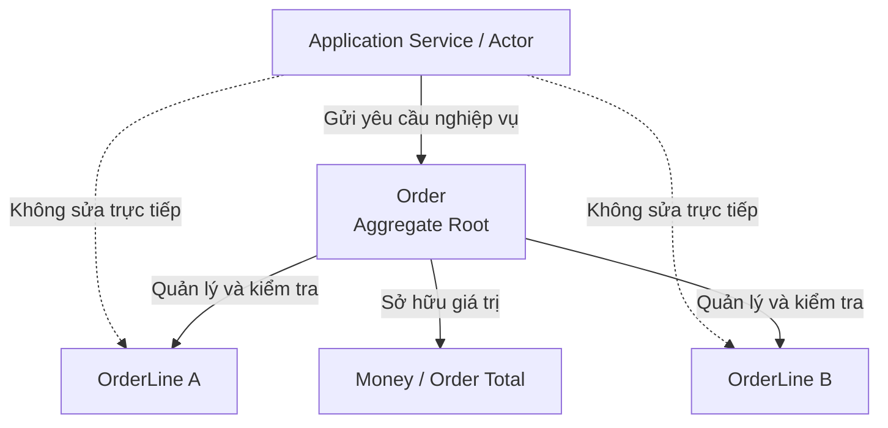
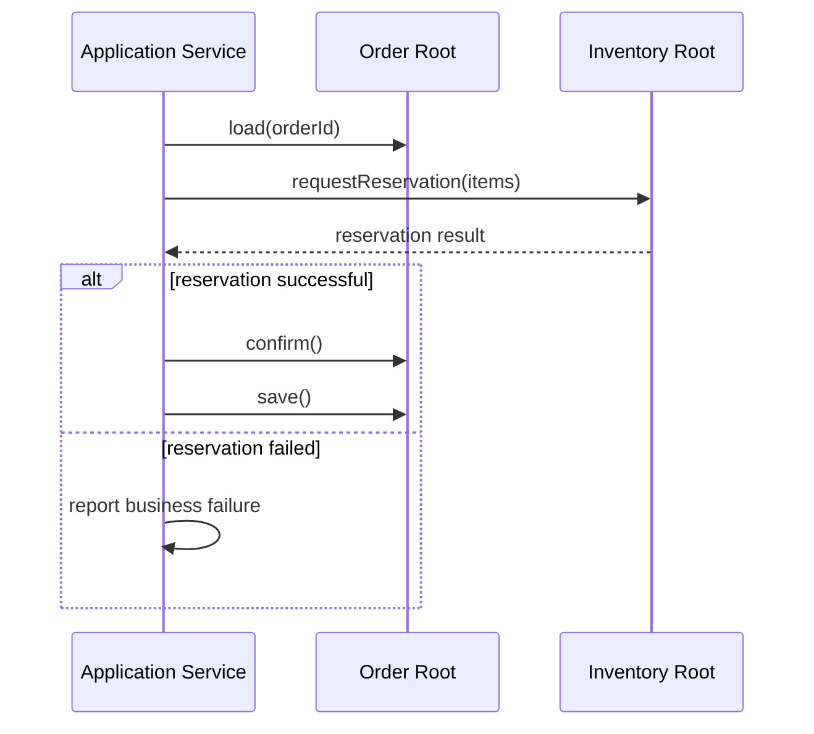

# Truy cập đối tượng bên trong thông qua aggregate root

Trong Domain-Driven Design (DDD), Aggregate là một cụm đối tượng được xem như một đơn vị nhất quán về nghiệp vụ. **Aggregate Root** là Entity đứng ở ranh giới của cụm đó và là cổng truy cập từ bên ngoài. Mọi thao tác làm thay đổi trạng thái của các đối tượng bên trong cần được yêu cầu thông qua Root để các quy tắc và bất biến của Aggregate luôn được bảo vệ.

Nguyên tắc này giúp đội phát triển biết nơi nào chịu trách nhiệm cho một thay đổi. Một đối tượng bên ngoài có thể yêu cầu Order thêm dòng hàng, đổi số lượng hoặc xác nhận đơn; nó không nên lấy trực tiếp OrderLine rồi sửa thuộc tính của dòng hàng. Order kiểm tra trạng thái và điều kiện trước khi cho phép thay đổi.

Bài học tập trung vào cách thiết kế API của Aggregate Root, cách truy cập dữ liệu nội bộ để đọc, cách giữ quyền kiểm soát collection và child entity, cùng cách phối hợp giữa nhiều Aggregate mà không làm ranh giới nhất quán bị phá vỡ.

## Mục tiêu học tập

Sau bài này, bạn có thể:

- Giải thích vì sao đối tượng bên ngoài phải truy cập Aggregate thông qua Aggregate Root.
- Phân biệt Aggregate Root với Entity con, Repository và Application Service.
- Thiết kế các phương thức của Root để thực hiện hành vi trên đối tượng nội bộ.
- Bảo vệ collection và trạng thái của child entity khỏi việc sửa trực tiếp.
- Phân biệt truy cập để đọc với quyền thay đổi trạng thái.
- Xác định cách tham chiếu Aggregate khác bằng ID.
- Nhận biết các lỗi thiết kế như repository cho Entity con, public setter hoặc trả về collection mutable.
- Áp dụng nguyên tắc này trong ví dụ Java và quy trình kiểm thử.

## 1. Aggregate Root là cổng truy cập của Aggregate

Aggregate là ranh giới nhất quán bao quanh một Root và các đối tượng nội bộ. Những đối tượng bên trong có thể là Entity hoặc Value Object. Root có định danh toàn cục trong phạm vi mô hình; Entity con thường chỉ cần được nhận diện bên trong Aggregate mà nó thuộc về.

Ví dụ, một Order có thể chứa nhiều OrderLine. Order là Aggregate Root vì nó đại diện cho đơn hàng và kiểm soát những thay đổi liên quan đến các dòng hàng. OrderLine có thể có ID riêng để xác định dòng cụ thể, nhưng vòng đời và quy tắc của nó được quản lý bởi Order.



Các đối tượng bên ngoài tương tác với Aggregate qua Root. Root chịu trách nhiệm:

- Kiểm tra trạng thái hiện tại có cho phép hành vi hay không.
- Kiểm tra dữ liệu đầu vào và điều kiện nghiệp vụ.
- Điều phối thay đổi trên các Entity hoặc Value Object bên trong.
- Bảo vệ bất biến cần đúng sau mỗi thao tác.
- Công bố kết quả hoặc Domain Event khi có sự kiện nghiệp vụ đáng chú ý.

Root không cần tự thực hiện mọi phép tính hoặc chứa mọi dòng code. Nó có thể ủy quyền một phần xử lý cho đối tượng nội bộ, nhưng bên ngoài vẫn yêu cầu thay đổi qua Root.

### Root không chỉ là lớp cha trong cấu trúc đối tượng

Aggregate Root không đơn thuần là một object chứa tham chiếu đến các object khác. Một lớp có thuộc tính List và các getter không tự động trở thành Root. Root có ý nghĩa vì nó là ranh giới kiểm soát những thay đổi cần giữ nhất quán.

Root cũng không đồng nghĩa với Application Service. Application Service điều phối một use case ở cấp ứng dụng, ví dụ tải Order từ Repository, gọi order.confirm() rồi lưu lại. Aggregate Root là đối tượng miền bảo vệ quy tắc trong phạm vi của nó.

## 2. Vì sao phải truy cập qua Root?

Nếu bên ngoài có thể sửa trực tiếp Entity con, các quy tắc của Aggregate sẽ phụ thuộc vào việc mọi caller có nhớ kiểm tra đúng điều kiện hay không. Khi có nhiều API, job nền, message handler hoặc use case cùng thay đổi dữ liệu, việc lặp lại kiểm tra rất dễ dẫn đến sai lệch.

Giả sử Order có các quy tắc:

- Chỉ đơn ở trạng thái DRAFT mới được thay đổi dòng hàng.
- Số lượng của mỗi dòng phải lớn hơn 0.
- Tất cả dòng hàng trong một Order dùng cùng loại tiền.
- Đơn phải có ít nhất một dòng hàng khi được xác nhận.
- Đơn đã xác nhận không nhận thêm hoặc xóa dòng hàng theo luồng chỉnh sửa thông thường.

Nếu caller được lấy OrderLine rồi gọi setQuantity(), quy tắc trạng thái của Order có thể bị bỏ qua. Nếu caller tự thêm phần tử vào danh sách, Order không có cơ hội kiểm tra loại tiền hoặc điều kiện khác.

Khi mọi thay đổi đi qua Root, các caller chỉ cần yêu cầu hành vi. Root quyết định thao tác có hợp lệ hay không và giữ trạng thái Aggregate nhất quán.

| Thao tác | Cách truy cập trực tiếp không an toàn | Cách yêu cầu qua Root |
| --- | --- | --- |
| Thêm dòng hàng | order.getLines().add(line) | order.addItem(productId, quantity, unitPrice) |
| Đổi số lượng | line.setQuantity(5) | order.changeLineQuantity(lineId, 5) |
| Xóa dòng hàng | order.getLines().remove(line) | order.removeLine(lineId) |
| Xác nhận đơn | order.setStatus(CONFIRMED) | order.confirm() |
| Tính tổng | Caller tự duyệt các dòng và cộng giá | order.totalAmount() |

Các tên phương thức trong bảng là ví dụ. Tên và điều kiện cụ thể cần theo ngôn ngữ chung và chính sách thực tế của miền.

## 3. Bên ngoài tham chiếu Root, không giữ tham chiếu đến Entity con

Quy tắc tham chiếu thường dùng trong DDD là: **đối tượng bên ngoài Aggregate giữ tham chiếu đến Aggregate Root; Root có thể giữ tham chiếu đến các đối tượng bên trong**.

Ví dụ, OrderService hoặc một Aggregate khác có thể giữ OrderId để yêu cầu thay đổi đơn. Nó không cần giữ một tham chiếu lâu dài đến OrderLine bên trong. Khi cần thao tác trên một dòng cụ thể, caller gửi OrderId và OrderLineId đến use case; ứng dụng tải Order rồi gọi phương thức tương ứng trên Root.

Điều này tạo ra một đường đi rõ ràng:

1. Caller xác định Aggregate cần thao tác bằng Root ID.
2. Repository tải Root cùng phần trạng thái nội bộ cần thiết.
3. Caller gọi hành vi nghiệp vụ trên Root.
4. Root tìm đối tượng nội bộ và kiểm tra quy tắc.
5. Repository lưu Aggregate sau khi hành vi hoàn tất.

Child ID có thể xuất hiện trong command hoặc URL để chỉ rõ dòng hàng cần thay đổi. Điều đó không có nghĩa caller được quyền tải và sửa Entity con độc lập. Root vẫn là nơi xác nhận dòng đó có thuộc Aggregate hay không và hành vi có hợp lệ không.

### Một Aggregate khác nên được tham chiếu bằng ID

Nếu Order cần liên hệ với Customer, Payment hoặc InventoryReservation thuộc Aggregate khác, Order thường giữ định danh của Aggregate đó thay vì giữ object graph có thể sửa trực tiếp.

Ví dụ, Order có thể lưu CustomerId. Khi cần thông tin khách hàng, Application Service hoặc query model tải thông tin phù hợp. Order không nên thay đổi Customer bằng cách đi qua một tham chiếu object được chia sẻ.

Cách tham chiếu bằng ID giúp giới hạn ranh giới nhất quán. Mỗi Aggregate tự bảo vệ bất biến của mình và có thể được tải, lưu trong giao dịch phù hợp với thiết kế.

## 4. Thiết kế API của Root theo hành vi nghiệp vụ

API công khai của Aggregate Root nên thể hiện các hành động mà nghiệp vụ nhận biết. Caller nói điều nó muốn xảy ra; Root chịu trách nhiệm kiểm tra và thực hiện.

Ví dụ với Order:

- addItem(...) thêm mặt hàng khi đơn còn nháp.
- changeLineQuantity(...) đổi số lượng của một dòng.
- removeLine(...) xóa dòng theo chính sách.
- confirm() xác nhận đơn khi các điều kiện được đáp ứng.
- totalAmount() cung cấp giá trị tổng theo quy tắc hiện tại.

Tránh mở các setter công khai cho những trạng thái cần được bảo vệ như status, confirmedAt hoặc danh sách lines. Một setter chung như setStatus(CONFIRMED) cho phép caller chuyển trạng thái mà không đi qua điều kiện nghiệp vụ.

### Truyền ý định, không truyền lệnh sửa cấu trúc

Một API như addItem(ProductId, quantity, unitPrice) truyền ý định nghiệp vụ. API như addLine(OrderLine line) có thể làm lộ cấu trúc nội bộ và cho phép caller tự tạo một child entity với trạng thái không hợp lệ.

Không phải mọi phương thức nhận object đều sai. Có thể truyền một Value Object bất biến hoặc một đối tượng dữ liệu đầu vào đã được kiểm tra. Cần tránh để caller tự tạo và đưa vào Aggregate một Entity con có thể bị sửa từ bên ngoài hoặc mang vòng đời không đúng.

### Root có thể ủy quyền cho Entity con

Root không cần tự chứa toàn bộ logic chi tiết. Nó có thể tìm dòng hàng rồi gọi một hành vi nội bộ trên dòng đó:

- Root kiểm tra Order còn ở trạng thái DRAFT.
- Root xác định OrderLine có thuộc Order không.
- OrderLine kiểm tra số lượng mới hợp lệ.
- Root giữ Aggregate ở trạng thái hợp lệ và điều phối thay đổi.

Như vậy, quyền truy cập vẫn qua Root, còn trách nhiệm nội bộ được đặt ở đúng đối tượng.

## 5. Bảo vệ collection và trạng thái nội bộ

Một lỗi phổ biến là cung cấp getter trả về danh sách mutable:

```java
public List<OrderLine> getLines() {
    return lines;
}
```

Caller có thể sửa trực tiếp danh sách:

```java
order.getLines().clear();
order.getLines().add(new OrderLine(...));
```

Những thao tác đó bỏ qua Root và có thể phá vỡ bất biến. Có ba cách phổ biến để bảo vệ:

### Giữ collection mutable ở private scope

Danh sách nội bộ chỉ được thay đổi bởi phương thức của Root. Không cung cấp setter cho toàn bộ collection.

### Trả về snapshot hoặc view chỉ đọc

Khi caller chỉ cần xem các dòng hàng, Root có thể trả về một bản sao không thể sửa hoặc một danh sách các view bất biến. Cách này ngăn caller thay đổi collection nội bộ.

### Trả về dữ liệu truy vấn riêng

Nếu màn hình cần nhiều dữ liệu tổng hợp hoặc cần phân trang, không nhất thiết phải tải Aggregate chỉ để hiển thị. Một query service có thể trả về DTO hoặc read model. Đây là luồng đọc phục vụ ứng dụng; nó không trao quyền sửa trạng thái miền.

Cần phân biệt collection chỉ đọc với đối tượng bên trong collection. Collections.unmodifiableList() chỉ ngăn sửa cấu trúc danh sách; nếu phần tử vẫn là Entity có setter công khai, caller vẫn có thể sửa Entity con. Vì vậy, hãy kết hợp collection read-only với API child entity được đóng gói và các snapshot bất biến khi cần.

## 6. Ví dụ Java: Order kiểm soát OrderLine

Ví dụ sau minh họa Order là Aggregate Root. OrderLine là Entity nội bộ, không được công khai để caller tự thay đổi. Caller chỉ thấy OrderLineView bất biến khi cần đọc chi tiết.

```java
import java.math.BigDecimal;
import java.util.ArrayList;
import java.util.Currency;
import java.util.List;
import java.util.Objects;
import java.util.Optional;
import java.util.UUID;

record OrderId(UUID value) {
    OrderId {
        Objects.requireNonNull(value);
    }
}

record OrderLineId(UUID value) {
    OrderLineId {
        Objects.requireNonNull(value);
    }
}

record ProductId(String value) {
    ProductId {
        Objects.requireNonNull(value);
        if (value.isBlank()) {
            throw new IllegalArgumentException("Product id is required");
        }
    }
}

record Money(BigDecimal amount, Currency currency) {
    Money {
        Objects.requireNonNull(amount);
        Objects.requireNonNull(currency);
        if (amount.signum() < 0) {
            throw new IllegalArgumentException("Amount cannot be negative");
        }
    }

    Money multiply(int quantity) {
        if (quantity < 0) {
            throw new IllegalArgumentException("Quantity cannot be negative");
        }
        return new Money(amount.multiply(BigDecimal.valueOf(quantity)), currency);
    }

    Money add(Money other) {
        Objects.requireNonNull(other);
        if (!currency.equals(other.currency)) {
            throw new IllegalArgumentException("Currency must match");
        }
        return new Money(amount.add(other.amount), currency);
    }
}

enum OrderStatus {
    DRAFT, CONFIRMED, CANCELLED
}

record OrderLineView(
    OrderLineId id,
    ProductId productId,
    int quantity,
    Money unitPrice,
    Money subtotal
) {}

final class Order {
    private final OrderId id;
    private final Currency currency;
    private final List<OrderLine> lines = new ArrayList<>();
    private OrderStatus status = OrderStatus.DRAFT;

    Order(OrderId id, Currency currency) {
        this.id = Objects.requireNonNull(id);
        this.currency = Objects.requireNonNull(currency);
    }

    public void addItem(ProductId productId, int quantity, Money unitPrice) {
        ensureDraft();
        requireOrderCurrency(unitPrice);
        lines.add(new OrderLine(
            new OrderLineId(UUID.randomUUID()),
            productId,
            quantity,
            unitPrice
        ));
    }

    public void changeLineQuantity(OrderLineId lineId, int quantity) {
        ensureDraft();
        requireLine(lineId).changeQuantity(quantity);
    }

    public void removeLine(OrderLineId lineId) {
        ensureDraft();
        OrderLine line = requireLine(lineId);
        lines.remove(line);
    }

    public void confirm() {
        ensureDraft();
        if (lines.isEmpty()) {
            throw new IllegalStateException(
                "An order must contain at least one line"
            );
        }
        status = OrderStatus.CONFIRMED;
    }

    public Money totalAmount() {
        Money total = new Money(BigDecimal.ZERO, currency);
        for (OrderLine line : lines) {
            total = total.add(line.subtotal());
        }
        return total;
    }

    public List<OrderLineView> lines() {
        return lines.stream()
            .map(OrderLine::toView)
            .toList();
    }

    public OrderId id() {
        return id;
    }

    public OrderStatus status() {
        return status;
    }

    private OrderLine requireLine(OrderLineId lineId) {
        Objects.requireNonNull(lineId);
        return lines.stream()
            .filter(line -> line.id().equals(lineId))
            .findFirst()
            .orElseThrow(() -> new IllegalArgumentException(
                "Order line does not belong to this order"
            ));
    }

    private void requireOrderCurrency(Money unitPrice) {
        Objects.requireNonNull(unitPrice);
        if (!currency.equals(unitPrice.currency())) {
            throw new IllegalArgumentException(
                "Order lines must use the order currency"
            );
        }
    }

    private void ensureDraft() {
        if (status != OrderStatus.DRAFT) {
            throw new IllegalStateException(
                "Only a draft order can be changed"
            );
        }
    }

    private static final class OrderLine {
        private final OrderLineId id;
        private final ProductId productId;
        private final Money unitPrice;
        private int quantity;

        private OrderLine(
            OrderLineId id,
            ProductId productId,
            int quantity,
            Money unitPrice
        ) {
            this.id = Objects.requireNonNull(id);
            this.productId = Objects.requireNonNull(productId);
            this.unitPrice = Objects.requireNonNull(unitPrice);
            changeQuantity(quantity);
        }

        private void changeQuantity(int quantity) {
            if (quantity <= 0) {
                throw new IllegalArgumentException(
                    "Quantity must be positive"
                );
            }
            this.quantity = quantity;
        }

        private OrderLineId id() {
            return id;
        }

        private Money subtotal() {
            return unitPrice.multiply(quantity);
        }

        private OrderLineView toView() {
            return new OrderLineView(
                id,
                productId,
                quantity,
                unitPrice,
                subtotal()
            );
        }
    }
}
```

Trong ví dụ:

- Order giữ collection OrderLine ở phạm vi private.
- Caller không thể tạo hoặc sửa OrderLine trực tiếp.
- Mọi thao tác thêm, đổi số lượng và xóa dòng đều đi qua Order.
- Root kiểm tra trạng thái trước khi thay đổi.
- Root xác định dòng hàng có thuộc chính đơn đó không.
- Root kiểm tra đơn có ít nhất một dòng trước khi xác nhận.
- Phương thức lines() trả về các OrderLineView, không để lộ Entity con.
- Order kiểm soát loại tiền để tổng tiền không cộng các giá trị không tương thích.

Ví dụ lược bỏ mapping ORM và constructor khôi phục Aggregate từ persistence. Trong hệ thống thực tế, ORM có thể cần constructor hoặc mapping phù hợp để tái tạo các child entity; yêu cầu đó không làm thay đổi nguyên tắc rằng application code phải thay đổi Aggregate qua Root.

## 7. Application Service truy cập child entity thông qua Root

Application Service điều phối use case. Khi cần thay đổi một dòng hàng, nó tải Order bằng OrderRepository, gọi phương thức trên Order rồi lưu Root.

```java
public final class ChangeOrderLineQuantity {
    private final OrderRepository orders;

    public ChangeOrderLineQuantity(OrderRepository orders) {
        this.orders = orders;
    }

    public void execute(
        OrderId orderId,
        OrderLineId lineId,
        int newQuantity
    ) {
        Order order = orders.findById(orderId)
            .orElseThrow(() -> new IllegalArgumentException("Order not found"));

        order.changeLineQuantity(lineId, newQuantity);
        orders.save(order);
    }
}

interface OrderRepository {
    Optional<Order> findById(OrderId id);
    void save(Order order);
}
```

Caller truyền OrderId và OrderLineId để xác định mục tiêu. Repository chỉ tải Aggregate Root. Application Service không cần OrderLineRepository riêng để thay đổi dòng hàng. Order chịu trách nhiệm xác nhận dòng đó thuộc về nó và kiểm tra trạng thái.

Nếu use case cần hiển thị danh sách dòng hàng, một query service có thể đọc projection riêng. Không cần gọi repository để tải từng child entity chỉ nhằm xây dựng màn hình.

## 8. Truy cập để đọc và truy cập để thay đổi

Nguyên tắc truy cập qua Root tập trung vào quyền kiểm soát thay đổi và bất biến. Nó không có nghĩa mọi dữ liệu đọc phải đi qua một chuỗi getter lồng nhau hoặc mọi truy vấn đều phải tải toàn bộ Aggregate.

Có thể phân biệt:

| Nhu cầu | Cách tiếp cận phù hợp |
| --- | --- |
| Thay đổi OrderLine | Gọi hành vi trên Order Root |
| Xác nhận Order | Gọi order.confirm() |
| Đọc các dòng của Order | Root cung cấp snapshot/view chỉ đọc |
| Tìm đơn theo bộ lọc và phân trang | Query service hoặc read model |
| Đọc báo cáo doanh thu nhiều Aggregate | Query/reporting model |
| Thay đổi Customer độc lập | Tải Customer Root qua CustomerRepository |

Nếu caller chỉ cần dữ liệu để hiển thị, một DTO có thể phù hợp hơn việc trả về object miền. Nhưng nếu cần thay đổi trạng thái nghiệp vụ, phải đi qua Root của Aggregate sở hữu trạng thái đó.

### Không biến Root thành API truy vấn khổng lồ

Root có thể cung cấp các phép đọc đơn giản cần thiết cho mô hình, như status(), totalAmount() hoặc lines() dưới dạng snapshot. Tuy nhiên, không nên thêm hàng chục phương thức truy vấn phục vụ mọi màn hình vào Root. Những truy vấn phức tạp, lọc, phân trang hoặc tổng hợp nhiều Aggregate thuộc query side.

Điều này giúp Aggregate tập trung vào trách nhiệm bảo vệ bất biến và hành vi nghiệp vụ.

## 9. Khi một hành vi liên quan đến nhiều Aggregate

Một use case có thể cần nhiều Aggregate cùng tham gia. Ví dụ, xác nhận đơn cần kiểm tra hoặc giữ hàng ở Inventory và xử lý thanh toán ở Payment. Không nên cho Order truy cập object nội bộ của Inventory rồi thay đổi trực tiếp.

Thay vào đó, Application Service điều phối các Root thông qua Repository hoặc giao diện ứng dụng của từng context:



Đây là luồng minh họa đơn giản. Nếu các thao tác không thể nằm trong cùng một giao dịch, hệ thống cần thiết kế trạng thái trung gian, sự kiện, retry hoặc hành động bù trừ. Mỗi Aggregate vẫn bảo vệ bất biến của chính nó. Một Root không được phép phá ranh giới của Root khác chỉ vì cùng một use case đang điều phối chúng.

Nếu quy trình có nhiều bước bất đồng bộ, Saga hoặc process manager có thể theo dõi tiến trình. Việc phối hợp không làm cho các Aggregate trở thành một Aggregate lớn.

## 10. Repository làm việc với Aggregate Root

Repository thường được định nghĩa theo Aggregate Root. Ví dụ, OrderRepository tải và lưu Order, bao gồm trạng thái nội bộ của các dòng hàng theo mapping persistence.

Không nên tạo OrderLineRepository chỉ để caller sửa một dòng hàng nằm trong Order. Nếu OrderLine là Entity nội bộ và bất biến của nó phụ thuộc vào Order, việc tải/lưu độc lập sẽ làm yếu ranh giới Aggregate.

Có thể có repository riêng cho một khái niệm nếu nó thực sự là Aggregate Root độc lập. Quyết định này phụ thuộc vào vòng đời, quyền sở hữu và bất biến nghiệp vụ; không phụ thuộc đơn thuần vào việc một bảng có khóa chính riêng.

Repository không nhất thiết trả toàn bộ dữ liệu mọi lúc. Có thể dùng query repository hoặc read model cho truy vấn. Nhưng thao tác ghi cần khôi phục Root và thực hiện thay đổi qua hành vi của nó.

## 11. Những sai lầm thường gặp

- **Cho phép sửa child entity trực tiếp:** caller có thể bỏ qua quy tắc và trạng thái của Root.
- **Trả về collection mutable:** bên ngoài có thể thêm, xóa hoặc thay thế phần tử mà Root không kiểm soát.
- **Trả về child entity có setter công khai:** collection read-only không đủ nếu phần tử bên trong vẫn sửa được.
- **Tạo repository cho mọi Entity con:** child entity bị quản lý như đối tượng độc lập dù vòng đời thuộc Aggregate.
- **Để Aggregate khác giữ tham chiếu đến child entity:** phụ thuộc xuyên ranh giới và khó kiểm soát thay đổi.
- **Cho Root truy cập trực tiếp Aggregate khác:** vi phạm ranh giới nhất quán; nên tham chiếu bằng ID và điều phối qua application layer.
- **Dồn mọi truy vấn vào Root:** làm Root phình to và trộn trách nhiệm đọc với thay đổi nghiệp vụ.
- **Nhầm Root với một facade kỹ thuật:** Root phải bảo vệ quy tắc miền, không chỉ chuyển tiếp lời gọi.
- **Tạo Aggregate quá lớn để mọi thứ đều truy cập qua một Root:** ranh giới giao dịch và tải dữ liệu trở nên nặng nề; hãy chia theo bất biến thực sự cần bảo vệ.

## 12. Quy trình thiết kế và kiểm tra quyền truy cập

Khi thiết kế một Aggregate, có thể đi theo các bước sau:

1. Xác định bất biến nghiệp vụ cần được bảo vệ trong một đơn vị nhất quán.
2. Chọn Entity đại diện cho Aggregate và làm Root.
3. Xác định Entity con và Value Object có vòng đời hoặc ý nghĩa phụ thuộc vào Root.
4. Đặt collection và trạng thái nội bộ ở phạm vi private.
5. Thiết kế phương thức Root theo hành vi nghiệp vụ thay vì setter dữ liệu.
6. Chỉ công bố dữ liệu đọc cần thiết dưới dạng giá trị bất biến hoặc snapshot.
7. Dùng ID để tham chiếu Aggregate khác và để chỉ child entity trong command.
8. Tạo Repository cho Root; dùng query model riêng cho truy vấn phức tạp.
9. Kiểm thử các bất biến qua API công khai của Root.
10. Kiểm tra mọi caller để bảo đảm không có đường ghi trực tiếp vào child entity hoặc collection.

Checklist review:

- [ ] Root có đại diện cho một Entity có định danh và trách nhiệm rõ ràng không?
- [ ] Các thay đổi trên đối tượng nội bộ có đi qua Root không?
- [ ] Root kiểm tra trạng thái và điều kiện trước khi thay đổi không?
- [ ] Child entity có bị lộ setter hoặc reference mutable ra ngoài không?
- [ ] Collection nội bộ có được bảo vệ khỏi thao tác trực tiếp không?
- [ ] Caller có thể xác định child entity bằng ID nhưng vẫn phải đi qua Root không?
- [ ] Aggregate khác được tham chiếu bằng ID và điều phối qua application layer không?
- [ ] Repository có tập trung vào Aggregate Root không?
- [ ] Truy vấn phục vụ màn hình có được tách khỏi API thay đổi nghiệp vụ không?
- [ ] Kiểm thử có chứng minh các bất biến không thể bị phá qua API công khai không?

## Kết luận

Aggregate Root là cổng truy cập và là nơi bảo vệ bất biến của Aggregate. Các đối tượng bên ngoài yêu cầu hành vi thông qua Root; Root xác định đối tượng nội bộ, kiểm tra điều kiện và điều phối thay đổi. Child Entity không nên có repository hoặc API sửa độc lập nếu vòng đời và quy tắc của nó thuộc Aggregate.

Thiết kế đúng nguyên tắc này giúp ranh giới nhất quán rõ ràng, giảm nguy cơ caller bỏ qua quy tắc và làm cho mã nguồn diễn đạt ý định nghiệp vụ. Hãy giữ trạng thái nội bộ được đóng gói, cung cấp snapshot chỉ đọc khi cần, tham chiếu Aggregate khác bằng ID và dùng Application Service để điều phối các quy trình đi qua nhiều Root.
