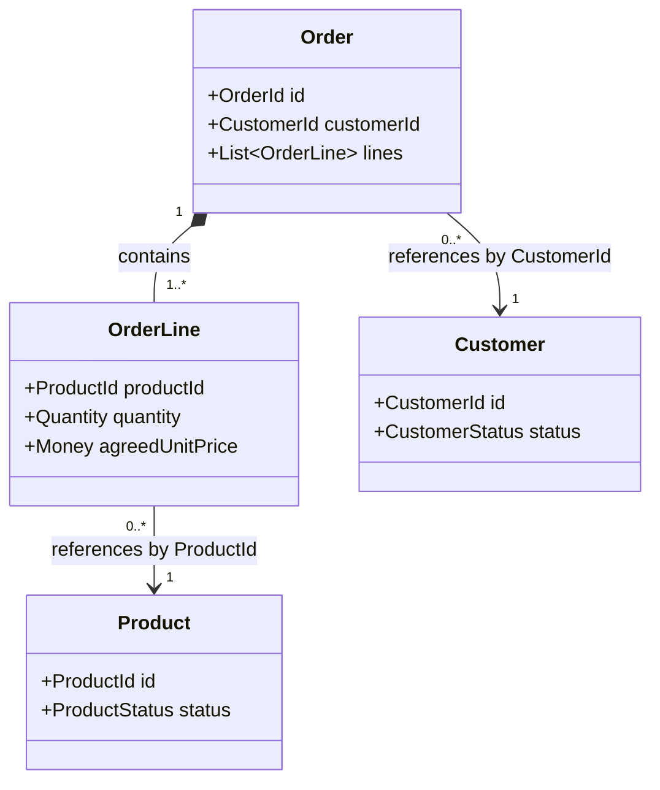
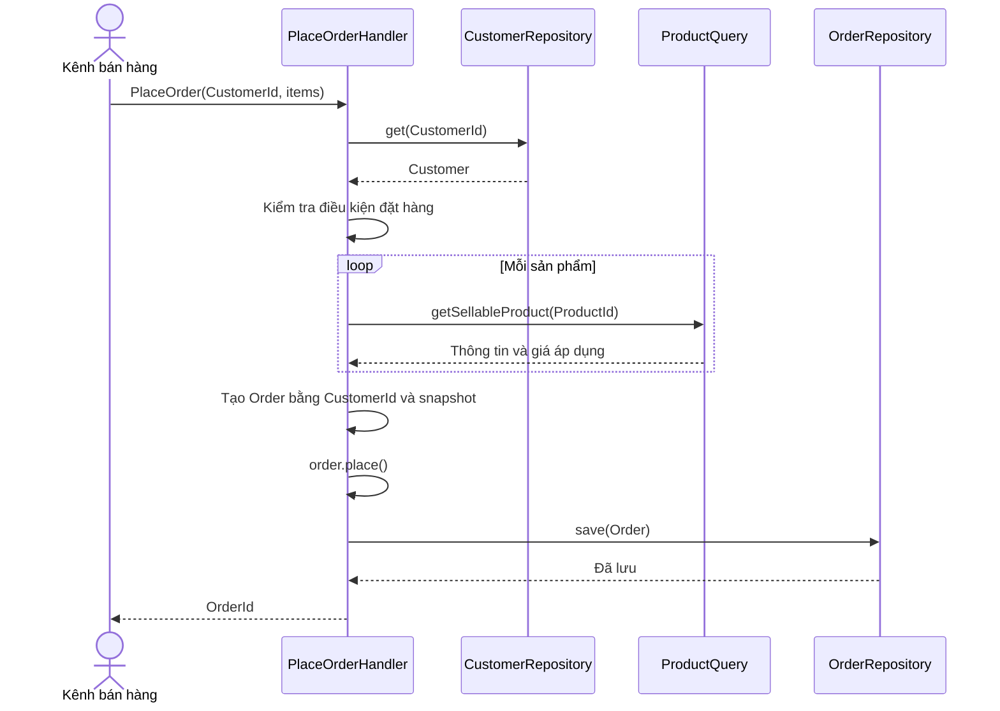
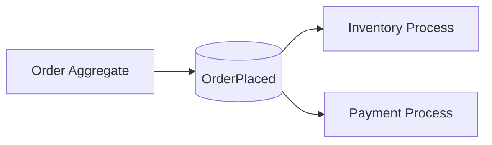

# Tham chiếu aggregate khác bằng định danh

## Vì sao aggregate thường tham chiếu nhau bằng ID?

Trong một mô hình miền, các đối tượng thường có liên hệ với nhau. Một đơn hàng được đặt bởi khách hàng, mỗi dòng hàng nhắc đến một sản phẩm, một hóa đơn được lập từ đơn hàng và một khoản thanh toán được thực hiện cho một giao dịch. Nếu biểu diễn tất cả các liên hệ bằng cách giữ trực tiếp object của nhau, mô hình rất dễ hình thành một đồ thị đối tượng lớn: tải một đơn hàng có thể kéo theo khách hàng, sản phẩm, tồn kho, thanh toán và nhiều đối tượng khác.

Domain-Driven Design (DDD) dùng **Aggregate** để xác định ranh giới nhất quán. Mỗi aggregate có một **Aggregate Root** chịu trách nhiệm bảo vệ các bất biến bên trong ranh giới đó. Khi một aggregate cần biết đến aggregate khác, cách tham chiếu phổ biến và dễ kiểm soát là lưu **định danh của aggregate root** thay vì giữ toàn bộ đối tượng kia.

Ví dụ, `Order` giữ `CustomerId` để biết khách hàng đặt đơn và `ProductId` trong từng dòng hàng để biết sản phẩm được đặt. `Order` không cần giữ toàn bộ đối tượng `Customer` hoặc `Product` trong bộ nhớ. Khi một use case cần thông tin khách hàng hay sản phẩm, application service có thể truy vấn aggregate hoặc read model tương ứng.

Sau bài học, người học có thể:

- Giải thích mối liên hệ giữa aggregate reference, aggregate root và ranh giới nhất quán.
- Thiết kế aggregate lưu định danh của aggregate khác thay vì tham chiếu object trực tiếp.
- Phân biệt tham chiếu bằng ID với snapshot giá trị cần giữ lại trong lịch sử nghiệp vụ.
- Tổ chức use case cần đọc nhiều aggregate mà vẫn giữ rõ trách nhiệm của từng aggregate.
- Chọn cách phối hợp đồng bộ hoặc bất đồng bộ khi một quy trình liên quan đến nhiều aggregate.
- Nhận diện các lỗi như object graph quá lớn, cập nhật xuyên aggregate và phụ thuộc vòng.

## Aggregate reference là gì?

**Aggregate reference** là mối liên hệ từ một aggregate đến một aggregate khác. Trong mô hình miền, mối liên hệ này thường được biểu diễn bằng định danh ổn định của aggregate root được tham chiếu.

Giả sử có ba aggregate:

- `Customer` có root là `Customer` và định danh `CustomerId`.
- `Product` có root là `Product` và định danh `ProductId`.
- `Order` có root là `Order` và định danh `OrderId`.

`Order` có thể lưu `CustomerId` và các `ProductId` trong các dòng hàng. Các định danh này cho biết đơn hàng liên quan đến ai và sản phẩm nào, nhưng không trao quyền cho `Order` thay đổi trạng thái nội bộ của `Customer` hoặc `Product`.



Sơ đồ diễn tả quan hệ ở mức khái niệm. Trong mã nguồn, `Order` giữ các kiểu ID. Việc truy vấn `Customer` hoặc `Product` được thực hiện qua repository, query service hoặc read model phù hợp với use case.

### Vì sao tham chiếu đến Aggregate Root?

Aggregate Root là cổng truy cập vào aggregate. Các entity bên trong aggregate không được xem là đối tượng độc lập để những aggregate khác tùy ý đọc và sửa. Nếu một quy trình cần tác động đến một aggregate, nó nên tìm root bằng định danh rồi yêu cầu root thực hiện hành vi phù hợp.

Ví dụ, một đơn hàng có thể giữ `OrderLineId` để nhận diện dòng hàng bên trong chính aggregate `Order`. Một quy trình bên ngoài không nên lấy `OrderLine` ra rồi sửa trực tiếp. Nó tải `Order` bằng `OrderId`, sau đó gọi hành vi trên root như `changeLineQuantity(lineId, quantity)`. Root kiểm tra trạng thái đơn và các bất biến liên quan.

Đối với aggregate khác, tham chiếu bằng `CustomerId` hoặc `ProductId` giúp thể hiện rõ rằng đối tượng đang được nhắc đến thuộc quyền sở hữu của aggregate riêng. Không nên giữ tham chiếu trực tiếp đến entity con của aggregate khác để đi vòng qua root.

## Lợi ích của việc tham chiếu bằng định danh

### Giữ ranh giới nhất quán

Mỗi aggregate chịu trách nhiệm bảo vệ các bất biến của chính nó. Nếu `Order` giữ một object `Customer` có thể sửa trực tiếp, một hành động trên đơn hàng có nguy cơ thay đổi trạng thái khách hàng mà không đi qua hành vi của `Customer`. Khi chỉ giữ `CustomerId`, `Order` biết liên hệ với khách hàng nào nhưng không thể vô tình sửa hồ sơ khách hàng.

Ranh giới này làm rõ nơi đặt quy tắc. Quy tắc về trạng thái đơn thuộc `Order`; quy tắc về trạng thái tài khoản hoặc điều kiện khách hàng thuộc `Customer`. Một use case có thể phối hợp hai aggregate, nhưng mỗi aggregate vẫn tự bảo vệ dữ liệu và hành vi của mình.

### Tránh tải đồ thị đối tượng quá lớn

Một đối tượng được tham chiếu trực tiếp có thể lại tham chiếu nhiều đối tượng khác. Khi các quan hệ lồng nhau, thao tác tải một aggregate có thể kéo theo nhiều truy vấn, tạo vòng lặp tải lười (lazy loading), hoặc vô tình tải dữ liệu không cần thiết.

Tham chiếu bằng ID giúp tải đúng phần dữ liệu cần thiết cho use case. Màn hình danh sách đơn hàng có thể chỉ cần `OrderId`, `CustomerId`, tên người nhận và tổng tiền; trang chi tiết khách hàng có thể truy vấn riêng hồ sơ khách hàng. Mỗi read model có thể tối ưu cho nhu cầu đọc mà không buộc domain model chứa toàn bộ object graph.

### Giảm liên kết và tránh phụ thuộc vòng

Nếu `Order` giữ `Customer`, còn `Customer` giữ danh sách `Order`, hai aggregate phụ thuộc trực tiếp vào cấu trúc của nhau. Khi cả hai bên cần thêm thuộc tính hoặc hành vi, thay đổi có thể lan qua nhiều module. Trong một số trường hợp, ORM còn phải xử lý quan hệ hai chiều và vòng tham chiếu khi serialize.

Khi `Order` chỉ giữ `CustomerId`, quan hệ được biểu diễn rõ và nhẹ hơn. `Customer` không cần biết cách `Order` được cấu trúc. Nếu cần tìm các đơn hàng của một khách hàng, một truy vấn có thể lọc theo `CustomerId` thay vì nạp toàn bộ collection từ aggregate `Customer`.

### Giảm rủi ro cập nhật dữ liệu cũ

Một object được tải từ trước có thể trở nên cũ khi aggregate sở hữu nó đã thay đổi. Nếu một aggregate khác giữ object đó trong thời gian dài, nó có thể vô tình sử dụng trạng thái cũ hoặc ghi đè thay đổi mới. ID làm cho việc lấy dữ liệu hiện hành trở thành một thao tác có chủ đích.

ID không tự giải quyết mọi vấn đề nhất quán. Dữ liệu vừa được truy vấn vẫn có thể thay đổi ngay sau đó. Tuy nhiên, tham chiếu bằng ID giúp nhóm nhận diện rõ thời điểm cần đọc lại, kiểm tra phiên bản hoặc chấp nhận tính nhất quán cuối cùng.

## Phân biệt tham chiếu bằng ID và snapshot

Một aggregate có thể cần vừa giữ ID của aggregate khác, vừa giữ một phần dữ liệu của nó dưới dạng snapshot. Hai cách lưu này phục vụ hai mục đích khác nhau.

- **ID** cho biết đối tượng liên quan là ai và cho phép truy vấn thông tin hiện tại khi cần.
- **Snapshot** giữ lại những giá trị đã được chốt tại một thời điểm để bảo toàn ý nghĩa lịch sử của giao dịch.

Ví dụ, một dòng hàng trong đơn có thể lưu `ProductId` để biết sản phẩm nguồn, đồng thời lưu tên sản phẩm và đơn giá đã thỏa thuận tại thời điểm đặt hàng. Nếu tên hoặc giá trong catalog thay đổi vào ngày hôm sau, hóa đơn cũ vẫn cần hiển thị đúng thông tin đã được khách chấp nhận.

| Thông tin trong OrderLine | Cách biểu diễn | Lý do |
|---|---|---|
| Sản phẩm nguồn | `ProductId` | Xác định sản phẩm được tham chiếu |
| Tên hiển thị tại thời điểm đặt | Snapshot `ProductName` hoặc chuỗi mô tả | Giữ lịch sử đơn hàng |
| Giá đã chấp thuận | Snapshot `Money` | Không bị thay đổi theo giá catalog hiện tại |
| Trạng thái hiện tại của sản phẩm | Truy vấn `Product` khi use case cần | Không sao chép trạng thái có thể thay đổi nếu không có nhu cầu lịch sử |

Không nên sao chép mọi thuộc tính của aggregate khác vào aggregate hiện tại. Chỉ giữ snapshot của những giá trị mà nghiệp vụ yêu cầu bảo toàn theo thời điểm. Nếu snapshot được cập nhật theo thay đổi của nguồn, nó không còn là bằng chứng lịch sử; khi đó cần mô hình một bản sao đồng bộ hoặc read model với quy tắc cập nhật riêng.

## Ví dụ Java: Order tham chiếu Customer và Product bằng ID

### Các kiểu định danh

Nên dùng kiểu định danh chuyên biệt thay vì truyền `UUID` hoặc `String` ở mọi nơi. Kiểu riêng giúp trình biên dịch phát hiện việc truyền nhầm `CustomerId` vào vị trí cần `ProductId`.

```java
import java.util.Objects;
import java.util.UUID;

public record CustomerId(UUID value) {
    public CustomerId {
        Objects.requireNonNull(value, "value");
    }
}

public record ProductId(UUID value) {
    public ProductId {
        Objects.requireNonNull(value, "value");
    }
}

public record OrderId(UUID value) {
    public OrderId {
        Objects.requireNonNull(value, "value");
    }
}
```

Các record này là ví dụ rút gọn. Một hệ thống có thể dùng UUID, mã nghiệp vụ hoặc định danh do hệ thống ngoài cấp. Điều quan trọng là định danh ổn định, có phạm vi duy nhất được xác định và không bị nhầm lẫn giữa các loại.

### Dòng hàng giữ ProductId và snapshot

```java
import java.util.Objects;

public record OrderLine(
        ProductId productId,
        String productNameAtOrder,
        Quantity quantity,
        Money agreedUnitPrice
) {
    public OrderLine {
        Objects.requireNonNull(productId, "productId");
        Objects.requireNonNull(productNameAtOrder, "productNameAtOrder");
        Objects.requireNonNull(quantity, "quantity");
        Objects.requireNonNull(agreedUnitPrice, "agreedUnitPrice");
        if (productNameAtOrder.isBlank()) {
            throw new IllegalArgumentException("Product name is required");
        }
    }
}
```

`OrderLine` không giữ `Product` trực tiếp. Nó lưu ID để truy xuất khi cần và giữ tên cùng đơn giá đã chốt để diễn giải đơn hàng cũ. `Quantity` và `Money` là các value object có quy tắc riêng.

### Aggregate Order giữ CustomerId

```java
import java.util.ArrayList;
import java.util.List;
import java.util.Objects;

public final class Order {
    private final OrderId id;
    private final CustomerId customerId;
    private final List<OrderLine> lines = new ArrayList<>();
    private OrderStatus status = OrderStatus.DRAFT;

    public Order(OrderId id, CustomerId customerId) {
        this.id = Objects.requireNonNull(id, "id");
        this.customerId = Objects.requireNonNull(customerId, "customerId");
    }

    public void addLine(OrderLine line) {
        if (status != OrderStatus.DRAFT) {
            throw new IllegalStateException("Only a draft order can be changed");
        }
        lines.add(Objects.requireNonNull(line, "line"));
    }

    public void place() {
        if (status != OrderStatus.DRAFT) {
            throw new IllegalStateException("Order is not a draft");
        }
        if (lines.isEmpty()) {
            throw new IllegalStateException("Order must contain at least one line");
        }
        status = OrderStatus.PLACED;
    }

    public OrderId id() {
        return id;
    }

    public CustomerId customerId() {
        return customerId;
    }

    public List<OrderLine> lines() {
        return List.copyOf(lines);
    }
}
```

Trong ví dụ, `Order` có quyền quản lý các dòng hàng bên trong aggregate và chỉ giữ `CustomerId` cho aggregate khách hàng. Phần mã lược bỏ các kiểu `OrderStatus`, `Quantity`, `Money` và factory tạo đơn để tập trung vào cách tham chiếu. Ứng dụng thực tế cũng cần kiểm soát việc khôi phục trạng thái từ persistence và công bố domain event sau khi giao dịch được lưu thành công.

## Use case cần nhiều aggregate: phối hợp ở Application Service

Giả sử khách đặt hàng. Quy trình cần kiểm tra khách hàng có thể đặt hàng, đọc thông tin sản phẩm, tạo các dòng hàng với giá đã chốt và lưu `Order`. Đây là một use case liên quan đến nhiều aggregate, nhưng không có nghĩa `Order` phải tự tải và giữ `Customer` hoặc `Product`.

Application Service điều phối các bước ở mức use case:

1. Nhận lệnh tạo đơn có `CustomerId` và danh sách sản phẩm cùng số lượng.
2. Tải `Customer` qua `CustomerRepository` để kiểm tra điều kiện đặt hàng theo chính sách hiện tại.
3. Tải thông tin cần thiết từ catalog qua repository hoặc query port để xác định sản phẩm có thể bán, tên và giá áp dụng.
4. Tạo `Order` với `CustomerId`; tạo các `OrderLine` bằng `ProductId` và snapshot cần thiết.
5. Gọi hành vi miền của `Order` để đặt đơn và bảo vệ các bất biến bên trong aggregate.
6. Lưu `Order` qua `OrderRepository`; ghi nhận sự kiện miền hoặc integration event theo cơ chế giao dịch phù hợp.



Sơ đồ mô tả một luồng đơn giản. Trong thực tế, kiểm tra khách hàng và sản phẩm có thể cần gọi dịch vụ ngoài, có timeout hoặc dữ liệu thay đổi đồng thời. Application Service điều phối use case; nó không nên trở thành nơi chứa mọi quy tắc nội tại của `Order`, `Customer` hay `Product`.

### Đặt quy tắc ở đúng nơi

- `Customer` bảo vệ quy tắc nội tại của hồ sơ khách hàng, ví dụ trạng thái tài khoản hoặc thông tin cần thiết để được xem là hợp lệ.
- `Product` hoặc catalog bảo vệ quy tắc về trạng thái bán, phiên bản giá hoặc quy cách sản phẩm.
- `Order` bảo vệ quy tắc về vòng đời đơn, dòng hàng, tổng tiền và điều kiện đặt đơn.
- Application Service phối hợp việc đọc, gọi hành vi và lưu các aggregate để hoàn thành use case.
- Domain Service có thể diễn đạt một chính sách miền không tự nhiên thuộc về một entity cụ thể, nhưng không nên dùng nó để phá vỡ ranh giới aggregate.

Nếu quy tắc chỉ liên quan đến trạng thái bên trong `Order`, hãy đặt nó trong `Order`. Nếu cần biết một khách hàng có bị khóa hay không, use case có thể truy vấn `Customer` trước khi tạo đơn. Không nên truyền toàn bộ `Customer` vào `Order` chỉ để gọi `customer.isActive()` từ bên trong aggregate.

### Cẩn trọng với kiểm tra rồi mới ghi

Một tình huống có thể xảy ra: application service đọc thấy khách hàng đang hoạt động, sau đó một giao dịch khác khóa tài khoản trước khi đơn hàng được lưu. Kết quả kiểm tra ban đầu đã cũ. Việc dùng ID thay cho object không tự giải quyết race condition này.

Hãy hỏi nghiệp vụ yêu cầu mức bảo đảm nào:

- Nếu chỉ cần kiểm tra điều kiện tại thời điểm tiếp nhận yêu cầu, có thể chấp nhận kết quả kiểm tra tại thời điểm đó và lưu dấu vết quyết định.
- Nếu cần ngăn đặt đơn ngay khi tài khoản bị khóa, cần một cơ chế phối hợp rõ như phiên bản, reservation, kiểm soát đồng thời hoặc quy trình xác nhận lại.
- Nếu điều kiện phải luôn đúng trong một giao dịch nguyên tử, hãy xem xét lại ranh giới aggregate và quyền sở hữu bất biến. Một quy tắc xuyên nhiều aggregate thường là dấu hiệu cần thiết kế lại chính sách hoặc quy trình phối hợp.

Không nên giả định một transaction cơ sở dữ liệu lớn sẽ luôn là giải pháp tốt. Nó có thể làm các aggregate phụ thuộc chặt chẽ và tạo tranh chấp khóa. Quyết định cần dựa trên yêu cầu nhất quán thực tế.

## Phối hợp nhiều aggregate bằng Domain Event

Một use case có thể hoàn thành thay đổi trên một aggregate rồi thông báo cho phần khác thông qua domain event. Ví dụ, khi `Order` được đặt, nó phát sinh sự kiện `OrderPlaced`. Thành phần quản lý tồn kho có thể nhận sự kiện và bắt đầu giữ hàng; thành phần thanh toán có thể tạo yêu cầu thanh toán.



Domain event ghi nhận điều đã xảy ra trong miền phát sinh. Consumer không nên sửa trực tiếp object `Order` thông qua tham chiếu được gửi kèm. Nếu consumer cần truy xuất đơn hàng, nó dùng `OrderId` theo một use case riêng và tôn trọng quyền sở hữu của `Order`.

Khi event được chuyển qua ranh giới hệ thống hoặc bounded context, thường cần một integration event với hợp đồng ổn định. Không nên gửi nguyên object aggregate hoặc lớp Java nội bộ qua message broker. Hãy gửi dữ liệu tối thiểu cần thiết, định danh có ý nghĩa, phiên bản schema và các thông tin nghiệp vụ đã được công bố.

### Transactional Outbox và xử lý lặp

Nếu lưu aggregate thành công nhưng gửi event thất bại, các thành phần khác có thể không biết thay đổi đã xảy ra. Transactional Outbox giải quyết khoảng hở này bằng cách ghi trạng thái aggregate và bản ghi outbox trong cùng giao dịch cơ sở dữ liệu; một tiến trình riêng gửi thông điệp từ outbox sau đó.

Consumer nên xử lý idempotent vì message có thể được gửi lại. Ví dụ, `Inventory` cần nhận diện cùng một `OrderPlaced` bằng event ID hoặc khóa nghiệp vụ để không giữ hàng hai lần. Cần có cách retry, dead-letter, quan sát và đối soát khi xử lý thất bại.

Nếu một quy trình kéo dài qua nhiều bước như đặt đơn, giữ hàng, thu tiền và giao hàng, có thể dùng **Process Manager** hoặc **Saga** để theo dõi tiến trình và điều phối hành động tiếp theo. Khi một bước thất bại, quy trình có thể phát lệnh bù trừ phù hợp, chẳng hạn giải phóng hàng đã giữ hoặc yêu cầu hoàn tiền theo chính sách. Đây là phối hợp nghiệp vụ qua thời gian, không phải một aggregate duy nhất chứa toàn bộ hệ thống.

## Tham chiếu aggregate trong cùng Bounded Context và giữa các Context

### Trong cùng Bounded Context

Các aggregate trong cùng bounded context thường dùng kiểu định danh của mô hình đó để tham chiếu nhau. `Order` có thể giữ `CustomerId`, còn `Payment` giữ `OrderId` nếu nghiệp vụ thanh toán cần biết khoản tiền thuộc về đơn nào.

Mỗi aggregate vẫn có mô hình và quy tắc riêng. Một thay đổi trong `Customer` không nên tự động sửa `Order`; một thay đổi trong `Order` không được tùy ý ghi vào `Payment`. Việc đồng bộ trạng thái có thể được thực hiện bằng use case, domain event hoặc process manager tùy yêu cầu.

### Giữa các Bounded Context

Không nên giả định ID nội bộ của một bounded context có ý nghĩa toàn cục. `CustomerId` trong CRM có thể không giống mã khách hàng mà Accounting sử dụng. Một context có thể cần một định danh tích hợp, mã đối tác hoặc lớp chuyển đổi để ánh xạ giữa các mô hình.

Khi tích hợp, hãy xác định:

- Bên nào sở hữu định danh và có quyền phát hành nó?
- Định danh có duy nhất trong phạm vi nào: một context, một tenant, một đối tác hay toàn hệ thống?
- Nếu upstream đổi mã hoặc hợp nhất hồ sơ thì downstream được thông báo và xử lý ra sao?
- Hợp đồng công bố tên, trạng thái và ý nghĩa của định danh như thế nào?
- Có cần Anti-Corruption Layer để dịch mô hình hoặc mã của hệ thống bên ngoài không?

Ví dụ, Order Management có thể lưu `CustomerId` nội bộ của chính nó. Khi nhận dữ liệu từ CRM, một ACL chuyển `CrmCustomerNumber` sang `CustomerId` tương ứng theo quy tắc tích hợp. Order Management không nên phụ thuộc vào toàn bộ object model của CRM chỉ để nhận diện khách hàng.

## Khi nào nên tải aggregate được tham chiếu?

Tham chiếu bằng ID không có nghĩa là không bao giờ được tải aggregate khác. Nó có nghĩa là việc tải phải có chủ đích và được điều phối ở đúng tầng.

| Nhu cầu | Cách xử lý thường phù hợp |
|---|---|
| Hiển thị tên khách hàng trên màn hình đơn hàng | Query service hoặc read model truy vấn theo `CustomerId` |
| Kiểm tra khách hàng đủ điều kiện đặt đơn | Application Service tải `Customer` hoặc gọi policy/query phù hợp |
| Đổi địa chỉ giao hàng của một đơn | Tải `Order` rồi gọi hành vi của root; địa chỉ là dữ liệu thuộc đơn |
| Khóa tài khoản khách hàng | Tải `Customer` và gọi hành vi của `Customer` |
| Tìm tất cả đơn của khách hàng | Repository/query lọc theo `CustomerId`, không nạp collection đơn vào `Customer` |
| Xử lý khi đơn được đặt để giữ hàng | Phát event hoặc điều phối process manager đến Inventory |

Repository trong DDD thường tập trung vào việc tải và lưu aggregate root theo định danh. Truy vấn phục vụ màn hình hoặc báo cáo có thể dùng query service/read model để tránh ép repository miền cung cấp mọi kiểu dữ liệu đọc.

## Những sai lầm thường gặp

| Sai lầm | Hệ quả | Cách điều chỉnh |
|---|---|---|
| Aggregate giữ trực tiếp object của aggregate khác | Tải đồ thị lớn và tạo liên kết chặt | Giữ định danh aggregate root |
| Truy cập entity con của aggregate khác | Bỏ qua root và phá vỡ bất biến | Tải root rồi gọi hành vi của root |
| Một aggregate sửa trạng thái aggregate khác | Quyền sở hữu và trách nhiệm không rõ | Dùng application service hoặc event để phối hợp |
| Sao chép toàn bộ dữ liệu của aggregate khác | Dữ liệu trùng lặp và nhanh lỗi thời | Chỉ lưu ID và snapshot có ý nghĩa lịch sử |
| Dùng ID nội bộ như mã toàn cục | Các context bị phụ thuộc vào định danh của nhau | Xác định phạm vi ID và ánh xạ qua hợp đồng/ACL |
| Dùng repository để tải mọi object graph | Truy vấn nặng và khó tối ưu | Dùng query service/read model cho nhu cầu đọc |
| Giả định kiểm tra aggregate khác rồi lưu là nguyên tử | Race condition có thể làm quyết định dựa trên dữ liệu cũ | Xác định mức nhất quán và cơ chế phối hợp |
| Phát event trực tiếp trước khi transaction commit | Consumer có thể thấy sự kiện của thay đổi chưa được lưu | Dùng outbox hoặc cơ chế phát event sau commit đáng tin cậy |
| Không xử lý message lặp | Hành động như giữ hàng hoặc thu tiền có thể bị thực hiện nhiều lần | Thiết kế consumer idempotent và có đối soát |

## Checklist thiết kế tham chiếu aggregate

Trước khi hoàn tất mô hình, hãy kiểm tra:

- [ ] Aggregate được tham chiếu có Aggregate Root và định danh rõ ràng.
- [ ] Bên tham chiếu lưu ID có kiểu cụ thể, tránh nhầm định danh giữa các loại.
- [ ] Không truy cập hoặc sửa entity con của aggregate khác qua object reference.
- [ ] Mỗi aggregate tự bảo vệ bất biến và trạng thái thuộc quyền sở hữu của nó.
- [ ] Snapshot chỉ giữ những giá trị cần thiết để bảo toàn ý nghĩa lịch sử.
- [ ] Use case cần nhiều aggregate được điều phối ở application layer hoặc process phù hợp.
- [ ] Đã xác định hành vi khi dữ liệu tham chiếu không tồn tại hoặc đã thay đổi.
- [ ] Đã xác định yêu cầu nhất quán, concurrency và cách xử lý race condition.
- [ ] Domain event/integration event chỉ công bố dữ liệu cần thiết và có hợp đồng rõ.
- [ ] Consumer có cơ chế idempotency, retry và đối soát.
- [ ] Định danh giữa các bounded context có phạm vi và quy tắc ánh xạ rõ ràng.

## Kết luận

Tham chiếu aggregate khác bằng định danh giúp mỗi aggregate giữ quyền sở hữu và bảo vệ bất biến của chính nó. ID thể hiện mối liên hệ mà không kéo theo toàn bộ object graph hoặc cho phép sửa xuyên qua ranh giới. Khi use case cần dữ liệu của aggregate khác, application service, query service hoặc cơ chế event sẽ phối hợp việc truy xuất và thay đổi theo yêu cầu nghiệp vụ. Kết hợp tham chiếu bằng ID với snapshot có chủ đích, hợp đồng tích hợp và chiến lược nhất quán phù hợp sẽ giúp mô hình dễ hiểu, ít liên kết và dễ phát triển theo thời gian.
