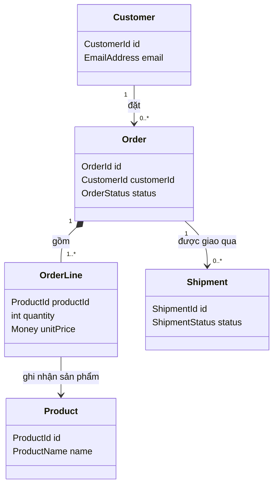

# Phân biệt quan hệ đối tượng, quan hệ dữ liệu và quyền sở hữu vòng đời

Khi mô hình hóa một miền nghiệp vụ bằng Domain-Driven Design (DDD), ta thường gặp nhiều mối quan hệ: một Order có nhiều OrderLine, một Customer tạo nhiều Order, một Order tham chiếu Product, một Shipment được lập để giao Order. Những quan hệ này có thể xuất hiện đồng thời trong mã nguồn, cơ sở dữ liệu và quy trình nghiệp vụ, nhưng chúng không có cùng ý nghĩa.

Ba câu hỏi cần được phân biệt:

1. **Quan hệ đối tượng:** các đối tượng nghiệp vụ biết, sử dụng hoặc liên kết với nhau như thế nào trong mô hình?
2. **Quan hệ dữ liệu:** dữ liệu được lưu, tham chiếu, kết nối và truy vấn như thế nào?
3. **Quyền sở hữu vòng đời:** thành phần nào chịu trách nhiệm tạo, thay đổi và kết thúc vòng đời của một đối tượng?

Nếu đồng nhất ba khía cạnh này, đội phát triển dễ thiết kế Aggregate theo sơ đồ bảng, tạo liên kết đối tượng quá chặt hoặc giao quyền thay đổi trạng thái cho sai thành phần. Một quan hệ khóa ngoại không tự động có nghĩa đối tượng này sở hữu đối tượng kia. Một đối tượng được tham chiếu cũng không có nghĩa nó thuộc cùng Aggregate. Việc hai đối tượng được lưu trong cùng một bảng hoặc giao dịch kỹ thuật cũng không chứng minh rằng chúng có chung vòng đời nghiệp vụ.

Bài viết dùng ví dụ thương mại điện tử để phân biệt ba khía cạnh, sau đó chỉ ra cách dùng chúng khi thiết kế Aggregate, repository và mô hình lưu trữ.

## 1. Ba khái niệm thường bị nhầm lẫn

### 1.1. Quan hệ đối tượng: mô hình nghiệp vụ nói gì?

Quan hệ đối tượng mô tả cách các khái niệm nghiệp vụ liên hệ với nhau. Nó trả lời những câu hỏi như:

- Order được tạo bởi Customer nào?
- Order gồm những dòng hàng nào?
- OrderLine ghi nhận sản phẩm nào đã được mua?
- Shipment phục vụ việc giao đơn hàng nào?
- Payment được thực hiện cho nghĩa vụ thanh toán nào?

Quan hệ có thể mang nhiều ý nghĩa: tham chiếu, chứa, sử dụng, phát sinh từ, chịu trách nhiệm cho hoặc phụ thuộc vào. Tên gọi quan hệ cần thể hiện ý nghĩa nghiệp vụ thay vì chỉ mô tả cấu trúc dữ liệu.

Ví dụ, nói “Order có Customer” chưa đủ rõ. Có thể diễn đạt chính xác hơn: “Order ghi nhận định danh khách hàng đã đặt đơn”. Câu này không hàm ý Order chứa toàn bộ đối tượng Customer hoặc có quyền thay đổi hồ sơ khách hàng.

### 1.2. Quan hệ dữ liệu: thông tin được lưu ra sao?

Quan hệ dữ liệu mô tả cách thông tin được tổ chức và liên kết trong hệ thống lưu trữ hoặc mô hình đọc. Nó thường được thể hiện bằng:

- Khóa chính và khóa ngoại.
- Cột tham chiếu định danh.
- Quan hệ một-một, một-nhiều hoặc nhiều-nhiều.
- Bảng liên kết.
- Join, projection và truy vấn tổng hợp.
- Bản sao dữ liệu hoặc snapshot tại một thời điểm.

Ví dụ, bảng orders có cột customer_id để truy vấn khách hàng đã đặt đơn. Điều đó thể hiện quan hệ dữ liệu. Nó chưa quyết định Order có thể sửa email Customer hay Customer có quyền hủy Order.

### 1.3. Quyền sở hữu vòng đời: ai chịu trách nhiệm cho đối tượng?

Quyền sở hữu vòng đời là trách nhiệm nghiệp vụ đối với việc tạo, thay đổi, chuyển trạng thái và kết thúc một đối tượng. Cần xác định:

- Ai được phép tạo đối tượng?
- Ai quyết định một thay đổi có hợp lệ?
- Những invariant nào phải được bảo vệ?
- Ai quản lý các chuyển trạng thái?
- Khi đối tượng cha kết thúc, đối tượng liên quan có bị kết thúc theo không?
- Có thể tồn tại độc lập sau khi đối tượng khác bị xóa hoặc đóng không?

Ví dụ, Order sở hữu vòng đời của các dòng hàng trong đơn: khi đơn còn ở trạng thái Draft, Order có thể cho thêm hoặc bỏ OrderLine; khi đơn đã được đặt, việc sửa dòng hàng bị giới hạn bởi chính sách. Customer có thể tạo nhiều Order, nhưng Customer không sở hữu vòng đời của từng Order. Đơn đã đặt vẫn tồn tại dù hồ sơ khách hàng sau đó bị vô hiệu hóa.

### 1.4. So sánh ba góc nhìn

| Góc nhìn | Câu hỏi chính | Dấu hiệu thường gặp | Ví dụ Order–Customer |
|---|---|---|---|
| Quan hệ đối tượng | Các khái niệm nghiệp vụ liên hệ với nhau ra sao? | Tham chiếu, chứa, sử dụng, phụ thuộc | Order được đặt bởi một Customer |
| Quan hệ dữ liệu | Thông tin được lưu và nối như thế nào? | FK, join, bảng liên kết, snapshot | orders.customer_id tham chiếu khách hàng |
| Quyền sở hữu vòng đời | Ai quản lý việc tạo, sửa và kết thúc? | Quyền thay đổi, invariant, chuyển trạng thái | Ordering quản lý Order; Customer quản lý hồ sơ của mình |

Một thiết kế tốt cần ba câu trả lời nhất quán, nhưng không yêu cầu chúng có cùng hình dạng. Mô hình đối tượng có thể dùng một ID thay vì tham chiếu trực tiếp. Database có thể dùng khóa ngoại. Quyền sở hữu vòng đời vẫn có thể thuộc một Aggregate riêng.

## 2. Quan hệ đối tượng không đồng nghĩa với quyền sở hữu

Trong ngôn ngữ mô hình hóa, một quan hệ có thể chỉ cho biết hai đối tượng có liên quan. Quan hệ đó không tự động trao quyền điều khiển vòng đời.

### 2.1. Association: hai đối tượng có liên hệ

Association là mối liên hệ giữa các đối tượng. Ví dụ:

- Customer đặt Order.
- Order tham chiếu Product đã mua.
- Payment liên quan đến Order.
- Shipment phục vụ Order.

Association có thể một chiều hoặc hai chiều trong mô hình. Việc chọn chiều tham chiếu cần dựa trên cách sử dụng và ranh giới mô hình.

Nếu Order chỉ cần biết CustomerId để ghi nhận người mua, Order không nhất thiết cần một tham chiếu đối tượng đầy đủ đến Customer. Tương tự, Customer không cần giữ danh sách tất cả Order như một collection trong domain chỉ để biểu diễn rằng khách hàng đã mua hàng.

### 2.2. Composition: một phần phụ thuộc vòng đời vào toàn thể

Composition thường biểu diễn quan hệ toàn thể–thành phần với sự phụ thuộc vòng đời. Trong ví dụ đơn hàng, OrderLine thường chỉ có ý nghĩa như một dòng của một Order cụ thể:

- Dòng hàng được tạo trong quá trình xây dựng đơn.
- Dòng hàng được thêm, sửa hoặc bỏ thông qua Order khi chính sách cho phép.
- Dòng hàng không được quản lý như một giao dịch mua độc lập ngoài Order.
- Khi đơn được lưu trữ hoặc kết thúc theo chính sách, dòng hàng vẫn thuộc hồ sơ của đơn.

Trong mô hình DDD, đây có thể là Entity con hoặc Value Object bên trong Aggregate Order. Composition là dấu hiệu về sự phụ thuộc vòng đời, nhưng quyết định Aggregate còn phải xét invariant và ranh giới nhất quán.

### 2.3. Aggregation: liên kết yếu hơn về vòng đời

Trong một số cách mô hình hóa, aggregation diễn tả quan hệ “có” nhưng các thành phần vẫn có thể tồn tại độc lập. Ví dụ, một Customer có thể liên quan đến nhiều Order, nhưng mỗi Order có vòng đời riêng. Customer có thể bị vô hiệu hóa trong khi các Order cũ vẫn cần được giữ để đối soát hoặc kiểm toán.

Không nên dùng thuật ngữ aggregation hoặc composition chỉ dựa trên việc một đối tượng có collection của đối tượng khác. Hãy xác nhận ý nghĩa vòng đời thực tế.

Ký hiệu association, aggregation hoặc composition trong UML cũng không tự động xác định ranh giới Aggregate của DDD. Aggregate còn phải bảo vệ các invariant cần được nhất quán cùng nhau và xác định Aggregate Root làm cửa truy cập. Một quan hệ composition có thể là manh mối để xem xét, nhưng không thay thế việc phân tích quy tắc nghiệp vụ.

### 2.4. Ví dụ quan hệ trong miền bán hàng



Sơ đồ cho thấy các loại liên hệ khác nhau. Order gồm các OrderLine. Order liên quan đến Customer và Shipment. OrderLine ghi nhận Product đã mua. Tuy nhiên, sơ đồ lớp này chưa thể hiện đầy đủ ai sở hữu vòng đời của từng đối tượng hoặc chúng có nằm trong cùng Aggregate hay không.

## 3. Quan hệ dữ liệu không quyết định mô hình domain

Cơ sở dữ liệu quan hệ thường biểu diễn quan hệ bằng khóa ngoại. ORM có thể chuyển khóa ngoại thành object reference hoặc collection. Những tiện ích đó phục vụ lưu trữ và truy cập dữ liệu, nhưng không thay thế quyết định mô hình hóa nghiệp vụ.

### 3.1. Khóa ngoại chỉ bảo đảm một quan hệ dữ liệu

Ví dụ schema:

```sql
CREATE TABLE customers (
    id UUID PRIMARY KEY,
    email VARCHAR(255) NOT NULL
);

CREATE TABLE orders (
    id UUID PRIMARY KEY,
    customer_id UUID NOT NULL,
    status VARCHAR(30) NOT NULL,
    CONSTRAINT fk_orders_customer
        FOREIGN KEY (customer_id)
        REFERENCES customers(id)
);

CREATE TABLE order_lines (
    id UUID PRIMARY KEY,
    order_id UUID NOT NULL,
    product_id UUID NOT NULL,
    quantity INTEGER NOT NULL,
    unit_price DECIMAL(18, 2) NOT NULL,
    CONSTRAINT fk_order_lines_order
        FOREIGN KEY (order_id)
        REFERENCES orders(id)
);
```

Schema này cho biết:

- Một Order tham chiếu Customer thông qua customer_id.
- Một OrderLine tham chiếu Order thông qua order_id.
- Cơ sở dữ liệu có thể kiểm tra tính toàn vẹn tham chiếu.

Nhưng schema chưa nói rằng Customer được phép sửa Order, Order có thể đổi hồ sơ Customer, hay một OrderLine phải được quản lý bởi một repository riêng. Đó là quyết định của mô hình và chính sách nghiệp vụ.

### 3.2. Quan hệ một-nhiều trong database không nhất thiết là collection trong domain

ORM thường cho phép viết:

```java
class Customer {
    @OneToMany(mappedBy = "customer")
    private List<OrderEntity> orders;
}
```

Cách ánh xạ này có thể tiện cho một số truy vấn, nhưng nếu đưa nguyên quan hệ vào domain, Customer có thể phải nạp một danh sách đơn hàng rất lớn chỉ để đọc hồ sơ khách. Nó cũng dễ tạo cảm giác Customer sở hữu vòng đời của mọi Order.

Trong domain, Customer có thể chỉ cần thông tin của chính mình. Khi cần lịch sử đơn, một query service có thể truy vấn theo CustomerId:

```java
public interface OrderQueries {
    List<OrderSummary> findRecentOrders(
        CustomerId customerId,
        int limit
    );
}
```

Cách này giữ rõ trách nhiệm: Customer là một mô hình nghiệp vụ; lịch sử đơn là nhu cầu truy vấn có thể được đáp ứng bằng read model.

### 3.3. Join không đồng nghĩa với một Aggregate

Một báo cáo có thể join Customer, Order, Payment và Shipment để hiển thị toàn bộ trạng thái mua hàng. Việc dữ liệu có thể join không có nghĩa bốn đối tượng cần nằm trong một Aggregate.

Aggregate được xác định bởi invariant và nhu cầu nhất quán nghiệp vụ. Query có thể tổng hợp nhiều Aggregate hoặc nhiều Bounded Context, thường thông qua read model hoặc projection. Đừng mở rộng Aggregate chỉ để một màn hình có thể đọc dữ liệu bằng một object graph.

### 3.4. Cascade trong ORM không phải quyền sở hữu nghiệp vụ

Các tùy chọn như CascadeType.PERSIST, CascadeType.REMOVE hoặc orphanRemoval điều khiển cách ORM truyền thao tác lưu và xóa. Chúng không tự xác định quan hệ vòng đời trong domain.

Ví dụ, cấu hình xóa cascade từ Customer sang Order có thể xóa lịch sử đơn khi xóa hồ sơ khách hàng. Điều này có thể trái với yêu cầu lưu chứng từ và kiểm toán. Ngược lại, xóa OrderLine khi bỏ dòng hàng khỏi Order có thể phù hợp nếu dòng hàng chỉ tồn tại như một phần của đơn chưa hoàn tất.

Hãy quyết định quyền sở hữu vòng đời bằng quy tắc nghiệp vụ trước, rồi mới cấu hình cascade tương ứng. Với dữ liệu lịch sử hoặc nghiệp vụ cần lưu giữ, thao tác xóa vật lý thường phải được thay bằng vô hiệu hóa, lưu trữ hoặc chính sách retention.

## 4. Quyền sở hữu vòng đời trong DDD

Trong DDD, Aggregate là ranh giới nhất quán nghiệp vụ. Aggregate Root là điểm truy cập từ bên ngoài và chịu trách nhiệm bảo vệ invariant của Aggregate. Đây là một cơ chế quan trọng để xác định quyền thay đổi đối tượng.

### 4.1. Aggregate Root kiểm soát các đối tượng bên trong Aggregate

Ví dụ, Order có thể chứa OrderLine. Bên ngoài tương tác với Order qua các hành vi:

- addLine(...)
- changeQuantity(...)
- removeLine(...)
- place()

Order kiểm tra trạng thái và invariant trước khi chấp nhận thay đổi. Bên ngoài không nên lấy một OrderLine rồi sửa trực tiếp mà bỏ qua Order.

```java
public class Order {
    private final OrderId id;
    private final List<OrderLine> lines = new ArrayList<>();
    private OrderStatus status = OrderStatus.DRAFT;

    public void addLine(OrderLine line) {
        ensureDraft();
        lines.add(Objects.requireNonNull(line));
    }

    public void changeQuantity(
            ProductId productId,
            int newQuantity) {
        ensureDraft();

        if (newQuantity <= 0) {
            throw new IllegalArgumentException(
                "Quantity must be positive"
            );
        }

        OrderLine line = findLine(productId);
        line.changeQuantity(newQuantity);
    }

    public void place() {
        ensureDraft();

        if (lines.isEmpty()) {
            throw new IllegalStateException(
                "An order must contain at least one line"
            );
        }

        status = OrderStatus.PLACED;
    }

    private void ensureDraft() {
        if (status != OrderStatus.DRAFT) {
            throw new IllegalStateException(
                "Only a draft order can be changed"
            );
        }
    }

    private OrderLine findLine(ProductId productId) {
        return lines.stream()
            .filter(line -> line.productId().equals(productId))
            .findFirst()
            .orElseThrow(() ->
                new IllegalArgumentException("Order line not found")
            );
    }
}
```

Đoạn mã minh họa quyền thay đổi được tập trung tại Aggregate Root. Trong hệ thống thực tế, nếu một đơn có thể chứa nhiều dòng cùng ProductId, cần dùng LineId để nhận diện đúng dòng thay vì tìm theo ProductId. Quy tắc về số lượng, giá và trạng thái cũng phải được hoàn thiện theo nghiệp vụ.

### 4.2. Aggregate Root không sở hữu mọi đối tượng mà nó tham chiếu

Order có thể tham chiếu CustomerId, ProductId, PaymentId hoặc ShipmentId. Việc tham chiếu không có nghĩa những đối tượng này nằm trong Aggregate Order.

Một nguyên tắc thường dùng là:

- Bên trong một Aggregate, các đối tượng có thể được liên kết trực tiếp để cùng bảo vệ invariant.
- Giữa các Aggregate, ưu tiên tham chiếu bằng định danh.
- Muốn thay đổi Aggregate khác, hãy tải và gọi hành vi qua Aggregate Root của nó.
- Nếu một quy trình cần phối hợp nhiều Aggregate, Application Service hoặc Process Manager điều phối qua các hợp đồng phù hợp.

Điều này giúp giới hạn object graph, giảm xung đột cập nhật và làm rõ nơi có quyền quyết định.

### 4.3. Quyền sở hữu vòng đời khác với quyền sở hữu dữ liệu tham chiếu

Order có thể lưu customerId để biết ai đã đặt đơn. Customer chịu trách nhiệm cho hồ sơ khách hàng. Ordering chịu trách nhiệm cho đơn hàng. Việc Customer bị vô hiệu hóa không tự động kết thúc Order.

Tương tự, OrderLine có thể lưu productId cùng snapshot tên và giá. Product Catalog chịu trách nhiệm cho thông tin sản phẩm hiện tại; Ordering chịu trách nhiệm cho nội dung giao dịch đã phát sinh. Nếu tên hoặc giá trong Catalog thay đổi, đơn cũ không nhất thiết thay đổi theo.

Đây là một khác biệt quan trọng: đối tượng có thể **tham chiếu** một khái niệm mà không **sở hữu** vòng đời của nó.

### 4.4. Quyền kiểm soát nghiệp vụ không đồng nghĩa với quyền xóa vật lý

Khi nói Aggregate Root kiểm soát các đối tượng bên trong Aggregate, điều đó có nghĩa các thay đổi nghiệp vụ phải đi qua Root để invariant được bảo vệ. Nó không có nghĩa mọi thao tác lưu trữ, lưu trữ lâu dài hoặc xóa vật lý đều phải do chính Root thực hiện.

Ví dụ, Order có thể quyết định một OrderLine được thêm hoặc bỏ khi đơn còn Draft. Sau khi đơn được đặt, chính sách lưu chứng từ có thể yêu cầu giữ lại các dòng hàng trong nhiều năm. Một tiến trình lưu trữ dữ liệu có thể chuyển đơn cũ sang kho lưu trữ theo chính sách retention; thao tác kỹ thuật đó không làm thay đổi việc Ordering là nơi sở hữu quy tắc nghiệp vụ của Order.

Vì vậy, khi xác định quyền sở hữu, hãy phân biệt ba trách nhiệm: ai quyết định hành vi nghiệp vụ hợp lệ, ai duy trì dữ liệu có thẩm quyền và thành phần nào thực hiện lưu trữ hoặc xóa vật lý. Chúng có thể thuộc các lớp hoặc tiến trình khác nhau, miễn là hợp đồng và quyền hạn rõ ràng.

## 5. Phân tích các quan hệ điển hình trong hệ thống thương mại điện tử

### 5.1. Customer và Order

Customer tạo nhiều Order, nhưng mỗi Order có vòng đời riêng.

| Khía cạnh | Thiết kế phù hợp |
|---|---|
| Quan hệ đối tượng | Order ghi nhận CustomerId của người đặt |
| Quan hệ dữ liệu | orders.customer_id tham chiếu customers.id |
| Quyền sở hữu vòng đời | Customer quản lý hồ sơ khách; Ordering quản lý Order |
| Thay đổi | Đổi email Customer không tự thay đổi snapshot thông tin trên đơn đã đặt |
| Truy vấn | Lịch sử đơn được truy vấn theo CustomerId |

Không nên để Customer Aggregate chứa toàn bộ danh sách Order chỉ vì quan hệ một-nhiều. Đơn hàng có thể rất nhiều, được tạo thường xuyên và có quy tắc thay đổi riêng.

### 5.2. Order và OrderLine

OrderLine thường phụ thuộc vào Order trong vòng đời đơn.

| Khía cạnh | Thiết kế phù hợp |
|---|---|
| Quan hệ đối tượng | Order gồm các OrderLine |
| Quan hệ dữ liệu | order_lines.order_id tham chiếu orders.id |
| Quyền sở hữu vòng đời | Order Root kiểm soát việc thêm, sửa, bỏ dòng hàng |
| Thay đổi | Chỉ cho sửa dòng hàng khi trạng thái đơn cho phép |
| Truy cập | Bên ngoài thay đổi dòng hàng qua hành vi của Order |

OrderLine có thể là Value Object hoặc Entity con tùy việc có cần danh tính riêng hay không. Dù là Entity con, nó vẫn có thể thuộc Aggregate Order và không có repository riêng.

### 5.3. OrderLine và Product

OrderLine liên quan đến Product được mua, nhưng thường không sở hữu vòng đời Product.

| Khía cạnh | Thiết kế phù hợp |
|---|---|
| Quan hệ đối tượng | OrderLine ghi nhận ProductId và thông tin cần thiết tại thời điểm mua |
| Quan hệ dữ liệu | order_lines.product_id có thể tham chiếu danh mục sản phẩm |
| Quyền sở hữu vòng đời | Product Catalog quản lý Product; Ordering quản lý OrderLine |
| Thay đổi | Đổi mô tả sản phẩm không viết lại nội dung giao dịch đã đặt |
| Snapshot | Lưu tên, SKU, đơn giá hoặc mô tả cần thiết theo yêu cầu chứng từ |

Có thể lưu FK đến Product để đối chiếu, đồng thời lưu snapshot để bảo toàn lịch sử giao dịch. Nếu sản phẩm bị ngừng kinh doanh, OrderLine cũ vẫn phải có đủ thông tin để giải thích đơn đã mua gì.

### 5.4. Order và Shipment

Order có thể được giao qua một hoặc nhiều Shipment, đặc biệt khi đơn được chia thành nhiều kiện hoặc giao nhiều đợt.

| Khía cạnh | Thiết kế phù hợp |
|---|---|
| Quan hệ đối tượng | Shipment phục vụ việc thực hiện giao hàng cho Order |
| Quan hệ dữ liệu | shipments.order_id tham chiếu Order hoặc lưu OrderId |
| Quyền sở hữu vòng đời | Shipping quản lý Shipment; Ordering quản lý trạng thái nghiệp vụ của Order |
| Thay đổi | Shipment cập nhật trạng thái vận chuyển; Order phản ánh tiến trình đơn theo chính sách |
| Phối hợp | Sự kiện như ShipmentDispatched hoặc ShipmentDelivered thông báo kết quả |

Order không nhất thiết chứa toàn bộ Shipment như các đối tượng nội bộ của Aggregate. Shipping cần quản lý lô giao độc lập, có thể có nhiều lần cập nhật từ đơn vị vận chuyển. Ordering nhận thông tin cần thiết để quyết định trạng thái đơn.

### 5.5. Order và Payment

Một Order có thể liên quan đến một hoặc nhiều Payment Attempt, tùy chính sách thanh toán. Payment có định danh và vòng đời giao dịch riêng.

| Khía cạnh | Thiết kế phù hợp |
|---|---|
| Quan hệ đối tượng | Payment tham chiếu Order hoặc nghĩa vụ thanh toán của Order |
| Quan hệ dữ liệu | Payment lưu orderId hoặc mã tham chiếu giao dịch |
| Quyền sở hữu vòng đời | Payment Context quản lý giao dịch; Ordering quản lý Order |
| Thay đổi | Payment xác nhận, từ chối, thu hoặc hoàn tiền theo quy tắc của nó |
| Phối hợp | Ordering phản ứng với kết quả thanh toán qua application workflow hoặc event |

Không nên gọi payment.authorize() bằng cách sửa trực tiếp một Payment object nằm bên trong Order nếu Payment là Aggregate riêng. Application có thể điều phối lệnh đến Payment Context, sau đó nhận kết quả qua phản hồi hoặc sự kiện.

## 6. Quan hệ giữa Aggregate, repository và cơ sở dữ liệu

Ba khái niệm này có liên hệ nhưng phục vụ những mục đích khác nhau.

### 6.1. Repository thường được định nghĩa cho Aggregate Root

Repository cung cấp cách nạp và lưu Aggregate như một đơn vị nghiệp vụ. Ví dụ:

```java
public interface OrderRepository {
    Optional<Order> findById(OrderId id);
    void save(Order order);
}
```

Không nhất thiết tạo OrderLineRepository nếu OrderLine chỉ được quản lý bên trong Order. Nếu application muốn đổi một dòng hàng, nó tải Order, gọi hành vi trên Root và lưu Order.

Tạo repository riêng cho Entity con có thể cho phép cập nhật bỏ qua invariant của Aggregate. Chỉ nên tách khi mô hình và vòng đời thực sự cho thấy đối tượng đó là một Aggregate Root độc lập.

### 6.2. Aggregate không bắt buộc tương ứng một bảng

Một Aggregate có thể được lưu qua nhiều bảng. Một bảng cũng có thể chứa dữ liệu phục vụ nhiều mô hình hoặc read model. Ranh giới Aggregate được xác định bởi invariant, không phải số lượng bảng.

Ví dụ, Order và OrderLine có thể được lưu ở hai bảng quan hệ nhưng vẫn là một Aggregate. Ngược lại, Customer và Order có thể được lưu trong cùng một database nhưng là hai Aggregate độc lập.

### 6.3. Giao dịch database và giao dịch nghiệp vụ

Một transaction database có thể cập nhật nhiều bảng cùng lúc. Nhưng không nên vì database có thể thực hiện một transaction mà gom mọi đối tượng vào cùng Aggregate.

Aggregate thường xác định ranh giới nhất quán nghiệp vụ cần bảo vệ trong một thao tác. Phối hợp giữa các Aggregate thường được thực hiện bằng quy trình ứng dụng, Domain Event, Integration Event, Process Manager hoặc Saga tùy yêu cầu.

Ví dụ, đặt đơn, giữ hàng và ủy quyền thanh toán có thể là ba thao tác ở ba Aggregate hoặc Bounded Context. Nếu một bước thất bại, hệ thống có thể cần giải phóng reservation hoặc xử lý hoàn tiền. Đó là quy trình nghiệp vụ có các trạng thái và hành động bù trừ, không phải một Aggregate khổng lồ.

### 6.4. Tránh để ORM quyết định Aggregate

Nếu ORM tự động nạp toàn bộ object graph qua EAGER relationship hoặc cascade, ứng dụng có thể vô tình tạo phụ thuộc dữ liệu lớn. Hãy chọn cách nạp dữ liệu theo use case và ranh giới Aggregate.

Một số hướng thực hành:

- Nạp Aggregate Root cùng những thành phần cần thiết để bảo vệ invariant.
- Tránh nạp collection rất lớn chỉ vì có quan hệ một-nhiều trong database.
- Dùng ID để tham chiếu Aggregate khác.
- Dùng query riêng cho màn hình, báo cáo và tìm kiếm.
- Cấu hình cascade theo quyền sở hữu vòng đời đã xác định.
- Không để thao tác persistence bỏ qua hành vi và quy tắc của Root.

## 7. Quy trình xác định quan hệ và quyền sở hữu

Khi gặp hai khái niệm có liên hệ, hãy phân tích theo trình tự sau.

### Bước 1: Mô tả quan hệ bằng câu nghiệp vụ

Tránh chỉ ghi “A có B”. Hãy viết câu có động từ và ý nghĩa cụ thể:

- Order được đặt bởi Customer.
- Order gồm các OrderLine.
- OrderLine ghi nhận Product được mua.
- Shipment thực hiện giao một phần hoặc toàn bộ Order.
- Payment thanh toán cho nghĩa vụ của Order.

Câu mô tả giúp phát hiện quan hệ là tham chiếu, thành phần hay quy trình phối hợp.

### Bước 2: Xác định danh tính của từng đối tượng

Hỏi hai đối tượng có cần được phân biệt độc lập không. Nếu một đối tượng thay đổi, đối tượng kia có còn là chính nó không? Có cần tham chiếu một đối tượng sau nhiều lần thay đổi không?

Nếu cả hai có danh tính và vòng đời riêng, chúng có thể là hai Entity hoặc hai Aggregate độc lập dù có liên hệ chặt chẽ.

### Bước 3: Xác định ai sở hữu từng quyết định

Với mỗi thay đổi, hỏi:

- Ai quyết định thay đổi có hợp lệ?
- Quy tắc nào phải được kiểm tra?
- Đối tượng nào có đủ thông tin để bảo vệ quy tắc?
- Thay đổi có cần nhất quán cùng những đối tượng nào?

Đối tượng chịu trách nhiệm bảo vệ invariant có thể là Aggregate Root phù hợp. Đừng chọn Root chỉ vì nó có tên giống “đối tượng cha” trong sơ đồ dữ liệu.

### Bước 4: Kiểm tra phụ thuộc vòng đời

Nếu A kết thúc, B có bắt buộc kết thúc theo không? B có thể được tạo hoặc quản lý độc lập không? B có giá trị ngoài quan hệ với A không?

Nếu B chỉ có ý nghĩa bên trong A, có thể là thành phần của A. Nếu B có vòng đời và trách nhiệm độc lập, nó có thể cần Aggregate riêng.

### Bước 5: Thiết kế cách tham chiếu trong mô hình

- Dùng object reference bên trong Aggregate khi cần bảo vệ invariant cùng nhau.
- Dùng ID để tham chiếu Aggregate khác trong nhiều trường hợp.
- Dùng snapshot khi cần giữ sự thật tại thời điểm giao dịch.
- Dùng Domain Event hoặc Integration Event để thông báo thay đổi giữa các phạm vi.

Không có quy tắc rằng mọi quan hệ trong domain đều phải là ID. Điều quan trọng là không tạo object graph vượt qua ranh giới nhất quán và không làm lộ quyền sửa đối tượng nội bộ.

### Bước 6: Thiết kế quan hệ dữ liệu sau khi hiểu mô hình

Chọn FK, bảng liên kết, snapshot, index và cách truy vấn để hỗ trợ mô hình và use case. Xác định cascade, xóa mềm và retention dựa trên vòng đời nghiệp vụ. Không để cấu trúc database buộc domain phải nhận một quan hệ không có ý nghĩa.

### Bước 7: Kiểm chứng bằng tình huống thay đổi và ngoại lệ

Thử các tình huống:

- Customer bị vô hiệu hóa sau khi đã đặt đơn.
- Product bị ngừng bán nhưng Order cũ vẫn cần hiển thị.
- Order bị hủy khi Reservation đã được tạo.
- Shipment giao một phần rồi thất bại.
- Payment được hoàn tiền sau khi Order đã hoàn tất.
- Một Order có hàng trăm dòng và lịch sử giao nhiều đợt.

Nếu mô hình không biết ai chịu trách nhiệm hoặc cần sửa trực tiếp dữ liệu của nhiều đối tượng, ranh giới cần được xem lại.

## 8. Những sai lầm thường gặp

**Đồng nhất quan hệ khóa ngoại với quan hệ sở hữu.** orders.customer_id chỉ cho biết đơn tham chiếu khách hàng. Nó không trao cho Customer quyền sửa hoặc xóa Order.

**Đưa mọi quan hệ một-nhiều thành collection hai chiều.** ORM có thể hỗ trợ collection nhưng domain không nhất thiết cần nạp toàn bộ các đối tượng liên quan. Điều này dễ tạo object graph lớn và vòng tham chiếu khó kiểm soát.

**Gom mọi đối tượng có liên quan vào một Aggregate.** Order, Payment, Inventory và Shipment cùng tham gia một quy trình nhưng có quy tắc và vòng đời riêng. Gom tất cả vào một Aggregate sẽ tạo ranh giới quá lớn.

**Tạo repository cho mọi bảng hoặc Entity con.** Repository nên phục vụ Aggregate Root. Entity con cần được thay đổi qua Root nếu nó thuộc Aggregate.

**Dùng cascade theo tiện ích ORM.** Cascade remove có thể xóa dữ liệu cần lưu giữ. Cấu hình persistence phải phản ánh chính sách vòng đời đã xác định.

**Để một context sửa dữ liệu do context khác sở hữu.** Ordering không nên tự ghi số lượng tồn kho nếu Inventory chịu trách nhiệm về lượng hàng. Hãy gửi yêu cầu và xử lý kết quả từ chủ sở hữu.

**Coi snapshot là bản sao cần đồng bộ liên tục.** Snapshot giá và tên sản phẩm trong Order có mục đích bảo toàn giao dịch tại thời điểm mua. Nó không nên bị cập nhật mỗi khi Catalog thay đổi.

**Dùng một transaction kỹ thuật để biện minh cho Aggregate lớn.** Database có thể cập nhật nhiều bảng nguyên tử, nhưng ranh giới nhất quán cần dựa trên quy tắc nghiệp vụ và khả năng thay đổi độc lập.

**Nhầm người tạo với người sở hữu vòng đời.** Customer có thể khởi phát việc tạo Order nhưng Ordering vẫn sở hữu quy tắc và vòng đời của Order. Tác nhân khởi tạo không nhất thiết là chủ thể quản lý đối tượng về sau.

## 9. Checklist rà soát một quan hệ trong mô hình

Với mỗi quan hệ A–B, hãy kiểm tra:

**Quan hệ đối tượng**

- Quan hệ được diễn đạt bằng động từ nghiệp vụ rõ ràng chưa?
- A tham chiếu, chứa, sử dụng hay phụ thuộc vào B?
- Có cần tham chiếu hai chiều không?
- Có thể dùng định danh thay cho object reference không?

**Quan hệ dữ liệu**

- FK hoặc bảng liên kết có phản ánh đúng mục đích dữ liệu không?
- Snapshot có cần thiết để giữ thông tin tại thời điểm nghiệp vụ không?
- Truy vấn có cần nạp toàn bộ object graph không?
- Cascade và xóa dữ liệu có phù hợp với chính sách lưu giữ không?

**Quyền sở hữu vòng đời**

- Ai tạo và thay đổi A, B?
- Ai bảo vệ invariant của từng đối tượng?
- B có tồn tại độc lập khi A kết thúc không?
- A có quyền thay đổi B hay chỉ gửi yêu cầu?
- B có thuộc cùng Aggregate hay là Aggregate độc lập?

**Aggregate và tích hợp**

- Ranh giới Aggregate có dựa trên invariant không?
- Bên ngoài có thể truy cập Entity con bỏ qua Root không?
- Các Aggregate khác được tham chiếu bằng định danh phù hợp chưa?
- Quy trình phối hợp nhiều Aggregate có trạng thái và cách xử lý lỗi rõ không?

## 10. Kết luận

Quan hệ đối tượng, quan hệ dữ liệu và quyền sở hữu vòng đời là ba góc nhìn khác nhau. Quan hệ đối tượng diễn đạt ý nghĩa nghiệp vụ giữa các khái niệm. Quan hệ dữ liệu cho biết thông tin được lưu và kết nối như thế nào. Quyền sở hữu vòng đời xác định ai chịu trách nhiệm tạo, thay đổi, bảo vệ và kết thúc một đối tượng.

Trong DDD, Aggregate Root kiểm soát các thay đổi bên trong Aggregate để bảo vệ invariant. Các Aggregate khác có thể liên hệ bằng định danh và phối hợp qua use case hoặc sự kiện. Database và ORM triển khai cách lưu trữ phù hợp với mô hình, nhưng không quyết định thay mô hình nghiệp vụ.

Khi thiết kế một quan hệ, hãy hỏi riêng ba điều: hai khái niệm có ý nghĩa gì với nhau, dữ liệu cần liên kết ra sao và ai thực sự sở hữu vòng đời của từng đối tượng. Trả lời rõ ba câu hỏi này giúp Aggregate có ranh giới hợp lý, tránh phụ thuộc chéo và giữ quyền quyết định ở đúng nơi trong domain.

