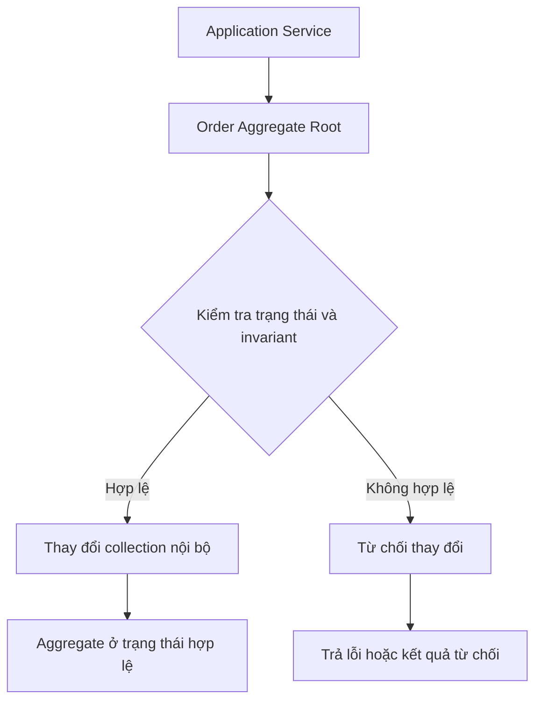

# Cập nhật collection mà không làm lộ cấu trúc có thể sửa từ bên ngoài

Trong Domain-Driven Design (DDD), Aggregate là ranh giới nhất quán của một nhóm đối tượng miền. Aggregate Root là điểm truy cập bên ngoài và chịu trách nhiệm bảo vệ các invariant của nhóm đó. Khi một Aggregate chứa collection như danh sách dòng đơn hàng, các mặt hàng trong giỏ hoặc các khoản mục hóa đơn, cách collection được truy cập và cập nhật ảnh hưởng trực tiếp đến khả năng bảo vệ quy tắc nghiệp vụ.

Nếu trả về trực tiếp một `List` có thể sửa, code bên ngoài có thể thêm, xóa hoặc thay thế phần tử mà không đi qua Aggregate Root. Khi đó, những quy tắc như “mỗi SKU chỉ xuất hiện một lần”, “đơn đã đặt không được sửa dòng hàng” hoặc “đơn phải có ít nhất một dòng khi được đặt” có thể bị phá vỡ. Aggregate vẫn có vẻ như sở hữu dữ liệu, nhưng thực tế đã mất quyền kiểm soát.

Bài học này trình bày cách đóng gói collection, cập nhật phần tử thông qua hành vi của Aggregate Root, sao chép dữ liệu đầu vào và đầu ra, dùng Value Object bất biến, đồng thời cân nhắc chi phí khi collection lớn hoặc được ORM quản lý.

## 1. Vì sao không nên để lộ collection có thể sửa?

Hãy xét Aggregate `Order` chứa danh sách `OrderLine`. Nghiệp vụ quy định:

- Một SKU chỉ xuất hiện một lần trong đơn; nếu khách tăng số lượng thì phải cập nhật dòng hiện có.
- Chỉ đơn ở trạng thái `DRAFT` mới được thêm, sửa hoặc xóa dòng hàng.
- Đơn phải có ít nhất một dòng hợp lệ trước khi chuyển sang `PLACED`.
- Số lượng đặt phải lớn hơn 0.

Nếu `Order` cung cấp collection nội bộ trực tiếp, người gọi có thể bỏ qua tất cả quy tắc trên:

```java
// Ví dụ thiết kế nguy hiểm: để lộ collection nội bộ.
public final class Order {
    private final List<OrderLine> lines = new ArrayList<>();

    public List<OrderLine> getLines() {
        return lines;
    }
}

// Code bên ngoài có thể sửa trực tiếp dữ liệu của Aggregate.
order.getLines().clear();
order.getLines().add(null);
order.getLines().add(anotherLineWithSameSku);
```

Các thao tác trên không gọi một hành vi nghiệp vụ nào của `Order`. Aggregate không có cơ hội kiểm tra trạng thái, tính duy nhất hoặc điều kiện hợp lệ của phần tử. Lỗi có thể chỉ xuất hiện ở một bước xử lý sau đó, khiến việc tìm nguyên nhân khó hơn.

Vấn đề không nằm ở việc dùng `List`. Collection là cấu trúc phù hợp để biểu diễn nhiều phần tử. Vấn đề là quyền sửa collection bị trao cho code không sở hữu invariant.

## 2. Aggregate Root phải kiểm soát thay đổi collection

Aggregate Root là cổng vào duy nhất cho những thay đổi bên ngoài đối với Aggregate. Với collection, nguyên tắc này có nghĩa:

1. Collection nội bộ được giữ ở trạng thái private.
2. Bên ngoài không nhận được tham chiếu có thể sửa collection nội bộ.
3. Mọi thao tác thêm, sửa, xóa đều đi qua phương thức diễn đạt hành vi miền của Aggregate Root.
4. Aggregate Root kiểm tra các invariant liên quan trước khi thay đổi.
5. Dữ liệu đọc ra được cung cấp dưới dạng bản sao hoặc giao diện chỉ đọc phù hợp.

Ví dụ, thay vì cung cấp `getLines()` để người gọi tự thao tác, `Order` cung cấp `addLine()`, `changeQuantity()` và `removeLine()`. Các phương thức này mô tả ý định nghiệp vụ, đồng thời giữ quyền kiểm soát collection ở bên trong Aggregate.



Application Service điều phối use case và gọi hành vi của Aggregate. Nó không nên lấy collection ra rồi tự sửa. Cách tổ chức này giúp quy tắc được bảo vệ tại nơi sở hữu trạng thái cần bảo vệ.

## 3. Thiết kế API collection theo ý nghĩa nghiệp vụ

### 3.1. Dùng phương thức hành vi thay cho setter collection

Một API như `setLines(List<OrderLine> lines)` cho phép caller thay toàn bộ collection. Nó khó thể hiện mục đích và dễ bỏ qua các quy tắc cần áp dụng cho từng thay đổi.

Hãy cung cấp các hành vi có ý nghĩa:

| API dễ gây rủi ro | API thể hiện ý định rõ hơn |
|---|---|
| `getLines().add(line)` | `order.addLine(line)` |
| `getLines().remove(line)` | `order.removeLine(sku)` |
| `getLines().set(i, line)` | `order.changeQuantity(sku, quantity)` |
| `setLines(lines)` | Một hành vi nghiệp vụ rõ ràng như `replaceDraftLines(...)`, nếu nghiệp vụ thực sự cho phép thay toàn bộ |

Không phải mọi Aggregate đều cần đủ ba phương thức thêm, sửa, xóa. API nên phản ánh những hành động mà nghiệp vụ cho phép. Nếu không có khái niệm “thay toàn bộ dòng hàng”, đừng tạo một setter collection tổng quát chỉ vì tiện cho framework.

### 3.2. Chọn collection theo quy tắc miền

Chọn `List`, `Set` hay `Map` dựa trên ý nghĩa của các phần tử:

- Dùng `List` khi thứ tự có ý nghĩa hoặc cần giữ thứ tự nhập.
- Dùng `Set` khi tính duy nhất của phần tử là đặc tính tự nhiên của mô hình.
- Dùng `Map` khi cần tra cứu theo khóa miền, chẳng hạn SKU.

Kiểu collection không thay thế invariant. Một `Set` chỉ ngăn phần tử trùng theo `equals()`/`hashCode()`; nếu nghiệp vụ định nghĩa trùng SKU nhưng `OrderLine` equality bao gồm cả số lượng và đơn giá, hai dòng cùng SKU vẫn có thể cùng tồn tại trong Set. Aggregate phải kiểm tra đúng khóa duy nhất mà nghiệp vụ quy định.

### 3.3. Phương thức nên nhận tham số có ngữ nghĩa

Thay vì nhận chỉ số vị trí như `updateLine(int index, ...)`, nên dùng định danh hoặc giá trị khóa phù hợp với mô hình, ví dụ `changeQuantity(Sku sku, Quantity quantity)`. Chỉ số của `List` là chi tiết cấu trúc; SKU là khái niệm nghiệp vụ.

Nếu phần tử là Entity con có identity riêng trong Aggregate, có thể dùng `OrderLineId`. Nếu phần tử là Value Object, khóa tra cứu có thể là một tổ hợp giá trị như SKU. Quyết định phụ thuộc vào việc dòng hàng có danh tính và vòng đời riêng trong miền hay không.

## 4. Phân biệt bản sao, view chỉ đọc và tham chiếu nội bộ

Có nhiều cách cung cấp dữ liệu collection cho bên ngoài. Chúng có hành vi khác nhau và cần được chọn có chủ đích.

### 4.1. Trả về tham chiếu mutable: không an toàn

```java
public List<OrderLine> lines() {
    return lines;
}
```

Caller có thể thêm, xóa hoặc thay thế phần tử mà không qua Aggregate Root. Đây là cách làm làm lộ cấu trúc nội bộ và phá vỡ quyền kiểm soát invariant.

### 4.2. Trả về unmodifiable view

```java
import java.util.Collections;

public List<OrderLine> linesView() {
    return Collections.unmodifiableList(lines);
}
```

`Collections.unmodifiableList()` tạo một view không cho caller sửa thông qua view đó. Tuy nhiên, đây là **view sống (live view)**: nếu Aggregate thay đổi collection nội bộ, caller đang giữ view vẫn nhìn thấy thay đổi mới. Nó cũng chỉ bảo vệ thao tác qua wrapper; nếu một tham chiếu mutable khác tới collection gốc bị lộ ở nơi khác, collection vẫn có thể bị sửa.

Unmodifiable view phù hợp khi API muốn cung cấp một góc nhìn chỉ đọc luôn phản ánh trạng thái hiện tại và vòng đời của view được kiểm soát. Nó không phải bản snapshot.

### 4.3. Trả về bản sao bất biến

```java
public List<OrderLine> lines() {
    return List.copyOf(lines);
}
```

`List.copyOf()` tạo một danh sách không thể sửa thông qua tham chiếu trả về. Danh sách này là snapshot tại thời điểm gọi: những thay đổi về sau của Aggregate không làm thay đổi danh sách caller đang giữ.

Đây thường là lựa chọn rõ ràng cho collection nhỏ hoặc vừa khi caller cần đọc trạng thái tại một thời điểm. Việc sao chép có chi phí theo số phần tử, nên cần cân nhắc với collection lớn hoặc truy vấn tần suất cao.

### 4.4. Bản sao nông và bất biến sâu

`List.copyOf()` chỉ bảo vệ cấu trúc danh sách. Nó không tự biến các phần tử bên trong thành bất biến. Nếu phần tử là object mutable, caller vẫn có thể thay đổi object đó và gián tiếp làm thay đổi trạng thái mà Aggregate đang giữ.

Ví dụ, nếu `OrderLine` có setter `setQuantity()`, snapshot của danh sách vẫn chứa tham chiếu tới chính các `OrderLine` mutable đó. Caller có thể gọi setter và phá vỡ invariant dù không thêm hoặc xóa được phần tử khỏi danh sách.

Vì vậy, cần kết hợp hai biện pháp:

- Không để lộ cấu trúc collection có thể sửa.
- Dùng Value Object bất biến cho phần tử nếu phù hợp với mô hình, hoặc cung cấp projection/DTO chỉ đọc khi cần hiển thị dữ liệu.

### 4.5. Không trả về `subList()` hoặc stream gắn với collection nội bộ

`subList()` của `List` thường là view gắn với danh sách gốc, không phải snapshot độc lập. Trả về trực tiếp `lines.subList(...)` có thể làm lộ quan hệ với collection nội bộ và tạo hành vi khó đoán khi danh sách thay đổi.

Tương tự, tránh trả về một `Stream` hoặc `Iterator` mà việc duyệt phụ thuộc trực tiếp vào collection mutable nội bộ. Nếu caller cần duyệt một snapshot, hãy tạo snapshot trước rồi cung cấp stream trên snapshot đó:

```java
import java.util.stream.Stream;

public Stream<OrderLine> lineStream() {
    return List.copyOf(lines).stream();
}
```

Trong nhiều trường hợp, trả về `List.copyOf(lines)` đơn giản và dễ hiểu hơn việc tạo API stream riêng.

## 5. Value Object bất biến giúp bảo vệ phần tử trong collection

Collection được đóng gói vẫn chưa đủ nếu các phần tử có thể bị sửa từ bên ngoài. Value Object là lựa chọn tự nhiên cho các phần tử được xác định bằng giá trị và không cần identity riêng.

Ví dụ, một dòng hàng trong đơn có thể được mô hình hóa bằng record:

```java
import java.math.BigDecimal;
import java.util.Currency;
import java.util.Objects;

record Sku(String value) {
    Sku {
        Objects.requireNonNull(value, "sku");
        value = value.trim();
        if (value.isEmpty()) {
            throw new IllegalArgumentException("SKU không được để trống");
        }
    }
}

record Quantity(int value) {
    Quantity {
        if (value <= 0) {
            throw new IllegalArgumentException("Số lượng phải lớn hơn 0");
        }
    }
}

record Money(BigDecimal amount, Currency currency) {
    Money {
        Objects.requireNonNull(amount, "amount");
        Objects.requireNonNull(currency, "currency");
        if (amount.signum() < 0) {
            throw new IllegalArgumentException("Số tiền không được âm");
        }
        amount = amount.stripTrailingZeros();
    }
}

record OrderLine(Sku sku, Quantity quantity, Money unitPrice) {
    OrderLine {
        Objects.requireNonNull(sku);
        Objects.requireNonNull(quantity);
        Objects.requireNonNull(unitPrice);
    }

    OrderLine withQuantity(Quantity newQuantity) {
        return new OrderLine(sku, newQuantity, unitPrice);
    }
}
```

`OrderLine` là immutable record. Khi cần đổi số lượng, Aggregate tạo một `OrderLine` mới thay cho phần tử cũ. `Sku`, `Quantity` và `Money` cũng là các giá trị bất biến trong ví dụ, nên snapshot danh sách không làm lộ một đường sửa trạng thái thông qua phần tử.

Quy tắc số tiền không âm và số lượng dương chỉ là giả định cho dòng hàng bán ra. Một bounded context khác có thể cần số âm cho bút toán điều chỉnh hoặc số lượng bằng 0 cho tồn kho. Không nên dùng chung một Value Object nếu các quy tắc miền khác nhau.

## 6. Ví dụ hoàn chỉnh: Aggregate Order kiểm soát collection dòng hàng

Giả sử Ordering có các quy tắc:

- `Order` là Aggregate Root và giữ collection các dòng hàng.
- Một SKU chỉ xuất hiện tối đa một lần trong một đơn.
- Chỉ đơn `DRAFT` mới được thay đổi dòng hàng.
- Đơn chỉ chuyển sang `PLACED` khi có ít nhất một dòng hàng.
- Số lượng từng dòng luôn lớn hơn 0.

Thiết kế dưới đây giữ collection private, sao chép dữ liệu đầu vào, trả snapshot bất biến khi đọc và chỉ thay đổi collection qua các hành vi của `Order`.

```java
import java.util.ArrayList;
import java.util.Collection;
import java.util.List;
import java.util.Objects;
import java.util.UUID;

record OrderId(UUID value) {
    OrderId {
        Objects.requireNonNull(value);
    }
}

enum OrderStatus {
    DRAFT,
    PLACED
}

final class Order {
    private final OrderId id;
    private final List<OrderLine> lines = new ArrayList<>();
    private OrderStatus status = OrderStatus.DRAFT;

    Order(OrderId id, Collection<OrderLine> initialLines) {
        this.id = Objects.requireNonNull(id);
        Objects.requireNonNull(initialLines);

        // Không giữ tham chiếu collection do caller sở hữu.
        for (OrderLine line : List.copyOf(initialLines)) {
            addLine(line);
        }
    }

    public OrderId id() {
        return id;
    }

    public OrderStatus status() {
        return status;
    }

    // Trả snapshot bất biến; caller không thể sửa collection nội bộ.
    public List<OrderLine> lines() {
        return List.copyOf(lines);
    }

    public int lineCount() {
        return lines.size();
    }

    public void addLine(OrderLine line) {
        ensureDraft();
        Objects.requireNonNull(line);

        if (indexOf(line.sku()) >= 0) {
            throw new IllegalArgumentException("SKU đã tồn tại trong đơn");
        }

        lines.add(line);
    }

    public void changeQuantity(Sku sku, Quantity newQuantity) {
        ensureDraft();
        Objects.requireNonNull(sku);
        Objects.requireNonNull(newQuantity);

        int index = indexOf(sku);
        if (index < 0) {
            throw new IllegalArgumentException("Không tìm thấy dòng hàng");
        }

        OrderLine current = lines.get(index);
        lines.set(index, current.withQuantity(newQuantity));
    }

    public boolean removeLine(Sku sku) {
        ensureDraft();
        Objects.requireNonNull(sku);

        int index = indexOf(sku);
        if (index < 0) {
            return false;
        }

        lines.remove(index);
        return true;
    }

    public void place() {
        ensureDraft();
        if (lines.isEmpty()) {
            throw new IllegalStateException("Đơn phải có ít nhất một dòng hàng");
        }
        status = OrderStatus.PLACED;
    }

    private int indexOf(Sku sku) {
        for (int i = 0; i < lines.size(); i++) {
            if (lines.get(i).sku().equals(sku)) {
                return i;
            }
        }
        return -1;
    }

    private void ensureDraft() {
        if (status != OrderStatus.DRAFT) {
            throw new IllegalStateException("Chỉ đơn nháp mới được sửa dòng hàng");
        }
    }
}
```

Điểm quan trọng trong ví dụ:

- `lines` là `private final`: tham chiếu collection không bị thay thế từ bên ngoài, nhưng Aggregate vẫn có thể cập nhật nội bộ.
- Constructor nhận `Collection` nhưng sao chép trước khi xử lý. Caller sửa collection ban đầu sau khi tạo `Order` sẽ không làm thay đổi đơn.
- `lines()` trả `List.copyOf(lines)`, không trả tham chiếu mutable nội bộ.
- `OrderLine` là immutable, nên snapshot danh sách không để lộ object con có thể sửa.
- `addLine()`, `changeQuantity()` và `removeLine()` kiểm tra trạng thái và khóa duy nhất trước khi thay đổi.
- `place()` bảo vệ invariant đơn phải có ít nhất một dòng trước khi chuyển trạng thái.

Trong hệ thống thực tế, có thể bổ sung domain event như `OrderPlaced`, kiểm tra quyền sở hữu, tính tổng tiền và optimistic locking. Những phần đó cần tuân theo mô hình và quy trình của Ordering; chúng không thay đổi nguyên tắc rằng Aggregate Root kiểm soát việc cập nhật collection.

## 7. Sao chép dữ liệu đầu vào: tránh aliasing từ caller

Không chỉ dữ liệu đầu ra mới có nguy cơ làm lộ collection. Constructor hoặc phương thức nhận collection từ caller cũng có thể vô tình giữ lại tham chiếu mutable bên ngoài.

Ví dụ nguy hiểm:

```java
final class ShoppingCart {
    private final List<CartLine> lines;

    ShoppingCart(List<CartLine> lines) {
        this.lines = lines; // Giữ nguyên tham chiếu của caller.
    }
}
```

Caller vẫn giữ list ban đầu và có thể sửa nó sau khi `ShoppingCart` được tạo:

```java
List<CartLine> input = new ArrayList<>();
ShoppingCart cart = new ShoppingCart(input);

input.clear(); // Có thể làm collection bên trong cart thay đổi.
```

Cách an toàn hơn là sao chép collection:

```java
ShoppingCart(Collection<CartLine> lines) {
    this.lines = new ArrayList<>(lines);
}
```

Việc sao chép cấu trúc ngăn caller thêm hoặc xóa phần tử thông qua list gốc. Tuy nhiên, nếu `CartLine` mutable, hai collection vẫn có thể cùng trỏ tới các object con. Cần dùng phần tử bất biến hoặc sao chép sâu theo ngữ nghĩa miền khi thật sự cần.

`List.copyOf(input)` cũng có thể tạo một bản sao không sửa được. Nếu Aggregate cần thay đổi collection nội bộ, hãy tạo `new ArrayList<>(input)` để sở hữu một collection mutable riêng; nếu collection chỉ cần bất biến, có thể giữ `List.copyOf(input)`.

## 8. Cập nhật phần tử: thay thế giá trị thay vì sửa object con

Khi phần tử là Value Object bất biến, cập nhật một phần tử có nghĩa là tạo giá trị mới rồi thay thế phần tử cũ bên trong Aggregate Root.

```java
OrderLine current = lines.get(index);
OrderLine updated = current.withQuantity(newQuantity);
lines.set(index, updated);
```

Caller không thể giữ tham chiếu tới `current` rồi thay đổi số lượng của nó. Aggregate có thể kiểm tra trước khi thay thế và đảm bảo quy tắc về trạng thái, khóa duy nhất hoặc tổng số lượng.

Nếu phần tử là Entity con có identity riêng, nó có thể có phương thức thay đổi trạng thái. Tuy nhiên, bên ngoài vẫn phải đi qua Aggregate Root để lấy hoặc điều khiển Entity con theo ranh giới nhất quán. Không nên trả Entity con mutable cho code tùy ý nếu việc sửa nó có thể phá invariant của Aggregate.

Ví dụ, thay vì:

```java
OrderLine line = order.getLine(sku);
line.setQuantity(new Quantity(4));
```

hãy dùng:

```java
order.changeQuantity(sku, new Quantity(4));
```

Phương thức của Aggregate Root có thể kiểm tra trạng thái đơn, số lượng, giới hạn mua và những quy tắc liên quan trước khi cập nhật.

## 9. Đọc collection lớn mà không phải sao chép toàn bộ

`List.copyOf()` dễ hiểu và phù hợp với collection nhỏ hoặc vừa. Nhưng nếu Aggregate chứa hàng chục nghìn phần tử và API đọc được gọi liên tục, việc tạo snapshot toàn bộ có thể tốn bộ nhớ và CPU.

Trước hết, hãy xem xét lại mô hình:

- Collection có thực sự thuộc cùng một ranh giới nhất quán không?
- Có cần tải toàn bộ phần tử để bảo vệ invariant của một thao tác không?
- Các phần tử có thể là những Aggregate riêng được tham chiếu bằng ID không?
- Caller có thật sự cần toàn bộ collection hay chỉ cần một truy vấn, một trang dữ liệu hoặc một projection?

Aggregate không nên trở thành một thùng chứa vô hạn. Nếu collection tăng không giới hạn, có thể cần tách các phần tử thành Aggregate riêng, dùng repository để truy vấn hoặc xây dựng read model phục vụ màn hình và báo cáo.

### 9.1. Cung cấp truy vấn có mục tiêu

Thay vì luôn trả toàn bộ collection, Aggregate có thể cung cấp các truy vấn nhỏ không làm lộ cấu trúc nội bộ:

```java
public boolean containsSku(Sku sku) {
    return indexOf(sku) >= 0;
}

public int lineCount() {
    return lines.size();
}

public Optional<OrderLine> lineFor(Sku sku) {
    int index = indexOf(sku);
    return index < 0 ? Optional.empty() : Optional.of(lines.get(index));
}
```

Ví dụ này an toàn vì `OrderLine` bất biến. Nếu phần tử mutable, `lineFor()` cần trả projection bất biến hoặc bản sao phù hợp thay vì trả tham chiếu có thể sửa.

Với truy vấn phân trang hoặc tìm kiếm phức tạp, nên cân nhắc query service/read model thay vì buộc Aggregate Root trở thành API truy vấn tổng quát.

### 9.2. Khi nào dùng unmodifiable view?

Nếu collection nhỏ, chỉ cần cung cấp góc nhìn chỉ đọc và caller không giữ view lâu, unmodifiable view có thể phù hợp. Nếu caller cần một snapshot ổn định, dùng bản sao. Nếu collection rất lớn, hãy tránh sao chép toàn bộ và cung cấp truy vấn/projection có mục tiêu.

Không có một phương thức trả collection phù hợp cho mọi trường hợp. Quyết định phụ thuộc vào kích thước, vòng đời, tính bất biến của phần tử, tần suất đọc và hợp đồng API.

## 10. Collection, Aggregate Boundary và tính nhất quán

Không phải cứ một collection nằm trong một class thì tất cả phần tử phải thuộc cùng một Aggregate. Aggregate được xác định bởi các invariant cần được bảo vệ như một đơn vị nhất quán, không phải bởi cấu trúc object graph.

Ví dụ, `Order` có thể sở hữu các dòng hàng vì tổng tiền, số lượng và trạng thái đặt hàng cần được kiểm tra cùng nhau khi xác nhận đơn. Nhưng hàng triệu bản ghi lịch sử giao dịch hoặc các sự kiện theo dõi vận chuyển không nhất thiết phải nằm trong cùng Aggregate với Order.

Hãy hỏi:

- Những phần tử nào phải được thay đổi cùng nhau để giữ invariant?
- Ai là điểm truy cập duy nhất để thay đổi chúng?
- Quy tắc có cần được bảo vệ trong một transaction không?
- Collection có kích thước và vòng đời được giới hạn không?
- Có phần tử nào thực chất có identity và vòng đời độc lập?

Nếu một collection quá lớn hoặc nhiều thao tác không liên quan cùng tranh chấp một Aggregate Root, có thể ranh giới Aggregate đang quá rộng. Khi tách, các Aggregate có thể tham chiếu nhau bằng ID và phối hợp qua domain event hoặc application service theo quy tắc nhất quán phù hợp.

## 11. Persistence và ORM: không để framework phá vỡ encapsulation

ORM như JPA/Hibernate thường dùng collection được quản lý (persistent collection) để theo dõi thay đổi. Điều đó không có nghĩa domain model phải công khai collection mutable cho application code.

Một số nguyên tắc:

- Giữ field collection ở phạm vi `private` và cấu hình ORM truy cập field nếu phù hợp.
- Không tạo setter công khai cho collection chỉ để framework binding.
- Để Aggregate Root cung cấp các phương thức thêm/xóa có kiểm tra invariant.
- Tránh để application service thao tác trực tiếp với persistent collection.
- Đảm bảo constructor, factory và cơ chế ORM khôi phục Aggregate không tạo trạng thái vi phạm invariant.
- Dùng transaction và cơ chế concurrency phù hợp khi nhiều yêu cầu có thể cập nhật cùng Aggregate.

Ví dụ, `@OneToMany` có thể ánh xạ collection nội bộ của `Order`, trong khi API miền vẫn chỉ cung cấp `addLine()` và `removeLine()`. Chi tiết annotation và constructor phụ thuộc ORM, nhưng ranh giới truy cập của mô hình miền cần được giữ rõ.

### 11.1. Optimistic locking và cập nhật đồng thời

Encapsulation ngăn caller sửa collection tùy ý, nhưng tự nó không giải quyết hai transaction cùng tải một Aggregate rồi cập nhật đồng thời. Nếu cả hai cùng thêm dòng hoặc thay đổi số lượng, hệ thống cần cơ chế phát hiện xung đột, chẳng hạn optimistic locking với version, hoặc cơ chế khóa phù hợp.

Khi lưu Aggregate, transaction cần bảo đảm thay đổi được ghi theo chính sách nhất quán đã chọn. Không nên giả định rằng `ArrayList` hoặc `List.copyOf()` làm object thread-safe. Aggregate thường được xử lý trong phạm vi một transaction; đồng bộ hóa giữa các request thuộc trách nhiệm của tầng persistence hoặc cơ chế điều phối.

### 11.2. Không để DTO hoặc serializer sửa trực tiếp Aggregate

Một số framework có thể bind JSON trực tiếp vào field hoặc setter. Nếu request chứa `lines`, việc deserialize thẳng vào collection nội bộ có thể bỏ qua các hành vi nghiệp vụ.

Nên chuyển dữ liệu đầu vào thành command hoặc DTO, sau đó application service gọi phương thức của Aggregate Root. Tương tự, khi trả dữ liệu qua API, tạo response DTO hoặc read projection thay vì serialize trực tiếp object graph mutable.

## 12. Kiểm thử việc đóng gói collection

Các kiểm thử nên chứng minh caller không thể sửa trạng thái nội bộ ngoài API nghiệp vụ và các hành vi của Aggregate vẫn bảo vệ invariant.

Ví dụ với JUnit:

```java
import static org.junit.jupiter.api.Assertions.*;

import java.util.ArrayList;
import java.util.List;
import org.junit.jupiter.api.Test;

class OrderTest {
    @Test
    void changingInputCollectionDoesNotChangeOrder() {
        List<OrderLine> input = new ArrayList<>();
        input.add(sampleLine("SKU-1", 2));

        Order order = new Order(sampleOrderId(), input);
        input.clear();

        assertEquals(1, order.lineCount());
    }

    @Test
    void returnedSnapshotCannotChangeOrderCollection() {
        Order order = orderWithLine("SKU-1", 2);
        List<OrderLine> snapshot = order.lines();

        assertThrows(UnsupportedOperationException.class, snapshot::clear);
        assertEquals(1, order.lineCount());
    }

    @Test
    void snapshotDoesNotChangeWhenAggregateChangesLater() {
        Order order = orderWithLine("SKU-1", 2);
        List<OrderLine> oldSnapshot = order.lines();

        order.changeQuantity(sku("SKU-1"), quantity(4));

        assertEquals(2, oldSnapshot.get(0).quantity().value());
        assertEquals(4, order.lines().get(0).quantity().value());
    }

    @Test
    void cannotAddDuplicateSku() {
        Order order = orderWithLine("SKU-1", 2);

        assertThrows(IllegalArgumentException.class,
            () -> order.addLine(sampleLine("SKU-1", 3)));
    }

    @Test
    void cannotChangePlacedOrder() {
        Order order = orderWithLine("SKU-1", 2);
        order.place();

        assertThrows(IllegalStateException.class,
            () -> order.removeLine(sku("SKU-1")));
    }
}
```

Các helper `sampleLine`, `sampleOrderId`, `orderWithLine`, `sku` và `quantity` trong đoạn kiểm thử là hàm tạo dữ liệu dùng chung của test suite. Test thực tế cần bổ sung các trường hợp constructor nhận collection có phần tử trùng, command cập nhật SKU không tồn tại, số lượng không hợp lệ và không thể đặt đơn rỗng.

Điểm cần kiểm tra không chỉ là `UnsupportedOperationException`. Cần chứng minh rằng thay đổi collection đầu vào, snapshot đầu ra hoặc object con không thể làm Aggregate rơi vào trạng thái không hợp lệ.

## 13. Những sai lầm thường gặp

- **Trả trực tiếp collection mutable:** caller có thể bỏ qua Aggregate Root và phá invariant.
- **Chỉ dùng unmodifiable view nhưng nghĩ đó là snapshot:** view vẫn phản ánh các thay đổi nội bộ về sau.
- **Dùng `List.copyOf()` nhưng phần tử mutable:** caller vẫn có thể sửa object con được chia sẻ.
- **Giữ collection đầu vào của caller:** caller có thể thay đổi dữ liệu sau khi Aggregate được tạo.
- **Dùng setter thay toàn bộ collection:** ý định nghiệp vụ và các bước kiểm tra bị che khuất.
- **Cho phép sửa phần tử con trực tiếp:** thay đổi không đi qua Aggregate Root.
- **Chọn Set nhưng không định nghĩa equality theo khóa nghiệp vụ:** phần tử trùng theo nghiệp vụ vẫn có thể lọt vào collection.
- **Dùng index làm định danh miền:** vị trí trong list có thể thay đổi khi thêm hoặc xóa phần tử.
- **Sao chép collection khổng lồ mỗi lần đọc:** gây chi phí bộ nhớ và CPU; có thể cần query/projection hoặc xem lại Aggregate Boundary.
- **Đưa mọi phần tử vào một Aggregate:** object graph và transaction phình to, tạo cạnh tranh cập nhật không cần thiết.
- **Tin rằng collection private làm object thread-safe:** concurrency vẫn cần transaction và kiểm soát xung đột.
- **Để ORM hoặc serializer ghi trực tiếp vào collection:** framework có thể bỏ qua hành vi miền nếu mapping không được kiểm soát.

## 14. Checklist thiết kế collection trong Aggregate

Trước khi hoàn thiện Aggregate có collection, hãy kiểm tra:

- [ ] Collection được giữ private và không có tham chiếu mutable nội bộ bị lộ.
- [ ] Constructor hoặc factory sao chép collection đầu vào khi cần sở hữu dữ liệu độc lập.
- [ ] Các phần tử là immutable Value Object hoặc được kiểm soát như Entity con.
- [ ] API đọc xác định rõ trả snapshot, unmodifiable view hay projection.
- [ ] API cập nhật diễn đạt hành vi nghiệp vụ thay vì cung cấp setter tổng quát.
- [ ] Aggregate Root kiểm tra trạng thái và invariant trước khi thay đổi.
- [ ] Khóa duy nhất và quy tắc trùng lặp phản ánh đúng nghiệp vụ.
- [ ] Việc sửa phần tử dùng khóa hoặc identity miền, không phụ thuộc index nếu index không có ý nghĩa.
- [ ] Kích thước collection và phạm vi nhất quán được giới hạn hợp lý.
- [ ] ORM, serializer và application service không bypass Aggregate Root.
- [ ] Transaction và optimistic locking xử lý cập nhật đồng thời khi cần.
- [ ] Test xác nhận caller không thể thay đổi trạng thái Aggregate qua input, output hoặc phần tử con.

## 15. Câu hỏi tự kiểm tra

1. Vì sao Aggregate Root cần kiểm soát việc thêm, sửa và xóa phần tử trong collection?
2. Trả trực tiếp một `List` mutable có thể phá vỡ invariant như thế nào?
3. `Collections.unmodifiableList()` khác `List.copyOf()` ở hành vi live view và snapshot ra sao?
4. Vì sao `List.copyOf()` chưa đủ nếu các phần tử bên trong là mutable?
5. Khi nhận collection từ caller trong constructor, vì sao cần sao chép?
6. Vì sao `addLine()` và `changeQuantity()` thể hiện ý định tốt hơn `getLines().add()` hoặc `setLines()`?
7. Khi nào nên dùng List, Set hoặc Map cho collection trong Aggregate?
8. Vì sao không nên dùng vị trí index làm định danh nghiệp vụ của phần tử?
9. Khi collection quá lớn, nên cân nhắc những lựa chọn nào ngoài việc sao chép toàn bộ?
10. Encapsulation collection giải quyết vấn đề gì và vì sao vẫn cần transaction hoặc optimistic locking cho cập nhật đồng thời?

## Kết luận

Collection bên trong Aggregate là một phần trạng thái cần được Aggregate Root kiểm soát. Giữ collection private, sao chép dữ liệu đầu vào, trả snapshot hoặc view chỉ đọc phù hợp và dùng phần tử bất biến giúp ngăn code bên ngoài sửa trạng thái mà không đi qua quy tắc nghiệp vụ.

Mọi thay đổi nên được diễn đạt bằng hành vi như thêm dòng hàng, đổi số lượng hoặc xóa phần tử. Aggregate Root kiểm tra invariant trước khi cập nhật và giữ cho trạng thái nhất quán. Khi collection lớn hoặc có vòng đời độc lập, hãy xem lại Aggregate Boundary và dùng query/projection hoặc Aggregate riêng phù hợp. Mục tiêu là bảo vệ mô hình miền bằng một API rõ ràng, dễ hiểu và khó sử dụng sai.
