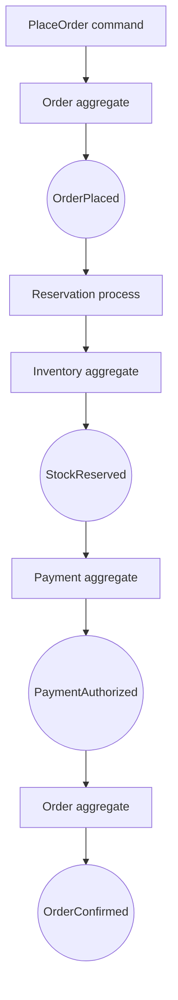
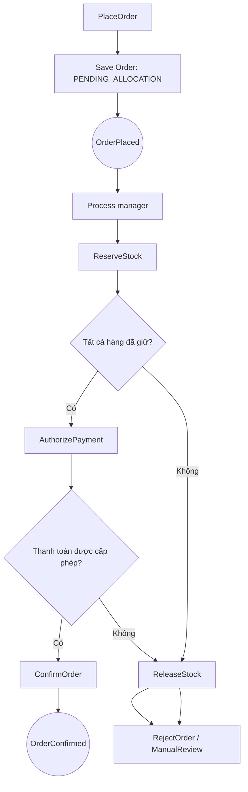

# Trường hợp một ca sử dụng liên quan đến nhiều aggregate

Trong một hệ thống theo Domain-Driven Design (DDD), một ca sử dụng có thể cần đọc hoặc thay đổi nhiều aggregate. Ví dụ, xử lý một đơn hàng có thể liên quan đến `Order`, `InventoryItem`, `Payment` và `Customer`. Mỗi aggregate bảo vệ quy tắc và trạng thái thuộc trách nhiệm của nó, trong khi ca sử dụng cần phối hợp chúng để đạt mục tiêu của người dùng.

Đây là lúc cần phân biệt **ranh giới nhất quán của aggregate** với **ranh giới điều phối của use case**. Aggregate root bảo vệ invariant bên trong aggregate. Application layer điều phối các aggregate cần thiết, gọi repository để tải từng root và quyết định thứ tự thao tác. Nếu quy trình có thể kéo dài hoặc đi qua nhiều bounded context, domain event cùng process manager/saga giúp phối hợp các bước bất đồng bộ.

Không nên gom mọi đối tượng vào một aggregate lớn chỉ vì chúng xuất hiện trong cùng một use case. Cũng không nên giả định mọi thao tác trên nhiều aggregate đều phải dùng một giao dịch cơ sở dữ liệu duy nhất. Cách phối hợp phụ thuộc vào yêu cầu nhất quán, quyền sở hữu nghiệp vụ, thời gian xử lý và ranh giới hệ thống.

## Sau bài học này

Bạn có thể:

- Phân biệt use case, aggregate boundary và transaction boundary.
- Giải thích vì sao application service thường điều phối nhiều aggregate root.
- Tham chiếu aggregate khác bằng ID và truy cập qua repository tương ứng.
- Chọn giữa một transaction cục bộ và quy trình nhất quán cuối cùng.
- Dùng domain event, integration event và process manager/saga để điều phối quy trình kéo dài.
- Thiết kế hành động bù, retry, timeout và idempotency.
- Nhận biết khi nào nên xem xét lại ranh giới aggregate vì invariant liên tục phải được bảo vệ cùng nhau.

## 1. Một use case có thể đi qua nhiều aggregate

Aggregate là ranh giới nhất quán của một nhóm entity và value object. Aggregate root là điểm truy cập bên ngoài để yêu cầu thay đổi nhóm đó. Một use case thì mô tả mục tiêu lớn hơn mà hệ thống cần hoàn thành.

Ví dụ, khách hàng đặt một đơn có hai sản phẩm. Để xử lý, hệ thống có thể cần:

- Kiểm tra khách hàng có được phép đặt hàng hay không.
- Tạo aggregate `Order` và lưu các dòng hàng cùng giá tại thời điểm đặt.
- Giữ số lượng trong một hoặc nhiều aggregate tồn kho.
- Yêu cầu aggregate `Payment` cấp phép thanh toán.
- Cập nhật trạng thái đơn khi các bước cần thiết hoàn tất.
- Tạo yêu cầu giao hàng sau khi đơn được xác nhận.

Mỗi phần có quy tắc riêng. `Order` bảo vệ vòng đời và dữ liệu đơn; `InventoryItem` bảo vệ số lượng khả dụng; `Payment` bảo vệ trạng thái và số tiền thanh toán. Một use case có thể phối hợp tất cả mà không làm chúng trở thành một aggregate duy nhất.

### Ba tình huống cần phân biệt

Một use case “liên quan đến nhiều aggregate” có thể mang một trong các dạng:

1. **Đọc nhiều aggregate:** màn hình chi tiết đơn cần thông tin đơn, hồ sơ khách hàng và trạng thái thanh toán. Không có thay đổi nghiệp vụ nào được thực hiện.
2. **Thay đổi nhiều aggregate trong cùng một thao tác cục bộ:** một giao dịch trong cùng bounded context cập nhật đơn và giữ hàng trong cùng cơ sở dữ liệu.
3. **Điều phối quy trình qua nhiều bước hoặc bounded context:** tạo đơn, chờ kho giữ hàng, chờ cổng thanh toán và tiếp tục khi nhận sự kiện.

Ba trường hợp này có yêu cầu nhất quán khác nhau. Đọc nhiều aggregate thường phù hợp với query/read model. Thay đổi cục bộ có thể dùng một transaction ngắn nếu thực sự cần. Quy trình kéo dài thường cần sự kiện và một cơ chế điều phối có trạng thái.

## 2. Aggregate bảo vệ invariant của chính nó

Mỗi aggregate root phải bảo đảm các quy tắc cần luôn đúng trong ranh giới của aggregate. Ví dụ:

| Aggregate | Invariant có thể bảo vệ |
| --- | --- |
| `Order` | Đơn đã xác nhận không thể thêm dòng hàng; dòng hàng phải có số lượng hợp lệ; chỉ trạng thái cho phép mới có thể hủy. |
| `InventoryItem` | Số lượng giữ không vượt số lượng có thể phân bổ theo chính sách; không thể giải phóng nhiều hơn số đã giữ. |
| `Payment` | Không thể capture vượt số tiền được cấp phép; tổng hoàn tiền không vượt số đã thu. |
| `CustomerAccount` | Tài khoản bị khóa không thể thực hiện những hành động bị chính sách cấm. |

Khi use case cần thay đổi một aggregate, nó tải root qua repository rồi gọi hành vi có ý nghĩa nghiệp vụ. Caller không nên lấy entity con từ aggregate này rồi sửa trực tiếp, cũng không nên tự đặt field trạng thái để bỏ qua invariant.

Ví dụ:

```java
Order order = orders.findById(orderId)
    .orElseThrow(() -> new OrderNotFoundException(orderId));

order.confirm(); // Order tự kiểm tra điều kiện xác nhận
orders.save(order);
```

Nếu cần giữ hàng, application tải `InventoryItem` qua `InventoryRepository` và gọi `reserve(...)`. `Order` không tự sửa số lượng tồn kho; `InventoryItem` không tự quyết định trạng thái đơn hàng.

### Không biến aggregate thành một đồ thị object lớn

Một aggregate có thể tham chiếu aggregate khác bằng định danh. Ví dụ, `Order` giữ `CustomerId` hoặc `PaymentId` khi cần liên kết. Nó không nhất thiết giữ toàn bộ object `Customer` hoặc `Payment`.

Việc dùng ID giúp mỗi aggregate có thể được tải và thay đổi theo ranh giới riêng. Nó cũng tránh một thao tác vô tình kéo cả đồ thị object lớn vào bộ nhớ và thay đổi nhiều phần không thuộc trách nhiệm của root hiện tại.

## 3. Application layer điều phối nhiều aggregate

Application service hoặc command handler là nơi phù hợp để điều phối một use case cần nhiều aggregate. Nó hiểu mục tiêu của use case và thứ tự cần thực hiện, nhưng giao việc bảo vệ invariant cho từng aggregate.

Một luồng điều phối thường gồm:

1. Nhận command và xác định actor/use case.
2. Tải từng aggregate root cần thiết qua repository.
3. Gọi hành vi miền trên từng aggregate.
4. Quyết định các thao tác cần cùng transaction hoặc có thể tách thành bước độc lập.
5. Lưu các aggregate đã thay đổi.
6. Ghi nhận domain event hoặc integration event cần công bố.
7. Trả kết quả hoặc trạng thái xử lý cho caller.

Application service không nên sao chép các quy tắc như “không giữ vượt tồn kho” hoặc “không capture vượt số tiền được cấp phép”. Nó gọi `inventory.reserve(...)` và `payment.capture(...)`, để mỗi aggregate tự kiểm tra điều kiện của mình.

### Ví dụ điều phối đồng bộ trong cùng bounded context

Giả sử đơn và tồn kho thuộc cùng một bounded context, dùng cùng cơ sở dữ liệu và nghiệp vụ yêu cầu kết quả phân bổ phải nhất quán ngay trong thao tác. Một application service có thể tải cả hai aggregate và cập nhật chúng trong một transaction cục bộ:

```java
public final class AllocateOrderHandler {
    private final OrderRepository orders;
    private final InventoryRepository inventory;
    private final TransactionRunner transactions;

    public void handle(AllocateOrder command) {
        transactions.run(() -> {
            Order order = orders.findById(command.orderId())
                .orElseThrow(() -> new OrderNotFoundException(command.orderId()));

            for (OrderLineRequest line : order.linesToAllocate()) {
                InventoryItem item = inventory.findByProductId(line.productId())
                    .orElseThrow(() -> new ProductNotStockedException(line.productId()));

                item.reserve(line.quantity());
                inventory.save(item);
            }

            order.markAllocated();
            orders.save(order);
        });
    }
}
```

Đây là ví dụ minh họa. Các interface và kiểu dữ liệu được lược giản. Nếu bất kỳ `InventoryItem.reserve(...)` nào thất bại, transaction có thể rollback các cập nhật cục bộ đã thực hiện trước đó. `Order` và `InventoryItem` vẫn tự bảo vệ invariant của riêng mình.

Giao dịch trên có thể hợp lý khi các aggregate cùng bounded context, cùng transactional resource, số lượng aggregate được cập nhật có giới hạn và yêu cầu nghiệp vụ cần kết quả tức thời. Tuy nhiên, nếu một đơn có hàng trăm sản phẩm hoặc tồn kho nằm ở hệ thống khác, giao dịch lớn sẽ làm tăng thời gian giữ lock, tranh chấp và phụ thuộc triển khai.

### Một transaction trên nhiều aggregate có bị cấm không?

Không nên hiểu hướng dẫn “mỗi transaction thường chỉ sửa một aggregate” thành một luật kỹ thuật tuyệt đối. Đây là nguyên tắc thiết kế hữu ích để giữ aggregate nhỏ và giảm coupling. Một transaction cơ sở dữ liệu cục bộ có thể cập nhật nhiều aggregate khi nghiệp vụ thực sự cần tính nguyên tử và các đối tượng cùng nằm trong một ranh giới vận hành phù hợp.

Trước khi làm vậy, hãy hỏi:

- Có invariant nào thực sự cần được bảo vệ nguyên tử giữa các aggregate không?
- Các aggregate có cùng bounded context và cùng transactional resource không?
- Số aggregate và thời gian transaction có bị giới hạn không?
- Có thể biểu diễn quy trình thành các bước độc lập với trạng thái chờ hay không?
- Việc gom chúng vào một aggregate có làm ranh giới quá lớn hoặc tạo phụ thuộc không hợp lý không?

Nếu các thao tác thường xuyên cần rollback cùng nhau để bảo vệ một invariant, có thể ranh giới aggregate hiện tại chưa đúng. Nếu chỉ cần phối hợp theo quy trình và doanh nghiệp chấp nhận trạng thái trung gian, một workflow bất đồng bộ thường phù hợp hơn.

## 4. Tham chiếu và tải aggregate đúng cách

### Repository tập trung vào aggregate root

Repository thường được định nghĩa cho aggregate root, chẳng hạn `OrderRepository`, `InventoryRepository` và `PaymentRepository`. Application service dùng từng repository để tải root cần thiết.

```java
Order order = orderRepository.findById(orderId).orElseThrow();
InventoryItem stock = inventoryRepository.findByProductId(productId).orElseThrow();
Payment payment = paymentRepository.findById(paymentId).orElseThrow();
```

Không nên tạo `OrderLineRepository` chỉ vì `OrderLine` được lưu ở một bảng riêng nếu `OrderLine` là entity nội bộ của aggregate `Order`. Việc thay đổi dòng hàng vẫn đi qua `Order` để bảo vệ invariant của đơn.

### Giữ tham chiếu đến aggregate khác bằng ID

Nếu `Order` cần biết khách hàng nào đã đặt đơn, nó có thể giữ `CustomerId`. Khi use case cần thông tin hoặc hành vi của khách hàng, application tải `Customer` qua `CustomerRepository`.

```java
public final class Order {
    private final OrderId id;
    private final CustomerId customerId;
    // Các thành phần nội bộ của Order
}
```

Cách này làm rõ quan hệ và quyền sở hữu. `Order` không có quyền sửa trạng thái tài khoản khách hàng; `Customer` không có quyền thay đổi các dòng hàng của đơn.

### Không gọi repository từ bên trong aggregate

Aggregate nên hoạt động trên trạng thái và các đối tượng mà nó sở hữu. Nếu `Order.confirm()` tự gọi `InventoryRepository` hoặc `PaymentGateway`, mô hình miền bị gắn với hạ tầng và khó kiểm soát transaction.

Application service tải các aggregate cần thiết và điều phối chúng. Nếu một quy tắc nghiệp vụ cần tính toán từ nhiều dữ liệu, có thể dùng domain service với các giá trị/đối tượng đã được cung cấp, nhưng việc tải và lưu aggregate vẫn thường thuộc application layer.

### Đọc dữ liệu nội bộ qua root và query model

Nếu caller cần xem dòng hàng, root có thể trả snapshot hoặc view bất biến. Không nên trả một collection mutable hoặc entity con có thể sửa trực tiếp từ bên ngoài.

```java
public List<OrderLineView> lineViews() {
    return lines.values().stream()
        .map(line -> new OrderLineView(
            line.id(), line.productId(), line.quantity()
        ))
        .toList();
}
```

Với báo cáo hoặc màn hình cần kết hợp nhiều aggregate, query handler có thể đọc từ projection hoặc truy vấn chuyên biệt. Quy tắc “truy cập qua aggregate root” chủ yếu bảo vệ thay đổi và invariant của domain model; nó không có nghĩa mọi truy vấn đọc đều phải tải toàn bộ object graph qua root.

## 5. Khi nào cần nhất quán ngay và khi nào chấp nhận nhất quán cuối cùng?

Quyết định quan trọng nhất khi use case chạm nhiều aggregate là mức độ nhất quán mà nghiệp vụ yêu cầu.

### Nhất quán tức thời (strong/immediate consistency)

Một thay đổi cần được xem là hoàn tất chỉ khi tất cả dữ liệu liên quan được cập nhật thành công trong cùng một transaction cục bộ. Ví dụ, một thao tác nội bộ chuyển tiền giữa hai tài khoản trong cùng sổ cái có thể yêu cầu ghi nợ và ghi có cùng thành công hoặc cùng thất bại.

Nếu hai aggregate `Account` phải luôn thỏa invariant tổng tiền được chuyển đi bằng tổng tiền nhận, đội cần xem xét kỹ ranh giới mô hình. Có thể dùng một aggregate quản lý giao dịch chuyển tiền hoặc một transaction cục bộ được thiết kế rõ. Không nên để hai cập nhật độc lập tạo ra trạng thái sai mà không có cơ chế bảo vệ.

### Nhất quán cuối cùng (eventual consistency)

Một số quy trình cho phép trạng thái trung gian trong một khoảng thời gian. Ví dụ, đơn đã được tiếp nhận nhưng đang chờ kho giữ hàng; sau đó mới chờ thanh toán và xác nhận. Trong thời gian này, giao diện có thể hiển thị `PENDING_ALLOCATION` hoặc `AWAITING_PAYMENT`.

Mỗi aggregate cập nhật trạng thái của chính nó trong transaction cục bộ. Khi thành công, nó phát event để phần khác tiếp tục. Các context hội tụ về trạng thái phù hợp sau khi các bước hoàn tất hoặc được xử lý bù.

### Bảng lựa chọn

| Tiêu chí | Transaction cục bộ trên nhiều aggregate | Quy trình bất đồng bộ |
| --- | --- | --- |
| Thời gian | Thường ngắn và hoàn tất trong một request | Có thể kéo dài từ vài giây đến nhiều phút hoặc hơn |
| Phạm vi | Một transactional resource hoặc bounded context có thể kiểm soát | Có thể qua nhiều service, database hoặc đối tác |
| Nhất quán | Nguyên tử trong transaction | Nhất quán cuối cùng, có trạng thái trung gian |
| Xử lý lỗi | Rollback cục bộ khi transaction thất bại | Retry, timeout, compensation và can thiệp thủ công khi cần |
| Độ phức tạp | Lock, contention và kích thước transaction | Điều phối trạng thái, idempotency, thứ tự event và quan sát vận hành |
| Phù hợp khi | Cần cập nhật tức thời và phạm vi nhỏ | Quy trình dài hoặc có ranh giới phân tán |

Không có một lựa chọn đúng cho mọi hệ thống. Quyết định cần dựa trên ý nghĩa nghiệp vụ của trạng thái trung gian và hậu quả khi một bước chưa hoàn tất.

## 6. Phối hợp nhiều aggregate bằng domain event

Domain event ghi nhận một sự thật đã xảy ra trong mô hình, ví dụ `OrderPlaced`, `StockReserved` hoặc `PaymentAuthorized`. Khi một aggregate hoàn thành hành vi, application có thể lưu aggregate và ghi nhận event cần công bố.

Một event giúp phần khác phản ứng mà không buộc aggregate phát sự kiện phải biết trực tiếp mọi consumer. Ví dụ, khi `OrderPlaced` xảy ra, quy trình có thể yêu cầu giữ hàng. Khi `StockReserved` xảy ra, quy trình tiếp tục sang bước thanh toán.

### Command và event có ý nghĩa khác nhau

- **Command:** yêu cầu một hành động, ví dụ `ReserveStock` hoặc `AuthorizePayment`.
- **Domain event:** sự thật đã xảy ra bên trong một bounded context, ví dụ `StockReserved`.
- **Integration event:** thông điệp được công bố qua ranh giới context/hệ thống để bên khác tiêu thụ, ví dụ `StockReservationCompleted`.

Command có thể bị từ chối. Event mô tả điều đã xảy ra. Integration event là hợp đồng trao đổi nên cần schema, phiên bản và ngữ nghĩa rõ ràng; không nên tự động công bố mọi domain event nội bộ.

### Ví dụ luồng sự kiện



Sơ đồ mô tả một luồng thành công được đơn giản hóa. Thực tế có thể có nhiều sản phẩm, nhiều yêu cầu giữ hàng, nhiều payment attempt và nhiều nhánh thất bại. Một đơn có thể cần chờ tất cả kết quả giữ hàng trước khi tiếp tục.

## 7. Process manager và Saga cho quy trình kéo dài

Khi một use case có nhiều bước bất đồng bộ, cần một thành phần theo dõi tiến trình và quyết định bước tiếp theo. Thành phần này thường được gọi là **process manager** hoặc được triển khai theo mẫu **Saga**.

Process manager không thay thế aggregate nghiệp vụ. Nó giữ trạng thái của quy trình, nhận event, gửi command và điều phối bước tiếp theo. Các aggregate vẫn bảo vệ invariant của riêng chúng.

Ví dụ, quy trình đặt hàng có thể theo dõi:

```text
OrderPlaced
    -> ReserveStock
        -> StockReserved
            -> AuthorizePayment
                -> PaymentAuthorized
                    -> ConfirmOrder
                -> PaymentRejected
                    -> ReleaseStock
                    -> RejectOrder
        -> StockReservationRejected
            -> RejectOrder
```

Nếu thanh toán thất bại sau khi kho đã giữ hàng, hệ thống gửi `ReleaseStock` để giải phóng phần đã giữ và cập nhật đơn sang trạng thái phù hợp.

### Saga không phải transaction phân tán

Saga chia một quy trình lớn thành nhiều transaction cục bộ. Mỗi bước commit trong aggregate/context sở hữu nó và phát event để kích hoạt bước tiếp theo. Nếu một bước thất bại, saga thực hiện các hành động bù đã được định nghĩa.

Hành động bù không phải rollback thời gian. Ví dụ, nếu kho đã giữ hàng rồi, `ReleaseStock` là một hành động nghiệp vụ mới để giải phóng hàng. Nếu payment đã capture, có thể cần `RefundPayment`, vốn không giống việc xóa giao dịch capture khỏi lịch sử.

### Process manager cần lưu trạng thái

Một quy trình kéo dài có thể cần nhớ:

- `orderId` và các ID liên quan.
- Những bước đã hoàn thành.
- Những bước đang chờ.
- Những lần thử và thời điểm timeout.
- Hành động bù nào đã được thực hiện.
- Kết quả cuối cùng hoặc trạng thái cần người vận hành can thiệp.

Trạng thái này có thể được lưu trong một process manager record hoặc một aggregate riêng nếu nó có vòng đời và invariant đáng kể. Không nên nhồi trạng thái điều phối vào `Order` nếu nó không thuộc trách nhiệm của đơn hàng.

### Khi nào dùng process manager?

Với một luồng ngắn, chỉ có một hoặc hai event và không cần nhớ trạng thái phức tạp, một event handler có thể đủ. Khi quy trình có nhiều nhánh, timeout, retry, nhiều aggregate và hành động bù, process manager giúp biểu diễn tiến trình rõ ràng hơn.

## 8. Thiết kế hành động bù và xử lý thất bại

Trong quy trình bất đồng bộ, không thể giả định mọi bước đều thành công. Cần mô hình hóa kết quả thất bại như một phần bình thường của nghiệp vụ.

Ví dụ:

| Bước | Thành công | Thất bại hoặc timeout | Hành động tiếp theo có thể có |
| --- | --- | --- | --- |
| Giữ hàng | `StockReserved` | `StockReservationRejected` hoặc không có phản hồi | Từ chối đơn hoặc thử lại theo chính sách. |
| Cấp phép thanh toán | `PaymentAuthorized` | `PaymentRejected` hoặc timeout | Giải phóng hàng; kiểm tra trạng thái giao dịch trước khi thử lại. |
| Xác nhận đơn | `OrderConfirmed` | Đơn không còn ở trạng thái phù hợp | Đưa quy trình vào trạng thái cần rà soát hoặc thực hiện bù theo chính sách. |
| Tạo shipment | `ShipmentCreated` | Nhà vận chuyển không nhận yêu cầu | Thử lại hoặc chọn nhà vận chuyển khác nếu nghiệp vụ cho phép. |

### Bù trừ phải dựa trên trạng thái thực tế

Không gửi `ReleaseStock` nếu chưa biết kho đã giữ hàng hay chưa. Không hoàn tiền nếu payment chỉ mới được authorize mà chưa capture. Mỗi hành động bù cần tham chiếu đến kết quả bước trước và được thiết kế sao cho an toàn khi nhận lặp.

### Timeout không đồng nghĩa thất bại

Một request timeout có thể do hệ thống đích đã xử lý nhưng phản hồi bị mất. Trước khi gửi lại command có tác động tài chính hoặc tồn kho, cần tra cứu trạng thái hoặc dùng idempotency key để tránh tạo tác động hai lần.

### Có trạng thái cần con người xử lý

Không phải mọi lỗi đều có thể tự động retry hoặc bù. Ví dụ, dữ liệu đối tác không nhất quán hoặc payment ở trạng thái không xác định có thể cần nhân viên vận hành kiểm tra. Mô hình quy trình nên có trạng thái `MANUAL_REVIEW` hoặc tương đương nếu nghiệp vụ yêu cầu.

## 9. Idempotency, thứ tự sự kiện và độ tin cậy

Khi các aggregate phối hợp bất đồng bộ, một event có thể được gửi lại, đến trễ hoặc đến sai thứ tự. Hệ thống cần thiết kế cho những tình huống đó.

### Idempotency

Một command hoặc event handler là idempotent nếu xử lý cùng một yêu cầu nhiều lần không tạo ra tác động nghiệp vụ lặp ngoài ý muốn.

Ví dụ, `ReserveStock` có thể mang `reservationId` duy nhất. Nếu nhận lại cùng command, `InventoryItem` hoặc reservation store nhận diện thao tác đã xử lý và trả lại kết quả cũ thay vì giữ hàng lần thứ hai.

### Outbox và Inbox

**Transactional Outbox** giúp ghi thay đổi aggregate và thông điệp cần phát trong cùng transaction cục bộ. Một publisher riêng gửi thông điệp sau commit. Cơ chế này giảm rủi ro dữ liệu đã commit nhưng event bị mất.

**Inbox/deduplication** giúp consumer lưu dấu event đã xử lý hoặc command đã tiếp nhận để loại bỏ tác động lặp. Việc ghi dấu và cập nhật aggregate nên được thiết kế nhất quán trong transaction của consumer.

Outbox không bảo đảm broker chỉ nhận đúng một lần. Publisher có thể gửi lại nếu không biết lần gửi trước đã thành công hay chưa; vì vậy consumer vẫn cần idempotency.

### Thứ tự sự kiện và phiên bản aggregate

Nếu `OrderConfirmed` đến trước `StockReserved` do sự kiện bị trễ hoặc xử lý song song, consumer không nên mặc định thứ tự nhận là thứ tự nghiệp vụ. Có thể dùng sequence/version, trạng thái quy trình và điều kiện chuyển tiếp để phát hiện sự kiện cũ hoặc chưa đủ điều kiện.

Không nên áp dụng quy tắc “bỏ mọi event có timestamp cũ” một cách đơn giản nếu timestamp giữa các máy không đồng bộ. Dùng định danh, version hoặc sequence được cấp trong phạm vi có thẩm quyền phù hợp hơn.

### Retry có giới hạn

Retry nên có giới hạn, khoảng chờ tăng dần và phân loại lỗi có thể thử lại. Lỗi dữ liệu không hợp lệ thường không tự biến mất nếu retry liên tục. Sau số lần thử nhất định, thông điệp có thể được đưa vào dead-letter queue hoặc hàng đợi cần rà soát, kèm cảnh báo và khả năng xử lý lại có kiểm soát.

## 10. Cập nhật đồng thời và tranh chấp giữa aggregate

Hai use case có thể cùng cố giữ số lượng của một `InventoryItem`. Mỗi request riêng lẻ có thể đọc thấy còn đủ hàng, nhưng nếu không có kiểm soát đồng thời thì tổng lượng giữ có thể vượt số lượng khả dụng.

Aggregate `InventoryItem` cần bảo vệ invariant trong hành vi `reserve(...)`, còn persistence phải bảo vệ cập nhật đồng thời bằng optimistic locking, version hoặc cơ chế atomic update phù hợp. Khi phát hiện xung đột, application có thể tải lại và thử lại nếu thao tác vẫn hợp lệ.

Với quy trình bất đồng bộ, lệnh giữ hàng nên được xử lý tại nơi sở hữu tồn kho. Không để nhiều context tự đọc một bản sao tồn kho rồi cùng kết luận rằng hàng còn đủ. Bản sao đọc có thể phục vụ hiển thị, nhưng quyết định giữ hàng phải do aggregate có thẩm quyền thực hiện.

## 11. Đọc nhiều aggregate: dùng query/read model phù hợp

Một use case đọc có thể cần kết hợp dữ liệu từ nhiều aggregate mà không cần gọi từng root rồi tải toàn bộ object graph.

Ví dụ màn hình đơn hàng có thể hiển thị:

- Thông tin và dòng hàng từ `Order`.
- Tên hiển thị từ hồ sơ khách hàng.
- Trạng thái thanh toán từ `Payment`.
- Trạng thái giao hàng từ `Shipment`.

Query handler có thể dùng projection hoặc read model kết hợp các dữ liệu cần thiết. Read model có thể được cập nhật đồng bộ từ database hoặc bất đồng bộ từ integration event, tùy yêu cầu.

Nếu read model cập nhật bất đồng bộ, giao diện cần hiểu dữ liệu có thể trễ. Không dùng projection có độ trễ để đưa ra quyết định cần dữ liệu có thẩm quyền tức thời nếu chưa có cơ chế xác nhận.

Tách query khỏi command giúp tránh tải aggregate chỉ để đọc. Nhưng khi thay đổi trạng thái, application vẫn phải tải aggregate root và gọi hành vi miền để bảo vệ invariant.

## 12. Khi nào nên xem xét lại ranh giới aggregate?

Nếu nhiều use case liên tục phải tải và cập nhật cùng một nhóm aggregate trong một transaction, đó có thể là dấu hiệu ranh giới aggregate chưa phù hợp. Tuy nhiên, không nên gộp chúng chỉ vì tiện gọi hàm.

Hãy kiểm tra:

- Có invariant nào thực sự phải luôn đúng trên toàn bộ các đối tượng đó không?
- Những thay đổi có cần xảy ra nguyên tử theo quy tắc nghiệp vụ không?
- Các đối tượng có cùng vòng đời và quyền sở hữu không?
- Có thể chấp nhận trạng thái trung gian và phối hợp bằng event không?
- Aggregate lớn hơn có làm tăng tranh chấp, tải dữ liệu và tần suất thay đổi không?

Nếu các đối tượng phải được thay đổi cùng nhau để bảo vệ một invariant cốt lõi, có thể chúng nên nằm trong cùng aggregate. Nếu chúng có quy tắc, vòng đời và chủ sở hữu riêng, hãy giữ ranh giới và dùng quy trình phối hợp.

### Không nhầm quan hệ dữ liệu với aggregate boundary

Hai bảng có khóa ngoại hoặc hai entity xuất hiện cùng một màn hình không có nghĩa chúng thuộc cùng aggregate. Ranh giới aggregate được quyết định bởi invariant và consistency requirement, không phải sơ đồ quan hệ cơ sở dữ liệu.

### Không dùng một aggregate khổng lồ để tránh điều phối

Gộp `Order`, `Inventory`, `Payment` và `Shipment` vào một aggregate có thể làm một thao tác phải tải nhiều dữ liệu, khóa quá rộng và tạo phụ thuộc giữa các nhóm. Nó cũng không giải quyết được giao tiếp với hệ thống ngoài hoặc quy trình kéo dài. Điều phối rõ ràng thường dễ thay đổi hơn một aggregate bao trùm nhiều vòng đời độc lập.

## 13. Ví dụ xuyên suốt: quy trình đặt hàng qua nhiều aggregate

Giả sử khách hàng đặt một đơn gồm nhiều sản phẩm. Quy trình cần giữ hàng, cấp phép thanh toán rồi xác nhận đơn. Tồn kho và thanh toán có thể là các bounded context riêng.

### Các aggregate và trách nhiệm

| Aggregate | Trách nhiệm | Hành vi tiêu biểu |
| --- | --- | --- |
| `Order` | Lưu yêu cầu mua, dòng hàng, giá tại thời điểm đặt và trạng thái đơn | `place()`, `confirm()`, `reject()`, `cancel()` |
| `InventoryItem` hoặc `StockReservation` | Bảo vệ số lượng có thể phân bổ và trạng thái giữ hàng | `reserve()`, `release()` |
| `Payment` | Theo dõi ủy quyền, thu tiền và hoàn tiền | `authorize()`, `capture()`, `voidAuthorization()`, `refund()` |
| Process manager | Theo dõi tiến trình đặt hàng qua các bước và quyết định command tiếp theo | `onOrderPlaced()`, `onStockReserved()`, `onPaymentRejected()` |

### Luồng thành công

1. Application nhận `PlaceOrder` và tạo/lưu `Order` ở trạng thái `PENDING_ALLOCATION`.
2. `OrderPlaced` được ghi vào outbox trong transaction của đơn.
3. Process manager nhận event và gửi `ReserveStock` cho Tồn kho.
4. Tồn kho tải aggregate sở hữu từng mặt hàng, kiểm tra số lượng và ghi nhận reservation. Khi thành công, nó phát `StockReserved`.
5. Process manager chờ kết quả của tất cả reservation cần thiết. Khi đủ hàng, nó gửi `AuthorizePayment`.
6. Payment xử lý và phát `PaymentAuthorized` nếu thành công.
7. Process manager gửi `ConfirmOrder`; aggregate `Order` kiểm tra trạng thái và chuyển sang `CONFIRMED`.
8. Quy trình hoàn tất và có thể phát `OrderConfirmed` để kích hoạt bước giao hàng.

### Luồng thất bại

Nếu một sản phẩm không đủ hàng, Tồn kho phát `StockReservationRejected`. Process manager có thể yêu cầu giải phóng những reservation đã thành công, sau đó gửi `RejectOrder` hoặc đưa đơn vào trạng thái chờ nhân viên xử lý tùy chính sách.

Nếu thanh toán bị từ chối sau khi đã giữ hàng, process manager gửi `ReleaseStock` cho các reservation đã tạo và yêu cầu đơn chuyển sang `PAYMENT_REJECTED` hoặc trạng thái tương ứng. Nếu request thanh toán timeout, cần tra cứu trạng thái hoặc dùng idempotency key trước khi quyết định thử lại hay bù trừ.

### Sơ đồ quy trình



Sơ đồ rút gọn bỏ qua một số chi tiết như nhiều reservation, timeout, retry và kết quả không xác định. Trong triển khai thật, process manager cần lưu tiến trình và đảm bảo mỗi event chỉ làm thay đổi trạng thái một cách an toàn.

### Trạng thái trung gian phải có ý nghĩa nghiệp vụ

Trong lúc quy trình chạy, đơn có thể ở `PENDING_ALLOCATION`, `AWAITING_PAYMENT` hoặc `REQUIRES_REVIEW`. Những trạng thái này không nhất thiết là lỗi; chúng phản ánh quy trình chưa hoàn tất. Đội cần xác định người dùng được phép làm gì trong từng trạng thái, thời gian chờ tối đa và cách giải quyết khi quy trình bị treo.

Không nên hiển thị `CONFIRMED` ngay khi mới nhận yêu cầu nếu hàng chưa được giữ hoặc điều kiện thanh toán chưa thỏa mãn theo chính sách. Tên trạng thái phải phản ánh đúng sự thật đã xảy ra.

## 14. Kiểm thử use case nhiều aggregate

Kiểm thử cần bao phủ cả hành vi của từng aggregate và quá trình phối hợp giữa chúng.

- **Aggregate unit test:** kiểm tra invariant của `Order`, `InventoryItem`, `Payment` độc lập.
- **Application test:** kiểm tra use case tải đúng root, gọi đúng hành vi và lưu kết quả theo thứ tự cần thiết.
- **Process manager test:** kiểm tra event đầu vào tạo command tiếp theo, trạng thái chờ, nhánh thất bại, timeout và compensation.
- **Integration test:** kiểm tra transaction, outbox/inbox, serialization, broker và repository adapter.
- **Concurrency test:** kiểm tra hai yêu cầu giữ hàng đồng thời không làm vượt tồn kho.
- **Contract test:** kiểm tra integration event và consumer tương thích với schema đã công bố.

Một số tình huống quan trọng:

1. Giữ hàng thành công và thanh toán thành công.
2. Một trong nhiều sản phẩm không đủ hàng.
3. Giữ hàng thành công một phần rồi một bước khác thất bại.
4. Thanh toán bị từ chối.
5. Thanh toán timeout nhưng phía cổng đã xử lý thành công.
6. Event được gửi lặp hoặc đến sai thứ tự.
7. Consumer lỗi sau khi đã nhận message nhưng trước khi commit.
8. Hai đơn cùng giữ một lượng tồn kho cuối cùng.
9. Process manager khởi động lại giữa quy trình.
10. Hành động bù thất bại và cần retry hoặc người vận hành can thiệp.

## 15. Những sai lầm thường gặp

- **Gộp mọi aggregate vào một aggregate lớn:** làm ranh giới nhất quán quá rộng và tăng coupling.
- **Để một aggregate sửa aggregate khác trực tiếp:** bỏ qua quyền sở hữu và invariant của root kia.
- **Để aggregate gọi repository hoặc API bên ngoài:** trộn domain model với điều phối và hạ tầng.
- **Cho rằng mọi use case phải dùng một transaction:** không phù hợp với quy trình dài hoặc hệ thống phân tán.
- **Cho rằng mỗi transaction chỉ được phép sửa đúng một aggregate trong mọi trường hợp:** biến một hướng dẫn thiết kế thành luật cứng và có thể tạo độ phức tạp không cần thiết.
- **Dùng event thay cho command:** event mô tả điều đã xảy ra, không phải yêu cầu hành động.
- **Coi compensation là rollback:** hành động bù là một hành động nghiệp vụ mới, có thể thất bại và cần theo dõi.
- **Không idempotent:** event hoặc command gửi lại tạo giữ hàng, thu tiền hoặc hoàn tiền nhiều lần.
- **Coi timeout là thất bại chắc chắn:** có thể lặp một thao tác đã thành công ở hệ thống đích.
- **Dùng read model trễ cho quyết định cần dữ liệu tức thời:** có thể ra quyết định dựa trên trạng thái cũ.
- **Không có trạng thái trung gian:** giao diện và vận hành không biết quy trình đang chờ hay bị kẹt.
- **Không kiểm thử nhánh thất bại và cạnh tranh:** luồng thành công chạy được nhưng hệ thống sai khi tải hoặc lỗi mạng.

## 16. Quy trình thiết kế một use case nhiều aggregate

Khi một yêu cầu nghiệp vụ chạm đến nhiều aggregate, có thể thực hiện theo trình tự:

1. **Mô tả mục tiêu use case:** actor muốn đạt kết quả gì và điều kiện hoàn tất là gì?
2. **Liệt kê aggregate liên quan:** mỗi aggregate sở hữu dữ liệu và quyết định nào?
3. **Viết invariant riêng:** xác định root nào chịu trách nhiệm bảo vệ từng quy tắc.
4. **Xác định cách tham chiếu:** dùng ID và repository để tải từng root; tránh giữ object graph xuyên aggregate.
5. **Xác định yêu cầu nhất quán:** bước nào cần nguyên tử ngay, bước nào chấp nhận trạng thái trung gian?
6. **Chọn cơ chế điều phối:** application service với transaction cục bộ, event handler hoặc process manager/saga.
7. **Thiết kế lỗi và bù trừ:** timeout, retry, từ chối, giải phóng tài nguyên và can thiệp thủ công.
8. **Bảo đảm độ tin cậy:** outbox/inbox, idempotency, version và xử lý thứ tự event.
9. **Thiết kế trạng thái quan sát được:** người dùng và vận hành cần biết quy trình đang ở bước nào.
10. **Kiểm thử các nhánh:** thành công, thất bại, lặp, trễ, đồng thời và phục hồi sau restart.
11. **Rà soát lại aggregate boundary:** nếu invariant liên tục buộc nhiều root thay đổi nguyên tử, xem xét mô hình và quyền sở hữu.

## Checklist rà soát

- [ ] Mỗi aggregate có một root và invariant riêng được mô tả rõ.
- [ ] Application layer điều phối use case và tải aggregate qua repository.
- [ ] Aggregate khác được tham chiếu bằng ID khi phù hợp.
- [ ] Không có aggregate nào sửa trạng thái nội bộ của aggregate khác trực tiếp.
- [ ] Repository tập trung vào aggregate root; entity con không bị truy cập độc lập ngoài ý muốn.
- [ ] Yêu cầu nhất quán tức thời và nhất quán cuối cùng đã được phân biệt.
- [ ] Transaction cục bộ có phạm vi và thời gian hợp lý.
- [ ] Quy trình bất đồng bộ có trạng thái, timeout và compensation rõ.
- [ ] Command, domain event và integration event được phân biệt.
- [ ] Handler có idempotency và xử lý event trùng lặp.
- [ ] Có chiến lược retry, dead-letter và can thiệp thủ công.
- [ ] Read model trễ không được dùng sai cho quyết định cần dữ liệu có thẩm quyền.
- [ ] Kiểm thử bao phủ thất bại, cạnh tranh và phục hồi.

## Kết luận

Một use case có thể phối hợp nhiều aggregate mà vẫn giữ mỗi aggregate chịu trách nhiệm bảo vệ invariant của chính nó. Application layer tải và điều phối các root qua repository; mỗi root thay đổi trạng thái bằng hành vi miền của mình. Với thao tác cục bộ cần tính nguyên tử, một transaction trên nhiều aggregate có thể phù hợp nếu phạm vi được kiểm soát. Với quy trình dài hoặc phân tán, domain event cùng process manager/saga giúp phối hợp các transaction cục bộ, xử lý trạng thái trung gian và hành động bù. Thiết kế tốt bắt đầu từ yêu cầu nhất quán và quyền sở hữu nghiệp vụ, không phải từ mong muốn gom mọi đối tượng vào một giao dịch hay một aggregate.
