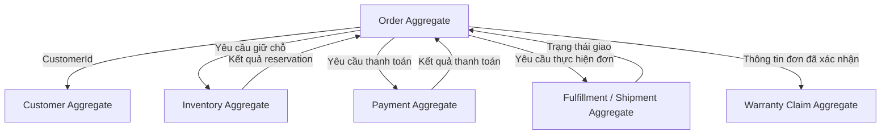
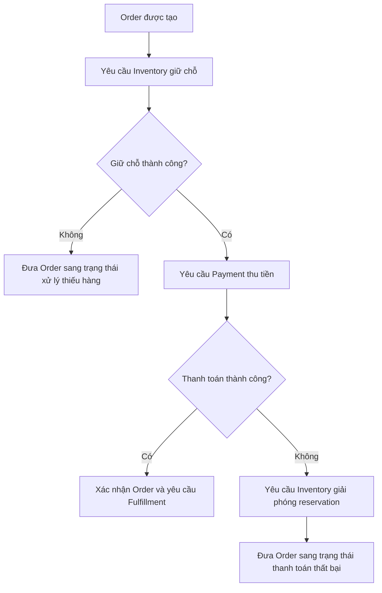
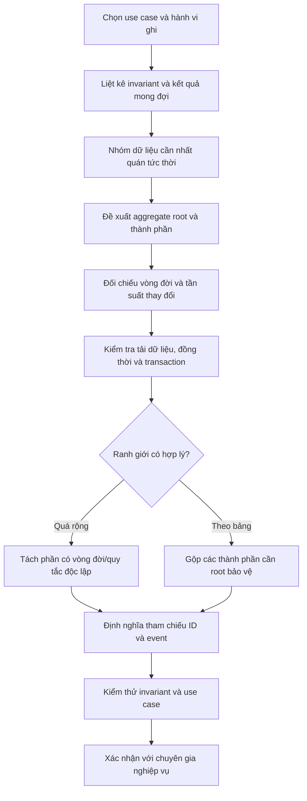

# Nhận diện aggregate quá lớn hoặc ranh giới được chia theo bảng dữ liệu

Trong Domain-Driven Design (DDD), Aggregate xác định một ranh giới nhất quán cho các đối tượng miền cần được bảo vệ cùng nhau. Aggregate giúp câu trả lời cho một câu hỏi nghiệp vụ quan trọng trở nên rõ ràng: **khi một hành động xảy ra, những quy tắc nào phải luôn đúng ngay sau hành động đó?**

Hai sai lầm thường gặp khi thiết kế Aggregate là gom quá nhiều đối tượng vào một aggregate lớn và chia aggregate theo cấu trúc bảng dữ liệu. Aggregate quá lớn khiến nhiều hành vi không liên quan phải tải, khóa và cập nhật cùng nhau. Ranh giới dựa trên bảng khiến mô hình miền bị chia theo cách lưu trữ: mỗi bảng có một repository hoặc một transaction riêng, trong khi các quy tắc nghiệp vụ thực sự cần được bảo vệ lại nằm rải rác.

Một Aggregate tốt không được xác định bởi số lượng bảng, số lượng class hay độ sâu của quan hệ object. Ranh giới cần xuất phát từ bất biến nghiệp vụ, vòng đời, hành vi và nhu cầu nhất quán của use case. Bài này trình bày cách nhận ra hai kiểu thiết kế sai, cách tìm ranh giới phù hợp và cách kiểm chứng bằng tình huống thực tế.

Trong `DOMAIN_DRIVEN_DESIGN`, Aggregate là một phần của tactical design cùng Entity, Value Object, Repository và Domain Event. Aggregate root kiểm soát việc truy cập và thay đổi trạng thái bên trong; Repository lưu và tải aggregate root; các thay đổi có ý nghĩa có thể tạo domain event để những aggregate khác phản ứng theo cách phù hợp.

## 1. Aggregate là ranh giới nhất quán nghiệp vụ

### 1.1. Aggregate gồm những gì?

Aggregate là một cụm đối tượng miền được xem như một đơn vị khi áp dụng các quy tắc nhất quán. Mỗi aggregate có một **Aggregate Root** (gốc aggregate), là entity bên ngoài được phép tham chiếu và dùng để yêu cầu thay đổi aggregate.

Ví dụ, `Order` có thể là aggregate root và chứa các `OrderLine`:

```text
Order (Aggregate Root)
  ├── OrderId
  ├── OrderStatus
  ├── OrderLine
  │     ├── ProductId
  │     ├── Quantity
  │     └── UnitPrice
  └── OrderLine
        ├── ProductId
        ├── Quantity
        └── UnitPrice
```

Khách hàng yêu cầu thêm hoặc bỏ một dòng hàng thông qua hành vi của `Order`. Bên ngoài không tự ý sửa `OrderLine` để bỏ qua quy tắc như “đơn đã xác nhận không thể thêm dòng hàng” hoặc “số lượng phải lớn hơn không”.

Aggregate root không nhất thiết là một object lớn. Nó là điểm kiểm soát các thay đổi cần bảo vệ. Các đối tượng con có thể là entity hoặc value object tùy việc chúng có identity và vòng đời riêng hay không.

### 1.2. Aggregate bảo vệ bất biến nào?

**Invariant (bất biến)** là điều kiện phải luôn đúng đối với mô hình sau khi một thao tác nghiệp vụ hoàn tất. Ví dụ:

- Số lượng của mỗi dòng hàng phải lớn hơn không.
- Đơn hàng đã xác nhận không được sửa giá đã chốt theo chính sách bán hàng.
- Tổng tiền của đơn phải nhất quán với các dòng hàng và điều chỉnh được chấp nhận.
- Không thể xác nhận một đơn ở trạng thái đã hủy.

Những điều kiện này có thể được bảo vệ bên trong aggregate `Order` nếu chúng chỉ phụ thuộc vào dữ liệu thuộc đơn hàng và cần được bảo đảm ngay trong cùng một thay đổi.

Ngược lại, quy tắc “tổng lượng giữ chỗ của một SKU tại một kho không vượt lượng có thể phân bổ” thường thuộc aggregate hoặc mô hình `Inventory`, vì đó là trách nhiệm quản lý tồn kho. `Order` không nên sao chép toàn bộ dữ liệu tồn kho vào trong aggregate chỉ để kiểm tra quy tắc này.

### 1.3. Aggregate là ranh giới transaction logic, không phải sơ đồ object

Trong DDD, aggregate thường được xem là ranh giới nhất quán và là đơn vị cập nhật trong một transaction nghiệp vụ. Điều này có nghĩa một lệnh nên thay đổi một aggregate root theo cách bảo vệ các bất biến của nó.

Một aggregate có thể được lưu qua nhiều bảng quan hệ. Ngược lại, một bảng không tự động tương ứng với một aggregate. Ranh giới aggregate nói về tính nhất quán nghiệp vụ, còn bảng nói về cách dữ liệu được tổ chức trong persistence.

Không nên hiểu nguyên tắc “mỗi transaction chỉ cập nhật một aggregate” như một luật vật lý tuyệt đối cho mọi hệ thống. Một số ứng dụng vẫn dùng transaction database bao quanh nhiều aggregate vì yêu cầu cụ thể. Tuy nhiên, nếu nhiều aggregate thường xuyên phải cập nhật cùng nhau để bảo vệ một bất biến, đó là tín hiệu cần xem lại ranh giới hoặc cách diễn đạt quy tắc. Mục tiêu thiết kế là giữ các bất biến mạnh ở nơi có thể bảo vệ trực tiếp và làm rõ các phối hợp xuyên aggregate.

## 2. Nhận diện Aggregate quá lớn

Aggregate lớn không chỉ vì có nhiều thuộc tính hoặc nhiều dòng dữ liệu. Vấn đề xuất hiện khi ranh giới gom các đối tượng không cần cùng chịu một quy tắc nhất quán, khiến chi phí tải, cập nhật, khóa và phối hợp tăng lên.

### 2.1. Dấu hiệu về phạm vi nghiệp vụ

Một aggregate có thể đang quá lớn nếu:

- Chứa các nhóm đối tượng có mục tiêu hoặc vòng đời khác nhau.
- Nhiều hành vi không liên quan phải đi qua cùng một root.
- Các phần bên trong thường xuyên thay đổi độc lập.
- Chuyên gia nghiệp vụ mô tả các phần như những năng lực hoặc quyết định riêng.
- Phần lớn các use case chỉ dùng một phần nhỏ aggregate.
- Một thay đổi ở phần này buộc phần khác phải tải hoặc cập nhật dù không có quy tắc phụ thuộc.

Ví dụ, một `Customer` aggregate chứa hồ sơ cá nhân, tất cả đơn hàng, tất cả giao dịch thanh toán, lịch sử hỗ trợ, điểm thưởng và địa chỉ giao hàng có thể trở nên quá lớn. Các phần này có vòng đời, tần suất thay đổi và quy tắc khác nhau. Khách hàng có thể là entity trong một context; đơn hàng, thanh toán và điểm thưởng có thể thuộc các aggregate hoặc bounded context riêng.

### 2.2. Dấu hiệu về hiệu năng và tải dữ liệu

Hãy chú ý khi:

- Mỗi lần tải aggregate phải lấy hàng trăm hoặc hàng nghìn object con nhưng use case chỉ cần một vài trường.
- Collection tăng không giới hạn theo thời gian, ví dụ một khách hàng có toàn bộ lịch sử đơn hàng trong một aggregate.
- Ghi một thay đổi nhỏ nhưng ORM phải tải và đồng bộ một đồ thị object lớn.
- Transaction giữ khóa lâu vì phải đọc và cập nhật nhiều phần không liên quan.
- Nhiều yêu cầu đồng thời bị tranh chấp cùng một aggregate root.
- Một aggregate trở thành điểm nóng ghi (write hotspot) vì nhiều nhóm cùng cập nhật các phần khác nhau.

Số lượng object lớn là dấu hiệu cần điều tra, không phải bằng chứng đủ để tách. Một aggregate có thể chứa nhiều dòng hàng nếu các dòng đó thực sự cùng tham gia vào bất biến đơn hàng. Ngược lại, một aggregate chỉ có vài object vẫn có thể quá lớn nếu các object thuộc những vòng đời độc lập.

### 2.3. Dấu hiệu về đồng thời và xung đột cập nhật

Giả sử một aggregate `Customer` chứa cả thông tin liên hệ và điểm thưởng. Bộ phận chăm sóc khách hàng cập nhật số điện thoại, trong khi hệ thống tích điểm cập nhật số điểm. Nếu cả hai thao tác đều lưu cùng một aggregate version, chúng có thể gây optimistic locking conflict dù hai hành vi không liên quan.

Đây là dấu hiệu ranh giới có thể gom quá nhiều trách nhiệm. Hãy hỏi:

- Hai thao tác có cần đọc cùng một trạng thái để quyết định không?
- Có bất biến nào yêu cầu chúng phải commit cùng nhau không?
- Nếu một thao tác thất bại, thao tác kia có cần rollback theo không?
- Xung đột cập nhật có phản ánh một tranh chấp nghiệp vụ thật hay chỉ do aggregate quá rộng?

Nếu hai thao tác độc lập về nghiệp vụ nhưng thường xuyên tranh chấp khóa, có thể cần tách aggregate hoặc điều chỉnh cách lưu.

### 2.4. Dấu hiệu về quy tắc và trách nhiệm

Một aggregate có thể quá lớn nếu root phải biết quá nhiều chính sách không thuộc cùng một khái niệm. Ví dụ, `Order` vừa tính giá khuyến mại, vừa quyết định tồn kho, vừa quản lý thanh toán, vừa lập tuyến giao hàng và xử lý bảo hành. Root đang trở thành một “đối tượng toàn năng” thay vì bảo vệ một ranh giới nhất quán.

Hãy xem xét các dấu hiệu:

- Phương thức của root phải gọi nhiều hệ thống bên ngoài để hoàn thành một thay đổi.
- Root chứa nhiều cờ trạng thái cho các quy trình độc lập.
- Các quy tắc chỉ được áp dụng trong một bộ phận hoặc một thời điểm khác nhau.
- Việc sửa một chính sách làm nhiều phần không liên quan trong aggregate phải thay đổi.
- Root cần biết chi tiết của nhiều bounded context khác.

Một aggregate root có thể điều phối một hành vi miền trong phạm vi của nó, nhưng không nên trở thành nơi chứa mọi logic của toàn bộ quy trình kinh doanh.

## 3. Nhận diện ranh giới bị chia theo bảng dữ liệu

Thiết kế theo bảng dữ liệu thường bắt đầu từ schema hoặc ERD: mỗi bảng trở thành một class, mỗi class có repository riêng, và các quan hệ khóa ngoại trở thành quan hệ object. Cách này có thể phù hợp với CRUD đơn giản, nhưng dễ làm mất ranh giới hành vi khi nghiệp vụ có quy tắc phức tạp.

### 3.1. Dấu hiệu “mỗi bảng là một aggregate”

Hãy nghi ngờ cách phân chia này nếu:

- Mỗi bảng đều có một repository và service CRUD riêng mà không có hành vi nghiệp vụ rõ.
- Caller cập nhật trực tiếp bảng con mà không đi qua aggregate root.
- Một quy tắc phải đúng giữa nhiều bảng nhưng không có nơi nào bảo vệ nó.
- Các thao tác cập nhật thường phải mở transaction thủ công qua nhiều repository.
- Tên class và API phản ánh tên cột hoặc bảng thay vì ngôn ngữ nghiệp vụ.
- Các quan hệ khóa ngoại được chuyển thành object reference hai chiều không giới hạn.
- Mô hình không thể giải thích vì sao một thay đổi được phép hoặc bị từ chối.

Ví dụ, có bảng `orders` và `order_lines`. Nếu `OrderLineRepository.updateQuantity()` cho phép sửa số lượng trực tiếp, nó có thể bỏ qua quy tắc của `Order` như đơn đã xác nhận không thể thay đổi. Việc chia class theo bảng đã vô tình chia một quy tắc nghiệp vụ thành hai nơi.

### 3.2. Bảng không phải là ranh giới nhất quán

Một aggregate `Order` có thể được lưu trong nhiều bảng:

```text
Order Aggregate
  ├── orders
  ├── order_lines
  ├── order_adjustments
  └── delivery_snapshot
```

Các bảng này chỉ là cách lưu các thành phần của cùng một aggregate. Repository tải và lưu root `Order`; ứng dụng không cần cung cấp repository công khai cho từng bảng con.

Ngược lại, hai aggregate khác nhau có thể cùng được lưu trong một bảng vật lý trong một số cách tổ chức persistence, ví dụ bảng dùng chung cho nhiều loại bản ghi hoặc chiến lược inheritance. Điều đó không làm chúng trở thành một aggregate. Quan hệ lưu trữ không quyết định ranh giới mô hình.

### 3.3. ERD hữu ích nhưng trả lời câu hỏi khác

ERD giúp hiểu cấu trúc dữ liệu, khóa, quan hệ và ràng buộc lưu trữ. Nó không tự cho biết:

- Ai có quyền thay đổi dữ liệu?
- Hành vi nào là hợp lệ?
- Những giá trị nào phải nhất quán ngay lập tức?
- Khi một hành động thất bại, phần nào phải rollback?
- Đối tượng nào có vòng đời độc lập?
- Những quy tắc nào thuộc bounded context nào?

Hãy dùng ERD như bằng chứng về persistence hiện tại, rồi đối chiếu với use case và invariant. Đừng suy ra Aggregate trực tiếp từ số bảng hoặc chiều khóa ngoại.

## 4. Tìm ranh giới từ invariant và use case

### 4.1. Bắt đầu bằng hành vi, không bắt đầu bằng class

Hãy chọn một use case cụ thể và viết:

1. Ai yêu cầu hành động?
2. Đối tượng nghiệp vụ nào được thay đổi?
3. Điều kiện nào phải đúng trước khi thay đổi?
4. Những dữ liệu nào cần được kiểm tra cùng nhau?
5. Sau khi hành động thành công, bất biến nào phải đúng?
6. Nếu một điều kiện không đạt, kết quả nghiệp vụ là gì?

Sau đó xác định tập dữ liệu cần được bảo vệ nguyên tử để giữ các bất biến đó. Đây là ứng viên cho aggregate boundary.

Ví dụ use case `AddOrderLine`:

- Đơn phải đang ở trạng thái cho phép chỉnh sửa.
- Sản phẩm và số lượng phải hợp lệ.
- Giá được chấp nhận phải có hiệu lực theo chính sách.
- Dòng hàng mới phải được thêm vào đơn.
- Tổng tiền phải được tính nhất quán theo quy tắc của đơn.

Nếu tất cả điều kiện này cần được kiểm tra và cập nhật như một đơn vị, `Order` là aggregate root hợp lý để kiểm soát hành vi thêm dòng hàng.

### 4.2. Xác định bất biến mạnh và quy tắc có thể nhất quán sau

Không phải mọi dữ liệu liên quan đều phải nằm trong cùng aggregate. Phân biệt:

- **Bất biến mạnh (strong invariant):** phải đúng ngay sau transaction của aggregate. Ví dụ, đơn đã xác nhận không thể thêm dòng hàng.
- **Quy tắc phối hợp xuyên aggregate:** cần nhiều aggregate cùng tham gia nhưng có thể được điều phối qua quy trình, domain event hoặc saga. Ví dụ, sau khi đơn được xác nhận, Inventory tạo reservation và Payment thu tiền.
- **Thông tin tham khảo:** được dùng để hiển thị hoặc hỗ trợ quyết định nhưng không cần nằm trong cùng transaction. Ví dụ, tên hiển thị hiện tại của sản phẩm.
- **Bản chụp tại thời điểm (snapshot):** dữ liệu được sao chép có chủ đích để bảo vệ lịch sử. Ví dụ, tên và đơn giá sản phẩm tại thời điểm đặt hàng.

Một nguyên tắc hữu ích là giữ các dữ liệu cần kiểm tra cùng nhau để bảo vệ bất biến mạnh trong cùng aggregate; các dữ liệu khác được tham chiếu bằng ID hoặc nhận qua hợp đồng.

### 4.3. Một aggregate không nên kéo theo toàn bộ object graph

Tham chiếu object trực tiếp có thể khiến mô hình tải cả đồ thị dữ liệu. Với quan hệ giữa hai aggregate, thường nên giữ ID của aggregate kia:

```java
public final class Order {
    private final OrderId id;
    private final CustomerId customerId;
    private final List<OrderLine> lines;
}
```

`Order` biết đơn thuộc về `CustomerId` nào nhưng không cần giữ toàn bộ object `Customer`. Khi cần thông tin khách hàng, application service có thể truy vấn context hoặc repository phù hợp qua một use case riêng.

Tham chiếu bằng ID làm ranh giới rõ hơn, giảm tải dữ liệu và tránh việc một aggregate vô tình sửa trạng thái của aggregate khác.

## 5. Ví dụ: từ Order Aggregate quá lớn đến các ranh giới phù hợp

### 5.1. Thiết kế ban đầu bị gom quá rộng

Giả sử một ứng dụng bán lẻ có một `Order` aggregate chứa:

- Thông tin đơn và các dòng hàng.
- Toàn bộ thông tin tồn kho theo SKU và kho.
- Các lần thử thanh toán, giao dịch và hoàn tiền.
- Các shipment, lần giao và lịch sử vận chuyển.
- Hồ sơ khách hàng, địa chỉ hiện tại và điểm thưởng.
- Yêu cầu bảo hành và lịch sửa chữa.

Mỗi lần tải đơn hàng, hệ thống có thể phải tải một lượng lớn dữ liệu. Khi cập nhật số điện thoại khách hàng, version của Order có thể xung đột với một tiến trình đang cập nhật trạng thái shipment. Khi Inventory điều chỉnh tồn kho, Order aggregate có thể bị cập nhật dù nội dung đơn không thay đổi.

Vấn đề không nằm ở số lượng bảng mà ở chỗ các vòng đời và quy tắc không cần cùng được bảo vệ trong một transaction đã bị gom chung.

### 5.2. Tìm các bất biến thuộc từng trách nhiệm

| Nhóm dữ liệu | Bất biến hoặc quyết định chính | Ứng viên sở hữu |
|---|---|---|
| Đơn và dòng hàng | Trạng thái đơn, số lượng, giá đã chốt, điều kiện chỉnh sửa | Order Aggregate |
| Số lượng tồn và reservation | Không phân bổ vượt lượng có thể cam kết | Inventory Aggregate |
| Giao dịch thu tiền | Một giao dịch có trạng thái và định danh riêng; không ghi nhận thu tiền trùng | Payment Aggregate |
| Lấy và giao hàng | Các lần thực hiện, kiện hàng, trạng thái giao | Fulfillment/Shipment Aggregate |
| Hồ sơ khách hàng | Thông tin khách và quy tắc cập nhật hồ sơ | Customer Aggregate |
| Bảo hành | Điều kiện quyền lợi và quyết định yêu cầu bảo hành | Warranty Claim Aggregate |

Các tên trên là ứng viên minh họa. Phạm vi thật cần được xác nhận theo bounded context, use case và ngôn ngữ của tổ chức.

### 5.3. Thiết kế sau khi phân ranh giới



Sơ đồ biểu diễn quan hệ phối hợp ở mức khái quát. Mỗi mũi tên cần một hợp đồng hoặc hành vi rõ ràng; không có nghĩa tất cả aggregate được tải vào một object graph hay cập nhật trong cùng một transaction database.

### 5.4. Quy trình xuyên aggregate

Một use case xác nhận đơn có thể diễn ra như sau:

1. `Order` kiểm tra trạng thái và điều kiện nội bộ, rồi ghi nhận đơn đã sẵn sàng xác nhận hoặc phát hành yêu cầu giữ chỗ theo quy trình.
2. `Inventory` kiểm tra bất biến tồn kho và tạo reservation nếu hợp lệ.
3. `Payment` xử lý giao dịch thanh toán theo hợp đồng của nó.
4. `Order` nhận kết quả cần thiết và chuyển trạng thái theo chính sách.
5. `Fulfillment` bắt đầu thực hiện đơn khi nhận thông tin xác nhận phù hợp.

Thứ tự và cách bù trừ phụ thuộc chính sách thực tế. Nếu thanh toán thành công nhưng bước xác nhận đơn thất bại, cần quy trình hoàn tiền hoặc đối soát. Nếu reservation thành công nhưng khách không thanh toán, cần giải phóng reservation khi hết hạn. Những phối hợp này thường được điều phối bằng application service, process manager hoặc saga, không bằng cách nhồi mọi aggregate vào `Order`.

## 6. Ví dụ: chia theo bảng khiến bất biến bị phá vỡ

### 6.1. Cách làm theo bảng

Giả sử hệ thống có:

```text
orders
  id
  status

order_lines
  id
  order_id
  product_id
  quantity
  unit_price
```

Đội phát triển tạo `OrderRepository` và `OrderLineRepository`. API cập nhật số lượng gọi thẳng `OrderLineRepository`:

```java
orderLineRepository.updateQuantity(lineId, newQuantity);
```

Nếu đơn đã được xác nhận, thao tác này vẫn có thể thành công vì repository chỉ cập nhật bảng `order_lines`. Quy tắc “đơn đã xác nhận không được sửa dòng hàng” không có nơi nào bảo vệ.

### 6.2. Cách làm theo aggregate

Thay vào đó, ứng dụng tải root và yêu cầu hành vi:

```java
Order order = orderRepository.findById(orderId)
    .orElseThrow(OrderNotFound::new);

order.changeLineQuantity(lineId, newQuantity);
orderRepository.save(order);
```

Aggregate root kiểm tra trạng thái, số lượng và các quy tắc liên quan. Repository có thể vẫn ghi dữ liệu vào cả hai bảng `orders` và `order_lines`, nhưng bên ngoài chỉ làm việc với `Order` aggregate.

```java
public void changeLineQuantity(OrderLineId lineId, Quantity quantity) {
    if (!status.allowsEditing()) {
        throw new OrderCannotBeEdited(id, status);
    }

    OrderLine line = findLine(lineId);
    line.changeQuantity(quantity);
    recalculateTotals();
}
```

Đoạn code minh họa cho thấy hành vi thay đổi dòng hàng được đặt dưới quyền kiểm soát của root. `OrderLine` vẫn có thể có hành vi nội bộ, nhưng caller bên ngoài không bỏ qua aggregate root.

### 6.3. Không cần một repository công khai cho từng bảng con

Repository của aggregate thường làm việc với root:

```java
public interface OrderRepository {
    Optional<Order> findById(OrderId id);
    void save(Order order);
}
```

Persistence adapter chịu trách nhiệm ánh xạ root và các thành phần sang các bảng. Không cần tạo `OrderLineRepository` chỉ vì có bảng `order_lines`. Nếu cần truy vấn báo cáo hoặc màn hình danh sách tối ưu, có thể dùng query/read model riêng mà không biến nó thành đường ghi xuyên qua aggregate.

## 7. Đừng tách Aggregate chỉ vì dữ liệu lớn

### 7.1. Collection không giới hạn cần một chiến lược riêng

Một đơn hàng có thể chứa hàng nghìn dòng trong trường hợp đặc biệt. Nếu nghiệp vụ cần bảo vệ tổng tiền, số lượng và trạng thái giữa các dòng ngay lập tức, việc tách mỗi dòng thành aggregate riêng có thể làm bất biến khó bảo vệ.

Tuy nhiên, collection tăng không giới hạn như lịch sử hoạt động, log, sự kiện hoặc lịch sử giao dịch thường không nên nằm trong aggregate chính. Có thể lưu chúng như các entity/aggregate riêng, event store hoặc read model, tùy nhu cầu.

Hãy hỏi:

- Collection có cần được tải để thực hiện hầu hết hành vi của root không?
- Mỗi phần tử có vòng đời hoặc trạng thái riêng không?
- Có cần cập nhật tất cả phần tử cùng lúc để giữ bất biến không?
- Có thể phân trang hoặc truy vấn lịch sử riêng không?
- Có giới hạn nghiệp vụ tự nhiên cho số lượng phần tử không?

### 7.2. Snapshot và tham chiếu ID

Một aggregate có thể lưu snapshot của dữ liệu từ aggregate khác nếu cần bảo vệ lịch sử. Ví dụ, `OrderLine` lưu tên sản phẩm và đơn giá tại thời điểm đặt hàng. Đây không phải là bản sao toàn bộ `Product` aggregate; đó là snapshot có ý nghĩa cho cam kết của đơn hàng.

Nếu chỉ cần biết sản phẩm nào được đặt, dùng `ProductId`. Nếu cần hiển thị thông tin sản phẩm hiện tại, truy vấn Product Catalog riêng. Nếu cần chứng minh khách đã mua tên và giá nào tại thời điểm giao dịch, lưu snapshot vào Order.

### 7.3. Không tạo aggregate quá nhỏ

Tách mỗi bảng thành aggregate riêng cũng có thể gây ra quá nhiều aggregate nhỏ. Nếu hai object luôn được tạo, thay đổi và xóa cùng nhau, và bất biến của chúng cần được kiểm tra đồng bộ, chúng có thể nên nằm trong cùng aggregate.

Ví dụ, `OrderLine` thường không thể tồn tại độc lập ngoài `Order`. Nếu nghiệp vụ không có use case quản lý dòng hàng độc lập, việc biến mỗi dòng thành aggregate riêng có thể tạo thêm tham chiếu, transaction và lỗi phối hợp mà không đem lại giá trị.

## 8. Đồng bộ giữa Aggregate: transaction, event và saga

### 8.1. Giữ bất biến cục bộ trong một aggregate

Các bất biến cần bảo vệ ngay lập tức nên được đặt trong aggregate sở hữu dữ liệu. Ví dụ, Inventory bảo vệ lượng tồn và reservation; Payment bảo vệ trạng thái giao dịch; Order bảo vệ trạng thái và giá đã chốt.

Không nên để Order trực tiếp sửa số lượng tồn hoặc trạng thái thanh toán. Thay vào đó, nó gửi yêu cầu qua application service hoặc nhận kết quả qua hợp đồng.

### 8.2. Dùng Domain Event để thông báo điều đã xảy ra

Khi một aggregate thay đổi thành công, nó có thể ghi nhận domain event:

- `OrderConfirmed`
- `ReservationCreated`
- `PaymentCaptured`
- `ShipmentDispatched`

Event nên biểu diễn điều đã xảy ra, không phải lệnh yêu cầu context khác làm việc. `ReserveStock` là command; `StockReserved` là event. Phân biệt hai loại này giúp xác định quyền sở hữu và trách nhiệm rõ ràng.

### 8.3. Eventual consistency là sự đánh đổi có chủ đích

Khi nhiều aggregate được cập nhật qua sự kiện, trạng thái toàn hệ thống có thể chưa đồng bộ ngay lập tức. Đây là eventual consistency. Nó phù hợp khi nghiệp vụ chấp nhận một khoảng thời gian chờ và có quy trình xử lý khi một bước thất bại.

Ví dụ, sau khi Order được tạo, Inventory có thể giữ chỗ bất đồng bộ. Trong thời gian chờ, Order ở trạng thái `AwaitingReservation`. Khi nhận `StockReserved`, Order tiếp tục quy trình; khi nhận `ReservationRejected`, Order có thể chuyển sang trạng thái cần khách chọn phương án khác.

Không nên dùng eventual consistency nếu nghiệp vụ yêu cầu một quyết định tức thời mà không thể chấp nhận trạng thái trung gian. Khi đó cần xem xét lại ranh giới aggregate, quy trình hoặc cơ chế transaction phù hợp.

### 8.4. Saga hoặc Process Manager điều phối quy trình dài

Khi một use case kéo dài qua nhiều aggregate và cần hành động bù trừ, saga/process manager có thể quản lý tiến trình:



Sơ đồ chỉ minh họa một chính sách. Thực tế cần xử lý timeout, retry, sự kiện đến trùng, kết quả đến muộn và trường hợp bước bù trừ thất bại. Saga không biến nhiều aggregate thành một aggregate lớn; nó điều phối các giao dịch cục bộ của từng aggregate.

## 9. Kiểm chứng ranh giới Aggregate bằng câu hỏi thực tế

Với mỗi aggregate ứng viên, hãy kiểm tra theo các nhóm sau.

### 9.1. Kiểm tra invariant

- Có thể liệt kê các bất biến mà root phải bảo vệ không?
- Mỗi bất biến có thực sự cần đúng ngay sau một transaction không?
- Các dữ liệu tham gia bất biến có nằm trong cùng aggregate không?
- Có quy tắc nào đang được bảo vệ ở nhiều nơi hoặc không có nơi nào bảo vệ không?
- Nếu tách một phần ra, có thể mô tả quy trình nhất quán sau thay cho transaction chung không?

### 9.2. Kiểm tra vòng đời

- Các thành phần có được tạo và kết thúc cùng nhau không?
- Một phần có thể tồn tại sau khi aggregate root kết thúc không?
- Có cần tham chiếu trực tiếp đến thành phần đó từ bên ngoài không?
- Thành phần có được cập nhật độc lập theo use case riêng không?

### 9.3. Kiểm tra truy cập và hiệu năng

- Use case thường tải bao nhiêu dữ liệu?
- Collection có tăng không giới hạn không?
- Có nhiều thao tác độc lập tranh chấp cùng root không?
- Transaction có kéo dài hoặc khóa quá nhiều dữ liệu không?
- Có thể dùng read model để truy vấn mà không tải toàn bộ aggregate không?

### 9.4. Kiểm tra ranh giới persistence

- Có repository nào được tạo chỉ vì có bảng không?
- Có thao tác ghi nào cập nhật bảng con mà bỏ qua root không?
- Một aggregate có được lưu qua nhiều bảng không?
- Schema có đang chi phối tên và cấu trúc object miền không?
- Query tối ưu có bị nhầm với quyền sở hữu hành vi ghi không?

### 9.5. Kiểm tra cộng tác giữa aggregate

- Aggregate nào sở hữu từng quyết định?
- Quan hệ dùng ID, snapshot hay object reference?
- Event hoặc command nào được trao đổi?
- Có chấp nhận trạng thái trung gian và eventual consistency không?
- Ai điều phối retry, timeout và hành động bù trừ?

## 10. Quy trình thiết kế lại Aggregate

Có thể thực hiện theo vòng lặp sau:



Các bước thực hiện:

1. Chọn một hành vi nghiệp vụ cụ thể thay vì bắt đầu từ schema.
2. Viết bất biến và điều kiện trước/sau hành động.
3. Nhóm dữ liệu cần được kiểm tra và thay đổi cùng nhau.
4. Chọn root có trách nhiệm bảo vệ các bất biến đó.
5. Dùng ID hoặc snapshot để tham chiếu aggregate khác.
6. Tách quy trình xuyên aggregate thành các bước và sự kiện nếu có thể chấp nhận nhất quán sau.
7. Đối chiếu với dữ liệu tải, xung đột đồng thời và thời gian transaction.
8. Viết kiểm thử cho hành vi hợp lệ, bị từ chối và các trường hợp đồng thời.
9. Xác nhận ngôn ngữ, quy tắc và ngoại lệ với chuyên gia nghiệp vụ.

Đừng tách aggregate chỉ để giảm số dòng code hoặc gộp aggregate chỉ để giảm số lần truy vấn. Hãy giải quyết vấn đề nghiệp vụ trước, sau đó tối ưu persistence bằng query, projection, batch hoặc cache phù hợp.

## 11. Ví dụ kiểm thử để phát hiện ranh giới sai

### 11.1. Kiểm thử root bảo vệ dòng hàng

```java
@Test
void cannotChangeLineAfterOrderIsConfirmed() {
    Order order = anOrderWithOneLine();
    order.confirm();

    assertThrows(OrderCannotBeEdited.class,
        () -> order.changeLineQuantity(
            order.firstLineId(), Quantity.of(3)
        ));
}
```

Kiểm thử này sẽ không thể được bảo đảm nếu ứng dụng cập nhật trực tiếp `order_lines` qua repository riêng mà không kiểm tra trạng thái root.

### 11.2. Kiểm thử invariant thuộc Inventory

```java
@Test
void cannotReserveMoreThanAvailableQuantity() {
    InventoryItem item = inventoryItemWithAvailable(5);

    assertThrows(InsufficientStock.class,
        () -> item.reserve(Quantity.of(6)));
}
```

Order không cần tải toàn bộ `InventoryItem` và tự sửa số lượng. Nó gửi yêu cầu giữ chỗ và xử lý kết quả từ Inventory.

### 11.3. Kiểm thử cập nhật độc lập

Nếu thông tin liên hệ khách hàng và điểm thưởng thuộc hai aggregate riêng, cập nhật số điện thoại không nên làm thay đổi version của Loyalty Account trừ khi có quy tắc nghiệp vụ yêu cầu. Kiểm thử tích hợp có thể xác nhận hai hành vi độc lập và không tạo xung đột giả.

### 11.4. Kiểm thử quy trình xuyên aggregate

Kiểm thử process manager nên bao gồm:

- Reservation thành công và thanh toán thành công.
- Reservation bị từ chối.
- Reservation thành công nhưng thanh toán thất bại.
- Timeout khi chưa biết kết quả giữ chỗ.
- Event được giao lại nhiều lần.
- Hành động giải phóng reservation thất bại và cần retry.

Các kiểm thử này xác nhận ranh giới được tách có thể phối hợp an toàn mà không cần gom tất cả dữ liệu vào một aggregate.

## 12. Những sai lầm thường gặp

**Một bảng là một aggregate.** Bảng là cấu trúc lưu trữ. Hãy tìm invariant và hành vi trước khi chọn root.

**Một aggregate là một bounded context.** Bounded context là ranh giới mô hình và ngôn ngữ; bên trong một context có thể có nhiều aggregate.

**Một aggregate càng lớn càng bảo đảm nhất quán.** Aggregate lớn làm tăng tranh chấp và tải dữ liệu, đồng thời kéo theo những quy tắc không cần cùng transaction.

**Mọi object liên quan phải nằm trong cùng aggregate.** Quan hệ nghiệp vụ không đồng nghĩa với yêu cầu cập nhật nguyên tử. Dùng ID, snapshot và event khi phù hợp.

**Tách aggregate để giải quyết mọi vấn đề hiệu năng.** Tách sai có thể làm bất biến bị phân tán và tăng độ phức tạp phối hợp. Hãy đo tải và xác định nguyên nhân trước.

**Cho phép sửa entity con trực tiếp.** Điều này có thể bỏ qua invariant của root. Các thay đổi bên ngoài nên đi qua aggregate root.

**Repository cho mọi bảng.** Repository trong DDD thường phục vụ aggregate root. Query/read model có thể truy vấn nhiều bảng mà không mở đường ghi xuyên aggregate.

**Dùng object reference giữa các aggregate.** Tham chiếu bằng ID thường làm ranh giới và vòng đời rõ hơn, giảm tải object graph.

**Cố giữ mọi bất biến xuyên aggregate trong một transaction.** Có thể cần saga hoặc quy trình nhất quán sau. Nếu bất biến thực sự cần bảo vệ nguyên tử, hãy xem lại ranh giới và yêu cầu nghiệp vụ.

**Tách theo service hoặc microservice quá sớm.** Aggregate là ranh giới mô hình và consistency; deployment boundary cần được quyết định riêng.

## 13. Checklist nhận diện và điều chỉnh Aggregate

Trước khi chốt một aggregate, hãy kiểm tra:

- [ ] Đã bắt đầu từ use case và hành vi nghiệp vụ, không phải từ bảng.
- [ ] Đã liệt kê các invariant mà aggregate root phải bảo vệ.
- [ ] Mọi dữ liệu trong aggregate thực sự cần cùng nhất quán tức thời.
- [ ] Thành phần bên trong có vòng đời phù hợp với root.
- [ ] Không có collection tăng không giới hạn nếu không có lý do nghiệp vụ.
- [ ] Các hành vi độc lập không phải tải và cập nhật toàn bộ aggregate.
- [ ] Không có xung đột đồng thời giả do gom các trách nhiệm không liên quan.
- [ ] Thay đổi entity con bên ngoài phải đi qua root.
- [ ] Repository làm việc với aggregate root, không được tạo chỉ vì có bảng.
- [ ] Các aggregate khác được tham chiếu bằng ID hoặc snapshot phù hợp.
- [ ] Quy trình xuyên aggregate có event/command và cơ chế retry, timeout, bù trừ rõ.
- [ ] Đã cân nhắc eventual consistency và xác nhận nghiệp vụ chấp nhận được.
- [ ] Đã có kiểm thử invariant, tình huống từ chối và cập nhật đồng thời.

## 14. Câu hỏi tự kiểm tra

1. Vì sao số lượng bảng không thể quyết định số lượng Aggregate?
2. Một `Customer` aggregate chứa toàn bộ đơn hàng và lịch sử thanh toán có thể gây ra vấn đề gì?
3. Khi nào `OrderLine` nên nằm trong `Order` aggregate thay vì là aggregate riêng?
4. Vì sao một bảng `order_lines` riêng không đồng nghĩa cần `OrderLineRepository` công khai?
5. Một đơn hàng cần giữ chỗ tồn kho và thu tiền. Vì sao không nên mặc định đưa toàn bộ Inventory và Payment vào Order aggregate?
6. Khi nào một collection lớn là dấu hiệu cần tách khỏi aggregate?
7. Nếu hai thao tác độc lập thường xuyên xung đột optimistic locking trên cùng root, cần điều tra điều gì?
8. Saga giải quyết loại vấn đề nào và khác aggregate lớn ở điểm nào?

**Gợi ý trả lời:**

- Câu 1: Bảng biểu diễn persistence; aggregate biểu diễn ranh giới bảo vệ invariant và hành vi. Một aggregate có thể dùng nhiều bảng và một bảng không tự xác định root.
- Câu 2: Aggregate tải lớn, transaction dài, xung đột cập nhật và vòng đời của đơn hàng/thanh toán bị buộc vào hồ sơ khách hàng.
- Câu 3: Khi dòng hàng không có vòng đời độc lập và các quy tắc của nó cần được Order bảo vệ cùng trạng thái, tổng tiền hoặc điều kiện chỉnh sửa.
- Câu 4: Repository thường đại diện cho aggregate root. Bảng con được lưu qua repository của root; truy vấn riêng có thể dùng read model.
- Câu 5: Inventory và Payment có invariant, trạng thái và vòng đời riêng. Order phối hợp qua ID, command, event và quy trình thay vì sở hữu dữ liệu nội bộ của chúng.
- Câu 6: Khi collection tăng không giới hạn, không cần cho hầu hết hành vi root hoặc có vòng đời và truy vấn riêng; cần kiểm tra invariant trước khi tách.
- Câu 7: Xem hai thao tác có thực sự chia sẻ invariant không. Nếu không, aggregate có thể quá rộng và gom các trách nhiệm độc lập.
- Câu 8: Saga điều phối nhiều giao dịch cục bộ và hành động bù trừ qua các aggregate. Nó giữ ranh giới riêng thay vì gom các mô hình vào một transaction/aggregate khổng lồ.

## Kết luận

Aggregate cần được thiết kế từ các bất biến và hành vi nghiệp vụ. Aggregate quá lớn thường gom các vòng đời độc lập, gây tải dữ liệu, xung đột cập nhật và trách nhiệm root phình to. Ranh giới chia theo bảng lại khiến quy tắc bị phân tán và cho phép cập nhật dữ liệu mà không đi qua root. Hãy bắt đầu từ use case, xác định dữ liệu cần nhất quán tức thời, đặt quyền thay đổi tại aggregate root và phối hợp các aggregate khác bằng ID, snapshot, domain event hoặc saga khi phù hợp. Bảng dữ liệu và ORM chỉ là cách lưu trữ; chúng không quyết định mô hình miền.
