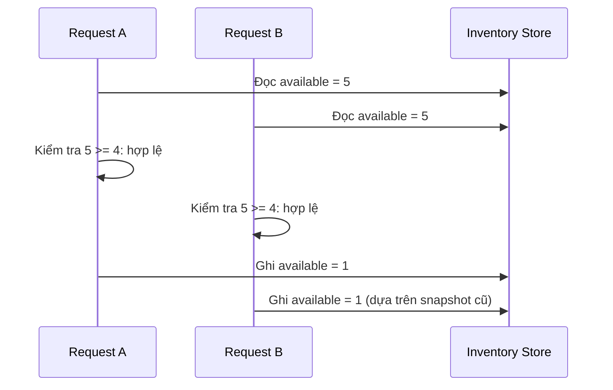
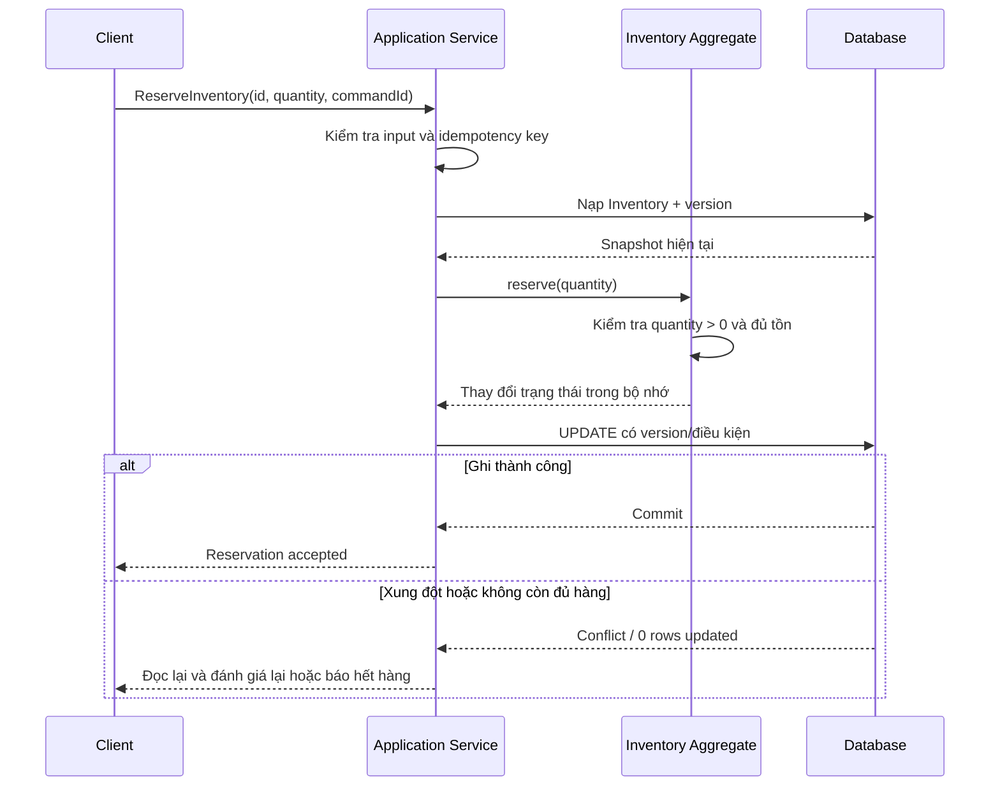

# Phân biệt kiểm tra trước thao tác với bảo vệ bất biến khi ghi

Trong Domain-Driven Design (DDD), kiểm tra điều kiện trước khi thực hiện một hành động và bảo vệ bất biến tại thời điểm ghi dữ liệu là hai việc có liên quan nhưng không thay thế cho nhau. Kiểm tra trước giúp phát hiện yêu cầu không hợp lệ và phản hồi sớm cho người dùng. Bảo vệ khi ghi giúp hệ thống duy trì tính đúng đắn ngay cả khi nhiều request cùng đọc một trạng thái rồi đồng thời cố gắng thay đổi nó.

Một phép kiểm tra có thể đúng tại thời điểm đọc nhưng trở nên sai trước khi dữ liệu được ghi. Vì vậy, nếu quy tắc nghiệp vụ phải luôn đúng dưới tải đồng thời, hệ thống cần một cơ chế bảo vệ nguyên tử ở ranh giới cập nhật: optimistic locking, pessimistic locking, câu lệnh cập nhật có điều kiện hoặc ràng buộc của cơ sở dữ liệu. Trong DDD, Aggregate Root vẫn là nơi diễn đạt và kiểm tra quy tắc miền; cơ chế lưu trữ bảo vệ quy tắc đó trước cạnh tranh và những đường ghi khác.

## 1. Hai thời điểm kiểm tra có mục đích khác nhau

Hãy phân biệt hai câu hỏi:

- **Trước thao tác:** Với trạng thái mà tôi đang quan sát, yêu cầu này có vẻ hợp lệ không?
- **Tại thời điểm ghi:** Dựa trên trạng thái hiện hành và các cập nhật cạnh tranh, hệ thống có thể chấp nhận thay đổi này một cách an toàn không?

Kiểm tra trước thao tác thường bao gồm:

- Dữ liệu đầu vào có đầy đủ và đúng định dạng không?
- Số lượng yêu cầu có lớn hơn 0 không?
- Người dùng có quyền thực hiện hành động không?
- Đơn hàng có đang ở trạng thái cho phép chỉnh sửa không?
- Theo dữ liệu vừa đọc, tồn kho có đủ đáp ứng không?

Bảo vệ khi ghi tập trung vào việc giữ cho bất biến không bị phá vỡ trong lúc cập nhật:

- Tồn kho không được âm dù nhiều đơn cùng giữ hàng.
- Một mã hóa đơn duy nhất không được cấp cho hai hóa đơn.
- Một đơn không được xác nhận hai lần theo hai cập nhật cạnh tranh.
- Số dư hoặc hạn mức không được vượt quá giới hạn do hai giao dịch cùng tiêu thụ.

Hai lớp kiểm tra bổ trợ nhau. Kiểm tra trước tạo thông báo dễ hiểu và tránh các thao tác không cần thiết. Cơ chế tại thời điểm ghi là nơi quyết định cuối cùng đối với các bất biến cần đúng khi dữ liệu được lưu.

## 2. Kiểm tra trước thao tác giúp gì?

Kiểm tra trước thao tác thường dựa trên dữ liệu được nạp từ repository hoặc được truyền vào hành vi của Aggregate Root. Nó giúp phát hiện lỗi sớm, đưa ra thông báo nghiệp vụ rõ ràng và tránh gọi các bước tiếp theo khi điều kiện đã sai.

Ví dụ, khi người dùng muốn giữ 3 sản phẩm, mô hình miền có thể kiểm tra:

```java
public void reserve(int quantity) {
    if (quantity <= 0) {
        throw new InvalidQuantity(quantity);
    }
    if (availableQuantity < quantity) {
        throw new InsufficientInventory();
    }

    availableQuantity -= quantity;
}
```

Đoạn mã thể hiện hai quy tắc quan trọng: số lượng yêu cầu phải dương và lượng khả dụng phải đủ. Nếu chỉ có một request tác động đến Aggregate tại một thời điểm, kiểm tra này có thể đủ để bảo vệ trạng thái trong bộ nhớ. Nhưng trong hệ thống nhiều request, hai instance của `Inventory` có thể cùng được nạp với một giá trị cũ.

Kiểm tra trước thao tác vẫn rất cần thiết. Nó giúp phân biệt dữ liệu đầu vào sai với tình trạng hết hàng, hỗ trợ giao diện hiển thị lỗi phù hợp và giữ quy tắc nghiệp vụ gần với mô hình. Điều cần hiểu là kết quả kiểm tra chỉ phản ánh snapshot đã đọc; nó không tự khóa dữ liệu và không bảo đảm trạng thái vẫn như vậy khi commit.

## 3. Race condition: kiểm tra đúng nhưng kết quả ghi sai

Giả sử kho đang có 5 sản phẩm khả dụng. Hai khách hàng cùng lúc yêu cầu giữ 4 sản phẩm. Cả hai request đều đọc số lượng 5 và đều vượt qua kiểm tra `availableQuantity >= 4`.

**Diễn biến nếu chỉ kiểm tra rồi ghi theo giá trị đã đọc**



Nếu hai request ghi giá trị tuyệt đối `1`, hệ thống có thể chỉ ghi nhận một lần giữ hàng dù đã chấp nhận cả hai. Nếu chúng ghi trừ theo cách không nguyên tử hoặc cập nhật các bản ghi khác nhau mà không có bảo vệ phù hợp, tổng lượng giữ có thể vượt quá tồn kho. Đây là một dạng **race condition**: kết quả phụ thuộc vào thứ tự và thời điểm các thao tác đồng thời.

Vấn đề thường được gọi là **TOCTOU (Time Of Check to Time Of Use)**: điều kiện đúng lúc kiểm tra nhưng không còn đúng lúc sử dụng hoặc ghi. Một transaction thông thường chưa chắc loại bỏ được vấn đề này. Với mức cô lập như Read Committed, hai transaction vẫn có thể đọc cùng giá trị trước khi một transaction ghi.

## 4. Bảo vệ bất biến ngay tại thời điểm ghi

Muốn giữ tồn kho không âm, thao tác giảm tồn cần được kiểm tra và cập nhật như một hành động nguyên tử. Hệ thống không được tách việc đọc điều kiện và việc ghi kết quả thành hai bước không có bảo vệ cạnh tranh.

Các cơ chế thường dùng:

| Cơ chế | Cách bảo vệ | Phù hợp khi |
| --- | --- | --- |
| Optimistic locking | Chỉ ghi nếu version chưa thay đổi | Xung đột không quá thường xuyên, muốn phát hiện và xử lý xung đột |
| Pessimistic locking | Khóa bản ghi hoặc tài nguyên trước khi đọc và sửa | Xung đột thường xuyên, cần tuần tự hóa cập nhật |
| Conditional update | Một câu lệnh ghi chỉ thành công nếu điều kiện vẫn đúng | Quy tắc có thể biểu diễn bằng điều kiện cập nhật nguyên tử |
| Database constraint | Cơ sở dữ liệu từ chối dữ liệu vi phạm | Bất biến có thể biểu diễn bằng unique, check, foreign key hoặc constraint phù hợp |

Không có một cơ chế duy nhất phù hợp cho mọi trường hợp. Hãy chọn theo loại bất biến, phạm vi dữ liệu, tần suất xung đột và yêu cầu về trải nghiệm người dùng.

## 5. Optimistic locking: phát hiện dữ liệu đã thay đổi

Optimistic locking giả định xung đột không xảy ra thường xuyên. Khi đọc Aggregate, hệ thống giữ lại version. Khi ghi, hệ thống chỉ cập nhật nếu version trong cơ sở dữ liệu vẫn là version đã đọc. Nếu một transaction khác đã ghi trước, cập nhật hiện tại thất bại thay vì ghi đè dữ liệu mới.

Ví dụ với JPA:

```java
@Entity
public class Inventory {
    @Id
    private UUID id;

    @Version
    private long version;

    @Column(nullable = false)
    private int availableQuantity;

    public void reserve(int quantity) {
        if (quantity <= 0) {
            throw new InvalidQuantity(quantity);
        }
        if (availableQuantity < quantity) {
            throw new InsufficientInventory();
        }
        availableQuantity -= quantity;
    }
}
```

Application service nạp Aggregate, gọi hành vi miền rồi lưu trong transaction:

```java
@Transactional
public void reserve(InventoryId id, int quantity) {
    Inventory inventory = repository.findById(id.value())
        .orElseThrow(() -> new InventoryNotFound(id));

    inventory.reserve(quantity);
    // JPA phát hiện thay đổi và ghi khi flush/commit.
}
```

Với `@Version`, ORM thường tạo câu lệnh cập nhật có điều kiện tương tự:

```sql
UPDATE inventory
SET available_quantity = ?, version = version + 1
WHERE id = ? AND version = ?;
```

Nếu transaction khác đã tăng version, câu lệnh cập nhật không khớp bản ghi nào và ORM báo lỗi optimistic locking. Một transaction có thể thành công; transaction còn lại phải rollback.

Điểm quan trọng là sau xung đột, không được chỉ phát lại câu lệnh ghi với dữ liệu cũ. Hãy nạp lại Aggregate trong transaction mới, chạy lại kiểm tra nghiệp vụ và quyết định xem yêu cầu còn hợp lệ không. Với ví dụ tồn kho, request thứ hai sau khi đọc lại số lượng 1 sẽ nhận kết quả `InsufficientInventory`.

Trong JPA, lỗi có thể chỉ xuất hiện tại lúc flush hoặc commit, không nhất thiết ngay ở dòng gọi `save`. Vì vậy, việc bắt lỗi và thử lại cần nằm ngoài transaction đã rollback, thường ở một lớp điều phối retry có giới hạn số lần. Không tiếp tục dùng một persistence context đã rơi vào trạng thái rollback.

Optimistic locking ngăn cập nhật mất dữ liệu đối với Aggregate có version được kiểm soát. Nó không tự giải quyết mọi bất biến trải qua nhiều Aggregate hoặc nhiều hàng dữ liệu không cùng được bảo vệ bởi version đó.

## 6. Conditional update: kiểm tra và ghi trong cùng câu lệnh

Với một quy tắc đơn giản như giảm tồn kho khi còn đủ số lượng, có thể dùng một câu lệnh cập nhật có điều kiện:

```sql
UPDATE inventory
SET available_quantity = available_quantity - ?
WHERE id = ?
  AND available_quantity >= ?;
```

Trước câu lệnh, ứng dụng vẫn kiểm tra `quantity > 0` để trả lỗi đầu vào rõ ràng. Câu lệnh cập nhật chỉ giảm số lượng nếu hàng vẫn đủ tại thời điểm database thực hiện cập nhật.

Ứng dụng kiểm tra số hàng bị ảnh hưởng:

```java
if (quantity <= 0) {
    throw new InvalidQuantity(quantity);
}

int updated = jdbcTemplate.update(sql, quantity, inventoryId, quantity);

if (updated == 0) {
    throw new InsufficientInventory();
}
```

Nếu hai request cùng giữ 4 sản phẩm từ lượng 5, một câu lệnh giảm thành công và lượng còn lại là 1. Câu lệnh kia đánh giá điều kiện trên giá trị hiện hành, không còn khớp nên cập nhật 0 hàng. Cơ sở dữ liệu đã thực hiện kiểm tra và thay đổi như một thao tác ghi nguyên tử. Kết quả 0 hàng có thể có nghĩa là không tìm thấy kho hoặc không còn đủ hàng; nếu nghiệp vụ cần phân biệt hai trường hợp, ứng dụng có thể đọc lại trạng thái để phân loại kết quả, nhưng quyết định giữ hàng vẫn phải dựa trên câu lệnh cập nhật nguyên tử.

Conditional update đặc biệt hữu ích khi hành vi có thể biểu diễn gọn bằng một câu lệnh. Tuy nhiên, nếu Aggregate có nhiều quy tắc cần phối hợp hoặc cần phát domain event với đầy đủ trạng thái miền, hãy cân nhắc cách giữ mô hình và persistence nhất quán. Một câu lệnh SQL trực tiếp không nên âm thầm bỏ qua các hành vi mà Aggregate Root cần bảo vệ.

## 7. Pessimistic locking: tuần tự hóa cập nhật

Pessimistic locking khóa tài nguyên trước khi đọc và thay đổi. Ví dụ, transaction có thể đọc một hàng tồn kho bằng `SELECT ... FOR UPDATE` để các transaction khác phải chờ khi muốn khóa cùng hàng.

```sql
SELECT available_quantity
FROM inventory
WHERE id = :inventory_id
FOR UPDATE;
```

Trong khi giữ khóa, transaction kiểm tra số lượng và cập nhật. Khi transaction commit hoặc rollback, khóa được giải phóng. Request tiếp theo mới có thể tiếp tục và nhìn thấy kết quả mới.

Pessimistic locking có thể phù hợp với tài nguyên nóng có nhiều xung đột, nhưng cần chú ý:

- Giữ transaction ngắn; không gọi API bên ngoài hoặc chờ người dùng trong lúc giữ khóa.
- Khóa theo thứ tự nhất quán nếu cần nhiều hàng để giảm nguy cơ deadlock.
- Có timeout và xử lý trường hợp không lấy được khóa.
- Chỉ khóa đúng phạm vi cần thiết để tránh làm giảm throughput.
- Hiểu rõ hành vi khóa và isolation của hệ quản trị cơ sở dữ liệu đang dùng.

Khóa bi quan không thay thế kiểm tra nghiệp vụ. Sau khi lấy khóa, Root vẫn cần kiểm tra điều kiện và từ chối hành động không hợp lệ.

## 8. Database constraint là lớp bảo vệ cuối cùng

Một số bất biến có thể và nên được bảo vệ ngay trong schema để mọi đường ghi đều phải tuân thủ, kể cả khi dữ liệu được cập nhật từ batch job, script quản trị hoặc một ứng dụng khác.

Ví dụ:

```sql
ALTER TABLE inventory
ADD CONSTRAINT ck_inventory_available_non_negative
CHECK (available_quantity >= 0);

ALTER TABLE invoice
ADD CONSTRAINT uq_invoice_number
UNIQUE (invoice_number);
```

`CHECK` ngăn lượng tồn âm; `UNIQUE` ngăn hai bản ghi dùng cùng số hóa đơn. Cơ sở dữ liệu là nơi có thể thực thi các ràng buộc này một cách đáng tin cậy trong cạnh tranh.

Tuy nhiên, database constraint không thay thế mô hình miền:

- Constraint thường diễn đạt điều kiện ở mức dữ liệu, không giải thích đầy đủ ý nghĩa nghiệp vụ.
- Một `CHECK` thường phù hợp với điều kiện trên một hàng; các bất biến tổng hợp nhiều hàng cần thiết kế khác.
- Thông báo lỗi constraint thường mang tính kỹ thuật, cần được ánh xạ thành kết quả nghiệp vụ phù hợp.
- Một số quy tắc cần dữ liệu hoặc quyết định từ bên ngoài database.

Giữ validation trong Value Object và Aggregate Root để mã nguồn diễn đạt nghiệp vụ. Dùng constraint để bảo vệ những điều kiện có thể thực thi ở tầng lưu trữ, đặc biệt trước các đường ghi ngoài luồng ứng dụng.

## 9. Transaction không tự động giải quyết mọi race condition

Transaction giúp nhóm các thao tác thành một đơn vị commit hoặc rollback. Nhưng chỉ mở transaction không có nghĩa mọi chuỗi đọc rồi ghi đã an toàn trước cạnh tranh.

Ví dụ, hai transaction ở mức Read Committed có thể cùng đọc `available_quantity = 5`, cùng kiểm tra yêu cầu 4 là hợp lệ rồi cập nhật theo cách ghi đè. Mức isolation, câu lệnh SQL, khóa và constraint mới quyết định các thao tác cạnh tranh được xử lý ra sao.

Một số hệ quản trị cung cấp mức Serializable để kết quả của các transaction tương đương với một thứ tự tuần tự. Khi xung đột, database có thể hủy một transaction để ứng dụng thử lại. Đây là lựa chọn mạnh nhưng có thể làm tăng chi phí, tỷ lệ abort và yêu cầu retry. Cần kiểm tra đặc tính cụ thể của database, không giả định mọi mức isolation có hành vi giống nhau giữa các hệ quản trị.

## 10. Aggregate Root kiểm tra quy tắc, cơ chế ghi bảo vệ cạnh tranh

Trong DDD, Aggregate Root là nơi thực thi các hành vi và bất biến của Aggregate. Khi một command đến, application service nạp Root, gọi phương thức nghiệp vụ và lưu Aggregate trong transaction.

Hai lớp trách nhiệm cần phối hợp:

1. **Mô hình miền:** kiểm tra ý nghĩa yêu cầu, trạng thái hiện tại và các điều kiện nghiệp vụ; đưa ra kết quả rõ ràng như `InsufficientInventory` hoặc `OrderCannotBeConfirmed`.
2. **Cơ chế nhất quán khi ghi:** bảo vệ cập nhật trước cạnh tranh bằng version, lock, conditional update hoặc constraint; phát hiện xung đột và ngăn ghi đè sai.

Nếu chỉ có lớp thứ nhất, hai request có thể cùng vượt qua kiểm tra trên snapshot cũ. Nếu chỉ có lớp thứ hai, database có thể từ chối dữ liệu nhưng mô hình miền không diễn đạt được vì sao hành động sai và người dùng nên làm gì.

Ví dụ, Root có thể kiểm tra `availableQuantity >= quantity` để tạo lỗi nghiệp vụ dễ hiểu. Repository dùng optimistic locking để bảo vệ version. Schema có `CHECK (available_quantity >= 0)` để chặn dữ liệu âm nếu có một đường ghi khác bỏ qua ứng dụng. Ba cơ chế có vai trò khác nhau và bổ trợ nhau.

## 11. Khi bất biến vượt qua một Aggregate

Aggregate thường được thiết kế sao cho các bất biến cần bảo vệ ngay lập tức nằm trong cùng ranh giới nhất quán. Nếu một quy tắc trải qua nhiều Aggregate, chỉ kiểm tra từng Root riêng lẻ có thể chưa đủ.

Ví dụ, một khách hàng có hạn mức tín dụng tổng 100 triệu đồng và nhiều đơn hàng được xử lý đồng thời. Mỗi đơn riêng lẻ có thể thấy hạn mức còn đủ, nhưng tổng giá trị các đơn cùng được chấp nhận có thể vượt giới hạn.

Các hướng xử lý có thể gồm:

- Mô hình hóa một Aggregate hoặc tài nguyên hạn mức chuyên trách để tuần tự hóa việc phân bổ tín dụng.
- Tạo thao tác giữ hạn mức (credit reservation) nguyên tử trước khi xác nhận đơn.
- Dùng conditional update trên bản ghi hạn mức để chỉ phân bổ khi số dư hạn mức còn đủ.
- Nếu nghiệp vụ cho phép nhất quán trễ, dùng quy trình điều phối và xử lý bù trừ khi tổng hợp phát hiện vượt giới hạn.

Không nên mở một transaction phân tán kéo dài chỉ để cố giữ mọi Aggregate đồng bộ. Hãy xác định mức nhất quán nghiệp vụ yêu cầu, ranh giới sở hữu quy tắc và cách phục hồi khi một bước thất bại.

## 12. Retry phải đọc lại và đánh giá lại nghiệp vụ

Khi gặp optimistic lock exception, deadlock hoặc serialization failure, ứng dụng có thể cần thử lại. Nhưng retry đúng nghĩa không phải gửi lại nguyên câu lệnh ghi trên dữ liệu cũ.

Một lần retry an toàn thường gồm:

1. Rollback transaction đã thất bại.
2. Bắt đầu transaction mới và nạp trạng thái hiện hành.
3. Kiểm tra lại điều kiện và bất biến bằng dữ liệu mới.
4. Thực hiện lại hành vi miền nếu vẫn hợp lệ.
5. Lưu với cơ chế concurrency như trước.
6. Dừng sau số lần giới hạn và trả kết quả có thể xử lý nếu xung đột tiếp tục.

Không retry mù quáng các lỗi nghiệp vụ như số lượng không đủ, tài khoản bị khóa hoặc báo giá hết hạn. Những lỗi này cần người dùng hoặc quy trình nghiệp vụ thay đổi đầu vào. Với command có thể được gửi lại từ message broker hoặc client, cần idempotency key để tránh thực hiện cùng một ý định hai lần.

Nếu thao tác có side effect bên ngoài như thu tiền hoặc gửi email, không thực hiện side effect đó trước khi biết transaction ghi Aggregate đã thành công. Có thể dùng transactional outbox để lưu sự kiện cần công bố cùng transaction, sau đó một tiến trình riêng gửi message và xử lý gửi lặp an toàn.

## 13. Phân biệt loại lỗi để phản hồi đúng

Không phải mọi thất bại khi ghi đều có cùng ý nghĩa. Hãy phân biệt:

| Loại lỗi | Ví dụ | Cách xử lý thường gặp |
| --- | --- | --- |
| Input validation | Số lượng bằng 0 | Trả lỗi đầu vào, yêu cầu sửa dữ liệu |
| Business rule violation | Đơn đã hủy nên không thể xác nhận | Trả kết quả nghiệp vụ, không retry tự động |
| Concurrency conflict | Version đã thay đổi | Rollback, đọc lại, đánh giá lại và có thể retry |
| Constraint violation | Số hóa đơn bị trùng | Ánh xạ constraint sang lỗi nghiệp vụ hoặc xử lý xung đột định danh |
| Infrastructure failure | Database timeout hoặc mất kết nối | Phân loại khả năng commit, xử lý retry có kiểm soát và idempotency |

Một timeout khi commit có thể để lại kết quả không chắc chắn ở phía client: transaction có thể đã commit nhưng phản hồi bị mất. Với thao tác quan trọng, hãy dùng command ID hoặc idempotency key và cung cấp cách tra cứu kết quả thay vì giả định timeout đồng nghĩa rollback.

## 14. Ví dụ tổng hợp: giữ hàng an toàn

Một luồng giữ hàng có thể được thiết kế như sau:



Trong thực tế, cách triển khai cụ thể phụ thuộc việc dùng ORM, SQL trực tiếp hay một cơ chế lưu trữ khác. Dù chọn cách nào, kết quả phải bảo đảm hai request không thể cùng tiêu thụ vượt lượng hàng hiện có.

## 15. Checklist bảo vệ bất biến khi ghi

Trước khi đưa một thao tác quan trọng vào vận hành, hãy tự hỏi:

- Quy tắc nghiệp vụ nào phải luôn đúng sau khi ghi?
- Kiểm tra trước đang dựa trên snapshot nào và snapshot đó có thể cũ không?
- Hai request đồng thời có thể cùng vượt qua kiểm tra không?
- Cơ chế nào bảo vệ cập nhật: version, lock, conditional update hay constraint?
- Transaction bao phủ đúng Aggregate và các thao tác cần nhất quán chưa?
- Nếu ghi thất bại do xung đột, hệ thống có đọc lại và chạy lại kiểm tra nghiệp vụ không?
- Retry có giới hạn và có phân biệt lỗi nghiệp vụ với lỗi kỹ thuật không?
- Command hoặc side effect có idempotent khi message được gửi lặp không?
- Các đường ghi ngoài ứng dụng có bị ràng buộc bởi database constraint phù hợp không?
- Bất biến có đang trải qua nhiều Aggregate và cần một mô hình phối hợp riêng không?

## 16. Nguyên tắc cần ghi nhớ

Kiểm tra trước thao tác giúp phát hiện yêu cầu không hợp lệ trên trạng thái đang quan sát và tạo phản hồi dễ hiểu. Nó không khóa trạng thái, không ngăn request khác thay đổi dữ liệu và không bảo đảm điều kiện vẫn đúng lúc ghi.

Để bảo vệ bất biến dưới tải đồng thời, hãy đặt quy tắc trong mô hình miền và dùng cơ chế ghi nguyên tử phù hợp: optimistic locking, pessimistic locking, conditional update hoặc database constraint. Khi có xung đột, rollback, nạp lại trạng thái và đánh giá lại nghiệp vụ trước khi thử lại. Thiết kế đúng cả hai thời điểm giúp hệ thống vừa phản hồi tốt cho người dùng vừa giữ dữ liệu hợp lệ khi nhiều tiến trình cùng hoạt động.
