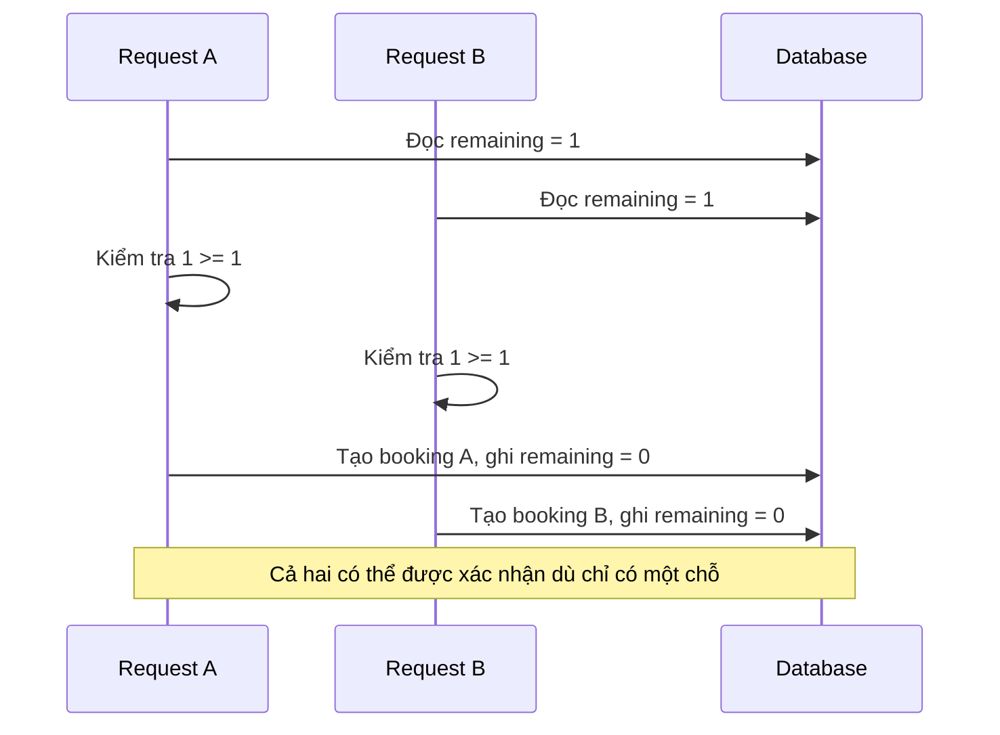
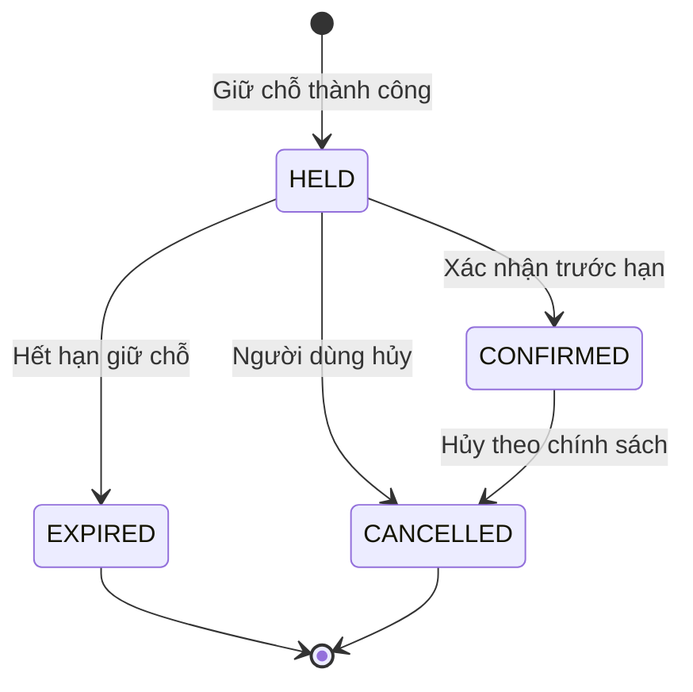
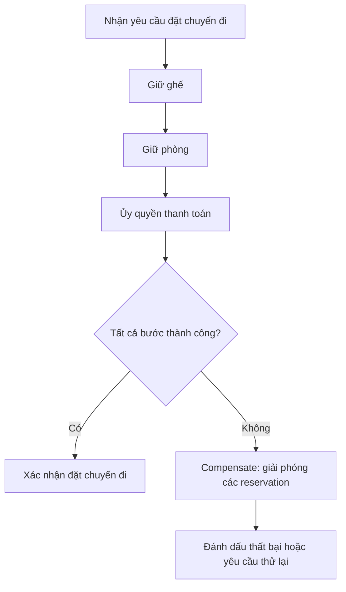

# Phân tích ví dụ đặt chỗ, tồn kho và hạn mức khi nhiều yêu cầu đồng thời

Trong hệ thống nghiệp vụ, một quy tắc có thể đúng khi từng yêu cầu được xử lý riêng lẻ nhưng bị phá vỡ khi nhiều yêu cầu đến cùng lúc. Hai khách hàng cùng đặt chỗ cuối cùng, hai đơn hàng cùng trừ một sản phẩm cuối kho hoặc hai giao dịch cùng sử dụng phần hạn mức còn lại là những tình huống điển hình.

Domain-Driven Design (DDD) yêu cầu mô hình miền biểu đạt và bảo vệ các **invariant (bất biến nghiệp vụ)**. Khi có đồng thời, chỉ viết điều kiện kiểm tra trong một entity là chưa đủ: hai transaction có thể cùng đọc một trạng thái hợp lệ rồi cùng đưa ra quyết định. Cần kết hợp mô hình miền với ranh giới aggregate, transaction, cơ chế khóa hoặc cập nhật nguyên tử và ràng buộc dữ liệu để bảo đảm invariant vẫn đúng dưới tải thực tế.

Bài học này phân tích ba ví dụ thường gặp: đặt chỗ có sức chứa giới hạn, tồn kho có số lượng hữu hạn và tài khoản có hạn mức tín dụng. Qua đó, ta thấy cách xác định invariant, tìm điểm tranh chấp, chọn cơ chế đồng thời và xử lý các trường hợp retry, timeout hoặc nhiều dịch vụ phối hợp.

## 1. Bất biến nghiệp vụ trong môi trường đồng thời

**Invariant** là một điều kiện phải luôn đúng đối với trạng thái nghiệp vụ hợp lệ. Một thao tác chỉ được chấp nhận nếu trạng thái sau thao tác vẫn thỏa mãn các invariant liên quan.

Ví dụ:

| Nghiệp vụ | Invariant cần bảo vệ |
|---|---|
| Đặt chỗ | Số chỗ đã giữ và đã xác nhận không vượt quá sức chứa |
| Tồn kho | Số lượng có thể bán không âm; tổng lượng đã giữ không vượt lượng có thể phân bổ |
| Hạn mức tín dụng | Tổng mức sử dụng được tính theo chính sách không vượt hạn mức được cấp |
| Chỗ ngồi cụ thể | Một chỗ trong một suất diễn chỉ được gán cho tối đa một lượt đặt hợp lệ |
| Phiếu đặt hàng | Một yêu cầu nghiệp vụ không bị ghi nhận thành nhiều giao dịch do retry |

Invariant khác với validation của đầu vào. Kiểm tra `quantity > 0` là validation cơ bản; kiểm tra “sau khi trừ số lượng, tồn kho vẫn không âm” là invariant cần được bảo vệ trước các thay đổi đồng thời.

### 1.1. Tại sao kiểm tra thông thường có thể thất bại?

Giả sử một phòng họp chỉ còn một chỗ. Hai request A và B đến gần như đồng thời. Cả hai transaction đều thực hiện:

1. Đọc số chỗ còn lại: `1`.
2. Kiểm tra `remaining >= 1`: đúng.
3. Tạo lượt đặt chỗ.
4. Ghi số chỗ còn lại thành `0`.

Nếu không có cơ chế đồng bộ phù hợp, cả hai request đều có thể thành công trong khi hệ thống chỉ ghi nhận một chỗ đã bị trừ. Hai khách hàng nhận xác nhận cho cùng một chỗ.



Đây là một dạng **race condition (điều kiện tranh chấp)**. Kết quả phụ thuộc vào thứ tự xen kẽ của các thao tác. Mỗi transaction có thể đúng khi xét riêng, nhưng tổ hợp của chúng tạo ra trạng thái sai.

### 1.2. Phân biệt các hiện tượng đồng thời

| Hiện tượng | Mô tả | Hệ quả có thể gặp |
|---|---|---|
| Lost update | Hai transaction cùng đọc một giá trị, cùng tính toán rồi lần ghi sau ghi đè lần ghi trước | Một thay đổi bị mất |
| Write skew | Hai transaction đọc các dữ liệu liên quan và ghi vào các hàng khác nhau, khiến một invariant tổng thể bị phá vỡ | Mỗi hàng riêng lẻ hợp lệ nhưng trạng thái chung sai |
| Duplicate request | Client gửi lại cùng yêu cầu do timeout hoặc không nhận được phản hồi | Tạo hai lượt đặt hoặc trừ tiền hai lần |
| Double booking | Hai yêu cầu cùng chiếm một tài nguyên hoặc một slot | Bán vượt sức chứa hoặc gán trùng chỗ |
| Overselling | Nhiều đơn cùng sử dụng số lượng tồn kho cuối cùng | Tồn kho âm hoặc không đủ hàng để giao |

Không phải mọi vấn đề đều được giải quyết bằng cùng một loại khóa. Trước tiên phải xác định invariant nằm ở đâu, các transaction tranh chấp dữ liệu nào và hệ thống cần mức nhất quán nào.

## 2. Xác định nơi sở hữu invariant bằng Aggregate

Trong DDD, **Aggregate** là ranh giới nhất quán của một nhóm đối tượng miền; **Aggregate Root** là điểm truy cập chính để thay đổi trạng thái của nhóm. Các invariant cần được bảo vệ ngay trong aggregate phải được kiểm tra qua hành vi của root.

Ví dụ về các aggregate có thể dùng:

| Aggregate Root | Phạm vi trạng thái được bảo vệ | Ví dụ invariant |
|---|---|---|
| `EventSession` hoặc `RoomSlot` | Sức chứa và số chỗ đã giữ của một suất/sự kiện/phòng | Số chỗ đã giữ không vượt capacity |
| `InventoryItem` hoặc `StockBalance` | Số lượng tồn tại một SKU ở một kho | Available quantity không âm |
| `CreditAccount` | Hạn mức và mức tín dụng đang sử dụng của một khách hàng | Exposure không vượt credit limit |

Đây là các lựa chọn mô hình minh họa. Aggregate thực tế phụ thuộc cách doanh nghiệp định nghĩa tài nguyên, kho, đơn vị lưu kho, khách hàng và chính sách tín dụng.

### 2.1. Invariant trong một aggregate

Nếu mọi thay đổi ảnh hưởng đến invariant đều đi qua cùng một aggregate root, hệ thống có thể bảo vệ trạng thái bằng một transaction và một cơ chế đồng thời gắn với root đó. Ví dụ, một `CreditAccount` có thể sở hữu `creditLimit` và `usedAmount`; mọi thao tác giữ thêm tín dụng phải được tuần tự hóa trên tài khoản này.

Không nên để nhiều use case tự đọc và cập nhật các field của aggregate theo cách riêng. Nếu một controller, batch job và message consumer cùng có thể sửa trực tiếp `availableQuantity`, invariant sẽ bị phụ thuộc vào việc mọi caller có nhớ kiểm tra hay không.

### 2.2. Invariant trải qua nhiều aggregate

Một quy tắc có thể liên quan đến nhiều aggregate. Ví dụ, khi xác nhận đơn hàng, hệ thống cần giữ hàng trong kho, giữ hạn mức tín dụng và xác nhận booking giao hàng. Không nên mặc định gom tất cả vào một aggregate khổng lồ chỉ để có transaction duy nhất. Aggregate lớn làm tăng contention, tải dữ liệu và phạm vi thay đổi.

Hãy phân biệt:

- Invariant phải đúng tức thời và có thể được đặt trong một aggregate hoặc một transaction cục bộ.
- Quy tắc phối hợp nhiều aggregate có thể được thực hiện bằng transaction trong cùng database nếu phạm vi và tải cho phép.
- Quy trình trải qua nhiều dịch vụ hoặc database thường cần reservation, saga/process manager, retry và compensation. Khi đó trạng thái trung gian phải được mô hình hóa rõ ràng.

Nếu một invariant thực sự cần được bảo đảm nguyên tử trên nhiều dữ liệu, nhóm phải chọn ranh giới dữ liệu và cơ chế transaction phù hợp. Không thể chỉ phát domain event rồi giả định mọi phần sẽ cập nhật đủ nhanh để ngăn vi phạm.

## 3. Ví dụ 1: đặt chỗ với sức chứa hữu hạn

Giả sử một buổi hội thảo có 100 chỗ. Nhiều người có thể gửi yêu cầu cùng lúc. Invariant là:

\[
0 \leq reserved + confirmed \leq capacity
\]

Trong một mô hình đơn giản, `reserved` là số chỗ đang được giữ tạm thời và `confirmed` là số chỗ đã xác nhận. Hệ thống cần xác định rõ giữ chỗ có thời hạn bao lâu, khi nào một lượt giữ được xác nhận và khi nào chỗ được giải phóng.

### 3.1. Mô hình trạng thái đặt chỗ

Một lượt đặt chỗ có thể có các trạng thái:



`HELD` là trạng thái tạm thời. Một lượt giữ cần có `reservationId`, `sessionId`, số lượng chỗ, thời điểm hết hạn và trạng thái. Khi xác nhận hoặc hết hạn, chỉ một chuyển trạng thái hợp lệ được phép thắng.

### 3.2. Giải pháp yếu: đọc rồi kiểm tra rồi ghi

Pseudo-code sau không an toàn nếu nhiều transaction chạy đồng thời:

```java
Session session = sessionRepository.findById(sessionId).orElseThrow();

if (session.availableSeats() >= requestedSeats) {
    session.reserve(requestedSeats);
    sessionRepository.save(session);
    bookingRepository.save(booking);
}
```

Hai transaction có thể cùng đọc một `availableSeats` trước khi transaction nào ghi. Điều kiện trong Java chỉ kiểm tra snapshot mà transaction nhìn thấy. Nó không tự tạo ra một vùng loại trừ giữa các request.

### 3.3. Cách 1: cập nhật nguyên tử có điều kiện

Với slot hoặc suất có một hàng lưu sức chứa, database có thể thực hiện kiểm tra và giảm số chỗ trong một câu lệnh nguyên tử:

```sql
UPDATE event_session
SET remaining_seats = remaining_seats - :requested
WHERE id = :session_id
  AND :requested > 0
  AND remaining_seats >= :requested;
```

Ứng dụng kiểm tra số hàng bị ảnh hưởng:

- `1`: đã giữ được số chỗ yêu cầu.
- `0`: suất không tồn tại, số chỗ không đủ hoặc điều kiện không còn đúng; cần phân biệt các trường hợp nếu use case yêu cầu thông báo chi tiết.

Lệnh `UPDATE` khóa hàng cần cập nhật theo cơ chế của database và đánh giá điều kiện khi thực hiện cập nhật. Hai transaction cùng tranh chấp hàng này sẽ được database điều phối; transaction sau chỉ thành công nếu điều kiện vẫn đúng.

Để tránh trạng thái đã trừ chỗ nhưng không tạo được reservation, hãy thực hiện cập nhật sức chứa và insert reservation trong cùng transaction database:

```text
BEGIN
  UPDATE event_session ... WHERE remaining_seats >= requested
  nếu affected_rows = 0 thì báo hết chỗ
  INSERT INTO booking_reservation (..., status = 'HELD')
COMMIT
```

Nếu insert thất bại, transaction rollback sẽ hoàn tác cả việc giảm số chỗ. Không nên trừ chỗ trong một transaction rồi tạo booking ở một transaction khác mà không có quy trình bù trừ rõ ràng.

### 3.4. Cách 2: khóa bi quan

Với `SELECT ... FOR UPDATE`, transaction khóa hàng của suất trước khi đọc và thay đổi:

```sql
BEGIN;

SELECT capacity, reserved_seats
FROM event_session
WHERE id = :session_id
FOR UPDATE;

-- Kiểm tra reserved_seats + requested <= capacity
-- Tạo reservation và cập nhật số chỗ

COMMIT;
```

Transaction khác muốn khóa cùng hàng phải chờ. Cách này dễ hiểu khi cần đọc nhiều field, kiểm tra nhiều điều kiện rồi cập nhật cùng một aggregate. Tuy nhiên, giữ khóa quá lâu làm tăng thời gian chờ và nguy cơ deadlock. Không gọi dịch vụ bên ngoài hoặc chờ người dùng trong lúc đang giữ khóa database.

### 3.5. Cách 3: ràng buộc duy nhất cho chỗ cụ thể

Nếu mỗi chỗ ngồi hoặc mỗi slot là một định danh cố định, unique constraint có thể là lớp bảo vệ cuối cùng:

```sql
CREATE TABLE seat_booking (
    session_id BIGINT NOT NULL,
    seat_number VARCHAR(20) NOT NULL,
    booking_id UUID NOT NULL,
    PRIMARY KEY (session_id, seat_number)
);
```

Hai transaction không thể insert cùng một `session_id` và `seat_number` thành công. Ứng dụng bắt lỗi vi phạm unique constraint và chuyển thành kết quả “chỗ đã được đặt”.

Nếu cần tái sử dụng chỗ sau khi hủy, thiết kế phải phản ánh trạng thái hợp lệ. Có thể lưu lịch sử booking riêng và duy trì bảng phân bổ chỗ hiện tại, hoặc dùng partial unique index chỉ áp dụng cho các booking còn hiệu lực nếu database hỗ trợ. Không xóa lịch sử một cách tùy tiện chỉ để giải phóng unique key.

Với khoảng thời gian tùy ý thay vì slot rời rạc, unique key trên thời điểm bắt đầu không ngăn được hai khoảng thời gian chồng lấn. Cần dùng cơ chế loại trừ khoảng thời gian của database, khóa tài nguyên, hoặc một mô hình slot đã được chuẩn hóa. Điều kiện “hai khoảng không overlap” phải được bảo vệ ở nơi có thể thực thi nguyên tử.

## 4. Vòng đời giữ chỗ và cuộc đua giữa xác nhận với hết hạn

Giữ chỗ tạm thời thường có thời hạn, ví dụ 10 phút để thanh toán. Chỉ có một tác vụ nền chạy mỗi phút để giải phóng chỗ hết hạn là chưa đủ: khách hàng có thể xác nhận đúng lúc tác vụ hết hạn đang chạy.

Hãy để database quyết định chuyển trạng thái bằng một cập nhật có điều kiện:

```sql
-- Xác nhận khi reservation vẫn còn hiệu lực
UPDATE booking_reservation
SET status = 'CONFIRMED', confirmed_at = CURRENT_TIMESTAMP
WHERE id = :reservation_id
  AND status = 'HELD'
  AND expires_at > CURRENT_TIMESTAMP;
```

```sql
-- Hết hạn khi reservation vẫn đang giữ và đã quá hạn
UPDATE booking_reservation
SET status = 'EXPIRED'
WHERE id = :reservation_id
  AND status = 'HELD'
  AND expires_at <= CURRENT_TIMESTAMP;
```

Cả hai lệnh đều yêu cầu trạng thái hiện tại là `HELD`, nhưng điều kiện thời gian đối lập nhau. Khi hai thao tác cạnh tranh, một thao tác chuyển trạng thái thành công; thao tác còn lại không còn thỏa điều kiện. Ứng dụng cần kiểm tra số hàng bị ảnh hưởng để biết thao tác có thắng hay không.

Việc chuyển `HELD` sang `EXPIRED` còn phải giải phóng số chỗ trong cùng transaction hoặc bằng một cơ chế nhất quán có thể phục hồi. Nếu tác vụ nền chỉ cập nhật trạng thái mà không trả lại capacity, hệ thống có thể giữ chỗ vĩnh viễn. Nếu cập nhật capacity nhưng không chuyển trạng thái, một tác vụ khác có thể giải phóng lần nữa. Một transaction cục bộ cần bao gồm cả hai thay đổi nếu chúng cùng database.

Thời điểm hết hạn phải được đánh giá bằng một nguồn thời gian thống nhất, thường là thời gian database hoặc một clock policy được kiểm soát. Tránh để mỗi application instance tự quyết định bằng đồng hồ máy riêng nếu sai lệch thời gian có thể làm thay đổi kết quả nghiệp vụ.

## 5. Ví dụ 2: tồn kho và ngăn bán vượt số lượng

Giả sử kho A có 5 chiếc sản phẩm P. Hai đơn hàng cùng yêu cầu 4 chiếc. Invariant của số dư tồn kho là:

\[
availableQuantity \geq 0
\]

Nếu hệ thống cho phép giữ hàng trước khi xác nhận đơn, có thể biểu diễn thêm:

\[
onHand = available + reserved
\]

Trong đó `onHand` là lượng hàng thực tế được ghi nhận, `reserved` là lượng đang được giữ cho đơn và `available` là lượng có thể tiếp tục phân bổ. Công thức chính xác phụ thuộc chính sách về hàng lỗi, hàng đang kiểm kê, hàng đang vận chuyển và lượng safety stock.

### 5.1. Race condition khi hai đơn cùng đọc tồn kho

Nếu cả hai transaction đọc `available = 5`, chúng đều thấy đủ 4 chiếc. Sau đó cùng tạo reservation. Hệ thống có thể chấp nhận 8 chiếc dù chỉ có 5 chiếc.

Chỉ kiểm tra `available >= requested` trong domain method không ngăn được tình huống này nếu hai transaction đang thao tác trên hai bản sao trạng thái được nạp độc lập. Cần bảo vệ thao tác thay đổi số lượng tại điểm lưu trữ có thẩm quyền.

### 5.2. Cập nhật tồn kho nguyên tử

Một câu lệnh có điều kiện có thể trừ số lượng trong cùng thao tác kiểm tra:

```sql
UPDATE inventory_balance
SET available_quantity = available_quantity - :quantity,
    reserved_quantity = reserved_quantity + :quantity
WHERE warehouse_id = :warehouse_id
  AND sku_id = :sku_id
  AND :quantity > 0
  AND available_quantity >= :quantity;
```

Nếu chỉ có 5 chiếc và hai yêu cầu cùng trừ 4, database tuần tự hóa cập nhật trên hàng tồn kho. Một lệnh có thể thành công; lệnh còn lại sau khi chờ sẽ thấy điều kiện `available_quantity >= 4` không còn đúng và cập nhật 0 hàng.

Trong cùng transaction, tạo reservation với định danh duy nhất:

```sql
INSERT INTO inventory_reservation (
    reservation_id, warehouse_id, sku_id, quantity, status, expires_at
) VALUES (
    :reservation_id, :warehouse_id, :sku_id, :quantity, 'HELD', :expires_at
);
```

Nếu insert reservation không thành công, transaction phải rollback thay đổi số dư. Một unique constraint trên `reservation_id` giúp tránh ghi trùng cùng một reservation identifier.

### 5.3. Mô hình hành vi của Inventory aggregate

Domain model vẫn cần bảo vệ các điều kiện nội tại và diễn đạt ngôn ngữ nghiệp vụ:

```java
public final class InventoryItem {
    private final SkuId skuId;
    private final WarehouseId warehouseId;
    private int available;
    private int reserved;

    public InventoryItem(SkuId skuId, WarehouseId warehouseId,
                         int available, int reserved) {
        if (available < 0 || reserved < 0) {
            throw new IllegalArgumentException("Inventory quantities cannot be negative");
        }
        this.skuId = skuId;
        this.warehouseId = warehouseId;
        this.available = available;
        this.reserved = reserved;
    }

    public void reserve(int quantity) {
        if (quantity <= 0) {
            throw new IllegalArgumentException("Quantity must be positive");
        }
        if (available < quantity) {
            throw new InsufficientInventoryException(skuId, quantity);
        }
        available -= quantity;
        reserved += quantity;
    }
}
```

Phương thức `reserve` làm rõ invariant và ngăn trạng thái sai trong một instance của aggregate. Tuy nhiên, nếu hai instance cùng được nạp từ một snapshot cũ, domain method không tự giải quyết xung đột. Repository adapter phải dùng optimistic locking, pessimistic locking hoặc câu lệnh cập nhật nguyên tử để phối hợp với database.

### 5.4. Optimistic locking với version

Nếu xung đột không quá thường xuyên, có thể dùng optimistic locking. Hàng tồn kho có thêm cột `version`. Khi đọc aggregate, ứng dụng lấy version hiện tại; khi ghi, database chỉ cập nhật nếu version chưa đổi.

Ví dụ JPA:

```java
@Entity
public class InventoryJpaEntity {
    @Id
    private Long id;

    private int available;

    @Version
    private long version;
}
```

Nếu hai transaction cùng đọc version 7, transaction đầu cập nhật thành version 8. Transaction sau cố ghi với version 7 sẽ gặp optimistic locking conflict. Ứng dụng cần xử lý xung đột bằng cách tải lại trạng thái mới, đánh giá lại yêu cầu và trả kết quả phù hợp hoặc thử lại có giới hạn.

Không được retry mù bằng cách gửi lại cùng câu lệnh ghi lên trạng thái cũ. Phải tải lại dữ liệu và thực hiện lại quyết định nghiệp vụ. Với truy vấn bulk update của JPA, cơ chế `@Version` không tự động được áp dụng như khi cập nhật entity được quản lý; nếu dùng bulk update, phải chủ động thiết kế version và điều kiện cập nhật.

## 6. Ví dụ 3: hạn mức tín dụng và tổng mức sử dụng

Một khách hàng có hạn mức tín dụng 100 triệu đồng. Mức sử dụng hiện tại là 70 triệu. Hai đơn hàng mới, mỗi đơn yêu cầu giữ 20 triệu. Nếu mỗi transaction đều đọc mức sử dụng 70 triệu, cả hai đều có thể thấy còn 30 triệu và cùng được chấp nhận. Kết quả 110 triệu vượt hạn mức.

Invariant có thể được biểu diễn:

\[
usedCredit + requestedCredit \leq creditLimit
\]

Điểm quan trọng là phải định nghĩa `usedCredit` theo chính sách thực tế. Nó có thể gồm hóa đơn chưa thanh toán, đơn đã được duyệt, khoản giữ tạm thời, giao dịch đang chờ hoặc một số loại rủi ro khác. Nếu hai use case tính exposure khác nhau, invariant trên giấy sẽ không có ý nghĩa.

### 6.1. Đặt CreditAccount làm điểm sở hữu hạn mức

Một `CreditAccount` có thể chứa:

- `customerId`.
- `creditLimit`.
- `usedAmount` hoặc `currentExposure`.
- Trạng thái tài khoản và currency.
- Các quy tắc tăng/giảm mức sử dụng.

Mọi yêu cầu giữ thêm tín dụng phải đi qua hành vi như `reserveCredit(amount)`. Khi khoản nợ được thanh toán, hủy hoặc giải phóng, aggregate cập nhật exposure theo đúng chính sách.

Không nên để từng đơn hàng tự đọc hạn mức khách hàng và quyết định độc lập. Hạn mức là tài nguyên dùng chung giữa các đơn, do đó cần một điểm đồng bộ theo `customerId` hoặc theo tài khoản tín dụng.

### 6.2. Cập nhật có điều kiện tại database

```sql
UPDATE credit_account
SET used_amount = used_amount + :amount
WHERE customer_id = :customer_id
  AND currency = :currency
  AND :amount > 0
  AND used_amount + :amount <= credit_limit;
```

Nếu cập nhật 1 hàng, hạn mức đã được giữ thành công. Nếu cập nhật 0 hàng, tài khoản không tồn tại, currency không khớp hoặc hạn mức không đủ. Có thể thực hiện truy vấn bổ sung để phân biệt nguyên nhân nếu cần, nhưng kết quả cập nhật có điều kiện mới là quyết định có thẩm quyền.

Trong cùng transaction, lưu một `CreditReservation` hoặc bản ghi exposure gắn với order để có thể giải phóng hoặc chuyển thành khoản sử dụng chính thức. Nếu ghi reservation thất bại, thay đổi `used_amount` phải rollback.

### 6.3. Hạn mức thay đổi đồng thời

Giả sử nhân viên tín dụng giảm hạn mức trong lúc một đơn hàng đang xin giữ thêm tín dụng. Cả hai thao tác cùng ảnh hưởng đến invariant. Nếu thao tác giữ tín dụng và thao tác điều chỉnh hạn mức đều cập nhật cùng hàng `credit_account` trong transaction, database có thể tuần tự hóa chúng. Cần xác định thứ tự nào được chấp nhận và cách xử lý nếu hạn mức mới thấp hơn exposure đang tồn tại.

Một chính sách có thể cho phép hạn mức giảm xuống dưới exposure hiện tại nhưng chặn mọi yêu cầu mới cho đến khi exposure giảm. Chính sách khác có thể yêu cầu phê duyệt hoặc xử lý ngoại lệ. Không nên tự suy ra rằng `used_amount <= credit_limit` phải luôn đúng sau mọi thay đổi nếu nghiệp vụ cho phép tài khoản vượt hạn mức trong một số tình huống đã được phê duyệt. Invariant cần phản ánh đúng chính sách.

### 6.4. Giữ hạn mức có thời hạn

Nếu hệ thống chỉ kiểm tra tín dụng trước khi thanh toán, cần tránh việc một request giữ hạn mức mãi mãi sau khi quy trình bị bỏ dở. Dùng reservation có thời hạn và các trạng thái rõ ràng:

```text
REQUESTED -> HELD -> CAPTURED
                 \-> RELEASED
                 \-> EXPIRED
```

`HELD` làm tăng exposure tạm thời; `CAPTURED` chuyển sang khoản sử dụng chính thức; `RELEASED` hoặc `EXPIRED` giải phóng phần đã giữ. Các chuyển trạng thái phải có điều kiện và idempotent để retry không cộng hoặc trừ exposure nhiều lần.

## 7. Chọn cơ chế đồng thời phù hợp

Không có một cơ chế tốt nhất cho mọi trường hợp. Hãy dựa vào tần suất xung đột, phạm vi invariant, thời gian giữ khóa, khả năng retry và yêu cầu nhất quán.

### 7.1. So sánh các cơ chế chính

| Cơ chế | Cách hoạt động | Phù hợp khi | Điểm cần lưu ý |
|---|---|---|---|
| Conditional atomic update | Kiểm tra điều kiện và thay đổi dữ liệu trong một câu lệnh | Một hàng chứa đủ dữ liệu để quyết định như tồn kho, hạn mức hoặc capacity | Cần kiểm tra affected rows và quản lý transaction |
| Unique/check constraint | Database từ chối trạng thái vi phạm ràng buộc | Quy tắc có thể biểu diễn bằng constraint trên dữ liệu | Không thay thế mọi quy tắc nhiều hàng hoặc nhiều dịch vụ |
| Optimistic locking | Ghi kèm version; từ chối nếu version đã thay đổi | Xung đột hiếm, transaction ngắn, có thể tải lại và thử lại | Conflict là kết quả bình thường cần xử lý; retry phải đánh giá lại nghiệp vụ |
| Pessimistic locking | Khóa dữ liệu trước khi đọc và thay đổi | Xung đột thường xuyên hoặc cần kiểm tra nhiều field cùng lúc | Có thể gây chờ, deadlock và giảm throughput |
| Serializable transaction | Database bảo đảm kết quả tương đương một thứ tự tuần tự hoặc hủy transaction xung đột | Invariant phức tạp khó bảo vệ bằng một hàng hoặc constraint | Có thể abort; cần retry có giới hạn và kiểm tra theo database cụ thể |
| Distributed lock | Điều phối quyền truy cập giữa nhiều process | Chỉ khi không có cơ chế lưu trữ nguyên tử phù hợp và đã đánh giá kỹ | Lease hết hạn, process cũ có thể tiếp tục ghi; cần fencing token và cơ chế phục hồi |

### 7.2. Optimistic locking

Optimistic locking giả định xung đột hiếm. Transaction đọc version, thay đổi đối tượng và cập nhật với điều kiện version vẫn như lúc đọc. Nếu có transaction khác ghi trước, thao tác thất bại thay vì ghi đè dữ liệu mới.

Luồng xử lý:

1. Tải aggregate cùng version `v`.
2. Thực hiện hành vi domain trên trạng thái đã tải.
3. Ghi aggregate với điều kiện `version = v`.
4. Nếu thành công, tăng version.
5. Nếu conflict, tải lại trạng thái và quyết định lại; nếu nghiệp vụ không còn cho phép, trả lỗi phù hợp.

Không nên retry vô hạn. Dùng số lần thử tối đa, backoff ngắn có jitter nếu phù hợp và ghi metric để phát hiện điểm nóng.

### 7.3. Pessimistic locking

Pessimistic locking khóa hàng hoặc tài nguyên trước khi đọc. Nó hữu ích khi cạnh tranh cao và việc tính lại sau conflict tốn kém. Tuy nhiên:

- Giữ transaction ngắn nhất có thể.
- Tránh gọi API ngoài, gửi email hoặc chờ người dùng trong transaction đang giữ lock.
- Nếu cần khóa nhiều hàng, luôn khóa theo thứ tự nhất quán để giảm deadlock.
- Đặt timeout và xử lý lock timeout như một kết quả có thể xảy ra.
- Theo dõi thời gian chờ, deadlock và throughput.

### 7.4. Isolation level không phải phép màu

`READ COMMITTED`, `REPEATABLE READ` và `SERIALIZABLE` có hành vi cụ thể tùy hệ quản trị cơ sở dữ liệu. Không nên suy luận rằng chỉ cần chọn `REPEATABLE READ` là mọi write skew hoặc double booking sẽ biến mất. Một số database triển khai `REPEATABLE READ` bằng snapshot isolation, cho phép các transaction cập nhật những hàng khác nhau dù cùng vi phạm một invariant tổng thể.

`SERIALIZABLE` cung cấp mức bảo vệ mạnh hơn theo ngữ nghĩa của database, nhưng transaction có thể bị hủy để tránh lịch thực thi không tuần tự hóa được. Ứng dụng phải nhận diện lỗi serialization và retry toàn bộ transaction với dữ liệu mới. Hãy đọc tài liệu của database đang dùng và kiểm thử trên đúng engine/version triển khai.

## 8. Ràng buộc database là lớp bảo vệ cuối cùng

Domain model giúp diễn đạt quy tắc và từ chối hành vi không hợp lệ. Database constraint bảo vệ dữ liệu trước nhiều đường ghi khác nhau, kể cả batch job hoặc một service khác dùng chung database.

Một số constraint hữu ích:

```sql
ALTER TABLE inventory_balance
ADD CONSTRAINT ck_inventory_non_negative
CHECK (available_quantity >= 0 AND reserved_quantity >= 0);
```

```sql
ALTER TABLE event_session
ADD CONSTRAINT ck_session_capacity
CHECK (remaining_seats >= 0 AND remaining_seats <= capacity);
```

```sql
ALTER TABLE seat_booking
ADD CONSTRAINT uq_session_seat
UNIQUE (session_id, seat_number);
```

Constraint cần phù hợp với mô hình lưu trữ. Một `CHECK` constraint thường kiểm tra giá trị của hàng hiện tại; nó không tự bảo vệ mọi invariant tổng hợp trên nhiều hàng hoặc nhiều bảng. Ví dụ tổng lượng đặt chỗ trên một bảng con không thể luôn được bảo vệ bằng một `CHECK` đơn giản trên từng booking row. Khi đó, cần một hàng capacity được cập nhật nguyên tử, trigger/constraint chuyên biệt của database hoặc transaction/locking phù hợp.

Không nên chỉ dựa vào application validation vì nhiều writer có thể bỏ qua application đó. Ngược lại, không nên dồn toàn bộ nghiệp vụ vào trigger hoặc stored procedure mà không có mô hình miền rõ ràng. Domain model diễn đạt ý nghĩa; database constraint bảo vệ tính toàn vẹn ở nơi lưu trữ.

## 9. Idempotency: xử lý retry và gửi lặp

Đồng thời không chỉ là hai người dùng khác nhau. Một client có thể gửi cùng yêu cầu nhiều lần vì timeout, mất kết nối hoặc không nhận được phản hồi dù server đã commit thành công.

Ví dụ, request giữ 2 chỗ đã thành công nhưng response bị mất. Client gửi lại request. Nếu server xem đó là một yêu cầu mới, hệ thống có thể giữ 4 chỗ cho cùng một ý định.

**Idempotency key** giúp nhận diện một ý định gửi lặp:

1. Client gửi một key duy nhất cho một thao tác nghiệp vụ.
2. Server ghi nhận key trong cùng transaction với kết quả nghiệp vụ, có unique constraint theo phạm vi phù hợp như `(customer_id, idempotency_key)`.
3. Nếu key đã tồn tại với cùng request payload, trả lại kết quả đã lưu.
4. Nếu key đã tồn tại nhưng payload khác, từ chối vì một key không được dùng cho hai ý định khác nhau.
5. Nếu transaction trước rollback, key và thay đổi nghiệp vụ cũng rollback theo nếu được ghi cùng transaction.

Idempotency không thay thế cơ chế bảo vệ invariant. Hai khách hàng khác nhau vẫn có thể tranh chấp chỗ cuối cùng; idempotency chỉ giúp một khách hàng retry cùng một ý định mà không tạo thêm lần giữ chỗ.

## 10. Khi quy trình đi qua nhiều dịch vụ: Reservation và Saga

Giả sử đặt một chuyến đi cần giữ ghế ở hệ thống vận tải, giữ phòng ở hệ thống lưu trú và thanh toán qua nhà cung cấp bên ngoài. Không có một transaction database đơn giản nào bao trùm tất cả dịch vụ.

Một quy trình có thể được tổ chức như sau:



Đây là một **Saga**: chuỗi transaction cục bộ có các hành động bù trừ khi một bước thất bại. Mỗi dịch vụ tự bảo vệ invariant của tài nguyên mình sở hữu. Orchestrator hoặc process manager theo dõi tiến trình và quyết định bước tiếp theo.

### 10.1. Trạng thái trung gian phải được mô hình hóa

Không nên hiển thị một yêu cầu là “đã xác nhận” ngay khi mới giữ được một phần tài nguyên. Có thể dùng trạng thái:

```text
PENDING
  -> RESOURCES_HELD
  -> PAYMENT_AUTHORIZED
  -> CONFIRMED

PENDING / RESOURCES_HELD / PAYMENT_AUTHORIZED
  -> COMPENSATING
  -> FAILED hoặc EXPIRED
```

Tên và thứ tự trạng thái phụ thuộc nghiệp vụ. Điều quan trọng là người dùng và các dịch vụ liên quan hiểu được yêu cầu đang chờ, đã giữ tài nguyên hay đã hoàn tất.

### 10.2. Compensation không phải rollback tức thời

Một hành động bù trừ là một thao tác nghiệp vụ mới. Ví dụ, hoàn tiền sau khi thanh toán thành công không giống như rollback một câu lệnh SQL chưa commit. Nó có thể thất bại, bị trì hoãn hoặc cần xử lý thủ công.

Vì vậy:

- Mỗi bước cần có idempotency key hoặc command identifier.
- Reservation cần thời hạn để tài nguyên không bị giữ vô hạn.
- Compensation phải có thể retry mà không giải phóng hai lần.
- Cần xử lý phản hồi đến trễ, ví dụ thanh toán thành công sau khi reservation đã hết hạn.
- Cần lưu tiến trình saga và có khả năng tiếp tục sau khi process restart.
- Cần có trạng thái ngoại lệ và cơ chế vận hành khi compensation không thành công.

Nếu nghiệp vụ không chấp nhận bất kỳ trạng thái tạm thời nào vượt giới hạn, phải thiết kế quyền sở hữu invariant và cơ chế phối hợp mạnh hơn. Saga thường cung cấp nhất quán cuối cùng, không tạo ra một transaction nguyên tử xuyên qua mọi dịch vụ.

## 11. Domain Event, Outbox và tính nhất quán của sự kiện

Khi reservation được tạo, domain có thể phát sinh sự kiện như `SeatReserved`, `InventoryReserved` hoặc `CreditReserved`. Sự kiện biểu đạt điều đã xảy ra, không phải yêu cầu chưa được chấp nhận.

Nếu ứng dụng commit database rồi mới publish message, process có thể dừng giữa hai thao tác: dữ liệu đã commit nhưng event chưa được gửi. Nếu publish trước rồi transaction rollback, consumer có thể nhận một event cho thay đổi chưa từng được lưu.

**Transactional Outbox** giải quyết khoảng trống này bằng cách ghi thay đổi nghiệp vụ và bản ghi outbox trong cùng transaction:

```text
BEGIN
  UPDATE inventory_balance ...
  INSERT inventory_reservation ...
  INSERT outbox_event(event_id, event_type, payload, created_at)
COMMIT
```

Một publisher đọc outbox và gửi event đến broker. Publisher có thể gửi lặp nếu không biết chắc lần gửi trước đã thành công hay chưa; vì vậy consumer cần idempotent, thường bằng cách lưu `event_id` đã xử lý với unique constraint.

Eventual consistency phù hợp để cập nhật báo cáo, thông báo hoặc projection. Nhưng nếu số lượng ghế còn lại là invariant tức thời, không thể chỉ trừ ghế trong một projection cập nhật trễ rồi chờ event lan truyền. Quyết định giữ tài nguyên phải được thực hiện tại aggregate hoặc store có thẩm quyền.

## 12. Xử lý lỗi, retry và kết quả cạnh tranh

Một request cạnh tranh tài nguyên có thể thất bại vì hết chỗ, optimistic lock conflict, unique constraint, lock timeout hoặc serialization failure. Không nên gộp tất cả thành lỗi máy chủ không rõ nguyên nhân.

| Kết quả | Cách xử lý thường gặp |
|---|---|
| Hết chỗ / hết hàng / vượt hạn mức | Trả kết quả nghiệp vụ rõ ràng; không retry tự động vô hạn |
| Optimistic lock conflict | Tải lại trạng thái, đánh giá lại yêu cầu; thử lại có giới hạn nếu còn hợp lệ |
| Unique constraint conflict | Xác định đây là duplicate idempotency hay tài nguyên đã được người khác giữ |
| Deadlock | Database có thể hủy một transaction; retry toàn bộ transaction có giới hạn và jitter |
| Lock timeout | Trả lỗi có thể thử lại hoặc đưa vào hàng đợi theo SLA; không giữ request vô thời hạn |
| Network timeout sau commit | Client dùng idempotency key để truy vấn/nhận lại kết quả cũ |
| Service ngoài phản hồi trễ | Kiểm tra trạng thái reservation và áp dụng chính sách cho phản hồi đến muộn |

Một retry chỉ an toàn khi thao tác có tính idempotent hoặc có cơ chế nhận diện lần thực hiện trước. Nếu không, retry có thể làm trùng booking, trừ kho hoặc giữ tín dụng nhiều lần.

## 13. Kiểm thử các invariant dưới tải đồng thời

Unit test cho domain rất quan trọng nhưng không đủ để chứng minh cơ chế đồng thời. Hai instance `InventoryItem` được tạo trong hai unit test riêng không mô phỏng hai transaction cùng ghi vào một database.

Hãy kết hợp các loại kiểm thử:

### 13.1. Unit test cho quy tắc miền

- Không cho phép giữ số lượng bằng 0 hoặc âm.
- Không cho phép xác nhận reservation đã hết hạn.
- Không cho phép hạn mức bị vượt theo chính sách.
- Không cho phép chuyển trạng thái không hợp lệ.

### 13.2. Integration test với nhiều transaction thật

Ví dụ kiểm thử tồn kho có 5 chiếc và gửi đồng thời hai yêu cầu, mỗi yêu cầu 4 chiếc:

```java
ExecutorService pool = Executors.newFixedThreadPool(2);
CountDownLatch ready = new CountDownLatch(2);
CountDownLatch start = new CountDownLatch(1);

Callable<Boolean> reserveFour = () -> {
    ready.countDown();
    start.await();
    return inventoryService.reserve(skuId, warehouseId, 4);
};

Future<Boolean> first = pool.submit(reserveFour);
Future<Boolean> second = pool.submit(reserveFour);

ready.await();
start.countDown();

int successCount = (first.get() ? 1 : 0) + (second.get() ? 1 : 0);
assertEquals(1, successCount);
assertEquals(1, inventoryRepository.availableQuantity(skuId, warehouseId));
```

Đây là pseudo-test minh họa cách đồng bộ hai luồng để tăng khả năng tranh chấp. Trong test thật, mỗi lời gọi phải chạy trong transaction và connection riêng; tránh một transaction bao ngoài toàn bộ test làm các luồng không nhìn thấy trạng thái đã commit như production. Hãy chạy trên đúng database engine và isolation level mà hệ thống triển khai.

### 13.3. Các kịch bản cần kiểm tra

- Nhiều yêu cầu cùng giữ đơn vị tài nguyên cuối cùng.
- Hai request có cùng idempotency key và cùng payload.
- Hai request dùng cùng key nhưng payload khác nhau.
- Xác nhận reservation cạnh tranh với tác vụ hết hạn.
- Transaction rollback sau khi đã cập nhật số dư nhưng trước khi insert reservation.
- Optimistic lock conflict và retry sau khi tải lại trạng thái.
- Deadlock hoặc lock timeout khi nhiều aggregate bị khóa.
- Publisher outbox gửi lặp và consumer nhận event trùng.
- Phản hồi thanh toán đến sau khi reservation đã hết hạn.
- Hạn mức thay đổi đồng thời với yêu cầu giữ tín dụng.

Ngoài kết quả cuối, nên kiểm tra lịch sử reservation, tổng lượng đã giữ, số lần chuyển trạng thái và event được phát ra. Một hệ thống có số dư cuối cùng đúng nhưng ghi nhận lịch sử sai vẫn có thể gây lỗi đối soát hoặc vận hành.

## 14. Hướng dẫn chọn thiết kế theo từng ví dụ

| Tình huống | Điểm sở hữu invariant | Cơ chế thường phù hợp | Điều cần xác nhận |
|---|---|---|---|
| Một slot có số chỗ cố định | `EventSession` / `RoomSlot` | Conditional update hoặc khóa hàng; có thể thêm unique constraint | Sức chứa, trạng thái giữ, thời hạn và chính sách hủy |
| Một chỗ ngồi cụ thể | Bản ghi phân bổ chỗ | Unique constraint trên session và seat | Chỗ hủy có được tái sử dụng và lưu lịch sử thế nào |
| Số lượng SKU tại một kho | `InventoryItem` / `StockBalance` | Atomic decrement có điều kiện hoặc optimistic/pessimistic lock | Hàng lỗi, hàng đang giữ, safety stock và đơn vị đo |
| Hạn mức của khách hàng | `CreditAccount` | Atomic update có điều kiện hoặc khóa account | Thành phần exposure, currency, khoản giữ và chính sách vượt hạn mức |
| Đặt chuyến đi qua nhiều nhà cung cấp | Reservation theo từng dịch vụ và saga/process manager | Transaction cục bộ, idempotency, outbox và compensation | Trạng thái trung gian, expiry, timeout và xử lý phản hồi trễ |

Một nguyên tắc thực hành là bắt đầu từ invariant và điểm dữ liệu có thẩm quyền. Nếu một câu lệnh cập nhật có điều kiện hoặc constraint diễn đạt được quy tắc, đó thường là giải pháp rõ ràng và dễ kiểm chứng. Nếu cần kiểm tra nhiều điều kiện trên cùng aggregate, cân nhắc lock hoặc optimistic version. Nếu quy tắc trải qua nhiều dịch vụ, mô hình hóa reservation và tiến trình phối hợp thay vì giả định có một transaction toàn cục.

## 15. Sai lầm thường gặp

**Chỉ kiểm tra trong Java rồi cho rằng đã an toàn.** Hai transaction có thể cùng kiểm tra trên hai snapshot hợp lệ. Cần cơ chế nguyên tử hoặc đồng bộ ở nơi ghi dữ liệu.

**Dùng `synchronized` để bảo vệ dữ liệu dùng chung giữa nhiều instance.** Monitor của JVM chỉ đồng bộ các thread trong cùng process và cùng object. Nó không bảo vệ nhiều pod, nhiều server hoặc writer khác kết nối trực tiếp database.

**Dùng distributed lock như lựa chọn đầu tiên.** Lock phân tán có thể hết lease trong lúc process cũ vẫn chạy. Nếu buộc phải dùng, cần fencing token và hệ thống ghi phải từ chối thao tác từ owner cũ; vẫn nên ưu tiên constraint hoặc atomic operation tại nguồn dữ liệu có thẩm quyền khi có thể.

**Cho rằng isolation level mặc định đã bảo vệ mọi invariant.** Isolation semantics phụ thuộc database và không tự thay thế việc xác định điểm tranh chấp. Hãy kiểm tra bằng integration test và tài liệu engine.

**Retry mọi lỗi.** Hết hàng là kết quả nghiệp vụ, không phải lỗi tạm thời. Retry mù có thể làm tăng tải và tạo hành vi khó đoán. Chỉ retry những lỗi có thể phục hồi và có giới hạn.

**Cập nhật số dư và reservation ở hai transaction riêng.** Điều này tạo cửa sổ sai lệch nếu một bước thành công và bước kia thất bại. Dùng cùng transaction cục bộ hoặc một quy trình bù trừ được mô hình hóa rõ.

**Để tác vụ nền là cơ chế duy nhất giải phóng reservation.** Tác vụ nền có thể trễ hoặc chạy lặp. Mỗi chuyển trạng thái cần điều kiện và idempotency; thao tác xác nhận cũng phải kiểm tra thời hạn.

**Gộp mọi dữ liệu vào một aggregate lớn.** Việc này giảm một số phối hợp nhưng tạo điểm nóng và làm aggregate khó tải, khó thay đổi. Hãy đặt aggregate theo invariant và giới hạn nhất quán thực sự cần thiết.

**Dùng event eventual consistency để bảo vệ tài nguyên khan hiếm.** Projection cập nhật trễ không thể là nơi duy nhất quyết định có được bán chỗ hoặc trừ tồn kho hay không.

## 16. Checklist thiết kế và vận hành

Trước khi phát hành một luồng có tranh chấp tài nguyên, hãy kiểm tra:

- Invariant được viết thành điều kiện rõ ràng và có thể kiểm chứng chưa?
- Ai là owner của dữ liệu và aggregate có thẩm quyền quyết định?
- Mọi writer có đi qua cơ chế bảo vệ invariant hay database constraint không?
- Kiểm tra và cập nhật có được thực hiện nguyên tử không?
- Transaction bao gồm những thay đổi nào và rollback có khôi phục toàn bộ không?
- Đã chọn optimistic lock, pessimistic lock, conditional update hay serializable dựa trên tải thực tế chưa?
- Conflict, deadlock, lock timeout và serialization failure được xử lý ra sao?
- Retry có giới hạn, có tải lại trạng thái và đánh giá lại nghiệp vụ không?
- Request lặp có idempotency key và unique constraint phù hợp không?
- Reservation có trạng thái, expiry và quy trình giải phóng rõ ràng không?
- Các bước nhiều dịch vụ có saga, outbox và compensation idempotent không?
- Consumer có xử lý event trùng và event đến trễ không?
- Integration test đã chạy nhiều transaction thật trên database tương ứng chưa?
- Có metric và log để theo dõi conflict rate, lock wait, deadlock, số reservation hết hạn và compensation thất bại không?

## 17. Câu hỏi tự kiểm tra

1. Vì sao hai transaction đều kiểm tra `available >= 1` thành công vẫn có thể tạo double booking?
2. Invariant của một aggregate nên được bảo vệ ở đâu và vì sao chỉ kiểm tra trong entity chưa đủ khi có nhiều instance đồng thời?
3. Khi nào conditional atomic update phù hợp hơn optimistic locking?
4. Vì sao `@Version` cần tải lại trạng thái và đánh giá lại nghiệp vụ trước khi retry?
5. Unique constraint có thể ngăn hai khách hàng giữ cùng một chỗ cụ thể như thế nào?
6. Cuộc đua giữa xác nhận và hết hạn reservation nên được giải quyết bằng điều kiện trạng thái nào?
7. Hạn mức tín dụng cần định nghĩa `usedCredit` hoặc `exposure` ra sao trước khi viết invariant?
8. Vì sao Saga không tương đương với rollback nguyên tử trên một database?
9. Idempotency key giải quyết loại lỗi nào và vì sao nó không thay thế cơ chế chống overselling?
10. Vì sao cần integration test với nhiều transaction thật thay vì chỉ dùng unit test domain?

## Kết luận

Để bảo vệ invariant khi nhiều yêu cầu đồng thời, hãy xác định rõ tài nguyên khan hiếm, trạng thái có thẩm quyền và aggregate sở hữu quy tắc. Đặt kiểm tra và cập nhật tại một điểm nguyên tử bằng conditional update, constraint hoặc khóa phù hợp; dùng optimistic locking khi xung đột hiếm và có thể tính lại; dùng reservation, idempotency, outbox và saga khi quy trình trải qua nhiều bước hoặc dịch vụ. Domain model làm rõ ý nghĩa và hành vi nghiệp vụ, còn transaction và cơ chế lưu trữ bảo đảm nhiều tiến trình không cùng đưa hệ thống vào trạng thái sai.
