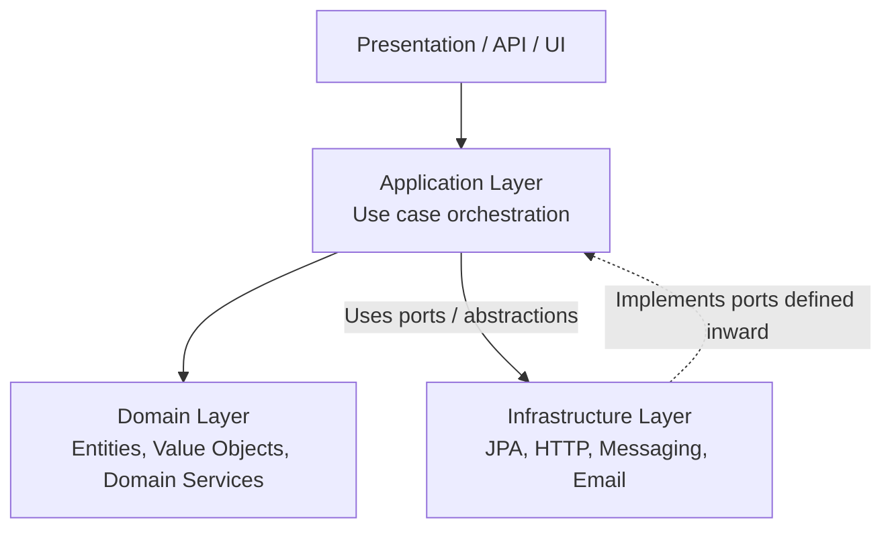

# Phân biệt Domain Service với Application Service và dịch vụ hạ tầng

Trong DDD, từ “service” thường xuất hiện ở nhiều nơi trong kiến trúc. Một lớp có thể được gọi là `PricingService`, `PlaceOrderService` hoặc `PaymentGatewayAdapter`, nhưng hậu tố `Service` không cho biết trách nhiệm thực sự của nó. Điều quan trọng là lớp đó đang giải quyết loại vấn đề nào: một quy tắc nghiệp vụ, một ca sử dụng của ứng dụng hay một thao tác kỹ thuật với hệ thống bên ngoài.

Ba vai trò cần phân biệt là:

- **Domain Service (dịch vụ miền):** biểu diễn một quy tắc hoặc hành vi nghiệp vụ có ý nghĩa trong mô hình, nhưng không tự nhiên thuộc về một Entity hay Value Object cụ thể.
- **Application Service (dịch vụ ứng dụng):** điều phối một use case, gọi các đối tượng miền và các cổng tích hợp theo đúng trình tự.
- **Infrastructure Service (dịch vụ hạ tầng):** cung cấp hoặc triển khai khả năng kỹ thuật như lưu trữ, gửi thông điệp, gọi API ngoài, đọc đồng hồ hệ thống hoặc gửi email.

Nếu đặt đúng trách nhiệm, mô hình miền tập trung vào nghiệp vụ, application layer điều phối công việc và infrastructure layer xử lý chi tiết kỹ thuật. Nếu trộn ba vai trò, quy tắc dễ bị phân tán, lớp dịch vụ phình to và thay đổi công nghệ có thể kéo theo thay đổi nghiệp vụ.

Lưu ý về thuật ngữ: Domain Service và Application Service là những cách phân loại trách nhiệm thường dùng trong DDD. “Infrastructure Service” ở đây mô tả vai trò của một thành phần thuộc tầng hạ tầng; nó không phải một mẫu tactical design đối xứng hoàn toàn với hai loại service còn lại.

## Mục tiêu học tập

Sau bài này, bạn có thể:

- Phân biệt Domain Service, Application Service và Infrastructure Service dựa trên trách nhiệm.
- Nhận biết quy tắc nào nên thuộc Entity/Value Object và quy tắc nào phù hợp với Domain Service.
- Giải thích vai trò điều phối của Application Service trong một use case.
- Nhận diện các thao tác kỹ thuật thuộc Infrastructure Service hoặc adapter.
- Hiểu hướng phụ thuộc giữa domain, application và infrastructure.
- Thiết kế ví dụ Java/Spring với ranh giới trách nhiệm rõ ràng.
- Tránh các lỗi như đưa quy tắc nghiệp vụ vào controller, biến Domain Service thành nơi điều phối hoặc để Infrastructure quyết định chính sách miền.

## 1. Vì sao cần phân biệt các loại Service?

Một hệ thống bán hàng có thể cần tính giá đơn hàng, tiếp nhận yêu cầu đặt hàng, lưu đơn vào cơ sở dữ liệu và gửi yêu cầu thanh toán đến nhà cung cấp. Các việc này cùng xuất hiện trong một hành trình nghiệp vụ, nhưng bản chất khác nhau.

- “Khách hàng thuộc hạng thành viên nào được áp dụng mức chiết khấu nào?” là câu hỏi về chính sách nghiệp vụ.
- “Khi khách đặt hàng, cần tải giỏ hàng, tính giá, tạo đơn, lưu đơn và phát sự kiện theo thứ tự nào?” là câu hỏi về điều phối use case.
- “Làm thế nào để ghi dữ liệu bằng JPA hoặc gửi yêu cầu HTTPS đến cổng thanh toán?” là câu hỏi kỹ thuật.

Không nên đặt tất cả vào một `OrderService` chỉ vì chúng cùng liên quan đến đơn hàng. Tên lớp có thể giống nhau giữa các dự án, nhưng trách nhiệm và vị trí kiến trúc phải được xác định từ nội dung công việc.

### Nhìn vào quyết định mà lớp đang thực hiện

Một cách phân loại hữu ích là hỏi:

1. Lớp đang quyết định điều gì đúng hoặc được phép theo nghiệp vụ? Đây thường là trách nhiệm của mô hình miền.
2. Lớp đang quyết định use case gồm những bước nào, gọi đối tượng nào và kết thúc ra sao? Đây thường là trách nhiệm của application layer.
3. Lớp đang quyết định cách kết nối, lưu trữ, chuyển đổi giao thức hoặc sử dụng thư viện nào? Đây thường là trách nhiệm của infrastructure layer.

Một use case có thể cần cả ba vai trò. Chúng phối hợp với nhau nhưng không nên thay thế trách nhiệm của nhau.

## 2. Domain Service: hành vi hoặc chính sách thuộc về miền

Domain Service biểu diễn một hành vi nghiệp vụ có ý nghĩa nhưng không thuộc tự nhiên về một Entity hoặc Value Object cụ thể. Nó thường được dùng khi một quy tắc:

- Liên quan đến nhiều khái niệm miền.
- Không có một đối tượng đơn lẻ nào phù hợp để sở hữu hành vi.
- Cần có tên rõ ràng trong ngôn ngữ chung.
- Không nên bị đặt vào application service chỉ vì use case đầu tiên cần đến nó.

Ví dụ, chính sách định giá có thể xét hạng thành viên, tổng giá trị giỏ hàng, chương trình khuyến mãi và thời điểm áp dụng. Nếu quy tắc này là năng lực của Pricing trong miền bán hàng và không thuộc riêng một Order hay Product, một `PricingService` có thể phù hợp.

Domain Service tập trung vào ý nghĩa nghiệp vụ. Nó không nên biết controller nào gọi nó, endpoint nào đang chạy, database dùng bảng gì hoặc nhà cung cấp thanh toán nào được tích hợp.

### Không tạo Domain Service khi hành vi thuộc Entity hoặc Value Object

Trước khi tạo service, hãy hỏi liệu hành vi có thuộc về một đối tượng miền hiện có hay không.

Ví dụ:

- `order.confirm()` thường thuộc Order vì Order có trạng thái và bảo vệ điều kiện xác nhận.
- `money.add(other)` thuộc Money vì phép cộng là hành vi tự nhiên của giá trị tiền.
- Một chính sách định giá kết hợp nhiều yếu tố có thể thuộc Pricing Domain Service.
- Một quy trình tải Order, lưu Order và phát thông điệp thường thuộc Application Service.

Nếu tạo `OrderDomainService` cho mọi thao tác liên quan đến Order, Entity sẽ trở thành túi dữ liệu và quy tắc mất nơi sở hữu tự nhiên.

### Đặc điểm thường gặp

Domain Service thường không giữ trạng thái nghiệp vụ riêng và có thể được thiết kế stateless. Đầu vào và đầu ra nên là các khái niệm miền như Entity, Value Object, enum hoặc kiểu kết quả nghiệp vụ. Nó có thể sử dụng các Domain Service khác hoặc abstraction phù hợp, nhưng không phụ thuộc vào chi tiết triển khai hạ tầng.

Domain Service không nhất thiết phải là một class có hậu tố `Service`. Trong một số mô hình, một hàm hoặc policy object đã đủ rõ. Mục tiêu là thể hiện trách nhiệm miền, không phải tăng số lượng lớp.

## 3. Application Service: điều phối một use case

Application Service cung cấp điểm vào cho một thao tác của ứng dụng, ví dụ `PlaceOrder`, `CancelOrder` hoặc `ChangeShippingAddress`. Nó phối hợp các thành phần để hoàn thành use case:

1. Nhận command hoặc dữ liệu đầu vào từ adapter bên ngoài.
2. Kiểm tra điều kiện ở cấp ứng dụng như quyền truy cập hoặc trạng thái của quy trình.
3. Tải Aggregate qua Repository.
4. Gọi hành vi trên Entity, Value Object hoặc Domain Service.
5. Lưu thay đổi trong ranh giới giao dịch thích hợp.
6. Yêu cầu gửi sự kiện hoặc thực hiện các bước tích hợp cần thiết.
7. Trả kết quả phù hợp cho adapter gọi nó.

Application Service biết use case cần phối hợp những gì, nhưng không nên trở thành nơi chứa mọi quy tắc nghiệp vụ. Nó có thể kiểm tra rằng request đã được xác thực, người dùng có quyền gọi thao tác hoặc use case đang ở bước phù hợp. Những quyết định như đơn có được xác nhận hay mức giảm giá nào hợp lệ nên được bảo vệ trong mô hình miền hoặc policy miền.

### Application Service không phải Domain Service

Hai loại service có thể cùng được gọi trong một use case nhưng trả lời hai câu hỏi khác nhau.

- Domain Service trả lời: “Theo chính sách nghiệp vụ, kết quả này là gì?”
- Application Service trả lời: “Để hoàn thành yêu cầu này, ứng dụng cần phối hợp những bước nào?”

Ví dụ, `PricingService` tính báo giá theo chính sách. `PlaceOrderService` tải dữ liệu cần thiết, gọi PricingService, tạo Order, lưu Aggregate và điều phối các bước tiếp theo.

### Application Service thường là stateless

Application Service thường không giữ trạng thái nghiệp vụ lâu dài giữa các request. Trạng thái cần lưu thuộc về Aggregate hoặc một mô hình quy trình riêng. Application Service có thể nhận dependency qua constructor như Repository, Domain Service, Unit of Work hoặc các port tích hợp.

Nó có thể định nghĩa ranh giới giao dịch hoặc dùng annotation của framework để yêu cầu transaction. Đây là chi tiết điều phối ứng dụng; transaction không nên biến Application Service thành nơi thực thi mọi quy tắc miền.

## 4. Infrastructure Service: thực hiện khả năng kỹ thuật

Infrastructure Service cung cấp chi tiết kỹ thuật để ứng dụng có thể tương tác với thế giới bên ngoài hoặc với cơ chế lưu trữ. Ví dụ:

- Repository implementation dùng JPA, JDBC hoặc một database client.
- Adapter gửi email hoặc SMS.
- Client gọi API thanh toán hoặc vận chuyển.
- Adapter publish message lên broker.
- Thành phần đọc thời gian hệ thống hoặc tạo số ngẫu nhiên.
- Adapter lưu file, mã hóa dữ liệu hoặc truy cập object storage.

Infrastructure Service trả lời câu hỏi “làm thế nào để thực hiện thao tác kỹ thuật?”. Nó không nên tự quyết định chính sách nghiệp vụ.

Ví dụ, cổng thanh toán trả về mã `DECLINED`. Adapter có thể chuyển mã kỹ thuật đó thành một kết quả chuẩn như `PaymentRejected` hoặc `PaymentUnavailable`. Nhưng chính sách liệu một đơn có được tiếp tục khi thanh toán bị từ chối, có được thử lại hay cần hủy reservation thuộc về application/domain workflow.

### Infrastructure thường triển khai các port

Application hoặc domain layer có thể định nghĩa interface thể hiện nhu cầu mà hệ thống cần, còn infrastructure cung cấp implementation cụ thể.

Ví dụ, application layer cần một `PaymentGateway` để yêu cầu thanh toán. Infrastructure có thể triển khai interface đó bằng REST client của nhà cung cấp A. Khi đổi nhà cung cấp, implementation có thể thay đổi trong khi use case vẫn gọi cùng một port.

Hướng phụ thuộc này giúp mô hình nghiệp vụ không bị khóa vào framework hoặc nhà cung cấp cụ thể.

## 5. So sánh ba vai trò

| Tiêu chí | Domain Service | Application Service | Infrastructure Service |
| --- | --- | --- | --- |
| Trọng tâm | Quy tắc hoặc hành vi nghiệp vụ | Điều phối use case | Khả năng kỹ thuật |
| Câu hỏi | Nghiệp vụ quyết định điều gì? | Cần làm những bước nào? | Thực hiện bằng công nghệ nào? |
| Đầu vào/đầu ra | Khái niệm miền, kết quả nghiệp vụ | Command, ID, kết quả use case | Request/response kỹ thuật, dữ liệu persistence |
| Phụ thuộc điển hình | Entity, Value Object, policy và abstraction phù hợp | Domain model, repository/port, transaction abstraction | Framework, database, broker, HTTP client, provider SDK |
| Có chứa quy tắc miền? | Có, khi quy tắc không thuộc tự nhiên về Entity/Value Object | Nên điều phối và gọi nơi sở hữu quy tắc | Không nên tự quyết định quy tắc miền |
| Ví dụ | PricingService, CreditAssessmentService | PlaceOrderService, CancelOrderService | JpaOrderRepository, PaymentGatewayAdapter |
| Kiểm thử trọng tâm | Kết quả quy tắc với dữ liệu miền | Trình tự và phối hợp use case | Tương tác công nghệ và hợp đồng bên ngoài |

Không nên phân loại chỉ dựa vào tên hoặc annotation. Trong Spring, `@Service` là một stereotype để đăng ký bean; nó không tự biến class thành Domain Service hay Application Service. Package, dependency và trách nhiệm thực tế mới cho biết vai trò kiến trúc.

## 6. Ví dụ xuyên suốt: đặt hàng và tính giá

Giả sử cửa hàng áp dụng chính sách giảm giá theo hạng thành viên và giá trị đơn. Khi khách đặt hàng, ứng dụng cần tính giá, tạo đơn và lưu kết quả. Nếu khách thanh toán trực tuyến, ứng dụng còn cần gọi cổng thanh toán.

Có thể chia trách nhiệm như sau:

| Thành phần | Trách nhiệm |
| --- | --- |
| `PricingService` (Domain) | Tính mức giảm theo chính sách thành viên và giá trị đơn |
| `Order` (Domain Entity/Aggregate) | Bảo vệ trạng thái đơn và các dòng hàng |
| `PlaceOrderService` (Application) | Tải dữ liệu, gọi định giá, tạo và lưu đơn, điều phối use case |
| `OrderRepository` (Port) | Khai báo cách application truy xuất/lưu Order |
| `JpaOrderRepository` (Infrastructure) | Thực hiện persistence bằng JPA |
| `PaymentGateway` (Port) | Khai báo khả năng yêu cầu thanh toán |
| `ExternalPaymentGateway` (Infrastructure) | Gọi API nhà cung cấp và chuyển đổi phản hồi |

### Domain Service tính giá theo chính sách

Ví dụ dưới đây dùng Value Object và policy để thể hiện một quy tắc miền. Các kiểu dữ liệu được rút gọn để tập trung vào trách nhiệm:

```java
public record Money(BigDecimal amount, Currency currency) {
    public Money {
        Objects.requireNonNull(amount);
        Objects.requireNonNull(currency);
    }

    public Money add(Money other) {
        if (!currency.equals(other.currency)) {
            throw new IllegalArgumentException("Currency must match");
        }
        return new Money(amount.add(other.amount), currency);
    }

    public Money subtract(Money other) {
        if (!currency.equals(other.currency)) {
            throw new IllegalArgumentException("Currency must match");
        }
        return new Money(amount.subtract(other.amount), currency);
    }

    public Money multiply(BigDecimal factor) {
        return new Money(amount.multiply(factor), currency);
    }
}

public enum CustomerTier {
    STANDARD, SILVER, GOLD
}

public record PriceQuote(
    Money subtotal,
    Money discount,
    Money total
) {}

public interface DiscountPolicy {
    Money discountFor(CustomerTier tier, Money subtotal);
}

public final class PricingService {
    private final DiscountPolicy discountPolicy;

    public PricingService(DiscountPolicy discountPolicy) {
        this.discountPolicy = discountPolicy;
    }

    public PriceQuote quote(CustomerTier tier, Money subtotal) {
        Money discount = discountPolicy.discountFor(tier, subtotal);
        if (!subtotal.currency().equals(discount.currency())) {
            throw new IllegalArgumentException("Discount currency must match subtotal");
        }
        if (discount.amount().signum() < 0
                || discount.amount().compareTo(subtotal.amount()) > 0) {
            throw new IllegalArgumentException("Invalid discount");
        }
        return new PriceQuote(
            subtotal,
            discount,
            subtotal.subtract(discount)
        );
    }
}
```

PricingService thực hiện một phép tính mang ý nghĩa nghiệp vụ. Nó không tải khách hàng từ database, không lưu đơn và không gọi cổng thanh toán. DiscountPolicy là một abstraction cho chính sách giảm giá; implementation của policy cũng cần được đặt ở nơi phù hợp với việc chính sách được cấu hình hay thay đổi.

Nếu quy tắc giảm giá chỉ đơn giản là một hành vi tự nhiên của một đối tượng miền và không cần phối hợp nhiều khái niệm, hãy đặt nó ở đối tượng đó thay vì tạo service. Ví dụ trên giả định chính sách định giá là năng lực riêng, được dùng cho nhiều loại đơn hoặc nhiều use case.

### Application Service điều phối việc đặt hàng

Application Service phối hợp các bước để hoàn tất use case. Ví dụ rút gọn:

```java
public final class PlaceOrderService {
    private final CartRepository carts;
    private final CustomerRepository customers;
    private final OrderRepository orders;
    private final PricingService pricing;
    private final OrderFactory orderFactory;

    public PlaceOrderService(
        CartRepository carts,
        CustomerRepository customers,
        OrderRepository orders,
        PricingService pricing,
        OrderFactory orderFactory
    ) {
        this.carts = carts;
        this.customers = customers;
        this.orders = orders;
        this.pricing = pricing;
        this.orderFactory = orderFactory;
    }

    public OrderId place(PlaceOrderCommand command) {
        Cart cart = carts.findById(command.cartId())
            .orElseThrow(() -> new IllegalArgumentException("Cart not found"));

        Customer customer = customers.findById(command.customerId())
            .orElseThrow(() -> new IllegalArgumentException("Customer not found"));

        Money subtotal = cart.subtotal();
        PriceQuote quote = pricing.quote(customer.tier(), subtotal);

        Order order = orderFactory.createFrom(cart, customer, quote);
        orders.save(order);

        return order.id();
    }
}
```

PlaceOrderService điều phối use case: tải dữ liệu, gọi PricingService, yêu cầu factory tạo Order và lưu Aggregate. Những quy tắc như đơn có được xác nhận hay một dòng hàng có số lượng hợp lệ vẫn cần được bảo vệ trong mô hình miền. Ví dụ không mô tả đầy đủ transaction, kiểm tra quyền, giỏ hàng hết hạn hoặc xử lý tồn kho; các bước đó cần được bổ sung theo use case thực tế.

### Infrastructure Adapter gọi nhà cung cấp thanh toán

Application layer có thể định nghĩa port:

```java
public interface PaymentGateway {
    PaymentResult authorize(PaymentRequest request);
}
```

Infrastructure triển khai port bằng API cụ thể:

```java
public final class ExternalPaymentGateway implements PaymentGateway {
    private final ProviderHttpClient client;

    public ExternalPaymentGateway(ProviderHttpClient client) {
        this.client = client;
    }

    @Override
    public PaymentResult authorize(PaymentRequest request) {
        ProviderResponse response = client.authorize(
            request.reference(),
            request.amount(),
            request.currency()
        );

        return switch (response.status()) {
            case "APPROVED" -> PaymentResult.approved(response.transactionId());
            case "DECLINED" -> PaymentResult.rejected(response.reasonCode());
            default -> PaymentResult.unavailable();
        };
    }
}
```

Adapter biết giao thức, tên trường và mã phản hồi của provider. Nó chuyển những chi tiết đó thành kiểu kết quả mà application layer hiểu. Quyết định nghiệp vụ sau kết quả thanh toán thuộc use case hoặc domain policy thích hợp.

## 7. Hướng phụ thuộc giữa các layer

Một kiến trúc phân lớp thường tách trách nhiệm thành Presentation, Application, Domain và Infrastructure. Cách tổ chức cụ thể có thể khác nhau, nhưng nguyên tắc quan trọng là chi tiết hạ tầng không được chi phối mô hình miền.



Sơ đồ nhấn mạnh rằng application layer gọi mô hình miền để thực thi quy tắc và sử dụng các abstraction cho persistence hoặc tích hợp. Infrastructure cung cấp implementation cho những abstraction đó. Tùy cách tổ chức, port có thể được khai báo trong application hoặc domain layer; điều quan trọng là domain model không phụ thuộc vào implementation cụ thể.

Một số nguyên tắc thực hành:

- Domain không import controller, Spring Web, JPA EntityManager hoặc SDK của nhà cung cấp.
- Application không tự viết SQL hoặc phụ thuộc trực tiếp vào một HTTP client cụ thể.
- Infrastructure có thể phụ thuộc vào domain/application types để triển khai adapter.
- Các interface/port nên thể hiện nhu cầu của phía gọi, không sao chép nguyên API của provider.
- Việc mapping giữa DTO bên ngoài và kiểu miền được thực hiện tại ranh giới phù hợp.

## 8. Đặt lớp vào đúng vai trò

Một số câu hỏi giúp quyết định vị trí của lớp:

### Có phải Domain Service không?

- Lớp có diễn đạt một chính sách hoặc hành vi mà chuyên gia nghiệp vụ nhận ra không?
- Quy tắc có liên quan đến nhiều Entity/Value Object hoặc không thuộc tự nhiên về một đối tượng nào?
- Lớp có thể làm việc bằng các khái niệm miền mà không cần biết HTTP, SQL, framework hay provider không?
- Nếu chính sách thay đổi, chuyên gia nghiệp vụ có xem đó là thay đổi của miền không?

Nếu câu trả lời chủ yếu là có, Domain Service có thể phù hợp. Nếu hành vi thuộc tự nhiên về Entity hoặc Value Object, hãy đặt nó ở đó.

### Có phải Application Service không?

- Lớp có đại diện cho một use case hoặc thao tác của ứng dụng không?
- Nó có tải Aggregate, gọi domain behavior, lưu kết quả và điều phối các bước không?
- Nó có xác định transaction hoặc xử lý workflow ở cấp ứng dụng không?
- Nó có thể được gọi từ nhiều adapter như REST, message handler hoặc CLI không?

Nếu có, đó thường là Application Service. Nó nên mỏng ở phần nghiệp vụ: điều phối các đối tượng có trách nhiệm thay vì tự sở hữu các quy tắc miền.

### Có phải Infrastructure Service không?

- Lớp có giao tiếp với database, message broker, filesystem, clock, email hoặc API bên ngoài không?
- Nó có phụ thuộc SDK, framework, giao thức hoặc cấu hình môi trường không?
- Có thể thay implementation mà không thay đổi chính sách nghiệp vụ không?

Nếu có, lớp thường thuộc infrastructure hoặc adapter. Hãy đặt tên theo khả năng kỹ thuật hoặc hệ thống mà nó kết nối, đồng thời giữ hợp đồng phía trong ổn định.

## 9. Các trường hợp dễ nhầm

### Kiểm tra quyền truy cập

Kiểm tra danh tính đăng nhập và quyền gọi endpoint thường thuộc presentation/application security. Nhưng một quy tắc như “chỉ chủ hợp đồng mới được thay đổi điều khoản” có ý nghĩa nghiệp vụ và có thể cần được bảo vệ trong mô hình miền. Một use case có thể thực hiện cả kiểm tra quyền ứng dụng và kiểm tra quyền sở hữu theo nghiệp vụ.

### Gửi email sau khi đơn được xác nhận

Quyết định rằng đơn đã được xác nhận là nghiệp vụ, thường được thể hiện bằng trạng thái và Domain Event. Việc dựng template, gọi SMTP hoặc nhà cung cấp email là hạ tầng. Application layer hoặc event handler điều phối việc gửi thông báo theo chính sách ứng dụng.

### Đọc thời gian hiện tại

Lấy thời gian từ hệ điều hành là chi tiết hạ tầng. Nhưng quyết định “đơn được đặt trước hạn 17:00 của ngày làm việc” là quy tắc nghiệp vụ. Có thể định nghĩa một `Clock` port để kiểm thử thời gian và để domain policy làm việc với một thời điểm được truyền vào. Cần tách nguồn lấy giờ khỏi quy tắc sử dụng giờ.

### Truy vấn dữ liệu

Tải Aggregate qua Repository là bước điều phối ứng dụng, còn JPA/SQL là implementation hạ tầng. Nếu một phép tính hoặc quyết định nghiệp vụ cần dữ liệu từ repository, hãy xem liệu nó có thực sự thuộc Domain Service hay nên được application service chuẩn bị dữ liệu rồi truyền vào. Không để Domain Service trở thành một nơi điều phối truy vấn tùy tiện.

### Giao dịch và retry

Transaction boundary thường do application layer điều phối thông qua abstraction hoặc framework. Retry khi gọi provider thường là kỹ thuật hạ tầng, nhưng số lần thử, thời hạn hoặc điều kiện cho phép thử lại có thể chịu ảnh hưởng của chính sách nghiệp vụ. Cần phân biệt cơ chế retry với quyết định nghiệp vụ có nên tiếp tục hay không.

## 10. Những sai lầm thường gặp

- **Đặt mọi thứ vào một Service:** một lớp lớn vừa tính giá, lưu dữ liệu, gửi email và gọi API khiến trách nhiệm khó hiểu.
- **Đưa quy tắc miền vào Application Service:** các quy tắc có thể bị lặp lại khi có use case hoặc adapter mới.
- **Biến Domain Service thành Application Service:** nếu lớp chủ yếu tải repository, mở transaction và điều phối nhiều bước, nó đang làm công việc ứng dụng.
- **Để Domain Service phụ thuộc framework hoặc provider:** mô hình miền bị khóa vào chi tiết triển khai.
- **Đưa quyết định nghiệp vụ vào Infrastructure:** mã trạng thái của provider hoặc cấu trúc database không nên tự quyết định chính sách miền.
- **Tạo Domain Service cho mọi hành vi:** Entity và Value Object trở thành cấu trúc dữ liệu thụ động.
- **Dùng `@Service` làm tiêu chí phân loại:** annotation Spring chỉ đăng ký bean, không định nghĩa vai trò DDD.
- **Đặt tên chung chung:** `CommonService`, `Manager` hoặc `Processor` che giấu ý nghĩa và trách nhiệm.
- **Để Application Service trả về Entity trực tiếp cho API:** có thể làm lộ mô hình nội bộ; adapter nên chuyển sang response DTO phù hợp.
- **Đặt port theo API của provider:** application bị phụ thuộc vào ngôn ngữ và cấu trúc của hệ thống ngoài.

## 11. Kiểm thử theo đúng loại Service

Ba vai trò có trọng tâm kiểm thử khác nhau:

| Loại | Cách kiểm thử phù hợp | Điều cần xác nhận |
| --- | --- | --- |
| Domain Service | Unit test với Entity/Value Object và policy giả lập | Kết quả nghiệp vụ, biên và trường hợp không hợp lệ |
| Application Service | Unit test với Repository/port fake hoặc mock | Đúng trình tự điều phối, gọi đúng domain behavior và lưu kết quả |
| Infrastructure Service | Integration/contract test với database, broker hoặc provider sandbox | Mapping, giao thức, timeout, lỗi và hợp đồng tích hợp |

Domain Service nên kiểm thử được mà không cần khởi động Spring hoặc database nếu quy tắc không phụ thuộc các thành phần đó. Application Service cần kiểm tra luồng use case và hành vi khi một dependency trả lỗi. Infrastructure Adapter cần kiểm tra tương tác thực tế hoặc hợp đồng với công nghệ được sử dụng.

Không nên mock mọi đối tượng miền trong unit test Domain Service đến mức chỉ kiểm tra lời gọi. Hãy dùng dữ liệu miền có ý nghĩa để xác minh kết quả của quy tắc.

## 12. Quy trình phân loại một lớp Service mới

Khi tạo một service, hãy thực hiện theo trình tự:

1. Viết một câu mô tả trách nhiệm bằng ngôn ngữ nghiệp vụ hoặc kỹ thuật cụ thể.
2. Xác định lớp đang sở hữu quyết định nào: quyết định nghiệp vụ, điều phối use case hay thao tác kỹ thuật.
3. Kiểm tra hành vi có thể đặt tự nhiên trên Entity hoặc Value Object hiện có không.
4. Nếu là quy tắc miền không thuộc một đối tượng cụ thể, thiết kế Domain Service với đầu vào/đầu ra miền.
5. Nếu là điều phối use case, thiết kế Application Service và giữ nó tập trung vào trình tự công việc.
6. Nếu là giao tiếp kỹ thuật, đặt implementation trong Infrastructure và cung cấp port phù hợp cho phía trong.
7. Kiểm tra dependency để bảo đảm domain không phụ thuộc framework hoặc provider.
8. Viết kiểm thử theo vai trò của lớp.
9. Review tên, package và API để người khác nhận biết trách nhiệm ngay khi đọc.

Checklist review:

- [ ] Lớp có một trách nhiệm chính có thể diễn đạt rõ không?
- [ ] Quy tắc nghiệp vụ có nằm trong Domain Model hoặc Domain Service phù hợp không?
- [ ] Application Service có chủ yếu điều phối use case không?
- [ ] Chi tiết kỹ thuật có nằm sau port/adapter phù hợp không?
- [ ] Domain không phụ thuộc framework, database hoặc provider cụ thể?
- [ ] Tên lớp diễn đạt đúng ý nghĩa, không chỉ phản ánh cách triển khai?
- [ ] Kiểm thử xác nhận đúng trách nhiệm của lớp?
- [ ] Có thể thay provider hoặc persistence implementation mà không đổi quy tắc miền?

## Kết luận

Domain Service, Application Service và Infrastructure Service cùng có thể tham gia một use case nhưng giải quyết ba loại trách nhiệm khác nhau. Domain Service diễn đạt quy tắc hoặc hành vi nghiệp vụ không thuộc tự nhiên về một Entity hay Value Object. Application Service điều phối các bước để hoàn thành use case. Infrastructure Service thực hiện các khả năng kỹ thuật và tích hợp với hệ thống bên ngoài.

Hãy bắt đầu bằng việc xác định lớp đang đưa ra quyết định gì. Đặt quy tắc ở mô hình miền, đặt trình tự use case ở application layer và đặt chi tiết công nghệ ở infrastructure layer. Khi ranh giới rõ, chính sách nghiệp vụ dễ kiểm thử, use case dễ đọc và hệ thống có thể thay đổi công nghệ mà không làm biến dạng mô hình miền.
