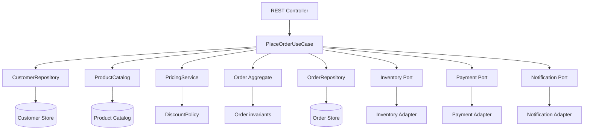

# Giữ dịch vụ không trở thành nơi gom toàn bộ logic của miền

Trong Domain-Driven Design (DDD), Domain Service là nơi đặt một hành vi nghiệp vụ không thuộc tự nhiên về một Entity hoặc Value Object cụ thể. Khái niệm này hữu ích khi một quyết định cần phối hợp nhiều đối tượng hoặc diễn đạt một quy tắc độc lập. Nhưng nếu cứ gặp logic nào chưa biết đặt ở đâu cũng tạo một service, mô hình sẽ dần biến thành tập hợp các lớp dịch vụ lớn, chứa gần như toàn bộ quy tắc của domain.

Một lớp như `OrderDomainService` có thể bắt đầu bằng vài thao tác, rồi tiếp tục nhận thêm logic tạo đơn, hủy đơn, tính giá, giữ hàng, thanh toán, giao hàng và gửi thông báo. Khi đó Entity chỉ còn dữ liệu với getter/setter, còn service trở thành nơi điều khiển mọi thứ. Đây là dấu hiệu mô hình đang mất đi trách nhiệm và hành vi vốn nên thuộc về các đối tượng nghiệp vụ.

Bài viết tập trung vào cách giữ Domain Service đúng phạm vi: hiểu khi nào cần dùng, chọn hành vi phù hợp để đặt trong Entity hoặc Value Object, phân biệt Domain Service với Application Service, và chia nhỏ một service đang phình to mà vẫn giữ nguyên ngôn ngữ nghiệp vụ.

## 1. Domain Service giải quyết loại hành vi nào?

Một số hành vi có chủ thể rất rõ:

- Order có thể được đặt, hủy hoặc xác nhận.
- Customer có thể đổi địa chỉ liên hệ.
- Money có thể cộng, trừ hoặc quy đổi theo quy tắc tiền tệ.
- Reservation có thể được xác nhận hoặc giải phóng.

Những hành vi này nên được đặt trên đối tượng sở hữu trạng thái và invariant liên quan. Khi gọi hành vi, đối tượng có đủ dữ liệu để kiểm tra điều kiện và bảo vệ trạng thái hợp lệ.

Tuy nhiên, có những quy tắc không thuộc tự nhiên về một đối tượng đơn lẻ. Ví dụ, xác định mức giá cuối cùng có thể cần thông tin sản phẩm, số lượng, hạng khách hàng và chính sách khuyến mãi. Không nên tùy tiện chọn Product hoặc Customer làm nơi sở hữu toàn bộ phép tính nếu hành vi thực sự là một quyết định định giá của domain.

**Domain Service** biểu diễn hành vi nghiệp vụ như vậy. Nó thường:

- Diễn đạt một quy tắc hoặc phép quyết định có ý nghĩa trong ngôn ngữ chung.
- Không có danh tính và vòng đời nghiệp vụ riêng như Entity.
- Không giữ trạng thái thay đổi của từng yêu cầu giữa các lần gọi.
- Nhận các đối tượng hoặc giá trị domain cần thiết làm đầu vào.
- Trả về kết quả domain hoặc phối hợp hành vi domain trong phạm vi được phép.
- Không trở thành nơi chứa mọi thao tác của ứng dụng.

Tên service nên phản ánh một khái niệm nghiệp vụ cụ thể, chẳng hạn `PricingService`, `CreditEligibilityPolicy` hoặc `TaxCalculationService`. Tên chung như `DomainService`, `CommonService` hay `BusinessManager` không giúp người đọc hiểu nó chịu trách nhiệm cho quyết định nào.

## 2. Vì sao không nên gom mọi logic vào Domain Service?

Một service lớn có thể làm ứng dụng chạy được, nhưng chi phí thiết kế sẽ tăng theo thời gian.

### 2.1. Entity trở thành túi dữ liệu

Nếu mọi hành vi đều chuyển sang service, Entity thường chỉ còn trường dữ liệu và getter/setter:

```java
public class Order {
    private OrderStatus status;
    private List<OrderLine> lines;

    public OrderStatus getStatus() {
        return status;
    }

    public void setStatus(OrderStatus status) {
        this.status = status;
    }

    public List<OrderLine> getLines() {
        return lines;
    }
}
```

Sau đó service phải tự kiểm tra và thay đổi trạng thái:

```java
public class OrderDomainService {
    public void place(Order order) {
        if (order.getStatus() != OrderStatus.DRAFT) {
            throw new IllegalStateException("Invalid status");
        }

        if (order.getLines().isEmpty()) {
            throw new IllegalStateException("Order is empty");
        }

        order.setStatus(OrderStatus.PLACED);
    }
}
```

Vấn đề là bất kỳ nơi nào có quyền gọi setter đều có thể thay đổi trạng thái mà không đi qua quy tắc. Invariant của Order không còn được bảo vệ tại chính đối tượng sở hữu nó.

Nếu hành vi chỉ liên quan đến Order, hãy đặt nó trong Order:

```java
public class Order {
    private OrderStatus status = OrderStatus.DRAFT;
    private final List<OrderLine> lines = new ArrayList<>();

    public void place() {
        if (status != OrderStatus.DRAFT) {
            throw new IllegalStateException(
                "Only a draft order can be placed"
            );
        }

        if (lines.isEmpty()) {
            throw new IllegalStateException(
                "An order must contain at least one line"
            );
        }

        status = OrderStatus.PLACED;
    }
}
```

Order tự bảo vệ điều kiện chuyển trạng thái. Application hoặc Domain Service có thể yêu cầu Order thực hiện hành vi, nhưng không cần sửa trạng thái thay cho nó.

### 2.2. Service trở thành God Object

Một service có quá nhiều trách nhiệm thường có các dấu hiệu:

- Tên lớp chung chung nhưng chứa nhiều nhóm hành vi không liên quan.
- Constructor nhận rất nhiều repository, client và service khác.
- Một phương thức vừa kiểm tra quy tắc, vừa truy vấn database, gọi HTTP, gửi message và cập nhật nhiều Aggregate.
- Thay đổi một quy tắc nhỏ buộc sửa lớp có nhiều use case khác.
- Unit test cần dựng hoặc mô phỏng quá nhiều thành phần để kiểm tra một quyết định domain.
- Những người khác nhau trong đội ngũ hiểu cùng một service theo các cách khác nhau.

Ví dụ không tốt:

```java
public class OrderDomainService {
    private final OrderRepository orders;
    private final CustomerRepository customers;
    private final ProductRepository products;
    private final InventoryClient inventory;
    private final PaymentClient payments;
    private final ShippingClient shipping;
    private final EmailClient email;

    public void placeOrder(...) { ... }
    public void cancelOrder(...) { ... }
    public void calculatePrice(...) { ... }
    public void reserveStock(...) { ... }
    public void authorizePayment(...) { ... }
    public void createShipment(...) { ... }
    public void sendConfirmation(...) { ... }
}
```

Lớp này đang trộn mô hình domain, điều phối use case và giao tiếp hạ tầng. Việc đặt hậu tố `DomainService` không làm cho toàn bộ nội dung của nó trở thành domain logic.

### 2.3. Quy tắc bị phân tán hoặc lặp lại

Khi một service chứa quy tắc của nhiều đối tượng, các nơi khác có thể vô tình thực hiện lại cùng quy tắc. Ví dụ, điều kiện “chỉ đơn Draft mới được sửa dòng hàng” có thể xuất hiện trong controller, service, batch job và message handler.

Nếu quy tắc thuộc Order, hãy để Order kiểm soát nó. Tất cả đường gọi đều sử dụng cùng hành vi và cùng invariant. Điều này giảm nguy cơ một use case quên kiểm tra điều kiện.

### 2.4. Khó kiểm thử và khó thay đổi

Một phép tính giá thuần domain có thể được kiểm tra với vài đầu vào và kết quả. Nếu nó nằm trong service lớn phải khởi động database, Payment API và mail client, việc kiểm thử trở nên tốn kém và khó xác định lỗi nằm ở đâu.

Tách đúng trách nhiệm giúp kiểm thử domain độc lập, application theo luồng điều phối và adapter theo hợp đồng tích hợp.

## 3. Chọn nơi đặt hành vi: Entity, Value Object hay Domain Service?

Không nên bắt đầu bằng câu hỏi “Tôi cần tạo service nào?”. Hãy bắt đầu bằng câu hỏi “Quy tắc này thuộc về khái niệm nào trong ngôn ngữ nghiệp vụ?”.

### 3.1. Đặt hành vi trong Entity khi danh tính và trạng thái của nó quyết định quy tắc

Nếu hành vi thay đổi trạng thái của một Entity hoặc bảo vệ invariant của nó, hãy ưu tiên đặt hành vi trong Entity hoặc Aggregate Root.

Ví dụ:

- Order xác nhận đơn khi đủ điều kiện.
- Account khóa tài khoản khi vi phạm giới hạn.
- Reservation giải phóng lượng hàng đã giữ.
- Subscription gia hạn khi điều kiện hợp lệ.

Entity có danh tính xuyên suốt vòng đời. Nó là nơi phù hợp để kiểm soát các chuyển trạng thái thuộc trách nhiệm của chính nó.

### 3.2. Đặt hành vi trong Value Object khi phép tính thuộc về các giá trị

Value Object thường bất biến và được xác định bằng giá trị. Các phép toán trên giá trị nên nằm trong chính Value Object nếu đó là cách diễn đạt tự nhiên.

Ví dụ, Money có thể kiểm tra loại tiền tệ khi cộng:

```java
public record Money(
    BigDecimal amount,
    Currency currency
) {
    public Money {
        Objects.requireNonNull(amount);
        Objects.requireNonNull(currency);
    }

    public Money add(Money other) {
        if (!currency.equals(other.currency)) {
            throw new IllegalArgumentException(
                "Currencies must match"
            );
        }

        return new Money(
            amount.add(other.amount),
            currency
        );
    }
}
```

Không cần tạo `MoneyService` chỉ để cộng hai số tiền cùng loại. Quy tắc thuộc về ý nghĩa của Money.

### 3.3. Dùng Domain Service khi hành vi không có chủ thể tự nhiên

Một hành vi có thể liên quan đến nhiều Entity hoặc Value Object mà không có một đối tượng nào nên sở hữu nó.

Ví dụ định giá có thể cần:

- Giá cơ sở của sản phẩm.
- Số lượng mua.
- Hạng khách hàng.
- Điều kiện của chương trình khuyến mãi.
- Quy tắc kết hợp các mức giảm.

Nếu quyết định cuối cùng là “giá bán áp dụng cho giao dịch này”, đó có thể là trách nhiệm của Pricing Service hoặc một Pricing Policy.

| Câu hỏi | Nơi đặt hành vi thường phù hợp |
|---|---|
| Quy tắc bảo vệ trạng thái của một Entity? | Entity / Aggregate Root |
| Phép toán hoặc xác thực thuộc về giá trị? | Value Object |
| Quyết định domain kết hợp nhiều đối tượng, không có chủ thể tự nhiên? | Domain Service / Domain Policy |
| Điều phối repository, transaction và nhiều bước use case? | Application Service |
| Gọi database, HTTP, message broker hoặc file system? | Infrastructure Adapter |

Bảng này là hướng dẫn để đặt câu hỏi, không phải luật cứng. Một chính sách có thể được mô hình hóa thành Value Object, Domain Service hoặc một đối tượng policy có cấu trúc tùy theo mức độ phức tạp và vòng đời của nó.

## 4. Domain Service nên có phạm vi nhỏ và ngôn ngữ rõ ràng

Một Domain Service tốt thường có một mục đích nghiệp vụ dễ mô tả bằng một câu. Ví dụ:

- Pricing Service xác định giá áp dụng cho một giao dịch.
- Credit Eligibility Policy quyết định một hồ sơ đáp ứng điều kiện tín dụng hay không.
- Tax Calculator tính nghĩa vụ thuế theo quy tắc domain.
- Route Selection Policy chọn phương án giao hàng hợp lệ theo tiêu chí nghiệp vụ.

Nếu không thể giải thích service bằng một câu ngắn mà không dùng từ “và” nhiều lần, có thể nó đang chứa nhiều trách nhiệm.

### 4.1. Một service, một quyết định hoặc nhóm hành vi gắn chặt

Không cần tạo một class cho mỗi phương thức. Các hành vi có cùng khái niệm, cùng quy tắc và cùng lý do thay đổi có thể nằm chung. Ngược lại, hai hành vi chỉ tình cờ cùng làm việc với Order không nhất thiết thuộc cùng một service.

Ví dụ, tính giá và xác định điều kiện miễn phí giao hàng có thể cùng thuộc Pricing nếu doanh nghiệp xem chúng là một quyết định báo giá. Nhưng gửi email xác nhận đơn là một tác vụ thông báo, không phải một phần của quyết định định giá.

### 4.2. Domain Service thường không giữ trạng thái nghiệp vụ riêng

Domain Service thường không cần field thay đổi theo từng khách hàng hoặc từng yêu cầu. Đầu vào của một lần gọi chứa đủ dữ liệu cần thiết; kết quả được trả về rõ ràng.

Không nên giữ các biến như `currentOrder`, `currentCustomer` hoặc `lastPrice` trong field của một service dùng chung. Điều đó tạo nguy cơ dữ liệu của request này ảnh hưởng request khác, nhất là khi service là singleton trong dependency injection container.

Stateless không có nghĩa service không thể có dependency. Nó có thể nhận một domain policy hoặc một abstraction cần thiết, nhưng dependency đó không nên biến service thành nơi lưu trạng thái của từng giao dịch.

### 4.3. Đầu vào và đầu ra nên là kiểu domain

Ưu tiên nhận Entity, Value Object, enum hoặc kiểu kết quả có ý nghĩa nghiệp vụ. Tránh để domain service nhận HTTP request, ORM entity, Map hoặc DTO gắn với giao thức.

Ví dụ:

```java
public record PriceQuote(
    Money unitPrice,
    Money discount,
    Money total
) {}
```

`PriceQuote` diễn đạt kết quả định giá. Application có thể chuyển nó thành response DTO, còn adapter lưu trữ có thể ánh xạ những giá trị cần lưu sang persistence model.

### 4.4. Không biến mọi quy tắc thành một lớp Service

Một quy tắc đơn giản không cần thêm abstraction chỉ để tăng số lượng lớp. Nếu một điều kiện rõ ràng thuộc về Order, hãy viết trong Order. Nếu Money có thể tự cộng và kiểm tra currency, hãy để Money thực hiện.

Domain Service có giá trị khi nó làm mô hình dễ hiểu hơn bằng cách đặt tên cho một hành vi domain thực sự không có chủ thể tự nhiên. Nếu lớp mới chỉ chuyển tiếp một lời gọi hoặc bọc một dòng code mà không diễn đạt khái niệm nào, có thể chưa cần tạo nó.

## 5. Ví dụ Java: tách logic định giá khỏi Order và Application Service

Giả sử doanh nghiệp bán sản phẩm cho khách hàng thuộc nhiều hạng khác nhau. Giá cuối cùng phụ thuộc giá cơ sở, số lượng, hạng khách và chính sách khuyến mãi. Order cần ghi nhận các dòng hàng và trạng thái đặt đơn; Pricing chịu trách nhiệm tính giá áp dụng.

### 5.1. Các kiểu domain đầu vào

```java
public enum CustomerTier {
    STANDARD,
    SILVER,
    GOLD
}

public record Quantity(int value) {
    public Quantity {
        if (value <= 0) {
            throw new IllegalArgumentException(
                "Quantity must be positive"
            );
        }
    }
}

public record PromotionRate(BigDecimal value) {
    public PromotionRate {
        Objects.requireNonNull(value);

        if (value.signum() < 0 ||
            value.compareTo(BigDecimal.ONE) > 0) {
            throw new IllegalArgumentException(
                "Rate must be between 0 and 1"
            );
        }
    }
}
```

Các kiểu này biểu diễn dữ liệu theo ngôn ngữ domain và kiểm tra điều kiện cơ bản ngay khi được tạo. Quy tắc làm tròn, mức giảm tối đa và khả năng kết hợp khuyến mãi cần được bổ sung theo chính sách thực tế.

### 5.2. Định nghĩa chính sách giảm giá

Có thể mô hình hóa chính sách giảm giá bằng một abstraction domain:

```java
public interface DiscountPolicy {
    PromotionRate rateFor(CustomerTier tier);
}
```

Một implementation đơn giản có thể dùng bảng quy tắc cố định:

```java
public final class StandardDiscountPolicy
        implements DiscountPolicy {

    @Override
    public PromotionRate rateFor(CustomerTier tier) {
        return switch (tier) {
            case STANDARD -> new PromotionRate(
                new BigDecimal("0.00")
            );
            case SILVER -> new PromotionRate(
                new BigDecimal("0.05")
            );
            case GOLD -> new PromotionRate(
                new BigDecimal("0.10")
            );
        };
    }
}
```

Nếu chính sách được quản trị như chương trình có mã, thời hạn, trạng thái và người phê duyệt, nó có thể cần mô hình riêng. Ví dụ này chỉ coi chính sách là quy tắc được cung cấp cho dịch vụ định giá.

### 5.3. Domain Service thực hiện quyết định định giá

```java
public final class PricingService {
    private final DiscountPolicy discountPolicy;

    public PricingService(DiscountPolicy discountPolicy) {
        this.discountPolicy =
            Objects.requireNonNull(discountPolicy);
    }

    public PriceQuote quote(
            Money unitPrice,
            Quantity quantity,
            CustomerTier tier) {

        Money subtotal = unitPrice.multiply(quantity.value());
        PromotionRate rate = discountPolicy.rateFor(tier);

        Money discount = subtotal.multiply(rate.value());
        Money total = subtotal.subtract(discount);

        return new PriceQuote(unitPrice, discount, total);
    }
}
```

Pricing Service kết hợp giá trị và chính sách để đưa ra một quyết định định giá. Nó không cần biết Order được lưu bằng JPA hay khách hàng gửi yêu cầu qua REST. Nó cũng không tự tải Customer hoặc Product từ database; dữ liệu cần thiết được cung cấp từ phía điều phối.

Đoạn mã là ví dụ khái niệm. Trong một hệ thống thực tế, cần làm rõ giảm giá tính trên đơn giá hay tổng tiền, cách làm tròn, thuế, phí giao hàng, giới hạn chương trình và thứ tự áp dụng các chính sách. Những chi tiết đó phải được chuyên gia nghiệp vụ xác nhận.

### 5.4. Order sở hữu hành vi đặt đơn

Order vẫn tự bảo vệ trạng thái và các invariant của nó:

```java
public class Order {
    private final OrderId id;
    private final List<OrderLine> lines;
    private OrderStatus status;

    public Order(OrderId id, List<OrderLine> lines) {
        this.id = Objects.requireNonNull(id);
        this.lines = new ArrayList<>(lines);
        this.status = OrderStatus.DRAFT;
    }

    public void place() {
        if (status != OrderStatus.DRAFT) {
            throw new IllegalStateException(
                "Only a draft order can be placed"
            );
        }

        if (lines.isEmpty()) {
            throw new IllegalStateException(
                "An order must contain at least one line"
            );
        }

        status = OrderStatus.PLACED;
    }

    public OrderId id() {
        return id;
    }
}
```

Pricing Service không được phép thay đổi trạng thái Order. Nó đưa ra báo giá; Order quyết định có thể được đặt hay không theo invariant của nó. Trong mô hình đầy đủ, Order có thể nhận các dòng hàng đã được định giá và lưu snapshot giá tại thời điểm đặt.

### 5.5. Application Service điều phối use case

Application Service tải dữ liệu, gọi domain behavior, lưu kết quả và điều phối các bước liên quan:

```java
public class PlaceOrderUseCase {
    private final OrderRepository orders;
    private final CustomerRepository customers;
    private final ProductCatalog products;
    private final PricingService pricing;

    public PlaceOrderUseCase(
            OrderRepository orders,
            CustomerRepository customers,
            ProductCatalog products,
            PricingService pricing) {
        this.orders = orders;
        this.customers = customers;
        this.products = products;
        this.pricing = pricing;
    }

    public void handle(PlaceOrderCommand command) {
        Customer customer = customers
            .findById(command.customerId())
            .orElseThrow(CustomerNotFoundException::new);

        Product product = products
            .findById(command.productId())
            .orElseThrow(ProductNotFoundException::new);

        PriceQuote quote = pricing.quote(
            product.unitPrice(),
            command.quantity(),
            customer.tier()
        );

        Order order = Order.create(
            command.orderId(),
            customer.id(),
            product,
            command.quantity(),
            quote
        );

        order.place();
        orders.save(order);
    }
}
```

Đây là phác thảo luồng để minh họa trách nhiệm. Trong ứng dụng thật, use case có thể xử lý nhiều dòng hàng, transaction boundary, kiểm tra tồn kho, phát Domain Event và các tình huống lỗi. Những bước đó cần được mô hình hóa riêng theo quy trình thực tế.

Điểm quan trọng là mỗi thành phần giữ đúng vai trò:

- Customer cung cấp thông tin thuộc hồ sơ khách hàng.
- Product cung cấp thông tin sản phẩm và giá cơ sở.
- Pricing Service quyết định giá theo chính sách domain.
- Order bảo vệ vòng đời và invariant của đơn.
- Application Service điều phối các thành phần để hoàn thành use case.

## 6. Phân biệt Domain Service với Application Service

Hai loại service thường bị trộn vì đều có thể được biểu diễn bằng class có phương thức. Nhưng chúng trả lời những câu hỏi khác nhau.

**Domain Service** trả lời: “Theo quy tắc nghiệp vụ, điều gì là đúng hoặc hành vi này được thực hiện như thế nào?”

**Application Service** trả lời: “Để hoàn thành use case, cần gọi những thành phần nào và theo trình tự nào?”

| Tiêu chí | Domain Service | Application Service |
|---|---|---|
| Mục tiêu | Biểu diễn quy tắc hoặc quyết định domain | Điều phối use case |
| Ngôn ngữ | Thuật ngữ nghiệp vụ | Tên hành động/use case của ứng dụng |
| Đầu vào | Entity, Value Object, domain policy | Command, input model, ID hoặc dữ liệu từ adapter |
| Trách nhiệm | Tính toán, đánh giá hoặc hành vi domain không có chủ thể tự nhiên | Tải Aggregate, gọi domain behavior, quản lý luồng và transaction |
| Repository | Thường không tự điều phối nhiều repository; có thể dùng abstraction domain khi quy tắc thực sự cần | Thường phối hợp repository để lấy và lưu Aggregate |
| Hạ tầng | Không gọi trực tiếp framework hoặc API kỹ thuật | Có thể dùng port và cơ chế transaction qua abstraction/configuration |
| Ví dụ | PricingService, CreditEligibilityPolicy | PlaceOrderUseCase, CancelSubscriptionUseCase |

### 6.1. Một luồng use case có thể gọi nhiều Domain Service

Application Service có thể điều phối nhiều quy tắc domain:

1. Tải thông tin khách hàng và sản phẩm.
2. Gọi Pricing Service để tính báo giá.
3. Gọi Order để tạo hoặc đặt đơn.
4. Lưu Aggregate.
5. Phát hoặc chuyển tiếp sự kiện theo cơ chế của ứng dụng.

Không nên đưa toàn bộ chuỗi này vào một Domain Service chỉ vì có nhiều bước liên quan đến nghiệp vụ. Thứ tự thực hiện, transaction và phối hợp repository là trách nhiệm của application.

### 6.2. Application Service không phải nơi chứa mọi quy tắc

Application Service có thể kiểm tra dữ liệu đầu vào, quyền truy cập ở mức use case và điều kiện điều phối. Nhưng invariant của Order vẫn phải do Order bảo vệ. Nếu application service có điều kiện nghiệp vụ mà mọi đường thay đổi Order đều phải tuân thủ, hãy xem xét chuyển điều kiện vào Aggregate.

### 6.3. Domain Service không phải một Application Service được đổi tên

Một lớp có tên `OrderDomainService` nhưng thực hiện các thao tác sau thực chất đang làm application orchestration:

- Nạp Order từ repository.
- Nạp Customer từ repository.
- Gọi Payment API.
- Gọi Inventory API.
- Cập nhật Order và Shipment.
- Gửi email.
- Quản lý transaction.

Hãy đặt luồng đó vào use case/Application Service. Những quyết định domain cụ thể bên trong luồng có thể được tách thành Entity, Value Object hoặc Domain Service phù hợp.

## 7. Khi Domain Service cần dữ liệu hoặc phụ thuộc bên ngoài

Domain Service thường được thiết kế với dữ liệu đầu vào rõ ràng. Nhưng có những quy tắc cần một thông tin không nằm sẵn trong đối tượng, chẳng hạn tỷ giá tại thời điểm giao dịch hoặc hạn mức tín dụng hiện hành.

Cần phân biệt dữ liệu nghiệp vụ với cơ chế lấy dữ liệu.

### 7.1. Ưu tiên truyền dữ liệu đã được chuẩn bị vào service

Nếu application đã tải được dữ liệu cần thiết, hãy truyền nó dưới dạng domain value. Ví dụ, truyền ExchangeRate vào phép quy đổi thay vì để Domain Service tự gọi HTTP API của nhà cung cấp tỷ giá.

Cách này giúp service dễ kiểm thử và không phụ thuộc giao thức bên ngoài.

### 7.2. Dùng abstraction khi khả năng lấy dữ liệu thực sự thuộc nhu cầu domain

Nếu domain cần một khả năng có ý nghĩa nghiệp vụ, có thể định nghĩa interface theo ngôn ngữ domain:

```java
public interface ExchangeRateProvider {
    ExchangeRate rateFor(
        Currency source,
        Currency target,
        BusinessDate date
    );
}
```

Một Domain Service có thể sử dụng abstraction này để thực hiện phép quyết định domain. Infrastructure triển khai interface bằng API, cache hoặc nguồn dữ liệu cụ thể.

Tuy nhiên, không nên mặc định mọi truy vấn đều phải nằm trong Domain Service. Nếu application chỉ cần tải một Aggregate hoặc lấy dữ liệu để điều phối, repository và query port nên được dùng tại Application Layer.

### 7.3. Không để Domain Service biết công nghệ cụ thể

Tránh các dependency trực tiếp như:

- EntityManager hoặc JpaRepository.
- RestTemplate, WebClient hoặc SDK của nhà cung cấp.
- Kafka Producer hoặc message broker client.
- Servlet request/response.
- File system API hoặc cloud storage SDK.

Nếu service cần một khả năng từ bên ngoài, hãy định nghĩa hợp đồng phù hợp và đặt nó ở phía lõi cần sử dụng. Adapter hạ tầng triển khai hợp đồng đó.

### 7.4. Cẩn thận với thao tác có tác dụng phụ

Một Domain Service tính giá có thể là phép tính thuần. Nhưng việc thu tiền, gửi email hoặc tạo vận đơn là các tương tác có tác dụng phụ, có thể timeout hoặc thất bại độc lập.

Những tương tác đó thường được application điều phối qua outbound port. Domain vẫn quyết định điều kiện nghiệp vụ và biểu diễn kết quả bằng trạng thái hoặc sự kiện phù hợp.

Không nên để một phương thức domain vừa quyết định giá, vừa gọi cổng thanh toán, vừa gửi email. Khi một bước thất bại, rất khó xác định trạng thái nghiệp vụ nào đã được chấp nhận và cần bù trừ ra sao.

## 8. Refactor một God Service thành mô hình có trách nhiệm rõ ràng

Giả sử ban đầu hệ thống có một lớp:

```java
public class OrderDomainService {
    public void placeOrder(...) { ... }
    public void cancelOrder(...) { ... }
    public Money calculatePrice(...) { ... }
    public void reserveStock(...) { ... }
    public void authorizePayment(...) { ... }
    public void createShipment(...) { ... }
    public void sendConfirmation(...) { ... }
}
```

Để tách lớp này, không nên chia cơ học mỗi phương thức thành một service mới. Hãy phân loại từng hành vi theo chủ thể và lý do thay đổi.

### Bước 1: Liệt kê hành vi và quy tắc mà nó bảo vệ

Ví dụ:

| Hành vi | Quy tắc hoặc trách nhiệm | Nơi phù hợp |
|---|---|---|
| Đặt đơn | Đơn phải ở Draft và có ít nhất một dòng | Order Aggregate |
| Hủy đơn | Chỉ hủy được ở các trạng thái được phép | Order Aggregate hoặc chính sách domain tương ứng |
| Tính giá | Kết hợp giá, hạng khách và khuyến mãi | Pricing Service / Policy |
| Giữ hàng | Bảo vệ số lượng có thể giữ trong kho | Inventory Aggregate |
| Ủy quyền thanh toán | Quản lý trạng thái giao dịch | Payment Aggregate / Payment Context |
| Tạo vận đơn | Quản lý lô giao và thông tin vận chuyển | Shipping Context |
| Gửi email | Chuyển thông tin đến kênh thông báo | Notification Adapter được application gọi |

Bảng này cho thấy một use case có thể đi qua nhiều thành phần sở hữu trách nhiệm khác nhau. Không có lý do để tất cả phải nằm trong OrderDomainService.

### Bước 2: Đưa invariant về đúng Aggregate

Chuyển quy tắc đặt/hủy đơn vào Order. Chuyển quy tắc giữ hàng vào Inventory Aggregate. Chuyển trạng thái giao dịch vào Payment Aggregate. Mỗi Aggregate bảo vệ dữ liệu và quyết định thuộc quyền của nó.

### Bước 3: Tách quyết định domain không có chủ thể tự nhiên

Đưa phép định giá vào Pricing Service. Nếu điều kiện miễn phí vận chuyển là một chính sách riêng, có thể mô hình hóa thành ShippingEligibilityPolicy. Không nên tạo service mới nếu một Value Object hoặc phương thức trên Entity đã diễn đạt tốt quy tắc.

### Bước 4: Đưa luồng điều phối về Application Service

Use case đặt đơn gọi các thành phần theo trình tự. Nó chịu trách nhiệm tải dữ liệu, phối hợp repository và xử lý kết quả của từng bước.

Nếu quy trình kéo dài qua nhiều sự kiện, có timeout, retry hoặc hành động bù trừ, hãy cân nhắc Process Manager hoặc Saga. Không nên ép toàn bộ quy trình bất đồng bộ vào một phương thức đồng bộ của Domain Service.

### Bước 5: Đưa kết nối công nghệ vào adapter

Database, HTTP client, message broker và email provider nằm ở Infrastructure. Adapter chuyển đổi kiểu dữ liệu và lỗi kỹ thuật thành hợp đồng mà application/domain hiểu.

### Bước 6: Kiểm tra lại tên và dependency

Sau khi tách, tên class nên phản ánh đúng vai trò. Constructor của Domain Service không nên nhận hàng loạt client hạ tầng. Application Service có thể có nhiều port vì nó điều phối use case, nhưng cũng cần chia nhỏ khi có quá nhiều lý do thay đổi.

## 9. Sơ đồ trách nhiệm sau khi tách

Luồng đặt đơn có thể được tổ chức như sau:



Sơ đồ thể hiện các trách nhiệm ở mức khái niệm. Tùy quy trình, Inventory và Payment có thể được xử lý đồng bộ hoặc bất đồng bộ; thông báo có thể được gửi sau khi giao dịch được commit thông qua outbox. Không nên hiểu sơ đồ là một lời gọi đồng bộ duy nhất qua tất cả thành phần.

## 10. Những dấu hiệu cho thấy Domain Service đang quá lớn

Hãy xem lại thiết kế khi có một hoặc nhiều dấu hiệu:

- Service có tên quá chung, chẳng hạn OrderService, nhưng chứa nhiều quyết định khác nhau.
- Một phương thức thay đổi trạng thái của nhiều Aggregate.
- Service vừa tính toán domain vừa gọi database hoặc API ngoài.
- Các phương thức trong cùng class không dùng chung khái niệm nghiệp vụ.
- Constructor cần quá nhiều dependency không liên quan.
- Thay đổi chính sách giảm giá buộc sửa lớp xử lý vận chuyển.
- Test một phép tính đơn giản cần mock nhiều repository và client.
- Entity chỉ có getter/setter, không tự bảo vệ invariant.
- Những quy tắc tương tự bị sao chép ở controller, service và batch job.
- Một service trở thành điểm nghẽn vì nhiều nhóm phải chỉnh sửa các phần không liên quan.

Một dấu hiệu riêng lẻ chưa chứng minh thiết kế sai. Ví dụ, một Domain Service có thể cần hai dependency domain để đánh giá một quy tắc phức tạp. Hãy nhìn vào tính liên kết và lý do thay đổi của các hành vi, thay vì chỉ đếm số phương thức hoặc số field.

## 11. Những sai lầm thường gặp

**Đưa mọi logic không phải getter/setter vào service.** Entity và Value Object cần có hành vi. Hãy đặt quy tắc tại nơi sở hữu trạng thái và invariant.

**Tạo service cho một phép toán vốn thuộc Value Object.** Cộng Money hoặc kiểm tra EmailAddress không cần một service riêng nếu Value Object có thể tự thực hiện.

**Đưa logic của Aggregate vào Domain Service để tránh sửa Entity.** Nếu hành vi thay đổi trạng thái và bảo vệ invariant của Aggregate, Root phải giữ quyền kiểm soát.

**Gọi mọi service là Domain Service.** Một lớp điều phối repository, transaction và API ngoài thường là Application Service hoặc adapter, dù tên class có chữ Domain.

**Dùng Domain Service làm nơi điều phối quy trình nhiều bước.** Quy trình đặt đơn, giữ hàng, thanh toán và giao hàng cần application orchestration hoặc Process Manager, đặc biệt khi có bất đồng bộ và bù trừ.

**Tạo một service cho mỗi phương thức.** Tách nhỏ không có nghĩa là phân mảnh quá mức. Các hành vi cùng một khái niệm và cùng lý do thay đổi có thể ở chung.

**Giữ trạng thái request trong field của service.** Service dùng chung thường được tạo một lần và gọi đồng thời. Dữ liệu tạm của một yêu cầu nên là biến cục bộ hoặc đầu vào của phương thức.

**Để service phụ thuộc trực tiếp vào ORM hoặc SDK.** Domain Service nên dùng kiểu domain và abstraction phù hợp. Adapter chịu trách nhiệm cho chi tiết kỹ thuật.

**Đưa mọi quy tắc vào Application Service.** Application điều phối; Aggregate và Domain Service vẫn phải bảo vệ và biểu diễn quy tắc nghiệp vụ.

**Tách service theo cấu trúc kỹ thuật thay vì ngôn ngữ nghiệp vụ.** Các tên như Helper, Manager hay Processor có thể che khuất quyết định thực sự. Hãy dùng thuật ngữ mà chuyên gia nghiệp vụ nhận ra.

## 12. Checklist đánh giá Domain Service

Trước khi tạo hoặc mở rộng một Domain Service, hãy kiểm tra:

**Về ý nghĩa nghiệp vụ**

- Service diễn đạt một hành vi hoặc quyết định domain cụ thể chưa?
- Tên service có dùng thuật ngữ chung của domain không?
- Có thể giải thích trách nhiệm bằng một câu rõ ràng không?
- Hành vi này có thật sự không thuộc tự nhiên về một Entity hoặc Value Object không?

**Về phạm vi**

- Service có đang chứa nhiều nhóm quy tắc không liên quan không?
- Các phương thức có cùng lý do thay đổi không?
- Có hành vi nào nên chuyển về Aggregate Root không?
- Có phép toán nào nên thuộc Value Object không?
- Có thao tác nào thực chất là điều phối use case không?

**Về dependency và trạng thái**

- Service có giữ trạng thái thay đổi theo từng request không?
- Đầu vào/đầu ra có dùng kiểu domain không?
- Có phụ thuộc trực tiếp vào ORM, HTTP client hoặc message broker không?
- Nếu cần dữ liệu ngoài, có abstraction rõ ràng và được đặt ở phía lõi phù hợp không?

**Về kiểm thử và phối hợp**

- Quy tắc domain có thể kiểm thử độc lập không?
- Application Service có chịu trách nhiệm cho transaction và trình tự use case không?
- Các Aggregate khác có được thay đổi qua Root của chúng không?
- Các tác dụng phụ và lỗi tích hợp có được xử lý ở ranh giới phù hợp không?

## 13. Kết luận

Domain Service tồn tại để diễn đạt những hành vi nghiệp vụ không có chủ thể tự nhiên trong Entity hoặc Value Object. Nó nên có tên rõ, phạm vi gắn kết và thường không giữ trạng thái nghiệp vụ riêng. Các invariant của Entity/Aggregate vẫn cần được bảo vệ bên trong chính đối tượng sở hữu chúng; Value Object vẫn nên thực hiện các phép toán thuộc về giá trị của nó.

Application Service điều phối use case, repository và transaction. Infrastructure Adapter kết nối database, API, message broker và các công nghệ khác. Khi một service bắt đầu làm tất cả những việc này cùng lúc, hãy phân loại lại từng hành vi theo ngôn ngữ và quyền sở hữu nghiệp vụ, rồi chuyển chúng về đúng thành phần.

Mục tiêu không phải là tạo thật nhiều lớp nhỏ. Mục tiêu là mỗi quy tắc có một nơi dễ tìm, một chủ thể chịu trách nhiệm và một cách kiểm thử phù hợp. Một Domain Service vừa đủ giúp mô hình rõ hơn; một Domain Service ôm toàn bộ logic sẽ che khuất mô hình mà DDD cần làm sáng tỏ.

