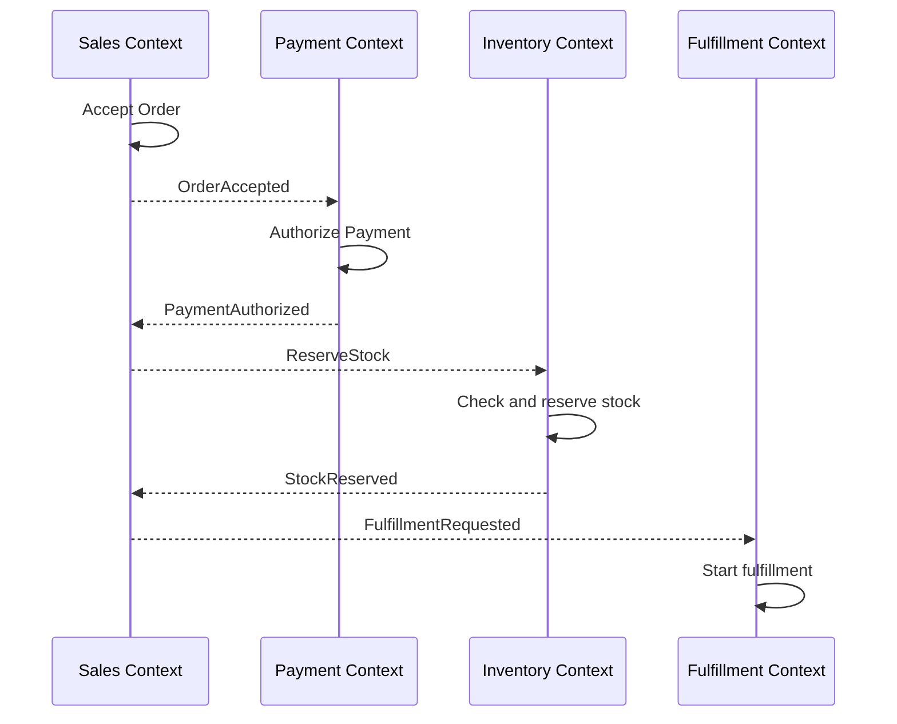

# Thao tác cần nhiều thực thể hoặc aggregate và giới hạn nhất quán

Trong một hệ thống ngân hàng, chuyển tiền từ tài khoản A sang tài khoản B liên quan đến hai Account. Tài khoản nguồn phải đủ số dư và được phép chuyển; tài khoản đích phải có thể nhận tiền; số tiền phải hợp lệ và hai tài khoản phải dùng loại tiền tương thích. Không một Account riêng lẻ nào có đủ thông tin để tự thực hiện toàn bộ quyết định chuyển tiền.

Trong Domain-Driven Design (DDD), hành vi thuộc tự nhiên về một Entity hoặc Aggregate nên được đặt trên chính đối tượng đó. Nhưng có những quy tắc nghiệp vụ liên quan đến nhiều đối tượng và không có một đối tượng nào phù hợp để làm chủ. Khi đó, **Domain Service (Dịch vụ miền)** có thể biểu diễn hành vi này bằng một thao tác có tên theo ngôn ngữ nghiệp vụ.

Domain Service giúp mô hình diễn đạt quy tắc phối hợp mà không biến một Entity thành nơi chứa mọi trách nhiệm. Tuy nhiên, gọi một phương thức Domain Service không tự tạo ra tính nguyên tử cho nhiều Aggregate. Mỗi Aggregate vẫn có ranh giới nhất quán riêng; khi thao tác đi qua nhiều Aggregate hoặc nhiều Bounded Context, đội phát triển phải lựa chọn rõ mức nhất quán và cách xử lý thất bại.

Sau bài học này, bạn có thể:

- Nhận diện khi nào một hành vi nên thuộc Entity/Aggregate và khi nào phù hợp với Domain Service.
- Thiết kế Domain Service cho thao tác liên quan đến nhiều thực thể hoặc Aggregate.
- Phân biệt Domain Service với Application Service và Process Manager.
- Hiểu giới hạn consistency boundary của Aggregate.
- Chọn giữa một transaction cục bộ, eventual consistency và Saga khi phối hợp nhiều Aggregate.
- Tránh tạo Domain Service chỉ để gom code hoặc che giấu phụ thuộc giữa các context.

## 1. Vì sao có hành vi không thuộc tự nhiên về một Entity?

Một Entity nên chịu trách nhiệm cho trạng thái và hành vi gắn với danh tính, vòng đời và invariant của chính nó. Ví dụ:

- `Account.withdraw()` kiểm tra và trừ tiền khỏi một tài khoản.
- `Order.cancel()` kiểm tra điều kiện hủy và chuyển trạng thái Order.
- `Reservation.release()` giải phóng một reservation theo quy tắc của nó.
- `Subscription.renew()` kiểm tra điều kiện gia hạn thuê bao.

Những hành vi này có một đối tượng sở hữu tự nhiên. Nếu chuyển chúng ra service chỉ để Entity còn getter/setter, mô hình sẽ mất nơi bảo vệ invariant.

Nhưng có hành vi cần xét nhiều đối tượng:

- Chuyển tiền giữa hai Account.
- Xác định một Customer có đủ điều kiện mua chịu dựa trên hồ sơ và các khoản nợ đang mở.
- Tính giá cuối cùng từ Product, chính sách khách hàng, khuyến mại và điều kiện giao hàng.
- Ghép một bác sĩ với lịch làm việc và yêu cầu đặt lịch.
- Đánh giá việc chuyển một nhân viên sang vị trí mới dựa trên năng lực, vị trí và quy tắc tổ chức.

Nếu đặt toàn bộ hành vi vào một Entity, đối tượng đó có thể phải biết và điều khiển những đối tượng không thuộc trách nhiệm của nó. Nếu đặt hành vi vào Application Service một cách tùy tiện, logic domain có thể bị trộn với điều phối kỹ thuật.

Domain Service là một lựa chọn khi thao tác có ý nghĩa nghiệp vụ, cần phối hợp nhiều đối tượng và không có Entity hoặc Value Object nào phù hợp làm chủ.

## 2. Domain Service là gì?

Domain Service là một thành phần của domain model biểu diễn một hành vi hoặc quy tắc nghiệp vụ không thuộc tự nhiên về một Entity hay Value Object cụ thể. Nó thường không có identity và không giữ trạng thái nghiệp vụ riêng giữa các lần gọi.

Một Domain Service tốt thường có các đặc điểm:

- Tên mô tả một hành động hoặc quy tắc nghiệp vụ mà chuyên gia có thể nhận ra.
- Chứa logic domain cần phối hợp nhiều đối tượng hoặc sử dụng kiến thức không thuộc một đối tượng riêng lẻ.
- Gọi hành vi của Entity/Aggregate để các đối tượng tiếp tục bảo vệ invariant của mình.
- Không trở thành nơi chứa toàn bộ use case, truy cập HTTP, gửi email hoặc điều khiển database theo cách làm domain phụ thuộc hạ tầng.
- Thường stateless: không giữ dữ liệu của một giao dịch để dùng cho lần gọi sau.

Ví dụ tên có thể dùng:

- `FundsTransferService`: thực hiện quy tắc chuyển tiền giữa hai tài khoản.
- `PricingService`: xác định giá theo chính sách kết hợp nhiều yếu tố.
- `EligibilityPolicy`: đánh giá điều kiện đủ tư cách theo nhiều dữ kiện domain.
- `RoutePlanningService`: đánh giá tuyến giao hàng theo các ràng buộc nghiệp vụ.

Tên service nên cụ thể và thuộc Ubiquitous Language của Bounded Context. Một lớp tên `CommonHelper`, `GeneralManager` hoặc `BusinessUtils` thường không cho biết nó chịu trách nhiệm về quy tắc nào.

### Domain Service không phải một Entity

Domain Service thường không cần ID, trạng thái vòng đời hoặc repository riêng. Nó cung cấp một hành vi. Nếu service bắt đầu có trạng thái riêng, lịch sử, quyền phê duyệt, trạng thái chờ, retry và vòng đời nghiệp vụ, hãy xem xét liệu khái niệm đó có thực sự là một Entity hoặc Aggregate.

Ví dụ, `FundsTransferService` có thể thực hiện phép chuyển tiền ngay trong một use case. Nhưng nếu doanh nghiệp cần theo dõi từng lệnh chuyển tiền, phê duyệt, chờ đối soát, thất bại, hoàn trả và kiểm toán, `FundsTransfer` có thể cần là một Aggregate riêng. Service khi đó có thể tạo và điều phối Aggregate này.

## 3. Quyết định đặt hành vi ở Entity, Domain Service hay Application Service

Không nên chọn Domain Service chỉ vì thao tác có nhiều dòng code. Hãy xác định hành vi thuộc về ai và loại trách nhiệm nào đang được thực hiện.

| Nơi đặt hành vi | Phù hợp khi | Ví dụ |
|---|---|---|
| Entity/Aggregate | Hành vi thay đổi hoặc bảo vệ trạng thái, invariant của chính đối tượng | `Order.cancel()`, `Account.debit()` |
| Value Object | Phép tính hoặc quy tắc gắn với giá trị bất biến | `Money.add()`, `DateRange.overlaps()` |
| Domain Service | Quy tắc domain phối hợp nhiều đối tượng và không có owner tự nhiên | `FundsTransferService.transfer(source, destination, amount)` |
| Application Service | Điều phối một use case, tải/lưu Aggregate, quản lý transaction và gọi cổng ngoài | `TransferMoneyUseCase.execute(command)` |
| Process Manager/Saga | Theo dõi tiến trình dài qua nhiều transaction hoặc context | Điều phối thanh toán, giữ hàng và giao hàng |

### Câu hỏi để chọn đúng nơi

1. Hành vi có thay đổi trạng thái hoặc bảo vệ invariant của một Entity không? Nếu có, ưu tiên đặt phần đó trên Entity.
2. Hành vi chỉ là phép tính trên các giá trị bất biến không? Nếu có, Value Object có thể là nơi phù hợp.
3. Quy tắc có cần phối hợp nhiều Entity/Aggregate và không có owner tự nhiên không? Cân nhắc Domain Service.
4. Công việc chủ yếu là tải dữ liệu, gọi repository, mở transaction, gửi message hoặc gọi API không? Đó là trách nhiệm của Application Service hoặc adapter.
5. Quy trình có kéo dài qua nhiều transaction, chờ phản hồi hoặc cần bù trừ không? Cân nhắc Process Manager/Saga.

Một use case có thể sử dụng cả ba lớp. Application Service điều phối; Domain Service thực hiện quy tắc liên đối tượng; Aggregate bảo vệ invariant nội bộ.

## 4. Ví dụ: chuyển tiền giữa hai Account Aggregate

Giả sử một Bounded Context Banking có hai Aggregate `Account`. Mỗi Account sở hữu số dư, currency và trạng thái hoạt động của mình.

Các invariant cục bộ có thể gồm:

- Tài khoản bị khóa không được ghi nợ.
- Số tiền ghi nợ phải lớn hơn 0.
- Số dư không được thấp hơn hạn mức thấu chi được phép.
- Tài khoản đã đóng không được nhận tiền.
- Currency của giao dịch phải phù hợp với quy tắc của tài khoản.

Hành vi `debit()` thuộc Account nguồn; hành vi `credit()` thuộc Account đích. Nhưng quy tắc “chuyển một khoản tiền từ tài khoản này sang tài khoản kia” liên quan đến cả hai. Một Domain Service có thể phối hợp hai hành vi.

```java
import java.util.Objects;

public final class FundsTransferService {

    public void transfer(Account source,
                         Account destination,
                         Money amount) {
        Objects.requireNonNull(source);
        Objects.requireNonNull(destination);
        Objects.requireNonNull(amount);

        if (source.id().equals(destination.id())) {
            throw new SameAccountTransferException();
        }

        if (!source.currency().equals(destination.currency())
                || !source.currency().equals(amount.currency())) {
            throw new CurrencyMismatchException();
        }

        // Kiểm tra các điều kiện liên đối tượng trước khi thay đổi trạng thái.
        source.ensureCanDebit(amount);
        destination.ensureCanReceive(amount);

        // Mỗi Aggregate vẫn tự bảo vệ invariant của nó.
        source.debit(amount);
        destination.credit(amount);
    }
}
```

Đoạn code giả định `Account` có các phương thức kiểm tra và hành vi tương ứng. Nó minh họa vai trò phối hợp của Domain Service; transaction và lưu trữ do Application Service cùng hạ tầng đảm nhiệm.

### Vì sao không đặt `transfer()` vào Account nguồn?

Nếu viết `source.transferTo(destination, amount)`, điều đó không nhất thiết sai. Một số domain có thể xem hành vi chuyển tiền là trách nhiệm của tài khoản nguồn. Nhưng nếu quy tắc cần phối hợp cả điều kiện nhận tiền, giới hạn của tài khoản đích, loại tài khoản, chính sách chuyển liên ngân hàng và phí, việc đặt toàn bộ vào Account nguồn có thể làm nó biết quá nhiều về một đối tượng khác.

Hãy để mỗi Account giữ trách nhiệm của mình:

- Account nguồn xác định có thể ghi nợ hay không.
- Account đích xác định có thể nhận tiền hay không.
- Domain Service phối hợp quy tắc chuyển giữa hai bên.

Nếu chuyên gia nghiệp vụ xem “chuyển tiền” là hành vi thuộc một đối tượng riêng có vòng đời, hãy mô hình hóa lệnh chuyển tiền thành Aggregate thay vì ép toàn bộ khái niệm vào một service stateless.

## 5. Application Service quản lý transaction và repository

Domain Service không tự làm cho hai Aggregate được lưu nguyên tử. Application Service điều phối việc tải, gọi domain behavior và lưu các Aggregate trong transaction phù hợp.

```java
import org.springframework.transaction.annotation.Transactional;

public final class TransferMoneyApplicationService {
    private final AccountRepository accounts;
    private final FundsTransferService transfers;

    public TransferMoneyApplicationService(
            AccountRepository accounts,
            FundsTransferService transfers) {
        this.accounts = accounts;
        this.transfers = transfers;
    }

    @Transactional
    public void execute(TransferMoneyCommand command) {
        Account source = accounts.getById(command.sourceAccountId());
        Account destination = accounts.getById(command.destinationAccountId());

        transfers.transfer(source, destination, command.amount());

        accounts.save(source);
        accounts.save(destination);
    }
}
```

Ví dụ này giả định hai Account được lưu trong cùng một transactional resource và transaction bao trùm cả hai lần lưu. Nếu việc ghi một Account thất bại, transaction phải rollback cả hai thay đổi. Nếu repository dùng optimistic locking, xung đột version ở một Aggregate phải khiến transaction không commit một nửa.

Các lời gọi `ensureCanDebit()` và `ensureCanReceive()` kiểm tra trạng thái đã được tải vào bộ nhớ. Một giao dịch khác vẫn có thể thay đổi Account trước khi transaction hiện tại commit. Vì vậy, repository/persistence layer cần kiểm tra version hoặc dùng cơ chế concurrency phù hợp cho cả hai Aggregate. Nếu một bên conflict, toàn bộ transaction phải rollback; ứng dụng tải lại trạng thái mới và đánh giá lại lệnh chuyển tiền.

Domain Service không cần biết `@Transactional`, SQL, JPA hoặc cách mở connection. Nó nhận các đối tượng domain và thực hiện quy tắc. Application Service biết use case cần những repository nào và transaction nào.

### Domain Service có được dùng Repository không?

Trong một số thiết kế, Domain Service có thể cần dữ liệu domain bổ sung và phụ thuộc vào một abstraction như repository hoặc domain policy. Tuy nhiên, cần cẩn thận để service không biến thành Application Service thứ hai.

Một cách thường dễ kiểm soát là Application Service tải các Aggregate cần thiết rồi truyền chúng vào Domain Service. Nếu quy tắc cần một phép tra cứu domain phức tạp, có thể truyền một abstraction domain phù hợp hoặc tách phần truy vấn/điều phối ra application layer. Không nên để Domain Service tự mở transaction, gọi trực tiếp ORM hoặc thực hiện network I/O.

## 6. Giới hạn nhất quán của Aggregate

Aggregate là ranh giới nhất quán (*consistency boundary*) trong đó các invariant cần được bảo vệ đồng bộ. Aggregate Root là điểm truy cập chính để thay đổi trạng thái của các đối tượng bên trong.

Ví dụ một Order Aggregate có thể bảo vệ:

- Order phải có ít nhất một Order Line khi được đặt.
- Số lượng mỗi dòng hàng phải hợp lệ.
- Tổng tiền phải được tính từ các dòng hàng theo policy của Order.
- Không thể hủy một Order đã ở trạng thái không cho phép hủy.

Các thay đổi cần nhất quán cùng nhau được lưu trong một transaction của Aggregate. Bên ngoài không nên sửa trực tiếp Entity con để bỏ qua invariant của Root.

Khi một thao tác cần nhiều Aggregate, có một số giới hạn cần hiểu:

- Version của Aggregate A không bảo vệ Aggregate B.
- Optimistic locking trên từng Aggregate chỉ phát hiện xung đột của từng Aggregate.
- Việc gọi hai phương thức domain liên tiếp không tự tạo transaction nguyên tử.
- Một transaction database có thể cập nhật nhiều Aggregate nếu cùng một transactional resource, nhưng điều đó mở rộng phạm vi nhất quán và cần được lựa chọn có chủ đích.
- Khi các Aggregate nằm ở database hoặc service khác nhau, không có transaction ACID cục bộ nào tự bảo đảm tất cả cùng commit.

### Không gom Aggregate chỉ vì một use case chạm đến nhiều đối tượng

Một đơn hàng có thể liên quan đến Customer, Payment, Inventory và Shipment. Điều đó không có nghĩa tất cả phải nằm trong một Aggregate. Hãy xác định invariant nào cần luôn đúng cùng nhau và dữ liệu nào có vòng đời, quyền sở hữu riêng.

Nếu đưa Customer, Payment, Inventory và Shipment vào một Aggregate Order khổng lồ, mỗi thay đổi ở bất kỳ phần nào cũng có thể làm tăng contention và khiến mô hình khó thay đổi. Aggregate lớn cũng làm tăng lượng dữ liệu cần tải và phạm vi rollback.

Domain Service có thể phối hợp các Aggregate, nhưng không xóa bỏ ranh giới consistency của chúng.

## 7. Khi nào có thể dùng một transaction cho nhiều Aggregate?

DDD không cấm tuyệt đối việc một transaction database cập nhật nhiều Aggregate. Nếu các Aggregate nằm trong cùng một database/transactional resource và nghiệp vụ thực sự yêu cầu tính nguyên tử ngay lập tức, một transaction có thể là lựa chọn hợp lệ.

Ví dụ chuyển tiền nội bộ có thể yêu cầu:

> Sau khi thao tác hoàn tất, tài khoản nguồn đã bị ghi nợ và tài khoản đích đã được ghi có; không chấp nhận chỉ một phía thay đổi.

Nếu cả hai Account nằm trong cùng database, Application Service có thể tải cả hai, gọi Domain Service rồi lưu trong một transaction. Cần đảm bảo:

- Cả hai Aggregate được commit hoặc rollback cùng nhau.
- Mọi invariant cục bộ vẫn được bảo vệ bởi từng Aggregate.
- Version/concurrency check được áp dụng cho cả hai.
- Transaction ngắn, không gọi dịch vụ bên ngoài khi đang giữ transaction.
- Có xử lý conflict nếu một trong hai Aggregate thay đổi đồng thời.

Đây là consistency do transaction database cung cấp cho use case cụ thể. Nó không có nghĩa hai Aggregate đã trở thành một Aggregate, và cũng không nên biến mọi thao tác liên Aggregate thành transaction lớn.

### Khi nào nên xem lại Aggregate boundary?

Nếu rất nhiều use case luôn phải cập nhật hai Aggregate cùng lúc để giữ một invariant cốt lõi, có thể boundary hiện tại chưa phù hợp. Hãy hỏi:

- Hai phần có thực sự có vòng đời và quyền sở hữu độc lập không?
- Invariant có cần được bảo vệ đồng bộ hay có thể chấp nhận trạng thái trung gian?
- Hai Aggregate có thay đổi cùng nhau thường xuyên không?
- Có thể đưa quyền sở hữu invariant về một Aggregate Root phù hợp hơn không?
- Transaction liên Aggregate có tạo contention hoặc coupling khó kiểm soát không?

Đừng hợp nhất Aggregate chỉ vì muốn giảm số lần gọi repository. Hãy dựa trên invariant và consistency requirement của domain.

## 8. Khi nào cần eventual consistency?

Khi một quy trình đi qua nhiều Aggregate hoặc Bounded Context độc lập, hệ thống thường chấp nhận các bước commit riêng và hội tụ về kết quả cuối cùng. Đây là **eventual consistency** (nhất quán cuối cùng).

Ví dụ đặt hàng trực tuyến:

1. Sales chấp nhận Order.
2. Payment xử lý thanh toán.
3. Inventory giữ hàng.
4. Fulfillment nhận yêu cầu chuẩn bị hàng.

Mỗi context sở hữu dữ liệu và transaction riêng. Sau một sự kiện, context khác nhận thông tin và tiếp tục quy trình. Trong một khoảng thời gian, Order có thể ở `PendingPayment`, Payment ở `Authorized`, Inventory chưa reserve hoặc Fulfillment chưa nhận yêu cầu. Đây là trạng thái trung gian được mô hình hóa, không nhất thiết là lỗi.



Sơ đồ là một ví dụ về orchestration qua các event/command. Trình tự thật phụ thuộc policy của doanh nghiệp: có nơi giữ hàng trước thanh toán, có nơi chỉ giữ sau khi thanh toán được authorize, và có nơi dùng cơ chế giữ chỗ có thời hạn.

Eventual consistency phù hợp khi domain cho phép trạng thái chờ, có thể xử lý lại và có chính sách cho các kết quả thất bại. Không nên dùng nó nếu nghiệp vụ yêu cầu một invariant phải đúng ngay tại thời điểm commit mà chưa có cơ chế bảo vệ tương ứng.

## 9. Saga và Process Manager cho quy trình dài

Một quy trình xuyên nhiều Aggregate hoặc Bounded Context có thể kéo dài, chờ phản hồi từ đối tác và không thể giữ một transaction database trong suốt quá trình. Khi đó, Saga hoặc Process Manager có thể theo dõi tiến trình.

Ví dụ, một Order chỉ được chuyển sang `ReadyForFulfillment` khi thanh toán đã được xác nhận và tồn kho đã giữ đủ hàng. Process Manager có thể ghi nhận:

```text
OrderAccepted
    |
    +--> RequestPayment
    |       |
    |       +--> PaymentAuthorized
    |       +--> PaymentFailed
    |
    +--> ReserveStock
            |
            +--> StockReserved
            +--> StockUnavailable
```

Khi nhận kết quả, Process Manager cập nhật tiến trình và gửi command tiếp theo. Nó không nên thay thế quy tắc nội bộ của Payment hoặc Inventory. Payment vẫn sở hữu quyết định authorize/refund; Inventory vẫn sở hữu quyết định reserve/release.

### Hành động bù trừ

Nếu thanh toán đã authorize nhưng không thể giữ hàng, quy trình có thể yêu cầu void authorization hoặc refund tùy loại giao dịch và policy. Đây là một hành động bù trừ (*compensation*), không phải rollback database xuyên các service.

Một Saga có thể có các bước:

| Bước | Hành động | Nếu thất bại |
|---|---|---|
| 1 | Sales chấp nhận Order | Từ chối yêu cầu |
| 2 | Payment authorize | Chuyển Order sang trạng thái thanh toán thất bại hoặc chờ thử lại |
| 3 | Inventory reserve | Yêu cầu void/refund theo policy; cập nhật Order |
| 4 | Fulfillment nhận yêu cầu | Retry, chờ hoặc chuyển sang xử lý ngoại lệ |

Không phải mọi hành động bù trừ đều đảo ngược hoàn toàn hành động trước. Ví dụ, một khoản tiền đã capture có thể cần refund thay vì xóa giao dịch; hàng đã được bàn giao cho hãng vận chuyển có thể cần quy trình trả hàng. Compensation là hành vi nghiệp vụ mới và phải có trạng thái, bằng chứng và quy tắc riêng.

## 10. Domain Service và Application Service khi phối hợp nhiều Aggregate

Hai loại service thường được dùng cùng nhau nhưng không nên trộn trách nhiệm.

| Trách nhiệm | Domain Service | Application Service |
|---|---|---|
| Biểu diễn quy tắc domain | Có | Không nên sở hữu thay domain model |
| Phối hợp hành vi của nhiều Entity/Aggregate | Có thể, khi là quy tắc domain | Điều phối use case gọi các thành phần domain |
| Tải Aggregate từ Repository | Thường không phải trách nhiệm chính | Có |
| Quản lý transaction | Không | Có |
| Gọi HTTP, message broker, email | Không nên | Thông qua port/adapter phù hợp |
| Quyết định thứ tự các bước use case | Chỉ phần thuộc quy tắc domain | Có |
| Giữ trạng thái tiến trình dài | Không phải vai trò thông thường | Có thể giao cho Process Manager/Saga |

Ví dụ chuyển tiền:

- Application Service nhận command, tải hai Account và mở transaction.
- Domain Service kiểm tra quy tắc chuyển tiền liên đối tượng và gọi `debit()`/`credit()`.
- Repository lưu hai Aggregate.
- Transaction manager commit hoặc rollback.
- Nếu cần thông báo ra ngoài, outbox publisher công bố event sau commit.

Ví dụ đặt hàng qua nhiều context:

- Application Service nhận yêu cầu đặt hàng và khởi tạo quy trình.
- Sales Aggregate quyết định chấp nhận Order.
- Process Manager theo dõi kết quả Payment và Inventory.
- Domain Service chỉ xuất hiện ở nơi có quy tắc domain liên đối tượng cụ thể; nó không thay Process Manager làm bộ điều phối toàn hệ thống.

## 11. Domain Service không nên vượt qua ranh giới Bounded Context

Domain Service thuộc một domain model và Bounded Context cụ thể. Nếu một thao tác cần gọi trực tiếp Aggregate của context khác, đọc database của context khác hoặc phụ thuộc class nội bộ của context khác, ranh giới mô hình có thể đang bị phá vỡ.

Ví dụ Sales không nên tạo một `Order` rồi truyền nguyên Aggregate đó vào Payment để Payment sửa trạng thái. Payment nên nhận một contract có dữ liệu cần thiết, tạo Payment Aggregate của mình và phát kết quả theo ngôn ngữ Payment.

Khi phối hợp giữa context:

- Application Service hoặc Process Manager điều phối use case.
- Integration contract diễn đạt dữ liệu và sự kiện được công bố.
- Anti-Corruption Layer có thể chuyển mô hình nguồn sang mô hình đích.
- Mỗi context giữ quyền quyết định và invariant của mình.

Nếu một quy tắc nghiệp vụ thật sự cần dữ liệu từ context khác, hãy làm rõ dữ liệu nào được cung cấp, độ mới cần thiết, cách xử lý khi nguồn không khả dụng và ai sở hữu quyết định cuối cùng. Không nên để Domain Service trở thành một lớp gọi API xuyên hệ thống tùy tiện.

## 12. Ví dụ khác: tính giá cần nhiều khái niệm

Giả sử giá cuối cùng của một đơn phụ thuộc vào giá niêm yết, chính sách khách hàng, chương trình khuyến mại và điều kiện vận chuyển. Không có một đối tượng đơn lẻ nào chứa toàn bộ quy tắc này.

Một `PricingService` có thể nhận các dữ kiện domain đã được tải và trả về một `PriceQuote`:

```java
public final class PricingService {

    public PriceQuote calculate(
            ProductOffer offer,
            CustomerPricingProfile customer,
            Promotion promotion,
            ShippingTerms shippingTerms,
            Quantity quantity) {

        Money base = offer.priceFor(quantity);
        Money customerPrice = customer.applyTo(base);
        Money discounted = promotion.apply(customerPrice);
        Money shipping = shippingTerms.feeFor(quantity);

        return PriceQuote.create(
            discounted,
            shipping,
            offer.taxPolicy()
        );
    }
}
```

Đây là ví dụ khái niệm. Các đối tượng đầu vào phải thuộc cùng mô hình hoặc được chuyển đổi sang kiểu domain phù hợp. `PricingService` cần biểu diễn quy tắc kết hợp; từng đối tượng vẫn chịu trách nhiệm cho quy tắc riêng của nó.

Nếu tính giá chỉ là phép tính trên `Money`, `Rate` và `Quantity`, Value Object có thể đảm nhận phần lớn logic. Nếu `Promotion` tự biết cách áp dụng chính sách giảm giá của mình, không cần chuyển toàn bộ logic đó vào `PricingService`. Domain Service chỉ nên chứa phần thực sự cần phối hợp.

Nếu giá phụ thuộc vào dữ liệu ngoài như tỷ giá thị trường hoặc phí hãng vận chuyển, Application Service có thể lấy dữ liệu qua port rồi truyền snapshot vào Domain Service. Domain Service không nên tự gọi API nhà cung cấp trong lúc tính toán.

## 13. Khi nào thao tác nhiều đối tượng nên trở thành một Aggregate mới?

Đôi khi việc nhiều đối tượng cùng tham gia một quy trình là dấu hiệu có một khái niệm domain mới với vòng đời riêng.

Hãy cân nhắc tạo Aggregate mới nếu:

- Có một đối tượng được tạo ra để đại diện cho chính giao dịch phối hợp.
- Nó có danh tính riêng và được tra cứu độc lập.
- Nó có trạng thái, lịch sử và chuyển đổi trạng thái riêng.
- Có quy tắc phê duyệt, hết hạn, retry, hủy hoặc bù trừ.
- Nhiều use case cần tham chiếu đến tiến trình đó.

Ví dụ, `FundsTransfer` có thể có các trạng thái `Requested`, `Approved`, `Debited`, `Credited`, `Completed`, `Failed` hoặc `Reversed`. Khi đó, nó không chỉ là một hàm `transfer()`. Nó là một khái niệm nghiệp vụ có vòng đời và cần được mô hình hóa như Entity/Aggregate.

Domain Service có thể tạo hoặc đánh giá hành vi cho Aggregate này, còn Application Service/Process Manager điều phối các bước lưu trữ và tiến trình dài.

## 14. Kiểm tra tính nguyên tử và thất bại một phần

Khi thao tác nhiều Aggregate, hãy liệt kê điều gì xảy ra nếu mỗi bước thất bại.

Với chuyển tiền trong một database transaction:

| Tình huống | Kết quả cần đảm bảo |
|---|---|
| Ghi nợ nguồn thất bại | Không ghi có đích |
| Ghi nợ thành công nhưng ghi có đích lỗi | Rollback cả hai thay đổi |
| Version nguồn bị conflict | Transaction không commit thay đổi nào |
| Version đích bị conflict | Transaction không commit thay đổi nào |
| Event công bố thất bại sau commit | Có cơ chế outbox/retry để không mất thông báo |

Với quy trình qua nhiều service:

| Tình huống | Cách xử lý cần mô hình hóa |
|---|---|
| Payment thành công, Inventory thất bại | Void/refund hoặc trạng thái chờ theo policy |
| Consumer nhận event hai lần | Idempotency/deduplication |
| Context tạm thời không khả dụng | Retry có giới hạn, backoff và trạng thái chờ |
| Kết quả bên ngoài không xác định | Đối soát trước khi phát lại side effect |
| Compensation thất bại | Theo dõi tiến trình và chuyển xử lý ngoại lệ |

Không nên chỉ viết `try/catch` rồi đảo các field trong bộ nhớ. Compensation phải là hành vi domain có thể kiểm toán và có quy tắc rõ ràng.

## 15. Những sai lầm thường gặp

**Đưa mọi hành vi vào Domain Service.** Entity trở thành cấu trúc dữ liệu thụ động và invariant bị phân tán. Hãy giữ hành vi thuộc về đối tượng ngay trên Entity/Aggregate.

**Dùng Domain Service thay Application Service.** Một lớp tải repository, mở transaction, gọi REST và gửi email thường đang điều phối use case, không chỉ thực hiện domain behavior.

**Cho rằng Domain Service tự tạo transaction.** Gọi hai Aggregate trong một method không đảm bảo chúng được commit nguyên tử. Transaction boundary phải được thiết kế ở application/infrastructure layer.

**Đặt toàn bộ quy tắc của các Aggregate vào service.** Service có thể phối hợp, nhưng mỗi Aggregate vẫn phải bảo vệ invariant cục bộ của mình.

**Dùng một Aggregate khổng lồ để giải quyết mọi thao tác liên đối tượng.** Hãy xác định invariant thực sự cần consistency đồng bộ và vòng đời của từng khái niệm.

**Để Domain Service gọi trực tiếp context khác.** Điều này làm mô hình phụ thuộc vào class, database hoặc API nội bộ của context khác. Hãy dùng contract và cơ chế tích hợp.

**Retry cả quy trình mà không có idempotency.** Side effect như thu tiền, phát hành chứng từ hoặc gửi lệnh giao hàng có thể bị thực hiện hai lần.

**Dùng Saga nhưng không có trạng thái trung gian.** Một quy trình dài cần biểu diễn chờ, thất bại, retry và compensation thay vì giả vờ mọi thứ hoàn tất trong một bước.

**Tạo service không có tên domain rõ ràng.** Các lớp `Helper` hoặc `Manager` dễ trở thành nơi gom logic không có owner. Hãy đặt tên theo hành vi nghiệp vụ và kiểm tra lại trách nhiệm.

## 16. Quy trình thiết kế thao tác nhiều Entity/Aggregate

Khi gặp một use case cần nhiều đối tượng, hãy thực hiện lần lượt:

**Bước 1: Viết quy tắc bằng ngôn ngữ nghiệp vụ.** Mô tả mục tiêu, điều kiện, kết quả và ngoại lệ mà chuyên gia xác nhận.

**Bước 2: Xác định owner của từng invariant.** Quy tắc nào thuộc Account nguồn, Account đích, Promotion, Inventory hoặc Order?

**Bước 3: Tìm hành vi có owner tự nhiên.** Đưa các hành vi cục bộ vào Entity/Aggregate hoặc Value Object.

**Bước 4: Xác định phần quy tắc còn lại.** Nếu còn một quy tắc phối hợp nhiều đối tượng mà không có owner tự nhiên, cân nhắc Domain Service.

**Bước 5: Xác định consistency requirement.** Những thay đổi nào phải cùng commit? Những phần nào có thể nhất quán cuối cùng?

**Bước 6: Chọn transaction boundary.** Nếu cùng transactional resource và cần atomicity, Application Service có thể điều phối một transaction. Nếu qua nhiều context/service, xem xét Saga hoặc Process Manager.

**Bước 7: Mô hình hóa failure path.** Xác định retry, timeout, duplicate, compensation và cách phục hồi.

**Bước 8: Kiểm tra ranh giới context.** Dùng identifier và contract rõ; không truyền Aggregate nội bộ qua context boundary.

**Bước 9: Đặt tên theo Ubiquitous Language.** Chuyên gia nghiệp vụ phải hiểu được tên service và hành vi của nó.

## 17. Checklist đánh giá Domain Service

- [ ] Hành vi có ý nghĩa nghiệp vụ và có tên rõ ràng.
- [ ] Hành vi thực sự cần nhiều đối tượng hoặc không có Entity/Value Object phù hợp làm owner.
- [ ] Invariant cục bộ vẫn được bảo vệ bên trong từng Aggregate.
- [ ] Domain Service không giữ trạng thái tiến trình giữa các lần gọi nếu không có lý do domain.
- [ ] Domain Service không chứa chi tiết database, HTTP hoặc message broker.
- [ ] Application Service chịu trách nhiệm tải/lưu Aggregate và quản lý transaction.
- [ ] Consistency requirement giữa các Aggregate được xác định rõ.
- [ ] Có cách xử lý version conflict và cập nhật đồng thời.
- [ ] Nếu eventual consistency được dùng, trạng thái chờ và failure path được mô hình hóa.
- [ ] Nếu có Saga, compensation là hành vi nghiệp vụ có thể theo dõi.
- [ ] Không có phụ thuộc trực tiếp vào mô hình nội bộ của Bounded Context khác.
- [ ] Có test cho quy tắc domain và test cho transaction/integration boundary phù hợp.

## 18. Bài tập tự kiểm tra

Một nền tảng đặt lịch khám có các khái niệm `Patient`, `Doctor`, `Appointment` và `Invoice`. Khi xác nhận một lịch khám, hệ thống cần kiểm tra:

- Bệnh nhân có được phép đặt lịch không.
- Bác sĩ có lịch làm việc phù hợp không.
- Khung giờ có còn trống không.
- Bệnh nhân có khoản nợ quá hạn bị policy hạn chế đặt lịch không.
- Phí khám được tính theo loại dịch vụ và hợp đồng bảo hiểm.

Hãy trả lời:

1. Quy tắc nào thuộc tự nhiên về `Appointment`?
2. Quy tắc nào thuộc `DoctorSchedule` hoặc `PatientAccount`?
3. Có cần một `AppointmentEligibilityService` hoặc `ConsultationPricingService` không? Vì sao?
4. Application Service cần tải những Aggregate nào và quản lý transaction ra sao?
5. Nếu lịch của bác sĩ và hồ sơ bệnh nhân thuộc hai Bounded Context khác nhau, có nên truyền Aggregate trực tiếp vào Domain Service không?
6. Nếu hai khách cùng đặt slot cuối, cơ chế nào bảo vệ invariant?
7. Nếu hệ thống bảo hiểm phản hồi chậm, nên xử lý đồng bộ hay theo quy trình chờ có trạng thái?

Gợi ý:

- `Appointment` bảo vệ quy tắc vòng đời của lịch hẹn như xác nhận, hủy và hoàn tất.
- `DoctorSchedule` sở hữu khả năng nhận lịch; `PatientAccount` sở hữu trạng thái tài khoản và chính sách liên quan.
- Domain Service phù hợp nếu có quy tắc đủ điều kiện hoặc tính giá cần phối hợp nhiều dữ kiện domain mà không thuộc một đối tượng riêng.
- Application Service điều phối tải dữ liệu, transaction và lưu kết quả. Nếu các Aggregate ở cùng database và cần atomicity, có thể dùng transaction cục bộ có chủ đích.
- Nếu qua Bounded Context, dùng contract/reference và cơ chế tích hợp; không dùng class nội bộ của context khác.
- Slot cần được bảo vệ tại nơi sở hữu tài nguyên, chẳng hạn Aggregate/unique constraint hoặc reservation mechanism; version riêng của từng Appointment chưa đủ.
- Phản hồi bảo hiểm chậm có thể yêu cầu trạng thái `PendingEligibility` và Process Manager theo dõi kết quả, tùy cam kết của nghiệp vụ.

## Kết luận

Domain Service phù hợp khi một quy tắc nghiệp vụ cần phối hợp nhiều Entity hoặc Aggregate và không có đối tượng nào sở hữu hành vi đó một cách tự nhiên. Service diễn đạt phần logic phối hợp, trong khi mỗi Aggregate vẫn bảo vệ invariant và trạng thái thuộc trách nhiệm của mình.

Domain Service không tự tạo ra tính nguyên tử cho nhiều Aggregate. Application Service quản lý repository và transaction; nếu các Aggregate cùng nằm trong một transactional resource và nghiệp vụ cần atomicity, có thể dùng một transaction cục bộ có chủ đích. Khi quy trình đi qua nhiều context hoặc hệ thống, cần mô hình hóa trạng thái trung gian, eventual consistency, Process Manager/Saga và hành động bù trừ. Chọn đúng ranh giới giúp domain model giữ được trách nhiệm rõ ràng mà vẫn hỗ trợ các quy trình nghiệp vụ phức tạp.
