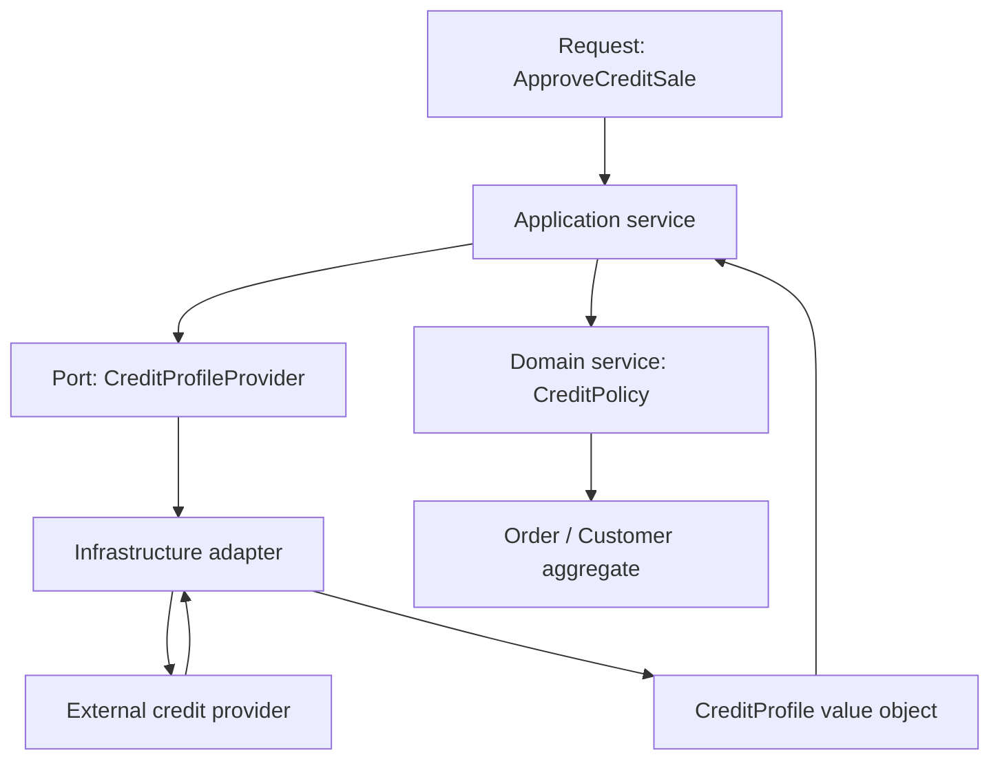
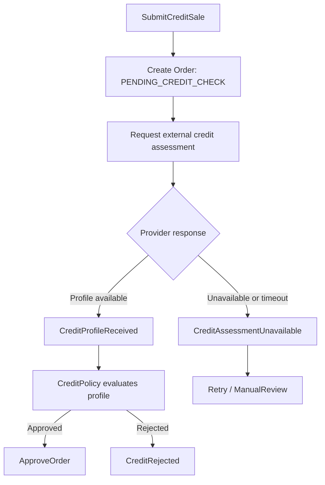

# Xử lý nhu cầu dữ liệu bên ngoài mà không kéo hạ tầng vào mô hình

Trong Domain-Driven Design (DDD), có những quy tắc nghiệp vụ cần thông tin mà một aggregate hiện tại không sở hữu. Ví dụ, chính sách bán chịu cần biết hồ sơ tín dụng từ một tổ chức bên ngoài; tính giá bằng ngoại tệ cần tỷ giá tại một thời điểm; tính thuế cần thông tin địa điểm và mức thuế có hiệu lực. Những dữ liệu này có thể đến từ database, API, message broker hoặc một nhà cung cấp dịch vụ.

Vấn đề là quy tắc nghiệp vụ vẫn cần được mô hình hóa rõ ràng, nhưng domain model không nên phụ thuộc trực tiếp vào HTTP client, SQL, SDK hay framework. Nếu `Order` tự gọi API của tổ chức tín dụng, đối tượng miền vừa phải bảo vệ trạng thái đơn vừa phải biết cách kết nối mạng, xử lý timeout và giải mã JSON. Mô hình trở nên khó kiểm thử, khó thay thế nhà cung cấp và khó hiểu bằng ngôn ngữ nghiệp vụ.

Domain service giúp biểu diễn quy tắc không thuộc tự nhiên về một entity hoặc value object cụ thể. Khi quy tắc cần dữ liệu bên ngoài, đội cần quyết định dữ liệu đó được lấy ở đâu, được chuyển thành khái niệm miền như thế nào và được đưa vào quy tắc bằng cách nào. Thông thường, application layer lấy dữ liệu qua một port/adapter, chuyển thành kiểu miền rồi truyền vào domain service. Trong một số trường hợp, domain có thể khai báo một abstraction mang ý nghĩa nghiệp vụ để truy vấn năng lực bên ngoài; infrastructure triển khai abstraction đó.

## Sau bài học này

Bạn có thể:

- Nhận diện khi nào một quy tắc cần domain service và khi nào chỉ cần hành vi của entity/value object.
- Phân biệt dữ liệu miền, dữ liệu kỹ thuật và dữ liệu do hệ thống bên ngoài sở hữu.
- Tổ chức việc lấy dữ liệu bên ngoài ở application/infrastructure mà không để domain phụ thuộc framework.
- Chuyển dữ liệu ngoài thành value object hoặc kiểu dữ liệu có ý nghĩa trong bounded context.
- Chọn giữa truyền dữ liệu vào domain service và sử dụng một domain-oriented port.
- Xử lý dữ liệu lỗi thời, thiếu, không xác định hoặc nguồn dữ liệu tạm thời không khả dụng.
- Thiết kế kiểm thử, transaction và hành vi lỗi cho quy tắc cần dữ liệu bên ngoài.

## 1. Vấn đề: quy tắc miền cần dữ liệu mà aggregate không sở hữu

Hãy xét use case bán hàng cho khách hàng theo hình thức ghi nợ. `Order` có thông tin đơn hàng và tổng tiền, nhưng quyết định có cho phép bán chịu hay không còn phụ thuộc vào:

- Hạn mức tín dụng đã được cấp.
- Dư nợ hiện tại của khách hàng.
- Điểm hoặc hồ sơ tín dụng do nhà cung cấp bên ngoài cung cấp.
- Chính sách rủi ro của doanh nghiệp.

Không nên thêm tất cả dữ liệu này vào `Order` chỉ vì use case xác nhận đơn cần chúng. `Order` không sở hữu hồ sơ tín dụng và không nên tự truy cập API bên ngoài.

Một quy tắc như “khách hàng chỉ được mua chịu nếu dư nợ sau giao dịch không vượt hạn mức và hồ sơ tín dụng còn hiệu lực” là quy tắc miền. Nếu quy tắc kết hợp nhiều khái niệm và không thuộc tự nhiên về một entity cụ thể, có thể biểu diễn bằng domain service, chẳng hạn `CreditPolicy`.

Domain service cần dữ liệu đầu vào để quyết định. Dữ liệu ấy có thể được application service tải từ các nguồn tương ứng rồi truyền vào. Nhờ vậy, `CreditPolicy` chỉ làm việc với các khái niệm miền như `CreditProfile`, `CreditLimit` và `Money`, không cần biết dữ liệu đến từ REST API hay database.

### Domain service không phải nơi chứa mọi thứ chưa biết đặt ở đâu

Một domain service phù hợp khi:

- Quy tắc có ý nghĩa nghiệp vụ rõ ràng.
- Hành vi không thuộc tự nhiên về một entity hoặc value object riêng lẻ.
- Quy tắc có thể cần phối hợp nhiều khái niệm hoặc nhiều đối tượng miền.
- Tên và tham số của service có thể diễn đạt bằng ngôn ngữ chung.

Nếu hành vi chỉ thay đổi trạng thái của một aggregate, hãy ưu tiên đặt nó trên aggregate root. Nếu logic chỉ điều phối tải dữ liệu, gọi repository, quản lý transaction và lưu kết quả, đó thường là trách nhiệm của application service.

## 2. Phân biệt ba loại trách nhiệm

Khi cần dữ liệu bên ngoài, hãy tách rõ quy tắc nghiệp vụ, điều phối use case và cơ chế truy cập dữ liệu.

| Thành phần | Trách nhiệm | Ví dụ |
| --- | --- | --- |
| Domain service | Áp dụng quy tắc nghiệp vụ trên dữ liệu miền đã được cung cấp hoặc qua abstraction mang ý nghĩa miền. | `CreditPolicy.evaluate(...)` quyết định khách hàng có đủ điều kiện bán chịu. |
| Application service | Điều phối use case, lấy aggregate, gọi các port, chuẩn bị dữ liệu và quản lý transaction. | `ApproveCreditSaleHandler` tải khách hàng, dư nợ và hồ sơ tín dụng rồi gọi policy. |
| Infrastructure adapter | Giao tiếp với công nghệ hoặc hệ thống ngoài và chuyển đổi giao thức/dữ liệu. | `BureauHttpClient` gọi API, giải mã JSON và chuyển DTO sang kiểu miền. |

Một luồng điển hình:



Application service quyết định khi nào cần gọi nguồn dữ liệu, xử lý lỗi giao tiếp và đưa dữ liệu về đúng kiểu. Domain service quyết định ý nghĩa nghiệp vụ của dữ liệu đó. Infrastructure adapter chịu trách nhiệm HTTP, serialization, authentication và các chi tiết kỹ thuật khác.

## 3. Chiến lược ưu tiên: lấy dữ liệu trước, truyền vào domain service

Nếu domain service chỉ cần một dữ kiện để thực hiện phép tính hoặc quyết định, cách đơn giản và dễ kiểm thử thường là application service lấy dữ liệu rồi truyền vào.

Ví dụ, `CreditPolicy` không cần biết ai cung cấp hồ sơ tín dụng. Nó chỉ cần nhận hồ sơ đã được xác thực và các giá trị miền liên quan:

```java
public record CreditProfile(
    CustomerId customerId,
    int riskScore,
    Instant assessedAt,
    String sourceReference
) {
    public CreditProfile {
        Objects.requireNonNull(customerId, "customerId");
        Objects.requireNonNull(assessedAt, "assessedAt");
        Objects.requireNonNull(sourceReference, "sourceReference");
        if (riskScore < 0 || riskScore > 1000) {
            throw new IllegalArgumentException("Risk score is out of range");
        }
    }
}

public record CreditDecision(boolean approved, String reason) {}

// Các port này thuộc application layer trong ví dụ vì use case
// chịu trách nhiệm chuẩn bị dữ liệu trước khi gọi chính sách miền.
public interface CreditProfileProvider {
    CreditProfile getFor(CustomerId customerId);
}

public interface ExposureQuery {
    Money currentFor(CustomerId customerId);
}

public final class CreditPolicy {
    public CreditDecision evaluate(
        CreditProfile profile,
        Money currentExposure,
        Money requestedAmount,
        Money creditLimit,
        Instant decisionTime
    ) {
        if (profile.assessedAt().isAfter(decisionTime)) {
            return new CreditDecision(false, "Credit profile is from the future");
        }
        if (profile.riskScore() < 600) {
            return new CreditDecision(false, "Credit risk is above the allowed level");
        }

        Money projectedExposure = currentExposure.add(requestedAmount);
        if (projectedExposure.compareTo(creditLimit) > 0) {
            return new CreditDecision(false, "Credit limit would be exceeded");
        }

        return new CreditDecision(true, "Credit policy satisfied");
    }
}
```

Đây là ví dụ minh họa. Ngưỡng điểm `600` và thang điểm `0..1000` không phải quy tắc chung; chúng phải được xác nhận với chuyên gia nghiệp vụ và hợp đồng của nguồn dữ liệu. Ví dụ cũng giả định các khoản `Money` đã cùng loại tiền tệ và `compareTo` được định nghĩa theo ngữ nghĩa miền.

Điểm quan trọng là `CreditPolicy` nhận các giá trị có ý nghĩa miền. Nó không nhận `HttpResponse`, JSON string, `ResultSet` hoặc object của SDK nhà cung cấp.

Domain service như `CreditPolicy` thường không giữ trạng thái nghiệp vụ có thể thay đổi giữa các lần gọi. Nó nhận các dữ kiện cần thiết, áp dụng quy tắc và trả kết quả. Các dependency kỹ thuật hoặc nguồn dữ liệu không nên được giấu trong một singleton mutable dùng chung.

### Application service chuẩn bị dữ liệu

```java
public final class ApproveCreditSaleHandler {
    private final CustomerRepository customers;
    private final CreditProfileProvider creditProfiles;
    private final ExposureQuery exposures;
    private final CreditPolicy creditPolicy;
    private final OrderRepository orders;

    public CreditDecision handle(ApproveCreditSale command) {
        Customer customer = customers.findById(command.customerId())
            .orElseThrow(() -> new CustomerNotFoundException(command.customerId()));

        CreditProfile profile = creditProfiles.getFor(customer.id());
        Money currentExposure = exposures.currentFor(customer.id());

        CreditDecision decision = creditPolicy.evaluate(
            profile,
            currentExposure,
            command.requestedAmount(),
            customer.creditLimit(),
            command.decisionTime()
        );

        if (decision.approved()) {
            Order order = orders.findById(command.orderId())
                .orElseThrow(() -> new OrderNotFoundException(command.orderId()));
            order.approveCreditSale();
            orders.save(order);
        }

        return decision;
    }
}
```

Ví dụ đã lược giản transaction, kiểm tra quyền và việc xác minh hồ sơ có thuộc đúng khách hàng hay không. Trong triển khai thực tế, application service phải bảo đảm `CreditProfile.customerId()` khớp khách hàng đang xét, dữ liệu còn hiệu lực theo chính sách và quyết định được lưu cùng thông tin cần thiết để truy vết.

### Lợi ích của cách truyền dữ liệu vào

- Domain service không phụ thuộc vào HTTP, database, framework hoặc nhà cung cấp.
- Có thể kiểm thử quy tắc bằng dữ liệu đầu vào cố định.
- Application quyết định thời điểm gọi nguồn dữ liệu và xử lý timeout/retry.
- Dễ thay nguồn dữ liệu vì chỉ cần thay adapter hoặc cách chuẩn bị dữ liệu.
- Có thể lưu snapshot của dữ liệu đã dùng để giải thích quyết định về sau.

Đây thường là lựa chọn tốt khi dữ liệu bên ngoài là một đầu vào của quy tắc, còn domain không cần kiểm soát cách truy xuất dữ liệu.

## 4. Khai báo port mang ý nghĩa miền khi cần thiết

Có những trường hợp yêu cầu truy vấn nguồn ngoài là một phần rõ ràng của chính sách miền. Ví dụ, quy tắc định giá yêu cầu lấy tỷ giá có hiệu lực tại thời điểm giao dịch theo một chính sách đã được doanh nghiệp định nghĩa. Khi đó, domain có thể khai báo một abstraction với tên miền, chẳng hạn `ExchangeRateProvider`.

```java
public interface ExchangeRateProvider {
    ExchangeRate rateFor(
        Currency source,
        Currency target,
        Instant effectiveAt
    );
}
```

Domain service có thể nhận abstraction này qua constructor:

```java
public final class CurrencyConversionPolicy {
    private final ExchangeRateProvider exchangeRates;

    public CurrencyConversionPolicy(ExchangeRateProvider exchangeRates) {
        this.exchangeRates = exchangeRates;
    }

    public Money convert(Money source, Currency target, Instant at) {
        ExchangeRate rate = exchangeRates.rateFor(
            source.currency(), target, at
        );
        return rate.convert(source, target);
    }
}
```

Infrastructure triển khai interface bằng cách gọi API hoặc đọc nguồn dữ liệu. Domain chỉ biết khái niệm `ExchangeRateProvider` và `ExchangeRate`, không biết giao thức cụ thể.

Khác với ví dụ `CreditProfileProvider` ở trên, interface `ExchangeRateProvider` có thể được đặt trong domain vì chính sách chuyển đổi tiền tệ định nghĩa yêu cầu nghiệp vụ về tỷ giá có hiệu lực tại một thời điểm. Nếu application chỉ cần tải tỷ giá rồi truyền `ExchangeRate` vào một hàm chuyển đổi thuần, port có thể thuộc application thay vì domain. Vị trí được quyết định bởi quyền sở hữu ý nghĩa hợp đồng.

### Khi nào nên dùng domain-oriented port?

Hướng này có thể phù hợp khi:

- Việc lấy dữ liệu là một phần ngữ nghĩa của chính sách miền, không chỉ là bước chuẩn bị dữ liệu của use case.
- Domain cần yêu cầu dữ liệu theo một khái niệm rõ, ví dụ tỷ giá có hiệu lực tại thời điểm định giá.
- Cần thay thế nhiều nguồn cung cấp mà vẫn giữ một hợp đồng miền ổn định.
- Đội có thể kiểm soát rõ lỗi, timeout và tính xác định của lời gọi.

Tuy nhiên, domain service lúc này có phụ thuộc runtime vào một port có thể thực hiện I/O. Điều đó làm service khó xem như một hàm thuần và có thể khiến lời gọi miền trở nên chậm hoặc thất bại do mạng. Cần cân nhắc kỹ.

### Không biến port thành một interface kỹ thuật chung chung

Tên như `HttpClient`, `DataFetcher`, `ExternalService` hoặc `GenericRepository` không diễn đạt yêu cầu miền. Hợp đồng nên mô tả khả năng nghiệp vụ: `ExchangeRateProvider`, `CreditProfileProvider` hoặc `TaxRatePolicySource`.

Nếu interface chỉ là wrapper quanh một SDK và chỉ application cần dùng, nó thường thuộc application layer hơn là domain. Vị trí của port phụ thuộc vào bên nào sở hữu ý nghĩa hợp đồng, không phải vào tên gọi “port”.

## 5. Chọn giữa truyền dữ liệu và domain port

Hai cách trên đều có thể đúng. Điểm quyết định là ai chịu trách nhiệm về yêu cầu dữ liệu và liệu domain có cần điều khiển việc truy vấn hay không.

| Câu hỏi | Truyền dữ liệu vào domain service | Domain-oriented port |
| --- | --- | --- |
| Ai quyết định thời điểm lấy dữ liệu? | Application service | Domain service có thể yêu cầu qua abstraction; application vẫn điều phối use case tổng thể |
| Domain service có cần I/O khi chạy? | Không | Có thể có, qua port |
| Kiểm thử domain service | Truyền dữ liệu mẫu trực tiếp | Dùng fake/stub cho port và kiểm thử lỗi truy vấn |
| Phù hợp khi | Dữ liệu là đầu vào của phép tính/quyết định | Việc truy vấn có ý nghĩa nghiệp vụ và là một phần của chính sách |
| Rủi ro chính | Application phải biết dữ liệu nào cần chuẩn bị | Domain service bị phụ thuộc vào tính sẵn sàng và độ trễ của nguồn dữ liệu |

Hãy ưu tiên truyền dữ liệu vào nếu application có thể lấy và xác thực dữ liệu trước khi gọi quy tắc. Chỉ đưa port vào domain khi hợp đồng thực sự thuộc ngôn ngữ miền và việc truy vấn không thể tách hợp lý khỏi chính sách.

## 6. Chuyển đổi dữ liệu ngoài thành mô hình miền

Hệ thống bên ngoài có thể dùng tên trường, enum, đơn vị và quy tắc khác với bounded context hiện tại. Không nên đưa DTO hoặc kiểu SDK của đối tác trực tiếp vào domain model.

Ví dụ, nhà cung cấp tín dụng trả về JSON:

```json
{
  "client_ref": "C-1042",
  "score_value": 742,
  "score_updated": "2026-11-17T10:00:00Z",
  "risk_band": "B"
}
```

Infrastructure adapter nhận payload và chuyển đổi sang kiểu nội bộ:

```java
public record BureauResponse(
    String client_ref,
    int score_value,
    Instant score_updated,
    String risk_band
) {}

public final class CreditProfileMapper {
    public CreditProfile toDomain(BureauResponse response) {
        return new CreditProfile(
            new CustomerId(response.client_ref()),
            response.score_value(),
            response.score_updated(),
            "BUREAU"
        );
    }
}
```

Trong code thực tế, tên field Java nên tuân theo quy ước camelCase và annotation serialization có thể ánh xạ tên JSON. Ví dụ giữ tên gần payload để làm rõ việc chuyển đổi. Mapper cần kiểm tra dữ liệu thiếu, mã khách hàng, khoảng điểm và trạng thái mà nhà cung cấp công bố.

### Anti-Corruption Layer

Khi mô hình ngoài khác biệt đáng kể, một **Anti-Corruption Layer (ACL)** giúp bảo vệ mô hình nội bộ. ACL không chỉ đổi tên field; nó chuyển ngữ nghĩa từ hợp đồng bên ngoài sang khái niệm trong bounded context.

Ví dụ, nhà cung cấp trả `risk_band=B`, trong khi miền nội bộ dùng `CreditRisk.MEDIUM`. Mapper/ACL phải dựa trên tài liệu và quy tắc được xác nhận để ánh xạ. Nếu nhà cung cấp bổ sung `UNASSESSED`, không nên mặc định ánh xạ thành `LOW`; cần có giá trị miền như `UNKNOWN` hoặc yêu cầu xử lý bổ sung.

ACL thường nằm ở ranh giới tích hợp/infrastructure. Nó chuyển DTO bên ngoài thành value object, enum hoặc command nội bộ. Domain service chỉ nhận mô hình miền đã được dịch.

## 7. Dữ liệu bên ngoài cần có ngữ cảnh về thời gian và nguồn

Một giá trị có thể đúng ở thời điểm nhận nhưng không còn đúng khi quyết định được thực hiện. Ví dụ, tỷ giá, điểm tín dụng, giá thị trường hoặc mức thuế có thể thay đổi.

Vì vậy, value object hoặc cấu trúc miền liên quan có thể cần lưu:

- Giá trị và đơn vị/loại tiền tệ.
- Thời điểm dữ liệu có hiệu lực (`effectiveAt`).
- Thời điểm hệ thống nhận dữ liệu (`receivedAt`).
- Nguồn hoặc mã tham chiếu nguồn (`sourceReference`).
- Phiên bản hoặc loại đánh giá nếu nguồn cung cấp.
- Thời điểm hết hiệu lực hoặc chính sách freshness.

Không phải mọi domain object đều cần tất cả trường này. Chỉ giữ thông tin cần thiết để áp dụng quy tắc, giải thích quyết định, kiểm toán hoặc tái hiện kết quả.

### Phân biệt thời điểm có hiệu lực và thời điểm nhận

`effectiveAt` cho biết dữ liệu áp dụng cho thời điểm nghiệp vụ nào. `receivedAt` cho biết hệ thống nhận nó khi nào. Hai thời điểm này có thể khác nhau đáng kể nếu nguồn dữ liệu phát thông điệp trễ hoặc gửi dữ liệu hồi tố.

Ví dụ, một tỷ giá được công bố lúc 10:00 nhưng hệ thống nhận lúc 10:05. Nếu đơn được định giá lúc 10:02, chính sách cần quyết định tỷ giá nào có hiệu lực tại thời điểm đó. Chỉ dùng thời điểm nhận có thể tạo kết quả sai.

### Snapshot khi quyết định cần tái hiện được

Nếu quyết định nghiệp vụ cần giải thích về sau, hãy lưu snapshot của các dữ kiện đã dùng. Ví dụ, một đơn được bán chịu có thể lưu điểm tín dụng, thời điểm đánh giá, hạn mức và phiên bản chính sách tại thời điểm phê duyệt.

Không nên chỉ truy vấn lại nguồn hiện tại khi kiểm tra quyết định cũ. Dữ liệu nguồn có thể đã thay đổi và không còn tái hiện được lý do của quyết định ban đầu.

## 8. Xử lý dữ liệu thiếu, cũ hoặc nguồn ngoài không khả dụng

Không nên mặc định rằng nguồn ngoài luôn trả dữ liệu hợp lệ và sẵn sàng. Đây là một phần của thiết kế use case.

Các trường hợp thường gặp:

| Tình huống | Câu hỏi nghiệp vụ | Cách xử lý có thể có |
| --- | --- | --- |
| Không tìm thấy hồ sơ | Không có hồ sơ có nghĩa là rủi ro thấp, chưa được đánh giá hay không đủ điều kiện? | Từ chối, yêu cầu bổ sung hoặc chuyển sang rà soát thủ công theo chính sách. |
| Dữ liệu quá cũ | Bao lâu thì hồ sơ hết hiệu lực? | Yêu cầu đánh giá mới, dùng dữ liệu đã lưu nếu chính sách cho phép hoặc chuyển trạng thái chờ. |
| API timeout | Có thể chờ, thử lại hay tiếp tục bằng dữ liệu cũ? | Retry có giới hạn, tra cứu trạng thái hoặc đánh dấu `PENDING_REVIEW`. |
| Giá trị không nhận diện | Nhà cung cấp thêm một risk band mới có nghĩa gì? | Không tự suy đoán; cách ly dữ liệu và cập nhật ACL/hợp đồng. |
| Hai nguồn mâu thuẫn | Nguồn nào có thẩm quyền cho quyết định này? | Áp dụng quy tắc ưu tiên nguồn đã được nghiệp vụ phê duyệt. |
| Dữ liệu thay đổi trong lúc xử lý | Quyết định dùng snapshot hay phải lấy lại dữ liệu mới? | Xác định thời điểm chốt và cơ chế kiểm tra lại. |

### Không dùng fallback tùy tiện

Nếu không lấy được điểm tín dụng, không nên tự gán điểm cao để use case tiếp tục. Nếu không lấy được tỷ giá, không nên dùng tỷ giá mặc định mà không có chính sách. Fallback phải là một quyết định nghiệp vụ có chủ sở hữu, giới hạn và khả năng truy vết.

### Phân loại lỗi kỹ thuật và kết quả nghiệp vụ

“Khách hàng không đủ điều kiện tín dụng” là kết quả nghiệp vụ. “Credit bureau không phản hồi” là lỗi hoặc trạng thái kỹ thuật. Hai trường hợp cần cách xử lý khác nhau. Không nên biến timeout thành `CreditRejected` nếu nghiệp vụ chưa đưa ra quyết định từ chối.

Application service có thể trả trạng thái chờ hoặc lỗi tạm thời cho caller; domain service chỉ quyết định dựa trên dữ liệu miền hợp lệ mà nó nhận được.

## 9. Transaction và lời gọi hệ thống ngoài

Không nên giữ transaction database mở trong lúc chờ API bên ngoài nếu có thể tránh. Lời gọi mạng có độ trễ không ổn định; nếu giữ lock trong suốt thời gian chờ, hệ thống có thể tăng contention và giảm thông lượng.

Một trình tự thường dùng:

1. Application nhận yêu cầu và tải dữ liệu nội bộ cần thiết.
2. Gọi nguồn ngoài qua port/adapter trước transaction ghi nếu nghiệp vụ cho phép.
3. Chuyển đổi và xác thực dữ liệu nhận được.
4. Gọi domain service để tính quyết định.
5. Mở transaction ngắn, tải lại hoặc kiểm tra version của aggregate nếu cần.
6. Áp dụng quyết định lên aggregate và lưu snapshot/dữ liệu cần truy vết.
7. Ghi outbox cùng transaction nếu cần phát event.
8. Commit rồi để publisher gửi thông điệp sau đó.

Thứ tự chính xác phụ thuộc vào quy tắc. Nếu dữ liệu ngoài phải được kiểm tra ngay tại thời điểm commit, có thể cần revalidation hoặc một cơ chế khóa/đặt chỗ với nguồn sở hữu. Không nên giả định kết quả lấy trước transaction vẫn còn đúng mãi.

### Tránh khoảng thời gian giữa kiểm tra và sử dụng

Giả sử application kiểm tra hạn mức tín dụng còn đủ, nhưng một giao dịch khác làm tăng dư nợ trước khi đơn được ghi nhận. Nếu hai use case cùng có thể sử dụng hạn mức, chỉ kiểm tra bằng một read model có thể dẫn đến vượt hạn mức.

Giải pháp có thể là một aggregate sở hữu hạn mức và thao tác giữ hạn mức nguyên tử, một reservation có thời hạn, optimistic locking hoặc một dịch vụ có thẩm quyền xử lý việc cấp tín dụng. Domain service tính quy tắc; cơ chế ghi nhận và đồng bộ bảo vệ tính đúng đắn khi có cạnh tranh.

## 10. Quy trình kéo dài: dùng trạng thái và event thay vì chờ đồng bộ

Một số nguồn ngoài không trả lời ngay hoặc quy trình cần người phê duyệt. Khi đó, application có thể tạo trạng thái chờ và tiếp tục khi nhận kết quả.

Ví dụ:



Một process manager hoặc saga có thể theo dõi yêu cầu đánh giá, timeout, retry và quyết định tiếp theo. Nó điều phối quy trình; domain service vẫn thực hiện chính sách tín dụng khi dữ liệu đã sẵn sàng.

Nếu provider gửi callback hoặc event, cần xác thực nguồn, xử lý message trùng lặp và đối chiếu correlation ID với yêu cầu ban đầu. Không nên để một callback bất kỳ cập nhật trực tiếp trạng thái aggregate mà bỏ qua hành vi miền.

## 11. Kiểm thử domain service khi có dữ liệu bên ngoài

Nếu domain service nhận dữ liệu đầu vào, unit test có thể dùng các value object được tạo trực tiếp:

```java
class CreditPolicyTest {
    private final CreditPolicy policy = new CreditPolicy();

    @Test
    void approvesWhenRiskAndExposureAreWithinPolicy() {
        CreditProfile profile = new CreditProfile(
            new CustomerId("C-1042"),
            742,
            Instant.parse("2026-11-17T10:00:00Z"),
            "BUREAU-REF-91"
        );

        CreditDecision decision = policy.evaluate(
            profile,
            Money.usd("200.00"),
            Money.usd("100.00"),
            Money.usd("500.00"),
            Instant.parse("2026-11-18T10:00:00Z")
        );

        assertTrue(decision.approved());
    }
}
```

Đây là mã minh họa, giả định có factory `Money.usd(...)` và `CreditPolicy` được tạo không cần dependency. Test có thể kiểm tra các ngưỡng, hồ sơ hết hạn, loại tiền không khớp và mức dư nợ vượt hạn mức.

Nếu domain service dùng domain-oriented port, hãy dùng fake/stub thay vì gọi API thật trong unit test:

```java
ExchangeRateProvider fixedRates = (source, target, at) ->
    new ExchangeRate(source, target, new BigDecimal("1.08"), at);

CurrencyConversionPolicy policy = new CurrencyConversionPolicy(fixedRates);
```

Sau đó, kiểm thử adapter riêng bằng contract/integration test để xác nhận mapping, authentication, timeout và schema của provider.

### Những lớp kiểm thử cần có

- **Domain unit test:** kiểm tra quy tắc và invariant với dữ liệu miền xác định.
- **Application test:** kiểm tra use case gọi provider, xử lý lỗi và điều phối đúng.
- **Adapter contract test:** kiểm tra payload ngoài được ánh xạ đúng sang kiểu miền.
- **Integration test:** kiểm tra kết nối thật hoặc môi trường giả lập của nhà cung cấp.
- **Workflow test:** kiểm tra timeout, callback trùng, retry, trạng thái chờ và can thiệp thủ công.

Không nên để unit test domain phụ thuộc mạng hoặc dịch vụ bên thứ ba. Điều đó làm test chậm, không ổn định và khó tái hiện lỗi.

## 12. Những sai lầm thường gặp

- **Để entity gọi HTTP hoặc database:** domain object biết giao thức và công nghệ, khó kiểm thử và thay thế.
- **Đưa DTO bên ngoài vào domain:** ngôn ngữ và cấu trúc của provider lan vào mô hình nội bộ.
- **Đặt mọi truy vấn vào domain service:** domain service trở thành application service trá hình và sở hữu quá nhiều I/O.
- **Đặt mọi quy tắc vào application service:** application chứa logic miền thay vì điều phối, khiến quy tắc bị lặp và khó bảo vệ.
- **Dùng interface kỹ thuật chung chung trong domain:** tên `HttpClient` hoặc `DataFetcher` không diễn đạt nhu cầu nghiệp vụ.
- **Đưa port vào domain chỉ để tuân theo mẫu kiến trúc:** nếu application chỉ cần gọi một API và truyền kết quả vào domain, interface có thể thuộc application.
- **Không kiểm tra độ mới của dữ liệu:** một kết quả hợp lệ về cấu trúc có thể đã hết hiệu lực.
- **Dùng fallback không có chính sách:** timeout bị biến thành quyết định nghiệp vụ sai.
- **Gọi API trong transaction dài:** giữ lock khi chờ mạng và tăng rủi ro nghẽn hệ thống.
- **Không lưu dữ kiện của quyết định:** không thể giải thích tại sao một đơn được duyệt hoặc từ chối sau khi dữ liệu nguồn thay đổi.
- **Tin rằng timeout nghĩa là provider chưa xử lý:** thử lại có thể tạo yêu cầu trùng nếu thiếu idempotency/correlation.

## 13. Quy trình thiết kế domain service cần dữ liệu ngoài

Khi một quy tắc miền cần dữ liệu ngoài, hãy thực hiện theo các bước:

1. **Xác định quy tắc:** mô tả quyết định bằng ngôn ngữ nghiệp vụ và xác định ai sở hữu nó.
2. **Xác định dữ liệu cần thiết:** liệt kê giá trị, đơn vị, thời điểm hiệu lực và nguồn có thẩm quyền.
3. **Phân loại trách nhiệm:** quy tắc thuộc domain; lấy dữ liệu và điều phối thuộc application; giao tiếp kỹ thuật thuộc infrastructure.
4. **Chọn cách cung cấp dữ liệu:** truyền value object vào domain service hoặc khai báo domain-oriented port nếu truy vấn là một phần của chính sách miền.
5. **Dịch dữ liệu tại biên:** dùng mapper/ACL để chuyển DTO và enum ngoài thành khái niệm nội bộ.
6. **Định nghĩa freshness và snapshot:** quy định dữ liệu có hiệu lực bao lâu, thời điểm nào được dùng và cần lưu gì để giải thích quyết định.
7. **Thiết kế lỗi:** phân biệt từ chối nghiệp vụ, dữ liệu thiếu, dữ liệu cũ, timeout và giá trị không nhận diện.
8. **Giữ transaction ngắn:** tránh chờ mạng trong transaction; kiểm tra lại version hoặc trạng thái nếu có cạnh tranh.
9. **Thiết kế workflow nếu cần:** trạng thái chờ, callback, event, retry, timeout và manual review.
10. **Kiểm thử từng ranh giới:** domain, application, adapter, hợp đồng và workflow.

## Checklist rà soát

- [ ] Domain service chứa một quy tắc nghiệp vụ có tên và mục đích rõ.
- [ ] Hành vi không thuộc tự nhiên về một entity/value object cụ thể.
- [ ] Domain không phụ thuộc HTTP client, SQL, SDK hoặc framework.
- [ ] Dữ liệu ngoài được chuyển thành value object/kiểu miền trước khi áp dụng quy tắc.
- [ ] Application service điều phối việc tải dữ liệu và gọi domain service.
- [ ] Nếu có domain port, hợp đồng mang ngữ nghĩa miền và có lý do rõ ràng.
- [ ] Nguồn dữ liệu có thẩm quyền, thời điểm hiệu lực và freshness đã được xác định.
- [ ] Dữ liệu cần kiểm toán được lưu snapshot hoặc reference phù hợp.
- [ ] Timeout, dữ liệu thiếu, lỗi mapping và giá trị chưa biết có cách xử lý.
- [ ] Không dùng fallback để tự ý thay đổi quyết định nghiệp vụ.
- [ ] Lời gọi ngoài không giữ transaction database mở quá lâu.
- [ ] Có idempotency/correlation cho retry và callback nếu cần.
- [ ] Unit test domain không gọi dịch vụ ngoài.
- [ ] Adapter có contract/integration test cho mapping và giao tiếp.

## Kết luận

Khi một quy tắc nghiệp vụ cần dữ liệu bên ngoài, hãy giữ ý nghĩa của quy tắc trong domain model và tách việc truy xuất dữ liệu khỏi chi tiết hạ tầng. Cách thường dùng là application service lấy dữ liệu qua port/adapter, chuyển thành value object rồi truyền vào domain service. Chỉ khai báo port ở domain khi khả năng truy vấn thực sự mang ý nghĩa của chính sách miền. Dù chọn cách nào, domain chỉ nên làm việc với ngôn ngữ và kiểu dữ liệu của bounded context; application điều phối, infrastructure giao tiếp và các quyết định về freshness, lỗi, transaction cùng snapshot phải được thiết kế rõ.
