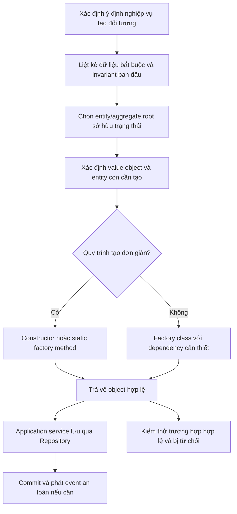

# Factory: tạo đối tượng hoặc Aggregate ở trạng thái hợp lệ

Một entity hoặc aggregate thường không thể được tạo chỉ bằng cách gán vài thuộc tính. Ngay từ thời điểm xuất hiện, nó có thể phải thỏa nhiều điều kiện: định danh hợp lệ, các giá trị bắt buộc đã có, những thành phần liên quan được khởi tạo đúng cách, trạng thái ban đầu phù hợp và các bất biến nghiệp vụ không bị vi phạm. Nếu đối tượng được tạo ở trạng thái nửa hoàn chỉnh rồi được sửa dần bằng nhiều setter, mọi đoạn code sử dụng nó đều phải đoán xem hiện tại nó đã hợp lệ hay chưa.

Trong Domain-Driven Design (DDD), **Factory** cung cấp một cách tạo entity hoặc aggregate để che giấu chi tiết khởi tạo và bảo đảm đối tượng mới đáp ứng các quy tắc cần thiết. Factory đặc biệt hữu ích khi quá trình tạo có nhiều bước, cần phối hợp nhiều value object hoặc entity con, hay phải chọn cách khởi tạo theo ý nghĩa nghiệp vụ. Kết quả của factory phải là một đối tượng có trạng thái rõ ràng, đủ điều kiện tham gia vào mô hình miền.

Bài này trình bày vai trò của Factory, cách chọn giữa static factory method và factory class, cách tạo aggregate cùng các thành phần bên trong, cách phân biệt tạo mới với khôi phục từ persistence, và cách kiểm thử để bảo đảm không có đối tượng nửa hợp lệ lọt vào mô hình.

Trong `DOMAIN_DRIVEN_DESIGN`, Factory gắn với tactical design cùng Entity, Value Object, Aggregate, Repository và Domain Event. Mục tiêu là giúp chuyên gia nghiệp vụ và đội phát triển diễn đạt rõ một đối tượng được tạo khi nào, với điều kiện nào và bắt đầu vòng đời ở trạng thái nào.

## 1. Vì sao cần Factory?

### 1.1. Constructor đơn giản không phải lúc nào cũng đủ

Với một đối tượng nhỏ, constructor có thể là cách tốt nhất:

```java
public record Quantity(int value) {
    public Quantity {
        if (value <= 0) {
            throw new IllegalArgumentException("Quantity must be positive");
        }
    }
}
```

`Quantity` có một giá trị và một quy tắc rõ ràng. Người gọi biết chính xác cần cung cấp gì; constructor kiểm tra điều kiện ngay lập tức.

Nhưng việc tạo một `Order` có thể phức tạp hơn:

- Phải có khách hàng và ít nhất một dòng hàng.
- Mỗi dòng hàng cần sản phẩm, số lượng và đơn giá hợp lệ.
- Địa chỉ giao hàng phải phù hợp với chính sách giao nhận.
- Các dòng hàng cần được chuyển thành những entity con thuộc quyền sở hữu của Order.
- Tổng tiền hoặc dữ liệu snapshot cần được xác định theo chính sách.
- Đơn phải bắt đầu ở trạng thái phù hợp với hành động nghiệp vụ.
- Hệ thống có thể cần ghi nhận một domain event sau khi tạo thành công.

Nếu caller tự thực hiện tất cả các bước này, quy tắc khởi tạo dễ bị lặp ở nhiều use case. Một caller có thể quên kiểm tra danh sách rỗng, caller khác có thể đặt sai trạng thái ban đầu, và caller thứ ba có thể tạo một dòng hàng không hợp lệ.

Factory gom trách nhiệm tạo đối tượng về một nơi có tên và ý nghĩa rõ ràng.

### 1.2. Factory bảo vệ trạng thái hợp lệ ngay từ lúc tạo

Một đối tượng hợp lệ cần thỏa các điều kiện cần thiết trước khi được trả về cho caller. Ví dụ, một đơn hàng được tạo ở trạng thái `PLACED` phải có khách hàng, ít nhất một dòng hàng và địa chỉ giao hàng hợp lệ. Không nên tạo một `Order` thiếu dòng hàng rồi hy vọng một service khác sẽ bổ sung sau.

Trạng thái hợp lệ không có nghĩa đối tượng phải hoàn tất mọi công việc trong vòng đời. Một đơn hàng có thể hợp lệ ở trạng thái `DRAFT` dù chưa thanh toán; một yêu cầu bảo hành có thể hợp lệ ở trạng thái `SUBMITTED` dù chưa được duyệt. Điều cần bảo đảm là trạng thái ban đầu phản ánh đúng một giai đoạn nghiệp vụ có ý nghĩa và mọi bất biến của giai đoạn đó đều đúng.

### 1.3. Factory che giấu cách tạo, không che giấu ý nghĩa nghiệp vụ

Caller nên nói rõ mình muốn tạo điều gì:

```java
Order.createDraft(...);
Order.place(...);
WarrantyClaim.submit(...);
Subscription.startTrial(...);
```

Những tên này diễn tả ý định nghiệp vụ tốt hơn một constructor có nhiều tham số hoặc một chuỗi setter chung chung. Factory không nên chỉ là một lớp có phương thức `create()` mơ hồ nếu miền có nhiều cách tạo với điều kiện khác nhau.

## 2. Factory nằm ở đâu trong mô hình DDD?

### 2.1. Factory và Entity

Entity có identity và vòng đời. Factory có thể tạo entity mới với định danh, thuộc tính bắt buộc và trạng thái ban đầu hợp lệ. Entity vẫn chịu trách nhiệm bảo vệ hành vi và bất biến trong suốt vòng đời sau đó.

Ví dụ, `Customer.register(...)` có thể tạo khách hàng mới. Sau khi được tạo, các hành vi như `changeContactInformation(...)` hoặc `deactivate(...)` vẫn thuộc về entity `Customer` nếu chúng làm thay đổi trạng thái của chính khách hàng.

### 2.2. Factory và Aggregate Root

Khi tạo aggregate, factory thường tạo aggregate root cùng các entity con và value object cần thiết. Caller nhận về root; các đối tượng bên trong được quản lý qua root theo quy tắc aggregate.

Ví dụ, `Order.place(...)` tạo `Order` và các `OrderLine`. Caller không cần tự tạo từng dòng rồi gắn chúng vào một root đang ở trạng thái thiếu thành phần. Aggregate root kiểm tra các bất biến liên quan đến toàn bộ đơn.

Factory có thể là một static method trên aggregate root, hoặc một factory class riêng nếu quy trình tạo đủ phức tạp. Dù cách nào, ranh giới aggregate vẫn do invariant và hành vi quyết định, không phải do vị trí đặt method factory.

### 2.3. Factory và Value Object

Value object thường có constructor hoặc static factory method đơn giản để xác thực và chuẩn hóa giá trị:

```java
PhoneNumber.of("+84 912 345 678");
Money.of(new BigDecimal("125000"), Currency.getInstance("VND"));
DateRange.between(start, end);
```

Không nhất thiết tạo một factory class riêng cho mọi value object. Constructor công khai hoặc static factory method là đủ khi quy tắc nhỏ, không cần phối hợp nhiều dependency và không có nhiều cách tạo phức tạp.

### 2.4. Factory và Repository

Factory tạo đối tượng mới trong miền. Repository cung cấp cách truy xuất và lưu aggregate đã được tạo hoặc thay đổi. Hai trách nhiệm không nên bị trộn lẫn.

```text
Application Service
      |
      v
Factory / Aggregate Root  ---> tạo trạng thái miền hợp lệ
      |
      v
Repository                ---> lưu aggregate
      |
      v
Persistence
```

Factory không mặc nhiên phải lưu đối tượng. Một aggregate được tạo trong bộ nhớ chưa chắc đã được commit vào database. Việc lưu và transaction thuộc application/persistence flow.

### 2.5. Factory và Domain Service

Factory tập trung vào việc tạo một đối tượng hoặc aggregate. Domain service biểu diễn một quy tắc nghiệp vụ không thuộc tự nhiên về một entity hoặc value object cụ thể.

Nếu một quyết định nghiệp vụ cần được tính trước khi tạo aggregate, domain service hoặc policy có thể cung cấp kết quả cho factory. Factory sau đó sử dụng kết quả đó để tạo đối tượng hợp lệ. Đừng biến factory thành nơi chứa mọi chính sách và quy trình chỉ vì nó đang được gọi ở đầu use case.

## 3. Những nguyên tắc của một Factory tốt

### 3.1. Trả về đối tượng hợp lệ

Factory không nên trả về object có các field bắt buộc đang null, collection chưa khởi tạo hoặc trạng thái không rõ. Nếu dữ liệu đầu vào chưa đủ, factory nên từ chối tạo và trả lỗi có ý nghĩa.

Ví dụ, nếu đơn hàng được tạo từ một danh sách dòng hàng, danh sách rỗng cần được xử lý ngay. Không nên tạo `Order` rồi để một phương thức `validateLater()` quyết định xem nó có thể sử dụng hay không.

### 3.2. Đặt tên theo ý định nghiệp vụ

Nếu có nhiều cách tạo khác nhau, tên method nên diễn tả sự khác biệt:

```java
Order.createDraft(customerId);
Order.place(customerId, lines, destination);
Order.createReplacementFor(originalOrderId, lines);
```

Ba cách tạo có thể có các điều kiện, trạng thái ban đầu và nguồn dữ liệu khác nhau. Tên rõ giúp caller chọn đúng quy trình và giúp code dễ đọc.

### 3.3. Bảo vệ invariant ở đúng nơi

Factory có thể kiểm tra điều kiện ban đầu, nhưng invariant cần được bảo vệ suốt vòng đời vẫn phải nằm trong entity hoặc aggregate root. Ví dụ, factory xác nhận đơn mới có ít nhất một dòng hàng; sau đó `Order.addLine(...)` vẫn phải kiểm tra trạng thái đơn có cho phép thêm dòng hàng không.

Đừng chỉ kiểm tra ở factory rồi công khai setter cho phép caller phá vỡ quy tắc sau khi tạo.

### 3.4. Không để lộ cấu trúc nội bộ

Caller nên cung cấp dữ liệu đầu vào có ý nghĩa, không cần biết thứ tự tạo từng entity con, cách sinh ID, cách khởi tạo collection hoặc cách thiết lập trạng thái nội bộ.

Factory có thể tạo `OrderLineId`, chuẩn hóa danh sách, tính snapshot và khởi tạo domain event. Các chi tiết này không nên buộc caller biết.

### 3.5. Không làm thay trách nhiệm của Application Service

Application service thường điều phối use case: xác thực người gọi, lấy dữ liệu tham chiếu, gọi dịch vụ miền, tạo aggregate, lưu repository và quản lý transaction. Factory không nên tự điều phối toàn bộ quy trình nhiều bounded context, gửi email, gọi API thanh toán hoặc commit transaction.

Nếu factory cần thông tin từ bên ngoài, application service có thể lấy dữ liệu trước rồi truyền vào. Khi một quy tắc miền cần một abstraction, factory có thể phụ thuộc vào interface phù hợp, nhưng phải tránh biến việc tạo object thành chuỗi side effect khó kiểm soát.

## 4. Static Factory Method hay Factory Class?

### 4.1. Static factory method

Static factory method phù hợp khi quá trình tạo tương đối gọn, phụ thuộc ít và có thể diễn đạt tự nhiên trên chính kiểu được tạo.

```java
public record Quantity(int value) {
    public Quantity {
        if (value <= 0) {
            throw new IllegalArgumentException("Quantity must be positive");
        }
    }

    public static Quantity of(int value) {
        return new Quantity(value);
    }
}
```

Với entity:

```java
public final class Customer {
    private final CustomerId id;
    private String displayName;
    private CustomerStatus status;

    private Customer(CustomerId id, String displayName) {
        this.id = Objects.requireNonNull(id);
        this.displayName = requireText(displayName, "displayName");
        this.status = CustomerStatus.ACTIVE;
    }

    public static Customer register(String displayName) {
        return new Customer(CustomerId.newId(), displayName);
    }

    public CustomerId id() {
        return id;
    }
}
```

Constructor private giúp caller không thể tạo `Customer` bằng cách bỏ qua quy tắc khởi tạo. Static method đặt tên `register` diễn tả hành động nghiệp vụ.

**Ưu điểm:** ít class hơn, dễ tìm nơi tạo, caller sử dụng trực tiếp kiểu miền và có thể cung cấp nhiều cách tạo với tên riêng.

**Giới hạn:** khó thay thế bằng implementation khác nếu cần dependency runtime; logic tạo phức tạp có thể làm entity chứa quá nhiều trách nhiệm; static method không thuận tiện khi cần dependency được inject.

### 4.2. Factory class riêng

Factory class phù hợp khi quá trình tạo có nhiều bước, cần phối hợp nhiều thành phần hoặc phụ thuộc vào abstraction như ID generator, clock, policy hay calculator.

```java
public final class OrderFactory {
    private final OrderIdGenerator idGenerator;
    private final Clock clock;

    public OrderFactory(OrderIdGenerator idGenerator, Clock clock) {
        this.idGenerator = Objects.requireNonNull(idGenerator);
        this.clock = Objects.requireNonNull(clock);
    }

    public Order place(
        CustomerId customerId,
        List<OrderLineInput> inputs,
        DeliveryDestination destination
    ) {
        Objects.requireNonNull(customerId);
        Objects.requireNonNull(destination);

        if (inputs == null || inputs.isEmpty()) {
            throw new EmptyOrderNotAllowed();
        }

        List<OrderLine> lines = inputs.stream()
            .map(input -> OrderLine.create(
                OrderLineId.newId(),
                input.productId(),
                input.quantity(),
                input.unitPrice()
            ))
            .toList();

        return Order.place(
            idGenerator.nextId(),
            customerId,
            lines,
            destination,
            clock.instant()
        );
    }
}
```

Trong ví dụ, factory class tạo ID, chuyển input thành entity con, lấy thời điểm và gọi aggregate root để hoàn tất việc khởi tạo. `Order.place(...)` vẫn chịu trách nhiệm bảo vệ invariant của Order. Factory không thay thế root.

**Ưu điểm:** dependency có thể được inject, dễ thay generator/clock trong test, tách logic tạo phức tạp khỏi entity và có thể tái sử dụng trong nhiều use case.

**Giới hạn:** thêm class và abstraction; nếu factory chỉ chuyển tiếp một dòng `new`, nó có thể là sự phức tạp không cần thiết.

### 4.3. Chọn cách nào?

| Tình huống | Lựa chọn thường phù hợp |
|---|---|
| Value object có một vài quy tắc xác thực | Constructor hoặc static factory method |
| Entity có cách tạo đơn giản, không cần dependency | Static factory method trên entity |
| Aggregate cần tạo các entity con và áp dụng invariant ban đầu | Static factory trên root hoặc factory class riêng |
| Cần ID generator, clock, policy hoặc calculator có thể thay thế | Factory class có dependency được inject |
| Có nhiều quy trình tạo khác nhau với ý nghĩa nghiệp vụ khác nhau | Nhiều named factory method hoặc factory class theo use case |
| Quá trình tạo là một workflow qua nhiều bounded context | Application service/process manager điều phối, không nhồi toàn bộ vào factory |

Không cần tạo interface `Factory` chung cho tất cả đối tượng. Hãy dùng abstraction khi có nhu cầu thay thế hoặc nhiều implementation thực sự, không chỉ để tuân theo một khuôn mẫu.

## 5. Ví dụ xuyên suốt: tạo Order Aggregate hợp lệ

Giả sử cửa hàng cho phép khách đặt đơn khi có ít nhất một dòng hàng, mỗi dòng có số lượng và đơn giá hợp lệ, khách hàng đã được xác định và địa chỉ giao hàng đã được cung cấp. Đơn mới được tạo ở trạng thái `PLACED` để bắt đầu quy trình giữ chỗ và thanh toán.

### 5.1. Định nghĩa các kiểu giá trị đầu vào

```java
public record OrderId(UUID value) {
    public OrderId {
        Objects.requireNonNull(value, "OrderId is required");
    }

    public static OrderId newId() {
        return new OrderId(UUID.randomUUID());
    }
}

public record CustomerId(UUID value) {
    public CustomerId {
        Objects.requireNonNull(value, "CustomerId is required");
    }
}

public record ProductId(String value) {
    public ProductId {
        if (value == null || value.isBlank()) {
            throw new IllegalArgumentException("ProductId is required");
        }
    }
}

public record Quantity(int value) {
    public Quantity {
        if (value <= 0) {
            throw new IllegalArgumentException("Quantity must be positive");
        }
    }
}
```

Các value object này tự bảo vệ giá trị. Factory không cần lặp lại mọi validation cấp thấp, nhưng vẫn kiểm tra các điều kiện tổng hợp như danh sách dòng hàng không rỗng.

### 5.2. Entity con thuộc Order

```java
public final class OrderLine {
    private final OrderLineId id;
    private final ProductId productId;
    private final Quantity quantity;
    private final Money unitPrice;

    private OrderLine(
        OrderLineId id,
        ProductId productId,
        Quantity quantity,
        Money unitPrice
    ) {
        this.id = Objects.requireNonNull(id);
        this.productId = Objects.requireNonNull(productId);
        this.quantity = Objects.requireNonNull(quantity);
        this.unitPrice = Objects.requireNonNull(unitPrice);
    }

    public static OrderLine create(
        OrderLineId id,
        ProductId productId,
        Quantity quantity,
        Money unitPrice
    ) {
        return new OrderLine(id, productId, quantity, unitPrice);
    }
}
```

Trong thiết kế thực tế, `OrderLineId` có thể được tạo bên trong `OrderLine.create` hoặc do factory cấp. Chọn một nơi có trách nhiệm rõ ràng và tránh để caller bên ngoài aggregate tự quản lý vòng đời dòng hàng.

### 5.3. Aggregate root kiểm soát invariant

```java
public final class Order {
    private final OrderId id;
    private final CustomerId customerId;
    private final List<OrderLine> lines;
    private final DeliveryDestination destination;
    private final Instant placedAt;
    private final OrderStatus status;

    private Order(
        OrderId id,
        CustomerId customerId,
        List<OrderLine> lines,
        DeliveryDestination destination,
        Instant placedAt
    ) {
        this.id = Objects.requireNonNull(id);
        this.customerId = Objects.requireNonNull(customerId);
        this.destination = Objects.requireNonNull(destination);
        this.placedAt = Objects.requireNonNull(placedAt);

        if (lines == null || lines.isEmpty()) {
            throw new EmptyOrderNotAllowed();
        }
        this.lines = List.copyOf(lines);
        this.status = OrderStatus.PLACED;
    }

    public static Order place(
        OrderId id,
        CustomerId customerId,
        List<OrderLine> lines,
        DeliveryDestination destination,
        Instant placedAt
    ) {
        return new Order(id, customerId, lines, destination, placedAt);
    }

    public OrderId id() {
        return id;
    }

    public List<OrderLine> lines() {
        return lines;
    }

    public OrderStatus status() {
        return status;
    }
}
```

Đây là ví dụ rút gọn với `OrderLine` bất biến. Nếu entity con có hành vi thay đổi, root cần cung cấp các phương thức điều phối và không trả collection mutable. `List.copyOf` bảo vệ cấu trúc list; các phần tử cũng phải được thiết kế an toàn.

### 5.4. Factory class tạo toàn bộ aggregate

```java
public final class OrderFactory {
    private final OrderIdGenerator idGenerator;
    private final Clock clock;

    public OrderFactory(OrderIdGenerator idGenerator, Clock clock) {
        this.idGenerator = Objects.requireNonNull(idGenerator);
        this.clock = Objects.requireNonNull(clock);
    }

    public Order place(
        CustomerId customerId,
        List<OrderLineInput> inputs,
        DeliveryDestination destination
    ) {
        if (inputs == null || inputs.isEmpty()) {
            throw new EmptyOrderNotAllowed();
        }

        List<OrderLine> lines = inputs.stream()
            .map(input -> OrderLine.create(
                OrderLineId.newId(),
                input.productId(),
                input.quantity(),
                input.unitPrice()
            ))
            .toList();

        return Order.place(
            idGenerator.nextId(),
            customerId,
            lines,
            destination,
            clock.instant()
        );
    }
}
```

Ở đây, factory class điều phối việc tạo các thành phần và cung cấp ID/thời điểm. Aggregate root vẫn là nơi bảo vệ bất biến cuối cùng. Việc kiểm tra danh sách rỗng ở factory giúp báo lỗi sớm; kiểm tra lại trong root bảo vệ invariant ngay cả khi một caller khác gọi `Order.place` trực tiếp.

### 5.5. Application service điều phối use case

```java
public final class PlaceOrderHandler {
    private final OrderFactory orderFactory;
    private final OrderRepository orderRepository;

    public PlaceOrderHandler(
        OrderFactory orderFactory,
        OrderRepository orderRepository
    ) {
        this.orderFactory = orderFactory;
        this.orderRepository = orderRepository;
    }

    public OrderId handle(PlaceOrderCommand command) {
        Order order = orderFactory.place(
            command.customerId(),
            command.lines(),
            command.destination()
        );

        orderRepository.save(order);
        return order.id();
    }
}
```

Application service chịu trách nhiệm use case và transaction ở lớp ứng dụng. Trong hệ thống thực tế, nó có thể cần xác minh quyền, lấy báo giá hoặc kiểm tra dữ liệu tham chiếu trước khi gọi factory. Những bước này không nhất thiết thuộc factory.

## 6. Khi nào Factory cần phụ thuộc vào dịch vụ khác?

### 6.1. ID Generator và Clock

Factory class có thể phụ thuộc vào abstraction để tạo ID hoặc lấy thời điểm:

```java
public interface OrderIdGenerator {
    OrderId nextId();
}
```

Điều này giúp test dùng ID cố định và thời gian cố định. Với ứng dụng nhỏ, gọi `UUID.randomUUID()` và `Instant.now()` trực tiếp có thể đủ; nhưng khi cần tính xác định, đồng bộ hoặc chính sách tạo ID riêng, abstraction có ích.

### 6.2. Domain Policy hoặc Calculator

Nếu quy tắc khởi tạo cần tính toán phức tạp, factory có thể sử dụng policy hoặc calculator thuộc miền:

```text
OrderFactory
  ├── OrderIdGenerator
  ├── Clock
  └── InitialPricingPolicy
```

Ví dụ, chính sách xác định đơn mới có được phép đặt cọc hay không có thể được áp dụng trước khi tạo aggregate. Tuy nhiên, cần phân biệt kết quả được tính từ dữ liệu đầu vào với dữ liệu cần truy vấn từ hệ thống khác.

### 6.3. Không truy vấn repository tùy tiện trong Factory

Một factory thường không nên tự gọi nhiều repository để tải Customer, Product, Inventory, Pricing rồi tạo Order. Điều đó làm factory trở thành nơi điều phối use case và tạo ra phụ thuộc khó kiểm soát.

Application service nên lấy dữ liệu cần thiết qua các cổng phù hợp, xác minh quyền và chính sách liên quan, rồi truyền dữ liệu hoặc kết quả đã xác nhận vào factory. Nếu việc tạo thực sự cần một domain service, hãy truyền abstraction có ý nghĩa miền và giới hạn trách nhiệm rõ ràng.

### 6.4. Không thực hiện side effect bên ngoài trong Factory

Factory không nên gửi email, gọi cổng thanh toán, publish message hoặc commit transaction. Những side effect này có thể thất bại sau khi object được tạo, làm trạng thái trong bộ nhớ và hệ thống bên ngoài không đồng bộ.

Factory có thể ghi nhận domain event trong aggregate hoặc trả về đối tượng chứa sự kiện cần xử lý. Application service/persistence flow sẽ lưu aggregate và outbox trong transaction phù hợp, sau đó mới phát thông điệp.

## 7. Factory cho nhiều cách tạo khác nhau

### 7.1. Tên method thể hiện trạng thái khởi đầu

Một entity có thể được tạo qua nhiều quy trình hợp lệ:

```java
Subscription.startTrial(customerId, planId, trialPeriod);
Subscription.activatePaid(customerId, planId, paymentReference);
Subscription.migrateFromLegacy(legacySnapshot);
```

Các phương thức này không chỉ khác nhau về dữ liệu đầu vào. Chúng có thể bắt đầu ở trạng thái khác nhau và chịu các điều kiện nghiệp vụ khác nhau.

Không nên tạo một method `create(...)` với hàng loạt tham số nullable như `trialPeriod`, `paymentReference`, `legacySnapshot` rồi suy luận nhánh dựa trên field nào có giá trị. Named factory method giúp biểu đạt ý định và loại trừ các tổ hợp không hợp lệ.

### 7.2. Factory theo loại hoặc chính sách

Nếu có nhiều biến thể tạo đối tượng, có thể dùng factory class riêng theo loại:

- `TrialSubscriptionFactory` tạo subscription dùng thử.
- `PaidSubscriptionFactory` tạo subscription đã thanh toán.
- `ImportedCustomerFactory` chuyển dữ liệu import thành Customer miền.

Chỉ tách thành nhiều class khi mỗi class có trách nhiệm hoặc dependency thực sự khác nhau. Nếu chỉ khác một tham số, named method có thể đơn giản hơn.

### 7.3. Không dùng Factory để che giấu dữ liệu bắt buộc

Factory không nên âm thầm điền giá trị mặc định không có căn cứ nghiệp vụ. Nếu thiếu địa chỉ giao hàng, không nên tự tạo địa chỉ rỗng chỉ để constructor chạy được. Nếu trạng thái ban đầu không xác định, hãy làm rõ chính sách thay vì chọn `PENDING` như một giá trị tiện lợi.

Giá trị mặc định chỉ nên được dùng khi nghiệp vụ xác định rõ ý nghĩa và phạm vi của nó.

## 8. Factory và Builder: khác nhau ở mục đích

Builder giúp dựng một object có nhiều tham số hoặc cấu hình tùy chọn theo từng bước. Factory tập trung vào việc tạo đối tượng theo một ý định và quy tắc nghiệp vụ cụ thể.

| Tiêu chí | Factory | Builder |
|---|---|---|
| Mục đích | Tạo entity/aggregate hợp lệ theo quy trình nghiệp vụ | Dựng object có cấu hình nhiều bước hoặc nhiều tùy chọn |
| Ngôn ngữ | `Order.place(...)`, `Subscription.startTrial(...)` | `Report.builder().title(...).format(...).build()` |
| Trọng tâm | Ý định tạo, invariant và trạng thái ban đầu | Thu thập và tổ chức các tham số |
| Kết quả | Thường là entity hoặc aggregate có vòng đời | Có thể là object miền, DTO, cấu hình hoặc tài liệu |
| Validation | Phải bảo đảm quy tắc khởi tạo miền | `build()` cần kiểm tra để không trả object sai |

Builder có thể được dùng bên trong factory để tổ chức dữ liệu đầu vào, nhưng không nên để caller tùy ý gọi setter trên builder rồi tạo một aggregate ở trạng thái không hợp lệ. Nếu builder được dùng cho miền, `build()` vẫn phải bảo vệ invariant hoặc chuyển việc tạo cuối cùng cho factory/root.

## 9. Tạo mới khác với khôi phục từ Persistence

### 9.1. Business creation

Tạo mới theo nghiệp vụ là bắt đầu một vòng đời mới. Các quy tắc như điều kiện đăng ký, trạng thái ban đầu, quyền sở hữu, ID và sự kiện khởi tạo cần được áp dụng.

Ví dụ, `Order.place(...)` có thể yêu cầu khách hàng hợp lệ, ít nhất một dòng hàng và địa chỉ giao nhận.

### 9.2. Reconstitution

Khi repository tải aggregate đã tồn tại từ database, nó cần tái tạo object từ trạng thái đã lưu. Đây là **reconstitution** (khôi phục), không phải một hành động nghiệp vụ tạo mới.

Nếu repository gọi lại `Order.place(...)` cho dữ liệu cũ, hệ thống có thể:

- Tạo ID mới thay vì giữ ID đã lưu.
- Gán lại trạng thái ban đầu, làm mất trạng thái hiện tại.
- Phát lại sự kiện `OrderPlaced` dù đơn đã được đặt từ trước.
- Áp dụng chính sách hiện tại lên dữ liệu được tạo theo chính sách cũ.

Vì vậy, đường khôi phục cần giữ nguyên identity, trạng thái và dữ liệu lịch sử đã lưu, đồng thời xử lý tương thích schema/version nếu cần.

### 9.3. Tách đường tạo mới và khôi phục

Một cách thiết kế là dùng constructor/factory dành cho tạo mới và một cơ chế reconstitution riêng trong persistence adapter:

```text
Business creation:
  OrderFactory.place(command)
      -> kiểm tra quy tắc tạo mới
      -> tạo ID và trạng thái ban đầu
      -> ghi nhận event khởi tạo

Reconstitution:
  OrderRepository.findById(id)
      -> đọc record
      -> mapper khôi phục ID, trạng thái và dữ liệu đã lưu
      -> trả aggregate hiện có
```

Không nên công khai một method `restore(...)` cho mọi caller nếu nó cho phép tạo aggregate tùy ý từ trạng thái không hợp lệ. Cơ chế này thường nên được giới hạn trong module persistence hoặc package phù hợp.

### 9.4. ORM và constructor mặc định

Một số ORM cần constructor mặc định hoặc cơ chế reflection để hydrate object. Đây là yêu cầu persistence, không phải lý do để cho phép application tạo entity miền thiếu dữ liệu.

Có thể dùng persistence model riêng, mapper hoặc constructor có phạm vi truy cập phù hợp để tách yêu cầu ORM khỏi API tạo mới của miền. Nếu dùng chung class cho domain và ORM, hãy bảo đảm caller bên ngoài vẫn không thể tạo object nửa hợp lệ.

## 10. Factory và Domain Event

### 10.1. Ghi nhận sự kiện tạo mới

Một hành động tạo có thể tạo ra domain event nếu nghiệp vụ quan tâm đến việc đó:

- `CustomerRegistered`
- `OrderPlaced`
- `SubscriptionStarted`
- `WarrantyClaimSubmitted`

Tên event phải phản ánh điều đã xảy ra. Nếu factory mới tạo bản nháp, sự kiện có thể là `OrderDraftCreated`; không nên phát `OrderPlaced` nếu đơn chưa thực sự được đặt theo định nghĩa nghiệp vụ.

### 10.2. Ghi event không đồng nghĩa publish ngay

Factory hoặc aggregate có thể ghi nhận event trong bộ nhớ. Application/persistence layer cần bảo đảm event được lưu và phát an toàn sau khi transaction commit, ví dụ bằng transactional outbox.

```text
Factory tạo Aggregate
        |
        v
Aggregate ghi nhận Domain Event
        |
        v
Repository lưu Aggregate + Outbox trong transaction
        |
        v
Transaction commit
        |
        v
Outbox publisher phát event
```

Nếu publish trực tiếp trong factory trước khi lưu, consumer có thể nhận sự kiện cho một aggregate chưa được commit hoặc cuối cùng bị rollback. Factory không nên tự quản lý broker hay network.

### 10.3. Không tạo event chỉ vì constructor được gọi

Không phải mọi object construction đều là sự kiện nghiệp vụ. Tạo một value object `Money` hoặc khôi phục một aggregate từ database thường không tạo event. Event chỉ cần khi một điều có ý nghĩa trong miền đã xảy ra và các bên khác cần biết.

## 11. Xử lý lỗi khi tạo đối tượng

### 11.1. Phân biệt input không hợp lệ và điều kiện nghiệp vụ không đạt

Một số lỗi là dữ liệu đầu vào sai định dạng, ví dụ số lượng bằng không hoặc ID bị thiếu. Một số trường hợp là quy tắc nghiệp vụ từ chối hành động, ví dụ khách hàng không được phép đặt đơn hoặc sản phẩm không còn được bán.

Không nên dùng một exception chung cho mọi trường hợp. Tên lỗi nên giúp application service và caller hiểu có thể làm gì tiếp theo.

### 11.2. Exception hay Result?

Với lỗi lập trình hoặc vi phạm điều kiện bất biến mà caller không nên bỏ qua, exception miền có thể phù hợp. Với các kết quả từ chối dự kiến trong luồng nghiệp vụ, có thể dùng `Result`, `Either` hoặc một kiểu kết quả có phân loại rõ.

Ví dụ khái quát:

```java
public sealed interface CreateOrderResult {
    record Created(Order order) implements CreateOrderResult {}
    record Rejected(String reason) implements CreateOrderResult {}
}
```

Kiểu kết quả này phù hợp khi từ chối là một kết quả bình thường mà caller cần trình bày hoặc xử lý. Cách chọn phụ thuộc quy ước của codebase; điều quan trọng là không trả về một aggregate nửa hợp lệ để biểu diễn thất bại.

### 11.3. Không âm thầm tạo trạng thái mặc định sai

Nếu thiếu một dữ kiện bắt buộc, factory nên từ chối tạo. Không dùng chuỗi rỗng, ID giả, ngày mặc định hoặc trạng thái `UNKNOWN` để lấp chỗ trống nếu nghiệp vụ không định nghĩa chúng.

Giá trị `UNKNOWN` có thể hợp lệ nếu miền thực sự có trạng thái chưa biết, chẳng hạn kết quả thanh toán chưa xác định sau timeout. Nhưng đó phải là trạng thái có ý nghĩa và có quy trình tiếp theo, không phải cách né validation.

## 12. Kiểm thử Factory

Factory cần được kiểm thử ở cấp miền mà không cần phụ thuộc database nếu việc tạo không yêu cầu persistence.

### 12.1. Kiểm thử tạo thành công

```java
@Test
void createsOrderWithValidInitialState() {
    OrderFactory factory = new OrderFactory(
        () -> new OrderId(UUID.fromString(
            "123e4567-e89b-12d3-a456-426614174000"
        )),
        Clock.fixed(
            Instant.parse("2026-11-18T03:00:00Z"),
            ZoneOffset.UTC
        )
    );

    Order order = factory.place(
        customerId(),
        List.of(validLineInput()),
        validDestination()
    );

    assertEquals(OrderStatus.PLACED, order.status());
    assertEquals(1, order.lines().size());
    assertNotNull(order.id());
}
```

Kiểm thử xác nhận factory tạo đủ các thành phần và trạng thái ban đầu đúng. ID và thời gian được cố định giúp kết quả có thể lặp lại.

### 12.2. Kiểm thử dữ liệu không hợp lệ

```java
@Test
void rejectsOrderWithoutLines() {
    OrderFactory factory = testOrderFactory();

    assertThrows(EmptyOrderNotAllowed.class,
        () -> factory.place(
            customerId(),
            List.of(),
            validDestination()
        ));
}
```

Không chỉ kiểm tra exception, hãy xác nhận không có repository write, event publish hoặc side effect bên ngoài nào đã xảy ra khi việc tạo bị từ chối.

### 12.3. Kiểm thử invariant của aggregate

Factory có thể tạo một aggregate hợp lệ, nhưng các hành vi sau đó vẫn cần được kiểm tra. Ví dụ, sau khi Order được xác nhận, hành vi thêm dòng hàng phải bị từ chối theo chính sách. Điều này xác nhận invariant được bảo vệ bởi aggregate root chứ không chỉ bởi factory.

### 12.4. Kiểm thử reconstitution riêng

Kiểm thử repository nên xác nhận tải lại aggregate giữ nguyên ID, trạng thái, snapshot và các dữ liệu lịch sử. Không được phát lại event tạo mới khi chỉ hydrate dữ liệu cũ.

## 13. Quy trình thiết kế Factory

Có thể thực hiện theo các bước sau:



Trước khi triển khai, hãy trả lời:

1. Đối tượng được tạo vì hành động nghiệp vụ nào?
2. Ai có quyền yêu cầu tạo?
3. Dữ liệu nào bắt buộc và dữ liệu nào tùy chọn?
4. Bất biến nào phải đúng ngay sau khi tạo?
5. Trạng thái ban đầu có ý nghĩa gì?
6. Có những cách tạo hợp lệ nào và chúng khác nhau ở đâu?
7. Có cần tạo các entity con hoặc value object cùng lúc không?
8. Factory có cần ID generator, clock hoặc domain policy không?
9. Những dữ liệu nào application service phải lấy trước?
10. Sự kiện nào thực sự đã xảy ra và khi nào được publish?
11. Đường khôi phục từ persistence có được tách khỏi đường tạo mới không?
12. Có thể kiểm thử factory mà không cần database hoặc hệ thống bên ngoài không?

## 14. Những sai lầm thường gặp

**Tạo object rỗng rồi gọi nhiều setter.** Object có thể bị sử dụng khi chưa đủ dữ liệu. Dùng constructor hoặc factory yêu cầu dữ liệu bắt buộc ngay từ đầu.

**Factory chỉ đổi tên constructor.** Nếu method không thêm ý nghĩa, validation hoặc che giấu logic tạo, có thể không cần factory riêng.

**Một factory khổng lồ tạo mọi loại object.** Trách nhiệm tạo nên gắn với khái niệm hoặc quy trình cụ thể. Tách theo ý nghĩa miền, không gom mọi `create()` vào một lớp tiện ích.

**Factory điều phối toàn bộ workflow.** Gọi API, gửi email, commit transaction và publish message thuộc application/infrastructure flow. Factory tập trung tạo object hợp lệ.

**Factory bỏ qua invariant vì caller đã kiểm tra.** Không tin mọi caller đều tuân thủ. Aggregate root và value object phải tự bảo vệ quy tắc thuộc về chúng.

**Dùng cùng một method cho mọi trạng thái ban đầu.** Tham số nullable và cờ boolean làm các tổ hợp không hợp lệ dễ xuất hiện. Dùng named factory method thể hiện từng ý định.

**Dùng factory tạo lại object khi repository tải dữ liệu.** Reconstitution phải giữ ID, trạng thái và lịch sử hiện có; không chạy lại nghiệp vụ tạo mới.

**Phát domain event ngay trong factory.** Việc tạo event trong bộ nhớ khác với publish ra hệ thống. Hãy gắn việc phát với transaction/outbox.

**Dùng Builder thay Factory mà không kiểm tra kết quả.** Builder có thể cho phép thiếu dữ liệu hoặc tổ hợp sai. `build()` vẫn phải xác thực hoặc ủy quyền cho aggregate root.

**Tạo abstraction quá sớm.** Không cần interface hoặc factory class riêng khi một static method đơn giản đã đáp ứng nhu cầu.

## 15. Checklist Factory và vòng đời khởi tạo

Trước khi xem factory là hoàn chỉnh, hãy kiểm tra:

- [ ] Tên factory diễn tả đúng ý định nghiệp vụ.
- [ ] Dữ liệu bắt buộc được yêu cầu ngay khi tạo.
- [ ] Value object kiểm tra giá trị của chính nó.
- [ ] Aggregate root kiểm tra invariant liên quan đến toàn aggregate.
- [ ] Entity con được tạo và gắn vào root theo đúng quyền sở hữu.
- [ ] Trạng thái ban đầu có ý nghĩa nghiệp vụ rõ ràng.
- [ ] Không có field bắt buộc null hoặc collection chưa khởi tạo.
- [ ] Caller không thể bỏ qua factory để tạo object nửa hợp lệ.
- [ ] Dependency như ID generator và clock được đưa vào có kiểm soát.
- [ ] Factory không thực hiện side effect hoặc commit transaction.
- [ ] Application service chịu trách nhiệm điều phối và lưu repository.
- [ ] Tạo mới được phân biệt với reconstitution từ persistence.
- [ ] Domain event chỉ được publish sau khi dữ liệu được commit an toàn.
- [ ] Có kiểm thử tạo thành công, dữ liệu sai và invariant ban đầu.

## 16. Câu hỏi tự kiểm tra

1. Factory giải quyết vấn đề gì khi tạo một aggregate có nhiều entity con?
2. Vì sao một đối tượng ở trạng thái `DRAFT` vẫn có thể là đối tượng hợp lệ?
3. Khi nào static factory method phù hợp hơn factory class?
4. Khi nào factory class có dependency được inject là lựa chọn hợp lý?
5. Vì sao Factory không nên tự gọi nhiều repository và API bên ngoài để điều phối toàn bộ use case?
6. Vì sao factory tạo mới không nên được dùng để khôi phục aggregate từ database?
7. Việc aggregate ghi nhận domain event có đồng nghĩa event đã được publish không?
8. Nếu một factory tạo Order không có dòng hàng nhưng caller dự định thêm sau, cần xem lại điều gì?

**Gợi ý trả lời:**

- Câu 1: Factory che giấu trình tự tạo, tạo các thành phần cần thiết và bảo đảm invariant ban đầu trước khi trả aggregate root.
- Câu 2: `DRAFT` là một giai đoạn nghiệp vụ có ý nghĩa nếu các quy tắc của bản nháp được thỏa mãn. Hợp lệ không có nghĩa đã hoàn tất toàn bộ vòng đời.
- Câu 3: Khi quy trình tạo gọn, ít dependency và có thể diễn đạt tự nhiên trên kiểu được tạo.
- Câu 4: Khi cần ID generator, clock, policy hoặc logic phối hợp nhiều thành phần và muốn thay thế dependency trong kiểm thử.
- Câu 5: Việc đó biến factory thành application service, làm trộn trách nhiệm tạo object với workflow, transaction và side effect.
- Câu 6: Factory tạo mới có thể sinh ID, trạng thái và event mới; reconstitution phải giữ identity, trạng thái và lịch sử đã lưu.
- Câu 7: Không. Ghi event trong aggregate là ghi nhận sự kiện miền; publish cần được phối hợp với persistence/transaction, thường qua outbox.
- Câu 8: Xác định xem Order có thực sự có trạng thái hợp lệ không có dòng hàng hay không. Nếu đơn chỉ hợp lệ sau khi có ít nhất một dòng, factory phải yêu cầu dòng hàng ngay khi tạo. Nếu bản nháp rỗng là giai đoạn hợp lệ, cần mô hình hóa riêng ý nghĩa và quy tắc của nó.

## Kết luận

Factory giúp tạo entity hoặc aggregate theo một ý định nghiệp vụ rõ ràng và trả về đối tượng đã thỏa các điều kiện khởi tạo. Với quy trình đơn giản, constructor hoặc static factory method thường đủ; với quy trình phức tạp và có dependency, factory class có thể phù hợp hơn. Aggregate root vẫn chịu trách nhiệm bảo vệ invariant trong suốt vòng đời, application service điều phối use case và repository lưu đối tượng. Tách tạo mới khỏi reconstitution và gắn việc publish domain event với transaction an toàn giúp vòng đời đối tượng rõ ràng, dễ kiểm thử và ít tạo ra trạng thái nửa hợp lệ.
