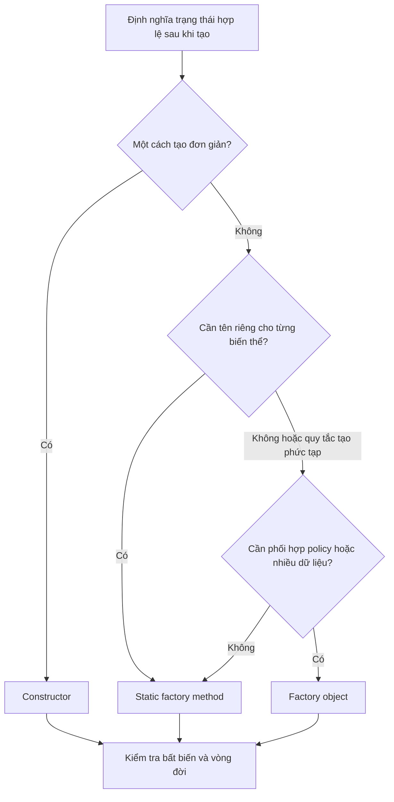

# Lựa chọn constructor, phương thức tạo tĩnh hoặc factory riêng

## Vì sao cách tạo đối tượng quan trọng trong DDD?

Trong Domain-Driven Design (DDD), tạo một đối tượng miền không chỉ là cấp phát bộ nhớ và gán vài trường dữ liệu. Một `Order` mới phải bắt đầu ở trạng thái hợp lệ; một `Subscription` phải có gói dịch vụ và thời điểm bắt đầu phù hợp; một `Payment` phải có số tiền, loại tiền và thông tin tham chiếu cần thiết. Nếu đối tượng được tạo trong trạng thái nửa vời rồi được sửa dần từ bên ngoài, quy tắc nghiệp vụ có thể bị bỏ qua và lỗi chỉ xuất hiện ở một bước xử lý xa hơn.

Java cung cấp nhiều cách diễn đạt quá trình tạo đối tượng. **Constructor** phù hợp khi việc tạo đơn giản và các tham số đủ rõ. **Static factory method** giúp đặt tên cho ý nghĩa của việc tạo và kiểm soát cách khởi tạo. **Factory riêng (factory object)** phù hợp khi quy tắc tạo phức tạp, cần phối hợp nhiều dữ liệu hoặc chính sách miền, hay cần tách trách nhiệm tạo khỏi đối tượng được tạo.

Không có một lựa chọn luôn tốt nhất. Cần xem xét độ phức tạp của quy tắc, số biến thể tạo, trách nhiệm bảo vệ bất biến và nơi dữ liệu cần thiết được lấy. Mục tiêu là mọi đường tạo mới đều tạo ra một đối tượng hợp lệ theo ngôn ngữ và chính sách nghiệp vụ.

Sau bài học, người học có thể:

- Phân biệt constructor, static factory method và factory object.
- Chọn cách tạo phù hợp với mức độ phức tạp và ý nghĩa nghiệp vụ.
- Bảo vệ bất biến ngay tại điểm tạo aggregate hoặc value object.
- Thiết kế các biến thể tạo có tên rõ ràng mà không làm lộ trạng thái nội bộ.
- Phân biệt tạo mới đối tượng với khôi phục đối tượng từ persistence.
- Tránh đặt truy vấn cơ sở dữ liệu, gọi API hoặc side effect không cần thiết trong constructor.

## Bắt đầu từ quy tắc tạo của miền

Trước khi chọn cú pháp Java, hãy mô tả đối tượng cần được tạo và điều kiện để nó được xem là hợp lệ. Có thể đặt các câu hỏi sau:

- Đối tượng đại diện cho khái niệm nào và được tạo vào thời điểm nghiệp vụ nào?
- Những dữ liệu nào bắt buộc phải có ngay từ đầu?
- Những điều kiện nào phải luôn đúng sau khi tạo?
- Có nhiều cách tạo hợp lệ với ý nghĩa nghiệp vụ khác nhau không?
- Việc tạo có cần phối hợp nhiều đối tượng hoặc chính sách không?
- Dữ liệu cần thiết đã có trong use case hay phải truy vấn từ một nguồn khác?
- Đối tượng được tạo mới hay đang được khôi phục từ trạng thái đã lưu?

Ví dụ, một đơn hàng có thể được tạo ở trạng thái nháp với khách hàng và danh sách dòng hàng rỗng. Một đơn hàng được đặt trực tiếp từ giỏ hàng có thể cần kiểm tra từng sản phẩm, chụp tên và giá tại thời điểm đặt, tính tổng tiền và tạo trạng thái ban đầu. Hai tình huống có thể dùng hai đường tạo khác nhau vì chúng mang ý nghĩa và yêu cầu khác nhau.

### Tạo đối tượng phải bảo vệ bất biến

Giả sử `Order` luôn cần có mã đơn và khách hàng. Một đơn ở trạng thái `PLACED` phải có ít nhất một dòng hàng và mọi dòng hàng phải có số lượng dương. Nếu constructor công khai cho phép truyền `status = PLACED` cùng một danh sách rỗng, mô hình cho phép tạo trạng thái không hợp lệ.

Một nguyên tắc hữu ích là: **sau khi constructor hoặc factory trả về, đối tượng phải thỏa mãn các bất biến áp dụng cho trạng thái ban đầu của nó**. Nếu nghiệp vụ cho phép đối tượng nháp chưa có dòng hàng, đó là trạng thái hợp lệ có điều kiện; hành vi chuyển từ nháp sang đặt đơn phải kiểm tra các điều kiện mới.

Không nhất thiết mọi thuộc tính đều phải được gán giá trị cuối cùng trong constructor. Một entity có thể có vòng đời nhiều bước. Nhưng trạng thái khởi tạo phải được định nghĩa rõ, không phải một tập trường null hoặc cờ boolean chưa biết ý nghĩa.

## Constructor: lựa chọn trực tiếp và rõ ràng

### Khi nào constructor phù hợp?

Constructor thường là lựa chọn tốt khi:

- Có một cách tạo chủ yếu và đơn giản.
- Các tham số bắt buộc đã đủ để tạo trạng thái hợp lệ.
- Không cần đặt tên khác nhau cho các biến thể tạo.
- Việc khởi tạo chỉ cần kiểm tra và gán trạng thái nội tại.

Ví dụ, một value object `EmailAddress` có thể được tạo bằng constructor và tự xác thực định dạng tối thiểu theo quy tắc của miền:

```java
import java.util.Objects;

public record EmailAddress(String value) {
    public EmailAddress {
        Objects.requireNonNull(value, "value");
        value = value.trim();
        if (value.isEmpty() || !value.contains("@")) {
            throw new IllegalArgumentException("Invalid email address");
        }
    }
}
```

Đây chỉ là kiểm tra cấu trúc cơ bản, không chứng minh địa chỉ email tồn tại hoặc có thể nhận thư. Xác minh quyền sở hữu email là một quy trình nghiệp vụ khác. Constructor chỉ nên bảo vệ điều kiện nội tại mà giá trị có thể tự xác định.

### Constructor công khai và constructor đóng

Constructor công khai phù hợp khi caller được phép tạo trực tiếp đối tượng với các tham số đã xác định. Với entity hoặc aggregate có nhiều quy tắc, có thể dùng constructor `private` hoặc package-private rồi cung cấp phương thức tạo có tên để kiểm soát các đường khởi tạo.

```java
import java.util.Objects;
import java.util.UUID;

public final class Customer {
    private final UUID id;
    private final String name;

    public Customer(UUID id, String name) {
        this.id = Objects.requireNonNull(id, "id");
        this.name = requireName(name);
    }

    private static String requireName(String name) {
        Objects.requireNonNull(name, "name");
        String normalized = name.trim();
        if (normalized.isEmpty()) {
            throw new IllegalArgumentException("Customer name is required");
        }
        return normalized;
    }
}
```

Constructor này đủ cho một ví dụ đơn giản. Nếu `Customer` cần phân biệt khách hàng đăng ký mới, khách được nhập từ hệ thống đối tác hoặc khách được tạo từ quy trình chuyển đổi dữ liệu, các đường tạo có thể cần ý nghĩa khác nhau và static factory hoặc factory object sẽ giúp diễn đạt tốt hơn.

### Giới hạn của constructor

Constructor trong Java không có tên riêng, vì vậy nhiều constructor overload có thể khó đọc nếu các tham số cùng kiểu hoặc số lượng tham số lớn:

```java
// Khó biết hai tham số String đại diện cho điều gì.
new Address("12 Nguyen Hue", "Ho Chi Minh City");
```

Constructor cũng không thể khai báo nhiều phương thức cùng chữ ký chỉ khác tên. Khi có nhiều cách tạo, các overload như `Order(CustomerId, Money)` và `Order(CustomerId, List<OrderLine>)` có thể khiến caller phải nhớ thứ tự và ý nghĩa tham số. Tham số tùy chọn dễ dẫn đến nhiều constructor hoặc truyền `null`.

Constructor nên tránh thực hiện I/O, truy vấn repository, gọi HTTP, gửi message hoặc đăng ký sự kiện ra ngoài. Những công việc này có thể thất bại, kéo dài hoặc tạo side effect; đặt chúng trong constructor làm cho việc tạo object khó kiểm thử và khó kiểm soát transaction. Hãy lấy dữ liệu cần thiết ở application layer rồi truyền dữ liệu đã xác định vào đối tượng hoặc factory miền.

## Static factory method: tạo bằng tên có ý nghĩa

### Static factory method là gì?

Static factory method là phương thức `static` trả về một instance của kiểu hiện tại hoặc một kiểu tương thích. Nó có thể gọi constructor riêng và áp dụng quy tắc trước khi trả đối tượng. Khác constructor, phương thức có tên nên diễn đạt được mục đích tạo.

```java
import java.util.Objects;
import java.util.UUID;

public final class OrderId {
    private final UUID value;

    private OrderId(UUID value) {
        this.value = Objects.requireNonNull(value, "value");
    }

    public static OrderId generate() {
        return new OrderId(UUID.randomUUID());
    }

    public static OrderId from(UUID value) {
        return new OrderId(value);
    }

    public UUID value() {
        return value;
    }
}
```

`generate()` diễn đạt việc tạo định danh mới; `from()` diễn đạt việc tạo giá trị từ một định danh đã có. Hai phương thức có thể dùng chung constructor nhưng ý nghĩa khác nhau được thể hiện rõ ở nơi gọi.

### Đặt tên theo ý nghĩa nghiệp vụ

Một số tên thường hữu ích:

- `of(...)`: tạo từ một hoặc nhiều giá trị cấu thành.
- `from(...)`: chuyển đổi từ một biểu diễn hoặc nguồn đã có.
- `create(...)`: tạo một đối tượng mới theo quy tắc thông thường.
- `draft(...)`: tạo ở trạng thái nháp.
- `register(...)`: tạo từ hành động đăng ký trong nghiệp vụ.
- `reconstitute(...)`: khôi phục từ dữ liệu đã lưu, nếu kiến trúc cần phân biệt rõ đường này.

Tên không bắt buộc theo một quy ước duy nhất. Điều quan trọng là người đọc hiểu đối tượng được tạo vì lý do gì và trạng thái ban đầu có ý nghĩa gì.

### Nhiều biến thể tạo mà không overload constructor

Giả sử một đơn hàng có thể bắt đầu ở trạng thái nháp hoặc được tạo từ một yêu cầu đặt hàng đã hợp lệ. Static factory giúp biểu đạt hai trường hợp:

```java
import java.util.ArrayList;
import java.util.List;
import java.util.Objects;
import java.util.UUID;

public final class Order {
    private final UUID id;
    private final UUID customerId;
    private final List<OrderLine> lines;
    private OrderStatus status;

    private Order(UUID id, UUID customerId, List<OrderLine> lines,
                  OrderStatus status) {
        this.id = Objects.requireNonNull(id, "id");
        this.customerId = Objects.requireNonNull(customerId, "customerId");
        this.lines = new ArrayList<>(Objects.requireNonNull(lines, "lines"));
        this.status = Objects.requireNonNull(status, "status");
    }

    public static Order draft(UUID customerId) {
        return new Order(UUID.randomUUID(), customerId,
                List.of(), OrderStatus.DRAFT);
    }

    public static Order placeNew(UUID customerId, List<OrderLine> lines) {
        Objects.requireNonNull(lines, "lines");
        if (lines.isEmpty()) {
            throw new IllegalArgumentException("An order needs at least one line");
        }
        return new Order(UUID.randomUUID(), customerId,
                lines, OrderStatus.PLACED);
    }
}
```

Ví dụ lược bỏ hành vi và các kiểu miền phụ để tập trung vào cách tạo. Trong ứng dụng thực tế, `placeNew()` cần kiểm tra mọi dòng hàng hợp lệ và có thể cần tính tổng tiền hoặc lưu snapshot theo chính sách. Nếu việc đặt đơn cần kiểm tra catalog, khách hàng hay tồn kho, application service nên phối hợp các bước đó trước khi gọi factory hoặc hành vi miền. Không đưa truy vấn DB vào `Order.placeNew()`.

Static factory đặc biệt hữu ích khi:

- Có nhiều trạng thái ban đầu hợp lệ với ý nghĩa khác nhau.
- Cần tên phương thức dễ đọc hơn một constructor nhiều tham số.
- Muốn constructor `private` để bắt buộc caller đi qua điểm tạo được kiểm soát.
- Muốn trả về subtype, interface hoặc instance được quản lý thay vì luôn tạo một lớp cụ thể.
- Muốn kiểm tra, chuẩn hóa hoặc tái sử dụng instance theo chính sách rõ ràng.

Không nên tạo static factory cho mọi class chỉ để đổi cú pháp. Nếu constructor đơn giản, duy nhất và đã diễn đạt rõ quy tắc, thêm factory có thể không đem lại lợi ích.

### Static factory không phải Factory Pattern đầy đủ

Static factory method là một phương thức trên chính kiểu được tạo. Factory object là một đối tượng riêng chịu trách nhiệm tạo đối tượng khác. Hai cách có thể cùng tồn tại: static factory đơn giản gọi constructor; factory object xử lý quy trình tạo phức tạp hoặc có phụ thuộc cần tiêm vào.

## Factory object: tách quy trình tạo phức tạp

### Khi nào cần factory riêng?

Factory object phù hợp khi việc tạo không còn là thao tác gán giá trị đơn giản. Ví dụ:

- Cần phối hợp nhiều đối tượng hoặc nhiều value object để tạo một aggregate hợp lệ.
- Có thuật toán hoặc chính sách tạo phức tạp, cần tách khỏi entity.
- Có nhiều biến thể sản phẩm hoặc cấu hình tạo được lựa chọn theo quy tắc miền.
- Cần dùng một domain service để tính toán hoặc xác định dữ liệu ban đầu.
- Muốn kiểm thử quy trình tạo độc lập mà không làm entity phình to.

Factory object không phải nơi mặc định để đặt mọi logic của application service. Nó nên tập trung vào việc tạo một đối tượng miền hoàn chỉnh. Việc truy xuất dữ liệu, xác thực quyền truy cập, gọi dịch vụ ngoài và quản lý transaction thường thuộc application layer.

### Ví dụ: tạo Subscription từ gói dịch vụ và chính sách

Giả sử một thuê bao mới cần khách hàng, gói dịch vụ, ngày bắt đầu, thời hạn dùng thử và giá được chốt. Quy tắc xác định thời điểm kết thúc dùng thử và giá ban đầu có thể thuộc một chính sách miền. Factory phối hợp các giá trị đã được application layer truy xuất:

```java
import java.time.LocalDate;
import java.util.Objects;
import java.util.UUID;

public final class SubscriptionFactory {
    private final TrialPolicy trialPolicy;
    private final InitialPricePolicy pricePolicy;

    public SubscriptionFactory(TrialPolicy trialPolicy,
                               InitialPricePolicy pricePolicy) {
        this.trialPolicy = Objects.requireNonNull(trialPolicy);
        this.pricePolicy = Objects.requireNonNull(pricePolicy);
    }

    public Subscription create(
            CustomerId customerId,
            ServicePlan plan,
            LocalDate startDate
    ) {
        Objects.requireNonNull(customerId, "customerId");
        Objects.requireNonNull(plan, "plan");
        Objects.requireNonNull(startDate, "startDate");

        LocalDate trialEndsAt = trialPolicy.trialEnd(plan, startDate);
        Money initialPrice = pricePolicy.priceFor(plan, startDate);

        return Subscription.start(
                SubscriptionId.newId(), customerId, plan.id(),
                startDate, trialEndsAt, initialPrice);
    }
}
```

`SubscriptionFactory` cần các policy miền qua constructor injection. Nó không tự truy vấn `CustomerRepository` hoặc `PlanRepository`; caller cung cấp `CustomerId` và `ServicePlan` đã được tải, kiểm tra quyền sử dụng theo use case. Factory tính các giá trị ban đầu rồi gọi phương thức tạo có kiểm soát của `Subscription`.

### Factory và Domain Service

Factory có thể dùng domain service hoặc policy để tính dữ liệu cần thiết, nhưng hai khái niệm có mục đích khác nhau:

- **Factory** chịu trách nhiệm tạo và trả về đối tượng miền hợp lệ.
- **Domain Service/Policy** biểu diễn quy tắc hoặc phép tính nghiệp vụ không thuộc tự nhiên về một entity hay value object cụ thể.

Nếu `InitialPricePolicy` chỉ xác định giá theo gói và ngày bắt đầu, nó có thể là domain policy. `SubscriptionFactory` dùng kết quả đó để khởi tạo thuê bao. Nếu factory chỉ chuyển tiếp lời gọi sang một service mà không có trách nhiệm tạo hoặc bảo đảm cấu trúc đối tượng, có thể chưa cần factory riêng.

### Factory có thể là interface khi có nhiều cách tạo

Khi ứng dụng cần thay đổi chiến lược tạo theo loại nghiệp vụ hoặc cấu hình, có thể định nghĩa interface:

```java
public interface ShipmentFactory {
    Shipment create(ShipmentRequest request);
}
```

Các implementation khác nhau có thể phục vụ giao hàng nội địa, quốc tế hoặc hàng cần kiểm soát đặc biệt. Tuy nhiên, không nên tạo interface chỉ để có thêm một lớp trừu tượng khi chỉ có một cách tạo đơn giản và không có nhu cầu thay thế. Hãy để nhu cầu miền và ranh giới module dẫn dắt mức trừu tượng.

## So sánh ba cách tạo

| Tiêu chí | Constructor | Static factory method | Factory object |
|---|---|---|---|
| Vị trí | Trong class được tạo | Phương thức static của class | Đối tượng riêng |
| Cách gọi | `new Type(...)` | `Type.create(...)` | `factory.create(...)` |
| Đặt tên theo ý nghĩa | Không có tên riêng | Có | Có |
| Nhiều biến thể tạo | Overload constructor | Nhiều method tên khác nhau | Nhiều method hoặc implementation |
| Phụ thuộc cần tiêm | Không thuận tiện cho dependency ngoài | Hạn chế vì là static | Hỗ trợ constructor injection |
| Phù hợp | Khởi tạo đơn giản | Nhiều cách tạo có tên rõ | Quy trình tạo phức tạp hoặc có policy |
| Nguy cơ lạm dụng | Nhiều tham số, overload khó đọc | Quá nhiều method tĩnh | Factory phình to hoặc thành application service thứ hai |

### Sơ đồ quyết định



Sơ đồ là gợi ý ra quyết định, không phải luật cứng. Một class có thể dùng constructor riêng bên trong static factory; factory object cũng có thể gọi static factory của aggregate root.

## Phân biệt tạo mới và khôi phục từ persistence

Tạo mới và khôi phục là hai hoạt động khác nhau:

- **Tạo mới (creation):** bắt đầu một vòng đời nghiệp vụ mới, thường áp dụng các quy tắc như đăng ký, đặt hàng hoặc mở tài khoản.
- **Khôi phục (reconstitution):** dựng lại đối tượng từ trạng thái đã được lưu trước đó để tiếp tục xử lý.

Khi tạo mới, hệ thống có thể sinh ID, đặt trạng thái ban đầu, áp dụng chính sách mặc định và kiểm tra điều kiện bắt đầu. Khi khôi phục, repository cần tái hiện trạng thái đã lưu, bao gồm trạng thái không còn là trạng thái ban đầu. Không nên chạy lại các chính sách tạo mới hoặc phát sinh sự kiện “đã đăng ký” mỗi lần tải đối tượng từ DB.

Ví dụ, một đơn hàng đang ở trạng thái `PLACED` được repository tải lên. Nó không nên được tạo lại bằng `Order.placeNew(...)`, vì phương thức đó có thể sinh ID mới hoặc áp dụng giá hiện tại. Repository hoặc persistence mapper cần khôi phục đúng `OrderId`, trạng thái, dòng hàng và snapshot đã lưu.

Trong Java, có thể giữ constructor tạo mới ở phạm vi hạn chế và cung cấp một cơ chế khôi phục dành riêng cho persistence adapter. Cách triển khai phụ thuộc ORM và kiến trúc. Điều quan trọng là không để đường khôi phục bị nhầm với hành vi nghiệp vụ tạo mới.

## Factory không nên làm thay Application Service

Application Service điều phối use case, thường bao gồm:

1. Nhận command hoặc request.
2. Tải aggregate hoặc dữ liệu tham chiếu qua repository/query port.
3. Kiểm tra quyền, điều kiện use case và gọi dịch vụ ngoài khi cần.
4. Gọi factory hoặc hành vi tạo của aggregate.
5. Lưu aggregate trong transaction phù hợp.
6. Công bố event sau commit hoặc qua outbox.

Factory tập trung vào việc tạo đối tượng miền hợp lệ. Application Service tập trung vào việc hoàn thành use case. Hai thành phần có thể phối hợp nhưng không nên trộn trách nhiệm.

Ví dụ, việc kiểm tra người dùng hiện tại có quyền tạo thuê bao là trách nhiệm application/security layer. Việc xác định thuê bao bắt đầu ở trạng thái nào và giá ban đầu được tính theo chính sách nào có thể thuộc factory và domain policy. Việc ghi thuê bao và outbox vào cùng transaction thuộc application/persistence boundary.

## Những sai lầm thường gặp

| Sai lầm | Hệ quả | Cách điều chỉnh |
|---|---|---|
| Constructor công khai cho phép trạng thái không hợp lệ | Caller có thể bỏ qua bất biến | Kiểm tra trong constructor hoặc đóng constructor và dùng factory |
| Có nhiều constructor overload khó phân biệt | Call site khó đọc và dễ truyền nhầm tham số | Dùng static factory có tên hoặc kiểu tham số chuyên biệt |
| Truyền nhiều `null` cho tham số tùy chọn | Không rõ ý nghĩa và khó kiểm tra | Dùng overload có tên, value object hoặc cấu trúc tham số rõ ràng |
| Constructor gọi repository hoặc HTTP | Tạo object kéo theo I/O, lỗi và side effect | Application layer lấy dữ liệu trước rồi truyền vào |
| Factory chứa toàn bộ use case | Ranh giới domain/application bị mờ | Giữ factory tập trung vào tạo object; orchestration ở application service |
| Mọi class đều có factory riêng | Tăng lớp và độ phức tạp không cần thiết | Dùng constructor khi khởi tạo đơn giản |
| Dùng đường tạo mới để tải dữ liệu cũ | Sinh ID hoặc áp dụng chính sách mới lên trạng thái lịch sử | Tách creation và reconstitution |
| Factory trả về object nửa vời để caller hoàn thiện | Bất biến không được bảo vệ tại điểm tạo | Trả về đối tượng hợp lệ với trạng thái ban đầu được định nghĩa |
| Static factory che giấu side effect | Khó hiểu chi phí và hành vi của lời gọi | Giữ static factory thuần, có tên và tác dụng rõ ràng |

## Checklist lựa chọn cách tạo

Trước khi hoàn tất thiết kế, hãy kiểm tra:

- [ ] Trạng thái hợp lệ ngay sau khi tạo đã được mô tả bằng quy tắc miền.
- [ ] Các tham số bắt buộc và điều kiện hợp lệ được kiểm tra tại điểm tạo.
- [ ] Constructor được dùng khi cách tạo đơn giản và đủ rõ.
- [ ] Static factory được dùng khi tên tạo giúp thể hiện ý nghĩa hoặc có nhiều biến thể.
- [ ] Factory object chỉ xuất hiện khi quy trình tạo cần trách nhiệm hoặc policy riêng.
- [ ] Không có I/O, truy vấn repository hoặc side effect không cần thiết trong constructor.
- [ ] Factory không thay thế application service trong việc điều phối use case.
- [ ] Đối tượng được trả về ở trạng thái hợp lệ, không cần caller sửa các trường nội bộ.
- [ ] Tạo mới và khôi phục từ persistence được phân biệt.
- [ ] Có ví dụ kiểm tra trường hợp hợp lệ, dữ liệu thiếu và điều kiện nghiệp vụ bị vi phạm.

## Kết luận

Constructor phù hợp với khởi tạo đơn giản; static factory method giúp đặt tên cho ý nghĩa và kiểm soát nhiều biến thể tạo; factory object phù hợp khi việc tạo cần phối hợp dữ liệu hoặc chính sách miền phức tạp. Dù chọn cách nào, điểm tạo phải bảo vệ bất biến và trả về đối tượng có trạng thái ban đầu rõ ràng. Khi tách biệt tạo mới, khôi phục persistence và điều phối use case, mô hình DDD sẽ giữ được trách nhiệm rõ ràng và dễ thay đổi theo nghiệp vụ.
