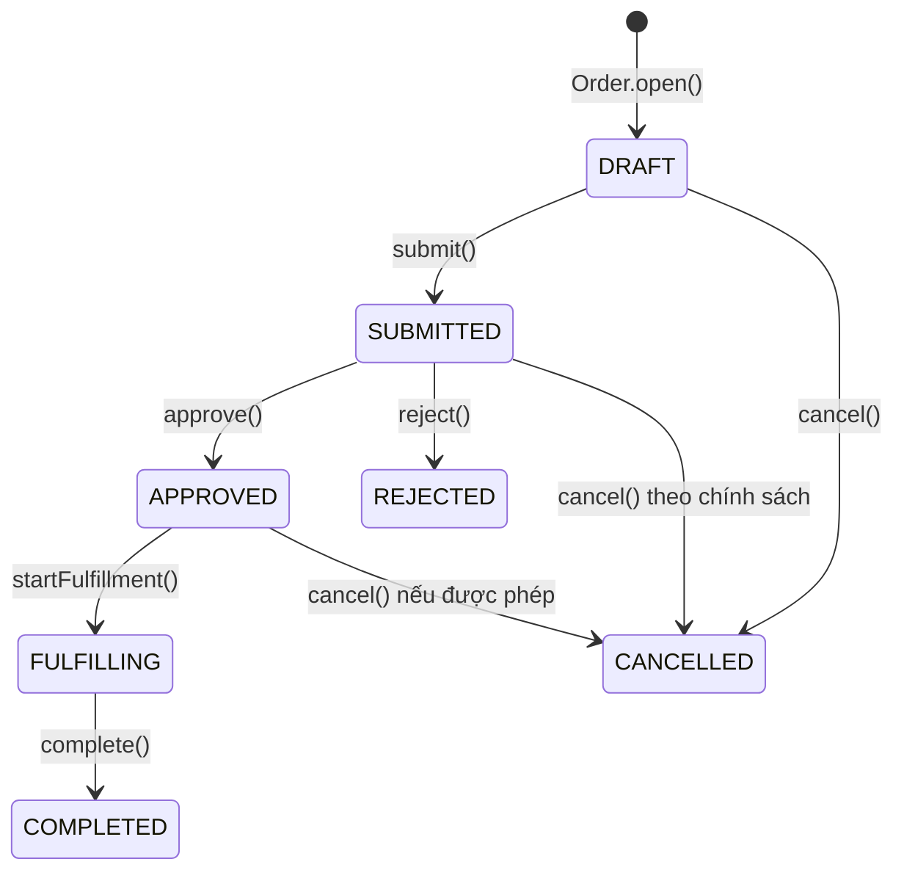

# Ẩn quy trình khởi tạo phức tạp khỏi bên sử dụng

Trong Domain-Driven Design (DDD), việc tạo một đối tượng nghiệp vụ có thể đòi hỏi nhiều bước: kiểm tra điều kiện, tạo value object, thiết lập quan hệ, áp dụng chính sách, sinh định danh và bảo đảm invariant của aggregate. Nếu mọi caller phải biết và thực hiện các bước này, quy tắc khởi tạo sẽ bị lặp lại và đối tượng có thể được tạo ở trạng thái không hợp lệ.

**Factory (nhà máy)** cung cấp một điểm tạo đối tượng có ý nghĩa nghiệp vụ và che giấu chi tiết khởi tạo khỏi bên sử dụng. Caller diễn đạt điều mình muốn tạo; factory chịu trách nhiệm xây dựng đối tượng hoặc aggregate đúng cách. Nhờ vậy, mô hình miền kiểm soát được trạng thái ban đầu, còn application layer không cần biết constructor nào phải gọi, thứ tự tạo object ra sao hay các thành phần nội bộ được liên kết thế nào.

Factory không chỉ là một lớp có phương thức `create()`. Nó là cách đặt trách nhiệm tạo đối tượng ở nơi hiểu đủ quy tắc và có thể bảo đảm kết quả hợp lệ. Factory nên tập trung vào việc tạo; hành vi trong suốt vòng đời vẫn thuộc entity, value object hoặc aggregate tương ứng.

## 1. Vì sao cần ẩn quy trình khởi tạo?

Hãy xét nghiệp vụ mở một tài khoản tín dụng. Để tạo một `CreditAccount`, hệ thống có thể cần:

- Xác minh khách hàng đủ điều kiện mở tài khoản.
- Xác định hạn mức theo hạng khách hàng và chính sách rủi ro.
- Chuẩn hóa tiền tệ và số tiền bằng value object.
- Sinh định danh tài khoản.
- Thiết lập trạng thái ban đầu, ngày hiệu lực và phiên bản chính sách.
- Tạo các cấu phần ban đầu như hạn mức khả dụng hoặc lịch sử trạng thái.
- Kiểm tra invariant trước khi công bố aggregate cho phần còn lại của ứng dụng.

Nếu controller hoặc application service tự làm tất cả, caller phải biết cấu trúc nội bộ của aggregate. Một caller khác như batch job, message consumer hoặc CLI có thể bỏ sót một bước. Khi chính sách khởi tạo thay đổi, nhiều nơi phải sửa đồng thời.

Ví dụ về cách khởi tạo phân tán:

```java
CreditAccount account = new CreditAccount();
account.setCustomerId(customerId);
account.setCurrency(currency);
account.setCreditLimit(limit);
account.setAvailableLimit(limit);
account.setStatus(AccountStatus.ACTIVE);
account.setOpenedAt(clock.instant());
```

Đoạn mã cho phép caller tạo ra trạng thái trung gian thiếu dữ liệu hoặc không nhất quán. Nó cũng để lộ những field nào phải được khởi tạo và cách các field liên hệ với nhau.

Một API tạo đối tượng có ý nghĩa hơn:

```java
CreditAccount account = creditAccountFactory.openFor(customer, offer);
```

Caller diễn đạt mục đích nghiệp vụ. Factory kiểm tra điều kiện, áp dụng chính sách và trả về một aggregate đã hợp lệ.

### 1.1. Những vấn đề thường gặp

**Khởi tạo không đầy đủ.** Constructor rỗng cùng nhiều setter cho phép đối tượng tồn tại khi các field bắt buộc chưa được thiết lập.

**Lặp quy tắc.** Nhiều caller tự kiểm tra điều kiện, tính giá trị mặc định hoặc tạo các object con theo cách hơi khác nhau.

**Lộ cấu trúc nội bộ.** Caller phải biết thứ tự tạo object, loại value object, quan hệ giữa entity con và cách sinh định danh.

**Khó thay đổi chính sách.** Khi quy tắc khởi tạo thay đổi, nhiều caller phải cập nhật; có nơi có thể bị bỏ sót.

**Tạo aggregate không nhất quán.** Một entity con có thể được tạo độc lập rồi gắn vào aggregate sau, khiến invariant chỉ đúng sau một chuỗi thao tác mà caller phải nhớ.

**Nhầm tạo mới với nạp lại.** Dùng cùng một đường khởi tạo cho object mới và object được đọc từ database có thể áp dụng lại quy tắc mặc định hoặc tạo sự kiện sai.

## 2. Factory trong DDD là gì?

Factory là một đối tượng hoặc phương thức chuyên trách tạo ra một object phức tạp. Nó che giấu quy trình tạo và trả về một instance đáp ứng điều kiện hợp lệ.

Trong DDD, factory thường được dùng khi:

- Việc tạo một entity hoặc aggregate có nhiều bước và quy tắc.
- Constructor cần nhiều tham số kỹ thuật hoặc cấu trúc nội bộ khó hiểu.
- Việc tạo object đòi hỏi phối hợp nhiều object con.
- Quy tắc khởi tạo thuộc kiến thức nghiệp vụ và cần một nơi duy nhất để duy trì.
- Caller không nên biết implementation cụ thể hoặc thứ tự khởi tạo.

Factory không bắt buộc cho mọi class. Một value object nhỏ như `EmailAddress` có thể có static factory method. Một entity đơn giản có thể được tạo bằng constructor rõ ràng. Chỉ nên bổ sung factory khi nó làm cho API tạo object dễ hiểu hơn hoặc bảo vệ được invariant quan trọng.

### 2.1. Kết quả của factory phải hợp lệ

Factory không nên trả về một aggregate nửa hoàn chỉnh rồi yêu cầu caller tiếp tục gọi các setter. Hợp đồng tạo nên bảo đảm rằng khi phương thức thành công, object đã ở trạng thái khởi tạo hợp lệ theo invariant của nó.

Ví dụ:

```java
public final class EmailAddress {
    private final String value;

    private EmailAddress(String value) {
        this.value = value;
    }

    public static EmailAddress of(String rawValue) {
        Objects.requireNonNull(rawValue, "email is required");
        String normalized = rawValue.trim().toLowerCase(Locale.ROOT);
        if (!normalized.matches("^[^@\\s]+@[^@\\s]+\\.[^@\\s]+$")) {
            throw new InvalidEmailAddressException(rawValue);
        }
        return new EmailAddress(normalized);
    }

    public String value() {
        return value;
    }
}
```

Caller chỉ cần `EmailAddress.of(input)`. Constructor bị ẩn để không ai tạo được email chưa chuẩn hóa hoặc chưa qua kiểm tra. Quy tắc kiểm tra định dạng trong ví dụ chỉ mang tính minh họa; hệ thống thực tế cần chọn chính sách xác thực phù hợp với nghiệp vụ và chuẩn địa chỉ email được hỗ trợ.

## 3. Các hình thức factory thường dùng

### 3.1. Constructor có kiểm soát

Với object nhỏ, constructor có thể là factory đơn giản nhất. Nó nhận dữ liệu cần thiết, kiểm tra invariant và tạo instance hợp lệ.

```java
public final class Quantity {
    private final int value;

    public Quantity(int value) {
        if (value <= 0) {
            throw new IllegalArgumentException("Quantity must be positive");
        }
        this.value = value;
    }

    public int value() {
        return value;
    }
}
```

Khi constructor đơn giản, có tên tham số rõ và không có quy trình phức tạp, không cần tạo thêm một factory class chỉ để gọi `new`.

### 3.2. Static factory method

Static factory method là phương thức tĩnh có tên mô tả ý nghĩa tạo object. Nó phù hợp khi có nhiều cách tạo hợp lệ hoặc muốn ẩn constructor.

```java
public final class OrderId {
    private final UUID value;

    private OrderId(UUID value) {
        this.value = Objects.requireNonNull(value);
    }

    public static OrderId generate() {
        return new OrderId(UUID.randomUUID());
    }

    public static OrderId from(String value) {
        return new OrderId(UUID.fromString(value));
    }

    public UUID value() {
        return value;
    }
}
```

Tên `generate()` thể hiện định danh mới được tạo; `from()` thể hiện một giá trị đã có được chuyển thành kiểu miền. Tên phương thức làm rõ ý định hơn một constructor nhận `String` hoặc `UUID` không có ngữ cảnh.

Static factory phù hợp khi không cần dependency bên ngoài. Nếu cần clock, policy, sequence generator hoặc repository, một factory object thường phù hợp hơn vì có thể nhận các dependency qua constructor.

### 3.3. Factory object

Factory object là một class có trách nhiệm tạo object khác. Nó hữu ích khi quy trình tạo cần dependency, chính sách hoặc nhiều bước phối hợp.

```java
public final class OrderFactory {
    private final OrderIdGenerator idGenerator;
    private final Clock clock;

    public OrderFactory(OrderIdGenerator idGenerator, Clock clock) {
        this.idGenerator = idGenerator;
        this.clock = clock;
    }

    public Order createFor(CustomerId customerId, List<OrderLineInput> inputs) {
        if (inputs.isEmpty()) {
            throw new EmptyOrderException();
        }

        List<OrderLine> lines = inputs.stream()
            .map(input -> new OrderLine(
                ProductId.from(input.productId()),
                new Quantity(input.quantity()),
                input.unitPrice()
            ))
            .toList();

        return Order.open(
            idGenerator.nextId(),
            customerId,
            lines,
            clock.instant()
        );
    }
}
```

Factory nhận các thành phần cần thiết, tạo các value object và entity con, sau đó gọi điểm khởi tạo có kiểm soát của aggregate. Caller không cần biết cách sinh ID, lấy thời gian hoặc tạo từng `OrderLine`.

### 3.4. Factory method trong một abstraction

Khi có nhiều loại sản phẩm cùng tuân theo một hợp đồng, có thể khai báo interface factory:

```java
public interface PaymentMethodFactory {
    PaymentMethod create(PaymentMethodDetails details);
}
```

Implementation có thể tạo phương thức thanh toán theo loại hoặc chính sách được chọn. Tuy nhiên, không nên tạo abstraction chỉ để có vẻ linh hoạt. Nếu chỉ có một cách tạo và không có lý do thay thế implementation, một class cụ thể là đủ.

## 4. Factory và Aggregate Root

Aggregate Root chịu trách nhiệm bảo vệ invariant trong ranh giới aggregate. Vì vậy, việc tạo một aggregate thường nên đi qua một điểm khởi tạo bảo đảm tất cả thành phần cần thiết đã được thiết lập.

Có hai cách thường gặp:

- Aggregate Root cung cấp static factory method hoặc named constructor khi quy trình tạo gắn chặt với chính aggregate và không cần dependency ngoài.
- Một factory object riêng tạo aggregate khi quy trình phức tạp, cần phối hợp nhiều object hoặc phụ thuộc vào policy, clock hay ID generator.

Ví dụ aggregate `Order` tự kiểm soát trạng thái ban đầu:

```java
public final class Order {
    private final OrderId id;
    private final CustomerId customerId;
    private final List<OrderLine> lines;
    private final Instant openedAt;
    private OrderStatus status;

    private Order(OrderId id, CustomerId customerId,
                  List<OrderLine> lines, Instant openedAt) {
        if (lines == null || lines.isEmpty()) {
            throw new EmptyOrderException();
        }
        this.id = Objects.requireNonNull(id);
        this.customerId = Objects.requireNonNull(customerId);
        this.lines = List.copyOf(lines);
        this.openedAt = Objects.requireNonNull(openedAt);
        this.status = OrderStatus.DRAFT;
    }

    public static Order open(OrderId id, CustomerId customerId,
                             List<OrderLine> lines, Instant openedAt) {
        return new Order(id, customerId, lines, openedAt);
    }

    public void submit() {
        if (status != OrderStatus.DRAFT) {
            throw new InvalidOrderTransitionException(status, OrderStatus.SUBMITTED);
        }
        status = OrderStatus.SUBMITTED;
    }
}
```

Constructor private giúp ngăn caller tạo aggregate bằng một tổ hợp field tùy ý. `Order.open()` diễn đạt ý định tạo đơn mới. `submit()` là hành vi trong vòng đời sau khi tạo, không phải một bước cấu hình tùy tiện.

Factory ngoài có thể chịu trách nhiệm sinh ID và thời gian, còn aggregate chịu trách nhiệm bảo vệ invariant nội tại. Phân chia này giúp tránh việc factory trở thành nơi chứa mọi hành vi nghiệp vụ.

### 4.1. Không tạo entity con tách rời rồi gắn vào aggregate tùy tiện

Nếu `OrderLine` chỉ có ý nghĩa bên trong một `Order`, caller không nên tạo `OrderLine` rồi lưu độc lập qua repository riêng. Factory hoặc aggregate root nên tạo và quản lý nó để bảo vệ quan hệ và invariant.

Ví dụ, nếu tổng số lượng đơn hàng phải lớn hơn 0, hoặc tổng tiền phải được tính từ các dòng hàng, aggregate cần đảm bảo các thành phần được tạo đồng bộ. Không để caller tự sửa danh sách lines và cập nhật total bằng hai thao tác riêng.

### 4.2. Factory không thay thế hành vi của aggregate

Factory tạo trạng thái ban đầu. Khi aggregate đã được tạo, các thay đổi tiếp theo phải đi qua hành vi nghiệp vụ như `addLine()`, `submit()`, `cancel()` hoặc `approve()`. Nếu factory tiếp tục sửa object sau khi đã trả về hoặc được dùng để thực hiện mọi thay đổi, ranh giới trách nhiệm trở nên khó hiểu.

## 5. Ẩn chính sách và quy trình tạo phức tạp

Factory có thể phối hợp các policy và dependency để tạo object. Điều quan trọng là caller chỉ cung cấp dữ liệu và ý định cần thiết; nó không phải điều khiển từng bước kỹ thuật.

### 5.1. Ví dụ: mở tài khoản theo gói sản phẩm

Giả sử khách hàng chọn gói tín dụng. Hạn mức khởi tạo phụ thuộc vào hạng khách hàng và chính sách đang có hiệu lực. Thay vì để application service tự biết công thức, hãy mô hình hóa policy:

```java
public interface InitialCreditLimitPolicy {
    Money determineLimit(CustomerProfile customer, CreditProduct product);
}

public final class CreditAccountFactory {
    private final InitialCreditLimitPolicy limitPolicy;
    private final CreditAccountIdGenerator idGenerator;
    private final Clock clock;

    public CreditAccountFactory(InitialCreditLimitPolicy limitPolicy,
                                CreditAccountIdGenerator idGenerator,
                                Clock clock) {
        this.limitPolicy = limitPolicy;
        this.idGenerator = idGenerator;
        this.clock = clock;
    }

    public CreditAccount open(CustomerProfile customer, CreditProduct product) {
        if (!customer.isEligibleFor(product)) {
            throw new CustomerNotEligibleException(customer.id(), product.id());
        }

        Money initialLimit = limitPolicy.determineLimit(customer, product);
        if (initialLimit.isZeroOrNegative()) {
            throw new InvalidInitialCreditLimitException(initialLimit);
        }

        return CreditAccount.open(
            idGenerator.nextId(),
            customer.id(),
            product.id(),
            initialLimit,
            clock.instant()
        );
    }
}
```

Factory kiểm tra điều kiện mở, gọi policy để xác định hạn mức và tạo aggregate. `InitialCreditLimitPolicy` có thể là domain policy nếu công thức mang ý nghĩa nghiệp vụ; implementation có thể sử dụng bảng chính sách hoặc cấu hình bên ngoài thông qua một adapter.

Không nên để factory truy cập trực tiếp database hoặc gọi một HTTP client cụ thể. Nếu cần dữ liệu ngoài, hãy truyền vào dữ liệu đã được application tải hoặc định nghĩa một abstraction phù hợp. Việc này giữ cho factory dễ kiểm thử và không làm domain phụ thuộc hạ tầng.

### 5.2. Phân biệt dữ liệu đầu vào và dependency

Một factory thường nhận hai nhóm thông tin:

- **Creation input:** dữ liệu mô tả object cần tạo, ví dụ customer, sản phẩm, danh sách dòng hàng, địa chỉ giao hàng.
- **Creation dependency:** thành phần hỗ trợ quy trình tạo, ví dụ clock, ID generator hoặc domain policy.

Không nên nhét dependency kỹ thuật vào command như `EntityManager`, `ApplicationContext` hay `HttpServletRequest`. Những dependency này được inject vào factory ở composition root. Input của factory nên diễn đạt dữ liệu có ý nghĩa trong nghiệp vụ.

### 5.3. Khi factory cần thông tin từ bên ngoài

Nếu việc tạo cần kiểm tra một hệ thống khác, có hai hướng:

1. Application service lấy dữ liệu cần thiết qua port, sau đó truyền dữ liệu đã xác minh vào factory.
2. Factory nhận một domain-facing port nếu việc truy vấn là một phần không thể tách khỏi quyết định tạo và có lý do rõ ràng.

Hãy cân nhắc ranh giới transaction và độ trễ. Không nên giữ transaction database mở trong lúc gọi dịch vụ bên ngoài. Nếu việc tạo phụ thuộc một quy trình nhiều bước hoặc có thể thất bại sau khi đã giữ tài nguyên, hãy mô hình hóa trạng thái và reservation thay vì giả định factory có thể hoàn tất nguyên tử mọi việc.

## 6. Factory Method, Builder và Abstract Factory

Các mẫu thiết kế này đều có thể hỗ trợ khởi tạo nhưng giải quyết những vấn đề khác nhau.

| Pattern | Mục đích chính | Khi phù hợp |
|---|---|---|
| Constructor / Static Factory Method | Tạo một object qua API có tên và kiểm soát | Object đơn giản hoặc có vài cách tạo rõ ràng |
| Factory Object | Đóng gói quy trình tạo có nhiều bước hoặc dependency | Tạo aggregate phức tạp, cần policy/clock/ID generator |
| Factory Method pattern | Cho phép lớp con quyết định implementation cụ thể cần tạo | Có một hierarchy và lựa chọn sản phẩm gắn với polymorphism |
| Abstract Factory | Tạo một họ object liên quan mà không lộ lớp cụ thể | Cần các bộ object tương thích theo một biến thể hoặc môi trường |
| Builder | Xây dựng object có nhiều tùy chọn theo từng bước | Cấu hình nhiều tham số tùy chọn, đặc biệt khi cần API fluent |

### 6.1. Factory Method pattern

Factory Method pattern dùng một phương thức tạo object được override bởi lớp con. Nó hữu ích khi lớp nền điều phối một quy trình nhưng loại sản phẩm cụ thể do implementation quyết định.

```java
abstract class PaymentProcessor {
    public final Receipt process(PaymentRequest request) {
        Payment payment = createPayment(request);
        payment.validate();
        return payment.execute();
    }

    protected abstract Payment createPayment(PaymentRequest request);
}

final class CardPaymentProcessor extends PaymentProcessor {
    @Override
    protected Payment createPayment(PaymentRequest request) {
        return new CardPayment(request);
    }
}
```

Đây là minh họa về pattern hướng đối tượng. Trong DDD, chỉ dùng nó khi việc lựa chọn loại object thực sự là một biến thể nghiệp vụ hoặc điểm mở rộng có ý nghĩa. Không nên tạo một hệ thống class hierarchy chỉ để bọc một constructor.

### 6.2. Abstract Factory

Abstract Factory cung cấp giao diện để tạo một họ object có liên quan. Ví dụ, một hệ thống có thể tạo bộ chính sách và dịch vụ tương ứng với loại hợp đồng doanh nghiệp hoặc cá nhân. Các object trong cùng họ phải tương thích với nhau.

```java
public interface ContractPolicyFactory {
    PricingPolicy pricingPolicy();
    ApprovalPolicy approvalPolicy();
    CreditPolicy creditPolicy();
}
```

Caller sử dụng interface mà không cần biết implementation cho loại hợp đồng nào. Pattern này chỉ có ích khi có nhiều họ object cần thay thế đồng bộ; nếu chỉ tạo một aggregate, factory object đơn giản thường dễ hiểu hơn.

### 6.3. Builder

Builder hỗ trợ tạo object có nhiều thuộc tính tùy chọn. Tuy nhiên, builder công khai từng setter có thể cho phép tạo trạng thái thiếu invariant nếu `build()` không kiểm tra đầy đủ.

```java
OrderDraft draft = OrderDraft.builder()
    .customer(customerId)
    .deliveryAddress(address)
    .addLine(productId, quantity)
    .build();
```

Builder có thể phù hợp với cấu hình hoặc một draft chưa phải aggregate chính thức. Nếu `Order` là aggregate đã cam kết invariant, `build()` phải kiểm tra và chỉ trả về một `Order` hợp lệ. Đừng dùng builder để tạo một object nửa hoàn chỉnh rồi cho phép mọi caller tự quyết định khi nào object sẵn sàng.

## 7. Phân biệt tạo mới với khôi phục từ persistence

Một điểm quan trọng trong DDD là **tạo một entity mới** khác với **khôi phục một entity đã tồn tại** từ database hoặc event store.

Khi tạo mới, hệ thống cần áp dụng chính sách mở mới, giá trị mặc định và sự kiện khởi tạo. Khi khôi phục, dữ liệu đã lưu phải được tái lập chính xác; không được sinh ID mới, đặt lại ngày tạo, áp dụng lại giá trị mặc định hoặc phát lại sự kiện `AccountOpened`.

### 7.1. Repository chịu trách nhiệm tái lập aggregate

Caller thường dùng repository:

```java
Order order = orderRepository.findById(orderId)
    .orElseThrow(() -> new OrderNotFoundException(orderId));
```

Repository adapter đọc dữ liệu persistence, ánh xạ về domain model và trả aggregate. Nó có thể dùng constructor/factory nội bộ dành cho reconstitution, nhưng đường này không được áp dụng các quy tắc của một thao tác tạo mới.

Có thể phân biệt hai API về mặt khái niệm:

```java
Order.open(...);          // Tạo đơn mới, áp dụng chính sách khởi tạo
Order.reconstitute(...);  // Khôi phục trạng thái đã tồn tại
```

`reconstitute()` thường nên được giới hạn truy cập trong module hoặc package phù hợp để caller nghiệp vụ không dùng nó nhằm bỏ qua invariant. Repository hoặc mapper là thành phần có quyền sử dụng đường khôi phục.

### 7.2. Khôi phục không đồng nghĩa bỏ qua mọi kiểm tra

Reconstitution không nên chạy lại chính sách khởi tạo như thể object mới. Tuy nhiên, dữ liệu persistence vẫn cần được kiểm tra tính toàn vẹn cơ bản và tương thích phiên bản. Nếu dữ liệu cũ không còn thỏa mô hình hiện tại, hệ thống cần có chiến lược migration hoặc nâng cấp dữ liệu rõ ràng.

Ví dụ, một tài khoản đã mở từ năm trước có thể có hạn mức theo chính sách cũ. Khi đọc lại, không nên tự động áp dụng hạn mức mới nhất chỉ vì factory tạo mới hiện tại dùng chính sách khác. Thay đổi hạn mức phải là một hành vi nghiệp vụ có chủ đích và có lịch sử.

## 8. Vòng đời của object và aggregate

Factory tạo trạng thái ban đầu, nhưng một entity hoặc aggregate thường tiếp tục trải qua nhiều trạng thái. Vòng đời nên được mô hình hóa bằng các hành vi rõ ràng thay vì cho phép sửa field tùy ý.

Ví dụ vòng đời đơn hàng:



Các trạng thái và chuyển tiếp trên chỉ là ví dụ. Domain thực tế cần xác định điều kiện, quyền thực hiện, thời hạn và ngoại lệ cho từng chuyển tiếp.

### 8.1. Tách tạo mới và chuyển trạng thái

Không nên dùng một factory để tạo object ở mọi trạng thái tùy ý, ví dụ `Order.create(status)` cho phép caller chọn `COMPLETED` ngay khi mở đơn. Trạng thái sau khởi tạo thường là kết quả của một chuỗi hành vi nghiệp vụ.

API nên phản ánh ý định:

```java
Order order = orderFactory.createDraft(command);
order.submit();
order.approve(approval);
```

Nếu có một quy trình nhập dữ liệu lịch sử hoặc migration cần tạo aggregate ở trạng thái đã hoàn tất, hãy dùng một use case import/migration được kiểm soát hoặc một reconstitution path riêng. Không mở rộng API tạo mới cho mọi caller chỉ vì một trường hợp đặc biệt.

### 8.2. Không để object thoát ra khi chưa hoàn chỉnh

Một object không nên được đăng ký vào repository, phát event hoặc truyền sang thread khác trước khi mọi invariant khởi tạo được bảo đảm. Với aggregate nhiều object con, hãy tạo tất cả trong phạm vi factory/aggregate root rồi mới trả kết quả.

Nếu khởi tạo cần một quy trình kéo dài qua nhiều dịch vụ, không giữ một object trong bộ nhớ như thể đã hoàn tất. Hãy tạo một aggregate quy trình hoặc process manager có trạng thái như `PENDING`, `READY`, `FAILED` và các chuyển tiếp hợp lệ.

## 9. Factory và Domain Event

Một thao tác tạo aggregate có thể làm phát sinh domain event như `OrderOpened`, `AccountCreated` hoặc `ReservationStarted`. Event diễn đạt điều có ý nghĩa đã xảy ra trong nghiệp vụ.

Factory có thể khởi tạo event hoặc aggregate ghi nhận event nội bộ trong lúc tạo. Tuy nhiên, chỉ nên công bố event sau khi thao tác được chấp nhận và transaction commit thành công. Nếu publish trực tiếp từ factory trước khi lưu dữ liệu, consumer có thể nhận sự kiện cho một aggregate cuối cùng không được commit.

Một cách thường dùng:

1. Factory tạo aggregate hợp lệ.
2. Aggregate ghi nhận domain event trong trạng thái nội bộ.
3. Application service lưu aggregate và outbox record trong cùng transaction.
4. Publisher phát outbox event sau commit.
5. Consumer xử lý event idempotent.

Không phải factory nào cũng cần phát event. Nếu event mô tả kết quả nghiệp vụ của thao tác tạo, aggregate hoặc domain operation có thể ghi nhận nó; application/infrastructure chịu trách nhiệm lưu và chuyển event ra ngoài.

## 10. Factory trong kiến trúc ứng dụng

Factory thường được gọi từ application service. Application nhận command, tải dữ liệu cần thiết, gọi factory và lưu aggregate qua repository.

```java
public final class OpenOrderService implements OpenOrderUseCase {
    private final OrderFactory orderFactory;
    private final OrderRepository orderRepository;

    public OpenOrderService(OrderFactory orderFactory,
                            OrderRepository orderRepository) {
        this.orderFactory = orderFactory;
        this.orderRepository = orderRepository;
    }

    @Override
    public OrderId execute(OpenOrderCommand command) {
        Order order = orderFactory.createFor(
            command.customerId(),
            command.lines()
        );
        orderRepository.save(order);
        return order.id();
    }
}
```

Application layer chịu trách nhiệm điều phối use case và persistence. Factory chịu trách nhiệm tạo aggregate. Repository chịu trách nhiệm lưu hoặc khôi phục aggregate. Ba trách nhiệm này liên quan nhưng không nên gộp thành một class làm tất cả.

### 10.1. Dependency injection cho factory

Nếu factory cần `Clock`, ID generator hoặc policy, application wiring cung cấp dependency:

```java
@Configuration
public class OrderModuleConfiguration {
    @Bean
    OrderFactory orderFactory(OrderIdGenerator idGenerator, Clock clock) {
        return new OrderFactory(idGenerator, clock);
    }
}
```

Factory không cần tự truy cập Spring `ApplicationContext`. Dependency được truyền tường minh giúp dễ kiểm thử và không gắn domain vào container.

### 10.2. Không đưa database hoặc HTTP vào factory

Một factory domain không nên chứa `EntityManager`, `JpaRepository`, `HttpClient` hay `WebClient`. Nếu phải gọi dịch vụ bên ngoài để lấy thông tin, hãy cân nhắc để application tải dữ liệu qua port trước, hoặc định nghĩa một abstraction thuộc phía trong khi đó thực sự là trách nhiệm của quy trình tạo.

Factory cũng không nên tự lưu object. Tạo và lưu là hai trách nhiệm khác nhau: factory bảo đảm object được xây dựng đúng; repository quản lý persistence. Tách hai việc giúp factory có thể được kiểm thử mà không cần database.

## 11. Những sai lầm thường gặp

**Tạo factory cho mọi class.** Object đơn giản với constructor rõ ràng không cần một lớp factory riêng. Abstraction không mang lại giá trị sẽ làm code dài hơn.

**Factory chỉ gọi `new`.** Nếu factory không che giấu quy trình, không áp dụng quy tắc và không tạo tên nghiệp vụ rõ hơn, nó chỉ là lớp chuyển tiếp không cần thiết.

**Để factory chứa mọi nghiệp vụ.** Factory có trách nhiệm khởi tạo. Hành vi sau khi tạo thuộc aggregate, entity, value object hoặc domain service phù hợp.

**Cho caller tự hoàn thiện object sau khi factory trả về.** Điều này làm mất cam kết rằng factory trả về trạng thái hợp lệ. Hãy dùng constructor có kiểm soát và aggregate root để bảo vệ invariant.

**Dùng factory tạo lại object đã tồn tại.** Áp dụng lại default, sinh ID mới hoặc phát event khởi tạo khi đọc database có thể làm sai lịch sử. Tách creation khỏi reconstitution.

**Factory phụ thuộc trực tiếp vào framework.** Việc dùng container, ORM hoặc HTTP client trong domain factory làm chi tiết kỹ thuật lan vào mô hình. Hãy inject abstraction hoặc để application chuẩn bị dữ liệu.

**Dùng Builder để né invariant.** Builder có nhiều setter nhưng không kiểm tra ở `build()` có thể tạo object thiếu dữ liệu. Hãy kiểm tra toàn bộ điều kiện trước khi trả aggregate.

**Cho phép caller chọn trạng thái tùy ý khi tạo.** Trạng thái sau khởi tạo phải tuân theo vòng đời nghiệp vụ. Các chuyển trạng thái cần đi qua hành vi có điều kiện.

**Phát domain event trước khi commit.** Sự kiện có thể được gửi dù dữ liệu chưa được lưu. Hãy dùng outbox hoặc cơ chế đồng bộ sau commit phù hợp.

## 12. Quy trình thiết kế factory

Khi gặp một quy trình khởi tạo phức tạp, hãy làm theo các bước:

1. **Xác định object cần tạo.** Đó là value object, entity, aggregate hay một họ object liên quan?
2. **Viết invariant ban đầu.** Điều gì phải đúng ngay khi object được công bố?
3. **Liệt kê dữ liệu bắt buộc.** Phân biệt dữ liệu nghiệp vụ do caller cung cấp với dependency như clock, ID generator và policy.
4. **Xác định nơi sở hữu quy tắc.** Invariant nội tại thuộc aggregate/value object; chính sách lựa chọn có thể thuộc domain policy; điều phối use case thuộc application.
5. **Chọn hình thức tạo phù hợp.** Constructor, static factory method hay factory object dựa trên độ phức tạp và dependency.
6. **Ẩn constructor nếu cần.** Không cho caller tạo trạng thái không hợp lệ bằng đường khởi tạo công khai.
7. **Phân biệt tạo mới với reconstitution.** Repository cần khôi phục trạng thái đã tồn tại mà không áp dụng lại chính sách mở mới.
8. **Xác định vòng đời.** Mô hình hóa các trạng thái và hành vi chuyển trạng thái sau khi tạo.
9. **Xác định thời điểm phát event và lưu trữ.** Đảm bảo event chỉ được công bố phù hợp với transaction commit.
10. **Kiểm thử invariant và các nhánh lỗi.** Kiểm tra cả input không hợp lệ, policy từ chối và trạng thái tạo thành công.

## 13. Kiểm thử factory

Factory là nơi tập trung quy tắc tạo, vì vậy cần kiểm thử các điều kiện quan trọng của nó.

Ví dụ với `CreditAccountFactory`:

```java
class CreditAccountFactoryTest {
    @Test
    void createsAccountWithPolicyLimitAndCurrentTime() {
        Clock clock = Clock.fixed(
            Instant.parse("2025-01-10T09:00:00Z"), ZoneOffset.UTC);
        InitialCreditLimitPolicy policy = (customer, product) -> Money.of("5000", "USD");
        CreditAccountIdGenerator ids = () -> CreditAccountId.from("ACC-100");
        CreditAccountFactory factory = new CreditAccountFactory(policy, ids, clock);

        CreditAccount account = factory.open(eligibleCustomer(), standardProduct());

        assertEquals("ACC-100", account.id().value());
        assertEquals(Money.of("5000", "USD"), account.creditLimit());
        assertEquals(Instant.parse("2025-01-10T09:00:00Z"), account.openedAt());
    }

    @Test
    void rejectsIneligibleCustomer() {
        CreditAccountFactory factory = configuredFactory();

        assertThrows(CustomerNotEligibleException.class,
            () -> factory.open(ineligibleCustomer(), standardProduct()));
    }
}
```

Đây là ví dụ minh họa; các helper và kiểu miền cần được định nghĩa trong dự án thực tế. Dùng `Clock` cố định và ID generator giả giúp test xác định, không phụ thuộc thời gian hệ thống hoặc randomness.

Nên kiểm tra:

- Object được tạo với ID và thời gian phù hợp.
- Các value object đã được chuẩn hóa và kiểm tra.
- Các object con bắt buộc đã được tạo.
- Invariant được bảo vệ khi input thiếu hoặc không hợp lệ.
- Policy từ chối hoặc trả kết quả không hợp lệ được xử lý rõ ràng.
- Factory không lưu dữ liệu hoặc phát message ngoài ý muốn.
- Reconstitution không gọi lại policy tạo mới hoặc phát event mở mới.

## 14. Checklist đánh giá

Trước khi hoàn tất thiết kế factory, hãy tự hỏi:

- Caller có thể diễn đạt ý định tạo bằng một API ngắn và có ý nghĩa nghiệp vụ không?
- Factory có che giấu đúng các bước và cấu trúc nội bộ cần ẩn không?
- Khi factory trả về, object có hợp lệ và đầy đủ theo invariant không?
- Quy tắc khởi tạo có đang bị lặp ở controller, application service hoặc batch job không?
- Invariant nội tại có được aggregate root/value object bảo vệ không?
- Factory có dependency ngoài nào cần inject qua abstraction không?
- Factory có đang làm thay nhiệm vụ của repository hoặc application service không?
- Đường tạo mới có được phân biệt với đường khôi phục từ persistence không?
- Vòng đời và các chuyển trạng thái sau khi tạo có được mô hình hóa rõ không?
- Event chỉ được công bố sau khi thay đổi được commit theo cơ chế phù hợp không?
- Có thực sự cần factory class, hay constructor/static method đã đủ?
- Test có bao phủ cả trường hợp tạo thành công và các điều kiện từ chối không?

## 15. Câu hỏi tự kiểm tra

1. Factory giải quyết vấn đề gì khi một aggregate có quy trình khởi tạo nhiều bước?
2. Khi nào nên dùng constructor, static factory method và factory object?
3. Vì sao factory nên trả về object đã hợp lệ thay vì object cần caller hoàn thiện thêm?
4. Phân biệt trách nhiệm của factory, aggregate root và repository.
5. Vì sao việc tạo mới một aggregate khác với khôi phục aggregate từ database?
6. Tại sao không nên để factory domain gọi trực tiếp `EntityManager` hoặc HTTP client?
7. Khi nào Builder phù hợp và điều kiện nào phải được kiểm tra trong `build()`?
8. Vì sao trạng thái sau khởi tạo nên được thay đổi qua hành vi vòng đời thay vì một setter tùy ý?
9. Domain event phát sinh trong lúc tạo nên được công bố ở thời điểm nào?
10. Làm thế nào kiểm thử factory có sử dụng thời gian và định danh mà không làm test phụ thuộc môi trường?

## Kết luận

Factory giúp ẩn quy trình khởi tạo phức tạp và tập trung các quy tắc tạo object vào một điểm có ý nghĩa nghiệp vụ. Với object nhỏ, constructor hoặc static factory method thường đủ; với aggregate cần nhiều bước và dependency, factory object giúp tổ chức quy trình rõ ràng. Aggregate root vẫn chịu trách nhiệm bảo vệ invariant, repository chịu trách nhiệm lưu và khôi phục trạng thái, còn application service điều phối use case. Khi tách rõ tạo mới, reconstitution và các chuyển trạng thái trong vòng đời, caller có thể sử dụng mô hình miền mà không phải biết những chi tiết nội bộ dễ thay đổi.
