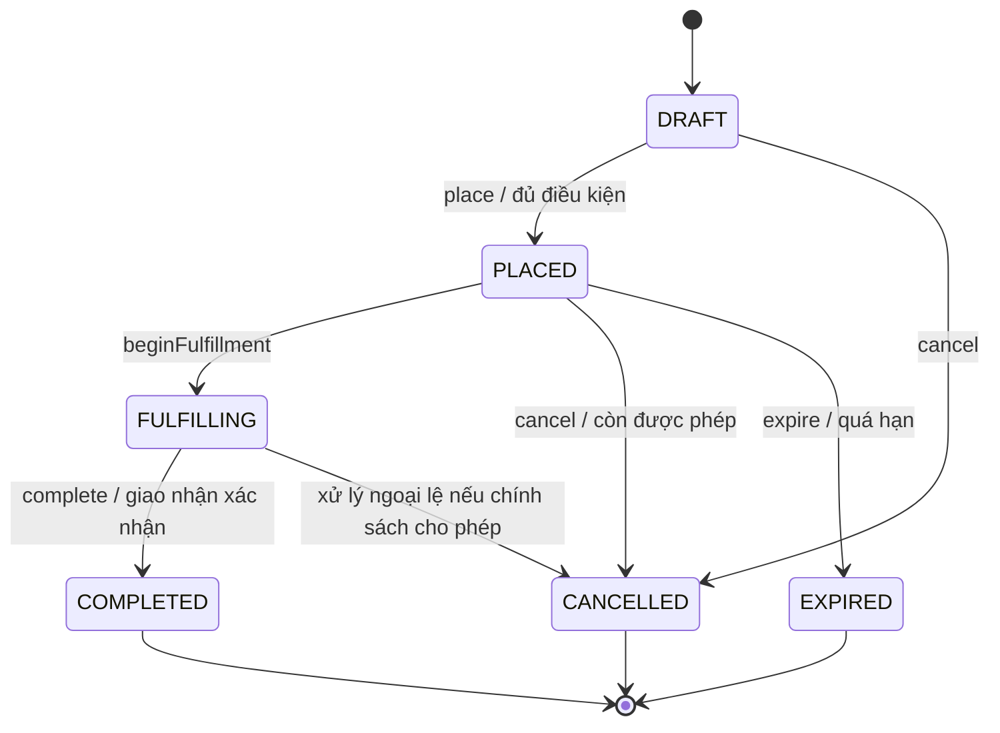

# Chuyển trạng thái, kết thúc vòng đời và lưu trữ lịch sử

## Vì sao vòng đời cần được mô hình hóa rõ ràng?

Một đối tượng miền thường tồn tại qua nhiều giai đoạn. Đơn hàng được tạo, đặt, xử lý, giao và hoàn tất; tài khoản được mở, tạm khóa, kích hoạt lại hoặc đóng; hợp đồng có hiệu lực, được gia hạn, hết hạn hoặc chấm dứt. Những thay đổi này không chỉ là việc cập nhật một trường `status`. Mỗi chuyển đổi biểu thị một sự kiện có ý nghĩa nghiệp vụ, chịu các điều kiện nhất định và có thể tạo ra nghĩa vụ tiếp theo.

Trong Domain-Driven Design (DDD), vòng đời của entity hoặc aggregate nên được thể hiện bằng các hành vi có tên theo ngôn ngữ nghiệp vụ. Aggregate Root kiểm tra trạng thái hiện tại, điều kiện chuyển đổi và các bất biến trước khi thay đổi. Khi trạng thái thay đổi, hệ thống có thể ghi lại lịch sử để giải thích ai đã làm gì, vào lúc nào và vì sao.

Kết thúc vòng đời cũng cần được hiểu theo nghiệp vụ. Một đơn hàng đã hoàn tất không nhất thiết bị xóa; một tài khoản đã đóng có thể vẫn cần giữ lịch sử giao dịch; một hồ sơ hết thời hạn có thể được chuyển sang lưu trữ. **Kết thúc hoạt động nghiệp vụ, lưu lịch sử và xóa dữ liệu vật lý là ba quyết định khác nhau.**

Sau bài học, người học có thể:

- Mô tả vòng đời của một entity hoặc aggregate bằng các trạng thái và chuyển đổi hợp lệ.
- Đặt điều kiện chuyển trạng thái vào đúng hành vi miền và bảo vệ chúng qua Aggregate Root.
- Phân biệt trạng thái hiện tại, lịch sử chuyển trạng thái, audit log và domain event.
- Thiết kế các hành vi kết thúc, hủy, hết hạn, đóng hoặc lưu trữ phù hợp với chính sách nghiệp vụ.
- Phân biệt soft delete, archive, anonymization và xóa vật lý.
- Xác định dữ liệu lịch sử cần giữ, thời điểm lưu và cách truy vấn lại.

## Trạng thái và chuyển trạng thái

### Trạng thái biểu thị điều gì?

Trạng thái (state) mô tả tình trạng hiện tại có ý nghĩa đối với nghiệp vụ của một đối tượng. Trạng thái cần giúp trả lời câu hỏi: hiện tại đối tượng đang ở giai đoạn nào và những hành động nào được phép tiếp theo?

Ví dụ, một đơn hàng có thể có các trạng thái:

- `DRAFT`: đơn đang được soạn, có thể thêm hoặc sửa dòng hàng.
- `PLACED`: đơn đã được đặt và chấp nhận theo quy tắc.
- `FULFILLING`: đơn đang được chuẩn bị hoặc thực hiện giao hàng.
- `COMPLETED`: đơn đã hoàn tất theo định nghĩa của doanh nghiệp.
- `CANCELLED`: đơn đã bị hủy.
- `EXPIRED`: đơn hết hiệu lực vì không hoàn thành điều kiện trong thời hạn.

Tên và số lượng trạng thái phải phản ánh cách doanh nghiệp vận hành. Có hệ thống dùng `PAID` như trạng thái thanh toán riêng, có hệ thống quản lý thanh toán bằng aggregate khác. Không nên đưa mọi thông tin vào một enum trạng thái đơn hàng. Nếu đơn hàng có thể đang giao trong khi thanh toán đã được hoàn tiền một phần, một trường trạng thái duy nhất có thể không biểu diễn hết các chiều nghiệp vụ.

### Trạng thái không phải là một nhãn tùy ý

Không nên cho phép mọi thành phần gọi `setStatus(...)` với bất kỳ giá trị nào. Cách đó khiến đối tượng có thể nhảy từ `DRAFT` sang `COMPLETED` mà bỏ qua các điều kiện đặt đơn, thanh toán hoặc giao hàng.

Thay vào đó, hãy biểu diễn ý định bằng hành vi:

- `place()` đặt đơn hàng.
- `beginFulfillment()` bắt đầu xử lý đơn.
- `complete()` hoàn tất đơn.
- `cancel(reason)` hủy đơn theo lý do và điều kiện được phép.
- `expire(now)` đánh dấu đơn hết hiệu lực khi đã quá hạn.

Mỗi hành vi biết trạng thái nào được phép làm trạng thái nguồn, điều kiện bổ sung là gì và kết quả nào được tạo ra. Tên phương thức diễn đạt ý định; trạng thái là kết quả của hành vi.

### Bảng chuyển trạng thái

Một bảng chuyển trạng thái giúp chuyên gia nghiệp vụ và đội phát triển thống nhất luồng hợp lệ. Ví dụ đơn hàng:

| Trạng thái hiện tại | Hành động | Trạng thái tiếp theo | Điều kiện minh họa |
|---|---|---|---|
| `DRAFT` | Đặt đơn | `PLACED` | Có ít nhất một dòng hàng; thông tin bắt buộc hợp lệ |
| `DRAFT` | Hủy đơn | `CANCELLED` | Người yêu cầu có quyền hủy bản nháp |
| `PLACED` | Bắt đầu xử lý | `FULFILLING` | Đơn được chấp nhận và có thể thực hiện |
| `PLACED` | Hủy đơn | `CANCELLED` | Chưa vượt mốc không thể hủy; đáp ứng chính sách |
| `PLACED` | Hết hạn | `EXPIRED` | Quá hạn xác nhận hoặc thanh toán theo chính sách |
| `FULFILLING` | Hoàn tất | `COMPLETED` | Các bước giao/nhận được xác nhận hoàn thành |
| `FULFILLING` | Hủy hoặc dừng | Theo quy trình ngoại lệ | Chỉ khi chính sách cho phép và xử lý hàng/tiền tương ứng |
| `COMPLETED` | Không có chuyển đổi thông thường | — | Có thể phát sinh quy trình đổi trả hoặc khiếu nại riêng |
| `CANCELLED` | Không có chuyển đổi thông thường | — | Nếu cho phép khôi phục, phải có hành vi riêng và điều kiện rõ |
| `EXPIRED` | Không có chuyển đổi thông thường | — | Tạo đơn mới hoặc gia hạn theo chính sách |

Đây là bảng ví dụ, không phải quy trình chuẩn cho mọi doanh nghiệp. Chẳng hạn, một đơn đã bắt đầu giao có thể không được hủy trực tiếp; thay vào đó, doanh nghiệp tạo yêu cầu thu hồi hoặc hoàn trả. Hãy mô hình hóa ngoại lệ theo ngôn ngữ và trách nhiệm thực tế.

### Sơ đồ vòng đời



Sơ đồ tập trung vào trạng thái chính của đơn hàng. Những quy trình như hoàn tiền, đổi trả, khiếu nại hoặc giao lại có thể có vòng đời riêng và liên kết với đơn hàng qua định danh. Không nên ép tất cả chúng thành các trạng thái bổ sung của `Order` nếu chúng có quy tắc và vòng đời độc lập.

## Bảo vệ chuyển trạng thái trong Aggregate Root

### Kiểm tra trạng thái nguồn và điều kiện nghiệp vụ

Aggregate Root là nơi bảo vệ bất biến của aggregate. Hành vi chuyển trạng thái cần kiểm tra ít nhất:

1. Trạng thái hiện tại có cho phép hành động không?
2. Các điều kiện nghiệp vụ trước khi chuyển đã thỏa mãn chưa?
3. Có dữ liệu hoặc bằng chứng cần ghi nhận cùng quyết định không?
4. Trạng thái mới và lịch sử thay đổi cần được cập nhật như thế nào?
5. Có domain event nào cần được tạo ra sau khi thay đổi hợp lệ không?

Không nên để caller tự đặt trạng thái mới rồi hy vọng dữ liệu khác nhất quán. Hành vi trên aggregate cần bảo vệ toàn bộ bất biến thuộc ranh giới của nó.

### Ví dụ Java: Order quản lý vòng đời và lịch sử

```java
import java.time.Instant;
import java.util.ArrayList;
import java.util.List;
import java.util.Objects;
import java.util.UUID;

enum OrderStatus {
    DRAFT,
    PLACED,
    FULFILLING,
    COMPLETED,
    CANCELLED,
    EXPIRED
}

record StatusChange(
        OrderStatus from,
        OrderStatus to,
        Instant changedAt,
        UUID actorId,
        String reason
) {}

public final class Order {
    private final UUID id;
    private OrderStatus status;
    private final List<OrderLine> lines = new ArrayList<>();
    private final List<StatusChange> history = new ArrayList<>();

    public Order(UUID id) {
        this.id = Objects.requireNonNull(id, "id");
        this.status = OrderStatus.DRAFT;
    }

    public void addLine(OrderLine line) {
        requireStatus(OrderStatus.DRAFT);
        lines.add(Objects.requireNonNull(line, "line"));
    }

    public void place(UUID actorId, Instant now) {
        requireStatus(OrderStatus.DRAFT);
        if (lines.isEmpty()) {
            throw new IllegalStateException("An order needs at least one line");
        }
        transitionTo(OrderStatus.PLACED, actorId, now, "Customer placed order");
    }

    public void beginFulfillment(UUID actorId, Instant now) {
        requireStatus(OrderStatus.PLACED);
        transitionTo(OrderStatus.FULFILLING, actorId, now, "Fulfillment started");
    }

    public void complete(UUID actorId, Instant now) {
        requireStatus(OrderStatus.FULFILLING);
        transitionTo(OrderStatus.COMPLETED, actorId, now, "Order completed");
    }

    public void cancel(UUID actorId, Instant now, String reason) {
        if (status != OrderStatus.DRAFT && status != OrderStatus.PLACED) {
            throw new IllegalStateException("Order can no longer be cancelled");
        }
        if (reason == null || reason.isBlank()) {
            throw new IllegalArgumentException("Cancellation reason is required");
        }
        transitionTo(OrderStatus.CANCELLED, actorId, now, reason.trim());
    }

    private void transitionTo(OrderStatus next, UUID actorId,
                              Instant now, String reason) {
        Objects.requireNonNull(next, "next");
        Objects.requireNonNull(actorId, "actorId");
        Objects.requireNonNull(now, "now");
        if (!isAllowed(status, next)) {
            throw new IllegalStateException(
                    "Transition is not allowed: " + status + " -> " + next);
        }
        history.add(new StatusChange(status, next, now, actorId, reason));
        status = next;
    }

    private boolean isAllowed(OrderStatus current, OrderStatus next) {
        return switch (current) {
            case DRAFT -> next == OrderStatus.PLACED
                    || next == OrderStatus.CANCELLED;
            case PLACED -> next == OrderStatus.FULFILLING
                    || next == OrderStatus.CANCELLED
                    || next == OrderStatus.EXPIRED;
            case FULFILLING -> next == OrderStatus.COMPLETED;
            case COMPLETED, CANCELLED, EXPIRED -> false;
        };
    }

    private void requireStatus(OrderStatus expected) {
        if (status != expected) {
            throw new IllegalStateException(
                    "Expected " + expected + " but was " + status);
        }
    }

    public OrderStatus status() {
        return status;
    }

    public List<StatusChange> history() {
        return List.copyOf(history);
    }
}
```

Ví dụ tập trung vào việc bảo vệ chuyển trạng thái. Các kiểu `OrderLine` và phần persistence được lược bỏ. Phương thức `expire()` có thể được bổ sung để chỉ cho phép hết hạn khi đơn còn `PLACED` và đã quá hạn; thời điểm hiện tại nên được truyền vào từ application layer thông qua `Clock` để dễ kiểm thử.

Trong hệ thống thực tế, cần cân nhắc cách lưu lịch sử sao cho bền vững. Danh sách `history` trong bộ nhớ của aggregate chỉ là minh họa. Nếu lịch sử là yêu cầu kiểm toán hoặc cần truy vấn lâu dài, các bản ghi chuyển trạng thái cần được lưu trong cùng transaction với thay đổi trạng thái hoặc qua một cơ chế outbox/audit đáng tin cậy.

### Không cho phép chuyển trạng thái bằng setter

Một setter như `setStatus(OrderStatus status)` cho phép caller bỏ qua ý nghĩa và điều kiện của hành động. Nếu có một hành vi quản trị đặc biệt cho phép điều chỉnh trạng thái, hãy đặt tên rõ như `reopenAfterReview()` hoặc `restoreFromSuspension()` và bảo vệ quyền, lý do, điều kiện cũng như lịch sử thay đổi.

Không nên tạo một phương thức `transitionTo()` công khai nhận mọi trạng thái nếu nó khiến caller có thể yêu cầu chuyển tùy ý. Phương thức chuyển trạng thái chung có thể là chi tiết private được các hành vi nghiệp vụ gọi sau khi đã kiểm tra.

## Kết thúc vòng đời nghiệp vụ

### Kết thúc không chỉ có nghĩa là xóa

Một đối tượng có thể ngừng hoạt động theo nhiều cách:

- **Completed:** công việc đã hoàn thành theo tiêu chí nghiệp vụ.
- **Cancelled:** công việc bị hủy trước khi hoàn tất.
- **Expired:** quyền hoặc yêu cầu hết hiệu lực theo thời hạn.
- **Closed:** tài khoản, hợp đồng hoặc hồ sơ được đóng theo một quyết định nghiệp vụ.
- **Archived:** dữ liệu được chuyển khỏi vùng vận hành thường xuyên nhưng vẫn được giữ để tra cứu theo chính sách.
- **Deleted:** dữ liệu được xóa theo quy tắc lưu trữ và nghĩa vụ áp dụng.

Các trạng thái này không thể thay thế cho nhau. Đơn hàng hoàn tất là kết quả kinh doanh; đơn hàng bị hủy là một kết quả khác; archive là cách quản lý dữ liệu; delete là thao tác vòng đời dữ liệu. Một đơn hàng có thể `COMPLETED` rồi nhiều tháng sau được chuyển sang kho lưu trữ mà trạng thái nghiệp vụ vẫn là `COMPLETED`.

### Hành vi kết thúc cần ghi nhận lý do và thời điểm

Đối với hành động có ảnh hưởng lớn, nên ghi nhận dữ liệu giúp giải thích quyết định:

- Thời điểm bắt đầu và kết thúc.
- Tác nhân hoặc hệ thống khởi tạo.
- Lý do hoặc mã nguyên nhân.
- Trạng thái trước và sau.
- Tham chiếu đến yêu cầu hoặc bằng chứng liên quan.
- Phiên bản hoặc command ID nếu cần truy vết thao tác.

Không phải mọi loại dữ liệu đều cần tất cả trường trên. Hãy xác định yêu cầu kiểm toán, hỗ trợ khách hàng, đối soát và vận hành trước khi quyết định schema lịch sử.

### Hành vi hủy, đóng và hết hạn

Hủy là một hành động nghiệp vụ, thường cần lý do và có thể kích hoạt bước bù trừ. Ví dụ, hủy đơn đã giữ hàng có thể yêu cầu giải phóng tồn kho; hủy đơn đã thanh toán có thể cần tạo yêu cầu hoàn tiền. Không nên chỉ đổi `status = CANCELLED` rồi xem toàn bộ quy trình đã kết thúc.

Đóng tài khoản có thể cần kiểm tra số dư, giao dịch đang chờ, quyền truy cập và nghĩa vụ còn tồn tại. Hết hạn có thể được kích hoạt bởi scheduler, nhưng scheduler chỉ là tác nhân kỹ thuật; aggregate vẫn cần kiểm tra thời hạn và trạng thái hiện tại trước khi chuyển.

Các lệnh kết thúc nên có tính an toàn khi được gửi lại. Nếu một yêu cầu hủy đã được xử lý, lần gửi lại có thể trả kết quả hiện tại hoặc kết quả idempotent theo hợp đồng use case. Nếu yêu cầu lặp có thể tạo refund hoặc giải phóng tài nguyên lần thứ hai, cần command ID/idempotency key và kiểm soát tác dụng phụ.

## Lưu trữ lịch sử: trạng thái hiện tại và quá khứ

### Trạng thái hiện tại không kể hết câu chuyện

Một cột `status` chỉ cho biết trạng thái hiện tại. Nếu cần trả lời “đơn đã bị hủy lúc nào?”, “ai chuyển đơn sang đang xử lý?” hoặc “vì sao tài khoản bị đóng?”, hệ thống cần lịch sử thay đổi hoặc audit trail.

Một bảng lịch sử trạng thái có thể có cấu trúc:

```sql
CREATE TABLE order_status_history (
    id UUID PRIMARY KEY,
    order_id UUID NOT NULL REFERENCES orders(id),
    sequence_no BIGINT NOT NULL,
    from_status VARCHAR(30),
    to_status VARCHAR(30) NOT NULL,
    changed_at TIMESTAMP WITH TIME ZONE NOT NULL,
    actor_id UUID,
    reason TEXT,
    command_id UUID,
    CONSTRAINT uq_order_status_sequence
        UNIQUE (order_id, sequence_no)
);
```

Đây là ví dụ SQL theo cú pháp PostgreSQL. `from_status` có thể null cho lần khởi tạo đầu tiên; nếu muốn bắt buộc có trạng thái nguồn, có thể ghi một bản ghi sự kiện tạo riêng. `sequence_no` giúp sắp xếp các thay đổi trong phạm vi một đơn, kể cả khi hai timestamp có độ phân giải giống nhau. `changed_at` lưu thời điểm nghiệp vụ được ghi nhận theo quy ước của hệ thống.

### Ghi trạng thái và lịch sử trong cùng transaction

Nếu cập nhật `orders.status` thành công nhưng insert lịch sử thất bại, trạng thái hiện tại và lịch sử sẽ mâu thuẫn. Ngược lại, lịch sử có thể ghi một chuyển đổi chưa bao giờ được commit. Nếu cả hai thuộc cùng ranh giới lưu trữ, hãy ghi chúng trong cùng transaction:

```java
@Transactional
public void cancelOrder(CancelOrderCommand command) {
    Order order = orderRepository.get(command.orderId());
    order.cancel(command.actorId(), clock.instant(), command.reason());
    orderRepository.save(order);
    statusHistoryRepository.append(order.historyChanges());
}
```

Đoạn mã là phác thảo để minh họa ý tưởng; cách lấy các thay đổi mới cần tránh ghi lặp toàn bộ lịch sử mỗi lần lưu. Có thể dùng change set, domain event được tạo trong aggregate, hoặc persistence mapping phù hợp. Nếu lịch sử được lưu trong cùng aggregate table/transaction, repository có thể đảm nhận việc ghi các thay đổi liên quan. Nếu ghi sang hệ thống khác, cần outbox hoặc cơ chế đảm bảo giao nhận.

### Phân biệt bốn loại thông tin

| Khái niệm | Mục đích | Ví dụ |
|---|---|---|
| Trạng thái hiện tại | Biết đối tượng đang ở đâu trong vòng đời | `Order.status = FULFILLING` |
| Lịch sử chuyển trạng thái | Biết các lần đổi trạng thái và ngữ cảnh | `PLACED -> FULFILLING`, thời điểm, tác nhân, lý do |
| Audit log | Ghi nhận ai đã thực hiện hành động nào trên dữ liệu/hệ thống để truy vết | Người quản trị thay đổi thông tin tài khoản |
| Domain event | Diễn đạt sự việc có ý nghĩa đã xảy ra để mô hình hoặc thành phần khác phản ứng | `OrderPlaced`, `OrderCancelled` |

Các khái niệm có thể dùng chung một nguồn dữ liệu nhưng không đồng nghĩa. Domain event thường được đặt theo điều đã xảy ra và mang ý nghĩa miền; audit log có thể ghi cả thao tác kỹ thuật hoặc truy cập; lịch sử trạng thái tập trung vào chuỗi trạng thái. Không nên dùng log ứng dụng thông thường làm nguồn lịch sử nghiệp vụ duy nhất nếu log có thể bị xoay vòng, thiếu cấu trúc hoặc không có bảo đảm lưu giữ.

### Domain Event không đồng nghĩa với Event Sourcing

Một aggregate có thể phát `OrderCancelled` để thông báo việc hủy đã xảy ra, đồng thời lưu trạng thái hiện tại trong bảng `orders`. Lịch sử có thể được lưu ở bảng audit riêng. Đây là cách dùng domain event trong kiến trúc thông thường, không phải Event Sourcing.

Trong **Event Sourcing**, chuỗi sự kiện là nguồn dữ liệu chính để dựng lại trạng thái aggregate. Cách này mang lại khả năng tái dựng lịch sử và phân tích theo thời gian, nhưng yêu cầu quản lý schema event, versioning, projection, snapshot, replay và xử lý dữ liệu nhạy cảm. Không nên chọn Event Sourcing chỉ vì cần lưu lịch sử chuyển trạng thái; một bảng history hoặc audit thường đơn giản hơn.

## Archive, soft delete và xóa vật lý

### Archive: chuyển dữ liệu ra khỏi vùng vận hành thường xuyên

Archive thường dùng khi dữ liệu đã ít được truy cập trong quy trình hằng ngày nhưng vẫn cần tra cứu, đối soát hoặc báo cáo. Có thể chuyển dữ liệu sang bảng archive, schema riêng, partition cũ hoặc kho lưu trữ chuyên biệt.

Trước khi archive, cần xác định:

- Khi nào dữ liệu đủ điều kiện lưu trữ?
- Các quan hệ nào phải được giữ để tra cứu được bản ghi?
- Có cần truy cập lịch sử trong cùng giao diện hay qua công cụ riêng?
- Cách phục hồi hoặc xuất dữ liệu khi có yêu cầu là gì?
- Chỉ mục, partition và quyền truy cập được quản lý thế nào?

Archive không nhất thiết thay đổi trạng thái nghiệp vụ. Một hợp đồng đã hết hạn có thể được archive nhưng vẫn giữ trạng thái `EXPIRED` và toàn bộ lịch sử liên quan.

### Soft delete: đánh dấu không còn hiển thị hoặc sử dụng

Soft delete thường thêm một cờ hoặc thời điểm như `deleted_at`, `is_deleted` để ứng dụng ẩn bản ghi khỏi các truy vấn thông thường. Nó hữu ích khi cần khôi phục hoặc tránh xóa ngay dữ liệu có liên quan.

Tuy nhiên, soft delete không phải là xóa dữ liệu. Bản ghi vẫn tồn tại, có thể còn chứa thông tin cá nhân hoặc dữ liệu nhạy cảm và vẫn cần được bảo vệ theo chính sách truy cập/lưu trữ. Các unique constraint, foreign key và truy vấn phải được thiết kế để xử lý bản ghi đã đánh dấu xóa. Không nên dùng soft delete thay cho trạng thái nghiệp vụ như `CANCELLED` hoặc `CLOSED`.

### Xóa vật lý và ẩn danh hóa

Xóa vật lý loại bỏ dữ liệu khỏi nơi lưu trữ chính, nhưng có thể còn bản sao trong backup, log, replica hoặc hệ thống downstream. Cần có quy trình rõ để xác định phạm vi xóa và thời điểm các bản sao hết hạn theo chính sách.

Ẩn danh hóa (anonymization) thay đổi hoặc loại bỏ thông tin có thể nhận diện cá nhân trong khi giữ lại phần dữ liệu cần cho thống kê hoặc lịch sử nghiệp vụ. Đây không phải lúc nào cũng tương đương với xóa; nếu vẫn có thể liên kết ngược để nhận diện cá nhân thì dữ liệu chưa thực sự ẩn danh theo mục đích mong muốn. Có thể cần pseudonymization hoặc tách thông tin nhận diện khỏi dữ liệu giao dịch.

Việc lưu giữ và xóa phải tuân theo mục đích xử lý, nghĩa vụ pháp lý, hợp đồng và chính sách của tổ chức. Không nên tự đặt thời hạn lưu chung cho mọi loại dữ liệu. Hãy làm rõ với bộ phận có thẩm quyền và chỉ giữ dữ liệu cần thiết trong thời gian được phép.

### So sánh các lựa chọn

| Cách xử lý | Dữ liệu còn ở hệ thống vận hành? | Có thể tra cứu? | Mục đích chính |
|---|---|---|---|
| Giữ trạng thái kết thúc | Có | Có | Ghi nhận kết quả nghiệp vụ |
| Archive | Có thể chuyển sang vùng lưu trữ riêng | Có, qua luồng truy cập lưu trữ | Giảm tải dữ liệu hoạt động nhưng giữ lịch sử |
| Soft delete | Có, thường bị ẩn khỏi truy vấn mặc định | Có nếu có quyền và truy vấn phù hợp | Đánh dấu không còn hiển thị/sử dụng |
| Anonymization | Giữ phần dữ liệu đã loại thông tin nhận diện | Có thể, tùy mục đích | Giữ giá trị phân tích mà giảm khả năng nhận diện |
| Physical deletion | Bản ghi bị xóa khỏi kho chính | Không qua luồng thông thường; bản sao có thể còn theo chính sách | Loại bỏ dữ liệu khi đủ điều kiện |

## Quy trình thiết kế vòng đời và lịch sử

### Bước 1: Xác định điểm bắt đầu và điểm kết thúc

Hỏi đối tượng được tạo bởi hành động nào, khi nào bắt đầu có hiệu lực và điều kiện nào khiến vòng đời kết thúc. Phân biệt kết thúc thành công, hủy, hết hạn, đóng và bị thu hồi nếu chúng mang ý nghĩa khác nhau.

### Bước 2: Liệt kê trạng thái có ý nghĩa

Chỉ tạo trạng thái giúp nghiệp vụ đưa ra quyết định hoặc diễn đạt một giai đoạn thực tế. Nếu hai trạng thái không khác nhau về hành động được phép, trách nhiệm hoặc kết quả, hãy xem có cần tách chúng không. Nếu một trường đang trộn nhiều chiều như trạng thái đơn và trạng thái thanh toán, hãy cân nhắc mô hình riêng.

### Bước 3: Vẽ các chuyển đổi và điều kiện

Với mỗi cặp trạng thái, ghi hành động, tác nhân, điều kiện trước, dữ liệu cần có, trạng thái sau và kết quả phụ. Hỏi cả trường hợp thất bại, gửi lệnh lặp và yêu cầu đến muộn.

### Bước 4: Đặt hành vi vào Aggregate Root

Tạo các phương thức diễn đạt ý định như `place`, `cancel`, `close` hoặc `expire`. Root kiểm tra trạng thái nguồn và bất biến. Không công khai setter trạng thái tùy ý.

### Bước 5: Xác định lịch sử cần giữ

Hỏi ai cần biết điều gì đã xảy ra, vì sao và trong bao lâu. Phân biệt nhu cầu audit, lịch sử trạng thái, domain event, báo cáo và khả năng tái dựng trạng thái. Chọn cấu trúc lưu phù hợp với mục tiêu thực tế.

### Bước 6: Xác định chính sách kết thúc dữ liệu

Sau khi nghiệp vụ kết thúc, dữ liệu sẽ tiếp tục được truy cập ở đâu? Có cần archive, soft delete, anonymization hay physical deletion không? Những quan hệ và bản sao nào bị ảnh hưởng? Ai có quyền phê duyệt?

### Bước 7: Kiểm tra đồng thời và vận hành

Hai lệnh chuyển trạng thái đồng thời có thể cùng đọc một trạng thái nguồn. Hãy dùng version/optimistic locking, khóa phù hợp hoặc cập nhật có điều kiện để chỉ một chuyển đổi thành công. Xác định cách retry, idempotency, outbox, cảnh báo và đối soát.

## Đồng thời khi chuyển trạng thái

Giả sử hai nhân viên cùng hủy một đơn hàng hoặc một người hủy trong khi tiến trình khác bắt đầu giao hàng. Cả hai có thể tải `Order` ở trạng thái `PLACED`, sau đó mỗi bên thực hiện một hành vi khác nhau. Nếu không có kiểm soát đồng thời, thay đổi sau có thể ghi đè thay đổi trước hoặc lịch sử không khớp trạng thái cuối.

Một cách phổ biến là optimistic locking với version:

```java
@Entity
public class OrderRecord {
    @Id
    private UUID id;

    @Enumerated(EnumType.STRING)
    private OrderStatus status;

    @Version
    private long version;
}
```

Khi hai transaction cùng đọc version 7, chỉ transaction đầu tiên cập nhật thành công và tăng version lên 8. Transaction còn lại không thể cập nhật với version 7 và nhận lỗi xung đột. Ứng dụng tải lại trạng thái rồi quyết định trả lỗi, thử lại hoặc xác nhận rằng hành động đã được thực hiện.

Nếu hai lệnh giống nhau được gửi lại, idempotency key hoặc command ID có thể giúp nhận diện yêu cầu trùng. Nếu hai lệnh khác nhau cạnh tranh, quy tắc nghiệp vụ phải quyết định hành động nào được phép. Không nên tự động retry một lệnh `cancel` sau khi đơn đã chuyển sang `FULFILLING` nếu chính sách không cho phép hủy ở giai đoạn đó.

Lịch sử trạng thái cần được ghi trong cùng transaction với cập nhật aggregate hoặc qua cơ chế đảm bảo nhất quán. Nếu công bố event ra message broker, Transactional Outbox giúp tránh tình trạng trạng thái đã commit nhưng event bị mất. Consumer cũng cần idempotent vì message có thể được gửi lại.

## Những sai lầm thường gặp

| Sai lầm | Hệ quả | Cách điều chỉnh |
|---|---|---|
| Cho phép `setStatus()` tùy ý | Có thể bỏ qua điều kiện và bước nghiệp vụ | Dùng hành vi chuyển trạng thái có tên |
| Tạo quá nhiều trạng thái kỹ thuật | Mô hình khó hiểu và trộn trạng thái nội bộ với nghiệp vụ | Chỉ giữ trạng thái có ý nghĩa với quyết định miền |
| Dùng một trường status cho nhiều vòng đời | Không biểu diễn được các tiến trình độc lập | Tách trạng thái đơn, thanh toán, giao hàng khi cần |
| Chỉ lưu trạng thái hiện tại | Không giải thích được ai đổi và vì sao | Lưu lịch sử/audit phù hợp |
| Nhầm domain event với audit log | Thiếu thông tin truy vết hoặc event mang quá nhiều dữ liệu kỹ thuật | Xác định mục đích và schema riêng |
| Nghĩ cần lịch sử là phải dùng Event Sourcing | Tăng độ phức tạp không cần thiết | Cân nhắc bảng history hoặc audit trước |
| Hủy chỉ bằng cách đổi status | Không giải phóng hàng, xử lý tiền hoặc nghĩa vụ liên quan | Mô hình hóa quy trình hủy và các bước bù trừ |
| Xem archive hoặc soft delete là xóa | Dữ liệu vẫn tồn tại nhưng không được quản lý đúng | Xác định chính sách truy cập, lưu giữ và xóa |
| Ghi trạng thái và lịch sử ở hai transaction độc lập | Hai nguồn có thể mâu thuẫn | Ghi cùng transaction hoặc dùng outbox |
| Không kiểm soát chuyển đổi đồng thời | Hai hành động có thể ghi đè hoặc tạo lịch sử sai | Dùng version, lock hoặc conditional update |
| Không xác định chính sách lưu giữ | Lưu quá lâu hoặc xóa quá sớm | Xác nhận mục đích, nghĩa vụ và thời hạn với chủ sở hữu dữ liệu |

## Checklist rà soát vòng đời

Trước khi hoàn tất mô hình, hãy kiểm tra:

- [ ] Điểm bắt đầu, trạng thái ban đầu và các trạng thái kết thúc được định nghĩa rõ.
- [ ] Mỗi chuyển đổi có hành động và điều kiện hợp lệ.
- [ ] Aggregate Root bảo vệ trạng thái nguồn và bất biến trước khi chuyển.
- [ ] Không có setter công khai cho phép thay đổi trạng thái tùy ý.
- [ ] Các trường hợp hủy, hết hạn, đóng, khôi phục hoặc chuyển lại được mô tả rõ.
- [ ] Các vòng đời độc lập như đơn hàng, thanh toán và giao hàng không bị gộp tùy tiện.
- [ ] Lịch sử ghi đủ thời điểm, tác nhân, trạng thái trước/sau và lý do theo nhu cầu.
- [ ] Trạng thái và lịch sử được lưu nhất quán.
- [ ] Domain event, audit log và Event Sourcing được phân biệt đúng mục đích.
- [ ] Chính sách archive, soft delete, anonymization và physical deletion được xác định.
- [ ] Thời hạn lưu giữ và quyền truy cập được xác nhận với chủ sở hữu dữ liệu.
- [ ] Chuyển trạng thái đồng thời có version, lock hoặc cơ chế tương đương.
- [ ] Lệnh lặp, retry và message trùng không tạo tác dụng phụ nhiều lần.

## Kết luận

Vòng đời của một entity hoặc aggregate cần được mô hình hóa bằng trạng thái có ý nghĩa và hành vi chuyển đổi được kiểm soát. Aggregate Root bảo vệ điều kiện chuyển, còn lịch sử giúp giải thích quá trình thay đổi và hỗ trợ kiểm toán, vận hành hoặc đối soát. Khi kết thúc vòng đời, hãy phân biệt kết quả nghiệp vụ với archive, soft delete, ẩn danh hóa và xóa vật lý. Kết hợp mô hình miền, lưu lịch sử nhất quán và kiểm soát đồng thời giúp hệ thống duy trì được cả trạng thái hiện tại lẫn dấu vết đáng tin cậy của những gì đã xảy ra.
