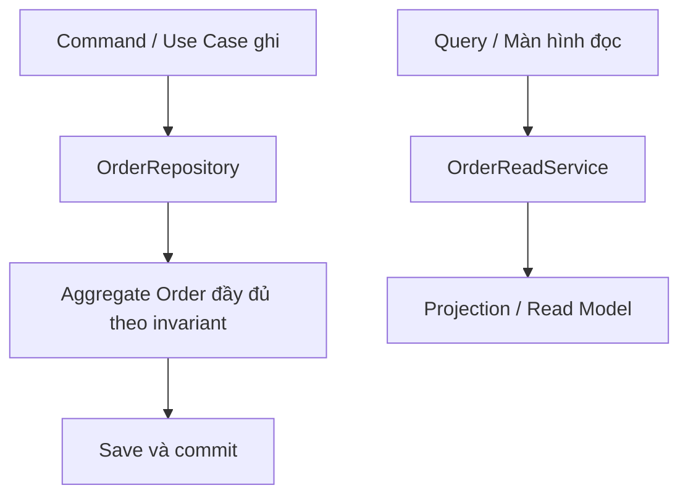
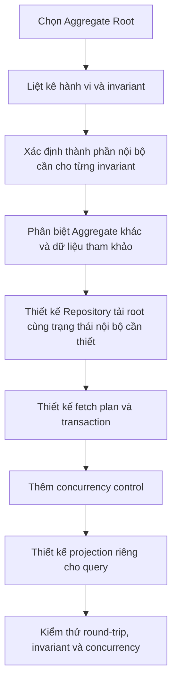

# Trả về Aggregate hoàn chỉnh theo nhu cầu bảo vệ bất biến

Trong Domain-Driven Design (DDD), Repository cung cấp cách truy xuất và lưu Aggregate như thể đang làm việc với một tập hợp đối tượng trong bộ nhớ. Khi ứng dụng yêu cầu một Aggregate, Repository cần trả về đủ trạng thái thuộc ranh giới Aggregate để các hành vi miền có thể kiểm tra và bảo vệ bất biến. Nếu chỉ tải Aggregate Root nhưng bỏ sót những thành phần bên trong có ảnh hưởng đến quy tắc, mô hình có thể đưa ra quyết định sai hoặc cho phép một thay đổi làm dữ liệu mất nhất quán.

Tuy nhiên, “Aggregate hoàn chỉnh” không có nghĩa là tải mọi dữ liệu có liên quan trong toàn hệ thống. Repository cần nạp đầy đủ phần thuộc Aggregate theo ranh giới nhất quán đã thiết kế. Những Aggregate khác thường được tham chiếu bằng ID và được truy xuất riêng khi use case cần. Các màn hình danh sách hoặc báo cáo chỉ cần một phần dữ liệu nên dùng projection/read model, không nên trả một Aggregate bị cắt bớt rồi vẫn cho phép gọi hành vi ghi.

Bài này giải thích Repository cần trả về gì, cách xác định mức độ đầy đủ dựa trên invariant, cách nạp các thành phần nội bộ và tham chiếu Aggregate khác, cùng những vấn đề về ORM, transaction, đồng thời, hiệu năng và kiểm thử.

Trong `DOMAIN_DRIVEN_DESIGN`, Repository là một phần của tactical design cùng Entity, Value Object, Aggregate và Domain Event. Repository làm cầu nối giữa mô hình miền và persistence, đồng thời giúp Aggregate Root giữ quyền kiểm soát các thay đổi nghiệp vụ.

## 1. Repository làm việc với Aggregate Root

### 1.1. Repository không đơn thuần là lớp truy vấn bảng

Repository thường được mô tả như một collection có thể truy xuất các Aggregate Root. Caller yêu cầu một đối tượng theo định danh hoặc một tiêu chí miền; Repository tìm dữ liệu trong persistence, tái tạo Aggregate và trả về cho ứng dụng.

Ví dụ:

```java
public interface OrderRepository {
    Optional<Order> findById(OrderId id);

    void save(Order order);
}
```

`OrderRepository` làm việc với `Order`, là Aggregate Root. Interface không nhất thiết phải có `OrderLineRepository` chỉ vì cơ sở dữ liệu có bảng `order_lines`. Các dòng hàng là thành phần bên trong Order và được nạp/lưu thông qua repository của root.

Repository có thể dùng nhiều bảng, câu SQL, document hoặc API persistence bên dưới. Cấu trúc lưu trữ không quyết định đối tượng mà repository miền trả về.

### 1.2. Vì sao cần tải qua Aggregate Root?

Aggregate Root là cổng kiểm soát các thay đổi bên trong Aggregate. Nếu caller tải một entity con và cập nhật trực tiếp, nó có thể bỏ qua bất biến của root.

Ví dụ, `Order` có quy tắc:

- Đơn đã xác nhận không thể thay đổi số lượng dòng hàng.
- Đơn phải có ít nhất một dòng hàng trước khi được xác nhận.
- Tổng tiền phải nhất quán với các dòng hàng và điều chỉnh được chấp thuận.

Nếu ứng dụng gọi `orderLineRepository.updateQuantity(...)`, thao tác có thể sửa dòng hàng mà không kiểm tra trạng thái Order hoặc cập nhật tổng tiền. Repository theo Aggregate Root buộc caller tải `Order`, gọi hành vi miền và lưu lại root.

```text
Application Service
       |
       v
OrderRepository.findById(OrderId)
       |
       v
Order Aggregate (đầy đủ theo invariant)
       |
       v
order.changeLineQuantity(...)
       |
       v
OrderRepository.save(order)
```

### 1.3. Repository là abstraction của miền

Interface Repository thường được đặt trong domain/application layer theo kiến trúc của dự án. Implementation cụ thể nằm ở infrastructure/persistence layer.

```text
Domain / Application
  OrderRepository (interface)
          ^
          | implements
Infrastructure
  JpaOrderRepository
  SqlOrderRepository
  DocumentOrderRepository
```

Mô hình miền phụ thuộc vào abstraction có ngôn ngữ nghiệp vụ; nó không cần biết dữ liệu được lưu bằng JPA, SQL, document database hay một công nghệ khác.

## 2. “Aggregate hoàn chỉnh” có nghĩa gì?

### 2.1. Đầy đủ theo ranh giới nhất quán

Một Aggregate hoàn chỉnh là một biểu diễn có đủ trạng thái nội bộ cần thiết để thực hiện các hành vi được Aggregate Root sở hữu và bảo vệ các invariant của nó.

Ví dụ, nếu `Order` chứa các `OrderLine` và invariant tổng tiền phụ thuộc vào toàn bộ dòng hàng, Repository cần nạp đủ các dòng hàng có liên quan trước khi hành vi thay đổi số lượng hoặc xác nhận đơn được thực hiện.

Nếu chỉ nạp ba trong mười dòng hàng rồi gọi `order.confirm()`, phép kiểm tra tổng tiền hoặc số lượng có thể bỏ qua bảy dòng còn lại. Aggregate lúc đó không thực sự đầy đủ cho hành vi đang được gọi.

### 2.2. Đầy đủ không đồng nghĩa tải mọi thứ

Aggregate không cần chứa toàn bộ dữ liệu mà nghiệp vụ có thể liên quan đến. Ví dụ, Order có thể lưu `CustomerId`, `ProductId`, `ReservationId` và một số snapshot cần thiết. Nó không nhất thiết phải nạp toàn bộ Customer, Product Catalog, Inventory hoặc Payment Aggregate.

Phân biệt ba loại dữ liệu:

| Loại dữ liệu | Cách xử lý thường phù hợp | Lý do |
|---|---|---|
| Thành phần nội bộ thuộc Aggregate | Nạp đủ theo invariant và hành vi root | Root phải bảo vệ trạng thái nội bộ như một đơn vị |
| Aggregate khác | Tham chiếu bằng ID; truy xuất riêng qua use case/cổng phù hợp | Tránh kéo nhiều ranh giới nhất quán vào cùng object graph |
| Dữ liệu chỉ phục vụ hiển thị/báo cáo | Projection/read model | Không cần tải Aggregate đầy đủ cho truy vấn đọc |

Vì vậy, “đầy đủ” luôn được hiểu trong phạm vi Aggregate đã thiết kế, không phải trong toàn bộ đồ thị quan hệ của cơ sở dữ liệu.

### 2.3. Đầy đủ cho hành vi, không phải cho mọi màn hình

Một Repository miền trả về Aggregate để thực hiện hành vi và bảo vệ invariant. Một màn hình danh sách đơn hàng có thể chỉ cần mã đơn, ngày tạo, tên khách, tổng tiền và trạng thái. Tải tất cả OrderLine, địa chỉ giao hàng và lịch sử thanh toán cho mỗi dòng trong danh sách sẽ lãng phí tài nguyên.

Không nên giải quyết vấn đề đó bằng cách trả về một `Order` bị thiếu thành phần rồi vẫn cho phép caller gọi `confirm()` hoặc `changeLineQuantity()`. Hãy dùng một kiểu đọc riêng:

```java
public record OrderSummary(
    OrderId id,
    Instant placedAt,
    String customerName,
    Money total,
    OrderStatus status
) {}

public interface OrderQueries {
    List<OrderSummary> findRecentOrders(CustomerId customerId);
}
```

`OrderSummary` là projection cho truy vấn, không phải Aggregate Root. Nó không cung cấp các hành vi ghi của Order.

## 3. Bắt đầu từ Invariant để xác định dữ liệu phải được nạp

### 3.1. Liệt kê các hành vi của Aggregate Root

Trước khi thiết kế query của Repository, hãy liệt kê các hành vi mà root cung cấp. Với Order có thể gồm:

- `addLine(...)`
- `removeLine(...)`
- `changeLineQuantity(...)`
- `confirm(...)`
- `requestCancellation(...)`
- `recordShipment(...)`

Mỗi hành vi có thể cần một tập dữ liệu khác nhau, nhưng mọi dữ liệu cần để bảo vệ invariant của hành vi phải có sẵn và đáng tin cậy.

### 3.2. Viết invariant dưới dạng điều kiện có thể kiểm tra

Ví dụ:

| Hành vi | Invariant cần bảo vệ | Trạng thái cần có |
|---|---|---|
| Thêm dòng hàng | Chỉ thêm khi đơn ở trạng thái cho phép chỉnh sửa | Trạng thái Order, danh sách dòng hàng nếu có giới hạn trùng hoặc tổng |
| Đổi số lượng | Số lượng dương; tổng tiền được tính lại đúng | Dòng hàng cần đổi và toàn bộ dữ liệu liên quan đến tổng |
| Xác nhận đơn | Đơn có ít nhất một dòng và mọi điều kiện xác nhận đều đạt | Toàn bộ dòng hàng, snapshot giá, trạng thái và điều kiện nội bộ |
| Hủy đơn | Chỉ hủy ở giai đoạn được phép | Trạng thái hiện tại, thông tin thực hiện nội bộ của Order |
| Ghi nhận hoàn tất | Điều kiện hoàn tất theo chính sách đơn hàng đã đạt | Trạng thái và các phần thực hiện thuộc Aggregate nếu chúng nằm trong ranh giới |

Không phải mọi điều kiện đều có thể được giải quyết chỉ bằng dữ liệu nội bộ. Nếu xác nhận đơn còn phụ thuộc kết quả giữ chỗ từ Inventory hoặc kết quả thanh toán từ Payment, application service cần lấy kết quả từ các context đó và truyền thông tin cần thiết vào hành vi Order. Không nên để Repository tự tải các Aggregate khác nhằm tạo cảm giác một object graph khổng lồ đã đầy đủ.

### 3.3. Nạp đủ các thành phần ảnh hưởng đến invariant

Giả sử Order có các dòng hàng, mỗi dòng chứa số lượng, đơn giá đã chốt và điều chỉnh giá. Nếu tổng tiền được tính bằng cách cộng các dòng, Repository cần nạp đủ các dòng và dữ liệu điều chỉnh có liên quan.

Nếu Order có danh sách lịch sử sự kiện rất dài nhưng các sự kiện này không tham gia vào bất kỳ invariant hay hành vi ghi nào, không nhất thiết phải nạp toàn bộ lịch sử đó. Lịch sử có thể được truy vấn qua read model hoặc kho lưu trữ riêng.

Điểm cần xác định là dữ liệu nào là một phần của trạng thái Aggregate hiện tại và dữ liệu nào chỉ là dữ liệu phụ trợ cho truy vấn.

## 4. Ví dụ: Order Repository trả về Aggregate đầy đủ

### 4.1. Mô hình Order

Giả sử `Order` sở hữu danh sách `OrderLine`. Tổng tiền của đơn được tính từ toàn bộ dòng hàng. Đơn chỉ được xác nhận khi có ít nhất một dòng và chưa bị hủy.

```java
public final class Order {
    private final OrderId id;
    private final CustomerId customerId;
    private final List<OrderLine> lines;
    private OrderStatus status;

    Order(
        OrderId id,
        CustomerId customerId,
        List<OrderLine> lines,
        OrderStatus status
    ) {
        this.id = Objects.requireNonNull(id);
        this.customerId = Objects.requireNonNull(customerId);
        this.lines = new ArrayList<>(lines);
        this.status = Objects.requireNonNull(status);
    }

    public void confirm() {
        if (status != OrderStatus.PLACED) {
            throw new OrderCannotBeConfirmed(id, status);
        }
        if (lines.isEmpty()) {
            throw new EmptyOrderNotAllowed(id);
        }
        status = OrderStatus.CONFIRMED;
    }

    public Money total() {
        return lines.stream()
            .map(OrderLine::subtotal)
            .reduce(Money.zero(Currency.getInstance("VND")), Money::add);
    }

    public OrderId id() {
        return id;
    }
}
```

Đây là ví dụ rút gọn. Trong triển khai thực tế, cần bảo vệ danh sách khỏi truy cập mutable từ bên ngoài và định nghĩa rõ quy tắc tính tiền, làm tròn, thuế và chiết khấu.

### 4.2. Repository trả về root cùng các dòng hàng

```java
public interface OrderRepository {
    Optional<Order> findById(OrderId id);

    void save(Order order);
}
```

Khi `findById` trả về một `Order`, implementation phải khôi phục đầy đủ các dòng hàng thuộc Order đó nếu chúng tham gia vào hành vi `confirm`, `total` hoặc các invariant liên quan.

```text
findById(orderId)
      |
      v
Load orders row
      |
      v
Load all order_lines for this order
      |
      v
Map rows to OrderLine entities
      |
      v
Reconstitute Order Aggregate
      |
      v
Return complete Order
```

Việc nạp có thể thực hiện bằng join, nhiều câu query trong cùng transaction, batch fetch hoặc một cơ chế document load. Chiến lược cụ thể phụ thuộc persistence, nhưng kết quả miền cần bảo đảm đủ trạng thái theo invariant.

### 4.3. Không trả về một Order chỉ có một phần dòng hàng

Giả sử query chỉ lấy 20 dòng đầu tiên:

```sql
SELECT *
FROM order_lines
WHERE order_id = :orderId
ORDER BY line_no
FETCH FIRST 20 ROWS ONLY;
```

Query này có thể phù hợp cho một màn hình xem trước, nhưng không đủ để tạo Aggregate `Order` nếu đơn có hơn 20 dòng và tổng tiền hoặc quy tắc xác nhận phụ thuộc toàn bộ dòng hàng.

Nếu use case chỉ cần xem một phần, trả `OrderLinePage` hoặc projection riêng. Nếu use case cần thay đổi Order, Repository phải tải trạng thái đầy đủ cần cho hành vi đó.

## 5. Tham chiếu Aggregate khác bằng ID

### 5.1. Không nạp toàn bộ Aggregate liên quan

Một Order có thể tham chiếu `CustomerId`, `ProductId`, `PaymentId` hoặc `ReservationId`. Các đối tượng đó có thể thuộc Aggregate hoặc bounded context riêng.

```java
public final class Order {
    private final OrderId id;
    private final CustomerId customerId;
    private final List<OrderLine> lines;
    private PaymentId paymentId;
}
```

Order không cần giữ toàn bộ object `Customer`, `Product` hoặc `Payment` chỉ để biết các định danh liên quan. Điều này tránh tải đồ thị lớn, giảm phụ thuộc vòng và giữ quyền sở hữu dữ liệu ở đúng Aggregate.

### 5.2. Khi cần dữ liệu ngoài Aggregate

Application service có thể truy vấn context hoặc Repository tương ứng, sau đó đưa kết quả cần thiết vào hành vi miền. Ví dụ, khi xác nhận đơn:

1. Tải Order đầy đủ từ `OrderRepository`.
2. Lấy kết quả reservation từ Inventory theo hợp đồng.
3. Lấy kết quả thanh toán từ Payment theo hợp đồng.
4. Gọi hành vi `order.confirm(reservationStatus, paymentStatus)` hoặc một hành vi phù hợp.
5. Lưu Order qua `OrderRepository`.

Application service điều phối nhiều nguồn dữ liệu; Order chỉ quyết định dựa trên thông tin cần thiết và quy tắc thuộc phạm vi của nó.

### 5.3. Snapshot khác với tham chiếu hiện tại

Order thường cần lưu tên sản phẩm, đơn giá và mô tả tại thời điểm mua để bảo vệ lịch sử giao dịch. Đó là snapshot thuộc Order, không phải lý do để nhúng toàn bộ Product Aggregate.

Nếu màn hình cần tên sản phẩm hiện tại, truy vấn Product Catalog riêng. Nếu hóa đơn cần tên và giá tại thời điểm đặt, dùng snapshot đã lưu cùng Order. Hai nhu cầu này có ngữ nghĩa khác nhau.

## 6. Repository và ORM: nạp đầy đủ nhưng không tải tùy tiện

### 6.1. Lazy loading có thể gây thiếu trạng thái

ORM thường hỗ trợ lazy loading để chỉ truy vấn quan hệ khi được truy cập. Điều này có thể tối ưu cho một số trường hợp, nhưng nếu aggregate được trả về sau khi persistence context đã đóng, việc truy cập collection có thể gây lỗi lazy initialization.

Một vấn đề nghiêm trọng hơn là code có thể không nhận ra rằng collection chỉ là proxy chưa được nạp. Nếu hành vi miền được gọi ngoài phạm vi session, nó có thể lỗi hoặc buộc persistence logic rò rỉ vào domain model.

Repository nên xác định rõ fetch plan cần cho aggregate. Khi trả Aggregate để xử lý nghiệp vụ, các thành phần cần cho hành vi đó phải được nạp trong ranh giới truy xuất/transaction thích hợp.

### 6.2. Eager loading mọi quan hệ cũng không phải giải pháp

Đặt mọi quan hệ là eager có thể khiến mỗi lần tải root kéo theo nhiều bảng và collection, tạo cartesian product, dữ liệu trùng lặp trong kết quả hoặc N+1 query ở các quan hệ lồng nhau.

Thay vì eager mọi thứ, hãy xác định thành phần nào thuộc Aggregate và cần thiết cho invariant. Có thể dùng:

- Fetch join cho một số quan hệ có kiểm soát.
- Batch fetching để giảm N+1.
- Nhiều query có chủ đích trong cùng transaction.
- Mapping document nếu persistence model phù hợp với aggregate.
- Projection riêng cho truy vấn đọc không cần Aggregate.

Tối ưu fetch không được làm thay đổi ý nghĩa của Aggregate. Một query nhanh nhưng trả trạng thái không đầy đủ cho hành vi ghi là một tối ưu sai.

### 6.3. Tránh N+1 khi nạp collection nội bộ

Nếu một trang cần tải nhiều Aggregate, mỗi Aggregate có nhiều dòng hàng, truy vấn riêng từng collection có thể gây N+1. Có thể dùng batch fetch hoặc query theo danh sách ID để giảm số lần round-trip.

Tuy nhiên, khi tải nhiều Order cho một màn hình, thường không cần tạo các Aggregate đầy đủ. Projection tổng hợp có thể hiệu quả hơn và thể hiện đúng ý định truy vấn.

### 6.4. Không để domain model phụ thuộc vào ORM session

Domain method không nên tự truy vấn database khi truy cập một thuộc tính. Ví dụ, `order.total()` không nên kích hoạt một query ẩn để tải thêm dòng hàng. Repository chịu trách nhiệm nạp trạng thái trước khi trả aggregate.

Nếu hành vi cần dữ liệu chưa có, hãy xem xét liệu dữ liệu đó có thực sự thuộc aggregate, liệu repository chưa nạp đủ hay ranh giới aggregate đang sai. Không để lazy loading che giấu quyết định thiết kế.

## 7. Repository phải bảo đảm trạng thái nhất quán khi có cập nhật đồng thời

### 7.1. Aggregate đầy đủ nhưng có thể đã cũ

Repository có thể trả về toàn bộ thành phần của Aggregate tại thời điểm đọc. Nhưng nếu một tiến trình khác cập nhật Aggregate trước khi caller lưu, trạng thái trong bộ nhớ có thể đã cũ.

Ví dụ, hai nhân viên cùng tải một Order ở version 5. Người thứ nhất thay địa chỉ và lưu thành version 6. Người thứ hai đổi số lượng dựa trên version 5. Nếu không có cơ chế kiểm soát đồng thời, thao tác thứ hai có thể ghi đè thay đổi của người thứ nhất hoặc tính toán dựa trên dữ liệu cũ.

### 7.2. Optimistic locking

Một cách phổ biến là lưu version trên Aggregate và dùng version đó khi cập nhật:

```java
@Version
private long version;
```

Khi ghi, persistence layer chỉ cập nhật nếu version hiện tại vẫn khớp. Nếu có tiến trình khác đã cập nhật, thao tác thất bại do optimistic locking conflict. Application service có thể tải lại Aggregate và yêu cầu người dùng thử lại hoặc chạy lại use case nếu an toàn.

Version phải áp dụng cho ranh giới nhất quán. Nếu dữ liệu nội bộ của Aggregate nằm ở nhiều bảng, thay đổi cần được kiểm soát trong cùng transaction để tránh một phần được cập nhật còn phần khác thì không.

### 7.3. Pessimistic locking và transaction isolation

Với một số nghiệp vụ có tranh chấp cao, có thể dùng pessimistic lock hoặc isolation level mạnh hơn. Đây là quyết định dựa trên yêu cầu và đặc tính tải; khóa lâu có thể làm giảm throughput và gây deadlock.

Repository không chỉ “đọc đủ dữ liệu”. Persistence flow còn phải bảo đảm các thay đổi được ghi theo cơ chế bảo vệ invariant dưới cập nhật đồng thời.

### 7.4. Không dựa vào kiểm tra trước ở Application Service

Kiểm tra ở application service trước khi tải hoặc lưu Aggregate có thể hữu ích cho trải nghiệm người dùng, nhưng không thay thế invariant bên trong root và concurrency control ở persistence. Một điều kiện như “đơn chưa bị hủy” phải được kiểm tra trên trạng thái Aggregate đang được cập nhật, đồng thời lưu với version hoặc cơ chế khóa phù hợp.

## 8. Repository không phải Query Service

### 8.1. Command side cần Aggregate

Khi use case thay đổi trạng thái miền, cần tải Aggregate đầy đủ qua Repository để gọi hành vi của root và bảo vệ invariant.

```java
public void changeQuantity(
    OrderId orderId,
    OrderLineId lineId,
    Quantity quantity
) {
    Order order = orderRepository.findById(orderId)
        .orElseThrow(() -> new OrderNotFound(orderId));

    order.changeLineQuantity(lineId, quantity);
    orderRepository.save(order);
}
```

### 8.2. Query side có thể trả projection

Một màn hình báo cáo có thể cần dữ liệu từ Order, Customer và Fulfillment. Việc tải nhiều Aggregate chỉ để ghép dữ liệu có thể không hiệu quả. Query service/read model có thể thực hiện join hoặc đọc từ read database để trả DTO phù hợp.

```java
public record OrderListItem(
    OrderId orderId,
    String customerName,
    Money total,
    OrderStatus orderStatus,
    String latestShipmentStatus
) {}

public interface OrderReadService {
    Page<OrderListItem> search(OrderSearchCriteria criteria);
}
```

`OrderListItem` không phải Aggregate và không được dùng để thay đổi trạng thái Order. Nếu người dùng chọn một hành động ghi, ứng dụng tải Aggregate thật bằng Repository.

### 8.3. CQRS giúp phân biệt hai nhu cầu

Trong CQRS, mô hình ghi tập trung vào invariant và hành vi của Aggregate; mô hình đọc có thể được tối ưu theo màn hình, báo cáo hoặc tìm kiếm.



Không cần triển khai CQRS phức tạp cho mọi ứng dụng. Chỉ cần giữ ranh giới rõ: Aggregate phục vụ hành vi ghi; projection phục vụ truy vấn chỉ đọc.

## 9. Thiết kế API Repository theo ngôn ngữ miền

### 9.1. Các phương thức thường gặp

```java
public interface OrderRepository {
    Optional<Order> findById(OrderId id);

    Order getRequired(OrderId id);

    void save(Order order);

    boolean existsById(OrderId id);
}
```

`findById` biểu diễn khả năng không tìm thấy. `getRequired` có thể là tiện ích nếu codebase thống nhất exception khi không tồn tại. `save` lưu root và toàn bộ thay đổi thuộc aggregate trong transaction phù hợp.

Không nên đưa mọi tiêu chí tìm kiếm báo cáo vào repository aggregate. Các truy vấn như “đếm đơn theo tháng và nhóm theo tỉnh” thường thuộc query service/read model.

### 9.2. Finder theo khái niệm miền

Một số finder có thể thuộc Repository nếu chúng tìm Aggregate Root theo một khái niệm nghiệp vụ:

```java
Optional<Order> findByOrderNumber(OrderNumber orderNumber);
Optional<Order> findOpenOrderFor(CustomerId customerId);
```

Hãy cẩn trọng với `findOpenOrderFor`: nếu có thể có nhiều đơn mở, tên và kiểu trả về cần phản ánh cardinality thực tế. Không nên để một tên method hàm ý duy nhất trong khi miền cho phép nhiều kết quả.

### 9.3. Tránh repository generic cho mọi bảng

Một `GenericRepository<T, ID>` với `save`, `delete`, `findAll` có thể hữu ích ở tầng kỹ thuật, nhưng nếu nó trở thành API miền duy nhất, caller dễ thao tác với entity con hoặc bảng trực tiếp. Repository nên thể hiện Aggregate Root và các thao tác có ý nghĩa.

Repository không cần phơi bày SQL, join, tên bảng hoặc fetch hint cho domain layer. Các chi tiết đó thuộc implementation.

## 10. Reconstitution: khôi phục Aggregate đầy đủ từ dữ liệu lưu trữ

### 10.1. Khôi phục không phải tạo mới

Repository khi tải dữ liệu cần tái tạo Aggregate từ trạng thái đã lưu. Nó phải giữ nguyên ID, trạng thái, các value object, entity con và version. Không nên gọi factory tạo mới theo nghiệp vụ nếu việc đó sinh ID mới, đặt lại trạng thái hoặc ghi nhận lại sự kiện khởi tạo.

```text
Database rows/documents
       |
       v
Persistence mapper
       |
       v
Reconstitute Aggregate Root + internal members
       |
       v
Return Aggregate to caller
```

### 10.2. Không trả về aggregate nửa khôi phục

Nếu dữ liệu lưu trữ bị thiếu một thành phần bắt buộc hoặc không thể tái tạo một value object hợp lệ, Repository cần phát hiện lỗi dữ liệu và xử lý theo chính sách. Không nên trả root với collection null hoặc thành phần giả để caller tiếp tục.

Tùy hệ thống, lỗi có thể được phân loại là dữ liệu hỏng, schema migration chưa hoàn tất hoặc lỗi persistence. Cần log đủ thông tin để điều tra mà không làm lộ dữ liệu nhạy cảm.

### 10.3. Validation khi reconstitution

Không phải mọi invariant hiện tại đều có thể áp dụng nguyên xi cho dữ liệu lịch sử. Ví dụ, chính sách mới có thể yêu cầu trường mà đơn cũ chưa từng lưu. Mapper hoặc migration cần có cách chuyển đổi phù hợp.

Repository phải bảo đảm aggregate được khôi phục ở một trạng thái mà mô hình hiện tại có thể hiểu và xử lý. Nếu cần tương thích phiên bản, hãy thực hiện mapping/migration rõ ràng, không âm thầm tạo dữ liệu mặc định sai.

## 11. Kiểm thử Repository trả về Aggregate hoàn chỉnh

### 11.1. Kiểm thử round-trip

Một kiểm thử tích hợp nên:

1. Tạo Aggregate hợp lệ.
2. Lưu qua Repository.
3. Kết thúc hoặc làm mới persistence context.
4. Tải lại bằng ID.
5. Xác nhận root và các thành phần nội bộ cần thiết đã được khôi phục.
6. Gọi một hành vi miền cần các thành phần đó.
7. Lưu và tải lại lần nữa để xác nhận thay đổi được duy trì.

Ví dụ:

```java
@Test
void loadsOrderWithAllLinesNeededForConfirmation() {
    Order order = anOrderWithLines(3);
    orderRepository.save(order);
    entityManager.flush();
    entityManager.clear();

    Order loaded = orderRepository.findById(order.id()).orElseThrow();

    assertEquals(3, loaded.lineCount());
    loaded.confirm();

    orderRepository.save(loaded);
    entityManager.flush();
}
```

`clear()` giúp tránh việc ORM trả lại cùng object đang nằm trong persistence context, nhờ đó kiểm thử thực sự đường khôi phục từ database.

### 11.2. Kiểm thử invariant phụ thuộc collection

Nếu tổng tiền hoặc điều kiện xác nhận phụ thuộc tất cả dòng hàng, hãy tạo dữ liệu có nhiều dòng hơn kích thước page mặc định hoặc giới hạn fetch. Tải Aggregate và xác nhận hành vi sử dụng đầy đủ dữ liệu.

### 11.3. Kiểm thử không tải Aggregate khác ngoài ý muốn

Có thể kiểm tra số query hoặc quan sát SQL để bảo đảm việc tải Order không vô tình kéo toàn bộ Customer, Product, Payment và Shipment. Những tham chiếu ngoài aggregate nên được xử lý theo use case.

### 11.4. Kiểm thử concurrency

Tạo hai transaction tải cùng một Aggregate version, thay đổi độc lập rồi lưu. Xác nhận một transaction phát hiện conflict theo chính sách optimistic/pessimistic locking. Nếu invariant cần dữ liệu nội bộ nằm ở nhiều bảng, kiểm tra rollback toàn bộ khi một phần cập nhật thất bại.

### 11.5. Kiểm thử projection riêng

Đảm bảo read model có dữ liệu phục vụ màn hình nhưng không bị sử dụng như Aggregate Root. Hành vi ghi phải tải Aggregate đầy đủ từ Repository.

## 12. Những sai lầm thường gặp

**Chỉ tải Aggregate Root mà bỏ qua thành phần nội bộ cần cho invariant.** Root có thể tồn tại trong bộ nhớ nhưng không đủ trạng thái để bảo vệ quy tắc. Hãy xác định fetch plan theo hành vi.

**Tải mọi quan hệ trong database.** Điều này tạo object graph quá lớn, query dư thừa và phụ thuộc chéo. Chỉ nạp phần thuộc aggregate; Aggregate khác được tham chiếu bằng ID.

**Trả DTO một phần dưới kiểu Aggregate.** Caller có thể gọi hành vi ghi trên dữ liệu thiếu. Dùng projection/read model với kiểu riêng.

**Mỗi bảng có một Repository.** Repository miền thường làm việc với root. Các bảng con được lưu cùng root qua persistence adapter.

**Dùng lazy loading như chiến lược mặc định mà không xét vòng đời session.** Domain method có thể phát sinh query ẩn hoặc lỗi khi session đóng. Repository cần nạp trạng thái trước khi trả Aggregate.

**Eager loading tất cả.** Nạp dư thừa có thể gây N+1, cartesian product và memory pressure. Chọn fetch strategy dựa trên invariant và use case.

**Cho rằng Aggregate đầy đủ thì không cần concurrency control.** Dữ liệu có thể đã cũ khi lưu. Dùng version/locking và transaction phù hợp.

**Repository tự điều phối nhiều Aggregate.** Repository tải/lưu một aggregate root. Application service hoặc process manager điều phối workflow xuyên aggregate.

**Gọi factory tạo mới khi tải dữ liệu.** Reconstitution phải giữ ID, trạng thái và lịch sử đã lưu, không phát lại sự kiện tạo mới.

**Dùng Repository cho mọi truy vấn báo cáo.** Query service/read model phù hợp hơn khi chỉ cần projection hoặc dữ liệu từ nhiều aggregate.

## 13. Quy trình thiết kế Repository theo invariant

Có thể áp dụng quy trình sau:



Các câu hỏi cần trả lời:

1. Aggregate Root nào đang được tải?
2. Hành vi ghi nào sẽ được gọi sau khi tải?
3. Những invariant nào hành vi đó phải bảo vệ?
4. Thành phần nội bộ nào tham gia vào invariant?
5. Có collection nào bị tải một phần hoặc phân trang không?
6. Dữ liệu nào thực ra thuộc Aggregate khác và chỉ nên giữ bằng ID?
7. Dữ liệu nào chỉ phục vụ đọc và nên là projection?
8. Repository bảo đảm việc khôi phục hoàn chỉnh trong transaction/session nào?
9. Cơ chế nào phát hiện cập nhật đồng thời?
10. Có kiểm thử chứng minh Aggregate tải lại vẫn bảo vệ đúng invariant không?

## 14. Checklist

Trước khi hoàn thiện Repository cho một Aggregate, hãy kiểm tra:

- [ ] Repository làm việc với Aggregate Root, không phải một bảng tùy ý.
- [ ] Đã liệt kê hành vi và invariant mà Aggregate cần bảo vệ.
- [ ] Tất cả thành phần nội bộ cần cho invariant được nạp đầy đủ.
- [ ] Không có collection bị giới hạn hoặc phân trang rồi dùng như trạng thái đầy đủ.
- [ ] Aggregate khác được tham chiếu bằng ID hoặc snapshot phù hợp.
- [ ] Repository không tải toàn bộ object graph của các context khác.
- [ ] Query/projection được tách khỏi Aggregate dùng cho hành vi ghi.
- [ ] Fetch plan không gây N+1 hoặc eager load quá mức.
- [ ] Domain method không kích hoạt lazy query ẩn.
- [ ] Reconstitution giữ nguyên ID, trạng thái và dữ liệu lịch sử.
- [ ] Transaction và concurrency control bảo vệ cập nhật nhiều bảng của cùng Aggregate.
- [ ] Repository không phát domain event hoặc thực hiện side effect ngoài trách nhiệm persistence.
- [ ] Có kiểm thử round-trip, invariant, collection đầy đủ và concurrency.

## 15. Câu hỏi tự kiểm tra

1. Vì sao Repository nên trả về Aggregate Root thay vì một entity con được truy vấn từ bảng riêng?
2. “Aggregate hoàn chỉnh” có nghĩa là tải tất cả Aggregate khác được tham chiếu không?
3. Nếu `Order.confirm()` cần kiểm tra toàn bộ dòng hàng, Repository có thể chỉ tải 20 dòng đầu tiên không?
4. Vì sao một projection cho màn hình danh sách không nên được dùng để cập nhật Order?
5. Khi nào nên giữ `CustomerId` thay vì tham chiếu trực tiếp đến Customer Aggregate?
6. Lazy loading có thể gây vấn đề gì khi Aggregate được trả về ngoài persistence session?
7. Vì sao Aggregate được tải đầy đủ vẫn có thể cần optimistic locking?
8. Repository cần làm gì khác với factory khi khôi phục Aggregate từ database?

**Gợi ý trả lời:**

- Câu 1: Aggregate Root kiểm soát hành vi và invariant của các thành phần nội bộ. Truy cập entity con trực tiếp có thể bỏ qua các quy tắc đó.
- Câu 2: Không. Nó chỉ cần đầy đủ trong ranh giới Aggregate. Aggregate khác thường được tham chiếu bằng ID và truy vấn riêng khi use case cần.
- Câu 3: Không, nếu invariant hoặc hành vi phụ thuộc toàn bộ dòng hàng. Query giới hạn chỉ phù hợp cho projection hoặc trang đọc.
- Câu 4: Projection có thể thiếu trạng thái nội bộ và không bảo vệ invariant. Nó chỉ phục vụ đọc; hành vi ghi phải tải Aggregate thật.
- Câu 5: Khi Customer là Aggregate riêng và Order chỉ cần nhận diện khách. ID giảm coupling và tránh kéo object graph của Customer vào Order.
- Câu 6: Có thể phát sinh query ẩn, N+1 hoặc lỗi lazy initialization khi session đóng. Repository nên nạp đủ phần cần thiết trước khi trả Aggregate.
- Câu 7: Aggregate có thể bị một transaction khác cập nhật sau thời điểm đọc. Version/locking giúp phát hiện stale state và tránh ghi đè thay đổi.
- Câu 8: Factory tạo vòng đời mới và áp dụng quy tắc khởi tạo; Repository khôi phục identity, trạng thái và các thành phần đã lưu mà không chạy lại hành động tạo mới.

## Kết luận

Repository cần trả về Aggregate Root cùng toàn bộ trạng thái nội bộ cần thiết để các hành vi miền bảo vệ invariant đúng đắn. “Hoàn chỉnh” được xác định bởi ranh giới nhất quán và use case, không phải bởi mọi quan hệ trong database. Aggregate khác nên được tham chiếu bằng ID hoặc snapshot; truy vấn chỉ đọc nên dùng projection riêng. Kết hợp fetch plan phù hợp, reconstitution đúng, transaction và concurrency control giúp Repository hỗ trợ mô hình miền mà không làm rò rỉ chi tiết persistence vào hành vi nghiệp vụ.
