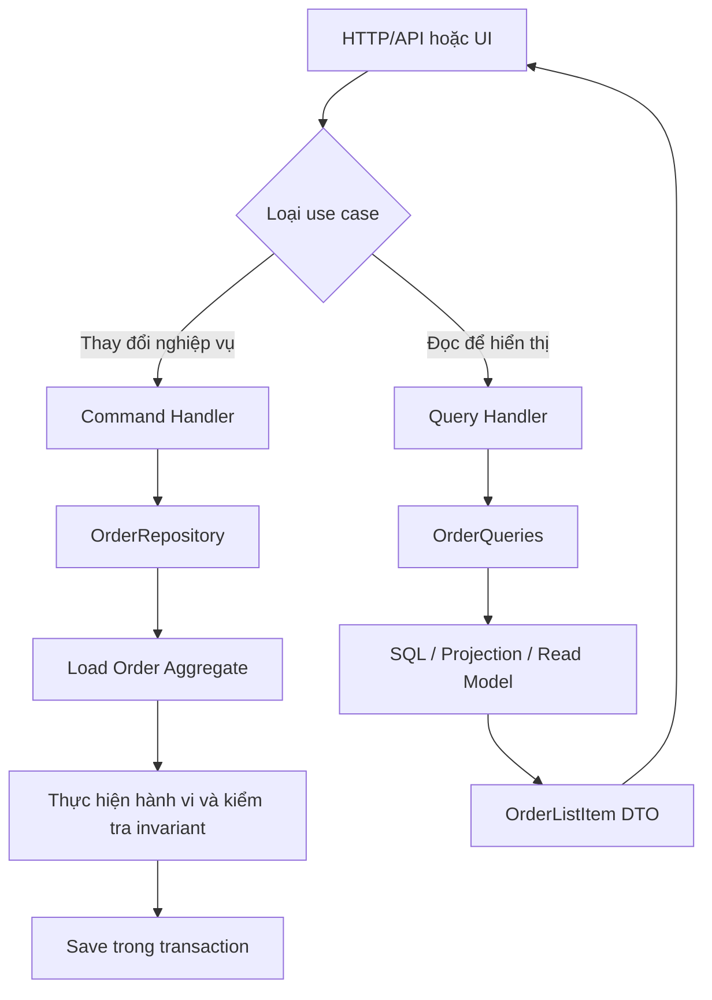
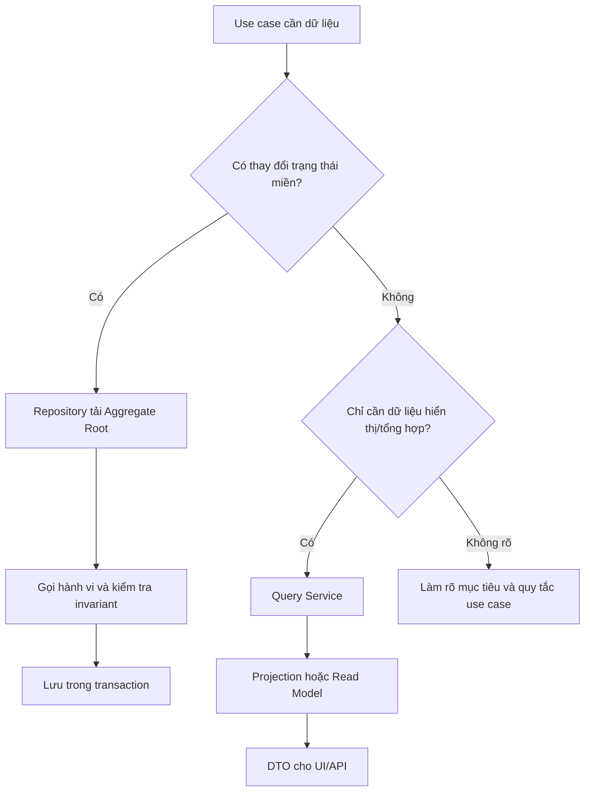

# Tách truy vấn phục vụ hiển thị khỏi việc nạp aggregate để thay đổi

Trong Domain-Driven Design (DDD), Repository cung cấp cách truy cập và lưu trữ Aggregate theo ngôn ngữ của miền. Khi một use case cần thay đổi nghiệp vụ, ứng dụng thường nạp Aggregate Root qua Repository, gọi hành vi của Aggregate để bảo vệ invariant rồi lưu kết quả. Tuy nhiên, một màn hình danh sách đơn hàng hoặc dashboard thường chỉ cần vài trường dữ liệu, bộ lọc, sắp xếp và phân trang. Nạp toàn bộ Aggregate cho những truy vấn hiển thị như vậy có thể tốn tài nguyên, kéo theo nhiều quan hệ không cần thiết và làm mờ trách nhiệm của Repository.

Vì vậy, cần phân biệt hai nhu cầu: **đọc Aggregate để thực hiện thay đổi nghiệp vụ** và **truy vấn dữ liệu để hiển thị hoặc báo cáo**. Repository thường phục vụ nhu cầu thứ nhất bằng cách tải Aggregate Root có thể thực hiện hành vi. Query service hoặc read model phục vụ nhu cầu thứ hai bằng cách trả projection phù hợp với màn hình. Hai đường đi có thể dùng chung database hoặc hạ tầng lưu trữ, nhưng có mục đích và hợp đồng khác nhau.

Bài học này giải thích ranh giới giữa Repository và truy vấn hiển thị, cách thiết kế API cho mỗi phía, cách phối hợp trong application layer, và những điểm cần chú ý về transaction, phân trang, hiệu năng, tính nhất quán và bảo mật.

## 1. Hai loại nhu cầu đọc dữ liệu khác nhau

Hãy xét hệ thống Ordering có Aggregate Root `Order`. Một use case cần xác nhận đơn hàng phải kiểm tra trạng thái, các dòng hàng và những điều kiện nghiệp vụ trước khi chuyển trạng thái. Một màn hình danh sách đơn chỉ cần mã đơn, tên khách, ngày tạo, tổng tiền và trạng thái.

Hai use case có mục đích khác nhau:

- **Đọc để thay đổi (command-side):** cần một Aggregate đủ thông tin và hành vi để kiểm tra invariant, thực hiện thay đổi và lưu lại một cách nhất quán.
- **Đọc để hiển thị (query-side):** cần dữ liệu được chọn, tính toán hoặc tổng hợp theo câu hỏi của màn hình; không cần nạp toàn bộ Aggregate và thường không thay đổi trạng thái miền.

| Tiêu chí | Nạp Aggregate để thay đổi | Truy vấn phục vụ hiển thị |
|---|---|---|
| Mục tiêu | Thực hiện một hành vi nghiệp vụ | Trả dữ liệu cho màn hình, báo cáo hoặc API đọc |
| Kết quả | Aggregate Root có hành vi và invariant | DTO, projection hoặc read model |
| Phạm vi dữ liệu | Đủ dữ liệu cần thiết để thực hiện hành vi | Chỉ trường cần cho truy vấn |
| Trách nhiệm | Repository tải/lưu Aggregate | Query service đọc và định dạng dữ liệu |
| Thay đổi dữ liệu miền | Có thể có; phải qua hành vi Aggregate | Thông thường không thay đổi trạng thái nghiệp vụ |
| Tối ưu | Tính nhất quán và hành vi miền | Bộ lọc, sắp xếp, phân trang, tổng hợp và tốc độ đọc |

Không phải mọi lệnh đọc đều cần tách thành hai hệ thống vật lý. Đây trước hết là sự phân biệt về mục đích và mô hình trả về. Một ứng dụng nhỏ có thể triển khai cả hai interface trên cùng một database và cùng một module.

## 2. Repository trong DDD có trách nhiệm gì?

Repository là abstraction cho phép domain/application layer truy cập Aggregate Root như thể đang làm việc với một tập hợp đối tượng miền. Repository che giấu chi tiết lưu trữ như SQL, ORM, document store hoặc cách kết nối cơ sở dữ liệu.

Một Repository điển hình cung cấp các thao tác như:

- Tìm Aggregate Root theo định danh.
- Thêm hoặc lưu một Aggregate Root.
- Xóa Aggregate Root nếu nghiệp vụ cho phép và chính sách lưu trữ quy định như vậy.
- Có thể cung cấp một số cách tìm Aggregate phục vụ use case, nhưng không nên trở thành bộ máy truy vấn báo cáo tổng quát.

Ví dụ interface trong Ordering:

```java
import java.util.Optional;

public interface OrderRepository {
    Optional<Order> findById(OrderId id);

    void save(Order order);
}
```

`findById()` trả về `Order` vì use case cần gọi hành vi của Aggregate. `save()` nhận Aggregate Root để lưu thay đổi. Interface không tiết lộ `EntityManager`, `Connection`, câu SQL hoặc tên bảng.

### 2.1. Repository thường được định nghĩa theo Aggregate Root

DDD khuyến khích Repository tập trung vào Aggregate Root, thay vì tạo một Repository cho mọi Entity con hoặc mọi bảng. Nếu `OrderLine` chỉ có vòng đời bên trong `Order`, ứng dụng thường không cần `OrderLineRepository` độc lập. Muốn thêm hoặc sửa dòng hàng, use case tải `Order`, gọi `addLine()` hoặc `changeQuantity()` rồi lưu `Order`.

Điều này giữ cho ranh giới nhất quán của Aggregate có ý nghĩa. Nếu một đối tượng thực sự có identity, vòng đời và invariant độc lập, cần xem xét liệu nó có nên là Aggregate Root riêng hay không; khi đó Repository riêng có thể hợp lý.

### 2.2. Repository không phải bản sao CRUD của database

Một interface như `GenericRepository<T>` với `findAll()`, `findByField()`, `updateColumn()` và `deleteById()` có thể hữu ích ở tầng hạ tầng hoặc trong ứng dụng CRUD đơn giản. Nhưng nếu đưa nguyên mô hình đó vào domain layer, nó dễ làm lộ cấu trúc lưu trữ và cho phép sửa dữ liệu mà không đi qua Aggregate Root.

Tên và chữ ký của Repository nên phản ánh cách ứng dụng làm việc với Aggregate. Những truy vấn phục vụ báo cáo hoặc tìm kiếm phức tạp thường phù hợp hơn với query service.

## 3. Vì sao không nên nạp Aggregate cho mọi màn hình?

Một màn hình danh sách thường cần dữ liệu đã được tổng hợp từ nhiều nguồn: thông tin đơn, tên khách hàng, số dòng, tổng tiền, nhãn trạng thái và thời điểm giao gần nhất. Nếu dùng Repository tải từng Aggregate rồi duyệt object graph để dựng màn hình, có thể phát sinh nhiều vấn đề.

### 3.1. Tải dữ liệu nhiều hơn mức cần thiết

Màn hình chỉ cần năm trường nhưng ORM có thể tải thêm nhiều collection và quan hệ. Điều này làm tăng lượng dữ liệu truyền từ database, số object được tạo trong bộ nhớ và thời gian chuyển đổi.

### 3.2. Nhiều truy vấn nhỏ (N+1)

Ứng dụng tải một danh sách đơn, sau đó truy cập khách hàng hoặc dòng hàng của từng đơn. Nếu ORM tải lazy từng quan hệ, một truy vấn ban đầu có thể kéo theo hàng chục hoặc hàng trăm truy vấn bổ sung.

### 3.3. Màn hình bị ràng buộc bởi cấu trúc Aggregate

Màn hình thường cần một cách trình bày riêng, chẳng hạn `customerName`, `itemCount`, `totalAmount` và `lastShipmentAt`. Không nhất thiết những trường này phải nằm trong cùng một object graph của Aggregate. Nếu cố dùng Aggregate làm response model, domain model có thể bị thêm getter hoặc quan hệ chỉ để phục vụ giao diện.

### 3.4. Phân trang và tổng hợp trở nên kém hiệu quả

Nạp toàn bộ Aggregate rồi lọc hoặc sắp xếp trong bộ nhớ khiến database không tận dụng được index, phép join, aggregate function và paging. Với dữ liệu lớn, chi phí này tăng nhanh.

### 3.5. Đọc có thể vô tình kích hoạt logic hoặc làm lộ dữ liệu

Khi serialize trực tiếp Aggregate, framework có thể duyệt quan hệ lazy, tạo vòng tham chiếu hoặc trả những field nội bộ không dành cho người dùng. Tách read DTO giúp kiểm soát dữ liệu hiển thị và tránh làm lộ mô hình miền.

Không phải mọi truy vấn dùng Aggregate đều sai. Một trang chi tiết có thể cần tải một Aggregate để hiển thị các giá trị thuộc nó. Tuy nhiên, nếu mục tiêu chỉ là đọc, không nên nạp object graph có thể thay đổi chỉ vì đó là cách duy nhất đang có.

## 4. Query Service và Read Model

Query Service cung cấp dữ liệu theo nhu cầu đọc. Nó có thể truy vấn database bằng SQL, dùng ORM projection, gọi một read store hoặc đọc một materialized view. Kết quả thường là DTO hoặc projection chỉ chứa trường cần thiết.

Ví dụ DTO cho danh sách đơn hàng:

```java
import java.math.BigDecimal;
import java.time.Instant;

public record OrderListItem(
    String orderId,
    String customerName,
    int itemCount,
    BigDecimal totalAmount,
    String currency,
    String status,
    Instant placedAt
) {}
```

Query Service có thể định nghĩa interface theo câu hỏi mà giao diện cần:

```java
import java.util.List;

public interface OrderQueries {
    List<OrderListItem> findRecentOrders(OrderFilter filter, PageRequest page);
}
```

`OrderListItem` là read DTO. Nó không cần có hành vi `confirm()` hoặc bảo vệ invariant của Order. Nó chỉ diễn đạt dữ liệu mà màn hình cần hiển thị.

### 4.1. Projection là gì?

Projection là cách chọn và biểu diễn một phần dữ liệu từ mô hình lưu trữ hoặc nguồn dữ liệu. Ví dụ, truy vấn có thể join `orders` với `customers`, đếm dòng hàng và trả trực tiếp `OrderListItem`.

```sql
SELECT
    o.order_id,
    c.display_name AS customer_name,
    COUNT(ol.order_line_id) AS item_count,
    o.total_amount,
    o.currency,
    o.status,
    o.placed_at
FROM orders o
JOIN customers c ON c.customer_id = o.customer_id
LEFT JOIN order_lines ol ON ol.order_id = o.order_id
WHERE o.tenant_id = :tenantId
  AND (:status IS NULL OR o.status = :status)
GROUP BY
    o.order_id, c.display_name, o.total_amount,
    o.currency, o.status, o.placed_at
ORDER BY o.placed_at DESC, o.order_id DESC
LIMIT :pageSize OFFSET :offset;
```

Truy vấn này minh họa cách database chọn đúng các trường cần cho màn hình, tổng hợp số dòng và phân trang. SQL thực tế cần điều chỉnh theo hệ quản trị, index, quy tắc đếm số lượng và yêu cầu phân quyền. Nếu một đơn có thể chứa nhiều loại dòng hoặc join tạo bản ghi trùng, phép đếm phải được xác định chính xác, chẳng hạn đếm distinct theo định danh dòng hàng.

### 4.2. Read Model có thể khác Domain Model

Domain Model tối ưu cho việc bảo vệ quy tắc và thực hiện hành vi. Read Model tối ưu cho việc trả lời câu hỏi. Vì vậy, cùng một dữ liệu có thể có cách tổ chức khác nhau:

- Domain Model: `Order` chứa `OrderLine`, trạng thái và các hành vi đặt, xác nhận, hủy.
- Read Model: `OrderListItem` chứa mã đơn, tên khách, số dòng, tổng tiền và nhãn trạng thái.
- Dashboard Model: tổng doanh thu theo ngày, số đơn theo trạng thái và giá trị trung bình.

Read Model có thể là projection tính tại thời điểm truy vấn hoặc dữ liệu được lưu sẵn (materialized/read table). Không nên đưa các trường chỉ phục vụ báo cáo vào Aggregate chỉ để tái sử dụng một class.

## 5. Thiết kế hai đường đi trong Application Layer

Application Service điều phối use case. Với thao tác thay đổi, nó dùng Repository để nạp Aggregate Root, gọi hành vi và lưu. Với truy vấn hiển thị, nó gọi Query Service và trả DTO.

### 5.1. Command path: nạp Aggregate để thay đổi

```java
record ConfirmOrder(OrderId orderId) {}

final class OrderNotFound extends RuntimeException {
    OrderNotFound(OrderId id) {
        super("Không tìm thấy đơn hàng: " + id);
    }
}

public interface UnitOfWork {
    void inTransaction(Runnable work);
}

public final class ConfirmOrderHandler {
    private final OrderRepository orders;
    private final UnitOfWork unitOfWork;

    public ConfirmOrderHandler(OrderRepository orders, UnitOfWork unitOfWork) {
        this.orders = orders;
        this.unitOfWork = unitOfWork;
    }

    public void handle(ConfirmOrder command) {
        unitOfWork.inTransaction(() -> {
            Order order = orders.findById(command.orderId())
                .orElseThrow(() -> new OrderNotFound(command.orderId()));

            order.confirm();
            orders.save(order);
        });
    }
}
```

`order.confirm()` là nơi kiểm tra trạng thái và invariant của Aggregate. Repository tải và lưu Aggregate; Unit of Work hoặc transaction manager bảo đảm thay đổi được commit theo ranh giới transaction phù hợp. Một số ORM tự theo dõi dirty checking nên `save()` có thể không cần thao tác rõ ràng; interface ở đây thể hiện ý định lưu và có thể được điều chỉnh theo persistence mechanism.

### 5.2. Query path: truy vấn DTO để hiển thị

```java
import java.util.List;

public final class ListOrdersHandler {
    private final OrderQueries queries;

    public ListOrdersHandler(OrderQueries queries) {
        this.queries = queries;
    }

    public List<OrderListItem> handle(OrderFilter filter, PageRequest page) {
        return queries.findRecentOrders(filter, page);
    }
}
```

Query handler không tải `Order` rồi duyệt từng Aggregate. Nó gọi một abstraction dành cho truy vấn và nhận đúng dữ liệu mà màn hình cần.

### 5.3. Sơ đồ hai đường đi



Hai đường đi có thể cùng dùng một database. Việc tách interface và kết quả trả về đã đủ để làm rõ mục đích. Chỉ khi nhu cầu mở rộng, thông lượng hoặc tính độc lập dữ liệu yêu cầu, nhóm mới cần cân nhắc tách read store hoặc triển khai CQRS đầy đủ.

## 6. Phân biệt Repository, DAO và Query Service

Các khái niệm này có thể dùng cùng công nghệ ở tầng hạ tầng nhưng khác nhau về vai trò.

| Thành phần | Trọng tâm | Kết quả thường trả về | Người sử dụng điển hình |
|---|---|---|---|
| Repository theo DDD | Tập hợp Aggregate Root | Aggregate Root | Application/domain-facing use case |
| DAO | Truy cập dữ liệu hoặc bảng/record | Record, entity persistence hoặc dữ liệu thô | Persistence adapter hoặc service |
| Query Service | Trả lời câu hỏi đọc cụ thể | DTO, projection, read model | Query handler, controller, UI |
| Read Model | Cấu trúc dữ liệu tối ưu cho đọc | Dữ liệu đã chọn/tổng hợp | Màn hình, báo cáo, API đọc |

DAO không phải khái niệm sai. Một Repository implementation có thể dùng DAO hoặc ORM ở bên dưới. Điểm quan trọng là không để API persistence chi tiết chảy ngược vào domain model và không dùng một Repository tổng quát làm nơi chứa mọi truy vấn hiển thị.

## 7. Phân trang, lọc và sắp xếp ở query side

Màn hình danh sách thường cần phân trang ổn định và lọc theo nhiều điều kiện. Những thao tác này nên được thực hiện ở nơi dữ liệu được truy vấn, thay vì tải tất cả Aggregate về rồi lọc trong bộ nhớ.

Ví dụ kiểu phân trang:

```java
import java.time.Instant;

public record PageRequest(int page, int size) {
    public PageRequest {
        if (page < 0) throw new IllegalArgumentException("page phải >= 0");
        if (size <= 0 || size > 200) {
            throw new IllegalArgumentException("size không hợp lệ");
        }
    }

    public int offset() {
        return Math.multiplyExact(page, size);
    }
}

public record OrderFilter(String status, Instant placedAfter, Instant placedBefore) {}
```

Với dữ liệu thay đổi liên tục, phân trang theo `OFFSET` có thể khiến bản ghi bị lặp hoặc bỏ sót giữa các trang khi có đơn mới được thêm. Có thể dùng keyset pagination dựa trên cặp khóa sắp xếp ổn định, ví dụ `placedAt` và `orderId`:

```sql
SELECT order_id, status, placed_at, total_amount, currency
FROM orders
WHERE tenant_id = :tenantId
  AND (placed_at, order_id) < (:lastPlacedAt, :lastOrderId)
ORDER BY placed_at DESC, order_id DESC
LIMIT :pageSize;
```

Cú pháp tuple comparison phụ thuộc hệ quản trị. Nếu không hỗ trợ, biểu diễn điều kiện tương đương bằng các mệnh đề so sánh. Keyset pagination phù hợp cho duyệt tuần tự dữ liệu lớn; nó không thay thế mọi trường hợp cần nhảy trực tiếp đến trang bất kỳ.

Các tham số lọc và sắp xếp cần được xác thực. Tên cột hoặc hướng sort không nên nối trực tiếp từ chuỗi người dùng vào SQL. Dùng whitelist cho trường sắp xếp được hỗ trợ và parameter binding cho giá trị.

## 8. Tách query không có nghĩa là CQRS đầy đủ

CQRS (Command Query Responsibility Segregation) phân biệt mô hình xử lý command và query. Tư tưởng này có thể được áp dụng ở mức đơn giản: một interface tải Aggregate để thay đổi và một query service trả projection để đọc. Hai phía vẫn có thể dùng chung database, transaction boundary hoặc deployment.

CQRS đầy đủ thường có mô hình ghi và mô hình đọc riêng, có thể đồng bộ qua domain event hoặc integration event. Điều này hữu ích khi hệ thống có nhu cầu đọc lớn, cấu trúc truy vấn rất khác mô hình ghi hoặc cần scale hai phía độc lập. Nhưng nó kéo theo chi phí đồng bộ, vận hành, xử lý event trễ và dữ liệu cuối cùng nhất quán.

Không nên triển khai event sourcing, message broker hoặc database đọc riêng chỉ vì muốn tách một truy vấn danh sách khỏi Repository. Bắt đầu bằng cách tách trách nhiệm và đo nhu cầu thực tế.

### 8.1. Một database, hai abstraction

Ở mức đơn giản, `OrderRepository` và `OrderQueries` có thể có implementation cùng đọc/ghi một database quan hệ. Repository dùng ORM để tái tạo Aggregate; Query Service dùng SQL projection để trả DTO. Không cần hai database hoặc hai bộ dữ liệu đồng bộ.

### 8.2. Read store riêng và eventual consistency

Nếu dùng read store riêng, dữ liệu đọc có thể chậm hơn dữ liệu ghi trong một khoảng thời gian. Ví dụ, command vừa xác nhận đơn nhưng dashboard chưa hiển thị trạng thái mới vì projection chưa xử lý event.

Khi đó, cần quyết định:

- Màn hình nào chấp nhận eventual consistency?
- Màn hình nào cần đọc lại từ write store sau command?
- Có cần trả version hoặc timestamp của projection không?
- Làm sao xử lý event trùng, sai thứ tự hoặc thất bại?
- Có cơ chế rebuild read model và đối soát dữ liệu không?

Một số use case có thể trả trạng thái vừa cập nhật trực tiếp từ command response, trong khi màn hình tổng hợp chấp nhận cập nhật chậm. Quyết định phải dựa trên kỳ vọng nghiệp vụ.

### 8.3. Không dùng projection làm nguồn quyết định invariant

Read model có thể được cập nhật trễ hoặc chỉ chứa một phần dữ liệu. Vì vậy, kết quả query phù hợp để hiển thị, tìm kiếm hoặc gợi ý cho người dùng, nhưng không nên là căn cứ duy nhất để chấp nhận một thay đổi quan trọng.

Ví dụ, màn hình có thể hiển thị tồn kho khả dụng là 3 tại thời điểm đọc. Trước khi command giữ 2 sản phẩm được xử lý, một đơn khác có thể đã giữ mất 2 sản phẩm. Inventory phải kiểm tra lại số lượng trong Aggregate hoặc cơ chế ghi có thẩm quyền của nó khi xử lý `ReserveInventory`. Nếu chỉ tin projection, hệ thống có thể bán vượt tồn kho.

Quy tắc này cũng áp dụng cho hạn mức tín dụng, số chỗ còn trống, trạng thái thanh toán và quyền phê duyệt. Query side có thể hỗ trợ trải nghiệm người dùng; quyết định cuối cùng phải được bảo vệ ở nơi sở hữu invariant, trong transaction hoặc cơ chế concurrency phù hợp.

## 9. Transaction và quyền sở hữu Aggregate

Repository không nên làm cho application layer quên ranh giới transaction. Một use case thay đổi Aggregate thường cần:

1. Bắt đầu transaction phù hợp.
2. Tải Aggregate Root qua Repository.
3. Gọi hành vi nghiệp vụ.
4. Lưu thay đổi và phát domain event theo cơ chế an toàn.
5. Commit transaction.

Nếu use case cần thay đổi nhiều Aggregate, cần xem xét lại ranh giới nghiệp vụ. Không nên mặc định tải nhiều Aggregate rồi giữ tất cả trong một transaction lớn. Có thể cần quy trình phối hợp, domain event hoặc eventual consistency.

Query Service thường không cần tải Aggregate hoặc giữ transaction ghi. Tuy nhiên, truy vấn báo cáo có thể cần snapshot nhất quán hoặc transaction read-only tùy database và yêu cầu dữ liệu. “Read” không có nghĩa là không cần quan tâm transaction isolation.

## 10. Kiểm soát truy cập và dữ liệu nhạy cảm ở query side

Projection chỉ chứa trường cần thiết giúp giảm nguy cơ trả dữ liệu thừa, nhưng không tự đảm bảo bảo mật. Query Service vẫn phải áp dụng:

- Phân quyền theo người dùng, vai trò và tenant.
- Bộ lọc phạm vi dữ liệu trước khi trả kết quả.
- Chính sách che hoặc loại bỏ dữ liệu cá nhân không cần cho màn hình.
- Parameter binding và whitelist cho bộ lọc/sắp xếp.
- Giới hạn kích thước trang và kiểm soát truy vấn tốn kém.
- Audit hoặc logging phù hợp với truy vấn nhạy cảm.

Ví dụ, `tenantId` nên được lấy từ ngữ cảnh xác thực đã được kiểm tra, không tin giá trị tenant do client tùy ý gửi. Nếu query join nhiều context hoặc bảng, cần đảm bảo việc lọc quyền áp dụng xuyên suốt dữ liệu trả về.

## 11. Những sai lầm thường gặp

- **Dùng Repository tải Aggregate cho mọi màn hình:** làm tăng số object, truy vấn phụ và coupling với domain model.
- **Dùng Repository như query builder tổng quát:** interface chứa quá nhiều bộ lọc và projection khiến trách nhiệm Aggregate bị mờ.
- **Tạo Repository cho mọi bảng:** làm lộ cấu trúc persistence và bỏ qua ranh giới Aggregate Root.
- **Trả Aggregate trực tiếp qua API:** có thể làm lộ field nội bộ, lazy relationship hoặc cấu trúc miền không dành cho client.
- **Dùng DTO làm domain entity:** mô hình miền bị chi phối bởi cấu trúc request/response.
- **Đưa logic nghiệp vụ vào Query Service:** truy vấn đọc không nên trở thành nơi thay đổi trạng thái hoặc quyết định invariant.
- **Lọc và phân trang trong bộ nhớ:** tải quá nhiều dữ liệu và không tận dụng khả năng truy vấn của database.
- **Nhầm tách query với CQRS phân tán:** triển khai hạ tầng phức tạp trước khi có nhu cầu.
- **Không tính eventual consistency:** màn hình có thể hiển thị dữ liệu cũ sau một command và gây hiểu nhầm cho người dùng.
- **Bỏ qua phân quyền ở projection:** query nhanh nhưng có thể trả dữ liệu của tenant hoặc vai trò khác.
- **Không có giới hạn trang:** truy vấn có thể trả lượng dữ liệu rất lớn và gây quá tải.

## 12. Quy trình quyết định nên dùng Repository hay Query Service

Khi thiết kế một use case, hãy đặt các câu hỏi sau:

1. Use case có cần thay đổi trạng thái nghiệp vụ không?
2. Có cần kiểm tra invariant hoặc gọi hành vi của Aggregate không?
3. Kết quả cần là Aggregate Root hay một hình chiếu dữ liệu cho màn hình?
4. Màn hình cần những trường nào, có cần join hoặc tổng hợp từ nhiều nguồn không?
5. Có cần lọc, sắp xếp, phân trang hoặc tìm kiếm toàn văn không?
6. Dữ liệu đọc có thể trễ so với write model không?
7. Quy tắc phân quyền và tenant được áp dụng ở đâu?
8. Có cần read store riêng hay một projection trên cùng database đã đủ?



Quy trình này là hướng dẫn suy nghĩ, không phải quy tắc cứng. Có use case đọc cần Aggregate vì phải thực hiện một hành vi có ý nghĩa ngay sau đó; cũng có use case command cần một số dữ liệu tham chiếu từ query service trước khi tải Aggregate. Điều quan trọng là xác định rõ dữ liệu nào phục vụ quyết định nghiệp vụ và dữ liệu nào chỉ phục vụ trình bày.

## 13. Checklist thiết kế Repository và truy vấn hiển thị

Trước khi hoàn thiện một use case, hãy kiểm tra:

- [ ] Repository tập trung tải/lưu Aggregate Root cần cho hành vi nghiệp vụ.
- [ ] Application Service gọi hành vi của Aggregate thay vì sửa trực tiếp dữ liệu lưu trữ.
- [ ] Truy vấn chỉ phục vụ hiển thị trả DTO hoặc projection phù hợp.
- [ ] Query Service không làm lộ Aggregate mutable hoặc object graph nội bộ.
- [ ] Truy vấn chọn đúng trường cần thiết và thực hiện lọc/phân trang ở database khi phù hợp.
- [ ] Đã kiểm tra nguy cơ N+1 và tải quan hệ không cần thiết.
- [ ] Bộ lọc, sort, tenant và phân quyền được xác thực.
- [ ] Transaction của command bảo vệ thay đổi Aggregate.
- [ ] Yêu cầu nhất quán của query được xác định rõ.
- [ ] Chỉ triển khai read store riêng/CQRS khi có nhu cầu cụ thể.
- [ ] DTO và read model không bị nhầm với domain model.

## 14. Câu hỏi tự kiểm tra

1. Repository trong DDD có trách nhiệm chính là gì?
2. Vì sao Repository thường được định nghĩa theo Aggregate Root thay vì từng bảng?
3. Khác biệt giữa nạp Aggregate để thay đổi và truy vấn DTO để hiển thị là gì?
4. Vì sao dùng Aggregate cho màn hình danh sách có thể gây N+1 và tải thừa dữ liệu?
5. Query Service và Read Model khác nhau ở vai trò nào?
6. Một ứng dụng có cần database riêng cho read model ngay khi tách Query Service không?
7. Khi nào nên cân nhắc CQRS đầy đủ và những chi phí nhất quán nào đi kèm?
8. Vì sao application layer cần điều phối transaction khi tải và lưu Aggregate?
9. Query Service cần bảo vệ tenant và quyền truy cập như thế nào?
10. Với màn hình danh sách đơn hàng và use case xác nhận đơn, bạn sẽ thiết kế hai đường đi dữ liệu ra sao?

## Kết luận

Repository trong DDD phục vụ việc nạp và lưu Aggregate Root để thực hiện hành vi nghiệp vụ. Truy vấn phục vụ hiển thị có mục tiêu khác: trả đúng dữ liệu mà màn hình hoặc báo cáo cần, thường dưới dạng DTO, projection hoặc read model. Tách hai trách nhiệm giúp Aggregate tập trung bảo vệ invariant, còn query side được tối ưu cho lọc, sắp xếp, phân trang và tổng hợp.

Hãy bắt đầu bằng cách xác định use case đang đọc để thay đổi hay đọc để trình bày. Dùng Repository cho đường đi cần Aggregate; dùng Query Service cho đường đi cần dữ liệu đọc chuyên biệt. Có thể triển khai cả hai trên cùng database trước, rồi chỉ mở rộng sang CQRS hoặc read store riêng khi yêu cầu về tải, cấu trúc truy vấn và tính nhất quán thực sự cần thiết.
