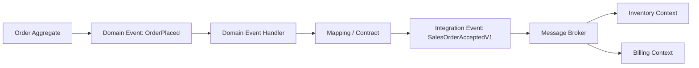
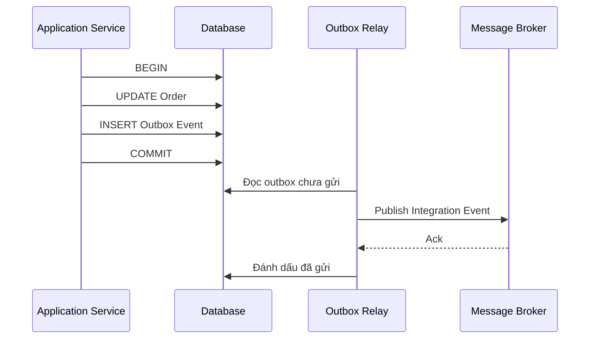
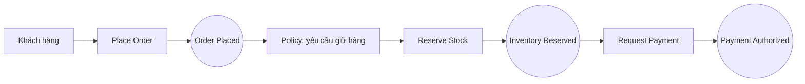

# Sự kiện miền (Domain Event): sự kiện có ý nghĩa trong một ngữ cảnh

## Vì sao cần mô hình hóa sự kiện miền?

Trong nghiệp vụ, có những việc một khi đã xảy ra thì các bên cần biết và có thể phải phản ứng: khách hàng đã đặt đơn, khoản thanh toán đã được chấp thuận, hàng đã được bàn giao, hợp đồng đã hết hiệu lực. Đây không chỉ là thay đổi một cột trong cơ sở dữ liệu. Mỗi việc có ý nghĩa đối với cách doanh nghiệp vận hành, tạo ra thông tin mới và đôi khi kích hoạt một bước tiếp theo.

Domain-Driven Design (DDD) gọi những sự việc như vậy là **Domain Event (sự kiện miền)**. Domain Event mô tả một điều có ý nghĩa nghiệp vụ đã thực sự xảy ra trong một miền hoặc bounded context. Tên sự kiện thường dùng dạng quá khứ, chẳng hạn `OrderPlaced`, `PaymentAuthorized` hoặc `ShipmentDispatched`, vì nó ghi nhận một sự thật đã được xác lập.

Sự kiện miền giúp mô hình diễn đạt rõ những thay đổi quan trọng, tách nơi phát sinh sự việc khỏi nơi cần phản ứng và tạo ngôn ngữ chung giữa chuyên gia nghiệp vụ với đội phát triển. Khi được dùng đúng, chúng giúp các thành phần phối hợp mà không cần biết quá nhiều về cấu trúc nội bộ của nhau.

Sau bài học, người học có thể:

- Giải thích Domain Event và nhận diện sự kiện có ý nghĩa trong một bounded context.
- Đặt tên sự kiện theo sự việc đã xảy ra, bằng ngôn ngữ nghiệp vụ.
- Phân biệt Domain Event với command, query, integration event, notification và audit log.
- Xác định dữ liệu tối thiểu cần có trong một sự kiện và cách giữ sự kiện bất biến.
- Mô hình hóa nơi phát sinh, thu thập và xử lý sự kiện trong ứng dụng.
- Hiểu thời điểm công bố sự kiện, transaction boundary và vai trò của Transactional Outbox.

## Domain Event là gì?

**Domain Event là một sự việc đã xảy ra mà chuyên gia nghiệp vụ quan tâm trong một ngữ cảnh cụ thể.** Nó biểu đạt một sự thật của miền, thường gắn với một thay đổi trạng thái hoặc một quyết định nghiệp vụ đã được chấp nhận.

Ví dụ trong một hệ thống thương mại điện tử:

- `OrderPlaced`: đơn hàng đã được đặt.
- `OrderCancelled`: đơn hàng đã bị hủy.
- `PaymentAuthorized`: khoản thanh toán đã được chấp thuận.
- `InventoryReserved`: hàng đã được giữ cho một yêu cầu.
- `ShipmentDispatched`: kiện hàng đã được bàn giao cho đơn vị vận chuyển.
- `RefundIssued`: khoản hoàn tiền đã được thực hiện.

Những tên này không mô tả yêu cầu cần thực hiện trong tương lai. Chúng khẳng định sự việc đã hoàn tất theo định nghĩa của miền phát sinh. Nếu một yêu cầu thanh toán mới được gửi đi nhưng cổng thanh toán chưa trả kết quả, sự kiện phù hợp có thể là `PaymentAuthorizationRequested` hoặc một command, tùy cách mô hình hóa. Không nên phát `PaymentAuthorized` trước khi có xác nhận rằng khoản thanh toán thực sự được chấp thuận.

### Sự kiện phải có ý nghĩa trong ngữ cảnh

Một từ có thể mang ý nghĩa khác nhau ở các bounded context. Ví dụ:

- Trong Order Management, `OrderPlaced` có thể nghĩa là khách đã gửi đơn và đơn đáp ứng điều kiện tiếp nhận.
- Trong Fulfillment, sự kiện liên quan có thể là `FulfillmentRequested`, nghĩa là quy trình chuẩn bị hàng đã được yêu cầu.
- Trong Payment, `PaymentAuthorized` nghĩa là một khoản tiền đã được bên cung cấp thanh toán chấp thuận theo giao thức của họ.

Không nên dùng một tên sự kiện chung như `StatusChanged` cho mọi thay đổi nếu người nhận cần hiểu điều gì đã xảy ra. Tên sự kiện nên thể hiện ngôn ngữ và ranh giới của context phát sinh. Nếu các context cần trao đổi, hãy công bố hợp đồng tích hợp có ý nghĩa với bên nhận.

### Sự kiện ghi nhận sự thật, không phải mệnh lệnh

So sánh:

| Cách diễn đạt | Ý nghĩa | Ví dụ |
|---|---|---|
| Command | Yêu cầu một hành động có thể được chấp nhận hoặc từ chối | `PlaceOrder`, `AuthorizePayment` |
| Domain Event | Ghi nhận điều đã xảy ra | `OrderPlaced`, `PaymentAuthorized` |
| Query | Yêu cầu đọc dữ liệu, không chủ đích thay đổi trạng thái | `GetOrderDetails`, `FindAvailableStock` |

Command thường dùng động từ ở dạng yêu cầu. Domain Event thường dùng dạng quá khứ. Query diễn đạt thông tin cần đọc. Phân biệt ba loại này giúp tránh việc một message vừa mang ý nghĩa “hãy làm” vừa giả định rằng việc đó đã hoàn tất.

## Khi nào một sự việc đáng được mô hình hóa thành Domain Event?

Không phải mọi thay đổi thuộc tính đều cần tạo sự kiện. Một thay đổi thường đáng được biểu diễn thành Domain Event khi:

- Nó đánh dấu một mốc nghiệp vụ mà chuyên gia có thể gọi tên và xác nhận.
- Nó làm thay đổi trạng thái hoặc quyền/nghĩa vụ có ý nghĩa.
- Nó là đầu vào cho quyết định hoặc hành động tiếp theo.
- Một bộ phận hoặc quy trình khác cần biết sự việc đã xảy ra.
- Doanh nghiệp cần truy vết, đối soát hoặc giải thích một kết quả.

Ví dụ, việc thay đổi khoảng trắng trong trường ghi chú nội bộ có thể không cần Domain Event. Việc khách hàng thay đổi địa chỉ giao hàng sau khi đơn đã được xác nhận có thể là sự kiện quan trọng vì nó ảnh hưởng đến quy trình giao hàng và cần được xác nhận theo chính sách.

Hãy hỏi chuyên gia nghiệp vụ:

- Điều gì đã xảy ra mà chúng ta cần gọi tên?
- Ai quan tâm đến việc đó?
- Sự việc có làm thay đổi trạng thái, quyền, nghĩa vụ hoặc quyết định không?
- Bộ phận khác cần biết chính xác điều gì và vào thời điểm nào?
- Nếu sự việc không xảy ra, quy trình tiếp theo có khác không?

Nếu không thể giải thích ý nghĩa nghiệp vụ của sự kiện, có thể đó chỉ là chi tiết kỹ thuật hoặc một thay đổi dữ liệu không cần công bố.

## Đặc điểm của một Domain Event tốt

### Tên sự kiện mô tả điều đã xảy ra

Tên nên rõ, cụ thể và dùng ngôn ngữ chung của context. Thông thường, tên thể hiện đối tượng và kết quả:

- Tốt: `OrderPlaced`, `InvoiceIssued`, `CustomerRegistered`.
- Mơ hồ: `OrderUpdated`, `ProcessCompleted`, `DataChanged`.
- Mang ý nghĩa command: `PlaceOrder`, `SendInvoice`, `UpdateCustomer`.

Tên tổng quát như `OrderUpdated` vẫn có thể hữu ích nếu miền thực sự quan tâm đến mọi thay đổi của đơn như một khái niệm. Tuy nhiên, nếu người nhận phải biết đơn đã được đặt, hủy hay thay đổi địa chỉ, sự kiện chuyên biệt sẽ diễn đạt tốt hơn.

### Sự kiện bất biến

Domain Event là bản ghi của một sự việc đã xảy ra. Sau khi tạo, dữ liệu của sự kiện không nên bị sửa để phản ánh trạng thái mới. Nếu thông tin sau đó thay đổi, hãy phát một sự kiện mới, ví dụ `OrderAddressChanged`, thay vì sửa payload của `OrderPlaced` đã phát sinh trước đó.

Tính bất biến giúp người đọc hiểu được lịch sử và cho phép nhiều consumer xử lý cùng một sự thật mà không làm thay đổi ý nghĩa của nó. Trong Java, record và các value object bất biến là cách biểu diễn phù hợp; với collection, cần sao chép phòng vệ thay vì giữ tham chiếu có thể sửa.

### Dữ liệu đủ để hiểu và xử lý sự kiện

Một sự kiện thường cần một số thông tin sau, tùy use case:

| Trường | Mục đích |
|---|---|
| `eventId` | Định danh duy nhất của lần phát sinh, hỗ trợ truy vết và chống xử lý lặp |
| `occurredAt` | Thời điểm sự việc xảy ra theo quy ước của hệ thống |
| `aggregateId` | Định danh aggregate phát sinh sự kiện |
| `aggregateVersion` hoặc `sequence` | Thứ tự hoặc phiên bản của thay đổi nếu cần |
| Dữ liệu nghiệp vụ | Những giá trị người nhận cần để hiểu sự việc hoặc xử lý tiếp |
| `correlationId` | Liên kết sự kiện với một quy trình hoặc yêu cầu lớn hơn |
| `causationId` | Cho biết command hoặc sự kiện nào trực tiếp dẫn đến sự kiện này |

Không phải Domain Event nào cũng cần tất cả trường. Một sự kiện nội bộ có thể chỉ cần ID aggregate, thời điểm và dữ liệu miền. Metadata phục vụ truyền message, quan sát hoặc truy vết có thể được bổ sung ở envelope hoặc tầng hạ tầng. Hãy tránh đưa mọi trường kỹ thuật vào mô hình miền nếu chúng không mang ý nghĩa đối với miền.

### Không gửi toàn bộ Aggregate trong payload

Không nên đặt nguyên object `Order`, `Customer` hoặc graph đối tượng vào payload sự kiện. Cách đó làm người nhận phụ thuộc vào cấu trúc nội bộ, có thể vô tình lộ dữ liệu không cần thiết và khiến thay đổi mô hình phá vỡ consumer.

Thay vào đó, chỉ gửi các dữ liệu cần thiết. Ví dụ, `OrderPlaced` có thể chứa `orderId`, `customerId`, thời điểm đặt, tổng tiền đã chốt và các dòng hàng ở dạng snapshot tối thiểu nếu quy trình tiếp theo cần chúng. Nếu consumer cần thông tin mới nhất về khách hàng hoặc sản phẩm, nó có thể truy vấn theo ID qua hợp đồng phù hợp.

## Ví dụ: mô hình hóa OrderPlaced trong Java

### Định nghĩa kiểu Domain Event

Có thể định nghĩa một interface chung cho các sự kiện miền:

```java
// DomainEvent.java
import java.time.Instant;
import java.util.UUID;

public interface DomainEvent {
    UUID eventId();
    Instant occurredAt();
}
```

Interface này cung cấp metadata cơ bản. Mỗi sự kiện cụ thể bổ sung dữ liệu miền cần thiết.

```java
// OrderPlaced.java
import java.math.BigDecimal;
import java.time.Instant;
import java.util.List;
import java.util.Objects;
import java.util.UUID;

public record OrderPlaced(
        UUID eventId,
        UUID orderId,
        UUID customerId,
        Instant occurredAt,
        BigDecimal totalAmount,
        String currency,
        List<PlacedOrderLine> lines
) implements DomainEvent {

    public OrderPlaced {
        Objects.requireNonNull(eventId, "eventId");
        Objects.requireNonNull(orderId, "orderId");
        Objects.requireNonNull(customerId, "customerId");
        Objects.requireNonNull(occurredAt, "occurredAt");
        Objects.requireNonNull(totalAmount, "totalAmount");
        Objects.requireNonNull(currency, "currency");
        lines = List.copyOf(lines);
    }
}

// PlacedOrderLine.java
public record PlacedOrderLine(
        UUID productId,
        String productName,
        BigDecimal quantity,
        BigDecimal agreedUnitPrice
) {}
```

Trong Java, mỗi kiểu `public` cấp cao nhất được đặt trong file riêng có tên tương ứng. Các chú thích tên file trong ví dụ cho biết cách tách các kiểu khi đưa vào dự án.

`OrderPlaced` chứa snapshot tối thiểu của dòng hàng để consumer có thể tiếp tục xử lý mà không cần nhận toàn bộ aggregate. Trong hệ thống thực tế, nên dùng `Money`, `Quantity` hoặc kiểu dữ liệu có đơn vị rõ ràng trong domain model; ví dụ trên dùng `BigDecimal` và mã tiền tệ riêng để giữ phần minh họa gọn. Cần xác định độ chính xác, đơn vị đo và chính sách làm tròn theo nghiệp vụ.

Record không tự làm mọi dữ liệu lồng nhau trở nên bất biến. `List.copyOf` tạo một danh sách không thể sửa, nhưng các phần tử bên trong cũng cần là value object bất biến. Nếu payload chứa một object mutable, người giữ tham chiếu vẫn có thể làm thay đổi nội dung sự kiện.

### Aggregate phát sinh sự kiện khi hành vi thành công

Aggregate không nên tự gửi message ra broker hoặc gọi HTTP. Nó thay đổi trạng thái theo quy tắc và ghi nhận Domain Event trong bộ nhớ để tầng điều phối thu thập sau đó.

```java
import java.time.Instant;
import java.util.ArrayList;
import java.util.List;
import java.util.UUID;

public final class Order {
    private final UUID id;
    private final UUID customerId;
    private final List<OrderLine> lines;
    private final List<DomainEvent> domainEvents = new ArrayList<>();
    private OrderStatus status;

    public Order(UUID id, UUID customerId, List<OrderLine> lines) {
        this.id = java.util.Objects.requireNonNull(id, "id");
        this.customerId = java.util.Objects.requireNonNull(customerId, "customerId");
        this.lines = new ArrayList<>(java.util.Objects.requireNonNull(lines, "lines"));
        this.status = OrderStatus.DRAFT;
    }

    public void place(Instant now) {
        java.util.Objects.requireNonNull(now, "now");
        if (status != OrderStatus.DRAFT) {
            throw new IllegalStateException("Only a draft order can be placed");
        }
        if (lines.isEmpty()) {
            throw new IllegalStateException("An order needs at least one line");
        }

        String currency = currencyCode();
        if (lines.stream().anyMatch(line -> !currency.equals(line.currencyCode()))) {
            throw new IllegalStateException("All order lines must use the same currency");
        }
        OrderPlaced event = new OrderPlaced(
                UUID.randomUUID(),
                id,
                customerId,
                now,
                totalAmount(),
                currency,
                lines.stream().map(OrderLine::toPlacedSnapshot).toList()
        );
        status = OrderStatus.PLACED;
        domainEvents.add(event);
    }

    public List<DomainEvent> pullDomainEvents() {
        List<DomainEvent> pending = List.copyOf(domainEvents);
        domainEvents.clear();
        return pending;
    }

    private java.math.BigDecimal totalAmount() {
        // Tính theo quy tắc giá và làm tròn của miền.
        return lines.stream()
                .map(OrderLine::lineTotal)
                .reduce(java.math.BigDecimal.ZERO, java.math.BigDecimal::add);
    }

    private String currencyCode() {
        // Ví dụ giả định mọi dòng hàng trong đơn dùng cùng tiền tệ.
        return lines.get(0).currencyCode();
    }
}
```

Đây là mã minh họa, giả định các dòng hàng đã hợp lệ và dùng cùng tiền tệ. Trong mô hình thực tế, `Order` cần kiểm tra tính tương thích tiền tệ và tính tổng bằng value object `Money`. Có thể dùng `Clock` ở application layer để cung cấp `Instant`, giúp kiểm thử thời gian. Phương thức `pullDomainEvents()` nên được giới hạn phạm vi truy cập theo kiến trúc để chỉ tầng điều phối có thể lấy và xóa các sự kiện đang chờ.

Điểm quan trọng là sự kiện chỉ được thêm sau khi hành vi đã vượt qua kiểm tra và trạng thái miền đã thay đổi. Nếu `place()` thất bại vì đơn không có dòng hàng, không được phát `OrderPlaced`. Nếu đơn đã đặt rồi, lời gọi lặp không được tạo thêm một sự kiện đặt đơn mới ngoài chính sách idempotency đã định nghĩa.

### Thu thập và xử lý ở Application Layer

Application Service điều phối tải aggregate, gọi hành vi, lưu thay đổi và công bố sự kiện. Một luồng đơn giản trong cùng tiến trình có thể được mô tả như sau:

```java
@Transactional
public void placeOrder(PlaceOrderCommand command) {
    Order order = orderRepository.get(command.orderId());

    order.place(clock.instant());
    List<DomainEvent> events = order.pullDomainEvents();

    orderRepository.save(order);
    domainEventDispatcher.publishAfterCommit(events);
}
```

`publishAfterCommit` là tên minh họa cho cơ chế điều phối sau commit; nó không phải API chuẩn của Spring hay Java. Nếu triển khai bằng callback transaction, cần bảo đảm sự kiện chỉ được chuyển cho handler sau khi transaction commit thành công. Nếu cần độ tin cậy qua lỗi tiến trình, hãy dùng Transactional Outbox thay vì chỉ giữ callback trong bộ nhớ.

## Domain Event, Integration Event và các khái niệm liên quan

### Domain Event và Integration Event

Domain Event thường biểu diễn sự việc trong mô hình của một bounded context. Integration Event là hợp đồng được công bố để context hoặc hệ thống khác có thể tiêu thụ. Một Domain Event có thể được chuyển đổi thành Integration Event, nhưng hai kiểu không nhất thiết giống nhau.

Ví dụ:

- Domain Event nội bộ: `OrderPlaced`, chứa các value object và dữ liệu chi tiết phù hợp với mô hình Order Management.
- Integration Event: `SalesOrderAcceptedV1`, chứa schema ổn định mà Inventory, Billing hoặc đối tác có thể hiểu.

Lý do tách:

- Mô hình nội bộ có thể thay đổi mà không buộc tất cả consumer thay đổi theo.
- Integration Event chỉ công bố dữ liệu được phép chia sẻ và cần thiết cho bên nhận.
- Có thể đổi tên, cấu trúc hoặc gộp các sự kiện nội bộ khi tạo hợp đồng tích hợp.
- Versioning và khả năng tương thích được quản lý ở ranh giới công bố.



Sơ đồ là một cách triển khai thường gặp. Một số hệ thống có thể công bố trực tiếp một sự kiện miền đã được thiết kế như hợp đồng tích hợp; điều đó vẫn cần quản lý ranh giới, dữ liệu, phiên bản và quyền sở hữu rõ ràng.

### Domain Event và Notification

Notification thường là thông điệp hướng đến người dùng hoặc kênh giao tiếp, ví dụ email “Đơn hàng của bạn đã được xác nhận”. Domain Event là sự thật trong mô hình miền, không phải nội dung email hay thông báo giao diện.

Một handler có thể nhận `OrderPlaced`, sau đó tạo yêu cầu gửi email hoặc push notification. Nội dung thông báo có thể được cá nhân hóa, dịch ngôn ngữ hoặc gửi lại theo chính sách mà không làm thay đổi ý nghĩa của Domain Event.

### Domain Event và Audit Log

Audit Log ghi lại ai đã thực hiện thao tác nào, vào lúc nào và trên dữ liệu nào nhằm phục vụ truy vết hoặc kiểm toán. Domain Event ghi nhận một sự việc có ý nghĩa nghiệp vụ. Hai loại có thể chia sẻ metadata như tác nhân và thời điểm, nhưng mục đích và schema không giống nhau.

Ví dụ, nhân viên mở trang chi tiết đơn hàng có thể tạo audit record về việc truy cập, nhưng không nhất thiết tạo Domain Event. Khi nhân viên hủy đơn và hành vi hủy được chấp nhận, `OrderCancelled` là Domain Event; audit log có thể đồng thời ghi tài khoản nhân viên, địa chỉ IP hoặc thông tin phiên làm việc theo chính sách bảo mật.

### Domain Event và Event Sourcing

Domain Event có thể được dùng trong một ứng dụng lưu trạng thái hiện tại bằng cơ sở dữ liệu quan hệ. Aggregate thay đổi trạng thái, phát sinh sự kiện và repository lưu trạng thái đó. Cách dùng này không phải Event Sourcing.

Trong Event Sourcing, event stream là nguồn dữ liệu chính; trạng thái hiện tại được dựng lại bằng cách áp dụng các sự kiện theo thứ tự. Event Sourcing đòi hỏi quản lý schema, versioning, replay, snapshot, projection và chính sách dữ liệu nhạy cảm. Chỉ cần thông báo cho phần khác rằng một sự việc đã xảy ra không phải lý do đủ để chọn Event Sourcing.

## Xử lý Domain Event

### Handler làm gì?

Một Domain Event Handler phản ứng với sự kiện và thực hiện công việc tiếp theo. Ví dụ, `OrderPlaced` có thể dẫn đến:

- Cập nhật một read model để màn hình danh sách hiển thị đơn mới.
- Tạo yêu cầu giữ hàng trong Inventory.
- Khởi tạo quy trình thanh toán.
- Ghi nhận thông tin cần cho báo cáo hoặc phân tích.
- Tạo yêu cầu gửi thông báo cho khách hàng.

Handler nên có trách nhiệm hẹp và rõ. Nếu một handler vừa giữ hàng, thu tiền, gửi email, cập nhật báo cáo và gọi nhiều hệ thống khác, việc xử lý lỗi và retry sẽ khó kiểm soát. Có thể tách thành các handler hoặc một process manager điều phối quy trình dài.

### Xử lý đồng bộ và bất đồng bộ

| Cách xử lý | Đặc điểm | Khi phù hợp |
|---|---|---|
| Đồng bộ trong tiến trình | Handler được gọi ngay trong cùng luồng ứng dụng | Quy tắc hoặc phản ứng cục bộ, nhanh, cần kết quả ngay và cùng transaction boundary |
| Bất đồng bộ qua hàng đợi/broker | Event được lưu/gửi để consumer xử lý sau | Tích hợp context, tác vụ lâu, cần tách tải hoặc chấp nhận eventual consistency |
| Outbox relay | Ghi event cùng transaction rồi tiến trình riêng phát message | Cần tránh mất event khi ứng dụng hoặc broker gặp lỗi |

Không nên mặc định mọi handler đều phải bất đồng bộ. Đồng bộ có thể đơn giản khi xử lý cục bộ và cần cùng transaction. Nhưng nếu handler gọi hệ thống ngoài hoặc có tác dụng phụ dài, giữ transaction mở trong lúc chờ có thể gây khóa lâu và làm tăng rủi ro. Khi tách bất đồng bộ, cần chấp nhận và mô hình hóa khoảng thời gian dữ liệu chưa đồng bộ.

### Không để handler làm thay đổi ngược aggregate tùy tiện

Một handler có thể tải aggregate khác và gọi hành vi của nó qua repository trong một use case phù hợp. Tuy nhiên, không nên dùng tham chiếu object hoặc cập nhật trực tiếp dữ liệu của aggregate phát sinh event để bỏ qua ranh giới sở hữu.

Ví dụ, handler của `OrderPlaced` có thể gửi command `ReserveStock` đến Inventory. Aggregate Inventory tự kiểm tra số lượng có thể giữ và phát `InventoryReserved` hoặc `StockReservationRejected`. Order Management nhận kết quả và cập nhật quy trình đơn hàng theo chính sách. Việc này làm rõ rằng đặt đơn và giữ hàng là hai quyết định ở hai trách nhiệm nghiệp vụ khác nhau.

## Thời điểm công bố: chỉ phát sự kiện cho thay đổi đã commit

### Vấn đề khi publish trước commit

Giả sử ứng dụng phát `OrderPlaced` lên broker rồi transaction lưu đơn hàng bị rollback. Consumer có thể nhận một sự kiện nói đơn đã được đặt trong khi đơn không tồn tại trong cơ sở dữ liệu. Ngược lại, nếu lưu đơn thành công nhưng ứng dụng dừng trước khi gửi event, trạng thái đã thay đổi nhưng consumer không bao giờ được thông báo.

Vì vậy, cần xác định rõ quan hệ giữa transaction ghi aggregate và việc công bố sự kiện.

### Sau commit trong cùng tiến trình

Với handler nội bộ và yêu cầu đơn giản, có thể đăng ký callback sau khi transaction commit. Cách này bảo đảm handler không chạy trước khi transaction thành công, nhưng callback trong bộ nhớ có thể bị mất nếu tiến trình dừng ngay sau commit. Nó không tự cung cấp bảo đảm giao message bền vững.

### Transactional Outbox

Transactional Outbox lưu bản ghi sự kiện trong cùng transaction với thay đổi aggregate:

1. Application gọi hành vi miền; aggregate tạo Domain Event.
2. Repository lưu trạng thái aggregate và outbox record trong cùng transaction.
3. Transaction commit; cả trạng thái và outbox record cùng tồn tại.
4. Một relay đọc outbox và gửi Integration Event lên broker.
5. Relay đánh dấu đã gửi hoặc lưu tiến trình phát, theo thiết kế hệ thống.



Outbox giải quyết khoảng hở giữa commit DB và việc gửi message bằng cách bảo đảm sự kiện cần phát đã được lưu bền vững cùng thay đổi. Relay vẫn có thể gửi lặp nếu broker đã nhận message nhưng relay chưa kịp đánh dấu hoàn tất. Vì vậy, consumer cần idempotency; không nên kỳ vọng hệ thống message luôn giao đúng một lần theo nghĩa tuyệt đối.

### Idempotency và thứ tự sự kiện

Consumer có thể nhận cùng một event nhiều lần do retry, redelivery hoặc relay phục hồi. Hãy dùng `eventId` hoặc khóa nghiệp vụ để phát hiện sự kiện đã xử lý. Việc ghi dấu đã xử lý và cập nhật trạng thái consumer nên được thực hiện trong cùng transaction nếu chúng thuộc cùng kho dữ liệu.

Nếu thứ tự quan trọng, cần có `aggregateVersion`, sequence hoặc partition key phù hợp để nhận biết thứ tự thay đổi của cùng aggregate. Không nên giả định message từ nhiều producer hoặc partition luôn đến theo thứ tự toàn cục. Consumer phải quyết định cách xử lý event đến muộn, lặp hoặc sai thứ tự.

## Thiết kế payload và phiên bản sự kiện

### Payload nhỏ và có ngữ nghĩa

Payload nên chỉ chứa thông tin cần thiết cho mục đích của consumer. Hãy cân nhắc:

- Dùng ID để nhận diện aggregate hoặc đối tượng liên quan.
- Gửi snapshot khi consumer cần giá trị tại thời điểm sự kiện xảy ra.
- Không gửi dữ liệu cá nhân hoặc bí mật nếu consumer không cần.
- Dùng kiểu dữ liệu và đơn vị rõ ràng; tránh trường số không có đơn vị hoặc giá trị mơ hồ.
- Không để lộ lớp Java, tên bảng hoặc cấu trúc ORM nội bộ trong hợp đồng công bố.

### Versioning

Khi Integration Event đã được consumer sử dụng, thay đổi schema cần được quản lý. Các chiến lược có thể gồm:

- Thêm trường tùy chọn có giá trị mặc định rõ, bảo đảm consumer cũ có thể bỏ qua.
- Phát phiên bản mới như `SalesOrderAcceptedV2` khi ý nghĩa hoặc cấu trúc thay đổi không tương thích.
- Duy trì mapping giữa Domain Event nội bộ và Integration Event để mô hình nội bộ không bị khóa bởi schema công bố.
- Có thời gian chuyển tiếp, giám sát consumer và kế hoạch ngừng phiên bản cũ.

Không nên đổi nghĩa của một trường hiện có mà vẫn giữ nguyên tên và phiên bản. Thay đổi ý nghĩa có thể nguy hiểm hơn thay đổi cấu trúc vì consumer vẫn parse được nhưng diễn giải sai.

## Khám phá Domain Event bằng Event Storming

**Event Storming** là kỹ thuật workshop giúp nhóm khám phá quy trình nghiệp vụ bằng cách đặt các sự kiện quan trọng theo trình tự thời gian. Nhóm bắt đầu bằng câu hỏi “Điều gì đã xảy ra?” và ghi các sự kiện bằng tên quá khứ. Sau đó, nhóm bổ sung command, actor, policy, hệ thống bên ngoài và aggregate liên quan.

Một luồng đơn giản có thể là:



Đây là sơ đồ minh họa để bắt đầu trao đổi. Trong thực tế, giữ hàng và thanh toán có thể xảy ra theo thứ tự khác, có thể thất bại hoặc cần quy trình bù trừ. Hãy bổ sung các nhánh như `StockReservationRejected`, `PaymentDeclined`, `OrderCancelled` và xác định ai chịu trách nhiệm cho từng quyết định.

Trong workshop, nên:

1. Mời chuyên gia nghiệp vụ, người vận hành và đội phát triển cùng tham gia.
2. Bắt đầu bằng sự kiện đã xảy ra, không bắt đầu bằng màn hình hoặc bảng dữ liệu.
3. Sắp xếp sự kiện theo trình tự thời gian và đánh dấu điểm có tranh luận.
4. Hỏi command nào đã dẫn đến sự kiện, ai thực hiện và điều kiện nào được áp dụng.
5. Nhận diện policy phản ứng với sự kiện và aggregate chịu trách nhiệm bảo vệ quy tắc.
6. Ghi lại ngoại lệ, sự kiện đến muộn, điểm tích hợp và ranh giới bounded context.

Event Storming là cách khám phá và trao đổi, không phải bằng chứng rằng mọi sticky note đều phải trở thành class hoặc message trong hệ thống. Nhóm cần xác minh ý nghĩa, tần suất và trách nhiệm trước khi thiết kế.

## Những sai lầm thường gặp

| Sai lầm | Hệ quả | Cách điều chỉnh |
|---|---|---|
| Đặt tên event theo command | Người nhận không biết hành động đã thành công chưa | Dùng tên quá khứ mô tả sự việc đã xảy ra |
| Phát event cho mọi thay đổi field | Nhiễu, phụ thuộc vào chi tiết kỹ thuật | Chỉ mô hình hóa sự việc có ý nghĩa nghiệp vụ |
| Dùng `StatusChanged` cho mọi trường hợp | Consumer phải suy đoán ý nghĩa từ payload | Đặt tên theo kết quả nghiệp vụ cụ thể |
| Gửi toàn bộ aggregate trong payload | Lộ dữ liệu và khóa consumer vào mô hình nội bộ | Gửi dữ liệu tối thiểu và snapshot có chủ đích |
| Sửa payload của event đã phát sinh | Lịch sử không còn bất biến | Phát event mới khi có thay đổi tiếp theo |
| Publish trước khi transaction commit | Consumer có thể xử lý sự kiện của dữ liệu đã rollback | Publish sau commit hoặc dùng outbox |
| Nghĩ callback sau commit bảo đảm không mất event | Tiến trình có thể dừng sau commit trước callback | Dùng outbox khi cần phát bền vững |
| Giả định broker chỉ giao một lần | Handler có thể thực hiện tác dụng phụ lặp | Consumer idempotent theo event ID hoặc khóa nghiệp vụ |
| Đồng nhất Domain Event với Integration Event | Mô hình nội bộ bị khóa vào hợp đồng bên ngoài | Mapping và quản lý schema ở ranh giới tích hợp |
| Dùng Event Sourcing chỉ để có lịch sử | Tăng độ phức tạp vận hành và versioning | Dùng event thông thường cùng bảng history/audit nếu đủ |
| Để handler chứa toàn bộ quy trình dài | Khó retry, quan sát và bù trừ | Tách handler hoặc dùng Process Manager/Saga |

## Checklist thiết kế Domain Event

Trước khi đưa sự kiện vào mô hình, hãy kiểm tra:

- [ ] Sự kiện mô tả một sự việc đã xảy ra và có ý nghĩa với chuyên gia nghiệp vụ.
- [ ] Tên sự kiện dùng ngôn ngữ của bounded context và không mang nghĩa command.
- [ ] Sự kiện chỉ được tạo sau khi hành vi miền hợp lệ và trạng thái thực sự thay đổi.
- [ ] Payload đủ để hiểu sự kiện nhưng không chứa toàn bộ aggregate hoặc dữ liệu không cần thiết.
- [ ] Các giá trị trong payload bất biến hoặc được sao chép an toàn.
- [ ] Đã xác định event ID, thời điểm và metadata cần thiết cho truy vết.
- [ ] Đã phân biệt Domain Event nội bộ với Integration Event được công bố.
- [ ] Đã xác định handler, trách nhiệm và cách xử lý lỗi.
- [ ] Đã chọn thời điểm công bố phù hợp với transaction boundary.
- [ ] Outbox được cân nhắc khi cần bảo đảm phát sự kiện bền vững.
- [ ] Consumer xử lý lặp an toàn và có chiến lược thứ tự khi cần.
- [ ] Schema tích hợp có quy tắc versioning và tương thích.
- [ ] Sự kiện được khám phá và xác nhận bằng ví dụ nghiệp vụ thực tế.

## Kết luận

Domain Event ghi nhận một sự việc có ý nghĩa đã xảy ra trong một bounded context. Tên sự kiện cần diễn đạt sự thật bằng ngôn ngữ nghiệp vụ; payload cần bất biến, đủ ý nghĩa và không làm lộ cấu trúc nội bộ. Aggregate phát sinh sự kiện khi hành vi hợp lệ làm thay đổi trạng thái, còn application layer điều phối lưu trữ và công bố. Khi sự kiện vượt qua ranh giới context, cần hợp đồng Integration Event ổn định; khi cần bảo đảm không mất thông báo sau commit, Transactional Outbox và consumer idempotent giúp việc phối hợp đáng tin cậy hơn.
