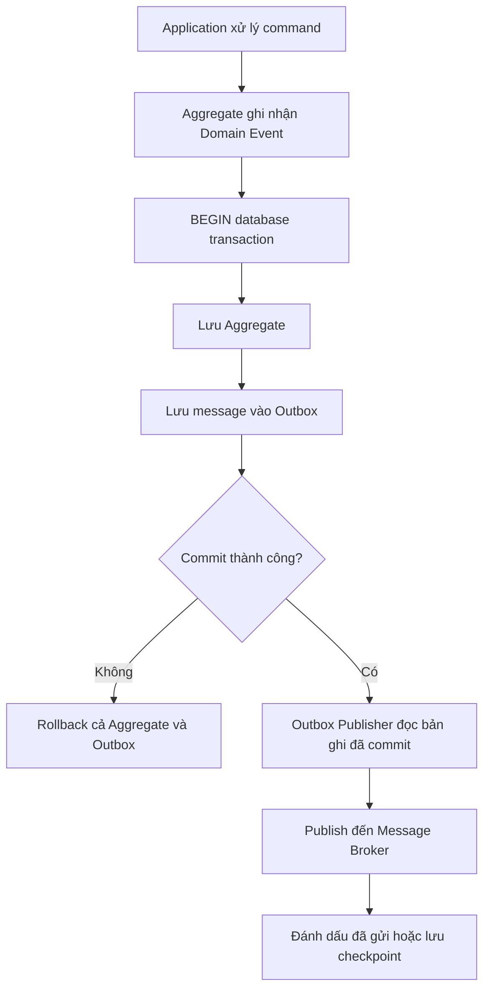
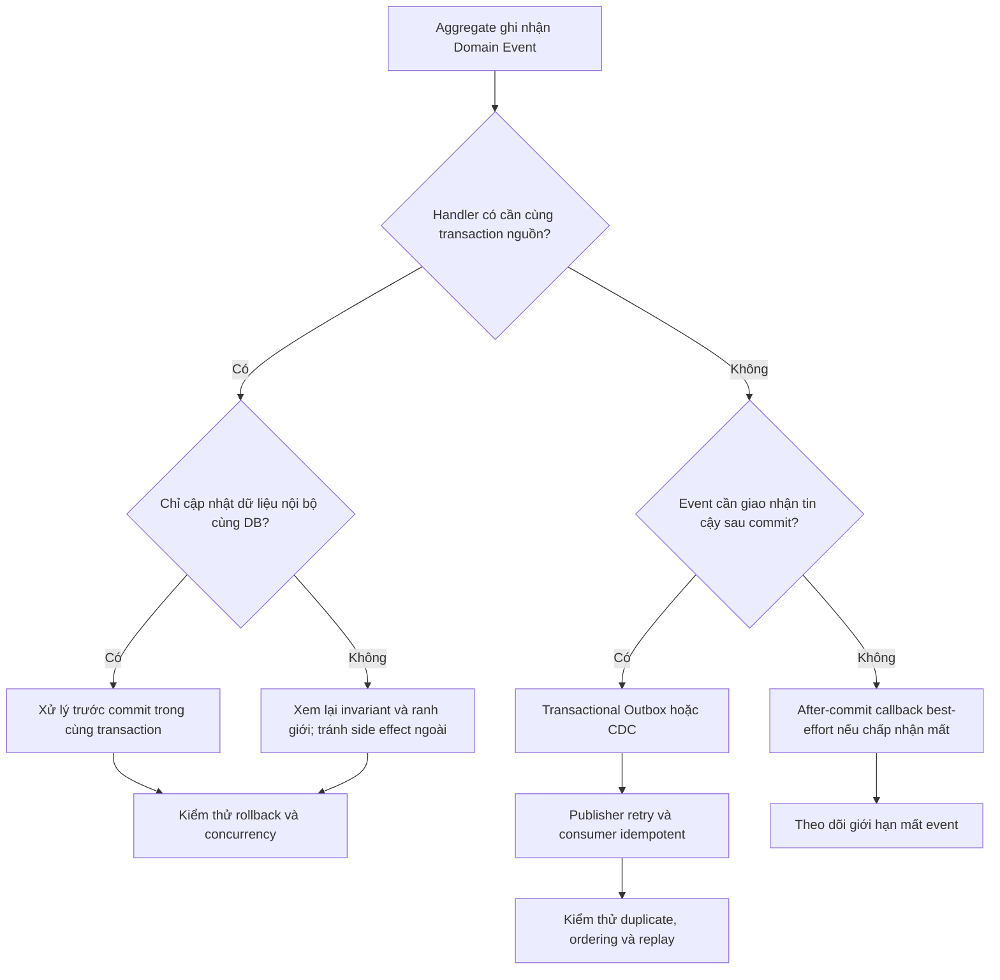

# Thời điểm phân phối sự kiện trước hoặc sau khi giao dịch hoàn tất

Khi một hành động nghiệp vụ làm thay đổi Aggregate, mô hình miền có thể ghi nhận một Domain Event để diễn tả điều vừa xảy ra. Ví dụ, sau khi đơn hàng được xác nhận, `OrderConfirmed` cho biết một cam kết bán hàng đã hình thành. Các thành phần khác có thể cần phản ứng với sự kiện này để giữ chỗ hàng, bắt đầu giao hàng, cập nhật chỉ số hoặc gửi thông báo.

Một quyết định quan trọng là **khi nào xử lý hoặc phân phối sự kiện**: trước khi transaction lưu Aggregate hoàn tất, hay sau khi transaction commit? Nếu phân phối quá sớm, consumer có thể phản ứng với một thay đổi cuối cùng bị rollback. Nếu chỉ publish sau commit bằng một lệnh gửi message riêng, tiến trình có thể dừng giữa lúc commit và publish, khiến sự kiện bị mất.

Để chọn đúng thời điểm, cần phân biệt ba việc: Aggregate ghi nhận sự kiện trong bộ nhớ; ứng dụng xử lý sự kiện trong phạm vi transaction hiện tại; và hệ thống phân phối thông điệp đến thành phần khác. Ba việc này có thể diễn ra ở những thời điểm khác nhau. Bài này phân tích các lựa chọn, rủi ro, Transactional Outbox, CDC, xử lý trùng, thứ tự sự kiện và cách kiểm thử.

Trong `DOMAIN_DRIVEN_DESIGN`, Domain Event là một phần của tactical design bên cạnh Entity, Value Object, Aggregate và Repository. Nó giúp mô tả một sự kiện có ý nghĩa trong ngôn ngữ miền và thông báo cho các phần khác sau khi sự kiện thực sự xảy ra.

## 1. Phân biệt ghi nhận, xử lý và phân phối sự kiện

### 1.1. Aggregate ghi nhận Domain Event

Domain Event biểu diễn một sự kiện nghiệp vụ đã xảy ra. Tên thường dùng thì quá khứ, chẳng hạn:

- `OrderPlaced`: đơn hàng đã được đặt.
- `OrderConfirmed`: đơn hàng đã được xác nhận.
- `PaymentCaptured`: khoản thanh toán đã được thu.
- `ReservationReleased`: reservation đã được giải phóng.

Aggregate có thể ghi nhận event vào một danh sách nội bộ khi hành vi thành công:

```java
public final class Order {
    private final OrderId id;
    private OrderStatus status;
    private final List<DomainEvent> domainEvents = new ArrayList<>();

    public void confirm(Instant occurredAt) {
        if (status != OrderStatus.PLACED) {
            throw new OrderCannotBeConfirmed(id, status);
        }

        status = OrderStatus.CONFIRMED;
        domainEvents.add(new OrderConfirmed(id, occurredAt));
    }

    public List<DomainEvent> domainEvents() {
        return List.copyOf(domainEvents);
    }

    public void clearDomainEvents() {
        domainEvents.clear();
    }
}
```

Việc thêm event vào danh sách chưa phải là gửi message ra broker. Nó chỉ ghi nhận điều đã xảy ra trong quá trình thay đổi trạng thái của Aggregate. Nếu transaction sau đó rollback, event trong bộ nhớ cũng phải bị bỏ đi và không được xem là một sự kiện đã commit.

### 1.2. Xử lý sự kiện trong ứng dụng

Application layer có thể lấy các event đã ghi nhận và gọi handler. Handler có thể:

- Cập nhật một mô hình hoặc Aggregate khác.
- Tạo một yêu cầu công việc tiếp theo.
- Ghi thêm dữ liệu phục vụ audit hoặc read model.
- Tạo Integration Event để gửi ra hệ thống bên ngoài.

Việc handler chạy trước hay sau commit quyết định nó có tham gia cùng transaction database hay không, và những tác động của nó có thể bị rollback cùng thay đổi ban đầu hay không.

### 1.3. Phân phối ra ngoài

Phân phối (publish/dispatch) là chuyển thông điệp đến một hoặc nhiều subscriber, message broker hoặc hệ thống khác. Đây là ranh giới có thể phát sinh lỗi mạng, timeout, retry và giao nhận trùng.

```text
Aggregate hành động
       |
       v
Ghi nhận Domain Event trong bộ nhớ
       |
       v
Application / Unit of Work
       |
       +----> Xử lý handler nội bộ
       |
       +----> Lưu Outbox trong transaction
                       |
                       v
                 Transaction commit
                       |
                       v
                 Publisher / Broker
                       |
                       v
                 Consumer bên ngoài
```

Không nên dùng một từ “dispatch” cho cả việc gọi handler nội bộ và gửi thông điệp ra broker nếu hai thao tác có ngữ nghĩa giao dịch khác nhau. Hãy ghi rõ event đang ở giai đoạn nào.

## 2. Transaction hoàn tất nghĩa là gì?

### 2.1. Phân biệt persist, flush và commit

Khi dùng ORM hoặc transaction manager, các thời điểm sau không giống nhau:

1. **Thay đổi trong bộ nhớ:** Aggregate đã đổi trạng thái và ghi nhận event.
2. **Persist:** persistence context quản lý thay đổi cần lưu.
3. **Flush:** ORM gửi các câu lệnh SQL xuống database. Việc flush chưa đồng nghĩa transaction đã commit.
4. **Commit:** database xác nhận transaction hoàn tất theo mức bảo đảm của nó; các thay đổi trở nên có hiệu lực với transaction khác theo isolation semantics.
5. **Publish:** thông điệp được chuyển đến broker hoặc subscriber. Việc này thường nằm ngoài transaction database trừ khi có một cơ chế tích hợp transaction chuyên biệt.

Một callback sau `flush` không phải callback sau `commit`. Nếu transaction rollback sau flush, dữ liệu vẫn có thể bị hoàn tác. Khi yêu cầu là chỉ phân phối sự kiện sau khi thay đổi đã commit, phải dùng mốc commit thực sự.

### 2.2. Vì sao commit là ranh giới quan trọng?

Consumer thường hiểu một event như bằng chứng rằng sự kiện nghiệp vụ đã xảy ra. Nếu `OrderConfirmed` được gửi đi, Fulfillment có thể bắt đầu lấy hàng. Nếu transaction tạo Order sau đó rollback, Fulfillment đã hành động dựa trên một cam kết không tồn tại.

Do đó, một event được công bố như sự kiện đã xảy ra cần gắn với kết quả commit của thay đổi tạo ra nó. Với các hệ thống dùng event sourcing, ranh giới lưu event stream chính là nguồn sự thật; nhưng khi dùng database thông thường, cần cơ chế bảo đảm sự kiện và thay đổi trạng thái không lệch nhau.

## 3. Phân phối trước khi transaction commit

### 3.1. Cách hoạt động

Một cách triển khai là gọi handler ngay sau khi Aggregate ghi nhận event, trong khi transaction database vẫn đang mở:

```text
BEGIN TRANSACTION
  Load Order
  Order.confirm()
  Dispatch OrderConfirmed handlers
  Save Order and handler changes
COMMIT
```

Nếu handler chỉ cập nhật dữ liệu trong cùng database và cùng transaction, các thay đổi của handler có thể commit hoặc rollback cùng Aggregate ban đầu.

Ví dụ, trong một bounded context nhỏ, `OrderConfirmed` có thể làm cập nhật một bảng thống kê nội bộ được coi là một phần của cùng transaction. Nếu bất kỳ bước nào thất bại, toàn bộ thay đổi database có thể rollback.

### 3.2. Ưu điểm

- Handler có thể tham gia cùng transaction với thay đổi Aggregate.
- Lỗi từ handler có thể khiến transaction ban đầu rollback nếu chính sách yêu cầu.
- Có thể duy trì tính nguyên tử giữa một số thay đổi database cùng transaction.
- Logic phản ứng nội bộ có thể hoàn thành trước khi use case trả kết quả.

### 3.3. Rủi ro

**Event có thể được xử lý dù transaction cuối cùng rollback.** Nếu handler gửi email, gọi API hoặc publish lên broker, tác động đó không thể được database rollback.

**Transaction bị kéo dài.** Handler có thể thực hiện nhiều query, gọi dịch vụ chậm hoặc chờ network, làm tăng thời gian giữ khóa và nguy cơ deadlock.

**Coupling tăng.** Use case ban đầu phụ thuộc thời gian chạy và độ sẵn sàng của tất cả handler đồng bộ.

**Vòng lặp event khó kiểm soát.** Handler cập nhật một Aggregate khác và tạo event mới, dẫn đến chuỗi xử lý lồng nhau trong cùng transaction.

**Ranh giới Aggregate có thể bị làm mờ.** Nếu nhiều Aggregate luôn phải thay đổi cùng transaction để bảo vệ một invariant, cần xem lại liệu ranh giới Aggregate đã đúng chưa.

### 3.4. Khi nào xử lý trước commit có thể phù hợp?

Chỉ cân nhắc khi handler:

- Chạy trong cùng tiến trình và cùng transaction database.
- Không thực hiện side effect không thể rollback như gửi email, gọi HTTP hoặc publish broker.
- Thực sự cần nguyên tử với thay đổi ban đầu.
- Có phạm vi nhỏ, thời gian chạy dự đoán được và không tạo phụ thuộc vòng.

Ngay cả trong trường hợp này, cần cân nhắc liệu phần xử lý có nên là một hành vi trực tiếp của Aggregate, một domain service hay một thao tác application service thay vì handler event. Domain Event phù hợp nhất khi nó diễn tả một sự kiện có ý nghĩa và có subscriber thực sự cần phản ứng.

### 3.5. Ví dụ không an toàn: gửi message trước commit

```java
@Transactional
public void confirmOrder(OrderId id) {
    Order order = orderRepository.findById(id).orElseThrow();
    order.confirm(clock.instant());
    orderRepository.save(order);

    order.domainEvents().forEach(eventBus::publish);
}
```

Nếu `publish` gửi message đến broker ngay lập tức, broker có thể nhận event trước khi database commit. Nếu commit thất bại hoặc transaction rollback, consumer vẫn đã nhận `OrderConfirmed`.

Việc gọi `publish` trước dòng `return` không bảo đảm nó xảy ra sau commit. Trong nhiều framework, transaction chỉ commit khi phương thức được quản lý transaction kết thúc thành công.

## 4. Phân phối sau khi transaction commit

### 4.1. Cách hoạt động

Một cách khác là đợi transaction commit xong rồi mới gọi publisher:

```text
BEGIN TRANSACTION
  Load Order
  Order.confirm()
  Save Order
COMMIT
  Publish OrderConfirmed
```

Điều này ngăn consumer nhận event về một thay đổi đã rollback. Nhưng nếu publish là một thao tác riêng sau commit, vẫn còn một khoảng thời gian có thể mất sự kiện.

### 4.2. Ưu điểm

- Consumer chỉ nhận event sau khi thay đổi nguồn đã commit.
- Side effect bên ngoài không giữ transaction database mở.
- Lỗi broker không làm rollback một transaction đã commit.
- Có thể retry publish mà không lặp lại hành vi nghiệp vụ ban đầu.

### 4.3. Khoảng trống giữa commit và publish

Xét trình tự:

1. Database commit Order thành công.
2. Process bị dừng trước khi gửi `OrderConfirmed`.
3. Order đã ở trạng thái `CONFIRMED`, nhưng broker không có event.

Đây là **dual-write problem**: ứng dụng phải ghi vào hai hệ thống độc lập, database và broker. Không có transaction phân tán chung thì không thể bảo đảm cả hai thao tác luôn thành công cùng nhau chỉ bằng cách đặt publish sau commit.

### 4.4. Callback after-commit không tự giải quyết được dual write

Một số framework cho phép đăng ký callback chạy sau commit. Callback giúp không publish trước commit, nhưng nếu process chết sau commit và trước khi callback hoàn thành, event vẫn bị mất.

Callback after-commit có thể phù hợp cho tác vụ best-effort hoặc hệ thống chấp nhận mất thông báo trong trường hợp hiếm. Với sự kiện cần giao nhận tin cậy, cần lưu dấu vết cần publish một cách nguyên tử với dữ liệu nguồn.

## 5. Transactional Outbox: ghi trạng thái và sự kiện trong cùng transaction

### 5.1. Ý tưởng

**Transactional Outbox** giải quyết khoảng trống dual-write bằng cách ghi cả Aggregate và một bản ghi Outbox vào cùng transaction database. Một tiến trình riêng đọc Outbox và publish message sau khi transaction đã commit.



Nếu transaction rollback, cả trạng thái Aggregate và Outbox đều không được lưu. Nếu commit thành công, Outbox tồn tại bền vững để publisher có thể gửi lại kể cả sau khi process khởi động lại.

### 5.2. Bảng Outbox cần lưu gì?

Một schema minh họa:

```sql
CREATE TABLE outbox_messages (
    message_id       UUID PRIMARY KEY,
    aggregate_type   VARCHAR(120) NOT NULL,
    aggregate_id     VARCHAR(160) NOT NULL,
    aggregate_version BIGINT,
    event_type       VARCHAR(200) NOT NULL,
    event_version    INTEGER NOT NULL,
    occurred_at      TIMESTAMP NOT NULL,
    payload          TEXT NOT NULL,
    created_at       TIMESTAMP NOT NULL,
    published_at     TIMESTAMP,
    attempts         INTEGER NOT NULL DEFAULT 0,
    last_error       TEXT
);
```

Các trường thường cần:

- `message_id`: định danh duy nhất của thông điệp để consumer chống xử lý trùng.
- `aggregate_type` và `aggregate_id`: nguồn phát sinh event.
- `aggregate_version`: hỗ trợ phát hiện thứ tự hoặc phiên bản thay đổi.
- `event_type` và `event_version`: loại event và phiên bản schema.
- `occurred_at`: thời điểm sự kiện xảy ra trong miền.
- `payload`: dữ liệu event đã được serialize theo hợp đồng.
- `published_at` hoặc trạng thái tương đương: dấu vết gửi thành công.
- `attempts` và `last_error`: thông tin phục vụ retry và vận hành.

Schema thực tế có thể dùng trạng thái `PENDING`, `IN_PROGRESS`, `PUBLISHED`, `FAILED`, lease/lock token hoặc checkpoint của CDC. Không phải hệ thống nào cũng cần mọi cột; thiết kế theo khả năng vận hành và lưu lượng thực tế.

### 5.3. Ghi Aggregate và Outbox cùng transaction

Application service có thể thực hiện:

```java
@Transactional
public void confirmOrder(OrderId id) {
    Order order = orderRepository.findById(id).orElseThrow();
    order.confirm(clock.instant());

    orderRepository.save(order);

    for (DomainEvent event : order.domainEvents()) {
        outboxRepository.insert(OutboxMessage.from(event));
    }

}
```

Đoạn code là minh họa cho một transaction database chung. `orderRepository.save` và `outboxRepository.insert` phải dùng cùng transaction manager và cùng database transaction. Nếu hai repository thực chất commit ở hai database độc lập, tính nguyên tử này không còn được bảo đảm.

Trong triển khai thực tế, có thể dùng Unit of Work hoặc transaction listener để thu thập event từ các Aggregate đã thay đổi và ghi Outbox tự động. Chỉ dọn danh sách event trong bộ nhớ sau khi commit thành công, hoặc bỏ Aggregate/Unit of Work đã rollback và tải lại trạng thái; không xóa event quá sớm rồi tiếp tục tái sử dụng object sau rollback. Dù tổ chức code thế nào, điều kiện cốt lõi vẫn là dữ liệu Aggregate và Outbox cùng commit hoặc cùng rollback.

### 5.4. Publisher đọc và gửi Outbox

Publisher chạy nền, tìm các message chưa gửi, publish đến broker rồi ghi nhận kết quả. Có thể dùng polling:

```text
while running:
    claim a batch of pending outbox messages
    publish each message with message_id
    after broker acknowledgement:
        mark message as published
    on failure:
        increment attempts and schedule retry
```

Để nhiều publisher chạy song song, cần cơ chế claim/lease hoặc khóa bản ghi, tránh hai worker xử lý cùng một batch không có kiểm soát. Với database hỗ trợ, có thể dùng `FOR UPDATE SKIP LOCKED` hoặc một cơ chế claim tương đương. Không giữ transaction database mở trong khi chờ broker phản hồi nếu điều đó gây khóa kéo dài; cách claim, publish và mark cần được thiết kế để chấp nhận khả năng gửi trùng.

### 5.5. Tại sao Outbox thường cho at-least-once?

Publisher có thể gửi message thành công đến broker nhưng bị dừng trước khi cập nhật `published_at`. Khi khởi động lại, nó thấy message vẫn chưa được đánh dấu và gửi lần nữa.

Vì vậy, Outbox thường bảo đảm **at-least-once delivery**: message sẽ được thử gửi cho đến khi có xác nhận theo chính sách, nhưng có thể được giao nhiều lần. Đây là lựa chọn thực tế và cần consumer idempotent.

Không nên tuyên bố hệ thống có exactly-once end-to-end chỉ vì có Outbox hoặc broker hỗ trợ một chế độ exactly-once trong phạm vi riêng. Cần xét cả database nguồn, broker, consumer database và mọi side effect tiếp theo.

## 6. Change Data Capture (CDC) và Outbox

### 6.1. CDC là gì?

Change Data Capture đọc các thay đổi từ transaction log hoặc cơ chế ghi nhận thay đổi của database rồi chuyển chúng thành stream. Nếu Outbox được dùng, CDC có thể đọc các bản ghi Outbox đã commit và phát thành message mà không cần polling bảng liên tục.

```text
Application transaction
  ├── Update Aggregate tables
  └── Insert Outbox row
          |
          v
      Database commit
          |
          v
   Transaction log / CDC connector
          |
          v
      Message Broker
```

CDC không thay thế ý nghĩa của Outbox. Bảng Outbox vẫn xác định những message nghiệp vụ cần phát; CDC là cơ chế vận chuyển thay đổi đã commit từ database đến broker.

### 6.2. Polling Outbox và CDC khác nhau thế nào?

| Tiêu chí | Polling Outbox | CDC từ Outbox |
|---|---|---|
| Cách đọc | Query các bản ghi chưa gửi | Đọc transaction log/change stream |
| Độ trễ | Phụ thuộc chu kỳ polling và batch | Có thể gần thời gian thực |
| Hạ tầng | Cần publisher và cơ chế claim/retry | Cần connector/CDC platform và quản lý offset |
| Đánh dấu đã gửi | Thường cập nhật trạng thái hoặc checkpoint | Thường dựa vào offset/checkpoint của connector; có thể vẫn cần quản lý retention |
| Vận hành | Dễ bắt đầu, dễ quan sát bằng SQL | Phức tạp hơn nhưng giảm polling và có thể mở rộng tốt |
| Phù hợp | Lưu lượng vừa phải, muốn kiểm soát trực tiếp | Lưu lượng lớn hoặc đã có nền tảng CDC |

CDC vẫn có thể phát lại message khi connector restart hoặc offset được khôi phục. Consumer vẫn phải xử lý trùng. Cũng cần quản lý retention của Outbox, schema, quyền đọc transaction log và khả năng phục hồi connector.

## 7. Consumer phải idempotent

### 7.1. Vì sao message có thể đến nhiều lần?

Giao nhận message thường có thể lặp vì:

- Publisher không nhận được broker acknowledgement dù broker đã nhận.
- Publisher chết sau publish nhưng trước khi đánh dấu Outbox.
- Broker giao lại message khi consumer không acknowledge.
- Consumer xử lý xong nhưng chết trước khi xác nhận message.
- CDC connector phát lại từ offset gần nhất.

Consumer không nên giả định mỗi message chỉ đến đúng một lần.

### 7.2. Dùng message ID để chống xử lý trùng

Consumer có thể lưu `message_id` đã xử lý trong bảng Inbox/Processed Messages với unique constraint:

```sql
CREATE TABLE processed_messages (
    consumer_name VARCHAR(120) NOT NULL,
    message_id UUID NOT NULL,
    processed_at TIMESTAMP NOT NULL,
    PRIMARY KEY (consumer_name, message_id)
);
```

Trong cùng transaction với cập nhật dữ liệu consumer:

1. Thử insert `(consumer_name, message_id)`.
2. Nếu khóa đã tồn tại, message đã được xử lý; không áp dụng hiệu ứng lần nữa.
3. Nếu insert thành công, thực hiện thay đổi nghiệp vụ của consumer.
4. Commit cả dấu vết xử lý và thay đổi nghiệp vụ cùng nhau.
5. Chỉ acknowledge message sau khi transaction commit thành công.

Ví dụ pseudocode:

```java
@Transactional
public void handle(OrderConfirmed message) {
    boolean firstDelivery = inboxRepository.tryRegister(
        "fulfillment", message.messageId()
    );

    if (!firstDelivery) {
        return;
    }

    fulfillmentService.startFor(message.orderId());
}
```

`tryRegister` phải dựa vào unique constraint hoặc thao tác nguyên tử tương đương, không chỉ query trước rồi insert sau vì hai consumer có thể chạy đồng thời.

### 7.3. Idempotency không chỉ là bỏ qua message trùng

Một số hệ thống không lưu Inbox riêng nhưng làm hành vi idempotent bằng business key hoặc trạng thái đã xử lý. Ví dụ, tạo shipment theo `OrderId` với unique constraint phù hợp có thể ngăn tạo shipment thứ hai.

Hãy xác định hiệu ứng nào có thể lặp: tạo bản ghi, trừ tiền, gửi email, tăng số lượng, gọi API bên ngoài. Nếu side effect nằm ngoài transaction consumer, cần idempotency key hoặc cơ chế đối soát ở hệ thống nhận.

### 7.4. Retention của Inbox

Nếu xóa message ID đã xử lý quá sớm, một message cũ được replay có thể tạo hiệu ứng lại. Thời gian giữ dấu vết cần dựa trên thời hạn replay, retention của broker, khả năng khôi phục backup và chính sách vận hành.

## 8. Thứ tự sự kiện và nhiều thay đổi trên cùng Aggregate

### 8.1. Không phải mọi event đều được giao theo thứ tự toàn cục

Nhiều broker chỉ bảo đảm thứ tự trong một partition hoặc một nhóm khóa, không bảo đảm thứ tự trên toàn hệ thống. Hai event của cùng một Order có thể đến consumer khác thứ tự nếu được publish qua nhiều luồng hoặc partition khác nhau.

Nếu thứ tự có ý nghĩa, hãy cung cấp khóa phân vùng dựa trên `aggregate_id` hoặc một định danh nghiệp vụ phù hợp để các event của cùng Aggregate đi cùng luồng. Cơ chế cụ thể phụ thuộc broker.

### 8.2. Dùng aggregate version hoặc sequence

Event có thể mang `aggregate_version` hoặc `event_sequence` để consumer phát hiện:

- Event đã xử lý rồi.
- Event đến muộn.
- Có khoảng trống trong chuỗi sự kiện.
- Hai event có thứ tự không phù hợp với trạng thái consumer.

Ví dụ, consumer đã xử lý version 12 nhưng nhận event version 10 thì có thể bỏ qua nếu event cũ không cần replay, hoặc đưa vào quy trình đối soát. Nếu nhận version 14 trong khi đang chờ version 13, consumer có thể trì hoãn hoặc truy vấn lại tùy yêu cầu.

### 8.3. Không dùng timestamp làm thứ tự tuyệt đối

Thời gian xảy ra event (`occurred_at`) có thể được tạo trên các node có clock lệch nhau. Hai event có timestamp gần nhau không đủ để xác định thứ tự nhân quả. Version hoặc sequence được cấp trong ranh giới Aggregate thường đáng tin hơn cho thứ tự thay đổi của chính Aggregate đó.

### 8.4. Một event hay nhiều event trong cùng transaction?

Một transaction có thể làm Aggregate phát sinh nhiều event. Outbox cần giữ thứ tự cần thiết trong cùng Aggregate. Có thể dùng sequence tăng dần, transaction-local ordering hoặc aggregate version cùng event index. Không nên dựa vào thứ tự ngẫu nhiên của truy vấn SQL nếu không có cột sắp xếp rõ ràng.

## 9. Domain Event và Integration Event

### 9.1. Domain Event phục vụ mô hình miền

Domain Event diễn tả điều đã xảy ra trong một bounded context. Nó có thể chứa kiểu miền, value object và thuật ngữ phù hợp với mô hình nội bộ.

Ví dụ:

```java
public record OrderConfirmed(
    OrderId orderId,
    Instant occurredAt
) implements DomainEvent {}
```

### 9.2. Integration Event là hợp đồng trao đổi

Khi cần thông báo sang bounded context hoặc hệ thống bên ngoài, ứng dụng có thể chuyển Domain Event thành Integration Event với schema được công bố và quản lý phiên bản.

```java
public record OrderConfirmedIntegrationEvent(
    UUID messageId,
    String orderReference,
    Instant confirmedAt,
    int schemaVersion
) {}
```

Không nhất thiết phải dùng cùng một class cho cả hai. Tách biệt giúp mô hình nội bộ thay đổi mà không làm vỡ hợp đồng với consumer. Outbox thường lưu Integration Event đã được serialize hoặc một representation ổn định của message cần publish.

### 9.3. Đừng publish mọi Domain Event ra ngoài

Một số Domain Event chỉ phục vụ logic nội bộ. Chỉ những sự kiện có ý nghĩa với consumer bên ngoài mới cần trở thành Integration Event. Việc công bố quá nhiều chi tiết nội bộ khiến bounded context bị ràng buộc vào mô hình của nhau.

## 10. Chọn thời điểm phân phối theo loại handler

Không có một thời điểm duy nhất phù hợp cho tất cả handler. Hãy phân loại theo yêu cầu nhất quán và side effect.

| Loại xử lý | Thời điểm thường phù hợp | Lý do và lưu ý |
|---|---|---|
| Kiểm tra hoặc tính toán đồng bộ thuộc cùng hành vi Aggregate | Trong hành vi miền, trước khi ghi event | Đây là một phần của quyết định miền, không nhất thiết cần event handler |
| Cập nhật dữ liệu nội bộ cần nguyên tử với transaction nguồn | Trước commit, trong cùng transaction nếu ranh giới nghiệp vụ cho phép | Lỗi có thể rollback cùng thay đổi nguồn; tránh gọi network |
| Tạo Outbox message | Trước commit, trong cùng transaction | Đảm bảo dữ liệu nguồn và ý định publish cùng tồn tại hoặc cùng rollback |
| Publish tới broker hoặc hệ thống bên ngoài | Sau commit, qua Outbox/CDC | Consumer không thấy event của transaction chưa commit; có thể retry |
| Gửi email, webhook hoặc push notification | Sau commit, qua job/outbox | Side effect không thể rollback; cần retry và idempotency |
| Cập nhật read model | Thường sau commit, bất đồng bộ | Chấp nhận eventual consistency và có thể rebuild |
| Best-effort telemetry | Sau commit hoặc theo pipeline quan sát riêng | Có thể chấp nhận mất một số bản ghi tùy yêu cầu |

Nếu một handler trước commit cần cập nhật Aggregate khác, hãy xem xét liệu hai phần có thực sự cần một invariant nguyên tử. Nếu có, có thể ranh giới Aggregate hoặc bounded context cần được xem lại. Nếu không, sự kiện sau commit và eventual consistency thường giúp giảm coupling.

## 11. Ma trận lỗi theo thời điểm phân phối

| Thời điểm lỗi | Nếu publish trực tiếp trước commit | Nếu publish trực tiếp sau commit | Nếu dùng Outbox |
|---|---|---|---|
| Transaction nguồn rollback | Consumer có thể đã nhận event sai | Không publish nếu callback chỉ chạy sau commit | Outbox rollback cùng Aggregate; không có message |
| Process chết trước commit | Message có thể đã ra ngoài dù dữ liệu rollback | Chưa có message | Aggregate và Outbox chưa commit; không có message |
| Process chết ngay sau commit | Consumer có thể đã nhận event dù dữ liệu chưa commit tại thời điểm đó | Có thể mất event trong khoảng trống commit-publish | Outbox còn trong database và sẽ được publisher xử lý lại |
| Broker tạm ngừng | Có thể làm transaction nguồn kéo dài hoặc thất bại | Event có thể mất nếu không có lưu trữ retry bền vững | Outbox giữ message để retry khi broker phục hồi |
| Publisher chết sau broker nhận nhưng trước khi đánh dấu | Có thể gửi trùng | Có thể gửi trùng nếu retry thủ công | Có thể gửi trùng; consumer cần idempotency |
| Consumer xử lý xong nhưng chưa acknowledge | Broker có thể giao lại | Broker có thể giao lại | Broker có thể giao lại; Inbox/idempotency bảo vệ hiệu ứng |

Ma trận này cho thấy Outbox không loại bỏ mọi lỗi. Nó loại bỏ khoảng trống mất message giữa commit dữ liệu nguồn và việc lưu ý định publish. Các bước gửi và tiêu thụ vẫn cần retry, idempotency và quan sát vận hành.

## 12. Vận hành Outbox an toàn

### 12.1. Retry có backoff

Nếu broker hoặc mạng tạm thời lỗi, publisher nên retry với exponential backoff và jitter để tránh nhiều worker cùng tạo tải đột biến. Cần phân biệt lỗi tạm thời với lỗi dữ liệu không thể gửi như payload sai schema.

### 12.2. Dead-letter và xử lý message lỗi lâu dài

Một message có thể thất bại liên tục vì schema không hợp lệ, kích thước quá lớn hoặc broker từ chối. Cần có trạng thái lỗi, cảnh báo, khả năng kiểm tra payload và quy trình sửa/replay. Không nên âm thầm bỏ qua message sau một số lần retry nếu nghiệp vụ cần nó.

### 12.3. Không xóa Outbox quá sớm

Giữ lại message đã publish trong một khoảng thời gian hỗ trợ audit và điều tra. Khi dọn dẹp, cần xem xét checkpoint CDC, khả năng replay, retention broker và yêu cầu tuân thủ. Có thể partition bảng theo thời gian hoặc chuyển archive để tránh bảng tăng vô hạn.

### 12.4. Theo dõi các chỉ số

Các chỉ số hữu ích gồm:

- Số lượng message đang chờ.
- Tuổi của message chờ lâu nhất.
- Thời gian từ commit đến publish.
- Tỷ lệ publish thành công và số lần retry.
- Số message ở trạng thái lỗi/dead-letter.
- Tỷ lệ consumer duplicate hoặc xử lý thất bại.
- Độ trễ projection/read model.

Một Outbox có thể hoạt động đúng về mặt code nhưng bị nghẽn nhiều giờ. Theo dõi tuổi message và backlog thường hữu ích hơn chỉ nhìn số lượng publish thành công.

## 13. Kiểm thử thời điểm phân phối

### 13.1. Transaction rollback không được tạo message đã commit

Kiểm thử cần xác nhận:

1. Aggregate thay đổi và ghi nhận event.
2. Repository lưu Aggregate và Outbox.
3. Cố ý làm transaction rollback.
4. Xác nhận cả thay đổi Aggregate và Outbox đều không tồn tại sau rollback.
5. Publisher không có message tương ứng để gửi.

### 13.2. Commit thành công phải để lại Outbox

Kiểm thử transaction thành công cần xác nhận Aggregate và Outbox cùng tồn tại sau commit. Không nhất thiết gọi broker thật trong unit test; có thể kiểm tra bản ghi Outbox và kiểm thử publisher riêng.

### 13.3. Publisher gửi trùng vẫn an toàn

Mô phỏng trường hợp broker đã nhận message nhưng publisher chưa đánh dấu thành công. Publisher gửi lại cùng `message_id`. Consumer phải chỉ tạo một hiệu ứng nghiệp vụ.

### 13.4. Consumer rollback không được đánh dấu đã xử lý

Nếu consumer ghi Inbox rồi cập nhật dữ liệu trong cùng transaction, cố ý làm cập nhật thất bại. Sau rollback, dấu vết Inbox cũng phải rollback để broker có thể giao lại message và consumer thử lại.

### 13.5. Kiểm thử thứ tự event

Với Aggregate phát nhiều event, kiểm tra publisher và consumer giữ thứ tự cần thiết theo aggregate ID/version. Mô phỏng event trùng, event đến muộn và event bị thiếu sequence.

### 13.6. Kiểm thử callback after-commit

Nếu dùng callback after-commit, kiểm thử rằng callback không chạy khi transaction rollback. Đồng thời phải ghi nhận giới hạn: unit test callback không chứng minh được khả năng phục hồi khi process chết sau commit; Outbox hoặc cơ chế bền vững mới giải quyết được khoảng trống đó.

## 14. Quy trình lựa chọn chiến lược phân phối

Có thể đi theo các bước sau:



Trước khi chọn, hãy trả lời:

1. Event có ý nghĩa gì và ai cần nhận nó?
2. Handler có phải tham gia cùng invariant với Aggregate nguồn không?
3. Handler có cập nhật cùng database hay gọi hệ thống ngoài?
4. Consumer có được phép thấy event trước khi transaction nguồn commit không?
5. Nếu process chết ngay sau commit, có chấp nhận mất event không?
6. Có cần Outbox, CDC hay callback best-effort?
7. Publisher xử lý retry, lease và dead-letter như thế nào?
8. Consumer chống xử lý trùng bằng message ID hoặc business key nào?
9. Có yêu cầu giữ thứ tự theo Aggregate không?
10. Event schema được version và tương thích ra sao?
11. Ai theo dõi backlog, lỗi và thời gian phân phối?

## 15. Những sai lầm thường gặp

**Publish ngay khi Aggregate ghi nhận event.** Ghi nhận trong bộ nhớ không đồng nghĩa transaction đã commit. Consumer có thể hành động dựa trên dữ liệu sẽ rollback.

**Cho rằng callback after-commit bảo đảm không mất message.** Callback có thể không chạy nếu process chết sau commit. Với sự kiện quan trọng, lưu ý định publish trong Outbox cùng transaction.

**Cho rằng Outbox bảo đảm exactly-once.** Publisher có thể gửi thành công rồi chết trước khi đánh dấu. Hãy thiết kế at-least-once và consumer idempotent.

**Gọi HTTP hoặc gửi email trong handler trước commit.** Side effect bên ngoài không rollback cùng database và có thể kéo dài transaction.

**Dùng một event class nội bộ làm hợp đồng công khai mãi mãi.** Domain model có thể thay đổi. Tạo Integration Event và version schema khi cần công bố.

**Không có message ID.** Không có định danh thông điệp, consumer khó nhận diện lần giao lại và tránh hiệu ứng trùng.

**Đánh dấu Outbox đã gửi trước khi broker xác nhận.** Nếu broker không nhận message, dữ liệu đã bị đánh dấu hoàn tất và có thể mất vĩnh viễn.

**Đánh dấu Inbox ngoài transaction xử lý nghiệp vụ.** Nếu Inbox commit nhưng cập nhật nghiệp vụ rollback, message lần sau có thể bị bỏ qua dù hiệu ứng chưa xảy ra.

**Dùng timestamp để suy ra thứ tự tuyệt đối.** Clock giữa node có thể lệch. Dùng version/sequence trong phạm vi Aggregate khi thứ tự quan trọng.

**Để Outbox tăng vô hạn hoặc lỗi không được theo dõi.** Cần retention, archive, cảnh báo backlog và quy trình xử lý dead-letter.

## 16. Checklist

Trước khi triển khai phân phối Domain Event, hãy kiểm tra:

- [ ] Aggregate chỉ ghi nhận event sau khi hành vi miền thành công.
- [ ] Đã phân biệt ghi nhận event, xử lý handler và publish message.
- [ ] Đã xác định rõ transaction boundary và thời điểm commit.
- [ ] Không publish ra ngoài trước commit nếu consumer hiểu event là sự kiện đã xảy ra.
- [ ] Handler trước commit chỉ thực hiện công việc có thể rollback trong cùng transaction.
- [ ] Đã đánh giá khoảng trống dual-write nếu publish trực tiếp sau commit.
- [ ] Event quan trọng được ghi Outbox cùng transaction với Aggregate.
- [ ] Publisher chỉ gửi message đã commit và có retry/claim an toàn.
- [ ] Consumer idempotent bằng Inbox, message ID hoặc business key.
- [ ] Inbox và thay đổi nghiệp vụ consumer được commit cùng nhau.
- [ ] Đã xác định thứ tự event theo aggregate ID/version khi cần.
- [ ] Domain Event và Integration Event có ranh giới rõ.
- [ ] Event schema có version và chính sách tương thích.
- [ ] Có giám sát backlog, retry, dead-letter và độ trễ publish.
- [ ] Có kiểm thử rollback, crash window, duplicate, ordering và replay.

## 17. Câu hỏi tự kiểm tra

1. Vì sao ghi Domain Event vào danh sách trong Aggregate chưa phải là publish?
2. Nếu publish `OrderConfirmed` trước khi transaction commit, điều gì có thể xảy ra?
3. Vì sao callback after-commit vẫn có khoảng trống mất sự kiện?
4. Transactional Outbox bảo đảm điều gì khi database transaction rollback?
5. Vì sao Outbox thường cung cấp at-least-once thay vì exactly-once end-to-end?
6. Consumer nên kết hợp Inbox và cập nhật nghiệp vụ trong transaction như thế nào?
7. CDC có thay thế Outbox không?
8. Khi thứ tự event của cùng Aggregate quan trọng, cần dùng thông tin nào?
9. Khi nào handler trước commit có thể hợp lý?
10. Vì sao không nên gửi email hoặc gọi HTTP trong handler đồng bộ trước commit?

**Gợi ý trả lời:**

- Câu 1: Event mới được ghi nhận trong bộ nhớ của Aggregate. Chưa có bảo đảm transaction commit hoặc thông điệp được chuyển đến consumer.
- Câu 2: Consumer có thể hành động dựa trên đơn đã xác nhận trong khi transaction nguồn sau đó rollback.
- Câu 3: Process có thể chết sau commit nhưng trước khi callback hoàn thành; database đã đổi nhưng message chưa được gửi.
- Câu 4: Aggregate và Outbox cùng rollback nên không để lại message cho một thay đổi chưa commit.
- Câu 5: Publisher có thể gửi thành công nhưng chết trước khi đánh dấu đã gửi, dẫn đến gửi lại. Consumer cần chống xử lý trùng.
- Câu 6: Ghi Inbox và thay đổi nghiệp vụ trong cùng transaction; chỉ acknowledge broker sau khi commit. Nếu transaction rollback, dấu vết Inbox cũng rollback.
- Câu 7: Không. Outbox xác định message nghiệp vụ cần phát; CDC là một cơ chế đọc thay đổi đã commit từ database để chuyển message.
- Câu 8: Dùng aggregate ID làm partition key và aggregate version/sequence để phát hiện trùng, đến muộn hoặc thiếu thứ tự.
- Câu 9: Khi handler chỉ cập nhật dữ liệu nội bộ cùng database, thực sự cần nguyên tử với thay đổi nguồn và không thực hiện side effect ngoài transaction.
- Câu 10: Email/HTTP không rollback cùng database. Consumer hoặc người nhận có thể thấy tác động dù transaction nguồn thất bại; network cũng kéo dài transaction và giữ khóa.

## Kết luận

Thời điểm phân phối Domain Event phải dựa trên ranh giới transaction và mức độ tin cậy cần có. Xử lý trước commit chỉ phù hợp với công việc nội bộ thực sự cần cùng transaction và có thể rollback. Publish trực tiếp sau commit tránh thông báo thay đổi chưa commit nhưng vẫn có khoảng trống mất message nếu process dừng. Với sự kiện cần giao nhận tin cậy, Transactional Outbox hoặc CDC từ Outbox giúp ghi trạng thái và ý định phát event trong cùng transaction; publisher retry sau commit và consumer xử lý idempotent. Kết hợp message ID, version/sequence, quan sát vận hành và kiểm thử lỗi giúp các bounded context phối hợp mà không đánh đổi tính đúng đắn của mô hình miền.
