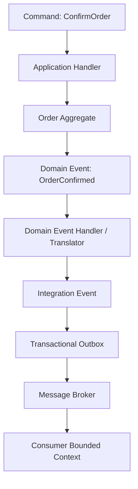
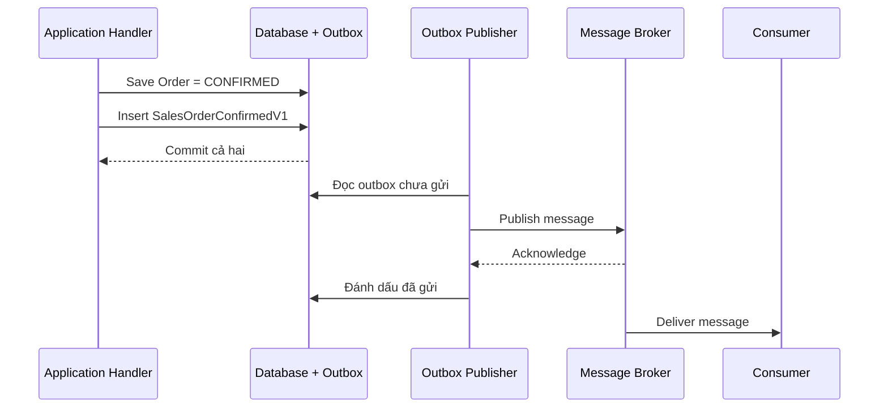

# Phân biệt Domain Event với Integration Event

Trong Domain-Driven Design (DDD), một sự kiện ghi nhận một điều đã xảy ra và có ý nghĩa với nghiệp vụ. Ví dụ, đơn hàng đã được xác nhận, khoản thanh toán đã được thu hoặc kiện hàng đã được giao. Tuy nhiên, không phải mọi sự kiện trong mô hình miền đều nên được gửi ra các hệ thống khác.

**Domain Event** mô tả một sự thật có ý nghĩa bên trong một bounded context. Nó giúp các thành phần trong cùng miền phản ứng với thay đổi mà không phải gọi trực tiếp lẫn nhau. **Integration Event** là thông điệp được công bố qua ranh giới bounded context hoặc hệ thống để consumer bên ngoài có thể tiếp nhận một sự thật đã xảy ra. Nó là hợp đồng tích hợp, cần được thiết kế ổn định và có quản lý phiên bản.

Hai loại sự kiện có thể bắt nguồn từ cùng một sự thật nghiệp vụ, nhưng có mục đích, đối tượng nhận, cấu trúc và vòng đời khác nhau. Application layer thường chuyển Domain Event thành Integration Event phù hợp trước khi ghi vào outbox và gửi qua message broker. Cách làm này giữ mô hình nội bộ độc lập, đồng thời cho phép các context phối hợp bằng hợp đồng rõ ràng.

## Sau bài học này

Bạn có thể:

- Giải thích Domain Event và Integration Event theo mục đích, phạm vi và người tiêu thụ.
- Phân biệt event với command, request và trạng thái hiện tại.
- Xác định sự kiện nào chỉ có ý nghĩa nội bộ và sự kiện nào cần công bố.
- Chuyển Domain Event thành Integration Event bằng mapping phù hợp với bounded context nhận.
- Thiết kế payload, định danh, thời điểm, correlation và version của Integration Event.
- Sử dụng Transactional Outbox để tránh mất thông điệp sau khi dữ liệu đã commit.
- Thiết kế consumer idempotent, xử lý thứ tự, retry và lỗi schema.
- Kiểm thử Domain Event và Integration Event ở đúng ranh giới.

## 1. Event là sự thật đã xảy ra

Event (sự kiện) mô tả một điều đã xảy ra trong miền hoặc trong một hệ thống. Tên event thường dùng thì quá khứ để nhấn mạnh rằng đó là sự thật, không phải yêu cầu đang chờ thực hiện.

Ví dụ:

- `OrderSubmitted`: yêu cầu đặt hàng đã được gửi.
- `OrderConfirmed`: đơn hàng đã được xác nhận.
- `PaymentCaptured`: khoản thanh toán đã được thu.
- `StockReserved`: số lượng hàng đã được giữ.
- `ShipmentDelivered`: kiện hàng đã được giao.

Một event nên giúp người đọc hiểu điều gì đã trở thành sự thật, đối tượng nào liên quan và thời điểm nào sự kiện xảy ra. Những tên như `OrderUpdated`, `StatusChanged` hoặc `ProcessFinished` thường quá chung nếu không có ngữ cảnh bổ sung.

### Event khác command

Command là yêu cầu thực hiện một hành động; event là thông báo về một sự thật đã xảy ra.

| Command | Event có thể phát sinh |
| --- | --- |
| `ConfirmOrder` | `OrderConfirmed` |
| `CapturePayment` | `PaymentCaptured` |
| `ReserveStock` | `StockReserved` hoặc `StockReservationRejected` |
| `DeliverShipment` | `ShipmentDelivered` hoặc `DeliveryAttemptFailed` |

Command có thể bị từ chối vì điều kiện không thỏa mãn. Event chỉ được ghi nhận khi sự thật tương ứng đã xảy ra. Gửi `ConfirmOrder` không có nghĩa đơn đã được xác nhận; consumer chỉ nên phản ứng với `OrderConfirmed` sau khi việc xác nhận thành công.

### Event khác trạng thái hiện tại

Trạng thái `CONFIRMED` cho biết đơn hiện đang được xem là đã xác nhận. Event `OrderConfirmed` cho biết hành động xác nhận đã xảy ra tại một thời điểm cụ thể. Hai đơn có cùng trạng thái hiện tại nhưng có thể đã đi qua những lịch sử khác nhau.

Event thường mang thông tin về sự thay đổi và thời điểm của nó. Một trạng thái hiện tại thường là kết quả của nhiều sự kiện và quyết định trước đó.

## 2. Domain Event là gì?

**Domain Event** là một sự thật đã xảy ra có ý nghĩa trong mô hình của một bounded context. Nó được đặt tên theo ngôn ngữ miền và thường được tạo ra khi entity hoặc aggregate hoàn thành một hành vi nghiệp vụ.

Ví dụ, khi `Order.confirm()` thành công, aggregate có thể ghi nhận `OrderConfirmed`. Một thành phần khác trong cùng bounded context có thể xử lý sự kiện này để cập nhật một projection nội bộ, tạo thông báo nội bộ hoặc khởi động một bước nghiệp vụ khác.

Domain Event có các đặc điểm thường gặp:

- Thuộc ngôn ngữ và mô hình của bounded context phát sinh.
- Mô tả sự thật đã xảy ra, thường dùng tên ở thì quá khứ.
- Có thể chứa các kiểu miền như `OrderId`, `Money` hoặc `CustomerId`.
- Không cần biết consumer cụ thể nào sẽ xử lý nó.
- Có thể được xử lý trong bộ nhớ, trong cùng tiến trình hoặc được chuyển tiếp qua một cơ chế nội bộ.
- Không mặc định là một hợp đồng công khai cho hệ thống bên ngoài.

### Domain Event giúp giảm phụ thuộc trực tiếp

Nếu `Order` gọi trực tiếp `NotificationService`, `LoyaltyService` và `ShippingService`, aggregate phải biết các thành phần sẽ phản ứng với việc xác nhận đơn. Khi thêm consumer mới, domain model phải thay đổi.

Thay vào đó, `Order` ghi nhận `OrderConfirmed`. Application layer hoặc một dispatcher nội bộ xử lý event và điều phối những hành động tiếp theo. Aggregate chỉ cần biết quy tắc xác nhận đơn của chính nó.

### Domain Event không phải Event Sourcing

Domain Event có thể được dùng trong một ứng dụng CRUD thông thường. Việc tạo và xử lý event không bắt buộc hệ thống phải lưu toàn bộ lịch sử trạng thái như Event Sourcing.

Trong Event Sourcing, event là nguồn dữ liệu có thẩm quyền để tái dựng trạng thái aggregate. Trong một ứng dụng DDD thông thường, database vẫn có thể lưu trạng thái hiện tại; Domain Event chỉ là cách biểu diễn và truyền đạt một sự thật đã xảy ra.

## 3. Integration Event là gì?

**Integration Event** là thông điệp được công bố để một bounded context hoặc hệ thống khác biết một sự thật đã xảy ra. Nó tạo ra hợp đồng trao đổi giữa producer và consumer.

Ví dụ, sau khi Bán hàng xác nhận đơn, context Bán hàng có thể công bố `OrderConfirmationPublished` hoặc `OrderConfirmedIntegrationEvent`. Context Vận chuyển tiêu thụ thông điệp để chuẩn bị giao hàng; context Chăm sóc khách hàng có thể cập nhật thông tin cho nhân viên.

Integration Event có các đặc điểm:

- Được thiết kế cho consumer bên ngoài bounded context phát sinh.
- Có schema và ngữ nghĩa được công bố, không phụ thuộc cấu trúc entity nội bộ.
- Chứa đủ dữ liệu để consumer hiểu sự kiện theo hợp đồng, hoặc định danh để consumer lấy thêm dữ liệu qua API được công bố.
- Có định danh thông điệp, thời điểm, phiên bản và metadata cần thiết cho vận hành.
- Có thể được gửi bất đồng bộ qua broker hoặc cơ chế tích hợp khác.
- Cần chính sách tương thích khi producer thay đổi payload.

Integration Event là một phần của ranh giới tích hợp. Khi một consumer phụ thuộc vào payload, tên trường và ý nghĩa của nó, những yếu tố đó trở thành hợp đồng cần quản lý.

### Integration Event không phải bản sao nguyên trạng của Domain Event

Domain Event phản ánh mô hình nội bộ của producer. Consumer bên ngoài có ngôn ngữ và nhu cầu riêng. Nếu công bố trực tiếp class domain, producer vô tình buộc consumer phụ thuộc vào tên lớp, cấu trúc object, enum nội bộ và các thay đổi mô hình.

Thay vào đó, producer nên chuyển đổi sang Integration Event được thiết kế cho người nhận. Có thể lược bỏ dữ liệu nội bộ, đổi tên trường, gom hoặc tách khái niệm và bổ sung metadata phù hợp.

### Không phải Domain Event nào cũng cần công bố

Một số Domain Event chỉ có ý nghĩa nội bộ. Ví dụ, `OrderLinePriceRecalculated` có thể giúp một handler nội bộ cập nhật tổng tiền, nhưng các context khác không cần biết chi tiết đó. Công bố mọi event sẽ tạo ra nhiều hợp đồng không cần thiết và làm tăng coupling.

Chỉ công bố sự thật mà context khác thực sự cần để thực hiện trách nhiệm của họ. Việc chọn event nào trở thành Integration Event là một quyết định thiết kế, không phải thao tác tự động cho mọi class event.

## 4. So sánh Domain Event và Integration Event

| Tiêu chí | Domain Event | Integration Event |
| --- | --- | --- |
| Phạm vi | Bên trong một bounded context | Qua ranh giới bounded context hoặc hệ thống |
| Mục đích | Diễn đạt sự thật trong mô hình miền và kích hoạt phản ứng nội bộ | Công bố sự thật để consumer bên ngoài phối hợp |
| Người tiêu thụ | Handler hoặc thành phần nội bộ | Service, context, ứng dụng hoặc đối tác khác |
| Ngôn ngữ | Ubiquitous Language và kiểu miền nội bộ | Ngôn ngữ trao đổi được công bố (Published Language) |
| Cấu trúc | Có thể dùng entity ID, value object và kiểu nội bộ | Payload độc lập với entity/ORM và phù hợp hợp đồng tích hợp |
| Thay đổi | Có thể thay đổi cùng mô hình nội bộ | Cần quản lý tương thích và version |
| Vận chuyển | Có thể xử lý trong bộ nhớ hoặc trong tiến trình | Thường qua broker, webhook hoặc API/message contract |
| Độ tin cậy | Phụ thuộc cơ chế dispatch nội bộ | Cần outbox, retry, deduplication và quan sát vận hành khi dùng messaging |
| Quyền sở hữu | Context phát sinh sở hữu | Producer công bố hợp đồng; consumer sở hữu cách diễn giải trong context của mình |

### Ví dụ cùng một sự thật, hai cách biểu diễn

Trong context Bán hàng, Domain Event có thể là:

```java
public record OrderConfirmed(
    OrderId orderId,
    CustomerId customerId,
    Money total,
    Instant occurredAt
) implements DomainEvent {}
```

Context Vận chuyển có thể chỉ cần biết mã đơn và địa chỉ giao hàng đã được chốt. Integration Event có thể là:

```json
{
  "eventId": "evt-8f3a",
  "eventType": "SalesOrderConfirmed",
  "eventVersion": 1,
  "occurredAt": "2026-11-18T08:30:00Z",
  "orderReference": "SO-1042",
  "deliveryReference": "DLV-7781"
}
```

Domain Event dùng `OrderId`, `CustomerId` và `Money` theo mô hình nội bộ. Integration Event chỉ công bố các tham chiếu cần thiết cho consumer. Vận chuyển có thể dùng `deliveryReference` để lấy thông tin giao hàng từ API đã công bố hoặc từ projection riêng.

Hai cấu trúc không cần giống nhau, dù cùng bắt nguồn từ việc đơn đã được xác nhận.

## 5. Vị trí của event trong kiến trúc DDD

Domain Event thường được tạo trong domain model, còn Integration Event thường được tạo ở ranh giới application/integration. Infrastructure chịu trách nhiệm lưu và gửi thông điệp bằng công nghệ cụ thể.



Sơ đồ minh họa một luồng phổ biến. Tùy kiến trúc, Domain Event có thể được dispatch sau khi aggregate thay đổi hoặc sau khi transaction commit. Điều quan trọng là không gửi thông điệp ra bên ngoài trước khi dữ liệu nghiệp vụ tương ứng được commit thành công.

### Aggregate ghi nhận Domain Event

Aggregate có thể giữ các event phát sinh trong lần xử lý hiện tại để application lấy ra sau khi hành vi miền hoàn tất:

```java
public final class Order {
    private final OrderId id;
    private final CustomerId customerId;
    private final List<OrderLine> lines;
    private OrderStatus status;
    private final List<DomainEvent> pendingEvents = new ArrayList<>();

    public void confirm(Instant now) {
        if (status != OrderStatus.ACCEPTED) {
            throw new OrderCannotBeConfirmedException(id, status);
        }
        if (lines.isEmpty()) {
            throw new EmptyOrderCannotBeConfirmedException(id);
        }

        status = OrderStatus.CONFIRMED;
        pendingEvents.add(new OrderConfirmed(
            id, customerId, total(), now
        ));
    }

    public List<DomainEvent> pullDomainEvents() {
        List<DomainEvent> result = List.copyOf(pendingEvents);
        pendingEvents.clear();
        return result;
    }
}
```

Ví dụ đã lược giản constructor, `total()` và các kiểu phụ trợ. `Order` chỉ ghi nhận sự kiện sau khi các invariant xác nhận được thỏa mãn. Nó không gửi message broker, gọi HTTP hay biết consumer nào sẽ nhận sự kiện.

### Application layer chuyển đổi event

Application layer có thể nhận Domain Event, chọn event nào cần công bố và chuyển thành Integration Event:

```java
public record SalesOrderConfirmedV1(
    UUID eventId,
    String orderReference,
    String deliveryReference,
    Instant occurredAt
) {}

public final class OrderEventTranslator {
    public Optional<SalesOrderConfirmedV1> toIntegrationEvent(
        DomainEvent event,
        DeliveryReference deliveryReference,
        UUID eventId
    ) {
        if (event instanceof OrderConfirmed confirmed) {
            return Optional.of(new SalesOrderConfirmedV1(
                eventId,
                confirmed.orderId().value().toString(),
                deliveryReference.value(),
                confirmed.occurredAt()
            ));
        }
        return Optional.empty();
    }
}
```

Translator chỉ công bố những event được chọn. Ví dụ minh họa đã lược giản correlation metadata và xử lý lỗi mapping. Nếu consumer cần thông tin khác, hãy bổ sung theo hợp đồng đã thống nhất hoặc cung cấp API truy vấn; không gửi toàn bộ object graph của aggregate.

### Infrastructure gửi Integration Event

Infrastructure triển khai outbox và publisher. Application không cần biết đang dùng Kafka, RabbitMQ hay một dịch vụ message cloud nào. Publisher đọc các bản ghi outbox đã commit, gửi message và đánh dấu đã gửi theo cơ chế phù hợp.

## 6. Vì sao cần Transactional Outbox?

Giả sử application thực hiện hai thao tác:

1. Cập nhật `Order.status = CONFIRMED` và commit database.
2. Gửi `OrderConfirmed` lên message broker.

Nếu database commit thành công nhưng broker không khả dụng, consumer không nhận được thông báo dù đơn đã xác nhận. Nếu gửi message trước rồi database rollback, consumer có thể phản ứng với một sự thật chưa bao giờ được commit.

Đây là vấn đề dual write: ghi vào database và gửi message là hai thao tác trên hai hệ thống khác nhau, không tự động nguyên tử.

### Outbox giải quyết khoảng trống đó

Transactional Outbox ghi thay đổi aggregate và bản ghi Integration Event vào cùng transaction database:



Nếu transaction rollback, cả thay đổi đơn và bản ghi outbox đều không tồn tại. Nếu broker tạm thời lỗi sau commit, publisher có thể thử gửi lại từ outbox.

### Outbox không tự tạo exactly-once delivery

Publisher có thể gửi message thành công nhưng bị lỗi trước khi đánh dấu outbox là đã gửi. Khi khởi động lại, nó có thể gửi lại cùng message. Vì vậy, mô hình phổ biến là at-least-once delivery: consumer có thể nhận một thông điệp nhiều lần.

Consumer cần idempotent hoặc có cơ chế deduplication. Không nên tuyên bố outbox bảo đảm message chỉ được giao đúng một lần.

### Outbox lưu loại dữ liệu nào?

Outbox thường lưu Integration Event đã được định dạng theo hợp đồng, gồm event ID, event type, version, payload, thời điểm và metadata. Có thể lưu domain event rồi chuyển đổi ở publisher trong một số kiến trúc, nhưng cách đó khiến publisher phải hiểu mô hình miền và có thể làm việc chuyển đổi thất bại sau khi transaction đã commit.

Một lựa chọn dễ kiểm soát là chuyển Domain Event thành Integration Event trong application transaction, sau đó ghi payload Integration Event vào outbox cùng với aggregate. Việc publish sau commit chỉ còn là vận chuyển message.

## 7. Thiết kế payload Integration Event

Payload cần giúp consumer hiểu sự thật được công bố mà không phải phụ thuộc vào nội bộ producer.

Một envelope thường có các trường:

| Trường | Ý nghĩa |
| --- | --- |
| `eventId` | Định danh duy nhất của thông điệp để deduplicate và truy vết. |
| `eventType` | Tên sự kiện theo hợp đồng đã công bố. |
| `eventVersion` | Phiên bản schema/contract của loại sự kiện. |
| `occurredAt` | Thời điểm sự thật nghiệp vụ xảy ra. |
| `publishedAt` | Thời điểm producer công bố hoặc gửi message nếu cần phân biệt. |
| `producer` | Context hoặc ứng dụng phát sự kiện. |
| `aggregateId` hoặc reference | Định danh đối tượng liên quan theo hợp đồng được phép công bố. |
| `correlationId` | Mã liên kết các thông điệp trong cùng một quy trình. |
| `causationId` | Mã command/event dẫn đến thông điệp hiện tại nếu có. |
| `payload` | Dữ liệu nghiệp vụ mà consumer cần. |

Không phải event nào cũng cần tất cả metadata. Hãy chọn trường theo nhu cầu consumer, truy vết và vận hành. Tránh thêm dữ liệu chỉ vì producer đang có sẵn.

### Công bố sự thật, không công bố toàn bộ trạng thái

Một Integration Event nên mô tả điều đã xảy ra và dữ liệu cần để consumer phản ứng. Không nên gửi toàn bộ object `Order` cùng mọi entity con, trường nội bộ và dữ liệu cá nhân chỉ vì thuận tiện serialization.

Payload quá rộng làm consumer phụ thuộc vào nhiều chi tiết, tăng rủi ro lộ dữ liệu và khiến thay đổi producer trở nên khó khăn. Nếu consumer cần thêm thông tin, có thể thiết kế một event khác hoặc API truy vấn được công bố.

### Không đưa dữ liệu nhạy cảm không cần thiết

Chỉ gửi thông tin mà consumer được phép và thực sự cần sử dụng. Không đưa số thẻ, thông tin xác thực, dữ liệu cá nhân hoặc thông tin nội bộ vào event một cách mặc định. Message broker và log có thể được lưu lâu, sao chép hoặc truy cập bởi nhiều thành phần.

Nếu consumer cần một thông tin nhạy cảm, hãy đánh giá quyền truy cập, mã hóa, thời hạn lưu trữ và cách truy xuất có kiểm soát. Có thể chỉ gửi một reference thay vì bản thân dữ liệu.

## 8. Quản lý phiên bản và khả năng tương thích

Integration Event là hợp đồng giữa các đội. Producer và consumer có thể được triển khai ở thời điểm khác nhau, vì vậy schema cần hỗ trợ tiến hóa có kiểm soát.

### Thay đổi tương thích

Một số thay đổi thường dễ tương thích hơn nếu consumer được thiết kế phù hợp:

- Thêm trường optional mà consumer cũ có thể bỏ qua.
- Thêm metadata không làm thay đổi ý nghĩa trường hiện có.
- Bổ sung event type mới mà consumer không đăng ký thì không cần xử lý.

Những thay đổi có nguy cơ phá vỡ tương thích:

- Xóa hoặc đổi tên trường đang được consumer dùng.
- Đổi kiểu dữ liệu hoặc đơn vị đo.
- Thay đổi ý nghĩa của một trường mà vẫn giữ tên cũ.
- Đổi enum hoặc thêm trạng thái mà consumer cũ không xử lý được.
- Thay đổi cardinality, chẳng hạn từ một reference thành danh sách nhiều reference.

### Versioning

Có thể quản lý phiên bản bằng trường `eventVersion`, schema registry, tên loại event có version hoặc một chính sách version hóa đã thống nhất. Điều quan trọng là consumer biết payload đang theo hợp đồng nào.

Không nên tăng version chỉ vì thêm một trường nội bộ không ảnh hưởng hợp đồng. Ngược lại, nếu ý nghĩa thay đổi, không nên giữ nguyên version và kỳ vọng consumer tự đoán.

### Consumer tolerant nhưng không được đoán nghiệp vụ

Consumer có thể bỏ qua trường optional chưa biết hoặc lưu payload để xử lý sau. Nhưng nếu nhận một trạng thái nghiệp vụ không nhận diện, không nên tự ánh xạ nó sang trạng thái thành công hoặc thất bại mặc định. Hãy dùng trạng thái chưa xác định, cách ly message hoặc yêu cầu cập nhật hợp đồng.

## 9. Idempotency, thứ tự và xử lý trùng lặp

Message broker thường có thể giao lại message khi consumer không xác nhận đúng lúc hoặc kết nối bị gián đoạn. Consumer cần thiết kế để nhận lặp không tạo tác động nghiệp vụ lặp ngoài ý muốn.

### Idempotency bằng event ID

Consumer có thể lưu `eventId` đã xử lý trong Inbox/deduplication store. Trong cùng transaction, consumer kiểm tra event đã được xử lý chưa, cập nhật aggregate và ghi nhận event ID. Nếu message được giao lại, consumer bỏ qua tác động đã hoàn tất.

```java
public void handle(SalesOrderConfirmedV1 event) {
    transactions.run(() -> {
        if (inbox.wasProcessed(event.eventId())) {
            return;
        }

        DeliveryPlan plan = deliveryPlans.findFor(event.deliveryReference())
            .orElseThrow(() -> new DeliveryPlanNotFoundException(
                event.deliveryReference()
            ));

        plan.prepareForDispatch();
        deliveryPlans.save(plan);
        inbox.markProcessed(event.eventId());
    });
}
```

Đây là ví dụ rút gọn. Ghi dấu Inbox và cập nhật aggregate phải được commit nguyên tử trong cùng transactional resource. Nếu đánh dấu đã xử lý trước khi cập nhật aggregate, lỗi giữa chừng có thể làm mất tác động nghiệp vụ.

### Thứ tự message

Hai event liên quan đến cùng một aggregate có thể đến trễ hoặc sai thứ tự nếu producer publish song song hoặc broker không bảo đảm thứ tự trong phạm vi cần thiết.

Nếu thứ tự quan trọng, hợp đồng có thể có `aggregateVersion` hoặc `sequenceNumber`. Consumer kiểm tra version để phát hiện event cũ, thiếu hoặc đến trước event cần thiết. Timestamp đơn thuần không luôn đủ vì đồng hồ giữa các máy có thể lệch và thời điểm nhận không phải thứ tự nghiệp vụ.

### Retry và dead-letter

Lỗi tạm thời như database timeout có thể được retry với khoảng chờ tăng dần và giới hạn số lần. Lỗi schema hoặc dữ liệu không hợp lệ thường không biến mất khi retry liên tục; message có thể được chuyển vào dead-letter queue để điều tra và xử lý lại sau khi sửa consumer hoặc mapping.

Retry phải kết hợp idempotency. Nếu consumer đã thực hiện tác động nhưng không kịp acknowledge, message sẽ được giao lại.

## 10. Domain Event handler và Integration Event consumer

Hai loại handler cũng có ranh giới khác nhau.

| Thành phần | Nhận | Phạm vi | Ví dụ |
| --- | --- | --- | --- |
| Domain Event handler | Domain Event | Cùng bounded context hoặc cùng ứng dụng | Khi `OrderConfirmed`, cập nhật projection nội bộ hoặc tạo tác vụ nội bộ. |
| Integration Event consumer | Integration Event | Ranh giới tích hợp | Vận chuyển nhận `SalesOrderConfirmedV1` và chuẩn bị giao hàng. |

Domain Event handler có thể chạy trong cùng tiến trình và dùng transaction cục bộ. Nếu handler thay đổi nhiều aggregate, cần xác định rõ transaction và invariant liên quan.

Integration Event consumer cần coi message là dữ liệu từ ranh giới bên ngoài: xác thực schema, kiểm tra định danh, xử lý trùng lặp và chuyển payload thành mô hình của context nhận. Consumer không nên đưa class domain của producer vào code của mình.

### Consumer sở hữu cách diễn giải trong context của nó

Ví dụ, Vận chuyển nhận `SalesOrderConfirmedV1`. Nó có thể ánh xạ sang command nội bộ `PrepareDelivery` và mô hình `DeliveryPlan`. Nó không cần dùng class `Order` của Bán hàng hoặc sao chép toàn bộ logic xác nhận đơn.

Điều này giữ bounded context độc lập. Producer sở hữu ý nghĩa và schema của event đã công bố; consumer sở hữu cách chuyển sự thật đó thành hành động trong mô hình riêng.

## 11. Ví dụ xuyên suốt: xác nhận đơn và chuẩn bị giao hàng

Giả sử context Bán hàng quản lý đơn hàng. Context Vận chuyển quản lý kế hoạch giao hàng. Khi một đơn được xác nhận, Vận chuyển cần biết để chuẩn bị giao, nhưng không cần biết toàn bộ mô hình nội bộ của `Order`.

### Bước 1: Domain Event trong Bán hàng

Aggregate `Order` xác nhận đơn sau khi kiểm tra trạng thái và dòng hàng:

```java
public void confirm(Instant now) {
    if (status != OrderStatus.ACCEPTED) {
        throw new OrderCannotBeConfirmedException(id, status);
    }
    if (lines.isEmpty()) {
        throw new EmptyOrderCannotBeConfirmedException(id);
    }

    status = OrderStatus.CONFIRMED;
    pendingEvents.add(new OrderConfirmed(id, now));
}
```

`OrderConfirmed` là Domain Event của Bán hàng. Nó phản ánh sự thật nội bộ và có thể được các handler trong context sử dụng.

### Bước 2: Application tạo Integration Event

Sau khi lấy Domain Event, application chuyển nó thành hợp đồng dành cho Vận chuyển:

```java
public record SalesOrderConfirmedV1(
    UUID eventId,
    String orderReference,
    String deliveryReference,
    Instant occurredAt,
    int eventVersion
) {}
```

Application không công bố `OrderConfirmed` nguyên trạng. Nó tạo `SalesOrderConfirmedV1` với các trường Vận chuyển cần và có ý nghĩa ổn định theo hợp đồng.

### Bước 3: Ghi aggregate và outbox trong cùng transaction

```java
public void handle(ConfirmOrder command) {
    transactions.run(() -> {
        Order order = orders.findById(command.orderId())
            .orElseThrow(() -> new OrderNotFoundException(command.orderId()));

        order.confirm(clock.instant());
        orders.save(order);

        for (DomainEvent event : order.pullDomainEvents()) {
            translator.toIntegrationEvent(event, deliveryReferenceFor(order))
                .ifPresent(outbox::append);
        }
    });
}
```

Ví dụ đã lược giản `eventId` generation và mapping. `outbox.append(...)` ghi bản ghi message vào cùng database transaction với việc lưu đơn. Nếu transaction rollback, cả trạng thái đơn và bản ghi outbox đều rollback.

### Bước 4: Publisher gửi message sau commit

Outbox publisher đọc bản ghi đã commit, gửi `SalesOrderConfirmedV1` lên broker và cập nhật trạng thái gửi. Nếu gửi lỗi, nó thử lại theo chính sách. Message có thể được giao lặp nên consumer phải idempotent.

### Bước 5: Vận chuyển tiêu thụ hợp đồng

Consumer của Vận chuyển xác thực envelope, kiểm tra event ID, chuyển payload thành command nội bộ rồi gọi aggregate `DeliveryPlan`. Nó có thể phát Domain Event riêng như `DeliveryPreparationStarted` trong context Vận chuyển.

Luồng này cho phép hai context phát triển mô hình riêng, nhưng vẫn phối hợp dựa trên một sự thật được công bố rõ.

## 12. Khi nào không cần Integration Event?

Không phải mọi thay đổi đều cần gửi message ra ngoài.

- Nếu chỉ một phương thức trong cùng aggregate cần phản ứng, gọi trực tiếp hành vi miền.
- Nếu một thành phần trong cùng bounded context cần biết sự kiện, Domain Event nội bộ có thể đủ.
- Nếu use case chỉ cần trả kết quả cho request hiện tại, response của application có thể phù hợp hơn event.
- Nếu consumer cần dữ liệu ngay trong cùng transaction và cùng bounded context, một lời gọi application/domain phù hợp có thể đơn giản hơn.
- Nếu không có consumer hoặc nhu cầu phối hợp, đừng tạo Integration Event chỉ để “event-driven” hơn.

Integration Event tạo coupling qua hợp đồng và thêm chi phí vận hành như broker, retry, versioning và eventual consistency. Chỉ dùng khi có nhu cầu giao tiếp qua ranh giới hoặc tách thời gian xử lý.

## 13. Kiểm thử Domain Event và Integration Event

Kiểm thử nên xác nhận ý nghĩa và hành vi ở từng ranh giới.

### Domain Event test

- Hành vi hợp lệ tạo đúng Domain Event.
- Hành vi bị từ chối không tạo event thành công.
- Event mang đúng định danh và dữ kiện cần thiết.
- Event chỉ được ghi nhận sau khi invariant được bảo vệ.
- Domain model không phụ thuộc broker, HTTP hoặc framework.

### Translator/contract test

- Domain Event được ánh xạ đúng sang Integration Event.
- Event nội bộ không được chọn sẽ không bị công bố.
- Trường payload, enum, đơn vị và thời điểm đúng theo hợp đồng.
- Phiên bản schema tương thích với consumer được hỗ trợ.
- Không đưa dữ liệu nhạy cảm hoặc trường nội bộ không cần thiết.

### Outbox/publisher test

- Aggregate và outbox được ghi trong cùng transaction.
- Rollback không để lại outbox message.
- Publisher retry khi broker tạm thời không khả dụng.
- Publisher có thể gửi lặp mà không làm mất message.
- Message được đánh dấu đã gửi sau khi nhận xác nhận theo cơ chế đã chọn.

### Consumer test

- Message hợp lệ tạo đúng hành vi miền trong context nhận.
- Event ID trùng không tạo tác động lặp.
- Event sai version hoặc payload lỗi được xử lý có kiểm soát.
- Event cũ hoặc sai thứ tự không làm lùi trạng thái trái quy tắc.
- Lỗi tạm thời được retry; lỗi không thể xử lý được chuyển sang dead-letter hoặc quy trình hỗ trợ.

## 14. Những sai lầm thường gặp

- **Công bố trực tiếp mọi Domain Event:** làm lộ mô hình nội bộ và tạo nhiều hợp đồng không cần thiết.
- **Dùng cùng một class cho Domain Event và Integration Event:** consumer phụ thuộc trực tiếp vào kiểu dữ liệu nội bộ của producer.
- **Đặt tên event như command:** `ConfirmOrder` nghe như yêu cầu, không phải sự thật đã xảy ra.
- **Gửi event trước khi transaction commit:** consumer có thể phản ứng với thay đổi bị rollback.
- **Dual write không có outbox:** database commit nhưng message bị mất, hoặc message được gửi dù dữ liệu rollback.
- **Cho rằng outbox bảo đảm exactly-once:** publisher vẫn có thể gửi lặp; consumer cần idempotency.
- **Payload chứa toàn bộ aggregate:** tăng coupling, lộ dữ liệu và làm schema khó tiến hóa.
- **Không có event ID hoặc correlation ID:** khó deduplicate, truy vết và liên kết các bước quy trình.
- **Thay đổi ý nghĩa trường mà không version hóa:** consumer cũ có thể xử lý sai mà không báo lỗi.
- **Bỏ qua event không nhận diện một cách im lặng:** sự thật quan trọng có thể bị mất khỏi quy trình.
- **Dùng timestamp làm thứ tự tuyệt đối:** đồng hồ có thể lệch và event có thể đến trễ.
- **Consumer xử lý message nhiều lần:** tạo tác động lặp như chuẩn bị giao hàng hoặc ghi nhận thanh toán hai lần.
- **Nhầm Integration Event với Event Sourcing:** công bố event không đồng nghĩa dùng event làm nguồn dữ liệu duy nhất.
- **Đưa dữ liệu nhạy cảm vào broker/log:** mở rộng phạm vi dữ liệu và tăng rủi ro truy cập không cần thiết.

## 15. Quy trình thiết kế một Integration Event

Khi một bounded context cần công bố sự thật cho context khác, hãy thực hiện theo các bước:

1. **Xác định sự thật:** điều gì đã xảy ra và context nào sở hữu quyết định đó?
2. **Xác định consumer:** ai cần biết sự thật và họ dùng nó để làm gì?
3. **Chọn Domain Event:** aggregate hoặc domain service ghi nhận sự thật nội bộ bằng ngôn ngữ miền.
4. **Quyết định có công bố không:** không phải Domain Event nào cũng cần trở thành Integration Event.
5. **Thiết kế hợp đồng:** tên event, payload, định danh, thời điểm, version và metadata cần thiết.
6. **Ánh xạ ở ranh giới:** chuyển kiểu miền sang Published Language, không lộ entity hoặc DTO nội bộ.
7. **Ghi outbox nguyên tử:** lưu message cùng transaction với thay đổi nghiệp vụ.
8. **Gửi sau commit:** publisher vận chuyển message và retry có giới hạn.
9. **Thiết kế consumer:** xác thực, deduplicate, ánh xạ vào mô hình nhận và xử lý lỗi.
10. **Quản lý tiến hóa:** kiểm thử hợp đồng, version hóa và phối hợp lịch triển khai.
11. **Quan sát vận hành:** theo dõi backlog outbox, độ trễ, retry, dead-letter và consumer lag.

## Checklist rà soát

- [ ] Domain Event mô tả một sự thật đã xảy ra trong bounded context.
- [ ] Command và Event có tên và ý nghĩa khác nhau.
- [ ] Domain Event chỉ chứa dữ kiện nội bộ cần thiết.
- [ ] Đã xác định consumer và lý do cần công bố.
- [ ] Chỉ event thực sự cần thiết mới được chuyển thành Integration Event.
- [ ] Integration Event có schema độc lập với entity/ORM của producer.
- [ ] Payload không chứa dữ liệu nhạy cảm hoặc dư thừa.
- [ ] Có event ID, event type, version và thời điểm phù hợp.
- [ ] Correlation/causation metadata có khi quy trình cần truy vết.
- [ ] Mapping được kiểm thử và có quy tắc cho giá trị chưa biết.
- [ ] Thay đổi aggregate và outbox được ghi trong cùng transaction.
- [ ] Publisher retry được và consumer idempotent.
- [ ] Có chiến lược xử lý thứ tự, dead-letter và message lỗi.
- [ ] Consumer chuyển event vào mô hình riêng của bounded context nhận.
- [ ] Có contract test và quy trình version hóa.

## Kết luận

Domain Event và Integration Event cùng mô tả sự thật đã xảy ra nhưng phục vụ hai ranh giới khác nhau. Domain Event thuộc mô hình nội bộ của bounded context, giúp các thành phần phản ứng mà không phụ thuộc trực tiếp. Integration Event là hợp đồng được công bố cho consumer bên ngoài, cần payload ổn định, version và cơ chế giao nhận đáng tin cậy. Application layer chọn event cần công bố và chuyển nó sang Published Language; Transactional Outbox giữ thay đổi nghiệp vụ và thông điệp nhất quán; consumer xử lý lặp, lỗi và thứ tự một cách an toàn. Giữ rõ hai loại event giúp mô hình miền tự do tiến hóa mà vẫn duy trì tích hợp có kiểm soát.
