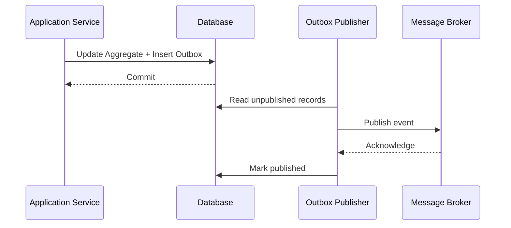

# Thứ tự, phiên bản và khả năng xử lý lặp theo nhu cầu thực tế

Domain Event ghi nhận một sự thật nghiệp vụ đã xảy ra, chẳng hạn đơn hàng đã được xác nhận hoặc khoản thanh toán đã được hoàn. Khi sự kiện được truyền qua message broker hoặc được xử lý bất đồng bộ, hệ thống phải đối mặt với ba vấn đề thường gặp: sự kiện có thể đến sai thứ tự, cấu trúc sự kiện có thể thay đổi theo thời gian và cùng một sự kiện có thể được giao nhiều lần.

Ba vấn đề này liên quan nhưng cần những cơ chế riêng. Thứ tự cần một quy tắc sắp xếp có phạm vi rõ ràng; phiên bản cần một chiến lược tiến hóa hợp đồng; xử lý lặp cần cơ chế idempotency ở consumer và nơi ghi nhận tác động. Không có một tùy chọn broker duy nhất giải quyết trọn vẹn cả ba.

Bài học trình bày cách thiết kế metadata của sự kiện, xác định thứ tự trong phạm vi Aggregate, tiến hóa schema mà vẫn hỗ trợ consumer cũ, và xử lý thông điệp giao lặp hoặc đến muộn. Các ví dụ dùng quy trình đơn hàng để minh họa.

## Mục tiêu học tập

Sau bài này, bạn có thể:

- Phân biệt thứ tự nghiệp vụ, thời điểm xảy ra và thứ tự nhận thông điệp.
- Xác định phạm vi cần bảo đảm thứ tự, thường là theo từng Aggregate.
- Phân biệt Aggregate Version, Event Sequence và Schema Version.
- Thiết kế envelope chứa định danh, phiên bản và metadata truy vết.
- Chọn cách thay đổi schema tương thích với producer và consumer đang chạy.
- Giải thích vì sao message broker thường giao ít nhất một lần và consumer cần idempotent.
- Thiết kế Inbox, Outbox và cơ chế deduplicate phù hợp.
- Xử lý sự kiện trùng, đến muộn, sai thứ tự, thiếu sự kiện và lỗi lặp lại.
- Viết kiểm thử cho ordering, schema compatibility và idempotency.

## 1. Vì sao thứ tự, phiên bản và xử lý lặp quan trọng?

Giả sử Sales phát hai sự kiện cho cùng một đơn hàng:

- OrderPlaced: khách hàng đã đặt đơn.
- OrderConfirmed: đơn hàng đã được xác nhận.

Consumer xây dựng màn hình trạng thái đơn nhận OrderConfirmed trước OrderPlaced. Nếu consumer áp dụng sự kiện theo thứ tự nhận mà không kiểm tra, trạng thái có thể bị ghi đè về “đã đặt” sau khi đã xác nhận.

Một tình huống khác xảy ra khi producer gửi sự kiện nhưng không nhận được xác nhận từ broker. Producer gửi lại cùng sự kiện. Consumer nhận hai bản sao và có thể gửi email hai lần, cộng doanh thu hai lần hoặc tạo hai reservation.

Theo thời gian, schema cũng thay đổi. Ban đầu OrderPlaced chỉ chứa orderId và customerId. Sau này, nghiệp vụ cần thêm currency hoặc salesChannel. Một consumer cũ có thể không hiểu trường mới; một consumer mới cần đọc cả sự kiện được tạo từ phiên bản trước.

| Vấn đề | Tình huống | Câu hỏi thiết kế |
| --- | --- | --- |
| Thứ tự | OrderConfirmed đến trước OrderPlaced | Sự kiện nào phải được xử lý trước, trong phạm vi nào? |
| Phiên bản | Payload được bổ sung hoặc thay đổi | Producer và consumer khác phiên bản có giao tiếp được không? |
| Giao lặp | Broker giao cùng event nhiều lần | Consumer có tạo tác động nghiệp vụ lặp không? |
| Đến muộn | Sự kiện cũ đến sau trạng thái mới | Có thể nhận biết và bỏ qua hoặc khôi phục thế nào? |
| Thiếu sự kiện | Consumer thấy sequence bị nhảy | Cần chờ, replay hay xử lý ngoại lệ? |

Không nên mặc định mọi sự kiện trong toàn hệ thống cần một thứ tự toàn cục. Phần lớn quy tắc cần thứ tự chỉ nằm trong vòng đời của một Aggregate hoặc một quy trình cụ thể.

## 2. Phân biệt các khái niệm thời gian và phiên bản

Một thiết kế sự kiện rõ ràng cần phân biệt những giá trị thường bị dùng thay thế cho nhau.

### Thời điểm xảy ra (occurredAt)

occurredAt là thời điểm sự kiện nghiệp vụ xảy ra theo nguồn thời gian được xác định. Nó hữu ích cho audit, báo cáo và hiển thị. Tuy nhiên, timestamp không phải lúc nào cũng là thứ tự đáng tin cậy:

- Hai sự kiện có thể cùng timestamp với độ phân giải của đồng hồ.
- Đồng hồ giữa các máy có thể lệch nhau.
- Sự kiện xảy ra trước có thể được publish hoặc nhận sau.
- Retry có thể khiến một sự kiện cũ đến muộn.

Vì vậy, không nên chỉ sắp xếp sự kiện theo timestamp rồi coi đó là thứ tự nghiệp vụ tuyệt đối.

### Aggregate Version

Aggregate Version là phiên bản của trạng thái Aggregate sau một lần thay đổi được ghi nhận. Nó thường tăng khi Aggregate được cập nhật thành công và có thể được dùng cho optimistic concurrency control.

Ví dụ, Order có version 7 trước khi xác nhận và version 8 sau khi xác nhận. Nếu hai command cùng cập nhật version 7, chỉ một command có thể lưu thành công; command còn lại phải tải lại và đánh giá lại điều kiện.

Một lần thay đổi Aggregate có thể phát ra nhiều Domain Event. Do đó, Aggregate Version không nhất thiết là số thứ tự duy nhất cho từng event.

### Event Sequence

Event Sequence là số thứ tự tăng dần của từng sự kiện trong một stream được xác định, thường là stream của một Aggregate. Nó cho biết event nào đứng trước event nào trong stream đó.

Ví dụ:

| Event | Aggregate Version | Event Sequence |
| --- | ---: | ---: |
| OrderPlaced | 1 | 1 |
| OrderLineAdded | 2 | 2 |
| DiscountApplied | 3 | 3 |
| OrderConfirmed | 4 | 4 |
| OrderPaymentRequested | 4 | 5 |

Trong ví dụ, hai sự kiện cuối cùng cùng thuộc một lần thay đổi Aggregate version 4 nhưng có sequence riêng. Cách cấp sequence phải được thực hiện nhất quán khi ghi nhận thay đổi và sự kiện.

Nếu mỗi lần thay đổi chỉ phát đúng một sự kiện, Aggregate Version có thể đồng thời đóng vai trò sequence. Khi một commit phát nhiều sự kiện, cần event index hoặc một số thứ tự event riêng.

### Schema Version

Schema Version mô tả phiên bản cấu trúc và hợp đồng của payload sự kiện. Nó không phải phiên bản trạng thái Aggregate và cũng không phải thứ tự sự kiện.

Ví dụ, OrderPlacedV1 có trường customerId; OrderPlacedV2 bổ sung currency. Hai payload có thể cùng mô tả sự kiện ở một vị trí trong vòng đời đơn nhưng có schema khác nhau.

| Giá trị | Mục đích | Có tăng theo mỗi event không? |
| --- | --- | --- |
| occurredAt | Thời điểm sự kiện xảy ra | Không bảo đảm |
| aggregateVersion | Phiên bản trạng thái Aggregate | Thường tăng theo lần ghi trạng thái |
| eventSequence | Thứ tự event trong một stream | Có, theo chính sách cấp sequence |
| schemaVersion | Phiên bản cấu trúc payload | Chỉ tăng khi hợp đồng thay đổi |

Không dùng một trường version chung cho tất cả mục đích. Tên trường và ngữ nghĩa phải được định nghĩa trong hợp đồng sự kiện.

## 3. Chọn phạm vi bảo đảm thứ tự

Thứ tự toàn cục giữa mọi sự kiện của mọi Aggregate thường tốn kém và không cần thiết. Một đơn hàng có thể được xử lý độc lập với một đơn hàng khác. Điều cần thiết thường là các sự kiện của cùng Order được xử lý theo thứ tự phù hợp.

### Thứ tự theo Aggregate

Dùng Aggregate ID làm khóa phân vùng hoặc ordering key là một lựa chọn phổ biến. Các sự kiện có cùng Aggregate ID được đưa vào cùng partition hoặc cùng luồng xử lý tuần tự theo khả năng của broker.

Ví dụ:

- Order A: OrderPlaced → OrderConfirmed → OrderCancelled.
- Order B: OrderPlaced → OrderConfirmed.

Không cần xác định Order A phải được xử lý trước hay sau Order B. Nhưng với Order A, nếu nghiệp vụ phụ thuộc vào trình tự, consumer cần nhận biết sequence.

Khả năng giữ thứ tự cụ thể phụ thuộc broker và cấu hình. Với Kafka, message cùng key thường được ghi vào cùng partition và thứ tự được giữ trong partition; các partition khác nhau không có thứ tự tổng thể. Với các broker khác, cần kiểm tra ordering key, message group hoặc FIFO scope tương ứng.

### Thứ tự nhận không đồng nghĩa với thứ tự xử lý

Một partition có thể giao message theo thứ tự, nhưng consumer vẫn có thể xử lý song song và hoàn thành không đúng thứ tự. Ví dụ, handler của event đầu tiên gọi dịch vụ chậm, còn handler của event thứ hai hoàn tất trước.

Nếu thứ tự có ý nghĩa, consumer cần xử lý tuần tự theo Aggregate key, dùng partition/queue group phù hợp hoặc áp dụng sequence check trước khi ghi trạng thái. Chỉ cấu hình broker là chưa đủ nếu ứng dụng tự tạo concurrency làm đảo thứ tự.

### Chỉ bảo đảm thứ tự ở nơi nghiệp vụ cần

Không phải mọi consumer đều cần cùng một mức bảo đảm:

- Email thông báo có thể chấp nhận xử lý độc lập nếu nội dung không làm sai trạng thái.
- Projection hiển thị trạng thái đơn cần tránh để event cũ ghi đè event mới.
- Ledger tài chính cần kiểm soát thứ tự ghi nhận và đối soát chặt hơn.
- Analytics có thể chấp nhận dữ liệu đến trễ và cập nhật lại kết quả.

Hãy xác định hệ quả nếu hai sự kiện bị đảo thứ tự, sau đó chọn cơ chế tương ứng. Tránh áp dụng một hàng đợi tuần tự toàn hệ thống khi chỉ một số luồng cần nó.

## 4. Thiết kế Event Envelope và metadata

Một event thường cần phần payload mô tả sự thật nghiệp vụ và phần envelope chứa metadata phục vụ định danh, thứ tự, phiên bản và truy vết.

Các trường thường hữu ích:

| Trường | Ý nghĩa |
| --- | --- |
| eventId | Định danh duy nhất của lần phát hành sự kiện |
| eventType | Tên loại sự kiện, thường ở dạng quá khứ |
| schemaVersion | Phiên bản cấu trúc payload |
| aggregateId | Aggregate phát sinh sự kiện |
| aggregateVersion | Phiên bản trạng thái Aggregate liên quan |
| eventSequence | Số thứ tự event trong stream đã xác định |
| occurredAt | Thời điểm sự kiện nghiệp vụ xảy ra |
| publishedAt | Thời điểm event được publish, nếu cần |
| correlationId | Liên kết các thông điệp trong cùng một hành trình |
| causationId | Định danh command hoặc event gây ra sự kiện hiện tại |
| payload | Dữ liệu nghiệp vụ của event |

Không phải mọi hệ thống đều cần tất cả trường. Hãy chọn theo yêu cầu ordering, replay, tracing, audit và hợp đồng tích hợp.

Ví dụ envelope trong Java:

```java
public record EventEnvelope<T>(
    UUID eventId,
    String eventType,
    int schemaVersion,
    UUID aggregateId,
    long aggregateVersion,
    long eventSequence,
    Instant occurredAt,
    String correlationId,
    String causationId,
    T payload
) {}

public record OrderConfirmedV1(
    String orderNumber,
    String customerId,
    BigDecimal totalAmount,
    String currency
) {}
```

Event payload nên bất biến sau khi được ghi nhận. Nếu cần bổ sung thông tin, hãy phát một phiên bản schema mới hoặc tạo một event mới theo đúng ý nghĩa nghiệp vụ; không sửa lại sự kiện cũ đã được công bố như thể nó chưa từng xảy ra.

### Event ID và Aggregate ID có mục đích khác nhau

eventId nhận diện một event cụ thể và là khóa thường dùng để deduplicate. aggregateId nhận diện đối tượng miền đã phát sinh event và thường dùng làm ordering key.

Không dùng aggregateId làm idempotency key duy nhất vì một Aggregate có thể phát nhiều sự kiện. Cũng không dùng eventId để suy ra thứ tự nghiệp vụ vì UUID ngẫu nhiên không mang thứ tự.

## 5. Xử lý event đến sai thứ tự

Giả sử consumer đã áp dụng OrderPlaced với sequence 1 và chờ sequence 2. Nó nhận OrderConfirmed với sequence 3 trước OrderLineAdded có sequence 2.

Có một số chiến lược:

### Chờ hoặc buffer khi phát hiện khoảng trống

Nếu consumer biết mình cần toàn bộ event trong stream và nhận sequence 3 trong khi đang chờ 2, nó có thể tạm giữ event 3, yêu cầu retry hoặc chờ event còn thiếu. Khi sequence 2 đến, consumer áp dụng 2 rồi 3.

Buffer cần có giới hạn dung lượng và thời gian. Nếu event bị mất vĩnh viễn hoặc producer không bao giờ phát lại, consumer cần quy trình khôi phục thay vì chờ vô hạn.

### Từ chối và retry

Consumer có thể phát sinh lỗi tạm thời khi phát hiện sequence gap để message được retry sau. Cách này phù hợp khi broker hỗ trợ retry có kiểm soát và thứ tự theo key được giữ trong quá trình retry.

Cần chú ý retry topic hoặc dead-letter queue có thể làm các event sau vượt qua event lỗi. Nếu event sequence 2 bị chuyển sang DLQ nhưng sequence 3 tiếp tục được xử lý, thứ tự của stream đã bị phá vỡ. Với key cần ordering nghiêm ngặt, có thể phải tạm dừng key/partition hoặc có quy trình sửa lỗi và replay trước khi tiếp tục.

### Bỏ qua event cũ đã được áp dụng

Nếu consumer đã xử lý sequence 5 rồi nhận lại sequence 4, event 4 có thể là bản sao đến muộn. Consumer có thể bỏ qua khi trạng thái projection xác nhận sequence 4 đã được áp dụng hoặc đã bị vượt qua theo chính sách.

Tuy nhiên, sequence guard chỉ có ý nghĩa khi consumer nhận được một stream có quy tắc sequence phù hợp. Nếu consumer chỉ subscribe một số loại event và bỏ qua các loại khác, sequence có thể nhảy hợp lệ. Khi đó không thể yêu cầu mọi sequence phải liên tiếp; cần dùng cursor riêng cho subscription, nhận toàn bộ stream rồi lọc, hoặc dùng quy tắc version phù hợp với loại projection.

### Sử dụng version để chống ghi đè dữ liệu cũ

Với projection chỉ cần trạng thái mới nhất, consumer có thể chỉ áp dụng cập nhật có version lớn hơn version đã lưu. Ví dụ, nếu OrderSummary đã ở version 8, một event version 7 đến muộn sẽ không được ghi đè trạng thái.

Cách này phù hợp với projection có thể tái dựng từ snapshot hoặc event mới nhất. Nó không thay thế việc xử lý từng event khi mỗi event đều mang tác động riêng, chẳng hạn ghi ledger, gửi thông báo hoặc tạo reservation.

## 6. Phiên bản schema và tiến hóa hợp đồng

Event có thể được tiêu thụ bởi nhiều service được triển khai ở thời điểm khác nhau. Producer và consumer không nhất thiết nâng cấp cùng lúc. Vì vậy, thay đổi schema cần được quản lý như thay đổi một hợp đồng tích hợp.

### Những thay đổi thường dễ tương thích

Các thay đổi sau thường có khả năng tương thích cao nếu serializer và consumer hỗ trợ đúng:

- Thêm trường tùy chọn mà consumer cũ bỏ qua được.
- Thêm trường mới có default rõ ràng ở consumer mới khi đọc event cũ.
- Bổ sung metadata không làm thay đổi ý nghĩa trường hiện tại.
- Thêm một loại event mới mà consumer không đăng ký có thể bỏ qua an toàn.

Tính tương thích còn phụ thuộc định dạng và quy tắc schema registry. Không được giả định mọi serializer tự động bỏ qua trường lạ hoặc mọi consumer có thể đọc trường thiếu.

### Những thay đổi có nguy cơ phá vỡ hợp đồng

- Xóa trường mà consumer đang yêu cầu.
- Đổi tên trường mà không có giai đoạn chuyển tiếp.
- Đổi kiểu dữ liệu, ví dụ số nguyên thành chuỗi.
- Thay đổi đơn vị hoặc ý nghĩa của giá trị mà vẫn giữ tên trường.
- Đổi tên event type đã được consumer đăng ký.
- Chuyển một trường bắt buộc thành tùy chọn hoặc ngược lại mà không có quy tắc xử lý.

Ví dụ, trường amount ban đầu biểu diễn số tiền theo đơn vị đồng nhưng sau đó chuyển sang đơn vị nghìn đồng mà không đổi tên hoặc version là thay đổi ngữ nghĩa nguy hiểm. Schema vẫn có thể parse thành công nhưng consumer tính sai.

### Backward và forward compatibility

Hai khái niệm cần được hiểu theo phía đọc:

- **Backward compatibility:** consumer phiên bản mới có thể đọc dữ liệu được tạo theo schema cũ.
- **Forward compatibility:** consumer phiên bản cũ có thể đọc dữ liệu được tạo theo schema mới.

Trong thực tế, khả năng tương thích phụ thuộc cách xử lý field thiếu, field lạ, enum mới, kiểu dữ liệu và cấu hình serializer. Một thay đổi có thể backward-compatible nhưng không forward-compatible.

Ví dụ, thêm một field tùy chọn thường giúp consumer cũ tiếp tục đọc nếu nó bỏ qua field không biết. Consumer mới phải có default hoặc logic phù hợp khi field đó vắng mặt trong event cũ.

### Chiến lược thay đổi schema

Một quy trình an toàn có thể là:

1. Bổ sung field mới theo cách tương thích.
2. Triển khai consumer mới có thể đọc cả payload cũ và mới.
3. Xác minh các consumer quan trọng đã hỗ trợ field mới.
4. Chuyển producer sang phát field mới hoặc schema version mới.
5. Theo dõi lỗi parse và tỷ lệ xử lý của consumer.
6. Chỉ ngừng field cũ sau khi không còn consumer cần nó và hợp đồng cho phép.

Nếu thay đổi không tương thích, có thể phát event type mới, dùng topic/version mới hoặc triển khai migration có giai đoạn. Không nên đổi schema đột ngột rồi kỳ vọng mọi consumer được cập nhật đồng thời.

## 7. Schema Version khác Event Version và Event Sourcing

Schema Version chỉ nói về cấu trúc payload. Aggregate Version hoặc Event Sequence nói về tiến trình trạng thái và thứ tự của stream.

Ví dụ:

- OrderConfirmed schema version 1 có orderId và confirmedAt.
- OrderConfirmed schema version 2 bổ sung confirmationChannel.
- Cả hai có thể đại diện cho sự kiện ở sequence 12 của một Aggregate, nếu đó là cùng sự kiện đã được ghi theo hợp đồng tương ứng.

Nếu dùng Event Sourcing, event store giữ chuỗi sự kiện làm nguồn dữ liệu để tái dựng trạng thái. Khi schema thay đổi, các event lịch sử vẫn tồn tại; hệ thống có thể dùng upcaster để chuyển payload cũ sang dạng mà code hiện tại hiểu được.

Nếu hệ thống chỉ dùng Domain Event để thông báo giữa các service, không nhất thiết phải lưu toàn bộ event làm nguồn sự thật. Nhưng hợp đồng đã publish vẫn cần được quản lý vì consumer có thể lưu trữ, replay hoặc xử lý lại message.

Không nên gọi mọi hệ thống phát message là Event Sourcing. Việc dùng event để tích hợp và việc dùng event làm nguồn dữ liệu là hai quyết định kiến trúc khác nhau.

## 8. Vì sao consumer cần idempotency?

Nhiều message broker cung cấp delivery semantics at-least-once: message có thể được giao lại nếu broker không nhận được acknowledgment hoặc consumer lỗi trước khi xác nhận. Điều này tránh mất message trong một số tình huống nhưng có nghĩa consumer phải chịu được giao lặp.

Idempotent là tính chất mà việc thực hiện cùng một thao tác nhiều lần tạo ra kết quả tương đương với thực hiện một lần trong phạm vi được xác định.

Ví dụ:

- Cập nhật trạng thái projection thành CONFIRMED có thể idempotent nếu chỉ ghi trạng thái cuối và kiểm soát version.
- Cộng 100.000 đồng vào tổng doanh thu mỗi lần nhận event không idempotent nếu không có deduplication.
- Gửi email xác nhận hai lần là tác động lặp, dù dữ liệu Order không đổi.
- Tạo reservation mới mỗi lần xử lý OrderConfirmed có thể giữ hàng nhiều lần.

Không thể giả định broker sẽ bảo đảm exactly-once cho mọi tác động bên ngoài. Một cơ chế exactly-once ở phạm vi broker thường không tự bao phủ database, email, payment provider và các API khác. Cần thiết kế idempotency tại nơi tạo tác động.

### Idempotency key

Một eventId ổn định có thể được dùng làm idempotency key. Khi consumer xử lý event lần đầu, nó ghi nhận eventId đã được xử lý. Nếu event được giao lại, consumer phát hiện key đã tồn tại và không thực hiện tác động lần nữa.

Nếu một event có thể được gửi qua nhiều loại handler với tác động độc lập, phạm vi deduplication cần bao gồm consumer/handler identity hoặc dùng inbox riêng cho từng subscription.

## 9. Inbox Pattern: ghi nhận sự kiện đã xử lý

Inbox là nơi consumer lưu các eventId đã nhận hoặc đã xử lý. Bảng Inbox thường có unique constraint trên cặp consumerName và eventId, hoặc một khóa tương đương.

Một luồng xử lý điển hình:

1. Consumer nhận event.
2. Bắt đầu transaction ở database của consumer.
3. Thử ghi eventId vào Inbox.
4. Nếu eventId đã tồn tại, bỏ qua tác động nghiệp vụ.
5. Nếu chưa tồn tại, cập nhật projection hoặc dữ liệu nghiệp vụ.
6. Commit transaction.
7. Sau đó acknowledgment message với broker.

Việc ghi Inbox và cập nhật dữ liệu phải cùng transaction nếu cả hai nằm trong cùng database. Nếu consumer ghi Inbox thành công nhưng cập nhật projection thất bại trong transaction khác, lần giao lại có thể bị coi là đã xử lý dù tác động chưa hoàn tất.

Ví dụ minh họa:

```java
@Transactional
public void handle(EventEnvelope<OrderConfirmedV1> event) {
    boolean firstDelivery = inbox.tryRecord(
        "order-summary-projector",
        event.eventId()
    );

    if (!firstDelivery) {
        return;
    }

    orderSummary.apply(
        event.aggregateId(),
        event.aggregateVersion(),
        event.payload()
    );
}
```

tryRecord cần được triển khai bằng thao tác insert có unique constraint để chống hai consumer xử lý đồng thời cùng một event. Không nên chỉ kiểm tra exists rồi insert bằng hai thao tác không được bảo vệ, vì hai transaction có thể cùng thấy event chưa tồn tại.

Acknowledgment cần được gửi sau khi transaction commit thành công. Nếu consumer acknowledge trước rồi database rollback, event có thể bị mất khỏi luồng xử lý.

### Idempotency không chỉ là lưu eventId

Nếu handler gọi một dịch vụ ngoài, ghi Inbox trong database local không thể tự tạo transaction nguyên tử bao trùm API bên ngoài.

Ví dụ, consumer ghi Inbox rồi gọi payment provider. Nếu provider đã thực hiện thanh toán nhưng kết nối timeout trước khi consumer nhận phản hồi, consumer không biết thao tác đã thành công hay chưa. Khi retry, nó có thể thu tiền lần hai.

Trong trường hợp đó, hãy truyền idempotency key ổn định đến provider nếu API hỗ trợ, lưu trạng thái yêu cầu và đối soát kết quả. Idempotency cần được thiết kế ở mọi ranh giới có tác động không thể lặp tùy tiện.

## 10. Outbox Pattern: phát event nhất quán với thay đổi dữ liệu

Một vấn đề ở phía producer là cập nhật database thành công nhưng publish event thất bại, hoặc publish event thành công nhưng transaction database rollback. Đây là dual-write problem.

Transactional Outbox giải quyết bằng cách ghi thay đổi Aggregate và một bản ghi Outbox trong cùng transaction database. Một publisher riêng đọc Outbox và gửi message đến broker.

Luồng cơ bản:

1. Application Service yêu cầu Aggregate thay đổi.
2. Repository lưu trạng thái Aggregate.
3. Domain Event được chuyển thành Integration Event hoặc payload cần publish.
4. Outbox record được ghi cùng transaction.
5. Sau commit, publisher lấy record chưa gửi và publish.
6. Publisher đánh dấu đã gửi hoặc lưu trạng thái retry.



Publisher có thể publish thành công nhưng lỗi trước khi đánh dấu record đã gửi. Lần sau nó sẽ publish lại cùng event. Vì vậy, Outbox giúp bảo đảm không mất sự kiện giữa commit và publish, nhưng không loại bỏ giao lặp. Consumer vẫn cần idempotency.

Outbox record nên có eventId ổn định, aggregateId, sequence, event type, schema version, payload và trạng thái publish. Nếu cần thứ tự theo Aggregate, publisher cần phát theo sequence hoặc đảm bảo broker nhận các message cùng key theo thứ tự. Nhiều publisher chạy song song phải tránh phát event sequence 2 trước sequence 1 của cùng Aggregate.

## 11. Kết hợp ordering và idempotency

Ordering và idempotency giải quyết hai vấn đề khác nhau:

- Idempotency ngăn một event đã xử lý tạo tác động lặp.
- Ordering ngăn event mới được áp dụng trước event cũ khi nghiệp vụ cần trình tự.
- Version/sequence giúp phát hiện event cũ, event trùng và khoảng trống.
- Retry/replay giúp phục hồi khi event chưa thể xử lý.

Một consumer có thể kết hợp Inbox với sequence check:

```java
@Transactional
public void handle(EventEnvelope<OrderConfirmedV1> event) {
    if (!inbox.tryRecord(CONSUMER_NAME, event.eventId())) {
        return;
    }

    long lastSequence = projection.lastEventSequence(event.aggregateId());

    if (event.eventSequence() <= lastSequence) {
        // Event cũ hoặc đã được áp dụng qua một lần replay khác.
        return;
    }

    if (event.eventSequence() != lastSequence + 1) {
        // Ném lỗi để transaction rollback, bao gồm cả Inbox record.
        throw new EventSequenceGap(
            event.aggregateId(),
            lastSequence + 1,
            event.eventSequence()
        );
    }

    projection.apply(event);
    projection.updateLastEventSequence(
        event.aggregateId(),
        event.eventSequence()
    );
}
```

Đây là pseudocode minh họa. Transaction cần rollback cả Inbox record khi phát hiện gap, để event có thể được retry sau khi event còn thiếu được khôi phục. Trong thực tế, cần xử lý unique constraint, optimistic locking và race giữa nhiều consumer.

Đặc biệt, quy tắc lastSequence + 1 chỉ phù hợp khi consumer nhận đầy đủ mọi event trong stream có sequence đó. Nếu consumer lọc chỉ nhận OrderConfirmed và OrderCancelled, những event khác bị bỏ qua có thể tạo khoảng trống hợp lệ. Khi đó hãy dùng sequence riêng cho luồng tích hợp hoặc một checkpoint có ngữ nghĩa phù hợp.

### Tránh áp dụng cùng lúc hai lần

Nếu Inbox đã ghi nhận event và projection đã được cập nhật trong cùng transaction, lần giao lại sẽ bị chặn bởi Inbox. Sequence check là lớp bảo vệ bổ sung để phát hiện sai thứ tự hoặc replay không nhất quán; nó không thay thế eventId deduplication.

Nếu event cũ đến với eventId khác nhưng sequence đã thấp hơn lastSequence, consumer cần quyết định có ghi nhận là stale hay báo lỗi. Quyết định phụ thuộc loại projection và khả năng tái dựng dữ liệu.

## 12. Retry, Dead Letter Queue và khôi phục

Không phải lỗi nào cũng nên retry vô hạn.

Có thể phân loại:

| Loại lỗi | Ví dụ | Cách xử lý thường dùng |
| --- | --- | --- |
| Lỗi tạm thời | Database timeout, broker tạm mất kết nối | Retry với backoff và giới hạn |
| Lỗi phụ thuộc ngoài | Provider rate limit hoặc unavailable | Retry theo chính sách, tôn trọng Retry-After nếu có |
| Lỗi dữ liệu | Payload sai định dạng, thiếu trường bắt buộc | Đưa vào DLQ hoặc quarantine để điều tra |
| Lỗi thứ tự | Thiếu event sequence trước đó | Buffer, retry hoặc yêu cầu replay |
| Lỗi nghiệp vụ | Trạng thái không cho phép hành động | Ghi nhận kết quả từ chối hoặc chuyển quy trình xử lý phù hợp |

Dead Letter Queue (DLQ) giúp cô lập message không thể xử lý sau số lần retry nhất định. Tuy nhiên, với stream cần thứ tự, chuyển một event lỗi sang DLQ rồi tiếp tục xử lý event sau có thể tạo trạng thái không hợp lệ.

Một quy trình khôi phục cần:

- Giữ nguyên eventId và metadata gốc khi chuyển message.
- Ghi lại lý do lỗi, số lần thử và thời điểm.
- Có công cụ replay sau khi sửa nguyên nhân.
- Kiểm tra sequence trước khi tiếp tục stream.
- Không sửa payload lịch sử một cách âm thầm.
- Theo dõi tuổi của message cũ nhất và số lượng event đang chờ.

Nếu cần bỏ qua một event, đó là quyết định nghiệp vụ có tác động đến tính đúng đắn của projection hoặc quy trình. Cần ghi lại quyết định và có cơ chế rebuild/reconcile phù hợp.

## 13. Phiên bản schema trong thực tế

Giả sử OrderPlaced V1 có payload:

```json
{
  "orderId": "ORD-100",
  "customerId": "CUS-10"
}
```

Phiên bản V2 cần thêm currency và salesChannel:

```json
{
  "orderId": "ORD-100",
  "customerId": "CUS-10",
  "currency": "VND",
  "salesChannel": "WEB"
}
```

Nếu consumer cũ bỏ qua field không biết, nó có thể tiếp tục đọc V2. Consumer mới phải có cách xử lý V1 khi currency và salesChannel chưa tồn tại, chẳng hạn default có ý nghĩa hoặc tra cứu thông tin lịch sử theo hợp đồng. Không được tự gán một default tùy tiện nếu nó làm thay đổi kết quả nghiệp vụ.

Khi schema thay đổi không tương thích, có thể dùng event type mới như OrderPlacedV2 hoặc schemaVersion tăng lên trong envelope. Chọn một quy ước và áp dụng nhất quán. Tránh vừa đổi tên event, vừa đổi topic, vừa đổi payload trong cùng một lần mà không có kế hoạch migration.

### Upcasting dữ liệu lịch sử

Trong hệ thống Event Sourcing, upcaster chuyển event schema cũ sang biểu diễn mà phiên bản code hiện tại hiểu được khi đọc. Upcaster không nhất thiết ghi đè event gốc trong event store.

Ví dụ, V1 thiếu currency. Nếu nghiệp vụ bảo đảm tất cả đơn trong giai đoạn đó dùng một currency cố định, upcaster có thể bổ sung giá trị dựa trên quy tắc lịch sử đã xác minh. Nếu không có cơ sở xác định, phải giữ rõ sự thiếu hụt hoặc thực hiện migration có kiểm soát; không được đoán dữ liệu.

Với Integration Event, consumer có thể dùng adapter chuyển payload phiên bản cũ sang internal command hoặc DTO ổn định. Nhờ đó, mô hình nội bộ không phải mang mọi biến thể của hợp đồng bên ngoài.

## 14. Kiểm thử thứ tự, phiên bản và xử lý lặp

Một bộ kiểm thử hữu ích nên bao gồm nhiều tình huống hơn happy path:

### Kiểm thử thứ tự

- Nhận sequence 1 rồi sequence 2: cả hai được áp dụng đúng thứ tự.
- Nhận sequence 2 trước sequence 1: consumer chờ, retry hoặc báo gap theo chính sách.
- Nhận sequence cũ sau sequence mới: trạng thái mới không bị ghi đè.
- Hai Aggregate khác nhau có thể được xử lý song song nếu không có phụ thuộc.
- Consumer lọc event cần có quy tắc sequence phù hợp với tập event mà nó nhận.

### Kiểm thử schema

- Consumer mới đọc payload cũ.
- Consumer cũ đọc payload mới nếu hợp đồng yêu cầu forward compatibility.
- Field tùy chọn vắng mặt có default hợp lệ.
- Enum hoặc event type chưa biết được xử lý theo chính sách.
- Event version không làm thay đổi nhầm aggregateVersion hoặc eventSequence.

### Kiểm thử idempotency và phục hồi

- Giao cùng eventId hai lần chỉ tạo một tác động.
- Hai worker nhận cùng event đồng thời không cùng xử lý thành công.
- Transaction rollback không để lại Inbox record giả.
- Consumer crash sau commit nhưng trước acknowledgment không gây tác động lặp.
- Outbox publisher gửi lại event sau timeout vẫn giữ cùng eventId.
- Event lỗi được đưa vào DLQ và replay có kiểm soát.
- External API nhận idempotency key để tránh lặp tác động.

Các kiểm thử concurrency và transaction nên dùng database/broker hoặc môi trường tích hợp phù hợp. Mock đơn thuần có thể không phát hiện race condition do unique constraint hoặc transaction isolation.

## 15. Những sai lầm thường gặp

- **Dùng timestamp làm thứ tự duy nhất:** đồng hồ lệch và publish trễ có thể đảo trình tự.
- **Dùng Aggregate Version như Event Sequence trong mọi trường hợp:** một commit có thể phát nhiều event.
- **Đòi hỏi thứ tự toàn cục:** nhiều Aggregate độc lập không cần chờ nhau.
- **Cho rằng broker giữ thứ tự là đủ:** consumer concurrency hoặc retry có thể làm đảo thứ tự xử lý.
- **Cho rằng message chỉ giao một lần:** at-least-once yêu cầu consumer chịu được duplicate.
- **Ghi Inbox tách transaction với tác động:** có thể đánh dấu đã xử lý dù projection chưa cập nhật.
- **Gọi API ngoài mà không có idempotency key:** timeout có thể dẫn đến tác động lặp.
- **Đổi schema phá vỡ hợp đồng:** consumer cũ có thể ngừng đọc message.
- **Dùng một trường version cho mọi mục đích:** schema version, aggregate version và sequence có ngữ nghĩa khác nhau.
- **Retry vô hạn hoặc bỏ qua event lỗi:** có thể gây tắc luồng hoặc làm projection sai.
- **Khẳng định exactly-once cho toàn hệ thống:** bảo đảm của broker không tự bao trùm database và dịch vụ ngoài.
- **Coi Domain Event và Event Sourcing là một:** phát event tích hợp không đồng nghĩa event store là nguồn dữ liệu chính.

## 16. Quy trình thiết kế và vận hành

Khi một Bounded Context cần phát và xử lý Domain Event, hãy thực hiện theo trình tự:

1. **Xác định ý nghĩa event.** Event phải diễn đạt một sự thật đã xảy ra và có tên rõ ràng.
2. **Xác định Aggregate phát event.** Chọn aggregateId và phạm vi ordering cần bảo đảm.
3. **Chọn versioning metadata.** Phân biệt aggregateVersion, eventSequence và schemaVersion.
4. **Thiết kế envelope và payload.** Bao gồm eventId, occurredAt và correlation metadata cần thiết.
5. **Chọn delivery semantics.** Xác định broker có thể giao lặp, thứ tự được bảo đảm ở phạm vi nào và consumer concurrency ra sao.
6. **Thiết kế Outbox nếu cần dual-write safety.** Ghi thay đổi Aggregate và Outbox trong cùng transaction.
7. **Thiết kế Inbox và idempotency.** Ghi nhận eventId cùng tác động consumer trong transaction phù hợp.
8. **Định nghĩa schema compatibility.** Quy định cách thêm, đổi, loại bỏ field và cách hỗ trợ consumer cũ.
9. **Thiết kế retry, DLQ và replay.** Xác định lỗi tạm thời, lỗi dữ liệu, gap và quy trình khôi phục.
10. **Kiểm thử các tình huống bất thường.** Duplicate, out-of-order, gap, timeout, crash, schema cũ và schema mới.
11. **Quan sát khi vận hành.** Theo dõi lag, tuổi event, retry count, DLQ, sequence gap và lỗi parse.

Checklist review:

- [ ] Event có eventId ổn định và duy nhất?
- [ ] aggregateId xác định đúng ordering key?
- [ ] occurredAt không bị dùng thay eventSequence?
- [ ] aggregateVersion, eventSequence và schemaVersion được phân biệt?
- [ ] Phạm vi ordering có đúng nhu cầu nghiệp vụ?
- [ ] Consumer concurrency có giữ được thứ tự cần thiết?
- [ ] Consumer có idempotent khi nhận cùng event nhiều lần?
- [ ] Inbox và cập nhật dữ liệu có cùng transaction?
- [ ] Producer dùng Outbox khi cần bảo đảm dual-write?
- [ ] Schema thay đổi có chính sách backward/forward compatibility?
- [ ] Retry và DLQ không âm thầm phá thứ tự của stream?
- [ ] Có cơ chế replay, reconcile và quan sát lỗi?

## Kết luận

Thứ tự, phiên bản và xử lý lặp là ba khía cạnh riêng của vòng đời Domain Event. Thứ tự nên được bảo đảm trong phạm vi nghiệp vụ cần thiết, thường theo từng Aggregate. Aggregate Version mô tả phiên bản trạng thái; Event Sequence xác định thứ tự sự kiện; Schema Version mô tả cấu trúc payload. occurredAt hữu ích cho audit nhưng không thay thế sequence.

Với delivery at-least-once, consumer cần idempotent bằng eventId, Inbox hoặc idempotency key ở dịch vụ ngoài. Outbox giúp ghi thay đổi Aggregate và sự kiện trong cùng transaction, nhưng publisher vẫn có thể giao lặp. Schema cần tiến hóa có kế hoạch để producer và consumer khác phiên bản vẫn tương thích. Khi kết hợp ordering key, sequence check, versioning, Inbox/Outbox, retry và replay theo đúng nhu cầu, hệ thống có thể xử lý sự kiện đáng tin cậy mà không đòi hỏi một thứ tự toàn cục hoặc một bảo đảm exactly-once không thực tế.
