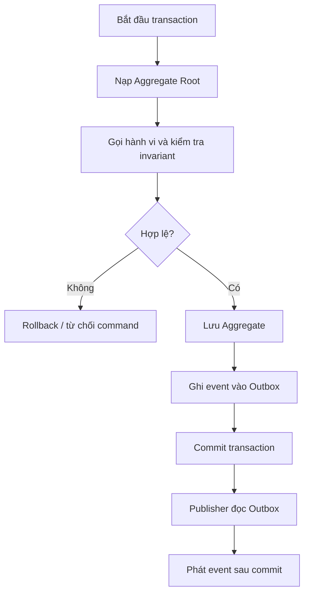
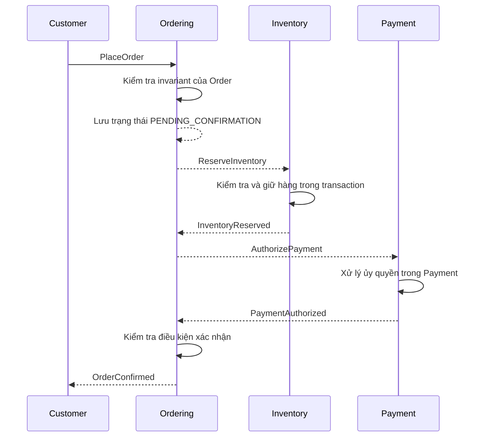
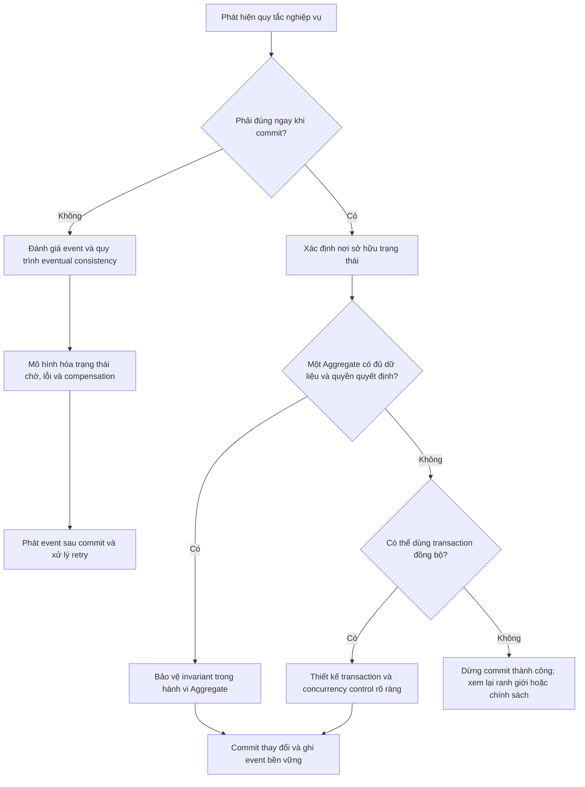

# Tránh dùng sự kiện để che giấu bất biến bắt buộc trong cùng giao dịch

Domain Event giúp các phần của hệ thống phản ứng với một sự thật nghiệp vụ đã xảy ra. Khi một đơn hàng được đặt, các thành phần liên quan có thể nhận `OrderPlaced` để cập nhật báo cáo, gửi thông báo hoặc bắt đầu quy trình giữ hàng. Cơ chế này giảm phụ thuộc trực tiếp giữa các thành phần và hỗ trợ phối hợp giữa những bounded context.

Tuy nhiên, event không thể thay thế việc kiểm tra một invariant bắt buộc phải đúng ngay khi một thao tác được commit. Nếu một đơn hàng không được phép xác nhận khi chưa có dòng hàng, việc phát `OrderConfirmed` rồi chờ một event handler kiểm tra danh sách dòng hàng là quá muộn: trạng thái sai có thể đã được lưu và các hệ thống khác đã phản ứng. Một event bất đồng bộ không thể bảo đảm điều kiện phải đúng trong cùng transaction.

Bài học này tập trung vào việc phân biệt invariant đồng bộ với phản ứng bất đồng bộ, xác định nơi sở hữu quy tắc, thiết kế transaction và Aggregate phù hợp, đồng thời sử dụng Domain Event, transactional outbox và saga đúng vai trò.

## 1. Invariant là điều kiện phải luôn đúng

Invariant là một quy tắc nghiệp vụ xác định trạng thái nào được xem là hợp lệ. Nó không chỉ là một kiểm tra đầu vào ở giao diện. Invariant phải được bảo vệ ở nơi có quyền thay đổi trạng thái, để mọi đường gọi đều tuân thủ cùng một quy tắc.

Ví dụ trong hệ thống thương mại điện tử:

- Đơn hàng đã đặt phải có ít nhất một dòng hàng hợp lệ.
- Số lượng của một dòng hàng phải lớn hơn 0.
- Một SKU chỉ xuất hiện một lần trong một đơn nếu mô hình quy định gộp số lượng theo SKU.
- Tồn kho khả dụng không được âm.
- Một khoản thanh toán không được thu vượt số tiền còn phải thu.
- Một đơn đã bàn giao vận chuyển không thể được hủy theo luồng hủy trước giao hàng.

Invariant thường gắn với một trạng thái hoặc một chuyển đổi trạng thái. Ví dụ, đơn nháp có thể rỗng, nhưng khi chuyển sang `PLACED` thì phải có ít nhất một dòng hàng. Quy tắc chính xác là “đơn đã đặt phải có dòng hàng”, không nhất thiết là “mọi Order object trong mọi thời điểm đều phải có dòng hàng”. Phân biệt thời điểm áp dụng giúp mô hình linh hoạt mà vẫn đúng nghiệp vụ.

### 1.1. Invariant khác validation giao diện

Giao diện có thể kiểm tra số lượng phải lớn hơn 0 để phản hồi nhanh cho người dùng. Nhưng client có thể bị bỏ qua, dữ liệu có thể đến từ API khác, message queue hoặc batch job. Vì vậy, validation ở giao diện chỉ cải thiện trải nghiệm; invariant vẫn phải được bảo vệ trong domain model hoặc cơ chế ghi có thẩm quyền.

### 1.2. Invariant khác phản ứng sau sự kiện

Invariant quyết định một thay đổi có được phép xảy ra hay không. Policy hoặc event handler mô tả việc hệ thống phản ứng sau khi một sự thật nghiệp vụ đã xảy ra. Hai việc này có quan hệ nhưng khác thời điểm và trách nhiệm.

| Câu hỏi | Invariant | Phản ứng với event |
|---|---|---|
| Mục đích | Ngăn trạng thái không hợp lệ được commit | Thực hiện công việc phát sinh từ sự kiện |
| Thời điểm | Trước hoặc trong lúc thay đổi được commit | Sau khi event được tạo; có thể sau commit |
| Nơi sở hữu | Aggregate hoặc thành phần có thẩm quyền quyết định dữ liệu | Event handler, policy, process manager hoặc consumer |
| Khi thất bại | Thay đổi bị từ chối hoặc transaction rollback | Retry, ghi nhận lỗi, bù trừ hoặc xử lý lại |
| Ví dụ | Không cho xác nhận đơn rỗng | Gửi email sau khi đơn được đặt |

## 2. Vì sao dùng event để kiểm tra invariant là nguy hiểm?

Giả sử `Order.confirm()` đổi trạng thái thành `CONFIRMED`, sau đó phát event `OrderConfirmed`. Một handler nhận event và kiểm tra xem đơn có dòng hàng hay không. Nếu không có, handler cố gắng đổi đơn về `REJECTED`.

Thiết kế này có một khoảng thời gian mà trạng thái sai đã tồn tại. Trong khoảng đó:

- API có thể trả về kết quả xác nhận thành công.
- Một consumer khác có thể gửi email xác nhận hoặc tạo yêu cầu giao hàng.
- Dashboard có thể hiển thị đơn đã xác nhận.
- Handler kiểm tra có thể thất bại hoặc không được chạy.
- Event có thể bị gửi trễ, gửi lặp hoặc xử lý sai thứ tự.

Việc sửa trạng thái về sau không thể xóa bỏ mọi tác động đã xảy ra. Đây là lý do không nên phát một event thành công trước rồi mới kiểm tra điều kiện bắt buộc.

### 2.1. Ví dụ sai: xác nhận trước, kiểm tra sau

```text
// Ví dụ sai: invariant được kiểm tra trong một handler bất đồng bộ.
public void confirm() {
    status = OrderStatus.CONFIRMED;
    eventBus.publish(new OrderConfirmed(id));
}

// Consumer chạy sau khi trạng thái đã được công bố.
public void on(OrderConfirmed event) {
    Order order = orders.findById(event.orderId()).orElseThrow();
    if (order.lines().isEmpty()) {
        order.reject();
        orders.save(order);
    }
}
```

Handler đang cố sửa hậu quả của một quyết định lẽ ra phải bị từ chối ngay từ đầu. Nếu `OrderConfirmed` đã được công bố ra ngoài, những consumer khác có thể đã tin rằng đơn thực sự được xác nhận.

### 2.2. Các biến thể vẫn có vấn đề

Đổi event thành `OrderConfirmationRequested` không tự giải quyết vấn đề nếu hệ thống vẫn ghi trạng thái `CONFIRMED` trước khi kiểm tra. Đổi consumer thành xử lý đồng bộ cũng chưa chắc là thiết kế tốt nếu quy tắc bắt buộc bị ẩn trong một handler ngầm, khó xác định thứ tự thực thi và transaction.

Nếu một quy tắc phải được thỏa mãn trước khi commit, hãy biểu diễn nó thành hành vi rõ ràng của Aggregate hoặc bước kiểm tra đồng bộ trong use case có thẩm quyền. Event có thể thông báo kết quả sau khi quyết định đã được đưa ra.

## 3. Bảo vệ invariant bên trong Aggregate

Aggregate là ranh giới nhất quán của một nhóm đối tượng miền. Aggregate Root là điểm truy cập bên ngoài và chịu trách nhiệm bảo vệ invariant của nhóm. Những quy tắc cần đúng đồng thời trong một thao tác nên được đặt tại ranh giới có thể kiểm tra và thay đổi chúng một cách nhất quán.

Ví dụ, `Order` sở hữu các dòng hàng và trạng thái đơn. Quy tắc “đơn phải có ít nhất một dòng khi được đặt” thuộc về hành vi `place()` của Aggregate Root.

```java
import java.util.ArrayList;
import java.util.List;
import java.util.Objects;
import java.util.UUID;

record OrderId(UUID value) {}

record OrderLine(String sku, int quantity) {
    OrderLine {
        if (sku == null || sku.isBlank()) {
            throw new IllegalArgumentException("Thiếu SKU");
        }
        if (quantity <= 0) {
            throw new IllegalArgumentException("Số lượng phải lớn hơn 0");
        }
    }
}

enum OrderStatus {
    DRAFT,
    PLACED,
    CONFIRMED
}

record OrderPlaced(OrderId orderId) {}

final class Order {
    private final OrderId id;
    private final List<OrderLine> lines = new ArrayList<>();
    private OrderStatus status = OrderStatus.DRAFT;

    Order(OrderId id) {
        this.id = Objects.requireNonNull(id);
    }

    public void addLine(OrderLine line) {
        ensureDraft();
        lines.add(Objects.requireNonNull(line));
    }

    public OrderPlaced place() {
        ensureDraft();
        if (lines.isEmpty()) {
            throw new IllegalStateException("Không thể đặt đơn rỗng");
        }

        status = OrderStatus.PLACED;
        return new OrderPlaced(id);
    }

    private void ensureDraft() {
        if (status != OrderStatus.DRAFT) {
            throw new IllegalStateException("Chỉ đơn nháp mới được thay đổi");
        }
    }
}
```

Ở đây, `place()` kiểm tra invariant trước khi chuyển trạng thái. Nếu đơn rỗng, phương thức ném lỗi và trạng thái vẫn là `DRAFT`. Event `OrderPlaced` chỉ được tạo sau khi điều kiện đã thỏa mãn.

Ví dụ rút gọn chưa bao gồm việc lưu Aggregate, phát event bền vững hoặc xử lý đồng thời. Giá trị `OrderPlaced` được trả về để application layer ghi vào outbox trong cùng transaction; không gửi trực tiếp tới broker trước khi transaction commit. Trong ứng dụng thực tế, tất cả thay đổi và việc ghi nhận event cần nằm trong một transaction có ranh giới rõ.

### 3.1. Không chuyển invariant sang Application Service chỉ vì tiện

Application Service điều phối use case, nhưng invariant nội tại của Aggregate nên được bảo vệ bởi chính Aggregate. Nếu chỉ kiểm tra `if (order.lines().isEmpty())` trong handler rồi gọi `order.place()`, một đường gọi khác có thể quên bước kiểm tra.

Application Service có thể kiểm tra dữ liệu cần thiết để điều phối, gọi dịch vụ miền hoặc lấy thông tin từ context khác. Nhưng điều kiện quyết định trạng thái nội bộ của Aggregate phải được bảo vệ tại nơi sở hữu trạng thái đó.

### 3.2. Đưa dữ liệu cần thiết vào Aggregate trước khi quyết định

Một Aggregate chỉ có thể bảo vệ invariant mà nó có đủ dữ liệu và quyền quyết định. Nếu quy tắc phụ thuộc vào một thông tin bắt buộc từ nơi khác, cần xác định rõ cơ chế kiểm tra và mức nhất quán mong muốn. Không nên phát event thành công rồi giả định consumer sẽ cung cấp thông tin còn thiếu sau đó.

## 4. Transaction là ranh giới commit của thay đổi bắt buộc

Một transaction giúp nhóm các thay đổi dữ liệu thành một đơn vị commit hoặc rollback theo cơ chế của datastore. Với một use case cần bảo vệ invariant, trình tự thông thường là:

1. Bắt đầu transaction.
2. Nạp Aggregate Root và dữ liệu cần thiết.
3. Gọi hành vi nghiệp vụ để kiểm tra invariant và thay đổi trạng thái.
4. Lưu Aggregate.
5. Ghi event cần công bố vào outbox trong cùng transaction nếu dùng transactional outbox.
6. Commit transaction.
7. Sau commit, publisher gửi event tới message broker hoặc consumer.

Nếu bước kiểm tra invariant thất bại, transaction không commit thay đổi nghiệp vụ. Nếu ghi outbox thất bại, transaction cũng rollback để không có trạng thái mới mà thiếu bản ghi event cần phát.



Transactional outbox bảo đảm thay đổi nghiệp vụ và bản ghi cần phát event được ghi cùng transaction trong một datastore hỗ trợ transaction đó. Nó giải quyết vấn đề “database đã commit nhưng message chưa được gửi” ở mức lưu trữ bền vững. Nó không thay thế kiểm tra invariant và cũng không bảo đảm consumer chỉ nhận event đúng một lần.

## 5. Domain Event nên thông báo sự thật đã được xác lập

Domain Event diễn đạt một sự thật nghiệp vụ đã xảy ra, thường được đặt tên ở thì quá khứ như `OrderPlaced`, `PaymentAuthorized` hoặc `InventoryReserved`.

Một event nên được tạo sau khi Aggregate hoặc thành phần có thẩm quyền xác nhận hành động thành công. Event không phải yêu cầu hành động và cũng không phải nơi trì hoãn một điều kiện cần kiểm tra trước commit.

| Thành phần | Ý nghĩa | Ví dụ |
|---|---|---|
| Command | Yêu cầu thực hiện hành động | `PlaceOrder` |
| Invariant | Điều kiện phải đúng để hành động được chấp nhận | Đơn được đặt phải có ít nhất một dòng |
| Domain Event | Sự thật đã xảy ra | `OrderPlaced` |
| Policy | Quy tắc phản ứng với event | Khi đơn được đặt, yêu cầu giữ hàng |
| Integration Event | Thông tin công bố qua ranh giới tích hợp | `OrderPlacedV1` |

Một Domain Event nội bộ có thể được dùng để kích hoạt nhiều phản ứng. Nhưng nếu một phản ứng thất bại, cần xác định xem đó là lỗi làm transaction gốc rollback hay là công việc có thể retry sau commit. Không nên để điều này mơ hồ.

### 5.1. Domain Event đồng bộ và bất đồng bộ

Event handler đồng bộ trong cùng process có thể được gọi trước khi transaction kết thúc. Nếu handler dùng cùng transaction và lỗi được truyền ngược để rollback, nó có thể tham gia vào thao tác đồng bộ. Tuy nhiên, việc dùng handler như một nơi ẩn chứa invariant vẫn làm luồng khó hiểu: người đọc phải biết có những handler nào, thứ tự nào và chúng có cùng transaction hay không.

Với invariant cốt lõi, ưu tiên gọi hành vi rõ ràng của Aggregate hoặc domain service trước khi commit. Dùng event handler đồng bộ cho phản ứng nội bộ khi việc tách handler thực sự làm mô hình dễ hiểu hơn, và hợp đồng transaction được thể hiện rõ.

Event bất đồng bộ được xử lý sau commit phù hợp cho công việc có thể trễ hoặc retry, ví dụ gửi email, cập nhật read model, tạo báo cáo hoặc bắt đầu quy trình ở bounded context khác. Nó không thể làm cho trạng thái đã commit trở nên hợp lệ hồi tố.

### 5.2. Không công bố event thành công trước commit

Nếu event được gửi ra broker trước khi transaction database commit, consumer có thể xử lý một sự kiện mà dữ liệu nguồn cuối cùng rollback. Cách làm này tạo ra thông tin không nhất quán.

Có thể publish sau commit bằng callback, nhưng nếu ứng dụng dừng giữa lúc commit và lúc publish thì event có thể bị mất. Transactional outbox khắc phục khoảng trống đó bằng cách ghi event vào cùng transaction, rồi một publisher riêng gửi lại sau commit.

## 6. Khi invariant liên quan nhiều Aggregate

Một câu hỏi khó xuất hiện khi quy tắc nghiệp vụ liên quan đến nhiều Aggregate. Ví dụ, một đơn chỉ được xác nhận khi tồn kho đã được giữ và thanh toán đã được ủy quyền. `Order`, `Inventory` và `Payment` có thể là các Aggregate hoặc bounded context riêng.

Trước tiên, cần phân biệt hai loại quy tắc:

- **Invariant nội bộ:** phải được bảo vệ ngay trong Aggregate và transaction của nó. Ví dụ, `Inventory` không được giữ số lượng vượt quá số lượng có thể cấp phát.
- **Điều kiện phối hợp giữa Aggregate:** có thể cần nhiều bước, nhiều context và thời gian xử lý. Ví dụ, đơn chỉ chuyển sang `CONFIRMED` sau khi nhận kết quả giữ hàng và ủy quyền thanh toán.

Nếu nghiệp vụ yêu cầu mọi phần phải được commit nguyên tử trong một transaction duy nhất, hãy xem xét lại ranh giới Aggregate, transaction boundary hoặc cơ chế dữ liệu. Không nên giả vờ rằng event bất đồng bộ tạo ra tính nguyên tử giữa nhiều hệ thống.

### 6.1. Trường hợp phải đúng ngay lập tức

Giả sử hai bản ghi trong cùng một database cùng tham gia vào một invariant bắt buộc, và doanh nghiệp yêu cầu không có thời điểm nào invariant bị vi phạm. Có thể cần một transaction đồng bộ bao trùm thay đổi, khóa hoặc optimistic concurrency phù hợp, cùng constraint ở database nếu thích hợp.

Đồng thời, hãy đánh giá xem các đối tượng có thực sự thuộc cùng một Aggregate hay không. Nếu chúng luôn phải thay đổi nguyên tử để bảo vệ một quy tắc, việc đặt chúng trong cùng một consistency boundary có thể làm mô hình đơn giản hơn. Nếu chúng có vòng đời và quyền sở hữu độc lập, cần hiểu rõ chi phí của transaction xuyên Aggregate.

### 6.2. Trường hợp chấp nhận quy trình nhiều bước

Nếu nghiệp vụ chấp nhận trạng thái trung gian, có thể dùng saga hoặc process manager để phối hợp nhiều Aggregate. Khi đó, mô hình phải biểu diễn rõ trạng thái đang chờ và kết quả thất bại.

Ví dụ, sau khi `OrderPlaced`, quy trình gửi `ReserveInventory`. Khi nhận `InventoryReserved`, quy trình gửi `AuthorizePayment`. Chỉ khi nhận `PaymentAuthorized`, Ordering mới gửi `ConfirmOrder`. Nếu giữ hàng hoặc thanh toán thất bại, quy trình chuyển sang nhánh xử lý phù hợp và có thể phát command bù trừ.

Điểm quan trọng: đơn ở trạng thái `PENDING_CONFIRMATION` không được gọi là `CONFIRMED`. Trạng thái trung gian thể hiện sự thật rằng quy trình chưa thỏa mãn mọi điều kiện.

## 7. Ví dụ: giữ tồn kho mà không bán vượt số lượng

Giả sử kho có 5 sản phẩm khả dụng. Hai khách hàng cùng lúc đặt mỗi người 4 sản phẩm. Cả hai màn hình đều có thể đọc thấy tồn kho là 5. Nếu hệ thống chỉ kiểm tra bằng query rồi phát event `InventoryReservationRequested`, hai yêu cầu đều có thể được chấp nhận dựa trên cùng một dữ liệu cũ.

### 7.1. Cách sai: kiểm tra bằng event sau khi đã nhận yêu cầu

```java
// Không an toàn nếu chỉ dựa vào số liệu đọc trước đó.
public void reserve(ReserveInventory command) {
    eventBus.publish(new InventoryReservationRequested(
        command.sku(), command.quantity()
    ));
}

public void on(InventoryReservationRequested event) {
    // Consumer mới kiểm tra tồn kho sau khi yêu cầu đã được phát.
    // Hai consumer hoặc hai lần xử lý có thể cạnh tranh nhau.
}
```

Event `InventoryReservationRequested` chỉ biểu thị một yêu cầu, không phải sự thật rằng hàng đã được giữ. Nếu hệ thống ghi đơn là đã xác nhận dựa trên yêu cầu này, nó có thể bán vượt tồn kho.

### 7.2. Cách đúng: Inventory kiểm tra và thay đổi trong transaction có concurrency control

Aggregate hoặc cơ chế ghi có thẩm quyền của Inventory phải kiểm tra số lượng còn khả dụng ngay khi xử lý command. Ví dụ logic trong Aggregate:

```java
import java.util.UUID;

record Sku(String value) {
    Sku {
        if (value == null || value.isBlank()) {
            throw new IllegalArgumentException("Thiếu SKU");
        }
    }
}

record ReservationId(UUID value) {}
record InventoryReserved(ReservationId reservationId, Sku sku, int quantity) {}

final class InsufficientStock extends RuntimeException {
    InsufficientStock(Sku sku, int available, int requested) {
        super("Không đủ tồn kho cho " + sku.value()
            + ": còn " + available + ", yêu cầu " + requested);
    }
}

final class StockItem {
    private final Sku sku;
    private int onHand;
    private int reserved;

    StockItem(Sku sku, int onHand, int reserved) {
        if (onHand < 0 || reserved < 0 || reserved > onHand) {
            throw new IllegalArgumentException("Số liệu tồn kho không hợp lệ");
        }
        this.sku = sku;
        this.onHand = onHand;
        this.reserved = reserved;
    }

    InventoryReserved reserve(ReservationId reservationId, int quantity) {
        if (quantity <= 0) {
            throw new IllegalArgumentException("Số lượng giữ phải lớn hơn 0");
        }

        int available = onHand - reserved;
        if (quantity > available) {
            throw new InsufficientStock(sku, available, quantity);
        }

        reserved += quantity;
        return new InventoryReserved(reservationId, sku, quantity);
    }
}
```

Hành vi `reserve()` kiểm tra và tăng số lượng đã giữ trong cùng một thay đổi của Aggregate. Trong hệ thống có nhiều request đồng thời, việc tải Aggregate, gọi phương thức và lưu cần optimistic locking hoặc khóa thích hợp để hai transaction không cùng ghi đè kết quả. Một constraint hoặc câu lệnh cập nhật có điều kiện ở database cũng có thể là lớp bảo vệ bổ sung.

Ví dụ SQL minh họa cập nhật có điều kiện:

```sql
UPDATE stock_item
SET reserved = reserved + :quantity,
    version = version + 1
WHERE sku = :sku
  AND on_hand - reserved >= :quantity
  AND version = :expectedVersion;
```

Ứng dụng kiểm tra số dòng được cập nhật. Nếu không có dòng nào, yêu cầu không được giữ hàng theo trạng thái hiện tại và cần tải lại hoặc trả kết quả thất bại phù hợp. SQL cần được điều chỉnh theo schema và chiến lược concurrency thực tế.

Sau khi transaction giữ hàng commit thành công, hệ thống mới ghi nhận và công bố `InventoryReserved`. Nếu không đủ hàng, command bị từ chối hoặc trả kết quả miền như `InventoryReservationRejected`; không phát event thành công.

### 7.3. Đơn hàng chờ kết quả thay vì xác nhận sớm

Luồng phối hợp có thể được mô tả:



Nếu Inventory trả `InventoryReservationRejected`, Ordering có thể chuyển đơn sang `REJECTED` hoặc một trạng thái chờ xử lý khác. Nếu Payment thất bại sau khi hàng đã được giữ, saga có thể gửi `ReleaseInventory`. Tên trạng thái và hành vi bù trừ phải phản ánh chính sách nghiệp vụ thực tế.

## 8. Saga và compensation không thay thế invariant cục bộ

Saga hoặc process manager điều phối một quy trình gồm nhiều transaction cục bộ. Mỗi bước thực hiện một thay đổi trong Aggregate hoặc context sở hữu nó, sau đó phát event để bước tiếp theo tiếp tục. Nếu một bước thất bại, saga có thể khởi chạy hành động bù trừ.

Ví dụ quy trình đặt hàng:

1. Ordering ghi nhận đơn ở trạng thái chờ.
2. Inventory giữ hàng và phát `InventoryReserved`.
3. Payment ủy quyền thanh toán và phát `PaymentAuthorized`.
4. Ordering xác nhận đơn sau khi kiểm tra các kết quả cần thiết.
5. Nếu thanh toán thất bại, saga gửi `ReleaseInventory` để giải phóng hàng đã giữ.

Mỗi context vẫn phải bảo vệ invariant của chính nó. Inventory không được giữ vượt tồn kho chỉ vì saga sẽ kiểm tra sau. Payment không được thu tiền vượt số tiền cho phép chỉ vì Ordering sẽ đối soát sau. Compensation xử lý hậu quả của một quy trình nhiều bước; nó không hợp thức hóa một transaction cục bộ đã vi phạm invariant.

### 8.1. Compensation không phải rollback

Rollback đưa thay đổi chưa commit về trạng thái trước transaction. Compensation là một hành động nghiệp vụ mới nhằm bù lại một bước đã commit. Ví dụ, giải phóng hàng đã giữ là một hành động mới; nó có thể thất bại, đến trễ hoặc cần retry.

Vì compensation không xóa lịch sử, mô hình nên ghi nhận các sự kiện và trạng thái trung gian một cách trung thực. Không nên giả vờ rằng hàng chưa từng được giữ nếu thực tế đã có một lần giữ rồi giải phóng.

### 8.2. Thiết kế idempotency và xử lý lặp

Message broker thường cung cấp giao nhận ít nhất một lần (at-least-once) trong nhiều cấu hình. Consumer có thể nhận cùng event nhiều lần. Handler cần idempotent, ví dụ lưu `eventId` đã xử lý hoặc dùng `reservationId` duy nhất để không giữ hàng hai lần.

Idempotency giúp xử lý thông điệp lặp an toàn; nó không thay thế invariant về số lượng. Consumer vẫn phải kiểm tra điều kiện ghi ở nơi sở hữu dữ liệu.

## 9. Outbox, inbox và thứ tự xử lý event

Khi event cần được phát ra ngoài process, có hai rủi ro phổ biến:

- Database commit thành công nhưng ứng dụng dừng trước khi publish, khiến event bị mất.
- Event được publish nhưng transaction database rollback, khiến consumer nhận một sự thật chưa từng được commit.

Transactional outbox giải quyết rủi ro đầu và ngăn rủi ro thứ hai bằng cách ghi bản ghi outbox cùng transaction với thay đổi Aggregate. Publisher đọc các bản ghi đã commit rồi gửi tới broker.

Outbox thường cho giao nhận ít nhất một lần, vì publisher có thể gửi thành công rồi dừng trước khi đánh dấu đã gửi. Consumer nên dùng inbox hoặc cơ chế deduplication để xử lý lặp. Cần xác định thêm:

- Event có cần giữ thứ tự theo Aggregate ID không?
- Consumer xử lý event cũ sau event mới ra sao?
- Event schema được version thế nào?
- Khi consumer lỗi lâu dài, ai theo dõi và xử lý dead-letter?
- Có thể replay event hay rebuild projection không?

Những cơ chế này làm cho việc trao đổi event đáng tin cậy hơn, nhưng không biến event thành công cụ bảo vệ invariant trước commit.

## 10. Khi nào event handler đồng bộ có thể tham gia transaction?

Không phải mọi event handler đều phải chạy bất đồng bộ. Một domain event có thể được dispatch đồng bộ trong cùng process. Nếu handler chạy trong cùng transaction, dùng cùng transaction manager và lỗi được truyền về để rollback, các thay đổi của handler có thể cùng commit hoặc rollback.

Tuy vậy, cần cân nhắc kỹ:

- Thứ tự handler có được xác định không?
- Handler có gọi hệ thống bên ngoài hoặc thao tác không thể rollback không?
- Handler có làm transaction kéo dài hoặc giữ lock lâu không?
- Người đọc có nhìn thấy rõ điều kiện bắt buộc ở luồng use case không?
- Có thể gọi một domain service hoặc phương thức rõ ràng hơn thay cho event handler ẩn không?

Nếu một điều kiện bắt buộc phải đúng để command thành công, hãy ưu tiên biểu diễn nó tường minh trong Aggregate hoặc application/domain service có thẩm quyền. Synchronous handler có thể phù hợp cho các phản ứng nội bộ được tách riêng, nhưng không nên là nơi duy nhất mà người đọc phải tìm để hiểu invariant.

## 11. Cách xác định invariant thuộc Aggregate nào

Khi phát hiện một quy tắc cần được bảo vệ, hãy lần lượt hỏi:

1. Trạng thái nào có thể làm quy tắc bị vi phạm?
2. Context hoặc Aggregate nào sở hữu trạng thái đó?
3. Có đủ dữ liệu để kiểm tra quy tắc tại nơi sở hữu không?
4. Những thay đổi nào phải được commit nguyên tử để giữ quy tắc?
5. Có thể gom các trạng thái liên quan vào cùng một Aggregate mà không tạo Aggregate quá lớn không?
6. Nếu nằm ở nhiều Aggregate, nghiệp vụ có chấp nhận trạng thái trung gian không?
7. Nếu chấp nhận, trạng thái chờ, thất bại và compensation được mô hình hóa thế nào?
8. Nếu không chấp nhận, cần transaction/concurrency control hoặc thay đổi ranh giới nào?



Sơ đồ là hướng dẫn phân tích. Nếu invariant bắt buộc không thể bảo vệ trong một Aggregate hoặc một transaction khả thi, đó có thể là dấu hiệu mô hình nghiệp vụ hoặc chính sách cần được làm rõ lại.

## 12. Những sai lầm thường gặp

- **Phát event thành công rồi mới kiểm tra invariant:** trạng thái sai có thể đã commit và được consumer khác sử dụng.
- **Dùng event bất đồng bộ để thực hiện validation bắt buộc:** retry hoặc xử lý trễ không bảo đảm điều kiện đúng tại thời điểm commit.
- **Gọi event handler ngầm thay cho hành vi Aggregate:** quy tắc quan trọng khó tìm, khó kiểm thử và khó biết có nằm trong transaction hay không.
- **Công bố event trước commit:** consumer có thể nhận sự kiện của một transaction cuối cùng rollback.
- **Cho rằng outbox bảo vệ invariant:** outbox bảo đảm lưu và phát event bền vững; nó không quyết định trạng thái nghiệp vụ có hợp lệ không.
- **Dựa vào dữ liệu đọc cũ để quyết định:** hai request đồng thời có thể cùng vượt qua kiểm tra rồi ghi kết quả mâu thuẫn.
- **Nhầm saga với transaction nguyên tử:** saga điều phối nhiều transaction và compensation, không làm các bước trở thành một commit duy nhất.
- **Dùng compensation để che lỗi invariant cục bộ:** hành động bù trừ không thể thay cho việc từ chối thay đổi sai ngay từ đầu.
- **Đánh dấu trạng thái hoàn tất quá sớm:** `CONFIRMED` được ghi trước khi các điều kiện bắt buộc thực sự thỏa mãn.
- **Bỏ qua idempotency và thứ tự event:** consumer xử lý lặp có thể thực hiện một hành động nhiều lần.
- **Đưa mọi quy tắc xuyên Aggregate vào một transaction lớn:** có thể làm tăng lock contention và coupling; cần xem lại consistency boundary.
- **Không phân biệt domain event với integration event:** event nội bộ và hợp đồng công bố ra ngoài có mục tiêu, vòng đời schema khác nhau.

## 13. Checklist bảo vệ invariant và sử dụng event

Trước khi hoàn thiện một luồng có Domain Event, hãy kiểm tra:

- [ ] Invariant được diễn đạt rõ và có thời điểm áp dụng cụ thể.
- [ ] Aggregate hoặc thành phần có thẩm quyền sở hữu trạng thái và bảo vệ quy tắc.
- [ ] Command bị từ chối trước commit nếu invariant không thỏa mãn.
- [ ] Event thành công chỉ được tạo sau khi hành vi nghiệp vụ hợp lệ.
- [ ] Transaction bao gồm các thay đổi bắt buộc và bản ghi outbox khi cần.
- [ ] Event không được publish trước commit.
- [ ] Consumer có idempotency hoặc deduplication phù hợp.
- [ ] Các bước liên context có trạng thái chờ và kết quả thất bại rõ ràng.
- [ ] Saga có compensation phù hợp và không giả định compensation luôn thành công.
- [ ] Concurrency control ngăn hai request cùng vi phạm invariant.
- [ ] Projection hoặc read model không được dùng làm nguồn quyết định invariant nếu có thể trễ.
- [ ] Các handler đồng bộ, transaction và thứ tự xử lý được thể hiện rõ.

## 14. Câu hỏi tự kiểm tra

1. Invariant khác validation giao diện và phản ứng với event như thế nào?
2. Vì sao phát `OrderConfirmed` rồi mới kiểm tra đơn có dòng hàng là quá muộn?
3. Aggregate Root cần bảo vệ những invariant nào của Aggregate?
4. Transaction giúp bảo đảm điều gì và không bảo đảm điều gì?
5. Transactional outbox giải quyết vấn đề mất event như thế nào? Vì sao nó không thay thế invariant?
6. Khi một quy tắc liên quan nhiều Aggregate, làm thế nào để quyết định dùng transaction đồng bộ hay saga?
7. Vì sao saga và compensation không tương đương rollback?
8. Làm thế nào để Inventory tránh giữ vượt số lượng khi hai request đến đồng thời?
9. Event handler đồng bộ có thể tham gia transaction trong điều kiện nào và vì sao invariant vẫn nên được thể hiện tường minh?
10. Nếu một đơn đang chờ giữ hàng và thanh toán, nên dùng trạng thái nào và khi nào mới được chuyển sang `CONFIRMED`?

## Kết luận

Domain Event giúp thông báo sự thật nghiệp vụ và phối hợp các phản ứng sau một thay đổi. Nó không phải cơ chế trì hoãn việc kiểm tra một invariant bắt buộc phải đúng trong cùng transaction. Invariant cần được bảo vệ ở Aggregate hoặc thành phần có thẩm quyền trước khi trạng thái được commit.

Khi một quy trình đi qua nhiều Aggregate hoặc bounded context, hãy phân biệt điều kiện bắt buộc tức thời với các bước có thể hoàn tất dần. Dùng transaction và concurrency control cho phần cần nhất quán ngay; dùng event, outbox và saga cho việc phối hợp có trạng thái trung gian, retry và compensation. Khi mô hình thể hiện rõ thời điểm quyết định và quyền sở hữu, event sẽ làm hệ thống dễ phối hợp hơn mà không che giấu những quy tắc quan trọng.
