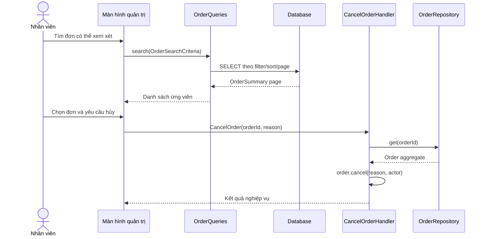

# Phân biệt đặc tả nghiệp vụ với tiêu chí truy vấn cơ sở dữ liệu

## Vì sao cần phân biệt hai loại đặc tả?

Trong một hệ thống nghiệp vụ, nhóm phát triển thường gặp những câu hỏi có vẻ giống nhau:

- Khách hàng có đủ điều kiện nhận miễn phí vận chuyển không?
- Tìm các đơn hàng của khách hàng A trong tháng trước.
- Đơn hàng này có được phép hủy ở trạng thái hiện tại không?
- Liệt kê các đơn đã thanh toán nhưng chưa giao, sắp xếp theo ngày đặt.

Tất cả đều có thể được diễn đạt bằng điều kiện đúng/sai hoặc bộ lọc dữ liệu. Tuy nhiên, mục đích của chúng khác nhau. Câu hỏi thứ nhất và thứ ba liên quan đến **quy tắc nghiệp vụ**: chúng quyết định điều gì được phép hoặc điều kiện nào được xem là thỏa mãn. Câu hỏi thứ hai và thứ tư chủ yếu phục vụ **truy vấn dữ liệu**: chúng xác định bản ghi nào cần tìm, sắp xếp và hiển thị.

Trong Domain-Driven Design (DDD), **Specification (đặc tả)** có thể được dùng để đóng gói một điều kiện nghiệp vụ có ý nghĩa, có thể kiểm tra và kết hợp với điều kiện khác. Trong khi đó, tiêu chí truy vấn cơ sở dữ liệu (query criteria) mô tả cách tìm tập dữ liệu phục vụ một màn hình, báo cáo hoặc use case đọc.

Hai khái niệm có thể cùng sử dụng các điều kiện như trạng thái, ngày tháng hoặc mã khách hàng, nhưng chúng không có cùng trách nhiệm. Nếu trộn lẫn, quy tắc nghiệp vụ có thể bị phụ thuộc vào SQL/ORM, hoặc truy vấn dữ liệu bị biến thành một mô hình miền phức tạp không cần thiết.

Sau bài học, người học có thể:

- Phân biệt Domain Specification với Query Criteria và database query specification.
- Nhận diện điều kiện nào thể hiện chính sách nghiệp vụ và điều kiện nào chỉ phục vụ việc tìm dữ liệu.
- Đóng gói quy tắc nghiệp vụ bằng Specification khi điều đó làm mô hình rõ ràng hơn.
- Thiết kế query criteria cho lọc, sắp xếp, phân trang và projection.
- Hiểu vì sao `Specification` của Spring Data JPA không tự động đồng nghĩa với Specification Pattern trong DDD.
- Kết hợp truy vấn ứng viên với việc kiểm tra quy tắc cuối cùng trong mô hình miền.

## Hai câu hỏi khác nhau: “Có hợp lệ không?” và “Tìm cái nào?”

### Đặc tả nghiệp vụ trả lời một câu hỏi về ý nghĩa

Đặc tả nghiệp vụ mô tả một điều kiện có ý nghĩa trong miền. Nó giúp trả lời các câu hỏi như:

- Khách hàng có đủ điều kiện tham gia chương trình ưu đãi không?
- Đơn hàng có thể được hủy theo chính sách hiện tại không?
- Một giao dịch có đáp ứng điều kiện để được quyết toán không?
- Sản phẩm có thể được bán trong kênh này không?

Kết quả của việc kiểm tra có thể ảnh hưởng đến quyết định nghiệp vụ. Điều kiện cần được diễn đạt bằng ngôn ngữ của chuyên gia nghiệp vụ và phải được kiểm chứng bằng ví dụ thực tế.

Ví dụ, “đơn hàng đủ điều kiện miễn phí vận chuyển” có thể phụ thuộc vào tổng tiền hàng, khu vực giao, loại sản phẩm và chương trình đang có hiệu lực. Đây là chính sách. Nếu chính sách thay đổi, kết quả nghiệp vụ có thể thay đổi dù cấu trúc bảng và màn hình không đổi.

### Tiêu chí truy vấn trả lời câu hỏi về tập dữ liệu

Query Criteria mô tả dữ liệu mà một use case muốn đọc. Nó thường chứa:

- Bộ lọc theo khách hàng, trạng thái, khoảng thời gian hoặc mã tham chiếu.
- Từ khóa tìm kiếm.
- Cách sắp xếp và thứ tự tăng/giảm.
- Trang hiện tại, kích thước trang hoặc cursor.
- Các trường cần trả về (projection) cho màn hình hoặc báo cáo.

Ví dụ, “tìm đơn hàng có trạng thái `PAID`, được tạo trong tháng trước, sắp xếp mới nhất trước, lấy 20 dòng” là yêu cầu đọc. Nó không quyết định đơn hàng có được phép hủy hay khách hàng có được nhận ưu đãi hay không.

### Bảng phân biệt nhanh

| Tiêu chí | Đặc tả nghiệp vụ (Domain Specification) | Tiêu chí truy vấn (Query Criteria) |
|---|---|---|
| Câu hỏi chính | Điều kiện nghiệp vụ có được thỏa mãn không? | Cần tìm hoặc hiển thị bản ghi nào? |
| Mục đích | Hỗ trợ quyết định hoặc bảo vệ chính sách | Lấy tập dữ liệu phục vụ use case đọc |
| Ngôn ngữ | Thuật ngữ và quy tắc của miền | Trường lọc, khoảng thời gian, sort, page, projection |
| Nơi sở hữu | Domain model hoặc domain policy phù hợp | Application/query layer và persistence adapter |
| Cách thực thi | Thường kiểm tra trên đối tượng hoặc dữ kiện miền | Thường được dịch thành SQL, Criteria API, search query |
| Kết quả | Thỏa mãn/không thỏa mãn, đôi khi kèm lý do | Danh sách, trang dữ liệu, số lượng hoặc projection |
| Thay đổi khi nào? | Khi chính sách hoặc quy tắc nghiệp vụ thay đổi | Khi nhu cầu tìm kiếm, màn hình hoặc hiệu năng thay đổi |
| Ví dụ | `OrderCanBeCancelled` | `OrderSearchCriteria` |

Một tiêu chí truy vấn có thể dùng điều kiện trông giống quy tắc nghiệp vụ, nhưng mục tiêu của nó vẫn là tìm dữ liệu. Ngược lại, một đặc tả nghiệp vụ có thể được tối ưu để thực thi ở cơ sở dữ liệu, nhưng điều đó không làm thay đổi quyền sở hữu ngữ nghĩa của nó.

## Domain Specification trong DDD

### Specification đóng gói một điều kiện có tên

Specification Pattern biểu diễn một điều kiện bằng một đối tượng có thể kiểm tra một candidate. Một interface đơn giản có thể như sau:

```java
public interface Specification<T> {
    boolean isSatisfiedBy(T candidate);
}
```

Ví dụ, một chính sách xác định đơn hàng có đủ điều kiện miễn phí vận chuyển:

```java
import java.util.Objects;

public final class FreeShippingSpecification
        implements Specification<Order> {

    private final Money minimumOrderTotal;

    public FreeShippingSpecification(Money minimumOrderTotal) {
        this.minimumOrderTotal =
                Objects.requireNonNull(minimumOrderTotal);
    }

    @Override
    public boolean isSatisfiedBy(Order order) {
        Objects.requireNonNull(order, "order");

        return order.shippingAddress().isDomestic()
                && order.total().compareTo(minimumOrderTotal) >= 0
                && !order.containsRestrictedShippingItem();
    }
}
```

Ví dụ giả định `Order` cung cấp các thông tin miền và `Money.compareTo()` chỉ so sánh các giá trị cùng tiền tệ. Các điều kiện như khu vực giao hàng, ngưỡng tiền tối thiểu và loại hàng bị hạn chế phải đến từ chính sách thực tế của doanh nghiệp. Specification này không cần biết dữ liệu được tải từ PostgreSQL, một API hay một bộ nhớ trong.

Tên `FreeShippingSpecification` làm cho điều kiện có thể trao đổi và kiểm thử. Application service có thể dùng nó khi quyết định áp dụng ưu đãi; aggregate hoặc domain policy có thể gọi nó tại thời điểm cần bảo vệ quy tắc.

### Khi nào nên tạo Specification riêng?

Một điều kiện đơn giản chỉ dùng một lần có thể nằm trực tiếp trong hành vi của entity hoặc aggregate. Không cần tạo class cho mọi câu `if`.

Specification riêng hữu ích khi:

- Điều kiện có tên nghiệp vụ và cần được trao đổi như một khái niệm.
- Điều kiện được tái sử dụng ở nhiều use case hoặc nhiều quyết định.
- Điều kiện có thể được kết hợp với các điều kiện khác.
- Quy tắc có đủ độ phức tạp để cần kiểm thử và thay đổi độc lập.
- Muốn tách chính sách khỏi entity mà không đẩy chính sách sang tầng persistence.

Không nên tạo Specification chỉ để bọc một biểu thức đơn giản như `status == ACTIVE` nếu tên và trách nhiệm mới không giúp mô hình dễ hiểu hơn. Một lớp quá nhỏ, quá nhiều hoặc trùng lặp có thể làm người đọc phải đi qua nhiều tầng chỉ để hiểu một điều kiện.

### Kết hợp các Specification

Các đặc tả thường có thể kết hợp bằng AND, OR và NOT. Ví dụ, một khách hàng được nhận ưu đãi nếu vừa là thành viên đang hoạt động, vừa đạt mức chi tiêu tối thiểu, và không nằm trong danh sách bị loại trừ.

```java
import java.util.Objects;

public interface Specification<T> {
    boolean isSatisfiedBy(T candidate);

    default Specification<T> and(Specification<T> other) {
        Objects.requireNonNull(other, "other");
        return candidate -> this.isSatisfiedBy(candidate)
                && other.isSatisfiedBy(candidate);
    }

    default Specification<T> or(Specification<T> other) {
        Objects.requireNonNull(other, "other");
        return candidate -> this.isSatisfiedBy(candidate)
                || other.isSatisfiedBy(candidate);
    }

    default Specification<T> not() {
        return candidate -> !this.isSatisfiedBy(candidate);
    }
}
```

Đây là phiên bản mở rộng của interface `Specification<T>` ở ví dụ trước; trong dự án, chỉ khai báo một interface với đầy đủ các phương thức cần dùng.

Ví dụ ghép:

```java
Specification<Customer> activeMember = new ActiveMemberSpecification();
Specification<Customer> highValue = new MinimumLifetimeSpendSpecification(minimumSpend);
Specification<Customer> eligible = activeMember.and(highValue);

boolean canReceiveOffer = eligible.isSatisfiedBy(customer);
```

Phép kết hợp chỉ có ý nghĩa khi các đặc tả cùng diễn đạt một loại điều kiện và có cùng cách hiểu về dữ liệu đầu vào. Không nên ghép một query filter như “được tạo trong 30 ngày gần nhất” vào một chính sách thành viên nếu thời gian chỉ phục vụ màn hình tìm kiếm.

### Specification không thay thế Aggregate Root

Specification trả lời một câu hỏi về điều kiện. Nó không tự cấp quyền thay đổi trạng thái. Ví dụ, `OrderCanBeCancelled` có thể kiểm tra đơn còn ở trạng thái cho phép hủy hay không. Hành vi `order.cancel(reason)` vẫn phải bảo vệ bất biến khi thực hiện chuyển trạng thái.

Nếu chỉ gọi Specification ở application layer rồi để một nơi khác cập nhật trạng thái tùy ý, quy tắc vẫn có thể bị bỏ qua hoặc gặp race condition. Kiểm tra điều kiện và thay đổi trạng thái phải được đặt trong ranh giới có trách nhiệm bảo vệ bất biến. Specification có thể được dùng bên trong hành vi đó nếu nó làm quy tắc rõ hơn.

### Specification có thể trả về lý do

Interface boolean đơn giản phù hợp với điều kiện độc lập. Nhưng khi người dùng cần biết vì sao không đủ điều kiện, chỉ trả `false` có thể không đủ.

Có thể dùng một kết quả đánh giá:

```java
import java.util.List;

public record SpecificationResult(
        boolean satisfied,
        List<String> reasons
) {
    public SpecificationResult {
        reasons = List.copyOf(reasons);
    }
}
```

Trong mô hình miền, lý do nên dùng mã hoặc kiểu kết quả có ý nghĩa ổn định thay vì phụ thuộc chuỗi hiển thị theo ngôn ngữ. Ví dụ `INSUFFICIENT_ORDER_TOTAL`, `OUTSIDE_SERVICE_AREA` hoặc `RESTRICTED_ITEM`. Application layer có thể chuyển các mã đó thành thông báo phù hợp cho người dùng.

Không phải mọi Specification đều cần thu thập mọi lỗi. Nếu chỉ cần quyết định nhanh, boolean là đủ. Nếu cần giải thích nhiều điều kiện cùng lúc, hãy thiết kế evaluation result có chủ đích và xác định thứ tự hoặc mức độ ưu tiên của lý do.

## Query Criteria và truy vấn cơ sở dữ liệu

### Query Criteria mô tả nhu cầu đọc

Một query criteria thường là một DTO hoặc value object mô tả bộ lọc và cách lấy dữ liệu. Nó không nhất thiết thuộc domain model vì nó thường phục vụ một màn hình hoặc báo cáo cụ thể.

```java
import java.time.Instant;
import java.util.Set;
import java.util.UUID;

public record OrderSearchCriteria(
        UUID customerId,
        Set<String> statuses,
        Instant createdFrom,
        Instant createdTo,
        String keyword,
        int page,
        int size,
        String sortBy,
        boolean descending
) {
    public OrderSearchCriteria {
        statuses = statuses == null ? Set.of() : Set.copyOf(statuses);
        if (page < 0) {
            throw new IllegalArgumentException("page must be non-negative");
        }
        if (size < 1 || size > 200) {
            throw new IllegalArgumentException("size must be between 1 and 200");
        }
        if (createdFrom != null && createdTo != null
                && createdFrom.isAfter(createdTo)) {
            throw new IllegalArgumentException("Invalid creation time range");
        }
    }
}
```

Criteria này mô tả các điều kiện đọc đơn hàng. `statuses`, khoảng thời gian, từ khóa, phân trang và sắp xếp không tự nói rằng đơn hàng hợp lệ hay không. Chúng chỉ giới hạn tập kết quả cần trả về. Trong ứng dụng thực tế, `sortBy` nên được ánh xạ qua danh sách trường được cho phép thay vì nối trực tiếp chuỗi người dùng vào SQL.

Query port có thể trả về projection thay vì aggregate đầy đủ:

```java
public interface OrderQueries {
    Page<OrderSummary> search(OrderSearchCriteria criteria);
}
```

`OrderSummary` có thể chỉ chứa mã đơn, tên khách, trạng thái, tổng tiền và thời điểm đặt. Việc đọc danh sách không cần tải toàn bộ aggregate cùng các quan hệ lồng nhau.

### Persistence adapter chuyển criteria thành SQL

Adapter ở tầng hạ tầng chịu trách nhiệm dịch criteria thành truy vấn phù hợp với cơ sở dữ liệu. Ví dụ SQL minh họa:

```sql
SELECT id, customer_id, status, total_amount, currency, created_at
FROM orders
WHERE (:customer_id IS NULL OR customer_id = :customer_id)
  AND (:created_from IS NULL OR created_at >= :created_from)
  AND (:created_to IS NULL OR created_at < :created_to)
  AND (COALESCE(:status_count, 0) = 0 OR status IN (:statuses))
ORDER BY created_at DESC
LIMIT :limit OFFSET :offset;
```

Đây là SQL minh họa theo kiểu tham số hóa; cú pháp bind danh sách và cách xử lý tham số null khác nhau giữa các driver/ORM. Trong hệ thống thực tế, nên xây câu truy vấn động hoặc dùng query builder để tránh các nhánh điều kiện không cần thiết và giúp planner sử dụng index hiệu quả. Luôn dùng bind parameter cho dữ liệu đầu vào; không nối chuỗi từ người dùng trực tiếp vào câu SQL.

Query adapter có thể tối ưu bằng index, partition, full-text search, projection hoặc read replica. Các lựa chọn đó không làm thay đổi ý nghĩa nghiệp vụ vì chúng thuộc cách thực hiện nhu cầu đọc.

### Query Criteria có thể chứa điều kiện giống nghiệp vụ

Ví dụ, màn hình quản trị muốn tìm các đơn “đủ điều kiện hoàn tiền”. Nếu điều kiện đó là một chính sách nghiệp vụ quyết định việc hoàn tiền, không nên chỉ viết một filter SQL rồi xem mọi bản ghi trả về là được phép hoàn. Query có thể tìm **ứng viên** dựa trên các trường lưu trữ, nhưng use case cần kiểm tra lại chính sách bằng mô hình miền trước khi thực hiện hành động.

Ngược lại, nếu màn hình chỉ cần lọc đơn theo `status = COMPLETED` để hiển thị, đó là query criteria. Không cần tạo `CompletedOrderSpecification` trong domain chỉ để thay thế một bộ lọc đọc đơn giản.

## Đừng nhầm Specification Pattern của DDD với Spring Data JPA Specification

Tên `Specification` được dùng trong nhiều thư viện. Một điểm dễ nhầm là `org.springframework.data.jpa.domain.Specification<T>` của Spring Data JPA.

Spring Data JPA Specification mô tả một predicate trên mô hình persistence và thường được dịch thành điều kiện của Criteria API/SQL. Nó là công cụ truy vấn. Việc nó có tên `Specification` không tự động biến nó thành Domain Specification.

| Khía cạnh | Domain Specification | Spring Data JPA Specification |
|---|---|---|
| Đầu vào | Đối tượng hoặc dữ kiện miền | JPA `Root`, `CriteriaQuery`, `CriteriaBuilder` |
| Ý nghĩa | Chính sách/điều kiện nghiệp vụ | Predicate để truy vấn entity persistence |
| Phụ thuộc ORM | Không nên phụ thuộc | Có phụ thuộc JPA |
| Có thể kiểm tra độc lập với DB | Thường có | Thường cần context JPA hoặc kiểm thử adapter |
| Ví dụ | `CustomerEligibleForOffer` | `OrderEntity` có `status = PAID` |

Ví dụ Spring Data JPA:

```java
import org.springframework.data.jpa.domain.Specification;

public final class OrderEntitySpecifications {
    private OrderEntitySpecifications() {}

    public static Specification<OrderEntity> hasStatus(OrderStatus status) {
        return (root, query, cb) -> cb.equal(root.get("status"), status);
    }
}
```

Đây là query specification dành cho `OrderEntity`. Nó giúp xây truy vấn có thể kết hợp và không cần tải tất cả entity vào bộ nhớ. Nó không nên trở thành nơi quyết định chính sách như “đơn có đủ điều kiện hủy hay không” nếu chính sách đó cần được bảo vệ bởi domain model.

Nếu dự án sử dụng Spring Data JPA, có thể dùng cả hai loại:

- Domain Specification ở module/domain để diễn đạt quy tắc nghiệp vụ.
- JPA Specification ở module/infrastructure để dịch query criteria thành SQL.

Đặt tên package và class rõ ràng như `domain.specification` và `persistence.query` để tránh nhầm lẫn. Không đưa kiểu JPA `Specification` vào aggregate hoặc domain service.

## Một yêu cầu có thể liên quan đến cả hai loại đặc tả

Hãy xem use case “nhân viên tìm các đơn có thể hủy và thực hiện hủy theo chính sách”.

### Phần truy vấn: tìm ứng viên

Màn hình cho phép lọc đơn theo khách hàng, trạng thái và ngày đặt. `OrderSearchCriteria` được chuyển thành SQL để lấy một trang `OrderSummary`. Có thể chỉ tìm các đơn đang ở trạng thái `PLACED` nhằm giảm số ứng viên.

### Phần nghiệp vụ: quyết định có thể hủy

Khi nhân viên chọn một đơn, application service tải aggregate `Order` theo ID. Hành vi `order.cancel(reason, actor)` kiểm tra trạng thái hiện tại, thời điểm, quyền hoặc chính sách liên quan và thực hiện chuyển đổi nếu hợp lệ. Nếu cần, `OrderCanBeCancelledSpecification` đóng gói điều kiện có tên và được gọi bên trong hành vi.

Một đơn có trạng thái `PLACED` vẫn có thể không hủy được nếu đã qua mốc xử lý, có yêu cầu giao hàng không thể thu hồi hoặc thuộc loại đơn có chính sách riêng. Vì vậy, query filter `status = PLACED` chỉ giúp tìm ứng viên; nó không thay thế quyết định nghiệp vụ.



Sơ đồ tách thao tác tìm kiếm khỏi quyết định hủy. Nếu trạng thái thay đổi giữa lúc tìm và lúc hủy, aggregate phải kiểm tra lại điều kiện trên trạng thái mới; có thể cần optimistic locking để xử lý cập nhật đồng thời.

## Khi nào có thể chuyển một Domain Specification thành truy vấn?

Một số đặc tả có biểu thức đơn giản, thuần dữ liệu và có thể được thực thi trên cả object trong bộ nhớ lẫn database. Ví dụ, “đơn có tổng tiền từ 1 triệu trở lên” có thể được viết bằng Java hoặc SQL.

Tuy nhiên, việc dịch một Domain Specification thành truy vấn chỉ an toàn khi ngữ nghĩa của hai cách thực thi tương đương. Cần xem xét:

- `NULL` trong SQL có logic ba giá trị (`TRUE`, `FALSE`, `UNKNOWN`), khác với boolean trong Java.
- So sánh chuỗi có thể khác do collation, chữ hoa/thường, dấu và chuẩn hóa.
- Múi giờ và độ chính xác timestamp có thể làm khác kết quả ở biên thời gian.
- Tiền tệ, scale và rounding có thể khiến phép so sánh tiền không tương đương.
- Quan hệ nhiều-nhiều và join có thể tạo bản ghi trùng hoặc làm thay đổi pagination.
- Dữ liệu có thể thay đổi giữa lúc query và lúc thực hiện hành động.

Nếu cần cùng một quy tắc chạy được trên nhiều nguồn dữ liệu, hãy cân nhắc biểu diễn quy tắc bằng một cây biểu thức hoặc mô hình trung gian có thể dịch sang các backend khác nhau. Đây là lựa chọn kiến trúc có chi phí; chỉ nên làm khi có nhu cầu thực tế và có kiểm thử chứng minh hai cách thực thi tương đương.

Đối với quyết định quan trọng, truy vấn có thể thu hẹp tập ứng viên, nhưng aggregate vẫn cần bảo vệ bất biến tại thời điểm ghi. Không nên dựa vào một kết quả query đã cũ để cho phép chuyển trạng thái.

## Nơi đặt từng loại đặc tả trong kiến trúc

Một cách phân chia trách nhiệm thường gặp:

| Thành phần | Trách nhiệm | Ví dụ |
|---|---|---|
| Entity/Aggregate | Bảo vệ bất biến và hành vi của đối tượng | `order.cancel()` |
| Domain Specification/Policy | Diễn đạt điều kiện nghiệp vụ có tên, có thể tái sử dụng | `FreeShippingSpecification` |
| Application Service | Điều phối use case và tải dữ liệu cần thiết | `CancelOrderHandler` |
| Query Criteria | Mô tả bộ lọc và cách lấy dữ liệu | `OrderSearchCriteria` |
| Query Service/Port | Cung cấp dữ liệu đọc hoặc projection | `OrderQueries.search()` |
| Persistence Adapter | Dịch criteria thành SQL/Criteria API/search query | `JpaOrderQueries` |

Không phải dự án nào cũng cần đủ các lớp này. Với use case nhỏ, query handler có thể tự xây criteria và gọi repository đọc. Với quy tắc đơn giản, aggregate có thể kiểm tra trực tiếp mà không cần Specification riêng. Cấu trúc nên phản ánh mức độ phức tạp thực tế.

## Kiểm thử đặc tả nghiệp vụ và tiêu chí truy vấn

### Kiểm thử Domain Specification

Domain Specification nên được kiểm thử bằng đối tượng miền hoặc dữ kiện miền, không cần database nếu quy tắc không phụ thuộc nguồn ngoài.

```java
class FreeShippingSpecificationTest {
    @Test
    void satisfiesWhenDomesticAndAboveMinimum() {
        Order order = anOrder()
                .withDomesticAddress()
                .withTotal(money("1_500_000", "VND"))
                .build();

        Specification<Order> specification =
                new FreeShippingSpecification(money("1_000_000", "VND"));

        assertTrue(specification.isSatisfiedBy(order));
    }

    @Test
    void rejectsWhenBelowMinimum() {
        Order order = anOrder()
                .withDomesticAddress()
                .withTotal(money("500_000", "VND"))
                .build();

        Specification<Order> specification =
                new FreeShippingSpecification(money("1_000_000", "VND"));

        assertFalse(specification.isSatisfiedBy(order));
    }
}
```

Builder và hàm `money()` là helper minh họa. Các test nên bao phủ biên như đúng ngưỡng tối thiểu, khác tiền tệ, địa chỉ ngoài khu vực và sản phẩm bị hạn chế. Nếu Specification trả về lý do, hãy kiểm tra mã lý do thay vì phụ thuộc vào chuỗi thông báo đã dịch.

### Kiểm thử Query Criteria và adapter

Query criteria có thể được kiểm tra về validation của page, size và khoảng ngày. Persistence adapter cần integration test với hệ quản trị thực tế hoặc môi trường tương thích để kiểm tra:

- Kết quả khi một hoặc nhiều filter bị bỏ trống.
- Xử lý danh sách trạng thái rỗng.
- Ranh giới thời gian đầu/cuối và múi giờ.
- Thứ tự sắp xếp ổn định khi nhiều bản ghi có cùng timestamp.
- Pagination không trùng hoặc bỏ sót dữ liệu ngoài dự kiến.
- Projection trả đúng trường và không tải graph không cần thiết.

Đừng chỉ kiểm tra query bằng mock repository rồi kết luận SQL đúng. Các khác biệt về null, collation, join và pagination thường chỉ xuất hiện khi chạy trên database.

## Những sai lầm thường gặp

| Sai lầm | Hệ quả | Cách điều chỉnh |
|---|---|---|
| Dùng query filter để quyết định nghiệp vụ | Bản ghi lọt qua bộ lọc bị xem nhầm là hợp lệ | Kiểm tra quy tắc trong domain model tại thời điểm hành động |
| Đưa SQL hoặc JPA Criteria vào Domain Specification | Domain phụ thuộc persistence và khó kiểm thử | Giữ domain rule độc lập, dịch truy vấn ở adapter |
| Tạo Specification cho mọi biểu thức nhỏ | Tăng lớp và làm luồng đọc khó theo dõi | Chỉ tách khi có tên nghiệp vụ, tái sử dụng hoặc độ phức tạp đáng kể |
| Coi Spring Data JPA Specification là Domain Specification | Trộn predicate truy vấn với chính sách miền | Đặt tên và package phân biệt rõ hai loại |
| Đưa pagination và sort vào Domain Specification | Mô hình miền phụ thuộc nhu cầu màn hình | Đặt chúng trong Query Criteria |
| Query một tập ứng viên rồi tin dữ liệu vẫn đúng khi ghi | Có thể xảy ra race condition | Tải aggregate và kiểm tra lại bất biến trong hành vi ghi |
| Dịch rule sang SQL mà không kiểm tra semantics | Java và DB có thể cho kết quả khác nhau | Kiểm thử tương đương về null, thời gian, tiền và chuỗi |
| Dùng repository aggregate cho mọi báo cáo | Tải quá nhiều entity và quan hệ | Dùng query service/projection phù hợp |
| Để query criteria quyết định quyền truy cập | Có thể lộ dữ liệu khi thiếu filter hoặc filter bị sửa | Kiểm tra authorization ở application/security boundary |

## Quy trình phân loại một điều kiện mới

Khi nhận một yêu cầu chứa điều kiện, hãy đi theo các bước sau:

1. **Viết lại thành câu hỏi:** Điều kiện đang quyết định một việc có được phép/đủ điều kiện không, hay chỉ chọn dữ liệu cần hiển thị?
2. **Xác định người sở hữu:** Chuyên gia nghiệp vụ có thể giải thích và thay đổi điều kiện này không? Hay nó xuất phát từ nhu cầu tìm kiếm của một màn hình?
3. **Xác định thời điểm kiểm tra:** Điều kiện được kiểm tra khi đọc danh sách, khi người dùng chọn hành động hay ngay trong giao dịch thay đổi trạng thái?
4. **Xác định dữ liệu cần thiết:** Có cần aggregate, value object, dữ kiện từ context khác hoặc chỉ các cột trong một bảng?
5. **Chọn nơi đặt:** Domain Specification/Policy cho quy tắc nghiệp vụ; Query Criteria cho bộ lọc đọc; aggregate method cho bất biến nội tại đơn giản.
6. **Kiểm tra đường ghi:** Nếu điều kiện ảnh hưởng đến quyết định ghi, bảo đảm nó được kiểm tra lại trong ranh giới bảo vệ bất biến và có concurrency control phù hợp.
7. **Viết test:** Kiểm thử quy tắc miền bằng ví dụ nghiệp vụ và kiểm thử query adapter trên database.

## Checklist rà soát

- [ ] Đã xác định điều kiện là quy tắc nghiệp vụ hay tiêu chí truy vấn.
- [ ] Domain Specification có tên thể hiện ý nghĩa trong ngôn ngữ miền.
- [ ] Domain Specification không phụ thuộc SQL, ORM hoặc repository nếu không có lý do kiến trúc rõ ràng.
- [ ] Quy tắc đơn giản không bị tách thành class không cần thiết.
- [ ] Query Criteria chỉ chứa bộ lọc, sort, pagination và projection cần cho use case đọc.
- [ ] Query adapter dùng bind parameter và kiểm soát trường sort được phép.
- [ ] Đã phân biệt `Specification` của DDD với `Specification` của Spring Data JPA.
- [ ] Query kết quả ứng viên không được xem là bằng chứng cuối cùng cho quyết định ghi.
- [ ] Aggregate bảo vệ bất biến ở thời điểm thay đổi trạng thái.
- [ ] Các khác biệt giữa Java và SQL về null, thời gian, chuỗi, tiền và join đã được xem xét.
- [ ] Domain rule và query adapter có loại kiểm thử phù hợp.

## Kết luận

Đặc tả nghiệp vụ và tiêu chí truy vấn có thể cùng sử dụng các biểu thức điều kiện, nhưng chúng trả lời hai câu hỏi khác nhau. Domain Specification diễn đạt một chính sách hoặc điều kiện có ý nghĩa trong miền; Query Criteria mô tả tập dữ liệu cần tìm, sắp xếp và phân trang. Giữ hai trách nhiệm riêng giúp domain model không phụ thuộc cơ sở dữ liệu, truy vấn dễ tối ưu và các quyết định quan trọng vẫn được bảo vệ tại aggregate. Khi một query tìm ra các ứng viên, hãy để mô hình miền kiểm tra lại quy tắc tại thời điểm thực hiện hành động.
