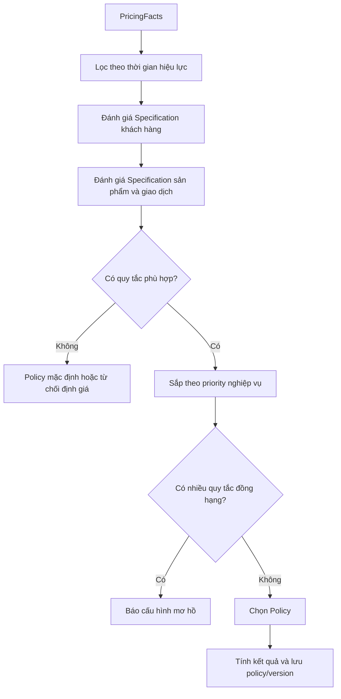

# Quy tắc thay đổi theo khách hàng, sản phẩm hoặc thời gian hiệu lực

Trong Domain-Driven Design (DDD), một quy tắc nghiệp vụ có thể thay đổi tùy khách hàng, sản phẩm, hợp đồng, khu vực hoặc thời điểm áp dụng. Ví dụ, khách hàng hạng Gold được giảm giá khác khách hàng Standard; một sản phẩm thuộc nhóm hàng dễ hỏng có chính sách giao hàng riêng; một hợp đồng chỉ áp dụng mức giá trong khoảng thời gian xác định.

Nếu viết mọi biến thể thành chuỗi `if/else` trong một service, mã nguồn sẽ nhanh chóng khó đọc và khó kiểm soát. DDD cung cấp hai khái niệm hữu ích để diễn đạt loại bài toán này: **Policy** mô tả quy tắc ra quyết định hoặc cách tính; **Specification** mô tả điều kiện mà một đối tượng hoặc giao dịch phải thỏa mãn. Kết hợp chúng đúng cách giúp hệ thống xác định giao dịch nào đủ điều kiện, chọn chính sách phù hợp và giải thích được vì sao kết quả được tạo ra.

## 1. Vì sao quy tắc cần thay đổi theo ngữ cảnh?

Một quy tắc thường có phạm vi áp dụng. Cùng một phép tính chiết khấu có thể cho kết quả khác nhau vì:

- **Khách hàng:** hạng thành viên, nhóm khách hàng, hợp đồng riêng, hạn mức hoặc lịch sử mua hàng.
- **Sản phẩm:** SKU, danh mục, thương hiệu, loại hàng, điều kiện bảo quản hoặc biên lợi nhuận.
- **Thời gian:** ngày bắt đầu/kết thúc chương trình, ngày ký hợp đồng, ngày đặt hàng hoặc ngày xác nhận.
- **Kênh và địa bàn:** cửa hàng, website, đại lý, quốc gia hoặc khu vực giao hàng.
- **Điều kiện giao dịch:** số lượng, tổng tiền, phương thức thanh toán hoặc trạng thái đơn.

Ví dụ, một doanh nghiệp bán hàng B2B có thể áp dụng:

1. Khách hàng có hợp đồng riêng được dùng giá hợp đồng cho SKU được chỉ định.
2. Nếu không có giá hợp đồng, khách hàng hạng Gold được giảm 7% trên nhóm sản phẩm tiêu chuẩn.
3. Nếu không thỏa hai điều kiện trên, chương trình khuyến mại theo sản lượng có thể giảm 5% khi mua từ 20 sản phẩm.
4. Mỗi chính sách chỉ có hiệu lực trong khoảng thời gian đã công bố.

Điều khó không chỉ là công thức tính. Hệ thống còn phải trả lời chính sách nào được áp dụng khi một giao dịch đồng thời thỏa nhiều điều kiện, điều gì xảy ra khi không có chính sách phù hợp và kết quả cũ được giải thích thế nào sau khi chính sách thay đổi.

## 2. Phân biệt Policy và Specification

Policy và Specification thường được dùng cùng nhau nhưng có trách nhiệm khác nhau.

| Khái niệm | Câu hỏi trả lời | Ví dụ |
| --- | --- | --- |
| Specification | Giao dịch hoặc đối tượng có thỏa một điều kiện không? | Khách hàng thuộc hạng Gold; sản phẩm nằm trong danh mục áp dụng; ngày giao dịch nằm trong thời hạn |
| Policy | Khi điều kiện áp dụng, cần ra quyết định hoặc tính kết quả thế nào? | Giảm 7%; tính phí giao hàng; chấp thuận hạn mức |
| Policy selection / Resolver | Trong nhiều policy, policy nào được chọn cho trường hợp này? | Chọn giá hợp đồng trước chính sách hạng khách hàng |

Specification diễn đạt một điều kiện có thể kiểm tra, thường trả về `true` hoặc `false`. Policy mô tả hành vi hoặc quy tắc tạo ra quyết định/kết quả. Resolver lựa chọn policy dựa trên phạm vi, thời gian và thứ tự ưu tiên đã được nghiệp vụ thống nhất.

Ví dụ:

- `CustomerTierIsGold` là Specification.
- `ProductCategoryIsStandard` là Specification.
- `IsWithinPromotionPeriod` là Specification.
- `GoldCustomerDiscountPolicy` là Policy tính khoản giảm giá.
- `ContractPricePolicy` là Policy lấy mức giá theo hợp đồng.

Không nên đặt toàn bộ điều kiện chọn chính sách bên trong công thức tính. Ngược lại, Specification cũng không nên tự thực hiện phép tính hoặc thay đổi trạng thái giao dịch. Phân tách hai trách nhiệm giúp mỗi phần dễ kiểm thử và thay đổi độc lập.

## 3. Mô hình hóa dữ kiện dùng để đánh giá quy tắc

Trước khi viết Specification, hãy xác định dữ kiện nghiệp vụ cần thiết để đánh giá một giao dịch. Có thể tạo một đối tượng dữ kiện bất biến thay vì truyền nhiều tham số rời rạc.

Ví dụ, khi định giá một dòng hàng:

```java
public record PricingFacts(
    CustomerId customerId,
    CustomerTier customerTier,
    ProductId productId,
    ProductCategory productCategory,
    int quantity,
    Money subtotal,
    Instant evaluatedAt
) {
    public PricingFacts {
        Objects.requireNonNull(customerId);
        Objects.requireNonNull(customerTier);
        Objects.requireNonNull(productId);
        Objects.requireNonNull(productCategory);
        Objects.requireNonNull(subtotal);
        Objects.requireNonNull(evaluatedAt);
        if (quantity <= 0) {
            throw new IllegalArgumentException("quantity must be positive");
        }
    }
}
```

`PricingFacts` là snapshot dữ kiện cần cho quyết định định giá. `evaluatedAt` phải được xác định theo quy tắc nghiệp vụ, chẳng hạn ngày đặt hàng hoặc ngày xác nhận. Không nên tự ý dùng thời điểm hiện tại trong từng Specification vì các điều kiện có thể được đánh giá ở những thời điểm hơi khác nhau.

Trong hệ thống thật, một số dữ kiện có thể được lấy từ context khác. Application service hoặc một thành phần điều phối sẽ nạp thông tin cần thiết qua hợp đồng phù hợp rồi tạo `PricingFacts`. Policy không nên tự truy vấn mọi hệ thống để tìm khách hàng, sản phẩm và thời gian áp dụng.

## 4. Specification biểu diễn điều kiện có thể kết hợp

Một Specification đơn giản có thể được biểu diễn bằng interface generic:

```java
@FunctionalInterface
public interface Specification<T> {
    boolean isSatisfiedBy(T candidate);

    default Specification<T> and(Specification<T> other) {
        return candidate ->
            this.isSatisfiedBy(candidate) && other.isSatisfiedBy(candidate);
    }

    default Specification<T> or(Specification<T> other) {
        return candidate ->
            this.isSatisfiedBy(candidate) || other.isSatisfiedBy(candidate);
    }

    default Specification<T> not() {
        return candidate -> !this.isSatisfiedBy(candidate);
    }
}
```

Các Specification cụ thể diễn đạt thuật ngữ nghiệp vụ:

```java
public final class GoldCustomerSpecification
        implements Specification<PricingFacts> {
    @Override
    public boolean isSatisfiedBy(PricingFacts facts) {
        return facts.customerTier() == CustomerTier.GOLD;
    }
}

public final class StandardProductSpecification
        implements Specification<PricingFacts> {
    @Override
    public boolean isSatisfiedBy(PricingFacts facts) {
        return facts.productCategory() == ProductCategory.STANDARD;
    }
}

public record MinimumQuantitySpecification(int minimum)
        implements Specification<PricingFacts> {
    public MinimumQuantitySpecification {
        if (minimum <= 0) {
            throw new IllegalArgumentException("minimum must be positive");
        }
    }

    @Override
    public boolean isSatisfiedBy(PricingFacts facts) {
        return facts.quantity() >= minimum;
    }
}
```

Có thể kết hợp chúng:

```java
Specification<PricingFacts> goldCustomerBuyingStandardProduct =
    new GoldCustomerSpecification()
        .and(new StandardProductSpecification());

boolean eligible = goldCustomerBuyingStandardProduct.isSatisfiedBy(facts);
```

Specification ghép giúp diễn đạt điều kiện như một biểu thức nghiệp vụ có thể đọc và kiểm thử. Tuy nhiên, không nên xây dựng một DSL phức tạp nếu chỉ có vài điều kiện đơn giản. Mục tiêu là làm rõ quy tắc, không phải tạo thêm một framework tổng quát.

## 5. Policy thực hiện quyết định hoặc phép tính

Sau khi biết một giao dịch có đủ điều kiện, Policy thực hiện cách tính hoặc quyết định tương ứng. Ví dụ, interface tính chiết khấu:

```java
public interface DiscountPolicy {
    Money calculate(PricingFacts facts);
}
```

Một implementation có thể áp dụng mức giảm cố định theo tỷ lệ:

```java
public final class PercentageDiscountPolicy implements DiscountPolicy {
    private final BigDecimal rate;

    public PercentageDiscountPolicy(BigDecimal rate) {
        Objects.requireNonNull(rate, "rate is required");
        if (rate.signum() < 0 || rate.compareTo(BigDecimal.ONE) > 0) {
            throw new IllegalArgumentException("rate must be between 0 and 1");
        }
        this.rate = rate;
    }

    @Override
    public Money calculate(PricingFacts facts) {
        return facts.subtotal().multiply(rate);
    }
}
```

Một chính sách khác có thể giảm theo bậc số lượng:

```java
public final class TieredQuantityDiscountPolicy implements DiscountPolicy {
    @Override
    public Money calculate(PricingFacts facts) {
        int quantity = facts.quantity();
        BigDecimal rate;
        if (quantity >= 100) {
            rate = new BigDecimal("0.12");
        } else if (quantity >= 50) {
            rate = new BigDecimal("0.08");
        } else if (quantity >= 20) {
            rate = new BigDecimal("0.05");
        } else {
            rate = BigDecimal.ZERO;
        }
        return facts.subtotal().multiply(rate);
    }
}
```

Các mức giảm trong ví dụ chỉ minh họa. Quy tắc thực tế cần xác định rõ cách làm tròn, giới hạn chiết khấu và việc các mức giảm có được cộng dồn hay không.

## 6. Thời gian hiệu lực là một phần của phạm vi áp dụng

Chính sách thường không có hiệu lực vô thời hạn. Một chương trình khuyến mại có thể bắt đầu lúc 00:00 ngày 1 tháng 6 và kết thúc ngay khi ngày 30 tháng 6 kết thúc. Một hợp đồng có thể áp dụng từ ngày ký đến ngày hết hạn. Một mức giá mới có thể được công bố hôm nay nhưng có hiệu lực từ tuần sau.

Nên mô hình hóa khoảng hiệu lực rõ ràng thay vì rải điều kiện ngày tháng trong nhiều service.

```java
public record EffectivePeriod(Instant fromInclusive, Instant toExclusive) {
    public EffectivePeriod {
        Objects.requireNonNull(fromInclusive);
        if (toExclusive != null && !fromInclusive.isBefore(toExclusive)) {
            throw new IllegalArgumentException("toExclusive must be after fromInclusive");
        }
    }

    public boolean contains(Instant instant) {
        return !instant.isBefore(fromInclusive)
            && (toExclusive == null || instant.isBefore(toExclusive));
    }
}
```

Khoảng nửa mở `[fromInclusive, toExclusive)` bao gồm thời điểm bắt đầu và không bao gồm thời điểm kết thúc. Cách biểu diễn này giúp hai phiên bản nối tiếp nhau không bị chồng lấn tại ranh giới: chính sách A kết thúc lúc 00:00 ngày 1 tháng 7; chính sách B bắt đầu đúng lúc đó.

Nếu nghiệp vụ làm việc theo ngày lịch, có thể dùng `LocalDate` cho `validFrom` và `validUntilExclusive`, sau đó chuyển sang thời điểm cụ thể theo múi giờ của thị trường khi cần. Hãy thống nhất múi giờ và độ chính xác thời gian; không nên dùng `LocalDateTime` không có ngữ cảnh múi giờ để so sánh các thời điểm trên nhiều hệ thống.

## 7. Một chính sách có cả điều kiện và cách tính

Một chính sách áp dụng được thường gồm ba phần:

1. **Phạm vi áp dụng:** khách hàng, sản phẩm, kênh hoặc giao dịch nào thỏa điều kiện.
2. **Thời gian hiệu lực:** chính sách được phép áp dụng trong khoảng nào.
3. **Hành vi:** nếu được chọn, chính sách tạo ra kết quả gì.

Ta có thể biểu diễn một quy tắc định giá như sau:

```java
public record DiscountRule(
    String policyId,
    int version,
    int priority,
    EffectivePeriod effectivePeriod,
    Specification<PricingFacts> applicability,
    DiscountPolicy policy
) {
    public DiscountRule {
        Objects.requireNonNull(policyId);
        Objects.requireNonNull(effectivePeriod);
        Objects.requireNonNull(applicability);
        Objects.requireNonNull(policy);
        if (version <= 0) {
            throw new IllegalArgumentException("version must be positive");
        }
    }

    public boolean appliesTo(PricingFacts facts) {
        return effectivePeriod.contains(facts.evaluatedAt())
            && applicability.isSatisfiedBy(facts);
    }
}
```

`priority` biểu diễn thứ tự ưu tiên đã được nghiệp vụ quy định. Không nên để thứ tự trong danh sách, thứ tự truy vấn database hoặc thứ tự khởi tạo bean vô tình quyết định policy nào thắng.

`DiscountRule` ở đây là mô hình runtime đã được lắp ghép với các Specification và Policy thực thi. Nếu quy tắc được cấu hình trong database, thường lưu dữ liệu cấu hình như `policyId`, version, priority, thời hạn và tham số; khi nạp, infrastructure ánh xạ cấu hình sang các implementation tương ứng. Không nên cố serialize lambda hoặc object chứa logic Java như một bản ghi cấu hình.

## 8. Chọn policy khi nhiều quy tắc cùng phù hợp

Một giao dịch có thể thỏa nhiều Specification cùng lúc. Ví dụ, khách hàng Gold mua 50 sản phẩm tiêu chuẩn trong thời gian khuyến mại có thể đủ điều kiện cho cả chính sách hạng khách hàng lẫn chính sách số lượng.

Trước khi triển khai resolver, nghiệp vụ cần xác định cách xử lý:

- **Ưu tiên một chính sách:** chính sách hợp đồng thắng chính sách hạng khách hàng; chính sách hạng khách hàng thắng khuyến mại chung.
- **Cho phép kết hợp:** hai khoản giảm có thể cộng dồn theo thứ tự đã xác định.
- **Chọn kết quả tốt nhất:** áp dụng mức có lợi nhất cho khách hàng nếu chính sách cho phép.
- **Không cho phép chồng lấn:** dữ liệu cấu hình phải bảo đảm mỗi giao dịch chỉ khớp tối đa một quy tắc.

Đây là quyết định nghiệp vụ. Không nên tự chọn `findFirst()` rồi phụ thuộc thứ tự phần tử trong collection.

Ví dụ resolver chọn duy nhất một quy tắc có priority cao nhất và báo lỗi nếu có hai quy tắc cùng mức ưu tiên:

```java
public final class DiscountPolicyResolver {
    public DiscountRule resolve(
        PricingFacts facts,
        List<DiscountRule> rules
    ) {
        List<DiscountRule> matches = rules.stream()
            .filter(rule -> rule.appliesTo(facts))
            .toList();

        if (matches.isEmpty()) {
            throw new NoApplicableDiscountPolicy();
        }

        int highestPriority = matches.stream()
            .mapToInt(DiscountRule::priority)
            .max()
            .orElseThrow();

        List<DiscountRule> highest = matches.stream()
            .filter(rule -> rule.priority() == highestPriority)
            .toList();

        if (highest.size() != 1) {
            throw new AmbiguousDiscountPolicy(highest.stream()
                .map(DiscountRule::policyId)
                .toList());
        }

        return highest.get(0);
    }
}
```

Resolver không âm thầm chọn một quy tắc khi dữ liệu cấu hình mâu thuẫn. Trường hợp không có policy phù hợp cũng được biểu diễn rõ. Tùy nghiệp vụ, hệ thống có thể có một policy mặc định, nhưng fallback đó phải được công bố và kiểm thử như một quy tắc thực sự.

## 9. Ví dụ tổng hợp: định giá theo khách hàng, sản phẩm và thời gian

Giả sử doanh nghiệp có ba quy tắc:

| Quy tắc | Điều kiện | Thời gian | Ưu tiên | Cách tính |
| --- | --- | --- | ---: | --- |
| Giá hợp đồng | Khách hàng có hợp đồng cho SKU | Theo thời hạn hợp đồng | 300 | Lấy giá và chiết khấu trong hợp đồng |
| Ưu đãi Gold | Khách hàng Gold, sản phẩm thuộc nhóm Standard | Quý hiện tại | 200 | Giảm 7% |
| Khuyến mại số lượng | Sản phẩm thuộc nhóm Standard, số lượng từ 20 | Tháng khuyến mại | 100 | Giảm 5% |

Một giao dịch Gold mua 25 sản phẩm Standard trong tháng khuyến mại có thể thỏa cả hai quy tắc sau. Resolver chọn ưu đãi Gold vì priority 200 cao hơn 100. Nếu khách hàng có hợp đồng riêng áp dụng cho SKU, quy tắc hợp đồng có priority 300 và được chọn trước.



Kết quả nên ghi nhận policy nào và phiên bản nào đã được sử dụng. Nếu sau này tỷ lệ ưu đãi Gold đổi từ 7% thành 6%, doanh nghiệp vẫn cần giải thích vì sao đơn hàng cũ được tính 7%.

## 10. Quy tắc cộng dồn và thứ tự áp dụng

Nếu nghiệp vụ cho phép nhiều policy cùng áp dụng, cần mô hình hóa cách kết hợp thay vì cộng các tỷ lệ một cách tùy ý.

Ví dụ, tổng tiền ban đầu là 1.000.000 đồng, policy A giảm 10%, policy B giảm thêm 5%:

- Cộng tỷ lệ trực tiếp: tổng giảm 15%, còn 850.000 đồng.
- Áp dụng tuần tự: sau A còn 900.000 đồng; B giảm 5% trên 900.000, còn 855.000 đồng.

Hai cách cho kết quả khác nhau. Chính sách có thể quy định một số khoản giảm không cộng dồn, một số khoản áp dụng tuần tự hoặc có trần chiết khấu tối đa.

Một cách thiết kế là phân loại policy theo vai trò và dùng một `DiscountCompositionPolicy` để xác định thứ tự, điều kiện kết hợp và giới hạn tổng. Không nên để mỗi implementation tự ý sửa tổng tiền hoặc tự gọi policy khác vì sẽ khó kiểm soát kết quả chung.

## 11. Thay đổi chính sách mà vẫn giải thích được giao dịch cũ

Chính sách nghiệp vụ có thể thay đổi theo thời gian. Hệ thống cần phân biệt:

- **Policy definition:** nội dung quy tắc, phạm vi áp dụng và công thức.
- **Policy version:** phiên bản cụ thể của quy tắc.
- **Effective period:** khoảng thời gian phiên bản đó được áp dụng.
- **Evaluation time:** thời điểm dùng để xác định policy phù hợp.
- **Applied policy snapshot:** policy/version và dữ kiện cần thiết đã được dùng cho giao dịch.

Không nên sửa đè một policy đã được sử dụng cho giao dịch lịch sử nếu việc đó khiến kết quả cũ không thể giải thích. Có thể tạo version mới với khoảng hiệu lực mới, đồng thời giữ phiên bản cũ để tra cứu.

Với đơn hàng đã xác nhận, có thể lưu `policyId`, `policyVersion`, thời điểm định giá và các thành phần kết quả. Nếu cần tái hiện chính xác, có thể lưu snapshot đầu vào hoặc các dữ kiện quan trọng như hạng khách hàng, SKU, số lượng, mức giảm và giá cơ sở. Chỉ lưu ID policy có thể chưa đủ nếu dữ liệu cấu hình cũ đã bị xóa hoặc thay đổi.

### Thay đổi hồi tố

Đôi khi doanh nghiệp quyết định một quy tắc mới có hiệu lực từ ngày trong quá khứ. Khi đó cần phân biệt ngày quyết định, ngày hiệu lực và cách xử lý giao dịch đã phát sinh trong khoảng thời gian bị ảnh hưởng.

Không nên âm thầm tính lại tất cả đơn cũ. Nghiệp vụ cần quyết định có phát sinh điều chỉnh, hoàn tiền, hóa đơn bổ sung hay chỉ áp dụng cho giao dịch chưa chốt. Lịch sử nên ghi nhận quyết định mới và các hành động điều chỉnh như những sự kiện riêng.

## 12. Nơi đặt Policy và Specification trong kiến trúc DDD

Policy và Specification thuộc mô hình miền khi chúng diễn đạt quy tắc nghiệp vụ. Chúng có thể được đặt trong package hoặc module domain của bounded context sở hữu quy tắc.

Một cách tổ chức tham khảo:

```text
pricing/
├── domain/
│   ├── model/
│   │   ├── PricingFacts.java
│   │   ├── Money.java
│   │   └── DiscountRule.java
│   ├── policy/
│   │   ├── DiscountPolicy.java
│   │   ├── PercentageDiscountPolicy.java
│   │   └── TieredQuantityDiscountPolicy.java
│   ├── specification/
│   │   ├── Specification.java
│   │   ├── GoldCustomerSpecification.java
│   │   └── StandardProductSpecification.java
│   └── service/
│       └── DiscountPolicyResolver.java
├── application/
│   └── PriceOrderHandler.java
└── infrastructure/
    └── persistence/
```

Application layer điều phối việc nạp dữ liệu và gọi domain service. Infrastructure cung cấp cách lưu trữ hoặc lấy cấu hình policy nếu chính sách được quản lý trong database. Domain model không nên phụ thuộc vào Spring, ORM hoặc message broker.

Không phải mọi Specification đều cần nằm trong domain. Một specification phục vụ lọc dữ liệu cho màn hình báo cáo có thể là query concern. Chỉ đưa nó vào mô hình miền khi điều kiện đó diễn đạt một quy tắc hoặc khái niệm mà nghiệp vụ thực sự quan tâm.

## 13. Specification cho truy vấn và Specification cho quy tắc miền

Specification Pattern có thể được dùng ở hai phạm vi khác nhau:

1. **Domain Specification:** kiểm tra một đối tượng hoặc giao dịch có thỏa điều kiện nghiệp vụ không. Ví dụ, đơn có đủ điều kiện miễn phí vận chuyển không.
2. **Query Specification:** mô tả điều kiện tìm kiếm dữ liệu, có thể được chuyển thành SQL, criteria hoặc truy vấn repository. Ví dụ, tìm tất cả đơn đã xác nhận trong tháng.

Hai loại có thể chia sẻ ý tưởng biểu diễn điều kiện nhưng không nên bị trộn trách nhiệm. Domain Specification thường nhận đối tượng miền hoặc dữ kiện miền và có thể kiểm thử độc lập. Query Specification có thể phụ thuộc vào cấu trúc persistence hoặc cơ chế truy vấn.

Không nên ép mọi Specification thành một cây biểu thức có thể dịch tự động sang SQL nếu bài toán không cần điều đó. Hãy chọn mức trừu tượng vừa đủ cho quy tắc đang giải quyết.

## 14. Kiểm thử Specification và Policy

Mỗi Specification cần có kiểm thử cho trường hợp thỏa và không thỏa. Với Specification kết hợp, cần kiểm tra logic `and`, `or`, `not` và các trường hợp biên.

Với Policy, hãy kiểm tra kết quả theo dữ kiện đầu vào và quy tắc đã thống nhất. Ví dụ:

| Tình huống | Kết quả cần kiểm tra |
| --- | --- |
| Khách hàng Gold, sản phẩm Standard | Specification ưu đãi Gold thỏa mãn |
| Khách hàng Standard, sản phẩm Standard | Specification Gold không thỏa mãn |
| Số lượng đúng ngưỡng 20 | Policy số lượng được áp dụng theo quy tắc `>= 20` |
| Thời điểm đúng `fromInclusive` | Chính sách bắt đầu có hiệu lực |
| Thời điểm đúng `toExclusive` | Chính sách đã hết hiệu lực |
| Hai rule cùng priority và cùng khớp | Resolver báo cấu hình mơ hồ |
| Không có rule phù hợp | Dùng fallback đã định nghĩa hoặc trả lỗi rõ ràng |
| Policy trả tiền khác currency | Kết quả bị từ chối |
| Policy version thay đổi | Giao dịch cũ vẫn truy xuất được version đã áp dụng |

Ngoài unit test, cần có kiểm thử tích hợp cho việc nạp cấu hình và resolver để phát hiện các khoảng hiệu lực chồng lấn, policy thiếu hoặc cấu hình sai. Nếu policy được quản lý bởi người dùng nghiệp vụ, có thể kiểm tra cấu hình trước khi publish để lỗi được phát hiện sớm.

## 15. Những lỗi thường gặp khi mô hình hóa quy tắc biến đổi

**Dồn mọi điều kiện vào một service.** Chuỗi `if/else` theo khách hàng, SKU và ngày hiệu lực trở nên khó đọc. Hãy tách Specification và Policy khi chúng có ý nghĩa và thay đổi độc lập.

**Nhầm điều kiện với cách tính.** Specification chỉ xác định có đủ điều kiện; Policy mới tính hoặc quyết định kết quả. Trộn hai trách nhiệm làm khó kiểm thử và tái sử dụng.

**Không xác định ưu tiên khi nhiều rule cùng khớp.** Dùng phần tử đầu tiên trong danh sách khiến kết quả phụ thuộc thứ tự dữ liệu. Hãy quy định priority hoặc chiến lược kết hợp bằng ngôn ngữ nghiệp vụ.

**Khoảng hiệu lực bị chồng lấn hoặc có khoảng trống ngoài ý muốn.** Hãy dùng quy ước biên rõ ràng, kiểm tra xung đột khi lưu cấu hình và xác định fallback.

**Dùng thời điểm hiện tại ở nhiều nơi.** Các điều kiện có thể được đánh giá tại những thời điểm khác nhau. Hãy truyền một `evaluatedAt` nhất quán và xác định nguồn thời gian theo nghiệp vụ.

**Sửa đè policy cũ.** Giao dịch lịch sử không còn giải thích được. Hãy quản lý version và khoảng hiệu lực.

**Tạo abstraction quá mức.** Không cần một interface, resolver và rule engine tổng quát cho một công thức ổn định. Chỉ tách khi có biến thể, phạm vi áp dụng hoặc nhu cầu thay đổi độc lập.

**Để Policy tự truy cập hạ tầng.** Gọi repository, API hoặc đồng hồ bên trong policy làm phép tính khó kiểm thử và khó lặp lại. Hãy truyền dữ kiện đã chuẩn bị qua hợp đồng rõ ràng.

## 16. Quy trình xây dựng quy tắc theo khách hàng, sản phẩm và thời gian

Có thể tiến hành theo các bước:

1. **Thu thập quy tắc hiện tại:** hỏi chuyên gia về khách hàng, sản phẩm, hợp đồng, kênh và thời điểm ảnh hưởng đến quyết định.
2. **Xác định phạm vi áp dụng:** viết rõ điều kiện cho từng nhóm giao dịch, tránh mô tả mơ hồ như “khách hàng tốt” hoặc “sản phẩm đặc biệt”.
3. **Tách Specification:** biểu diễn điều kiện có thể kiểm tra và kết hợp.
4. **Tách Policy:** mô tả cách tính hoặc quyết định khi điều kiện thỏa mãn.
5. **Xác định hiệu lực:** dùng khoảng thời gian có biên rõ ràng và múi giờ phù hợp.
6. **Quy định ưu tiên/kết hợp:** xử lý trường hợp nhiều policy cùng khớp hoặc không có policy nào khớp.
7. **Thiết kế resolver:** lựa chọn policy một cách xác định, phát hiện cấu hình mâu thuẫn.
8. **Quản lý version và lịch sử:** lưu policy đã áp dụng cùng dữ kiện cần thiết để giải thích giao dịch.
9. **Đặt đúng ranh giới:** giữ quy tắc miền trong bounded context sở hữu; để application/infrastructure nạp dữ liệu và cấu hình.
10. **Kiểm thử biên và thay đổi:** kiểm tra điều kiện kết hợp, thời điểm bắt đầu/kết thúc, ưu tiên, fallback và phiên bản cũ.

## 17. Checklist rà soát

Trước khi đưa một bộ quy tắc vào vận hành, hãy tự hỏi:

- Điều kiện áp dụng có được diễn đạt rõ theo khách hàng, sản phẩm và giao dịch không?
- Specification có chỉ kiểm tra điều kiện và không thực hiện phép tính ngoài trách nhiệm không?
- Policy có mô tả rõ quyết định hoặc công thức không?
- Resolver có quy tắc xác định khi nhiều policy cùng phù hợp không?
- Có phát hiện hai rule đồng hạng hoặc khoảng hiệu lực chồng lấn không?
- Biên thời gian có quy ước bao gồm/không bao gồm rõ ràng không?
- Mọi điều kiện có dùng cùng một thời điểm đánh giá không?
- Có chính sách mặc định khi không có rule phù hợp không?
- Policy version và dữ kiện đã áp dụng có được lưu để giải thích giao dịch cũ không?
- Các con số, giới hạn và cách làm tròn có được xác nhận bởi nghiệp vụ không?
- Có kiểm thử các trường hợp đúng ngưỡng và sát ranh giới thời gian không?

## 18. Nguyên tắc cần ghi nhớ

Khi quy tắc thay đổi theo khách hàng, sản phẩm hoặc thời gian hiệu lực, hãy mô hình hóa điều kiện áp dụng và cách ra quyết định thành những phần có trách nhiệm rõ. Specification trả lời giao dịch có đủ điều kiện hay không; Policy tính hoặc quyết định kết quả; Resolver chọn policy theo phạm vi, hiệu lực và thứ tự ưu tiên đã được nghiệp vụ thống nhất.

Hãy quản lý khoảng hiệu lực với quy ước biên nhất quán, dùng một thời điểm đánh giá xác định, phát hiện xung đột cấu hình và lưu phiên bản policy đã áp dụng. Tách abstraction khi nó giúp phản ánh biến thể nghiệp vụ thực sự; giữ thiết kế đơn giản khi quy tắc ổn định. Nhờ vậy, thay đổi chính sách có thể được kiểm soát, kiểm thử và giải thích mà không làm rối luồng nghiệp vụ cốt lõi.
