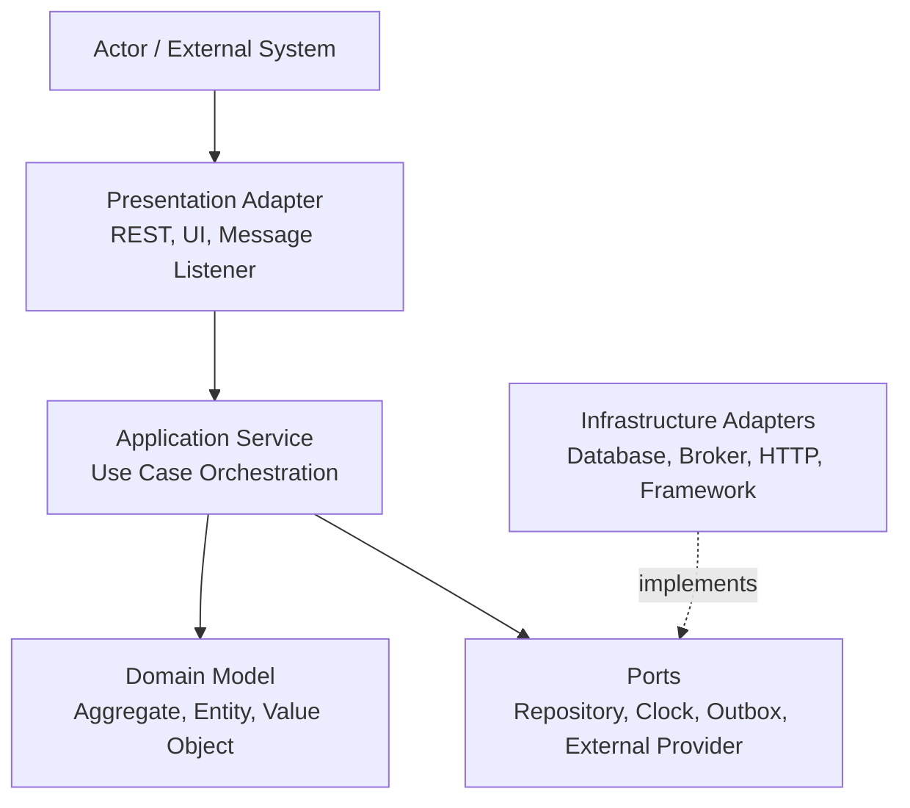
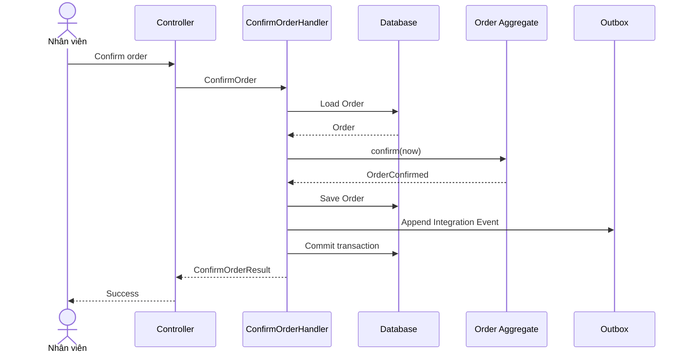

# Dịch vụ ứng dụng điều phối một mục tiêu cụ thể của người dùng

Trong Domain-Driven Design (DDD), một ứng dụng cung cấp các khả năng để người dùng hoặc hệ thống khác hoàn thành mục tiêu nghiệp vụ. Ví dụ: đặt hàng, xác nhận đơn, đăng ký thuê bao, ghi nhận thanh toán hoặc yêu cầu hoàn tiền. Mỗi mục tiêu như vậy được mô tả thành một **use case (ca sử dụng)**.

**Application Service (dịch vụ ứng dụng)** điều phối một use case. Nó nhận yêu cầu, tải các aggregate cần thiết, gọi hành vi miền, phối hợp các port và quản lý ranh giới transaction. Nó biết trình tự cần thực hiện để hoàn thành mục tiêu, nhưng không nên thay thế domain model bằng một tập hợp điều kiện nghiệp vụ rải rác.

Ví dụ, use case xác nhận đơn có thể tải `Order`, kiểm tra người gọi có quyền thao tác, gọi `order.confirm()`, lưu aggregate và ghi sự kiện cần công bố. `Order` tự bảo vệ các điều kiện như trạng thái nào được phép xác nhận và đơn có dòng hàng hợp lệ hay không. Application Service điều phối các bước; Domain Model quyết định hành vi nào hợp lệ theo nghiệp vụ.

## Sau bài học này

Bạn có thể:

- Giải thích use case và vai trò của Application Service trong kiến trúc DDD.
- Phân biệt Application Service với controller, Domain Service và Infrastructure Service.
- Thiết kế đầu vào, đầu ra và luồng xử lý cho một mục tiêu cụ thể.
- Điều phối aggregate, repository, domain service và các port.
- Đặt kiểm tra đầu vào, phân quyền và quy tắc miền ở đúng ranh giới.
- Xác định transaction boundary và xử lý event sau khi commit.
- Phân biệt command use case với query use case.
- Xử lý lỗi, idempotency, quy trình bất đồng bộ và kiểm thử Application Service.

## 1. Use case là mục tiêu mà hệ thống cần hỗ trợ

Use case mô tả một mục tiêu có ý nghĩa đối với actor (người dùng hoặc hệ thống gọi). Nó không chỉ là một endpoint, một nút trên giao diện hay một câu lệnh SQL.

Ví dụ trong hệ thống bán hàng:

| Actor | Mục tiêu | Use case có thể có |
| --- | --- | --- |
| Khách hàng | Gửi yêu cầu mua hàng | `PlaceOrder` |
| Nhân viên bán hàng | Xác nhận đơn đủ điều kiện | `ConfirmOrder` |
| Nhân viên vận hành | Hủy đơn theo chính sách | `CancelOrder` |
| Hệ thống thanh toán | Ghi nhận khoản tiền đã thu | `RecordPaymentCapture` |
| Nhân viên hỗ trợ | Tra cứu tình trạng đơn | `GetOrderDetails` |

Một use case cần làm rõ:

- Ai hoặc hệ thống nào khởi tạo?
- Mục tiêu cần đạt là gì?
- Dữ liệu đầu vào nào cần thiết?
- Điều kiện nào phải thỏa mãn?
- Những aggregate hoặc khả năng nào cần phối hợp?
- Kết quả thành công và các kết quả thất bại có thể có là gì?
- Có tác động phụ hoặc sự kiện nào cần phát sinh không?

Khi mục tiêu và trách nhiệm rõ, Application Service có thể cung cấp một điểm điều phối dễ gọi và dễ kiểm thử.

### Use case không đồng nghĩa với một endpoint

Một use case có thể được gọi qua REST API, giao diện dòng lệnh, message consumer, job nền hoặc một giao diện quản trị. Ví dụ `ConfirmOrder` có thể được khởi tạo từ nút xác nhận của nhân viên hoặc từ một quy trình tự động. Cả hai adapter có thể gọi cùng application handler.

Ngược lại, một endpoint đôi khi phục vụ nhiều use case tùy theo hành động được yêu cầu. Vì vậy, không nên suy ra ranh giới use case chỉ từ URL hoặc tên controller.

## 2. Application Service là gì?

Application Service là thành phần thể hiện và điều phối một khả năng của ứng dụng. Nó nằm trong application layer, giữa adapter giao tiếp và domain model.

Một Application Service thường thực hiện các trách nhiệm sau:

1. Nhận command hoặc tham số của use case.
2. Xác định ngữ cảnh người gọi và kiểm tra quyền ở mức ứng dụng khi cần.
3. Tải aggregate hoặc dữ liệu cần thiết qua repository/query port.
4. Gọi hành vi trên aggregate, entity, value object hoặc Domain Service.
5. Phối hợp nhiều thành phần theo đúng trình tự nghiệp vụ.
6. Quản lý transaction boundary và lưu các thay đổi.
7. Ghi nhận event/outbox hoặc khởi động bước tiếp theo.
8. Trả kết quả của use case cho caller.

Application Service mô tả *cách ứng dụng hoàn thành mục tiêu*. Nó không nên tự sở hữu mọi quy tắc về trạng thái, giá, số lượng, hạn mức hoặc điều kiện nghiệp vụ nếu những quy tắc đó thuộc domain model.

### Application Service không phải controller

Controller là adapter giao tiếp. Nó hiểu HTTP, JSON, route, status code và cách chuyển dữ liệu giao thức. Application Service hiểu command và mục tiêu use case.

```java
@RestController
@RequestMapping("/orders")
public class OrderController {
    private final ConfirmOrderHandler confirmOrder;

    public OrderController(ConfirmOrderHandler confirmOrder) {
        this.confirmOrder = confirmOrder;
    }

    @PostMapping("/{orderId}/confirm")
    public ResponseEntity<ConfirmOrderResponse> confirm(
        @PathVariable UUID orderId,
        Authentication authentication
    ) {
        UserId actorId = UserId.from(authentication.getName());
        ConfirmOrderResult result = confirmOrder.handle(
            new ConfirmOrder(new OrderId(orderId), actorId)
        );
        return ResponseEntity.ok(
            new ConfirmOrderResponse(result.orderId().value(), result.status().name())
        );
    }
}
```

Controller chuyển request thành command và kết quả use case thành response. Nó không tự tải `Order`, sửa trạng thái hoặc gửi message. Nếu sau này thêm message consumer hoặc CLI, các adapter đó có thể gọi `ConfirmOrderHandler` mà không phải sao chép quy trình.

### Application Service không phải Domain Service

Domain Service chứa một quy tắc nghiệp vụ có ý nghĩa nhưng không thuộc tự nhiên về một entity hoặc value object cụ thể. Application Service điều phối use case và gọi Domain Service khi cần.

Ví dụ, `PricingPolicy` có thể tính mức chiết khấu theo quy tắc miền; `PlaceOrderHandler` tải thông tin cần thiết, gọi `PricingPolicy`, tạo `Order` và lưu kết quả. `PricingPolicy` không cần biết use case được gọi từ REST hay message.

### Application Service không phải Infrastructure Service

Infrastructure Service/Adapter thực hiện chi tiết kỹ thuật như gọi HTTP, truy vấn SQL, gửi email, lưu file hoặc publish message. Application Service có thể gọi các port mà nó cần; infrastructure cung cấp adapter triển khai các port đó.

## 3. Phân chia trách nhiệm giữa các layer

Một use case thường đi qua các vùng trách nhiệm sau:

| Layer | Trách nhiệm | Ví dụ xác nhận đơn |
| --- | --- | --- |
| Presentation | Nhận yêu cầu, xác thực giao thức, parse dữ liệu và trả response | REST controller đọc `orderId`. |
| Application | Điều phối mục tiêu, phân quyền use case, tải aggregate, transaction và kết quả | `ConfirmOrderHandler` tải đơn và gọi `confirm()`. |
| Domain | Bảo vệ invariant, hành vi và quy tắc nghiệp vụ | `Order.confirm()` kiểm tra trạng thái và dòng hàng. |
| Infrastructure | Triển khai lưu trữ, message, HTTP và framework | JPA repository, outbox publisher, HTTP adapter. |



Sơ đồ thể hiện hướng phụ thuộc logic. Application gọi abstraction mà nó cần; infrastructure triển khai abstraction đó. Domain model không cần biết adapter dùng Spring, JPA, Kafka hay một nhà cung cấp cụ thể.

## 4. Thiết kế hợp đồng của một use case

Một use case dễ hiểu thường có đầu vào và đầu ra rõ ràng. Command thể hiện yêu cầu thay đổi hoặc thực hiện hành động; kết quả mô tả điều caller cần biết sau khi xử lý.

Ví dụ:

```java
public record ConfirmOrder(
    OrderId orderId,
    UserId actorId
) {}

public record ConfirmOrderResult(
    OrderId orderId,
    OrderStatus status,
    Instant confirmedAt
) {}
```

`ConfirmOrder` diễn đạt ý định. `ConfirmOrderResult` thể hiện kết quả use case. Không nên truyền nguyên HTTP request, `HttpServletRequest`, JPA entity hoặc object của SDK vào Application Service.

### Đầu vào nên là kiểu có ý nghĩa

Nếu một tham số có ý nghĩa miền rõ, dùng value object như `OrderId`, `CustomerId`, `Money`, `Quantity` hoặc `DateRange`. Điều này giúp tránh truyền nhầm kiểu và đặt validation ở đúng nơi.

Ví dụ, `OrderId` nên kiểm tra giá trị không null; `Quantity` có thể bảo vệ điều kiện số lượng hợp lệ. Application Service vẫn kiểm tra cấu trúc command và các điều kiện của use case, còn domain object bảo vệ invariant của nó.

### Đầu ra không nhất thiết là aggregate

Application Service thường trả kết quả hoặc DTO phù hợp với caller thay vì trả aggregate domain trực tiếp. Điều này ngăn adapter giao tiếp phụ thuộc vào cấu trúc nội bộ của aggregate và tránh vô tình sửa object sau khi use case kết thúc.

Ví dụ, trả `ConfirmOrderResult` hoặc `OrderSummary` thay vì trả `Order` đầy đủ. Nếu caller cần đọc chi tiết, một query use case riêng có thể trả read model phù hợp.

### Command và Query là hai mục tiêu khác nhau

- **Command use case** yêu cầu thay đổi trạng thái hoặc tạo tác động nghiệp vụ: `ConfirmOrder`, `CancelOrder`, `CapturePayment`.
- **Query use case** lấy thông tin để hiển thị hoặc hỗ trợ quyết định: `GetOrderDetails`, `SearchOrders`.

Query thường không cần tải aggregate để thay đổi. Nó có thể dùng query service/read model trả DTO hoặc projection. Command cần tải aggregate root và gọi hành vi miền để bảo vệ invariant.

## 5. Điều phối use case mà không sao chép quy tắc miền

Giả sử đơn hàng chỉ được xác nhận khi đang ở trạng thái `ACCEPTED` và có ít nhất một dòng hàng. Application Service cần gọi hành vi miền, còn `Order` chịu trách nhiệm kiểm tra điều kiện đó.

```java
public final class Order {
    private final OrderId id;
    private final List<OrderLine> lines;
    private OrderStatus status;
    private Instant confirmedAt;
    private final List<DomainEvent> pendingEvents = new ArrayList<>();

    public void confirm(Instant now) {
        if (status != OrderStatus.ACCEPTED) {
            throw new OrderCannotBeConfirmedException(id, status);
        }
        if (lines.isEmpty()) {
            throw new EmptyOrderCannotBeConfirmedException(id);
        }

        status = OrderStatus.CONFIRMED;
        confirmedAt = now;
        pendingEvents.add(new OrderConfirmed(id, now));
    }

    public List<DomainEvent> pullDomainEvents() {
        List<DomainEvent> events = List.copyOf(pendingEvents);
        pendingEvents.clear();
        return events;
    }
}
```

`Order` không biết ai đang gọi hoặc yêu cầu đến từ HTTP hay message. Nó chỉ bảo vệ quy tắc xác nhận đơn và ghi nhận sự kiện sau khi hành vi thành công.

Application Service tải aggregate và gọi phương thức:

```java
public final class ConfirmOrderHandler {
    private final OrderRepository orders;
    private final OrderAccessPolicy accessPolicy;
    private final TransactionRunner transactions;
    private final IntegrationEventTranslator eventTranslator;
    private final IntegrationEventOutbox outbox;
    private final Clock clock;

    public ConfirmOrderResult handle(ConfirmOrder command) {
        return transactions.required(() -> {
            Order order = orders.findById(command.orderId())
                .orElseThrow(() -> new OrderNotFoundException(command.orderId()));

            accessPolicy.ensureCanConfirm(command.actorId(), order);
            order.confirm(clock.instant());
            orders.save(order);
            List<DomainEvent> domainEvents = order.pullDomainEvents();
            outbox.append(eventTranslator.translate(domainEvents));

            return new ConfirmOrderResult(
                order.id(), order.status(), order.confirmedAt()
            );
        });
    }
}
```

Ví dụ đã lược giản constructor, kiểu phụ trợ và cách triển khai transaction/outbox. `OrderAccessPolicy` thể hiện chính sách quyền ở mức use case; nếu có một quy tắc phân quyền mang tính nghiệp vụ riêng, nó có thể được mô hình hóa bằng domain policy. `Order.confirm()` vẫn là nơi bảo vệ invariant của aggregate.

### Vì sao không viết mọi điều kiện trong handler?

Nếu handler tự kiểm tra trạng thái, dòng hàng và điều kiện xác nhận, một use case khác như xác nhận tự động có thể quên một điều kiện. Quy tắc bị lặp và khó biết nơi nào có thẩm quyền.

Handler nên quyết định *khi nào* gọi `order.confirm()`. Aggregate quyết định *có được phép* xác nhận hay không theo trạng thái và invariant của nó.

## 6. Phân quyền và validation trong use case

Application Service là ranh giới phù hợp để bảo đảm một use case chỉ được thực hiện bởi actor có quyền. Tuy nhiên, cần phân biệt authentication, authorization và invariant miền.

- **Authentication:** xác định caller là ai; thường do adapter/framework bảo mật xử lý.
- **Authorization:** caller có được phép thực hiện use case hoặc thao tác trên tài nguyên cụ thể không; application layer có thể gọi access policy/authorization port.
- **Domain invariant:** trạng thái có hợp lệ theo nghiệp vụ không; aggregate/domain service chịu trách nhiệm.
- **Input validation:** cấu trúc và kiểu dữ liệu đầu vào có hợp lệ không; adapter hoặc command/value object kiểm tra ở mức phù hợp.

Ví dụ, nhân viên có thể có quyền `CONFIRM_ORDER`, nhưng đơn vẫn không thể xác nhận nếu đã bị hủy. Quyền của người gọi không thay thế invariant của `Order`.

### Tránh tin vào actor ID do client tự khai

Không nên cho phép client gửi `actorId` tùy ý rồi tin đó là danh tính đã xác thực. Adapter nên lấy danh tính từ security context đã được xác thực và truyền vào command hoặc execution context. Application Service có thể dùng identity đó để kiểm tra quyền.

### Quyền truy cập dữ liệu cũng cần rõ

Biết `OrderId` không có nghĩa người gọi được phép xem hoặc sửa đơn. Use case phải kiểm tra quyền trên aggregate được tải, tránh lộ dữ liệu qua khác biệt phản hồi nếu chính sách bảo mật yêu cầu che giấu sự tồn tại của tài nguyên.

## 7. Repository, port và phụ thuộc bên ngoài

Application Service không nên tự viết SQL hoặc gọi SDK trực tiếp. Nó dùng port để yêu cầu khả năng cần thiết:

```java
public interface OrderRepository {
    Optional<Order> findById(OrderId id);
    void save(Order order);
}

public interface IntegrationEventTranslator {
    List<IntegrationEvent> translate(List<DomainEvent> events);
}

public interface IntegrationEventOutbox {
    void append(List<IntegrationEvent> events);
}

public interface TransactionRunner {
    <T> T required(Supplier<T> work);
}
```

Infrastructure triển khai repository bằng JPA/JDBC, outbox bằng database và transaction runner bằng cơ chế transaction của framework. Application Service phụ thuộc vào hợp đồng, không phụ thuộc chi tiết adapter.

### Port nên thuộc phía cần khả năng

Nếu use case cần tải/lưu aggregate, `OrderRepository` có thể được khai báo trong application hoặc domain tùy cách tổ chức và quyền sở hữu hợp đồng. Nếu domain policy cần một khả năng mang ngữ nghĩa miền, abstraction có thể thuộc domain. Điều quan trọng là interface không làm lộ SQL, HTTP hoặc kiểu ORM.

### Không để Application Service gọi trực tiếp hệ thống ngoài trong transaction dài

Một lời gọi HTTP có thể chậm hoặc timeout. Nếu transaction database đang mở trong lúc chờ, hệ thống có thể giữ lock lâu. Thường nên lấy dữ liệu ngoài trước transaction ghi nếu nghiệp vụ cho phép, hoặc chuyển quy trình thành các bước bất đồng bộ.

Nếu dữ liệu ngoài có thể thay đổi giữa lúc đọc và lúc commit, cần xác định snapshot, thời điểm hiệu lực, version hoặc cơ chế xác nhận lại. Không được giả định kết quả lấy trước transaction luôn đúng.

## 8. Transaction boundary thuộc về use case

Application Service thường xác định thao tác nào cần được thực hiện trong cùng transaction cục bộ. Ví dụ xác nhận đơn có thể gồm tải đơn, gọi `order.confirm()`, lưu aggregate và ghi outbox trong một transaction.



Việc lưu aggregate và ghi outbox trong cùng transactional resource giúp tránh trường hợp đơn đã commit nhưng thông điệp cần phát bị mất. Publisher gửi thông điệp sau commit.

### Transaction không nên bao trùm toàn bộ quy trình phân tán

Nếu use case cần giữ hàng, gọi cổng thanh toán và tạo shipment ở các hệ thống khác nhau, không nên giữ một transaction database mở trong suốt thời gian chờ tất cả hệ thống phản hồi.

Thay vào đó, Application Service có thể khởi động một quy trình kéo dài. Mỗi bước cập nhật aggregate trong transaction cục bộ, phát event và chờ kết quả tiếp theo. Process Manager/Saga theo dõi tiến trình, timeout và hành động bù.

### Optimistic locking và cập nhật đồng thời

Hai request có thể cùng tải một aggregate rồi cùng xác nhận hoặc hủy. Repository/persistence cần cơ chế phát hiện xung đột như version column hoặc optimistic locking. Aggregate vẫn bảo vệ invariant; application xử lý xung đột theo chính sách, có thể tải lại và thử lại nếu thao tác còn hợp lệ.

## 9. Domain Event và tác động sau use case

Khi một hành vi miền thành công, aggregate có thể ghi nhận Domain Event. Application Service lấy các event này và quyết định cách xử lý:

- Gọi handler nội bộ trong cùng bounded context.
- Chuyển một số event thành Integration Event.
- Ghi Integration Event vào outbox cùng transaction.
- Khởi động process manager hoặc một bước bất đồng bộ.

Không phải mọi Domain Event đều cần công bố ra ngoài. Application Service chọn sự kiện phù hợp với hợp đồng tích hợp.

### Không gửi message trước khi commit

Nếu gửi message trước khi database commit, consumer có thể nhận một sự thật mà transaction sau đó rollback. Nếu commit database trước rồi gửi message trực tiếp, broker lỗi có thể làm mất thông báo. Transactional Outbox giải quyết dual write bằng cách ghi message cần phát trong cùng transaction với dữ liệu nghiệp vụ.

Outbox thường giao message theo kiểu at-least-once, nên consumer cần idempotent. Application Service có thể tạo event ID/correlation ID hoặc yêu cầu cơ chế outbox cung cấp metadata phù hợp.

## 10. Idempotency và xử lý yêu cầu lặp

Client có thể gửi lại cùng request khi timeout hoặc mất response. Message consumer cũng có thể nhận lại command. Với use case tạo tác động không nên lặp như đặt đơn, thu tiền hoặc tạo đăng ký, cần cân nhắc idempotency.

Một command có thể chứa `requestId` hoặc idempotency key. Application Service lưu kết quả đã xử lý theo key trong phạm vi phù hợp. Nếu nhận lại cùng key với cùng nội dung, nó trả kết quả đã có thay vì thực hiện tác động lần nữa.

```java
public record PlaceOrder(
    UUID requestId,
    CustomerId customerId,
    List<RequestedOrderLine> lines
) {}
```

Idempotency key cần có phạm vi và thời hạn rõ ràng. Nếu cùng key nhưng payload khác, hệ thống nên từ chối hoặc báo xung đột thay vì tùy tiện trả kết quả cũ.

Idempotency không thay thế invariant của aggregate hoặc unique constraint ở persistence. Nó bảo vệ việc một yêu cầu được tiếp nhận lặp; aggregate vẫn phải bảo vệ trạng thái hợp lệ dưới cập nhật đồng thời.

## 11. Xử lý kết quả và lỗi của use case

Application Service nên phân biệt lỗi nghiệp vụ, lỗi đầu vào, lỗi quyền và lỗi hạ tầng. Presentation adapter có thể chuyển chúng thành HTTP status hoặc định dạng lỗi phù hợp.

| Tình huống | Ví dụ | Cách xử lý ở mức use case |
| --- | --- | --- |
| Không tìm thấy | Không có `Order` theo ID | Trả lỗi `OrderNotFound` hoặc kết quả không có tùy mục tiêu. |
| Vi phạm nghiệp vụ | Đơn đã hủy nên không thể xác nhận | Giữ lý do miền, chuyển thành lỗi use case phù hợp. |
| Không đủ quyền | Nhân viên không được xác nhận đơn này | Từ chối trước khi thực hiện thay đổi. |
| Xung đột đồng thời | Version của đơn đã thay đổi | Retry có kiểm soát hoặc trả conflict để caller làm mới. |
| Lỗi hạ tầng | Database timeout | Báo lỗi tạm thời, retry theo chính sách nếu an toàn. |
| Nguồn ngoài chưa phản hồi | Chờ đánh giá tín dụng | Trả trạng thái pending hoặc khởi động quy trình bất đồng bộ. |

Không nên để domain model phụ thuộc HTTP status code, Spring exception hoặc kiểu lỗi của SDK. Application Service có thể chuyển kết quả domain thành lỗi use case; controller ánh xạ tiếp thành HTTP response.

### Exception hay Result?

Với lỗi không thể tiếp tục như aggregate không tồn tại hoặc invariant bị vi phạm, exception có kiểu rõ có thể phù hợp. Với kết quả nghiệp vụ dự kiến như “không đủ điều kiện” hoặc “đang chờ phê duyệt”, một kiểu `Result`/`Decision` có thể diễn đạt rõ hơn exception.

Điều quan trọng là caller biết đây là kết quả nghiệp vụ bình thường hay lỗi kỹ thuật cần retry/điều tra.

## 12. Use case đọc và use case ghi

Application layer có thể tổ chức command handler và query handler riêng:

```java
public interface OrderQueries {
    Optional<OrderDetailsView> findDetails(OrderId orderId);
    Page<OrderSummary> search(OrderSearch criteria);
}

public record OrderDetailsView(
    OrderId orderId,
    String customerName,
    List<OrderLineView> lines,
    Money total,
    OrderStatus status
) {}
```

Query handler không cần tải aggregate nếu chỉ cần projection để hiển thị. Nó có thể đọc từ SQL projection hoặc read model. Command handler cần tải aggregate root để gọi hành vi miền.

Đây là tách biệt read/write ở mức use case. Nó không bắt buộc phải dùng CQRS đầy đủ, hai database hoặc Event Sourcing. Hãy chọn mức độ tách phù hợp với độ phức tạp và nhu cầu thực tế.

## 13. Use case có nhiều aggregate

Một mục tiêu có thể cần nhiều aggregate. Application Service điều phối từng root qua repository, nhưng mỗi aggregate tự bảo vệ invariant của mình.

Ví dụ, use case đặt hàng có thể cần `Order`, `InventoryItem` và `Payment`. Nếu chúng nằm trong cùng bounded context, cùng database và yêu cầu cập nhật nguyên tử trong một thao tác ngắn, application có thể dùng một transaction cục bộ trên các aggregate liên quan.

Nếu quy trình đi qua các context hoặc dịch vụ ngoài, cần cân nhắc eventual consistency và process manager/saga. Các bước có thể là:

1. Tạo đơn ở trạng thái `PENDING_ALLOCATION`.
2. Phát `OrderPlaced` sau commit.
3. Yêu cầu Tồn kho giữ hàng.
4. Khi nhận `StockReserved`, yêu cầu Thanh toán cấp phép.
5. Khi nhận `PaymentAuthorized`, xác nhận đơn.
6. Nếu một bước thất bại, thực hiện hành động bù như giải phóng hàng hoặc hủy ủy quyền.

Application Service điều phối mục tiêu ban đầu; process manager quản lý tiến trình kéo dài. Không nên biến một handler đồng bộ thành một transaction khổng lồ chỉ để tránh trạng thái chờ.

## 14. Tổ chức Application Service trong codebase

Có nhiều cách tổ chức phù hợp:

```text
orders/
  presentation/
    OrderController.java
  application/
    ConfirmOrder.java
    ConfirmOrderHandler.java
    ConfirmOrderResult.java
    GetOrderDetailsHandler.java
    OrderQueries.java
    OrderAccessPolicy.java
  domain/
    Order.java
    OrderLine.java
    OrderRepository.java
    OrderConfirmed.java
  infrastructure/
    JpaOrderRepository.java
    JpaOutbox.java
```

Một handler cho mỗi use case có thể làm luồng xử lý rõ, nhưng không phải quy tắc bắt buộc. Một class application service có thể nhóm vài thao tác liên quan nếu chúng có cùng trách nhiệm và vẫn dễ hiểu. Tránh tạo một `OrderService` khổng lồ chứa mọi use case, truy vấn, quy tắc và giao tiếp ngoài.

### Đặt tên theo mục tiêu

Tên như `ConfirmOrderHandler`, `CancelOrderHandler` hoặc `RegisterCustomerHandler` thể hiện mục tiêu. Các tên chung như `process()`, `executeAction()` hoặc `handleRequest()` không cho biết khả năng ứng dụng.

### Tránh trộn use case của nhiều bounded context

Application Service nên điều phối trong phạm vi bounded context của nó. Khi cần phối hợp nhiều context, dùng hợp đồng tích hợp hoặc process manager ở nơi sở hữu quy trình liên context. Không để một application service truy cập trực tiếp database nội bộ của mọi context.

## 15. Kiểm thử Application Service

Application Service thường được kiểm thử bằng cách thay các port bằng fake hoặc mock, sau đó xác nhận use case điều phối đúng.

Các trường hợp nên kiểm tra:

- Tải đúng aggregate theo ID.
- Kiểm tra quyền trước khi thay đổi trạng thái.
- Gọi đúng hành vi miền với dữ liệu và thời điểm phù hợp.
- Lưu aggregate sau khi hành vi thành công.
- Không lưu hoặc phát event khi domain từ chối hành vi.
- Ghi outbox cùng transaction khi có event cần công bố.
- Trả đúng kết quả use case.
- Xử lý không tìm thấy, không đủ quyền, lỗi hạ tầng và xung đột đồng thời.
- Xử lý request lặp theo idempotency policy.

Ví dụ test có thể xác nhận rằng khi `order.confirm()` ném `OrderCannotBeConfirmedException`, repository không được lưu và outbox không được append. Đây là kiểm thử điều phối; invariant cụ thể của `Order` nên có unit test riêng trong domain layer.

### Các lớp kiểm thử khác nhau

- **Domain unit test:** kiểm tra quy tắc và invariant độc lập.
- **Application test:** kiểm tra thứ tự điều phối, quyền, transaction contract và kết quả.
- **Infrastructure integration test:** kiểm tra repository, transaction, outbox, broker và adapter.
- **Presentation/contract test:** kiểm tra request/response, xác thực và hợp đồng API/message.

Không cần khởi động toàn bộ Spring context cho mọi unit test application nếu có thể kiểm tra handler bằng các port giả lập. Dùng integration test ở nơi cần xác nhận hành vi thực của adapter và transaction.

## 16. Những sai lầm thường gặp

- **Fat Controller:** controller thực hiện cả truy vấn, quy tắc nghiệp vụ, lưu dữ liệu và gửi message.
- **God Application Service:** một service chứa tất cả use case, logic miền và tích hợp của cả bounded context.
- **Application Service chứa invariant:** các điều kiện miền bị lặp và có thể bị bỏ qua bởi use case khác.
- **Domain Model chỉ còn getter/setter:** hành vi bị chuyển hết vào application service.
- **Application Service trả aggregate trực tiếp cho giao diện:** adapter phụ thuộc vào cấu trúc miền và có thể làm lộ object graph.
- **Gọi hệ thống ngoài trong transaction dài:** tăng lock, timeout và coupling vận hành.
- **Một endpoint bằng một use case theo mặc định:** bỏ qua các adapter khác có thể gọi cùng khả năng.
- **Dùng command cho thao tác đọc:** làm query bị trộn với thay đổi trạng thái.
- **Không kiểm tra quyền trên tài nguyên:** người gọi có ID có thể thao tác dữ liệu không thuộc quyền.
- **Phát message trước commit:** consumer có thể xử lý một sự thật chưa được lưu.
- **Không xử lý request lặp:** đặt đơn hoặc thu tiền hai lần khi client retry.
- **Dùng transaction phân tán cho quy trình kéo dài:** giữ tài nguyên quá lâu và khó phục hồi khi một hệ thống ngoài lỗi.
- **Kiểm thử handler thay cho kiểm thử domain:** xác nhận orchestration nhưng bỏ sót invariant thực sự.

## 17. Quy trình thiết kế một Application Service

Khi xây dựng một use case mới, hãy thực hiện theo trình tự:

1. **Mô tả mục tiêu:** viết một câu thể hiện kết quả actor muốn đạt.
2. **Xác định actor và quyền:** ai gọi, danh tính lấy từ đâu và cần quyền nào?
3. **Thiết kế command/query:** chọn dữ liệu đầu vào, kiểu miền và kết quả trả về.
4. **Xác định aggregate và port:** cần tải root nào, gọi provider nào và đọc projection nào?
5. **Đặt quy tắc vào domain:** entity, value object hoặc domain service bảo vệ điều kiện nào?
6. **Viết trình tự điều phối:** mô tả bước tải, kiểm tra, gọi hành vi, lưu và trả kết quả.
7. **Xác định transaction boundary:** thao tác nào cần commit nguyên tử trong một transactional resource?
8. **Thiết kế event và tác động phụ:** domain event nào phát sinh, event nào cần chuyển thành integration event?
9. **Thiết kế lỗi và idempotency:** không tìm thấy, từ chối nghiệp vụ, timeout, request lặp và xung đột được xử lý ra sao?
10. **Xác định quy trình kéo dài:** nếu có bước bất đồng bộ, ai theo dõi trạng thái và hành động bù?
11. **Viết test theo layer:** domain, application, infrastructure và presentation.
12. **Rà soát ngôn ngữ:** tên use case, command và kết quả có thể hiểu được bởi chuyên gia nghiệp vụ không?

## Checklist rà soát

- [ ] Use case mô tả một mục tiêu cụ thể của actor.
- [ ] Application Service có tên và hợp đồng đầu vào/đầu ra rõ.
- [ ] Controller chỉ xử lý giao thức và chuyển tiếp use case.
- [ ] Application điều phối, không sao chép invariant của domain.
- [ ] Aggregate root được tải qua repository và thay đổi bằng hành vi miền.
- [ ] Domain Service chỉ chứa quy tắc không thuộc tự nhiên về một entity/value object.
- [ ] Quyền truy cập được kiểm tra ở ranh giới phù hợp.
- [ ] Query và command được phân biệt theo tác động.
- [ ] Transaction boundary có phạm vi hợp lý.
- [ ] Event được ghi nhận sau hành vi miền và công bố sau commit qua cơ chế an toàn.
- [ ] Request có tác động quan trọng được xem xét idempotency.
- [ ] Quy trình liên context có trạng thái, timeout và compensation khi cần.
- [ ] Lỗi nghiệp vụ, lỗi quyền và lỗi hạ tầng được phân biệt.
- [ ] Kết quả trả về không làm lộ aggregate/persistence model không cần thiết.
- [ ] Có test cho domain rule và orchestration ở đúng layer.

## Kết luận

Application Service điều phối một mục tiêu cụ thể của người dùng hoặc hệ thống. Nó nhận command/query, kiểm tra quyền ở mức ứng dụng, tải dữ liệu qua port, gọi hành vi miền, quản lý transaction và trả kết quả. Domain model vẫn chịu trách nhiệm bảo vệ invariant; infrastructure thực hiện chi tiết lưu trữ và giao tiếp; presentation chuyển đổi giao thức. Khi ranh giới này rõ ràng, use case dễ hiểu, dễ kiểm thử và có thể được gọi từ nhiều adapter mà không phải sao chép quy trình hay làm mô hình miền phụ thuộc công nghệ.
