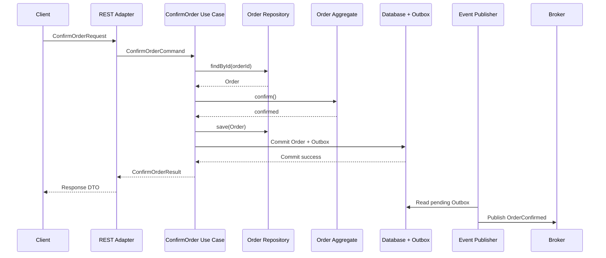

# Thiết kế đầu vào, kết quả và ranh giới của ca sử dụng

Trong Domain-Driven Design (DDD), ca sử dụng (use case) mô tả một mục tiêu mà actor muốn đạt được thông qua hệ thống. Một ca sử dụng cần xác định rõ dữ liệu đầu vào, kết quả có thể quan sát và phạm vi công việc mà ứng dụng chịu trách nhiệm điều phối. Ba yếu tố này tạo nên hợp đồng giữa bên gọi và application layer.

Thiết kế hợp đồng không chỉ là chọn các field cho một request DTO. Đầu vào cần thể hiện ý định nghiệp vụ và cung cấp đủ dữ liệu để thực hiện hành động; kết quả cần nói rõ điều gì đã xảy ra; ranh giới cần xác định phần nào được thực hiện trong use case, phần nào thuộc Aggregate, và phần nào phải phối hợp qua hệ thống khác.

Nếu đầu vào nhận quá nhiều dữ liệu mà client không có quyền quyết định, hệ thống có thể tin nhầm giá, trạng thái hoặc danh tính. Nếu kết quả trả thẳng Entity hoặc cấu trúc persistence, API sẽ để lộ mô hình nội bộ. Nếu ranh giới không rõ, một thao tác có thể cập nhật nửa chừng, gọi dịch vụ ngoài trong transaction hoặc vô tình thực hiện cùng một yêu cầu nhiều lần.

Bài học này dùng ví dụ xác nhận đơn hàng để trình bày cách thiết kế input contract, output contract và use case boundary có thể kiểm thử, bảo vệ quy tắc miền và tiến hóa theo thời gian.

## Mục tiêu học tập

Sau bài này, bạn có thể:

- Mô tả use case bằng mục tiêu, actor, điều kiện trước, kết quả và luồng thay thế.
- Thiết kế command/input contract thể hiện ý định thay vì sao chép toàn bộ dữ liệu màn hình.
- Phân biệt dữ liệu do client cung cấp với danh tính và metadata do hệ thống xác định.
- Phân lớp kiểm tra đầu vào, quyền truy cập và bất biến miền.
- Thiết kế kết quả use case ổn định mà không để lộ Aggregate hoặc persistence model.
- Phân biệt kết quả nghiệp vụ bị từ chối với lỗi kỹ thuật.
- Xác định ranh giới transaction, Aggregate và tích hợp bên ngoài.
- Xử lý optimistic concurrency, idempotency và yêu cầu gửi lại.
- Kiểm thử hợp đồng đầu vào, đầu ra và các nhánh của use case.

## 1. Use case là một mục tiêu có hợp đồng rõ ràng

Use case mô tả một hành động có ý nghĩa đối với actor hoặc một quy trình khác. Ví dụ:

- Khách hàng đặt hàng.
- Nhân viên xác nhận đơn.
- Khách hàng yêu cầu hủy đơn.
- Nhân viên thay đổi địa chỉ giao hàng.
- Hệ thống ghi nhận kết quả thanh toán.

Tên use case nên diễn đạt ý định nghiệp vụ bằng động từ rõ nghĩa. Một thao tác như UpdateOrder có thể quá chung chung vì không cho biết người gọi muốn thay đổi điều gì và những quy tắc nào cần áp dụng. ConfirmOrder hoặc ChangeShippingAddress thể hiện ý định cụ thể hơn.

Một mô tả use case thường có:

| Thành phần | Câu hỏi cần trả lời |
| --- | --- |
| Mục tiêu | Actor muốn đạt kết quả gì? |
| Actor/trigger | Ai hoặc sự kiện nào khởi phát? |
| Điều kiện trước | Điều gì phải đúng trước khi bắt đầu? |
| Đầu vào | Hệ thống cần dữ liệu nào để thực hiện? |
| Luồng chính | Các bước thành công diễn ra thế nào? |
| Luồng thay thế | Có những kết quả nghiệp vụ nào khác? |
| Kết quả | Bên gọi quan sát được điều gì sau khi xử lý? |
| Ranh giới | Những thay đổi nào thuộc use case và transaction này? |

Use case không nhất thiết phải là một lớp cho mỗi màn hình hoặc endpoint. Cùng một use case có thể được gọi từ REST API, message handler, CLI hoặc một giao diện khác. Ngược lại, một màn hình có thể gọi nhiều use case khác nhau.

### Ví dụ: xác nhận đơn hàng

Mục tiêu là chuyển một đơn hợp lệ từ DRAFT sang CONFIRMED theo chính sách bán hàng. Actor có thể là nhân viên bán hàng hoặc một quy trình tự động đã được cấp quyền.

Điều kiện và quy tắc minh họa:

- Đơn phải tồn tại.
- Actor phải có quyền xác nhận đơn đó.
- Đơn phải còn ở trạng thái DRAFT.
- Đơn phải có ít nhất một dòng hàng.
- Phiên bản đơn mà actor thao tác phải còn hiệu lực.
- Sau khi xác nhận thành công, hệ thống lưu trạng thái và ghi nhận sự kiện OrderConfirmed.

Các nhánh thay thế có thể gồm đơn không tồn tại, actor không có quyền, đơn đã được xác nhận, đơn rỗng hoặc dữ liệu đã bị thay đổi bởi một thao tác đồng thời.

Một use case tốt làm rõ các kết quả này trước khi thiết kế request/response hoặc viết controller.

## 2. Thiết kế đầu vào theo ý định nghiệp vụ

Đầu vào của use case thường được biểu diễn bằng command hoặc input model. Command mô tả điều bên gọi muốn hệ thống thực hiện. Nó không nên là một bản sao nguyên vẹn của toàn bộ Entity hoặc dữ liệu hiển thị trên màn hình.

Ví dụ, ConfirmOrder chỉ cần thông tin xác định đơn và dữ liệu điều khiển cần thiết:

- orderId: đơn cần xác nhận.
- expectedVersion: phiên bản mà bên gọi đã đọc, nếu use case dùng optimistic concurrency.
- idempotencyKey: khóa nhận diện yêu cầu khi client có thể gửi lại.
- actor identity: danh tính người hoặc hệ thống gọi, lấy từ ngữ cảnh xác thực đáng tin cậy.
- correlation metadata: thông tin truy vết nếu cần.

Không cần gửi lại toàn bộ danh sách OrderLine, giá từng dòng hoặc trạng thái mới. Những dữ liệu đó đã thuộc về Order và phải được tải từ nguồn có thẩm quyền.

### Command diễn đạt ý định, không cho phép cập nhật tùy ý

Một request tổng quát như sau dễ làm lộ quá nhiều quyền:

```java
public record UpdateOrderRequest(
    UUID orderId,
    String status,
    BigDecimal total,
    String currency,
    List<OrderLineRequest> lines
) {}
```

Client có thể gửi status=CONFIRMED hoặc tự thay tổng tiền, dù đây là những giá trị hệ thống phải quyết định theo quy tắc miền. Cách thiết kế này biến use case thành một thao tác ghi dữ liệu tổng quát.

Một input chuyên biệt an toàn và rõ ý định hơn:

```java
public record ConfirmOrderRequest(
    UUID orderId,
    long expectedVersion,
    String idempotencyKey
) {}
```

Request ở ranh giới HTTP vẫn là kiểu transport. Application layer có thể chuyển nó thành command nội bộ:

```java
public record ConfirmOrderCommand(
    OrderId orderId,
    long expectedVersion,
    UserId actorId,
    IdempotencyKey idempotencyKey,
    CorrelationId correlationId,
    CommandFingerprint fingerprint
) {}

public record CommandFingerprint(String value) {}
```

Các kiểu ID riêng giúp tránh truyền nhầm UUID giữa những khái niệm khác nhau. Command có thể bất biến để dữ liệu không bị thay đổi sau khi được tiếp nhận.

CommandFingerprint là giá trị được application tạo từ biểu diễn chuẩn hóa của các trường nghiệp vụ có ảnh hưởng đến kết quả. Không nhận fingerprint như một giá trị đáng tin cậy từ request body; nếu có truyền qua header thì vẫn phải tự tính lại hoặc xác minh ở phía server.

### Không tin danh tính do client tự khai

Một request không nên được quyền tự quyết định ai đang gọi chỉ bằng cách gửi actorId trong JSON. Adapter lấy danh tính từ security context hoặc thông tin xác thực đã được kiểm tra rồi đưa vào command.

Tương tự, không tin các giá trị như:

- Giá cuối cùng mà client tự tính.
- Trạng thái đơn mà client muốn ghi.
- Quyền sở hữu hoặc vai trò do client tự khai.
- Tổng tiền, thuế hoặc mức chiết khấu không được hệ thống xác nhận.
- Thời điểm hệ thống nếu client có thể tùy ý thay đổi nó.

Client có thể gửi lựa chọn hoặc dữ liệu đầu vào mà nghiệp vụ cho phép, chẳng hạn mã sản phẩm, số lượng, địa chỉ giao hàng mới hoặc phương thức giao. Hệ thống phải xác thực và tính toán lại những giá trị thuộc thẩm quyền của mình.

### Phân biệt dữ liệu nghiệp vụ và metadata điều khiển

| Nhóm | Ví dụ | Nguồn và cách sử dụng |
| --- | --- | --- |
| Dữ liệu nghiệp vụ | orderId, productId, quantity, shippingAddress | Do actor cung cấp hoặc được xác định từ nguồn miền |
| Danh tính gọi | userId, clientId, service identity | Lấy từ cơ chế xác thực đáng tin cậy |
| Điều khiển đồng thời | expectedVersion, etag | Dùng phát hiện dữ liệu đã thay đổi |
| Idempotency | idempotencyKey | Dùng nhận diện yêu cầu gửi lại |
| Truy vết | correlationId, causationId | Dùng liên kết log, event và workflow |
| Hạ tầng | traceparent, request timestamp | Được adapter hoặc middleware quản lý |

Không phải use case nào cũng cần tất cả metadata. Chỉ đưa vào hợp đồng những giá trị có mục đích rõ ràng và xác định ai chịu trách nhiệm tạo chúng.

## 3. Kiểm tra đầu vào ở đúng lớp

Validation không phải một bước duy nhất. Các loại kiểm tra khác nhau có chủ sở hữu khác nhau.

### Kiểm tra cấu trúc và định dạng ở ranh giới

Presentation adapter hoặc input mapper có thể kiểm tra:

- Trường bắt buộc có mặt.
- UUID, ngày tháng và số có định dạng hợp lệ.
- Chuỗi không vượt giới hạn kích thước.
- JSON có cấu trúc đúng.
- Số lượng dương nếu đó là điều kiện cơ bản của input contract.
- Giá trị enum có thuộc tập transport được hỗ trợ không.

Các kiểm tra này giúp từ chối request không thể parse hoặc không đáp ứng hợp đồng giao tiếp. Chúng không thay thế quy tắc miền.

### Kiểm tra quyền và điều kiện ứng dụng ở Application Service

Application layer có thể kiểm tra actor có quyền gọi use case, tải đúng tài nguyên trong phạm vi tenant, xác định dữ liệu cần thiết và điều phối quy trình.

Ví dụ, user có thể đăng nhập nhưng không được xác nhận đơn thuộc cửa hàng khác. Đây là kiểm tra quyền truy cập ở cấp ứng dụng. Tuy nhiên, một quy tắc như đơn đã giao không thể bị hủy theo chính sách bán hàng cần được mô hình miền bảo vệ để mọi caller đều tuân thủ.

### Bảo vệ bất biến trong Domain Model

Aggregate hoặc Domain Service kiểm tra các điều kiện nghiệp vụ phải luôn đúng:

- Order chỉ được xác nhận từ trạng thái hợp lệ.
- Order phải có ít nhất một dòng hàng.
- Số lượng phải lớn hơn 0.
- Tổng tiền và loại tiền phải nhất quán.
- Một hành vi không được làm Aggregate rơi vào trạng thái bất hợp lệ.

Không nên chỉ kiểm tra những điều kiện này trong controller. Một message handler hoặc batch job có thể gọi cùng Aggregate mà không đi qua controller.

| Loại kiểm tra | Ví dụ | Nơi phù hợp |
| --- | --- | --- |
| Định dạng | UUID sai, JSON thiếu trường | Adapter / input validation |
| Quyền truy cập | User không có quyền trên orderId | Application/security policy |
| Tồn tại | Không tìm thấy Order | Application Service / Repository result |
| Bất biến miền | Không xác nhận đơn rỗng | Aggregate / Domain Service |
| Đồng thời | Version đã thay đổi | Repository / transaction / concurrency policy |
| Kỹ thuật | Database unavailable | Infrastructure và error handling |

Một điều kiện có thể cần được kiểm tra ở nhiều lớp vì mục đích khác nhau. Ví dụ số lượng dương có thể được kiểm tra sớm để trả lỗi request thân thiện, nhưng OrderLine vẫn phải tự bảo vệ bất biến để không phụ thuộc vào adapter.

## 4. Thiết kế kết quả theo điều bên gọi cần biết

Output contract mô tả kết quả use case. Nó không nhất thiết phải trả về toàn bộ Aggregate hoặc Entity vừa được thay đổi.

Sau khi xác nhận đơn, bên gọi thường cần biết:

- Đơn nào đã được xác nhận.
- Trạng thái mới.
- Thời điểm xác nhận.
- Phiên bản mới nếu client cần tiếp tục cập nhật.
- Mã tham chiếu hoặc thông tin điều hướng tiếp theo.

Một kết quả gọn có thể là:

```java
public record ConfirmOrderResponse(
    UUID orderId,
    String status,
    Instant confirmedAt,
    long version
) {}
```

Application Service hoặc presenter chuyển dữ liệu miền sang output model. Không trả thẳng JPA Entity hoặc Aggregate có collection mutable qua API vì điều đó làm lộ cấu trúc nội bộ, có thể kéo theo lazy loading và ràng buộc client vào mô hình persistence.

### Kết quả không nhất thiết là một DTO duy nhất

Use case có thể có nhiều kết quả nghiệp vụ hợp lệ. Ví dụ:

- Đã xác nhận.
- Không tìm thấy đơn.
- Không đủ điều kiện xác nhận.
- Phiên bản đã cũ.
- Actor không có quyền.

Có thể biểu diễn bằng result type tường minh:

```java
public sealed interface ConfirmOrderResult
    permits OrderConfirmed, OrderNotFound, ConfirmationRejected,
            OrderVersionConflict, ConfirmationForbidden {}

public record OrderConfirmed(
    OrderId orderId,
    OrderStatus status,
    Instant confirmedAt,
    long version
) implements ConfirmOrderResult {}

public record OrderNotFound(
    OrderId orderId
) implements ConfirmOrderResult {}

public record ConfirmationRejected(
    String reasonCode,
    String message
) implements ConfirmOrderResult {}

public record OrderVersionConflict(
    long expectedVersion,
    long actualVersion
) implements ConfirmOrderResult {}

public record ConfirmationForbidden()
    implements ConfirmOrderResult {}
```

Đây là một lựa chọn thiết kế cho application boundary. Dự án cũng có thể dùng Result/Either, exception có kiểu hoặc một quy ước response khác. Điều quan trọng là các kết quả nghiệp vụ có thể dự đoán phải được biểu diễn rõ và không bị trộn với lỗi hạ tầng bất ngờ.

### Không trả Domain Event như response mặc định

Domain Event ghi nhận điều đã xảy ra để các thành phần khác phản ứng. Output contract trả kết quả cho caller của use case. Hai thứ có thể chứa một số dữ liệu giống nhau nhưng mục đích khác nhau.

Ví dụ, OrderConfirmed có thể được ghi vào Outbox để Billing hoặc Delivery xử lý. API xác nhận đơn có thể chỉ trả orderId, status và version. Caller không cần biết toàn bộ cấu trúc event nội bộ hoặc danh sách consumer.

## 5. Phân biệt kết quả nghiệp vụ và lỗi kỹ thuật

Không phải mọi tình huống không thành công đều là exception. Một use case có thể kết thúc bằng kết quả nghiệp vụ bị từ chối nhưng hệ thống vẫn hoạt động bình thường.

| Tình huống | Phân loại | Cách biểu diễn gợi ý |
| --- | --- | --- |
| Đơn không tồn tại | Kết quả không tìm thấy | NotFound result |
| Đơn đã xác nhận | Từ chối theo trạng thái nghiệp vụ | Rejected result hoặc domain error có kiểu |
| Actor không có quyền | Từ chối truy cập | Forbidden result/security error |
| Version không còn mới | Xung đột đồng thời | Conflict result |
| Request sai định dạng | Lỗi hợp đồng đầu vào | Validation response |
| Database timeout | Lỗi kỹ thuật tạm thời | Exception/error boundary |
| Broker không khả dụng | Lỗi tích hợp | Retry hoặc lỗi kỹ thuật theo chính sách |
| Bug hoặc vi phạm giả định nội bộ | Lỗi bất ngờ | Exception và observability |

Không nên bắt client phân tích stack trace hoặc thông điệp exception nội bộ. Adapter chuyển kết quả use case sang HTTP, message response hoặc giao diện phù hợp.

Ví dụ ánh xạ HTTP thường gặp:

- 200/204 cho thao tác thành công không tạo tài nguyên mới.
- 201 khi use case tạo tài nguyên mới và hợp đồng API dùng semantics đó.
- 400 hoặc 422 cho input không hợp lệ hoặc điều kiện nghiệp vụ không được chấp nhận, theo quy ước API.
- 401/403 cho xác thực hoặc quyền truy cập.
- 404 khi tài nguyên không tồn tại và chính sách bảo mật cho phép tiết lộ điều đó.
- 409 cho xung đột version hoặc trạng thái.
- 5xx cho lỗi kỹ thuật mà server không thể xử lý bình thường.

Đây là gợi ý, không phải mapping bắt buộc cho mọi API. Cần định nghĩa nhất quán và không để HTTP status quyết định mô hình miền.

## 6. Xác định ranh giới của use case

Ranh giới use case xác định phần công việc application layer điều phối cho một mục tiêu. Nó thường bắt đầu khi adapter gọi input port và kết thúc khi application trả kết quả hoặc xác nhận đã tiếp nhận một công việc bất đồng bộ.

Một luồng xác nhận đơn có thể gồm:

1. REST controller nhận request và actor đã xác thực.
2. Controller chuyển request thành ConfirmOrderCommand.
3. Application Service kiểm tra quyền và tải Order.
4. Order kiểm tra bất biến và thực hiện confirm.
5. Repository lưu Aggregate trong transaction.
6. Outbox ghi Integration Event trong cùng transaction.
7. Application Service trả ConfirmOrderResult.
8. Publisher gửi event bất đồng bộ sau commit.



Sơ đồ là luồng minh họa. Repository và Outbox có thể cùng dùng một Unit of Work; không nhất thiết phải có một lời gọi database riêng như trong sơ đồ. Điểm quan trọng là thay đổi Aggregate và bản ghi Outbox cần được commit nhất quán nếu hệ thống dùng transactional outbox.

### Use case boundary không đồng nghĩa với controller boundary

Controller là adapter giao tiếp, thường xử lý HTTP, parse request và ánh xạ response. Use case là hợp đồng ứng dụng, có thể được gọi từ nhiều adapter.

Nếu đặt toàn bộ quy tắc trong controller, một message handler gọi cùng nghiệp vụ có thể bỏ qua các kiểm tra. Nếu application service chỉ được gọi từ một controller cụ thể, khả năng tái sử dụng use case bị hạn chế.

### Use case boundary không đồng nghĩa với Aggregate boundary

Một use case có thể điều phối một hoặc nhiều Aggregate. Aggregate xác định ranh giới nhất quán của mô hình miền; use case xác định mục tiêu và trình tự công việc của ứng dụng.

Ví dụ, PlaceOrder có thể tạo Order, yêu cầu Inventory giữ hàng và yêu cầu Billing khởi tạo thanh toán. Các Aggregate vẫn bảo vệ bất biến riêng. Use case điều phối kết quả giữa chúng và cần xử lý trạng thái trung gian hoặc eventual consistency nếu không thể dùng một transaction duy nhất.

## 7. Transaction boundary và tác động bên ngoài

Một use case thường có một transaction ghi cho các thay đổi cần nguyên tử trong cùng database. Transaction boundary nên bao quanh thao tác tải Aggregate, thực hiện hành vi và lưu thay đổi theo chính sách concurrency.

Không nên giữ transaction database mở trong khi gọi một API bên ngoài có độ trễ không xác định. Điều đó có thể giữ lock lâu, tăng contention và khiến rollback không thể đảo ngược tác động đã xảy ra ở hệ thống ngoài.

Với thao tác như xác nhận đơn rồi gửi thông báo:

- Ghi trạng thái Order và Outbox trong một transaction.
- Commit transaction.
- Publisher gửi event.
- Consumer gửi email hoặc thực hiện tác động tiếp theo.
- Consumer dùng idempotency để chịu được message giao lặp.

Nếu use case cần gọi provider trước khi có thể hoàn tất, hãy xác định rõ trạng thái trung gian, timeout, retry, idempotency key và cách đối soát. Không thể giả định rollback database sẽ hoàn tác một giao dịch đã được hệ thống bên ngoài chấp nhận.

### Một use case có thể gồm nhiều bước nhưng không phải một transaction dài

Quy trình nhiều bước có thể được điều phối bằng Saga hoặc process manager. Mỗi bước có transaction cục bộ, sự kiện hoặc kết quả riêng. Nếu một bước thất bại, hệ thống có thể chạy hành động bù trừ theo chính sách.

Đầu vào và kết quả của use case cần thể hiện rõ việc xử lý đã hoàn tất hay mới được tiếp nhận để chạy nền. Không trả “thành công” theo nghĩa nghiệp vụ nếu hệ thống mới chỉ xếp công việc vào hàng đợi.

## 8. Đồng thời và expected version

Một client có thể đọc Order version 5, trong lúc một nhân viên khác thay đổi đơn và lưu version 6. Nếu client đầu gửi lệnh xác nhận dựa trên dữ liệu cũ, hệ thống cần chính sách xác định có chấp nhận hay không.

Optimistic concurrency thường dùng expectedVersion hoặc ETag:

- Client gửi phiên bản mà nó đã đọc.
- Repository hoặc persistence layer kiểm tra version hiện tại.
- Nếu version không khớp, thao tác ghi thất bại hoặc trả kết quả conflict.
- Application Service có thể tải lại và yêu cầu actor xác nhận lại theo trạng thái mới.

Ví dụ input:

```java
public record ChangeShippingAddressCommand(
    OrderId orderId,
    Address newAddress,
    long expectedVersion,
    UserId actorId
) {}
```

Không phải mọi use case đều cần expectedVersion do client gửi. Một số use case có thể chỉ cần optimistic locking ở persistence layer. Hãy dùng version công khai khi caller cần biết nó đang thao tác trên snapshot nào hoặc khi API cần semantics tương tự HTTP If-Match.

Không nên tự động retry một command có tác động nghiệp vụ sau conflict mà không đánh giá lại điều kiện. Một thao tác hợp lệ ở version cũ có thể không còn hợp lệ ở version mới.

## 9. Idempotency và yêu cầu gửi lại

Client có thể gửi lại request do timeout, mất kết nối hoặc người dùng bấm nút nhiều lần. Nếu use case tạo đơn, thu tiền hoặc đặt chỗ, thực hiện lặp có thể tạo tác động trùng.

Idempotency key cho phép hệ thống nhận diện các lần gửi lại của cùng một ý định. Một cách triển khai thường gặp:

1. Client tạo key ổn định cho một thao tác logic.
2. Application Service tra cứu key trong phạm vi actor/tenant/use case và đối chiếu fingerprint của command.
3. Nếu đã hoàn tất, trả lại kết quả đã lưu.
4. Nếu đang xử lý, trả trạng thái phù hợp hoặc yêu cầu thử lại sau.
5. Nếu chưa có, ghi nhận key và thực hiện use case.
6. Lưu kết quả cùng trạng thái xử lý theo transaction phù hợp.

Idempotency key cần có phạm vi và thời hạn lưu rõ ràng. Phạm vi thường bao gồm tên use case cùng actor hoặc tenant; fingerprint giúp phát hiện trường hợp client vô tình dùng lại một key cho payload khác. Khi cùng key nhưng nội dung command khác, hệ thống nên từ chối thay vì trả kết quả cũ cho một ý định mới. Nếu kết quả replay chứa dữ liệu nhạy cảm, cần áp dụng chính sách xác thực và phân quyền phù hợp trước khi trả lại. Không dùng orderId làm key nếu một đơn có thể nhận nhiều command hợp lệ khác nhau. Không tạo key mới mỗi lần retry vì khi đó hệ thống không nhận ra cùng một yêu cầu.

Với tác động ngoài như payment provider, cần truyền key tương ứng nếu provider hỗ trợ. Idempotency ở database local không tự bảo đảm một API bên ngoài chỉ thực hiện một lần.

## 10. Kết quả đồng bộ và bất đồng bộ

Không phải use case nào cũng có thể trả kết quả cuối cùng ngay trong một request.

### Xử lý đồng bộ

Dùng khi thao tác có thể hoàn thành trong thời gian phù hợp và caller cần kết quả ngay. Ví dụ cập nhật địa chỉ giao hàng hoặc xác nhận một đơn trong cùng một context.

Response có thể chứa trạng thái mới và version để caller cập nhật giao diện.

### Tiếp nhận công việc bất đồng bộ

Với tác vụ dài hoặc cần phối hợp nhiều hệ thống, API có thể trả về kết quả đã tiếp nhận:

- operationId hoặc jobId.
- trạng thái ACCEPTED/PENDING.
- thời điểm tiếp nhận.
- cách truy vấn trạng thái tiến trình.

Điều này chỉ xác nhận hệ thống đã tiếp nhận công việc, không có nghĩa nghiệp vụ đã hoàn tất. Khi tiến trình kết thúc, kết quả cuối có thể được truy vấn hoặc phát qua notification/event.

```java
public record OperationAccepted(
    UUID operationId,
    String status,
    Instant acceptedAt
) {}

public record OperationStatus(
    UUID operationId,
    String status,
    String resultReference,
    String failureCode
) {}
```

Không dùng cùng một response “success” cho cả hai ý nghĩa: hoàn tất nghiệp vụ và mới tiếp nhận xử lý. Hợp đồng phải làm rõ trạng thái để client không hiển thị kết quả sai.

## 11. Giữ output contract ổn định khi mô hình thay đổi

Aggregate có thể thay đổi cấu trúc nội bộ, nhưng output contract của use case chỉ nên thay đổi khi nhu cầu của caller thay đổi. Một response DTO giúp tách API khỏi các chi tiết như:

- Tên field nội bộ của Aggregate.
- Cấu trúc collection và child entity.
- ORM proxy hoặc lazy association.
- Trường audit nội bộ.
- Cách biểu diễn trạng thái trong database.

Khi cần bổ sung field, hãy xem xét tính tương thích với client cũ. Thêm field tùy chọn thường dễ tương thích hơn xóa hoặc đổi ý nghĩa field đang tồn tại. Nếu một use case có nhiều adapter, mỗi adapter có thể có response model riêng nhưng vẫn dựa trên cùng kết quả ứng dụng.

Không nên trả toàn bộ Aggregate chỉ vì response cần một vài trường. Cũng không nên tạo một DTO khổng lồ dùng cho mọi use case. Output nên đủ cho mục tiêu cụ thể và không chứa dữ liệu nhạy cảm mà caller không được phép xem.

## 12. Ví dụ Java: triển khai use case ConfirmOrder

Ví dụ dưới đây ghép command, result, application service và port. Một số interface như Authorizer, UnitOfWork và Repository được giản lược để tập trung vào ranh giới.

```java
public record ConfirmOrderCommand(
    OrderId orderId,
    long expectedVersion,
    UserId actorId,
    IdempotencyKey idempotencyKey,
    CorrelationId correlationId,
    CommandFingerprint fingerprint
) {}

public sealed interface ConfirmOrderResult
    permits Confirmed, NotFound, Rejected, Conflict, Forbidden,
            ConfirmationInProgress {}

public record Confirmed(
    OrderId orderId,
    OrderStatus status,
    Instant confirmedAt,
    long version
) implements ConfirmOrderResult {}

public record NotFound(OrderId orderId)
    implements ConfirmOrderResult {}

public record Rejected(String reasonCode)
    implements ConfirmOrderResult {}

public record Conflict(long expected, long actual)
    implements ConfirmOrderResult {}

public record Forbidden()
    implements ConfirmOrderResult {}

public record ConfirmationInProgress()
    implements ConfirmOrderResult {}

public record IdempotencyScope(
    String useCase,
    UserId actorId,
    IdempotencyKey key
) {}

public interface IdempotencyStore {
    // Atomic claim: false means the same key/fingerprint already exists;
    // a reused key with a different fingerprint must be rejected.
    boolean tryClaim(IdempotencyScope scope, CommandFingerprint fingerprint);
    Optional<ConfirmOrderResult> findResult(
        IdempotencyScope scope,
        CommandFingerprint fingerprint
    );
    void storeResult(
        IdempotencyScope scope,
        CommandFingerprint fingerprint,
        ConfirmOrderResult result
    );
}

public final class ConfirmOrderUseCase {
    private final OrderRepository orders;
    private final OrderAuthorizer authorizer;
    private final IdempotencyStore idempotency;
    private final UnitOfWork unitOfWork;
    private final Clock clock;

    public ConfirmOrderUseCase(
        OrderRepository orders,
        OrderAuthorizer authorizer,
        IdempotencyStore idempotency,
        UnitOfWork unitOfWork,
        Clock clock
    ) {
        this.orders = orders;
        this.authorizer = authorizer;
        this.idempotency = idempotency;
        this.unitOfWork = unitOfWork;
        this.clock = clock;
    }

    public ConfirmOrderResult handle(ConfirmOrderCommand command) {
        var scope = new IdempotencyScope(
            "ConfirmOrder",
            command.actorId(),
            command.idempotencyKey()
        );

        return unitOfWork.execute(() -> {
            var order = orders.findById(command.orderId());
            if (order.isEmpty()) {
                return new NotFound(command.orderId());
            }

            if (!authorizer.canConfirm(command.actorId(), order.get())) {
                return new Forbidden();
            }

            if (!idempotency.tryClaim(scope, command.fingerprint())) {
                return idempotency.findResult(scope, command.fingerprint())
                    .orElseGet(ConfirmationInProgress::new);
            }

            if (order.get().version() != command.expectedVersion()) {
                Conflict result = new Conflict(
                    command.expectedVersion(),
                    order.get().version()
                );
                idempotency.storeResult(scope, command.fingerprint(), result);
                return result;
            }

            try {
                order.get().confirm(clock.instant());
            } catch (OrderRuleViolation ex) {
                Rejected result = new Rejected(ex.reasonCode());
                idempotency.storeResult(scope, command.fingerprint(), result);
                return result;
            }

            orders.save(order.get());

            Confirmed result = new Confirmed(
                order.get().id(),
                order.get().status(),
                order.get().confirmedAt(),
                order.get().version() + 1
            );

            idempotency.storeResult(scope, command.fingerprint(), result);
            return result;
        });
    }
}
```

Đây là phác thảo kiến trúc, không phải implementation hoàn chỉnh của idempotency hoặc optimistic locking. Trong hệ thống thực tế:

- Việc claim idempotency key phải chống được hai request đồng thời.
- Key cần được scope theo use case và actor/tenant; fingerprint phải khớp với command gốc.
- Claim phải dùng unique constraint hoặc cơ chế atomic tương đương trong cùng transaction; cùng key nhưng fingerprint khác phải bị từ chối. Các kết quả terminal sau khi claim, kể cả Rejected hoặc Conflict, cần được lưu để lần gửi lại không mắc ở trạng thái đang xử lý.
- Kết quả và trạng thái idempotency cần được lưu nhất quán.
- Version thực tế sau khi lưu nên được lấy từ Aggregate/Repository hoặc cơ chế concurrency, không nên giả định luôn tăng đúng một nếu persistence có quy ước khác.
- Domain Event và Outbox cần được ghi cùng transaction nếu use case phát sự kiện.
- Lỗi optimistic locking ở database cần được ánh xạ thành Conflict.
- Việc không tiết lộ sự tồn tại của đơn cho actor không có quyền có thể yêu cầu trả cùng một kết quả NotFound theo chính sách bảo mật.

Ví dụ thể hiện cách phân chia trách nhiệm: command mang ý định, use case điều phối, Aggregate bảo vệ quy tắc, Repository lưu, kết quả trả thông tin ổn định cho caller.

## 13. Kiểm thử hợp đồng và ranh giới use case

Kiểm thử nên bao phủ cả đầu vào hợp lệ, đầu vào sai, kết quả nghiệp vụ và lỗi ở ranh giới.

### Kiểm thử input contract

- Thiếu orderId hoặc định dạng ID không hợp lệ.
- expectedVersion âm hoặc không phù hợp với hợp đồng.
- idempotencyKey thiếu khi use case yêu cầu.
- Actor identity được lấy từ security context thay vì body do client tự khai.
- Trường không được phép như status hoặc total bị từ chối hoặc bỏ qua theo hợp đồng.

### Kiểm thử kết quả use case

- Order hợp lệ được xác nhận và trả đúng ID, status, timestamp, version.
- Order không tồn tại trả NotFound.
- Actor không có quyền trả Forbidden theo chính sách.
- Order không thỏa bất biến trả Rejected.
- Version cũ trả Conflict.
- Lỗi database không bị chuyển thành một kết quả nghiệp vụ giả.

### Kiểm thử ranh giới và tác động

- Aggregate được tải và lưu trong transaction phù hợp.
- Outbox record được ghi cùng transaction với thay đổi Aggregate.
- Transaction rollback không để lại kết quả idempotency thành công.
- Gửi lại cùng idempotency key trả kết quả cũ và không lặp tác động.
- Hai command đồng thời không phá vỡ bất biến.
- API response không làm lộ Entity, ORM type hoặc field nội bộ.
- Use case có thể được gọi từ adapter khác mà không sao chép quy tắc miền.

Một số kiểm thử cần database thật hoặc test container để xác nhận transaction, unique constraint và optimistic locking. Mock chỉ xác nhận tương tác ở mức code, không chứng minh semantics của persistence.

## 14. Những sai lầm thường gặp

- **Dùng Entity làm request DTO:** client có thể gửi các field nội bộ và vô tình điều khiển trạng thái miền.
- **Dùng một UpdateRequest cho mọi hành động:** ý định nghiệp vụ và điều kiện của từng use case bị che khuất.
- **Tin actorId hoặc role từ request body:** caller có thể giả mạo danh tính.
- **Để client quyết định giá hoặc trạng thái:** dữ liệu thuộc thẩm quyền của miền bị thay đổi từ bên ngoài.
- **Chỉ validation trong controller:** các caller khác có thể bỏ qua bất biến.
- **Đưa mọi lỗi thành exception:** kết quả nghiệp vụ bình thường bị trộn với lỗi kỹ thuật.
- **Trả thẳng Aggregate hoặc JPA Entity:** API bị ràng buộc với mô hình nội bộ và có thể tải dữ liệu ngoài ý muốn.
- **Trả “thành công” khi mới enqueue:** caller hiểu nhầm công việc đã hoàn tất.
- **Giữ transaction mở khi gọi API ngoài:** lock kéo dài và rollback không thể đảo ngược tác động ngoài.
- **Không kiểm soát request gửi lại:** tạo đơn, thu tiền hoặc gửi thông báo nhiều lần.
- **Retry command cũ sau conflict mà không đánh giá lại:** hành vi có thể không còn hợp lệ với trạng thái mới.
- **Đồng nhất use case boundary với Aggregate boundary:** một use case có thể điều phối nhiều Aggregate, mỗi Aggregate vẫn giữ bất biến riêng.

## 15. Quy trình thiết kế một use case

Khi bắt đầu một use case mới, có thể thực hiện theo thứ tự:

1. **Mô tả mục tiêu.** Viết một câu nêu actor muốn đạt điều gì.
2. **Liệt kê luồng và kết quả.** Ghi luồng thành công, nhánh từ chối, lỗi và điều kiện trước.
3. **Thiết kế input contract.** Chỉ nhận dữ liệu cần cho ý định; tách actor identity và metadata.
4. **Phân lớp validation.** Đặt kiểm tra cấu trúc ở adapter, quyền/điều phối ở application và bất biến ở domain.
5. **Thiết kế output contract.** Trả dữ liệu caller cần và các kết quả nghiệp vụ có thể dự đoán.
6. **Xác định Aggregate tham gia.** Làm rõ Root nào bảo vệ quy tắc và thao tác nào cần thay đổi.
7. **Xác định transaction boundary.** Chọn các thay đổi cần nguyên tử; dùng Outbox cho publish nhất quán.
8. **Đánh giá đồng thời và idempotency.** Thêm version hoặc key khi có nguy cơ cập nhật xung đột hay gửi lặp.
9. **Chọn giao tiếp đồng bộ/bất đồng bộ.** Phân biệt hoàn tất với tiếp nhận xử lý.
10. **Viết kiểm thử theo kết quả.** Bao phủ happy path, alternate flow, concurrency và failure.
11. **Review hợp đồng.** Bảo đảm adapter không làm lộ mô hình miền hoặc dữ liệu nội bộ.

Checklist review:

- [ ] Tên use case diễn đạt rõ một ý định nghiệp vụ?
- [ ] Input contract chỉ chứa dữ liệu cần thiết?
- [ ] Actor identity đến từ nguồn xác thực đáng tin cậy?
- [ ] Client không tự quyết định giá, trạng thái hoặc quyền sở hữu?
- [ ] Validation được đặt ở đúng lớp?
- [ ] Output contract không để lộ Aggregate hoặc persistence model?
- [ ] Kết quả nghiệp vụ và lỗi kỹ thuật được phân biệt?
- [ ] Ranh giới transaction và Aggregate được xác định?
- [ ] Tác động ngoài được điều phối sau commit hoặc qua workflow phù hợp?
- [ ] Có chính sách expectedVersion và idempotency khi cần?
- [ ] Response phân biệt xử lý hoàn tất với mới được tiếp nhận?
- [ ] Có kiểm thử các nhánh lỗi, retry và cạnh tranh đồng thời?

## Kết luận

Một use case có hợp đồng rõ ràng khi đầu vào thể hiện đúng ý định, kết quả phản ánh đúng điều đã xảy ra và ranh giới xác định trách nhiệm của application layer, Aggregate và các hệ thống bên ngoài. Input contract không nên cho client quyền sửa tùy ý trạng thái miền; output contract không nên để lộ cấu trúc nội bộ; validation cần được đặt ở đúng lớp để mọi caller đều tuân thủ quy tắc.

Hãy thiết kế use case quanh mục tiêu nghiệp vụ, điều phối thay đổi qua Aggregate Root, trả kết quả ổn định và xác định transaction, concurrency, idempotency theo rủi ro thực tế. Khi đó, REST API, message handler hay giao diện khác có thể dùng chung hành vi ứng dụng mà không sao chép quy tắc hoặc làm mờ ranh giới miền.
