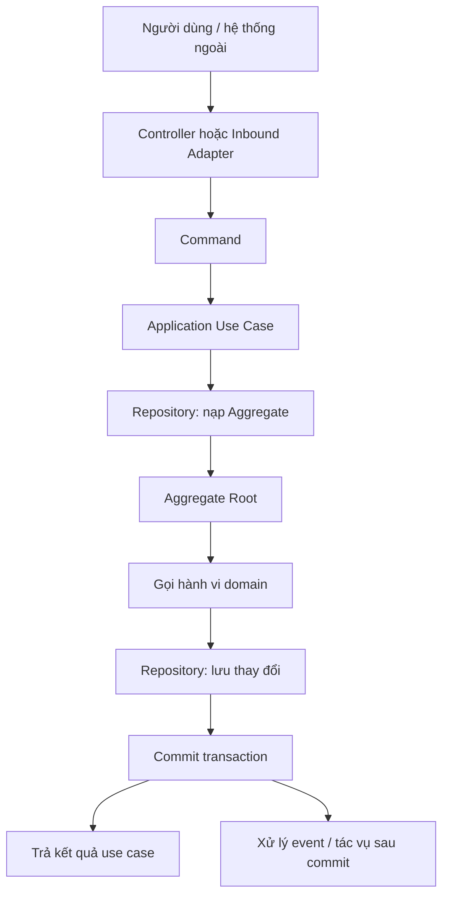
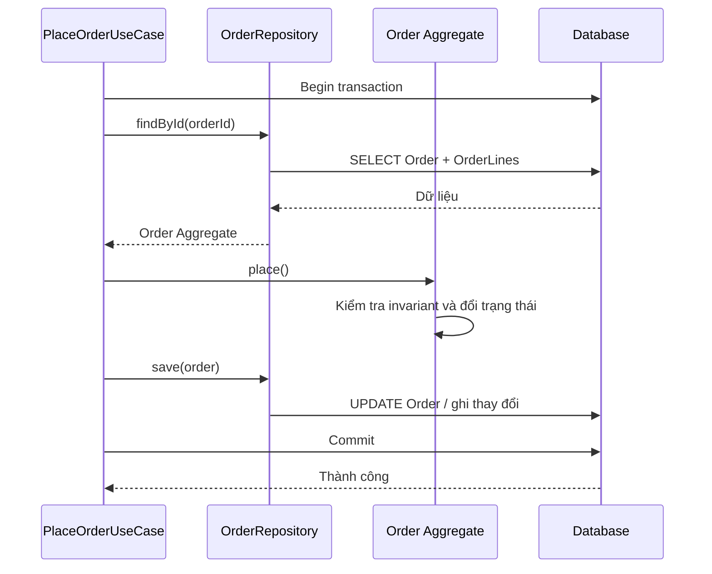

# Luồng nạp Aggregate, gọi hành vi và lưu thay đổi

Trong Domain-Driven Design (DDD), một use case thường cần tìm một Aggregate hiện có, yêu cầu Aggregate thực hiện hành vi nghiệp vụ, rồi lưu trạng thái mới. Luồng này là cách phổ biến để Application Layer phối hợp với Domain Model và Repository:

1. Nhận yêu cầu và xác định Aggregate cần xử lý.
2. Nạp Aggregate Root qua Repository.
3. Gọi hành vi trên Aggregate để nó tự kiểm tra invariant và thay đổi trạng thái.
4. Lưu thay đổi trong ranh giới transaction.
5. Hoàn tất transaction và xử lý những công việc tiếp theo theo cơ chế phù hợp.

Mỗi bước có trách nhiệm riêng. Application Service điều phối use case; Repository cung cấp Aggregate; Aggregate bảo vệ quy tắc nghiệp vụ; Infrastructure thực hiện việc lưu trữ và quản lý transaction. Nếu Application Service tự sửa field của Aggregate, Repository chứa quy tắc nghiệp vụ hoặc Domain Model tự gọi database, ranh giới trách nhiệm sẽ bị mờ.

Bài viết dùng luồng đặt đơn hàng làm ví dụ để giải thích cách tổ chức một use case hoàn chỉnh, cách xử lý lỗi và transaction, cũng như những trường hợp cần chú ý khi có nhiều Aggregate hoặc nhiều yêu cầu đồng thời.

## 1. Use case là điểm điều phối một mục tiêu nghiệp vụ

Use case mô tả một mục tiêu mà người dùng hoặc hệ thống bên ngoài muốn hoàn thành, chẳng hạn:

- Đặt một đơn hàng.
- Hủy một đơn hàng.
- Xác nhận một khoản thanh toán.
- Đổi địa chỉ giao hàng.
- Phê duyệt một yêu cầu tín dụng.

Một use case không đơn giản là một phương thức CRUD. Nó diễn đạt một hành động có ý nghĩa với doanh nghiệp, có đầu vào, quy tắc, kết quả và các tình huống thất bại.

Ví dụ, “đặt đơn hàng” có thể yêu cầu đơn đang ở trạng thái Draft, phải có ít nhất một dòng hàng và mỗi dòng phải có số lượng hợp lệ. Use case sẽ tìm đúng đơn, yêu cầu Aggregate đặt đơn và lưu kết quả. Quy tắc “đơn có thể được đặt hay không” thuộc mô hình domain; trình tự tìm đơn và lưu nó thuộc Application Layer.

### 1.1. Phân biệt Command, Use Case và Domain Behavior

Ba khái niệm thường xuất hiện cùng nhau nhưng không đồng nghĩa:

| Khái niệm | Ý nghĩa | Ví dụ |
|---|---|---|
| Command | Dữ liệu diễn đạt ý định thực hiện một hành động | `PlaceOrderCommand` |
| Use Case / Application Service | Điều phối các bước để hoàn thành ý định | `PlaceOrderUseCase` |
| Domain Behavior | Hành vi nghiệp vụ và invariant trên mô hình | `order.place()` |

Command thường mang dữ liệu cần thiết để xác định đối tượng và tham số của hành động. Nó không nên chứa logic thay đổi trạng thái domain.

Use Case điều phối các thành phần: tải Aggregate, gọi hành vi, lưu thay đổi và phối hợp các port cần thiết.

Domain Behavior nằm trong Entity, Value Object, Aggregate Root hoặc Domain Service phù hợp. Đây là nơi quyết định một thay đổi có hợp lệ theo quy tắc nghiệp vụ hay không.

### 1.2. Luồng tổng quát



Sơ đồ mô tả luồng khái niệm. Cách thực thi cụ thể có thể dùng transaction interceptor, Unit of Work, ORM persistence context hoặc một cơ chế lưu trữ khác. Điều quan trọng là toàn bộ thay đổi cần được commit theo ranh giới nhất quán đã xác định.

## 2. Bước 1: Nhận yêu cầu và tạo Command

Inbound Adapter, ví dụ REST Controller, nhận dữ liệu từ giao thức bên ngoài và chuyển nó thành input model hoặc Command cho Application Layer.

Ví dụ, người dùng yêu cầu đặt đơn có sẵn:

```java
public record PlaceOrderCommand(OrderId orderId) {
    public PlaceOrderCommand {
        Objects.requireNonNull(orderId);
    }
}
```

Command chứa định danh của đơn cần xử lý. Nếu use case cần thêm dữ liệu, chẳng hạn mã xác nhận hoặc lựa chọn giao hàng, có thể bổ sung các Value Object hoặc kiểu dữ liệu phù hợp.

Không nên đưa toàn bộ HTTP request, servlet object hoặc ORM entity vào Command. Command thuộc ranh giới ứng dụng và cần độc lập với giao thức.

### 2.1. Kiểm tra đầu vào ở đâu?

Có nhiều mức kiểm tra khác nhau:

- **Kiểm tra cấu trúc:** trường bắt buộc, định dạng ID, giá trị số dương. Có thể thực hiện ở adapter hoặc khi tạo Command/Value Object.
- **Kiểm tra quyền truy cập:** người gọi có được phép thực hiện use case trên đơn này không. Thường được xử lý ở ranh giới application/security.
- **Kiểm tra invariant domain:** đơn có đang ở trạng thái cho phép đặt không, có dòng hàng hay không. Phải được Aggregate bảo vệ.
- **Kiểm tra điều kiện phối hợp:** có cần tải thêm dữ liệu hoặc gọi port khác để hoàn tất use case không. Application điều phối, còn quyết định nghiệp vụ tương ứng cần nằm trong domain model hoặc policy phù hợp.

Không nên chuyển mọi kiểm tra về Controller. Cùng một use case có thể được gọi từ REST, message consumer, batch job hoặc CLI; quy tắc nghiệp vụ phải được áp dụng bất kể nguồn gọi.

## 3. Bước 2: Nạp Aggregate Root qua Repository

Sau khi nhận Command, Application Service dùng Repository để nạp Aggregate cần xử lý.

```java
public interface OrderRepository {
    Optional<Order> findById(OrderId id);

    void save(Order order);
}
```

Repository trừu tượng hóa cách tìm và lưu Aggregate. Application chỉ cần biết hợp đồng này, không cần biết dữ liệu nằm trong PostgreSQL, MongoDB hay một implementation trong bộ nhớ.

### 3.1. Vì sao nạp qua Aggregate Root?

Aggregate Root là điểm truy cập từ bên ngoài vào Aggregate. Khi use case muốn thay đổi một Order, nó nạp Order Root rồi gọi hành vi trên Root. Nếu Order chứa OrderLine, application không nên tải một OrderLine riêng rồi sửa trực tiếp để bỏ qua invariant của Order.

Ví dụ:

```java
Order order = orders.findById(command.orderId())
    .orElseThrow(() -> new OrderNotFoundException(command.orderId()));
```

Nếu không tìm thấy Aggregate, use case dừng và trả kết quả lỗi phù hợp. Không nên tạo một Order rỗng chỉ để tiếp tục một hành động yêu cầu xử lý đơn đã tồn tại.

### 3.2. Nạp đủ dữ liệu để bảo vệ invariant

Repository cần tái tạo Aggregate ở trạng thái hợp lệ và cung cấp các thành phần mà hành vi cần để kiểm tra invariant.

Nếu `order.place()` cần biết các dòng hàng, Aggregate phải có các dòng hàng cần thiết. Tuy nhiên, không có nghĩa repository phải nạp toàn bộ dữ liệu liên quan của mọi Aggregate khác.

Ví dụ, Order có thể giữ `CustomerId` và `ProductId` thay vì nạp toàn bộ Customer và Product. Nếu use case cần xác minh một điều kiện từ Inventory, Application có thể gọi một port phù hợp hoặc điều phối quy trình riêng.

Chỉ nạp dữ liệu cần cho Aggregate và use case. Một object graph khổng lồ làm tăng chi phí truy vấn và dễ vượt qua ranh giới Aggregate.

### 3.3. Repository không phải nơi quyết định hành vi

Repository chịu trách nhiệm tìm và lưu Aggregate. Nó không nên quyết định đơn có được đặt hay không, đơn có thể hủy không hoặc mức giảm giá nào được áp dụng.

Tránh những API như:

```java
public interface OrderRepository {
    void placeOrder(OrderId id);
    void cancelOrder(OrderId id);
    void applyDiscount(OrderId id, Money discount);
}
```

Những phương thức này khiến Repository trở thành nơi chứa quy tắc hoặc thủ tục nghiệp vụ. Thay vào đó, tải Aggregate rồi gọi hành vi tương ứng:

```java
Order order = orders.findById(id).orElseThrow(...);
order.place();
orders.save(order);
```

### 3.4. Không phải use case nào cũng cần nạp Aggregate

Một truy vấn chỉ hiển thị danh sách đơn có thể dùng Query Service hoặc Read Model. Không cần nạp từng Aggregate đầy đủ nếu mục tiêu chỉ là đọc dữ liệu trình bày.

Bài này tập trung vào use case làm thay đổi trạng thái nghiệp vụ. Với truy vấn đọc, mô hình đọc riêng thường phù hợp và hiệu quả hơn.

## 4. Bước 3: Gọi hành vi trên Aggregate

Sau khi nạp Aggregate, Application Service gọi một phương thức có ý nghĩa nghiệp vụ. Aggregate Root chịu trách nhiệm kiểm tra điều kiện và bảo vệ invariant trước khi thay đổi trạng thái.

Ví dụ, Order có thể chỉ được đặt khi đang Draft và có ít nhất một dòng hàng:

```java
public enum OrderStatus {
    DRAFT,
    PLACED,
    CANCELLED
}

public class Order {
    private final OrderId id;
    private final List<OrderLine> lines;
    private OrderStatus status;

    public Order(OrderId id, List<OrderLine> lines) {
        this.id = Objects.requireNonNull(id);
        this.lines = new ArrayList<>(lines);
        this.status = OrderStatus.DRAFT;
    }

    public void place() {
        if (status != OrderStatus.DRAFT) {
            throw new InvalidOrderTransitionException(
                "Only a draft order can be placed"
            );
        }

        if (lines.isEmpty()) {
            throw new EmptyOrderException();
        }

        status = OrderStatus.PLACED;
    }

    public OrderId id() {
        return id;
    }

    public OrderStatus status() {
        return status;
    }

    public List<OrderLine> lines() {
        return List.copyOf(lines);
    }
}
```

Ví dụ được giản lược để tập trung vào luồng use case. Trong domain thực tế, Aggregate có thể cần kiểm tra hạn mức, chính sách giá, trạng thái tồn kho hoặc điều kiện thanh toán. Cần xác định quy tắc nào là invariant nội bộ của Order và quy tắc nào thuộc một Aggregate hoặc Domain Service khác.

### 4.1. Vì sao gọi hành vi thay vì gán field?

Không nên viết trong Application Service:

```java
order.setStatus(OrderStatus.PLACED);
```

Cách này bỏ qua quy tắc chuyển trạng thái. Một nơi gọi khác có thể gán PLACED dù đơn chưa có dòng hàng hoặc đang bị hủy.

Phương thức `order.place()` thể hiện ý định nghiệp vụ và tập trung điều kiện hợp lệ tại một nơi. Khi domain thay đổi chính sách, đội phát triển sửa hành vi của Aggregate thay vì tìm mọi nơi đang gán field.

### 4.2. Aggregate bảo vệ invariant của chính nó

Invariant là điều kiện phải luôn đúng tại ranh giới nhất quán của Aggregate. Ví dụ:

- Order không thể được đặt khi không có dòng hàng.
- Số lượng của OrderLine phải lớn hơn không.
- Đơn đã hủy không thể được đặt lại nếu chính sách không cho phép.
- Tổng tiền phải được tính từ các thành phần hợp lệ theo quy tắc đã thống nhất.

Application có thể kiểm tra dữ liệu đầu vào hoặc điều phối các điều kiện bên ngoài, nhưng không nên là nơi duy nhất bảo vệ invariant. Nếu nhiều use case có thể thay đổi Order, tất cả đều phải đi qua hành vi của Order Root.

### 4.3. Khi quy tắc liên quan đến nhiều đối tượng

Nếu hành vi không thuộc tự nhiên về một Entity hoặc Value Object, Domain Service có thể biểu diễn quyết định đó. Ví dụ, Pricing Service tính giá theo sản phẩm, số lượng và hạng khách hàng.

Application Service có thể nạp dữ liệu cần thiết, gọi Pricing Service, rồi truyền kết quả vào hành vi của Aggregate. Domain Service không nên thay Application điều phối repository và transaction.

Nếu quy tắc cần phối hợp nhiều Aggregate, hãy xem xét ranh giới nhất quán. Không nên tải nhiều Aggregate rồi sửa trực tiếp field của chúng trong một service duy nhất chỉ để hoàn thành một phương thức.

## 5. Bước 4: Lưu thay đổi qua Repository

Sau khi hành vi domain hoàn tất, Application Service yêu cầu Repository lưu Aggregate:

```java
order.place();
orders.save(order);
```

Lời gọi `save` thể hiện ý định lưu trạng thái mới qua repository contract. Cách implementation thực hiện điều đó phụ thuộc persistence technology.

### 5.1. Với JDBC hoặc persistence adapter tự quản lý

Adapter có thể chuyển Aggregate thành persistence model, thực hiện câu lệnh INSERT/UPDATE và ánh xạ kết quả. Repository chịu trách nhiệm lưu trạng thái phù hợp với contract.

Ví dụ khái niệm:

```java
public final class JdbcOrderRepository implements OrderRepository {
    private final JdbcTemplate jdbc;
    private final OrderMapper mapper;

    public JdbcOrderRepository(
            JdbcTemplate jdbc,
            OrderMapper mapper) {
        this.jdbc = jdbc;
        this.mapper = mapper;
    }

    @Override
    public Optional<Order> findById(OrderId id) {
        return jdbc.query(
            "select id, status from orders where id = ?",
            mapper.rowMapper(),
            id.value()
        ).stream().findFirst()
         .map(row -> loadAggregate(row));
    }

    @Override
    public void save(Order order) {
        // INSERT hoặc UPDATE Aggregate theo contract.
        // Việc thực thi nằm trong transaction hiện hành.
    }
}
```

Đây chỉ là khung minh họa; adapter thật cần xử lý đầy đủ dòng hàng, mapping, lỗi, optimistic locking và SQL phù hợp với schema. Application không cần biết các chi tiết đó.

### 5.2. Với JPA và persistence context

Khi repository nạp một Aggregate dưới một transaction JPA, các đối tượng có thể trở thành managed entity trong persistence context. Khi hành vi domain thay đổi trạng thái của chúng, ORM có thể phát hiện thay đổi bằng dirty checking và ghi SQL khi flush hoặc commit.

Vì vậy, trong một implementation JPA cụ thể, gọi `save(order)` sau khi đã nạp managed Aggregate có thể không cần thiết về mặt kỹ thuật. Tuy nhiên:

- Repository contract có thể vẫn định nghĩa `save` để thể hiện rõ yêu cầu lưu và giữ cách dùng nhất quán giữa các adapter.
- Với Aggregate detached hoặc đối tượng mới, adapter có thể cần `persist`, `merge` hoặc cơ chế khác.
- `save()` thường không đồng nghĩa SQL đã được commit ngay lập tức.
- Lỗi constraint có thể chỉ xuất hiện khi flush hoặc commit.

Đừng để application phụ thuộc vào hành vi riêng của một ORM. Hãy xác định semantics repository và transaction rõ ràng trong kiến trúc.

### 5.3. Lưu Aggregate như một đơn vị nghiệp vụ

Nếu Order chứa OrderLine trong cùng Aggregate, việc lưu Order phải bảo toàn trạng thái nhất quán của cả Aggregate. Adapter có thể ghi nhiều bảng, nhưng application thao tác qua Root.

Không nên tạo một `OrderLineRepository` riêng chỉ vì OrderLine có bảng riêng. Cấu trúc bảng không quyết định ranh giới Aggregate.

### 5.4. Không phát sự kiện ra ngoài trước khi commit

Nếu hành vi domain tạo ra `OrderPlaced`, sự kiện chỉ nên được công bố sau khi thay đổi tương ứng đã được lưu thành công. Nếu gửi message trước commit rồi transaction thất bại, hệ thống khác có thể nhận một sự kiện mô tả trạng thái chưa tồn tại.

Một cách phổ biến là lưu Domain Event hoặc Integration Event vào Outbox trong cùng transaction với Aggregate, sau đó một tiến trình riêng phát message sau commit. Với ứng dụng nhỏ, có thể dùng transaction synchronization phù hợp. Cần chọn cơ chế bảo đảm không phát thông báo thành công trước khi dữ liệu nghiệp vụ được commit.

## 6. Bước 5: Xác định ranh giới transaction

Một use case thay đổi Aggregate thường cần transaction bao quanh việc nạp, thay đổi và lưu Aggregate. Mục tiêu là đảm bảo thao tác được commit nguyên tử theo ranh giới persistence đã chọn.

Luồng khái niệm:



Sơ đồ dùng database để minh họa; một repository khác có thể dùng transaction manager hoặc cơ chế lưu trữ tương ứng.

### 6.1. Transaction bao quanh use case

Một cách triển khai thường gặp với Spring là đặt ranh giới transaction ở Application Service:

```java
@Service
public class PlaceOrderUseCase {
    private final OrderRepository orders;

    public PlaceOrderUseCase(OrderRepository orders) {
        this.orders = orders;
    }

    @Transactional
    public void handle(PlaceOrderCommand command) {
        Order order = orders.findById(command.orderId())
            .orElseThrow(() ->
                new OrderNotFoundException(command.orderId())
            );

        order.place();
        orders.save(order);
    }
}
```

Annotation là chi tiết của framework. Có thể dùng transaction decorator, interceptor hoặc Unit of Work nếu muốn Application Layer không phụ thuộc trực tiếp Spring. Dù chọn cách nào, ranh giới transaction vẫn cần bao trùm thao tác nghiệp vụ phù hợp.

### 6.2. Đừng giữ transaction mở khi chờ hệ thống bên ngoài

Gọi Payment Gateway, gửi email hoặc chờ đơn vị vận chuyển có thể mất nhiều thời gian và thất bại độc lập. Không nên mặc định giữ transaction database mở trong toàn bộ thời gian chờ HTTP hoặc message.

Nếu use case cần phối hợp nhiều hệ thống, hãy thiết kế workflow bất đồng bộ, trạng thái trung gian, Outbox, Process Manager hoặc Saga theo nhu cầu. Mỗi transaction ngắn bảo vệ một thay đổi nhất quán; quy trình dài được quản lý bằng trạng thái và sự kiện.

### 6.3. Flush không giống commit

Trong ORM, `flush` đồng bộ thay đổi từ persistence context xuống database nhưng transaction vẫn có thể chưa commit. Commit mới hoàn tất transaction theo semantics của database.

Điều này có nghĩa:

- `save()` có thể chỉ đăng ký hoặc chuẩn bị thay đổi.
- `flush()` có thể khiến SQL được thực thi và phát hiện một số lỗi.
- `commit()` xác nhận transaction thành công.
- Sau commit, dữ liệu mới được các transaction khác nhìn thấy theo isolation level tương ứng.

Không nên trả thông báo “đã đặt đơn thành công” hoặc phát Integration Event trước khi biết transaction đã commit.

## 7. Xử lý lỗi trong luồng use case

Một luồng nạp, gọi hành vi và lưu có thể thất bại ở nhiều điểm. Phân loại lỗi giúp application phản hồi chính xác và tránh biến mọi lỗi thành một thông báo chung.

| Thời điểm | Ví dụ lỗi | Cách xử lý thường phù hợp |
|---|---|---|
| Nhận Command | ID hoặc tham số sai định dạng | Từ chối đầu vào ở ranh giới |
| Nạp Aggregate | Không tìm thấy Order | Trả lỗi nghiệp vụ phù hợp, thường là not found |
| Gọi hành vi | Đơn không ở trạng thái cho phép | Domain từ chối chuyển trạng thái |
| Lưu thay đổi | Unique constraint hoặc dữ liệu không hợp lệ | Adapter chuyển lỗi persistence theo contract |
| Commit | Deadlock, timeout hoặc lỗi kết nối | Rollback và áp dụng retry nếu an toàn |
| Sau commit | Gửi message hoặc thông báo thất bại | Retry qua Outbox hoặc cơ chế giao nhận bền vững |

### 7.1. Không tìm thấy Aggregate

Nếu `findById` trả về rỗng, use case không thể tiếp tục hành vi trên Aggregate. Application có thể ném `OrderNotFoundException` hoặc trả một kết quả lỗi có kiểu.

Không nên để `NullPointerException` trở thành cách biểu diễn tình huống không tìm thấy dữ liệu.

### 7.2. Domain từ chối hành vi

Nếu Order đang ở trạng thái Cancelled, gọi `place()` có thể ném lỗi domain hoặc trả kết quả từ chối. Application chuyển lỗi đó thành phản hồi phù hợp với giao thức, nhưng không nên tự thay đổi trạng thái để “sửa” lỗi.

### 7.3. Lỗi persistence và rollback

Nếu ghi dữ liệu thất bại, transaction cần rollback để không để lại một phần thay đổi. Với nhiều bảng trong cùng database transaction, cơ chế transaction bảo vệ tính nguyên tử của các thay đổi đó.

Nếu use case đã gọi hệ thống bên ngoài trước khi database rollback, tác dụng phụ bên ngoài không tự động được hoàn tác. Đây là lý do nên tách tác dụng phụ khỏi transaction hoặc dùng workflow bù trừ.

### 7.4. Retry chỉ khi hành động an toàn

Deadlock hoặc lỗi tạm thời có thể được retry. Nhưng không nên retry mù quáng mọi exception.

Cần xem xét:

- Lỗi có thực sự tạm thời không?
- Transaction trước đã rollback chắc chắn chưa?
- Use case có thể chạy lại mà không tạo tác dụng phụ trùng lặp không?
- Có idempotency key hoặc business key để nhận diện yêu cầu lặp không?
- Có thể xảy ra optimistic locking conflict do một người khác đã cập nhật Aggregate không?

Một lần retry phải bắt đầu với transaction mới và tải lại Aggregate mới nhất. Không nên giữ object cũ rồi lặp lại thao tác trên trạng thái đã lỗi thời.

## 8. Xử lý nhiều Aggregate trong một use case

Một use case đôi khi cần làm việc với nhiều Aggregate. Ví dụ, đặt đơn có thể cần Order, Inventory và Payment. Tuy nhiên, không nên gom chúng vào một Aggregate chỉ vì cùng tham gia một quy trình.

### 8.1. Phân biệt invariant nội bộ và quy trình phối hợp

Nếu một quy tắc phải được bảo vệ tức thời trong một Aggregate, hãy đặt nó trong Aggregate đó.

Ví dụ:

- Order bảo vệ việc đơn có thể được đặt.
- Inventory bảo vệ số lượng có thể giữ.
- Payment bảo vệ trạng thái của giao dịch thanh toán.

Application Service điều phối các thao tác theo trình tự. Nếu Inventory giữ hàng thành công nhưng Payment thất bại, workflow cần giải phóng reservation hoặc chuyển sang trạng thái chờ xử lý theo chính sách.

### 8.2. Không cập nhật trực tiếp nhiều Aggregate bằng field

Tránh mô hình như:

```java
order.setStatus(PLACED);
inventory.setAvailableQuantity(inventory.getAvailableQuantity() - quantity);
payment.setStatus(AUTHORIZED);
```

Cách này phá vỡ quyền bảo vệ invariant của từng Aggregate. Thay vào đó, mỗi Aggregate nhận một hành vi phù hợp qua Root:

```java
order.place();
inventory.reserve(reservationRequest);
payment.recordAuthorization(authorizationResult);
```

Các hành vi trên vẫn phải được gọi theo đúng quy trình và ranh giới transaction. Nếu các Aggregate thuộc những Bounded Context hoặc database khác nhau, phối hợp thường cần message/event và eventual consistency.

### 8.3. Dùng Process Manager hoặc Saga cho quy trình dài

Một quy trình đặt hàng có thể gồm:

1. Đơn được tạo.
2. Hàng được giữ.
3. Thanh toán được ủy quyền.
4. Đơn được xác nhận.
5. Shipment được tạo.

Nếu một bước thất bại, quy trình có thể cần hành động bù trừ. Process Manager hoặc Saga theo dõi trạng thái quy trình và phát lệnh tiếp theo. Đây là trách nhiệm điều phối dài hạn, không phải invariant của một Aggregate đơn lẻ.

Không phải mọi use case đều cần Saga. Với thao tác ngắn trong một database và một Aggregate, transaction thông thường thường đủ.

## 9. Optimistic Locking và yêu cầu đồng thời

Khi hai người cùng thao tác một Aggregate, cả hai có thể nạp cùng một phiên bản dữ liệu. Nếu không có cơ chế bảo vệ, lần ghi sau có thể ghi đè thay đổi của lần ghi trước.

Ví dụ:

- Nhân viên A nạp Order phiên bản 4.
- Nhân viên B cũng nạp Order phiên bản 4.
- A đặt đơn và lưu phiên bản 5.
- B hủy đơn dựa trên phiên bản 4 rồi cố lưu.

Optimistic locking có thể phát hiện phiên bản đã thay đổi và từ chối lần ghi cũ.

### 9.1. Version trên Aggregate

Một persistence model có thể có cột version:

```java
@Entity
public class OrderJpaEntity {
    @Id
    private UUID id;

    @Version
    private long version;

    private String status;
}
```

Khi cập nhật, ORM dùng version để xác định dữ liệu có bị thay đổi từ sau lần đọc hay không. Nếu version không còn khớp, thao tác có thể thất bại với optimistic locking exception.

`@Version` là chi tiết persistence. Domain không nhất thiết phải phụ thuộc annotation này; adapter ánh xạ và xử lý lỗi phù hợp.

### 9.2. Khi có conflict, tải lại và đánh giá lại

Không nên chỉ tăng version rồi ghi đè. Khi có conflict:

1. Rollback transaction hiện tại.
2. Bắt đầu transaction mới.
3. Nạp Aggregate mới nhất.
4. Kiểm tra lại hành vi có còn hợp lệ không.
5. Chỉ thực hiện lại nếu quy tắc nghiệp vụ vẫn cho phép.

Ví dụ, nếu một người đã hủy đơn, người khác không thể tự động đặt đơn lại chỉ vì retry. Domain phải đánh giá trạng thái mới.

## 10. Idempotency và xử lý yêu cầu lặp

Trong hệ thống có HTTP retry hoặc message delivery ít nhất một lần, cùng một Command có thể đến nhiều lần. Nếu không có cơ chế nhận diện, use case có thể thực hiện hành động hai lần.

Idempotency có nghĩa việc xử lý lại cùng một yêu cầu được nhận diện và không tạo tác động nghiệp vụ trùng lặp ngoài ý muốn.

Có thể dùng:

- Request ID hoặc idempotency key.
- Business key có unique constraint.
- Trạng thái Aggregate để từ chối chuyển trạng thái lặp.
- Bảng lưu kết quả xử lý command.
- Inbox/Outbox khi giao tiếp qua message.

Ví dụ, gọi `order.place()` lần thứ hai có thể bị từ chối vì Order đã ở trạng thái Placed. Điều đó bảo vệ invariant, nhưng chưa đủ cho mọi tình huống HTTP retry: client có thể cần nhận lại kết quả thành công ban đầu thay vì lỗi chuyển trạng thái. Khi đó, application có thể lưu idempotency key và kết quả tương ứng.

Idempotency cần được thiết kế theo ý nghĩa của từng use case, không chỉ dựa vào việc phương thức domain có thể gọi nhiều lần hay không.

## 11. Ví dụ đầy đủ: PlaceOrderUseCase

Các phần trước có thể kết hợp thành một use case đơn giản:

```java
public record PlaceOrderCommand(OrderId orderId) {
    public PlaceOrderCommand {
        Objects.requireNonNull(orderId);
    }
}

public interface OrderRepository {
    Optional<Order> findById(OrderId id);
    void save(Order order);
}

public final class PlaceOrderUseCase {
    private final OrderRepository orders;

    public PlaceOrderUseCase(OrderRepository orders) {
        this.orders = Objects.requireNonNull(orders);
    }

    // Ranh giới transaction được cấu hình ở application boundary.
    public PlaceOrderResult handle(PlaceOrderCommand command) {
        Order order = orders.findById(command.orderId())
            .orElseThrow(() ->
                new OrderNotFoundException(command.orderId())
            );

        order.place();

        orders.save(order);

        return new PlaceOrderResult(
            order.id(),
            order.status()
        );
    }
}

public record PlaceOrderResult(
    OrderId orderId,
    OrderStatus status
) {}
```

Đoạn mã cho thấy trình tự chính:

- Use case nhận Command.
- Repository nạp Aggregate.
- Aggregate thực hiện hành vi và bảo vệ invariant.
- Repository lưu thay đổi.
- Use case trả kết quả có ý nghĩa.

Trong production, transaction boundary cần bao quanh phương thức `handle` hoặc được áp dụng bằng một decorator tương đương. Nếu `save` chỉ đánh dấu thay đổi trong ORM, commit sẽ thực hiện việc ghi cuối cùng. Nếu adapter dùng JDBC, repository có thể thực hiện SQL trong transaction đang mở.

### 11.1. Điều gì không nên xuất hiện trong use case này?

Không nên để use case:

- Tự gán `order.status`.
- Sửa trực tiếp collection `order.lines`.
- Tự tính lại invariant đã thuộc Order.
- Gọi SQL trực tiếp.
- Tạo object JPA để thay cho Aggregate.
- Phát Integration Event trước khi commit.
- Nạp toàn bộ Customer, Product, Shipment và Payment nếu không cần cho hành vi.
- Bắt mọi exception rồi trả về một kết quả thành công giả.

Use case cần rõ ràng và có thể đọc như một trình tự nghiệp vụ.

## 12. Kiểm thử luồng nạp, gọi hành vi và lưu

Nên kiểm thử riêng domain behavior và application orchestration.

### 12.1. Unit test cho Aggregate

Kiểm tra Order tự bảo vệ invariant:

```java
@Test
void cannotPlaceAnEmptyOrder() {
    Order order = Order.draft(
        new OrderId(UUID.randomUUID()),
        List.of()
    );

    assertThrows(
        EmptyOrderException.class,
        order::place
    );
}
```

Test này không cần repository, database hoặc framework. Nó xác minh quy tắc thuộc Aggregate.

### 12.2. Application test với InMemory Repository

Dùng fake để kiểm tra use case tải và lưu Aggregate:

```java
@Test
void placesExistingOrder() {
    InMemoryOrderRepository repository =
        new InMemoryOrderRepository();

    Order order = TestOrders.draftWithOneLine();
    repository.save(order);

    PlaceOrderUseCase useCase =
        new PlaceOrderUseCase(repository);

    useCase.handle(new PlaceOrderCommand(order.id()));

    Order saved = repository.findById(order.id()).orElseThrow();

    assertEquals(OrderStatus.PLACED, saved.status());
}
```

Fake cần có semantics phù hợp. Nếu nó giữ cùng mutable reference, test có thể vẫn pass khi use case quên gọi `save`. Có thể dùng copy/snapshot hoặc xác minh tương tác lưu nếu hành vi gọi save là điều cần kiểm tra.

### 12.3. Integration test cho Repository thật

Integration test cần xác minh:

- Aggregate được nạp đầy đủ và đúng mapping.
- Thay đổi trạng thái được ghi xuống database.
- Quan hệ với các thành phần của Aggregate được lưu đúng.
- Transaction rollback khi xảy ra lỗi.
- Optimistic locking hoạt động khi có cập nhật đồng thời.
- Constraint và migration phù hợp với schema.

Fake không thể thay thế những kiểm tra này.

### 12.4. Kiểm thử transaction của use case

Có thể tạo một tình huống lỗi sau khi Aggregate thay đổi nhưng trước khi transaction commit, rồi xác minh dữ liệu trong database vẫn ở trạng thái cũ sau rollback. Test cần chạy qua transaction manager và persistence adapter thực tế.

Không nên chỉ kiểm tra rằng một exception được ném ra; cần xác minh trạng thái đã lưu sau khi transaction kết thúc.

## 13. Những sai lầm thường gặp

**Để Controller gọi Repository trực tiếp.** Controller trở thành nơi điều phối use case và có thể bỏ qua hành vi domain. Hãy chuyển trình tự vào Application Service.

**Để Repository thực hiện hành vi nghiệp vụ.** Phương thức `placeOrder(id)` che giấu việc tải Aggregate và gọi hành vi. Repository nên tập trung vào lưu/nạp.

**Application Service sửa field của Aggregate.** Cách này làm invariant bị phân tán. Hãy gọi phương thức domain có ý nghĩa.

**Tải toàn bộ object graph.** Nạp nhiều Aggregate không liên quan làm tăng truy vấn và vượt ranh giới nhất quán. Chỉ nạp dữ liệu cần thiết.

**Gọi `save()` rồi cho rằng dữ liệu đã commit.** ORM có thể trì hoãn SQL đến flush/commit. Cần hiểu transaction boundary và xử lý lỗi tại đúng thời điểm.

**Phát event trước commit.** Hệ thống khác có thể nhận thông báo cho một thay đổi đã rollback. Dùng Outbox hoặc cơ chế sau commit.

**Giữ transaction mở khi gọi dịch vụ ngoài.** Thời gian chờ dài làm giữ khóa và tài nguyên. Tách workflow hoặc dùng cơ chế bất đồng bộ.

**Gom nhiều Aggregate vào một transaction lớn mà không có lý do.** Transaction kỹ thuật không thay thế ranh giới invariant. Với quy trình dài, dùng trạng thái trung gian và eventual consistency khi phù hợp.

**Retry trên Aggregate cũ sau optimistic lock conflict.** Trạng thái cũ không còn đáng tin. Tải lại Aggregate và đánh giá lại hành vi trong transaction mới.

**Không xử lý Command lặp.** HTTP retry hoặc message redelivery có thể tạo tác động trùng. Xác định idempotency theo use case.

**Chỉ kiểm thử bằng fake.** Test application có thể pass trong khi SQL, mapping, constraint hoặc transaction thật bị lỗi. Cần integration test cho adapter.

## 14. Checklist thiết kế một use case thay đổi Aggregate

Trước khi hoàn thành use case, hãy rà soát:

**Đầu vào và điều phối**

- Command có biểu diễn đúng ý định nghiệp vụ không?
- Use case có một mục tiêu rõ ràng không?
- Controller chỉ chuyển đổi giao thức và gọi use case không?
- Kiểm tra cấu trúc, quyền truy cập và invariant đã được đặt đúng lớp chưa?

**Nạp Aggregate**

- Đã nạp đúng Aggregate Root chưa?
- Repository có trả về Aggregate ở trạng thái hợp lệ không?
- Có nạp đủ thành phần cần để bảo vệ invariant không?
- Có đang nạp thêm Aggregate khác mà use case không cần không?
- Trường hợp không tìm thấy đã được xử lý rõ chưa?

**Hành vi domain**

- Use case gọi phương thức có ý nghĩa nghiệp vụ chưa?
- Aggregate tự kiểm tra invariant và kiểm soát trạng thái chưa?
- Có sửa trực tiếp field hoặc collection nội bộ không?
- Quy tắc liên quan nhiều đối tượng có cần Domain Service hoặc Policy không?

**Lưu và transaction**

- Repository contract có semantics rõ chưa?
- Thay đổi được lưu trong transaction phù hợp chưa?
- Có hiểu khác biệt giữa save, flush và commit không?
- Rollback có bảo vệ thay đổi khi thao tác thất bại không?
- Có optimistic locking hoặc cơ chế concurrency phù hợp không?

**Sự kiện và tác dụng phụ**

- Domain Event có được ghi nhận đúng nơi không?
- Integration Event có được phát sau commit hoặc qua Outbox không?
- Có giữ transaction mở trong lúc chờ API ngoài không?
- Retry và idempotency đã được xem xét chưa?

**Kiểm thử**

- Invariant được unit test trực tiếp trên Aggregate chưa?
- Luồng Application có test với fake phù hợp chưa?
- Repository thật có integration test không?
- Transaction rollback, mapping, constraint và concurrency đã được kiểm chứng ở nơi cần thiết chưa?

## 15. Kết luận

Luồng nạp Aggregate, gọi hành vi và lưu thay đổi là cấu trúc cốt lõi của một use case thay đổi trạng thái trong DDD. Application Service nhận Command và điều phối; Repository nạp Aggregate Root; Aggregate tự bảo vệ invariant và thực hiện hành vi; Repository lưu thay đổi trong transaction phù hợp.

Ranh giới transaction cần bao quanh phần thay đổi phải được commit cùng nhau. ORM có thể dùng dirty checking, nhưng `save`, `flush` và `commit` vẫn là những khái niệm khác nhau. Sự kiện và tác dụng phụ cần được xử lý sau khi thay đổi đã commit hoặc qua Outbox. Khi use case phối hợp nhiều Aggregate, mỗi Aggregate vẫn phải giữ quyền bảo vệ quy tắc của mình; Application hoặc Process Manager quản lý quy trình tổng thể.

Một use case tốt có thể được đọc như một trình tự nghiệp vụ ngắn, trong đó mỗi bước gọi đúng thành phần chịu trách nhiệm. Điều này giúp mô hình domain giữ được quy tắc, application giữ được luồng điều phối và infrastructure giữ được chi tiết lưu trữ.

